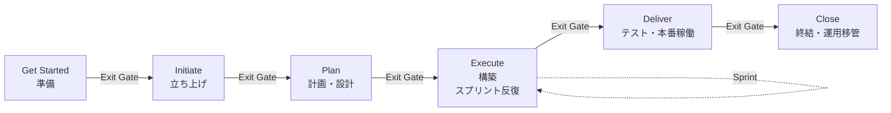
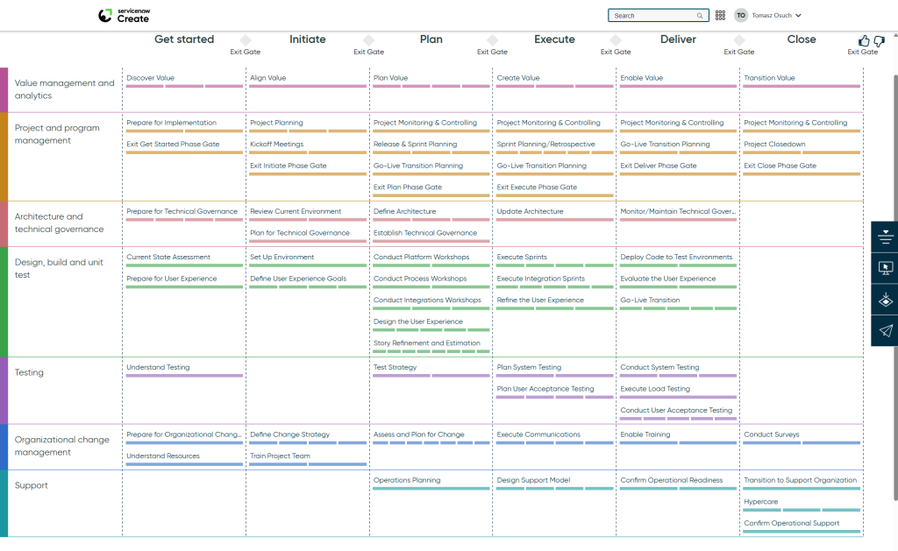
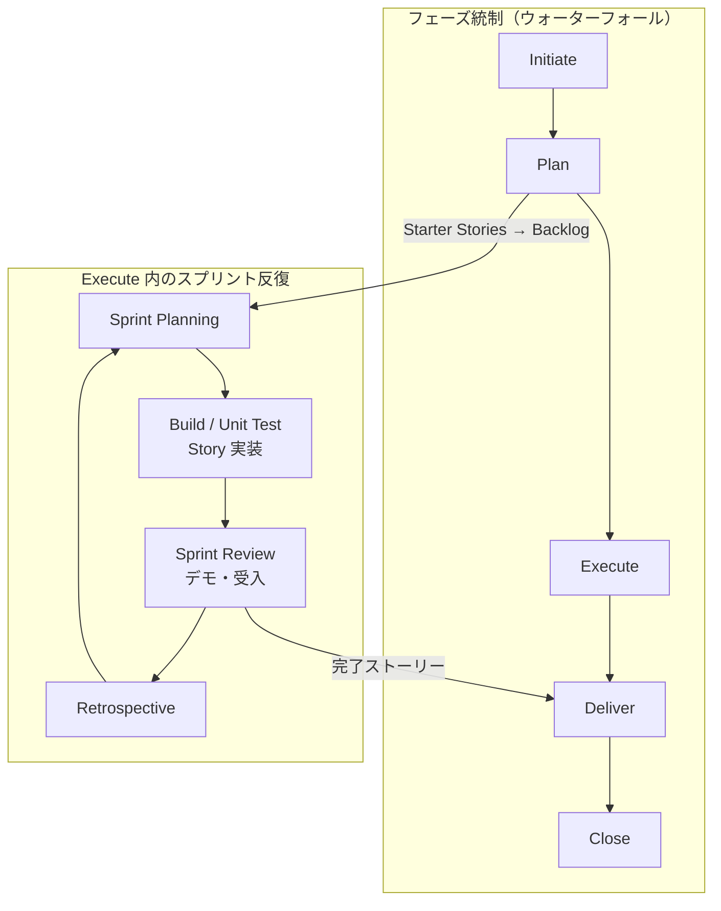

# 導入方法論（Implementation Methodology）

## 概要

ServiceNow の公式導入方法論は **Now Create（ナウ・クリエイト）** である。Now Create は数千件の導入経験から整理されたフェーズ構成・役割別ガイダンス・テンプレート群（Success Pack）の総称で、ServiceNow Expert Services、パートナー、自社導入（self-implementation）のいずれでも共通の「ものさし」として使われてきた。[出典](https://www.servicenow.com/community/grc-blog/what-is-now-create-how-can-it-help-me/ba-p/3224712)

2025-12-05 に **Now Create ポータルは廃止**され、**My Now の Best Practices サイト**（`https://mynow.servicenow.com/now/best-practices/home`）に置き換えられた。ただし ServiceNow は「Best Practices が置き換えるのは Now Create の**ポータル**であり、Now Create の**コンテンツや方法論**ではない」と明言しており、フェーズ構成・Success Pack・各種アセットは Best Practices サイト上で引き続き提供されている。[出典](https://www.servicenow.com/community/in-other-news/now-create-retirement-faqs-and-introduction-to-the-best/ba-p/3425556)

本ファイルは、コンサルタント・PM が実際の導入計画を立てる際に必要となる以下を扱う。

| 節 | 内容 |
|---|---|
| Now Create / Best Practices | 位置づけ、ポータル移行、アクセス方法、アセット種別 |
| フェーズ構成 | Get Started / Initiate / Plan / Execute / Deliver / Close と Exit Gate、7 ワークストリーム |
| 一般的な工程名との対応 | Initiate / Plan / Design / Build / Test / Deploy / Close との対応表 |
| アジャイル導入 | ハイブリッド型（フェーズ＋スプリント）、Agile Development 2.0 / CWM での管理 |
| Fit to Standard | OOTB（標準機能）適合の考え方、ワークショップの進め方、Configuration と Customization の境界 |
| Quick start | Simplified ITSM、Otto for Setup、Guided setup、Impact Accelerator、国内パートナーの短期導入パッケージ |
| 期間・工数目安 | モジュール別・フェーズ別の目安（第三者情報） |

関連ファイル：体制は [05-project-organization.md](05-project-organization.md)、要件定義は [06-requirements-design.md](06-requirements-design.md)、テスト・本番稼働は [11-testing-golive.md](11-testing-golive.md)、運用ガバナンスは [12-operations-governance.md](12-operations-governance.md)、失敗パターンは [../04_応用編/01-implementation-failure-patterns.md](../04_応用編/01-implementation-failure-patterns.md)。

---

## 1. Now Create と Best Practices サイト

### 1.1 Now Create とは

Now Create は ServiceNow 導入プロジェクトのための公式方法論およびベストプラクティス集である。Now Create は次の要素で構成される。[出典](https://www.servicenow.com/community/grc-blog/what-is-now-create-how-can-it-help-me/ba-p/3224712)

| 要素 | 内容 |
|---|---|
| Methodology（方法論） | 実際の導入経験に基づく段階的なデリバリーガイダンス。フェーズと Exit Gate（フェーズ終了判定）で構成される |
| Success Pack（サクセスパック） | 特定のビジネス成果または製品（例：ITSM、HRSD、GRC）に合わせて、フェーズごとのアクティビティとアセットを束ねたプロジェクト計画テンプレート |
| Asset（アセット） | Process Guide、Starter Stories、Implementation Guide などの個別成果物テンプレート |
| Role-based guidance（役割別ガイダンス） | プロジェクトマネージャー、プロセスオーナー、技術リード、チェンジマネージャー等、役割ごとの推奨タスク |

ServiceNow の公式 ebook（日本語サイト掲載）では、Now Create のコア方法論を「**順序立ったプロジェクトフェーズと Exit Gate を基盤とするハイブリッド・ウォーターフォール方法論**」と説明し、Success Pack によってプロジェクトごとに方法論を適合させ、導入ごとに **7 つのワークストリーム**を設定するとしている。[出典](https://www.servicenow.com/jp/standard/data-sheet/now-create-ebook.html)（※本ページは取得時 403 のため、検索エンジンの抜粋に基づく）

第三者の解説では、Now Create は「7,000 件超の導入経験に基づく」「規範的（prescriptive）だが硬直的なチェックリストではなく、アジャイル・ウォーターフォール・ハイブリッドのいずれの既存手法にも統合できる“半構造化”フレームワーク」と説明されている。【第三者情報】[出典](https://sii.pl/blog/en/understanding-the-now-create-framework-structure-advantages-and-common-pitfalls/)

### 1.2 歴史（StartNow → Now Create → Best Practices）

| 時期 | 名称 | 概要 |
|---|---|---|
| 2012 頃 | **StartNow**（STrategic Alignment and Rapid Transformation） | ServiceNow Professional Services の方法論。Project（ウォーターフォール型計画・スコープ・変更管理）、Scrum（タイムボックス型スプリント）、Risk の 3 要素で構成。[出典](https://www.servicenow.com/community/in-other-news/servicenow-implementation-methodology-startnow/ba-p/2277431) |
| 〜2025-12-05 | **Now Create** | Now Learning（現 Now University）配下のポータル `learning.servicenow.com/nowcreate` で提供。[出典](https://www.servicenow.com/community/manufacturing-articles/implementation-assets-on-nowcreate/ta-p/3277266) |
| 2025-12-05〜 | **Best Practices（My Now）** | `mynow.servicenow.com/now/best-practices/home`。導入だけでなくオンボーディング、セキュリティ、サポートまでカスタマージャーニー全体のベストプラクティスを統合。[出典](https://www.servicenow.com/community/in-other-news/now-create-retirement-faqs-and-introduction-to-the-best/ba-p/3425556) |

なお、ServiceNow 社員のコミュニティ記事では、戦略・ロードマップ策定段階を指して「**Now-Value** 方法論の **Envision** フェーズ」という表現も使われている。Now-Value の全体構成は公開情報では確認できず。[出典](https://www.servicenow.com/community/in-other-news/how-to-think-about-planning-your-servicenow-digital/ba-p/3059144)

### 1.3 Best Practices サイトへの移行（ポータル廃止）の要点

ServiceNow 公式コミュニティの FAQ（2025-11-12 公開）に記載された要点は次のとおり。[出典](https://www.servicenow.com/community/in-other-news/now-create-retirement-faqs-and-introduction-to-the-best/ba-p/3425556)

| 項目 | 内容 |
|---|---|
| 廃止日 | 2025-12-05（Now Create ポータル） |
| 置き換え先 | Best Practices サイト（`https://mynow.servicenow.com/now/best-practices/home`） |
| 移行対象 | Now Create のコンテンツと方法論はそのまま Best Practices に収録。ポータルのみ置き換え |
| 旧 URL | 既存の Now Create URL・ブックマークは対応する Best Practices のページへ自動リダイレクト |
| 移行されないアセット | 一部アセットは廃止。リストは別途添付予定とされた |
| アクセス | サイト自体は公開だが、導入系コンテンツの大半は **ServiceNow ID** でのログインが必要 |
| 機能 | AI を用いた検索・プレビュー、Product collection（製品コレクション）、Success Pack、WalkMe によるガイドツアー、方法論紹介動画 2 本 |
| 告知 | 顧客へは 2025-12-08 にメール、パートナーへはニュースレター |

コンテンツの保持範囲については、「直近 2 ファミリーリリース分のコンテンツが Best Practices サイトで引き続き利用可能」とされている。[出典](https://www.servicenow.com/community/grc-blog/what-is-now-create-how-can-it-help-me/ba-p/3224712)

> **実務上の注意:** 公式トレーニング「ServiceNow Platform Implementation（SNPI）」のラボ教材には「Explore the Now Create Portal」が残っており、2026-04 時点でもポータル廃止に教材が追随していないとの報告がある。受講時は Best Practices サイトで代替する必要がある。[出典](https://www.servicenow.com/community/guided-learning-itsm/servicenow-platform-implementation-yokohama-course/m-p/3525371)

### 1.4 アセット種別

Best Practices（旧 Now Create）で提供される代表的なアセット種別は次のとおり。製品ごとに提供範囲は異なる。[出典](https://www.servicenow.com/community/grc-blog/what-is-now-create-how-can-it-help-me/ba-p/3224712) [出典](https://www.servicenow.com/community/manufacturing-articles/implementation-assets-on-nowcreate/ta-p/3277266)

| アセット種別（英語） | 日本語訳 | 内容・用途 | 主に使うフェーズ |
|---|---|---|---|
| Domain Overview / Technology Overview | 領域概要 | プロジェクト開始前に、製品の技術とプロセスの背景を理解する資料 | Get Started |
| Scoping Guide | スコーピングガイド | スコープ、準備状況、デリバリーリスクを洗い出すディスカバリーツール | Get Started / Initiate |
| Recommended Implementation Sequence | 推奨導入順序 | 製品・機能を段階的に導入するためのロードマップ（例：SPM 用）| Initiate / Plan |
| Process Workshop Presentation | プロセスワークショップ資料 | 要件確定のためのプロセスワークショップのテンプレート | Plan |
| Process Guide | プロセスガイド | 製品ごとのプロセス設計に関する ServiceNow の見解。ビジネスニーズとワークフロー・ロール・KPI・設定手順を紐付ける | Plan |
| Starter Stories | スターターストーリー | 要件を表す定義済みアジャイル User Story（ユーザーストーリー）集 | Plan / Execute |
| Implementation Guide | 導入ガイド | 規定の成果を実現するための設定・展開手順 | Execute / Deliver |
| Implementation Insights / Insights | 導入インサイト | 実導入から得られた教訓、機能別のリーディングプラクティス（例：Capability Matrix） | 全フェーズ |
| Product Architecture Blueprint | アーキテクチャブループリント | 製品アーキテクチャの全体図（例：SPM High-level Blueprint Architecture） | Plan |

SPM の例では、`Recommended Implementation Sequence` と `SPM High-level Blueprint Architecture` が Best Practices サイト上で公開されている（URL 例：`https://mynow.servicenow.com/now/best-practices/assets/strategic-portfolio-management-recommended-implementation-sequence`）。[出典](https://www.servicenow.com/community/spm-articles/discover-updated-spm-best-practices-from-my-now-formerly-now/ta-p/3445101)

### 1.5 Success Pack

Success Pack は、特定の製品やビジネス成果（例：「IT ヘルプデスクの生産性向上」）を具体的なプロジェクト計画に落とし込むためのテンプレート一式である。Success Pack には Project type（プロジェクト種別）があり、UX アクティビティの検索例として「Project type が Implementation の Success Pack」を検索するよう案内されている。[出典](https://www.servicenow.com/community/user-experience-sig/create-exceptional-business-outcomes-and-user-experiences-with/ba-p/2753409)

ITSM では「**ITSM modernization success pack**」が Best Practices ポータルで提供されているとの報告がある。[出典](https://www.servicenow.com/community/guided-learning-itsm/servicenow-platform-implementation-yokohama-course/m-p/3525371)

第三者の解説による Success Pack の典型的な同梱物は次のとおり。【第三者情報】[出典](https://sii.pl/blog/en/understanding-the-now-create-framework-structure-advantages-and-common-pitfalls/)

| 区分 | 例 |
|---|---|
| プロジェクト管理文書 | キックオフ資料、プロジェクト計画テンプレート、ステータスレポート、フェーズチェックリスト、プロジェクト憲章、RAID ログ |
| プロセス／プロジェクトツール | ワークショップのアジェンダ・資料、プロセスガイド、データモデルテンプレート、アーキテクチャ計画 |
| 技術アクセラレータ | 初期ユーザーストーリー、設定シート、連携ガイド、スクリプト、デモ用プロトタイプ |
| 定着化・テスト資料 | トレーニング計画、OCM（組織変革管理）チェックリスト、UAT テストスクリプト、導入ガイド |

---

## 2. フェーズ構成と Exit Gate

### 2.1 フェーズ一覧

Now Create のフェーズは、資料により「5 フェーズ（Initiate / Plan / Execute / Deliver / Close）」と「6 フェーズ（先頭に Get Started を加える）」の 2 通りで説明される。公式 ebook と公式トレーニング SNPI は 5 フェーズ、Now Create ポータルの実画面と UX アクティビティ追加の公式コミュニティ記事は Get Started を含む 6 フェーズで表示している。実務上は「Get Started は Initiate 前の準備フェーズ」と理解すればよい。[出典](https://www.servicenow.com/jp/standard/data-sheet/now-create-ebook.html) [出典](https://www.globalknowledge.com/en-gb/courses/servicenow/service_management/snpi/co) [出典](https://www.servicenow.com/community/user-experience-sig/create-exceptional-business-outcomes-and-user-experiences-with/ba-p/2753409)

各フェーズの終わりには **Exit Gate（フェーズ終了判定）** があり、「正しい判断を正しいタイミングで」行ったことを確認してから次フェーズに進む。例えば、計画や要件が明確に定義されていない状態で Plan から Execute へ移行することはできない。【第三者情報】[出典](https://sii.pl/blog/en/understanding-the-now-create-framework-structure-advantages-and-common-pitfalls/)

| フェーズ | 目的 | 主なアクティビティ | 主な成果物 |
|---|---|---|---|
| **Get Started**（準備） | ビジョン・スコープ定義、ステークホルダー特定、ガバナンス確立、リソース確保 | 導入準備、現状評価（Current State Assessment）、テスト理解、OCM 準備、UX 理解 | ビジネス目標、プロジェクト憲章／導入計画、UX Readiness Checklist |
| **Initiate**（立ち上げ） | ステークホルダーによる計画・目標の承認、体制立ち上げ | プロジェクト計画、キックオフ、現行環境（アーキテクチャ）のレビュー、ライセンス・新規インスタンスの確認、環境セットアップ、変更戦略定義、プロジェクトチームのトレーニング | キックオフ資料、実装ダッシュボード、技術ガバナンス計画 |
| **Plan**（計画・設計） | 要件確定、アーキテクチャ設計、リスク評価、データ移行・連携・OCM・トレーニング計画の確定 | プラットフォーム／プロセス／連携ワークショップ、UX 設計、ストーリー精緻化と見積り、テスト戦略、リリース・スプリント計画、運用計画 | 確定バックログ（ユーザーストーリー）、アーキテクチャ定義、技術ガバナンス、テスト戦略 |
| **Execute**（構築） | 計画どおりに設定・開発・連携を実装し、検証可能なインスタンスを作る | スプリント実行、連携スプリント、UX 改善、システムテスト／UAT 計画、サポートモデル設計、コミュニケーション実施 | 設定済みインスタンス、完了ストーリー |
| **Deliver**（テスト・本番稼働） | 本番利用に耐える状態を保証し、Go-Live する | テスト環境へのデプロイ、システムテスト、負荷テスト、UAT、トレーニング、運用準備確認、Go-Live 移行 | テスト結果、UAT 承認、Go-Live 判定 |
| **Close**（終結） | 目標達成の確認、運用組織への移管、振り返り | Hypercare、サポート組織への移行、運用サポート確認、プロジェクトクローズ、サーベイ、価値（ベネフィット）報告、最新版維持計画 | 移管文書、事後レビュー（教訓）、ベネフィットレポート |

上表は、Now Create ポータル画面（下図）、SNPI コースアウトライン、第三者解説を統合して作成した。[出典](https://www.globalknowledge.com/en-gb/courses/servicenow/service_management/snpi/co) 【第三者情報】[出典](https://sii.pl/blog/en/understanding-the-now-create-framework-structure-advantages-and-common-pitfalls/)

### 2.2 7 つのワークストリームとアクティビティマトリクス

Now Create は、フェーズ（横軸）× **7 ワークストリーム**（縦軸）のマトリクスでアクティビティを定義している。

**図 1：Now Create ポータルの導入計画ビュー（Implementation plan view）**

- 画面説明：旧 Now Create ポータル（ヘッダーに「servicenow Create」ロゴ、右上に検索ボックス）で Success Pack を開いた画面。横軸に 6 フェーズ（Get started → Initiate → Plan → Execute → Deliver → Close）が並び、各フェーズ間と Close の後に「Exit Gate」の菱形マークがある。縦軸は 7 ワークストリーム（Value management and analytics / Project and program management / Architecture and technical governance / Design, build and unit test / Testing / Organizational change management / Support）で色分けされ、各セルにアクティビティ名（例：Plan × Design, build and unit test に「Conduct Platform Workshops」「Conduct Process Workshops」「Conduct Integrations Workshops」「Design the User Experience」「Story Refinement and Estimation」）が並ぶ。右端には表示切替・ダウンロード等のアイコン列がある。
- 出典：Sii Poland「Understanding the Now Create framework: structure, advantages and common pitfalls」（2025-07-18）掲載の Fig. 1 https://sii.pl/blog/en/understanding-the-now-create-framework-structure-advantages-and-common-pitfalls/ （取得日：2026-11-03）。画像の権利は ServiceNow, Inc. および掲載者に帰属。【第三者情報】
- 注意：ポータルは 2025-12-05 に廃止済み。Best Practices サイトでの表示形式は異なる可能性がある。

図 1 から読み取れるアクティビティを表に起こすと次のとおり（英語名は画面表記のまま）。

| ワークストリーム | Get Started | Initiate | Plan | Execute | Deliver | Close |
|---|---|---|---|---|---|---|
| **Value management and analytics**（価値管理と分析） | Discover Value | Align Value | Plan Value | Create Value | Enable Value | Transition Value |
| **Project and program management**（プロジェクト・プログラム管理） | Prepare for Implementation / Exit Get Started Phase Gate | Project Planning / Kickoff Meetings / Exit Initiate Phase Gate | Project Monitoring & Controlling / Release & Sprint Planning / Go-Live Transition Planning / Exit Plan Phase Gate | Project Monitoring & Controlling / Sprint Planning/Retrospective / Go-Live Transition Planning / Exit Execute Phase Gate | Project Monitoring & Controlling / Go-Live Transition Planning / Exit Deliver Phase Gate | Project Monitoring & Controlling / Project Closedown / Exit Close Phase Gate |
| **Architecture and technical governance**（アーキテクチャと技術ガバナンス） | Prepare for Technical Governance | Review Current Environment / Plan for Technical Governance | Define Architecture / Establish Technical Governance | Update Architecture | Monitor/Maintain Technical Governance | — |
| **Design, build and unit test**（設計・構築・単体テスト） | Current State Assessment / Prepare for User Experience | Set Up Environment / Define User Experience Goals | Conduct Platform Workshops / Conduct Process Workshops / Conduct Integrations Workshops / Design the User Experience / Story Refinement and Estimation | Execute Sprints / Execute Integration Sprints / Refine the User Experience | Deploy Code to Test Environments / Evaluate the User Experience / Go-Live Transition | — |
| **Testing**（テスト） | Understand Testing | — | Test Strategy | Plan System Testing / Plan User Acceptance Testing | Conduct System Testing / Execute Load Testing / Conduct User Acceptance Testing | — |
| **Organizational change management**（組織変革管理） | Prepare for Organizational Change / Understand Resources | Define Change Strategy / Train Project Team | Assess and Plan for Change | Execute Communications | Enable Training | Conduct Surveys |
| **Support**（サポート） | — | — | Operations Planning | Design Support Model | Confirm Operational Readiness | Transition to Support Organization / Hypercare / Confirm Operational Support |

【第三者情報】（ポータル画面のスクリーンショットからの書き起こし。Success Pack・バージョンにより差異がありうる）

### 2.3 UX アクティビティ（2024-01 追加）

2024-01 に、カスタマー・パートナー・Expert Services の知見をもとに **14 の UX アクティビティ**が Now Create の導入方法論に追加された。フェーズごとの UX のテーマは次のとおり。[出典](https://www.servicenow.com/community/user-experience-sig/create-exceptional-business-outcomes-and-user-experiences-with/ba-p/2753409)

| フェーズ | UX テーマ | 内容 |
|---|---|---|
| Get Started | Understand User Experience | プロジェクトにとっての UX の意味を理解し、ユーザー・プロセスについて既知の情報を文書化。UX Readiness Checklist |
| Initiate | Define User Experience Goals | 現状のユーザー操作のベースラインを取り、改善対象についてステークホルダーを合意（Stakeholder Alignment、Persona Workshop） |
| Plan | Design the User Experience | UX リードが将来像のユーザーフロー・画面体験を定義し、バックログに反映。設計案へのユーザーフィードバック収集。カタログ・ナレッジ導入ではカードソート／ツリーテスト |
| Execute | Refine the User Experience | 完了ストーリーへの反復フィードバックで体験を改善 |
| Deliver | Evaluate the User Experience | Go-Live 後に新たな UX ベースライン・スコアを設定し、未対応事項を将来バックログ化 |

### 2.4 公式トレーニング（SNPI）でのフェーズ別学習内容

ServiceNow 公式コース「ServiceNow Platform Implementation（SNPI、3 日間、前提：ServiceNow Administration Fundamentals）」は Now Create のフェーズに沿って構成されており、各フェーズで実際に行う技術作業の例として参考になる。[出典](https://www.globalknowledge.com/en-gb/courses/servicenow/service_management/snpi/co)

| SNPI モジュール | 主な内容 |
|---|---|
| Overview of Now Create | 製品とニーズのマッチング、フェーズ、Success Pack とアセット、典型的なプロジェクトフロー |
| Phase 1: Initiate | 役割と責任、現行アーキテクチャ、導入チーム特定、キックオフ準備。Lab：Implementation Dashboard（実装ダッシュボード）作成 |
| Phase 2: Plan | Agile ボードでのスプリント・ストーリー計画、インスタンス設定タスク、LDAP 連携、アーキテクチャ／技術ガバナンス、CSDM、Transform Map によるデータ取込、要件ワークショップ。Lab：Agile Planning and Tracking、Security Admin グループ設定、LDAP 認証、CMDB／基盤データ投入 |
| Phase 3: Execute | 構成要素、品質特性の設計、開発ツール、スコープ／グローバルアプリのデプロイとセキュリティ、スプリント運営。Lab：Sprint Planning、アプリ構築、Delegated Developer 追加、ミニ導入 |
| Phase 4: Deliver | コードデプロイ方式、テストと UAT、ユーザートレーニングと変更促進、Go-Live |
| Phase 5: Close | プロジェクト効果の報告、最新バージョン追随計画、ユーザー認知とトレーニング、プロジェクトクローズ |

---

## 3. 一般的な工程名（Initiate/Plan/Design/Build/Test/Deploy/Close）との対応

日本の SI 慣行やパートナー各社の提案書では「立上げ → 計画 → 設計 → 構築 → テスト → 展開 → 終結」のような V 字型の工程名が使われることが多い。Now Create には独立した **Design / Build / Test / Deploy フェーズは存在しない**。設計は Plan に、構築は Execute に、テストと展開は主に Deliver に含まれ、ワークストリーム（Design, build and unit test / Testing）として全フェーズを横断する。[出典](https://www.globalknowledge.com/en-gb/courses/servicenow/service_management/snpi/co)

| 一般的な工程名 | Now Create のフェーズ | 補足 |
|---|---|---|
| Initiate（立上げ） | Get Started + Initiate | 憲章・体制・ガバナンス・環境準備 |
| Plan（計画） | Initiate 後半 + Plan | プロジェクト計画、リリース・スプリント計画 |
| Design（設計／要件定義） | **Plan** | プロセス／プラットフォーム／連携ワークショップ、アーキテクチャ定義、ストーリー精緻化。要件はユーザーストーリーとして確定する |
| Build（構築） | **Execute** | スプリントで設定・開発・単体テスト。連携は Integration Sprint |
| Test（テスト） | Execute（計画）+ **Deliver**（実施） | システムテスト・負荷テスト・UAT は Deliver で実施。ATF（Automated Test Framework）は Execute から整備 |
| Deploy（展開／本番移行） | **Deliver** | テスト環境へのデプロイ、Go-Live Transition、トレーニング |
| Close（終結） | Close | Hypercare、サポート組織への移管、ベネフィット報告 |

パートナーの解説では、同様の 6 段階（Initiate and Discovery / Design and Architecture / Build and Configuration / Testing and Validation / Deployment and Go-Live / Hypercare and Stabilization）で説明されることも多い。【第三者情報】[出典](https://www.aegissofttech.com/insights/servicenow-implementation-timeline/)

> **【経験則】** 顧客が社内標準の V 字工程（要件定義・基本設計・詳細設計…）での管理を求める場合は、Now Create のフェーズ＝マイルストーン、ワークストリーム＝WBS の第 2 階層として対応表を作り、Exit Gate を社内の工程完了判定会議に読み替えると齟齬が少ない。詳細設計書を全量作成するのではなく、ユーザーストーリー＋設定記録（Update Set／Configuration ワークブック）を設計成果物とすることが ServiceNow 案件では一般的である。

---

## 4. アジャイル導入（ハイブリッド型）

### 4.1 Now Create におけるアジャイルの位置づけ

Now Create のコアは「フェーズと Exit Gate を持つハイブリッド・ウォーターフォール」であり、フェーズはプロジェクト全体の統制（予算・スコープ・Go-Live 判定）に使い、**Plan 後半〜Execute の構築作業はスプリントで反復する**という構成になっている。図 1 でも、Project and program management ワークストリームに Plan の「Release & Sprint Planning」、Execute の「Sprint Planning/Retrospective」、Design, build and unit test に「Execute Sprints」「Execute Integration Sprints」が置かれている。[出典](https://www.servicenow.com/jp/standard/data-sheet/now-create-ebook.html) 【第三者情報】[出典](https://sii.pl/blog/en/understanding-the-now-create-framework-structure-advantages-and-common-pitfalls/)

この「フェーズ統制＋スプリント実行」の考え方は、前身の StartNow（Project ＋ Scrum ＋ Risk）から一貫している。[出典](https://www.servicenow.com/community/in-other-news/servicenow-implementation-methodology-startnow/ba-p/2277431)

### 4.2 アジャイル導入の進め方（実務）

| ステップ | 内容 | 根拠 |
|---|---|---|
| 1. バックログ作成 | Best Practices の **Starter Stories** を起点に、プロセスワークショップの結果を加えて Epic／Story を作成 | [出典](https://www.servicenow.com/community/manufacturing-articles/implementation-assets-on-nowcreate/ta-p/3277266) |
| 2. ストーリー精緻化・見積り | Plan の「Story Refinement and Estimation」でストーリーポイントを付与し、リリース・スプリント計画を作成 | 図 1【第三者情報】 |
| 3. スプリント実行 | Execute で 2 週間程度のスプリントを反復。各スプリント末にデモし、プロセスオーナーが受け入れ | 【経験則】 |
| 4. 連携スプリント | 連携は依存先システム側の準備が必要なため「Integration Sprints」として別トラックで実施 | 図 1【第三者情報】 |
| 5. テスト | ストーリー単位のテスト、統合テスト、UAT、ストレス／ボリュームテストに時間とリソースを計画。カスタマイズには ATF テストを作成しアップグレード時に再利用 | [出典](https://www.servicenow.com/community/in-other-news/how-to-think-about-planning-your-servicenow-digital/ba-p/3059144) |
| 6. Go-Live | Deliver で一括リリース。段階的 Go-Live（早期に価値を出せるが変更管理が難しい）か、ビッグバン Go-Live（切替は 1 回だがリスクが高い）かを判断 | [出典](https://www.servicenow.com/community/in-other-news/how-to-think-about-planning-your-servicenow-digital/ba-p/3059144) |

第三者の利用者報告では、通常 10〜13 週の案件がアジャイルの適用で限定スコープなら 5〜6 週に短縮できた例もある。【第三者情報】

### 4.3 ServiceNow 上での導入プロジェクト管理（Agile Development 2.0 / CWM）

ServiceNow の導入プロジェクト自体を ServiceNow インスタンス上で管理することが多い（SNPI でも Lab で Agile ボードと Implementation Dashboard を使用）。管理ツールの選択肢は次のとおり。

#### Agile Development 2.0

**Agile Development 2.0** は SPM（旧 ITBM）に含まれるスクラム管理アプリケーションである。主要テーブルとロールは次のとおり。[出典](https://www.servicenow.com/docs/r/zurich/it-business-management/agile-development/components-installed-with-agile-2.0.html)

| テーブル（日本語訳） | テーブル名 | 用途 |
|---|---|---|
| Epic（エピック） | `rm_epic` | 関連するストーリーの束、またはストーリー化前の要件 |
| Story（ストーリー） | `rm_story` | 1 スプリント内で完了する自己完結した作業 |
| Scrum task（スクラムタスク） | `rm_scrum_task` | スプリント中にストーリーに対して行う作業単位 |
| Sprint（スプリント） | `rm_sprint` | 一定期間にまとめて対応するバックログ項目 |
| Scrum release（スクラムリリース） | `rm_release_scrum` | スプリントを含むプロダクトのバージョン |
| Defect（欠陥） | `rm_defect` | 期待動作からの逸脱 |
| Enhancement（改善要望） | `rm_enhancement` | 既存プロダクトの改善 |
| Testing Task（テストタスク） | `rm_test` | テストタスク |
| Team（チーム） | `scrum_pp_team` | タスク・ストーリーを担当するチーム |
| Theme（テーマ） | `scrum_theme` | 具体的なプロダクトまたは抽象的なゴール |

| ロール（日本語訳） | ロール名 | 役割 |
|---|---|---|
| Scrum admin（スクラム管理者） | `scrum_admin` | Agile Development 2.0 の全権限 |
| Scrum product owner（プロダクトオーナー） | `scrum_product_owner` | ビジネス価値とプロダクトバックログに責任。バックログとリリース間でストーリーを移動 |
| Scrum master（スクラムマスター） | `scrum_master` | スプリント運営、リリースバックログとスプリント間でストーリーを移動 |
| Scrum team member（チームメンバー） | `scrum_team_member` | スプリント内でストーリーを実施、スクラムタスク作成、欠陥・改善要望の登録 |
| Scrum user（スクラムユーザー） | `scrum_user` | 参照のみの基本ロール（他ロールが継承） |

| プロパティ | 既定値 | 内容 |
|---|---|---|
| `com.snc.sdlc.scrum.pp.default_sprint_length` | `14` | スプリント長（日）の既定値 |
| `com.snc.sdlc.scrum.pp.progress.story.states` | `-6,1,2,-7,-8,3` | 進捗ボードに表示するストーリー状態（Draft, Ready, Work in progress, Ready for testing, Testing, Complete） |
| `com.snc.sdlc.scrum.pp.burndown.ideal.linear` | `false` | バーンダウンの理想線を直線で描画 |
| `com.snc.sdlc.scrum.pp.task_uses_actual_hours` | `true` | Scrum Task の Actual hours（実績時間）フィールドを有効化 |

#### Collaborative Work Management（CWM）への移行

ServiceNow 公式コミュニティの移行ガイド（2026-03-15 公開）では、チームレベルのアジャイル管理を Agile Development 2.0 から **Collaborative Work Management（CWM）** へ移行する手順が示されている。Agile 2.0 は「legacy」と表現され、移行後は履歴参照用に read-only で残すことが推奨されている。正式な廃止日は公開情報では確認できず。CWM の利用には CWM ライセンスまたは SPM ライセンスが必要。[出典](https://www.servicenow.com/community/cwm-articles/migration-guide-for-team-level-agile-from-agile-development-2-0/ta-p/3508312)

| Agile 2.0 | CWM |
|---|---|
| Sprint planning board | Board の Sprint Planning ビュー |
| Backlog | Sprint Planning の Backlog セクション |
| Story / Scrum task | Connected work として取り込み（他の task 系レコードも可） |
| Sprint tracking board | Kanban ビュー |
| Epic backlog | CWM の List（ネイティブ Epic 表示は 2026 H2 予定とされる） |
| Sprint 履歴 | CWM の新しいスプリントテーブル（構造非互換のため履歴移行より新規スプリント開始を推奨） |

詳細は [../02_リファレンス/spm/agile-apm-eam.md](../02_リファレンス/spm/agile-apm-eam.md) を参照。

---

## 5. Fit to Standard（標準適合）

### 5.1 ServiceNow における Fit to Standard の位置づけ

「Fit to Standard」は SAP など ERP 導入で広まった用語で、業務を製品標準に合わせ、差分をアドオンで埋める従来の「Fit & Gap」とは逆の発想をとる手法である。**ServiceNow 公式ドキュメントに「Fit to Standard」という名称の方法論は存在しない**（公開情報では確認できず）。ServiceNow コミュニティでも「Fit to Standard を裏付ける公式資料はどこか」という質問に対し、Now Create（Asset と Success Pack）と Now Learning のコースが案内されるにとどまっている。[出典](https://www.servicenow.com/community/architect-forum/seeking-official-servicenow-guidance-on-fit-to-standard/m-p/3298315)

ただし、同じ思想は公式ドキュメントや公式方法論の随所に組み込まれている。

| 公式の考え方 | 内容 | 出典 |
|---|---|---|
| Configuration over customization（カスタマイズより設定） | ServiceNow プラットフォームは可能な限りカスタマイズより設定を推奨し、アプリ本来の意図を超える機能拡張は App Engine で新規アプリとして開発することを推奨 | [出典](https://www.servicenow.com/docs/r/application-development/app-engine-studio/aes-custom-vs-config.html) |
| カスタムコードのサポート範囲 | ServiceNow カスタマーサポートは、顧客固有ロジックを再現・分析できないため、カスタムコードに起因する問題は支援しない | [出典](https://www.servicenow.com/docs/r/application-development/app-engine-studio/aes-custom-vs-config.html) |
| Process Guide | 製品ごとのプロセスに関する ServiceNow の見解（推奨プロセス）を提示 | [出典](https://www.servicenow.com/community/manufacturing-articles/implementation-assets-on-nowcreate/ta-p/3277266) |
| Simplified ITSM | 既定構成を自動適用し、管理者がレビュー・変更する方式（後述） | [出典](https://www.servicenow.com/docs/r/IDeOjpA1hzonPLWG~inEpg/25qrl_cqlBpZ4BR44nhlkw) |
| OOTB を出発点にする | ServiceNow の OOTB ベストプラクティスとテンプレートを将来像プロセスの出発点とし、スケーラビリティ・アップグレード容易性・技術的負債削減のため OOTB 機能（Flow Designer、CSDM 等）を最大限使う | [出典](https://www.servicenow.com/community/architect-articles/the-servicenow-architect-s-guide-to-a-successful-implementation/ta-p/3423012) |

### 5.2 Configuration と Customization の境界

公式ドキュメントでは、UI Policy、Business Rule、UI Action などのツール自体ではなく、**ベースラインのフローやコードを変更するかどうか**で区別する。[出典](https://www.servicenow.com/docs/r/application-development/app-engine-studio/aes-custom-vs-config.html)

| 区分 | 定義 | 例 |
|---|---|---|
| Configuration（設定） | ベースラインのコードを変えずに機能を拡張する | フォームレイアウト変更、選択肢追加、新規 Business Rule 追加、Flow 作成、通知追加 |
| Customization（カスタマイズ） | ベースラインのフローやコードを変更する | OOTB の Business Rule／Script Include の直接編集、OOTB UI Page の改変 |

推奨事項として「カスタマイズの前に設定を最大限使う」「オブジェクトはコピーせずにその場で更新する」が挙げられている。なお、コードを追加した場合はベースラインを変えなくても「追加したコードの所有者は顧客自身」となる。[出典](https://www.servicenow.com/docs/r/application-development/app-engine-studio/aes-custom-vs-config.html)

カスタマイズの判断基準と技術的負債の管理は [../04_応用編/02-customization-technical-debt.md](../04_応用編/02-customization-technical-debt.md) を参照。

### 5.3 Fit to Standard 型ワークショップの進め方

Now Create の Plan フェーズの「Conduct Process Workshops」「Conduct Platform Workshops」を Fit to Standard 型で運営する場合の手順を、公式アセットとコミュニティのチェックリストから整理する。

| 手順 | 内容 | 根拠 |
|---|---|---|
| 1. 事前準備 | Process Workshop Presentation と Process Guide を準備。各モジュールのフィールドシートをエクスポートし、As-Is と ServiceNow のマッピング表（特に Reference／Choice／Boolean 型フィールド）を作成 | [出典](https://www.servicenow.com/community/manufacturing-articles/implementation-assets-on-nowcreate/ta-p/3277266) [出典](https://www.servicenow.com/community/now-platform-articles/pack-amp-break-green-amp-brown-field-implementation/ta-p/3101282) |
| 2. 標準のデモ | 要件ヒアリングから入らず、OOTB の画面・プロセスを先に見せ（PDI やデモインスタンスを利用）、標準でできることを共有 | 【第三者情報】[出典](https://www.servicenow.com/community/now-platform-articles/pack-amp-break-green-amp-brown-field-implementation/ta-p/3101282) |
| 3. 差分の識別 | OOTB 機能をマッピングしてギャップを特定し、ベストプラクティスと OOB 標準に沿ったカスタマイズ方針を整理 | [出典](https://www.servicenow.com/community/now-platform-articles/pack-amp-break-green-amp-brown-field-implementation/ta-p/3101282) |
| 4. ギャップの判定 | 各ギャップを「業務を標準に合わせる／設定で対応／カスタマイズ（要承認）／対象外」に分類。カスタマイズには根拠とビジネス価値を記録 | 【経験則】 |
| 5. ストーリー化 | 合意結果を Starter Stories をベースにユーザーストーリー化してバックログへ | [出典](https://www.servicenow.com/community/manufacturing-articles/implementation-assets-on-nowcreate/ta-p/3277266) |
| 6. 宿題管理 | ワークショップ前・中・後のチェックリストで準備状況を管理し、ステークホルダー側と導入側の宿題を明確化 | [出典](https://www.servicenow.com/community/now-platform-articles/pack-amp-break-green-amp-brown-field-implementation/ta-p/3101282) |

ワークショップで論点にすべき代表的な領域は次のとおり。【第三者情報】[出典](https://www.servicenow.com/community/now-platform-articles/pack-amp-break-green-amp-brown-field-implementation/ta-p/3101282)

| 領域 | 論点 |
|---|---|
| 基盤データ | ユーザー、グループ、会社、ロケーション、部署などの必須データ |
| Service Catalog | アイテムの複雑度（Simple／Medium／Complex）、承認数・タスク数、並列か直列か、変数・承認・通知・SLA を含む要件テンプレート |
| 連携 | 連携方式、推奨アプローチ、運用管理方針 |
| CMDB | 既存データソース数、Discovery 範囲（インフラ／EUC）、Service Mapping、カスタムクラス、Discovery で取れない属性数 |
| レポート | OOTB 以外に作成するカスタムレポート・ダッシュボード数 |
| チケット移行 | 原則移行しない。必要な場合はアクティブチケットのみ（作業ログ・添付付き） |
| データ可視性 | 事業部・会社・ペルソナ単位のアクセス制御を ACL、Query Business Rule、ドメインセパレーションのいずれで実現するか |

> **【経験則】** Fit to Standard を掲げても、ServiceNow の導入では「業務を合わせる」だけでなく「設定（Configuration）で合わせる」余地が ERP より大きい。Fit to Standard の目標は「カスタマイズ（ベースライン変更）をゼロに近づける」ことと定義し、設定は許容する、と最初に合意しておくと議論が混乱しにくい。コミュニティでも「すべてのカスタマイズが悪いわけではなく、OOB/標準の定義をポリシーで明確にすべき」と指摘されている。[出典](https://www.servicenow.com/community/architect-forum/seeking-official-servicenow-guidance-on-fit-to-standard/m-p/3298315)

要件定義の詳細は [06-requirements-design.md](06-requirements-design.md) を参照。

---

## 6. Quick start（短期導入）の手段

「Quick start」は ServiceNow 公式の単一の方法論名ではなく、文脈により以下のいずれかを指す。

| 種別 | 名称 | 提供者 | 概要 |
|---|---|---|---|
| 製品機能 | Simplified IT Service Management | ServiceNow | 既定構成の自動適用とガイド付き／会話型セットアップ（Australia で新規） |
| 製品機能 | ServiceNow Otto for Setup | ServiceNow | Admin Home からの AI ガイド付きセットアップ（Brazil 文書で確認） |
| 製品機能 | Guided Setup（ガイド付きセットアップ） | ServiceNow | ITSM 等の設定タスクを順序立てて提示 |
| 公式ガイド | QuickStart guides | ServiceNow | 自社導入向けの製品別ガイド（Performance Analytics、Predictive Intelligence、Virtual Agent 等） |
| サービス | Impact Accelerators | ServiceNow（Impact） | 定義済みスコープのワークショップ型支援（Jumpstart 系など） |
| サービス | パートナーの短期導入パッケージ | パートナー各社 | 対象機能を絞ったテンプレート導入 |

### 6.1 Simplified IT Service Management（Australia で新規）

**Simplified IT Service Management**（Simplified ITSM、文書 URL 上は AI-native ITSM）は、「簡素化・自動化された導入と、複数 ITSM アプリにまたがる統一ユーザー体験のための AI ネイティブソリューション」で、Australia リリースノートで新規アプリケーションとして記載されている。管理者、従業員、フルフィラーを対象とする。[出典](https://www.servicenow.com/docs/r/QykF2iRSIs6VXztArCSo3w/Y6mrH259_KW4wgrD4Tzkkw)

Australia リリースノートに記載のバージョン別の主な機能は次のとおり。[出典](https://www.servicenow.com/docs/r/IDeOjpA1hzonPLWG~inEpg/25qrl_cqlBpZ4BR44nhlkw)

| バージョン | 内容 |
|---|---|
| 2.0.1 | インストールした製品・モジュールに **既定の構成設定を自動適用**し、管理者がレビュー・変更できる。ITSM ワークフローのガイド付き構成。1 つの管理ページから自然言語で AI エージェントにワークフローを構成させられる |
| 3.0.2 | Employee Slate、構成アイテム、Change Management 稼働に必要なコア設定のガイド付き体験。Problem Management、Major Incident Management など高度なワークフローは Service Operations Workspace Admin Center で構成 |
| 3.1.1 | 受信メール設定のガイド付き体験 |
| 3.2.3 | Incident Management と Request Management を専用の管理ロールで構成。Change のフォーム・リストは Configuration Console で構成 |

Simplified ITSM では、Incident のフォーム・リスト・SLA（および関連 Flow）、Requested Item・Catalog Task のフォーム・リストが事前構成済みで提供される。リストレイアウトは業務要件に応じて見直すよう案内されている。[出典](https://www.servicenow.com/docs/r/QykF2iRSIs6VXztArCSo3w/HTgroNE2TlT21KubCsXdqw)

> **Brazil での変更:** Brazil の文書では、セットアップ手順が「① ServiceNow Otto for Setup アプリをインストール → ② サブスクリプションに基づき ITSM アプリが自動インストールされたか確認（されていなければ ServiceNow Store でエンタイトルメントを申請してインストール）→ ③ ガイド付き構成または会話型 AI エージェントで ITSM を構成」となっている。アプリは基本版 **IT Service Management**（`sn_ai_itsm_cont`：Incident Management、Request Management）と **IT Service Management Advanced**（`sn_itsm_adv_cont`：Change、Problem、Major Incident、On-Call Scheduling、Walk-up Experience）に分かれ、いずれもワンクリックのインストール／アップグレードで既定構成が適用される。[出典](https://www.servicenow.com/docs/r/it-service-management/configuring-ai-native-itsm.html)

Simplified ITSM はまさに「標準構成を受け入れてから必要箇所だけ変える」Fit to Standard 型の導入を製品側で支援する機能であり、新規（グリーンフィールド）の中堅規模 ITSM 導入では Quick start の第一候補となる。【推定】既存の高度にカスタマイズされた ITSM 環境（ブラウンフィールド）への適用可否・制約は公開情報では確認できず。ITSM の詳細は [../02_リファレンス/itsm/itsm-overview.md](../02_リファレンス/itsm/itsm-overview.md) を参照。

### 6.2 ServiceNow Otto for Setup

> **Brazil での変更:** Brazil の文書では、**ServiceNow Otto for Setup**（アプリ `sn_ia`）が ServiceNow Otto を設定するためのアプリケーションとして記載されている。[出典](https://www.servicenow.com/docs/r/platform-administration/ia-setup-now-assist.html)
>
> | 項目 | 内容 |
> |---|---|
> | 必要ロール | `admin` |
> | 対象 | ITSM、CBS、ITOM、ESM の Foundation SKU、および ITSM、HRSD の Pro+ SKU の利用者 |
> | 入手 | ServiceNow Store、または Admin Home のプロンプトから |
> | メニュー位置 | **Admin Home** の「Manage your products」セクション（既定では折りたたみ）にある ServiceNow Otto カード → Product Hub → Not installed タブのアプリバンドル → App manager で Install |
> | インストール後 | Product Hub で「Go to ServiceNow Otto Admin」を選択。以降の設定は AI Admin Hub ドキュメントを参照 |
>
> Otto for Setup には、データインポート（データソース・インポートセット・Transform Map の作成）、SSO（SAML／OIDC）、SLA 定義、Update Set などを支援する AI エージェントがあるとされる。ServiceNow Store の掲載では「セットアップ時間を 60〜80% 削減」とうたっているが、ベンダーの主張値である。【第三者情報】（検索結果の要約に基づき、個々のエージェント名・提供範囲は未検証）

Now Assist／AI エージェントの詳細は [../02_リファレンス/platform/now-assist-ai-agents.md](../02_リファレンス/platform/now-assist-ai-agents.md) を参照。

### 6.3 QuickStart guides と ITSM Pro オンボーディング

公式コミュニティの「ITSM Pro Onboarding Guide」（2025-09 更新）は、自社導入（self-implementation）向けに次の手順を推奨している。[出典](https://www.servicenow.com/community/itsm-articles/itsm-pro-onboarding-guide/ta-p/2296018)

1. ITSM Pro の機能（Virtual Agent、Predictive Intelligence、Platform Analytics、DevOps Change Velocity 等）を理解する
2. 最初に狙うビジネス成果を 1 つ選ぶ（「すべてを一度にやる必要はない」）
3. デリバリーモデル（パートナー／ServiceNow Expert Services／自社導入）を選ぶ
4. プラグインを有効化する（Performance Analytics、Predictive Intelligence、Virtual Agent）
5. 製品別の **QuickStart guide** に従う。QuickStart guide は initiate・plan・execute・deliver・close の各段階をカバーする。パイロットの場合はパイロットの目的に資するアクティビティのみに絞る
6. コースと認定資格でチームのスキルを育成する
7. Go-Live 前に最新リリースへアップグレードする
8. 組織変革（OCM）を準備する

### 6.4 Impact Accelerators

**ServiceNow Impact** は ServiceNow のカスタマーサクセス・サービスで、Accelerator Catalog から定義済みスコープのワークショップ型支援（Accelerator）を受けられる。Brazil 時点の文書で確認できるパッケージは次のとおり。[出典](https://www.servicenow.com/docs/r/impact/impact-packages1.html)

| パッケージ | Accelerator 関連の主な内容 |
|---|---|
| Guided | Impact App、24/7 サポート、Customer Success Manager 1 名、サブカタログごとに同時 1 件の Accelerator、カタログは Technical 全部と Strategy／Architecture の一部 |
| Total | Guided の全内容＋Technical／Strategy／Architecture／Optimization のフルカタログ、サブカタログごとに同時 2 件（Optimization は 1 件）、専任 Impact Squad（CSM、Customer Success Executive、Platform Architect、Support Account Manager） |
| Integrated Success | Total の全内容＋契約に応じた導入サービス（Free Form initiative で開始） |

Accelerator の例として「Jumpstart Your ServiceNow AI Journey」「Jumpstart Your Knowledge Management」「Jumpstart Your Modern Change Management」「Stakeholder Path to Value」が公式ドキュメントに掲載されている。Technical Accelerator は **ハンズオンのキーボード作業ではなく**、Impact チームは導入・設定・要員派遣・トレーニングを行わない。各 Accelerator には定義済みのスコープと成果があり、環境に応じた軽微な調整のみ可能。[出典](https://www.servicenow.com/community/servicenow-impact-articles/getting-started-with-impact-technical-accelerators-what-is-it/ta-p/3479343)

Impact とサポートの詳細は [14-support-monitoring.md](14-support-monitoring.md) を参照。

### 6.5 国内パートナーの短期導入パッケージ（例）

日本国内では、ITSM の利用頻度の高い機能に絞ったテンプレート型の短期導入パッケージが複数発表されている。いずれもパートナーの発表値であり、前提スコープは各社で異なる。【第三者情報】

| 提供会社 | パッケージ名 | 対象 | 期間（発表値） | 発表 | 出典 |
|---|---|---|---|---|---|
| TDCソフト | Snap ITSM | ITSM の高頻度機能に絞ったテンプレート。要件定義・開発工程を省略 | 契約から約 1 週間で利用開始（通常導入は約 3 カ月） | 2024-06-17 | [出典](https://it.impress.co.jp/articles/-/26474) |
| TIS | ITSMクイックスタートパッケージ | ServiceNow ITSM＋同社 IT リスクマネジメントプラットフォーム。中堅・成長企業向け | 標準機能の範囲で最短 3 カ月 | 2024-06-06 | [出典](https://cloud.watch.impress.co.jp/docs/news/1597903.html) |
| アオラナウ／シイエヌエス | ServiceNow ITSM クイックスターターパッケージ | Incident／Problem Management。中堅企業向け。ベストプラクティスに基づく標準テンプレート | 最短 1 カ月で本番運用開始 | 2025-04-15 | [出典](https://ascii.jp/elem/000/004/263/4263391/) |

日本市場の詳細は [15-japan-market.md](15-japan-market.md) を参照。

---

## 7. 期間・工数の目安

### 7.1 前提

ServiceNow は導入期間・工数の公式な標準値を公開していない（公開情報では確認できず）。以下はパートナー・第三者の公開値であり、すべて `【第三者情報】` である。実際の期間は、スコープ、連携数、CMDB の準備状況、プロセス成熟度、意思決定の速さに大きく左右される。

ServiceNow 社員のコミュニティ記事では、プログラム計画として「少なくとも今後 12 カ月」をカバーする導入ロードマップ（導入する製品、必要なチームとリソース、スコープ、順序）を作成し、製品構成に応じた Recommended Implementation Sequence を参照することを推奨している。[出典](https://www.servicenow.com/community/in-other-news/how-to-think-about-planning-your-servicenow-digital/ba-p/3059144)

### 7.2 モジュール・スコープ別の期間目安

【第三者情報】[出典](https://www.aegissofttech.com/insights/servicenow-implementation-timeline/)（Aegis Softtech、2026-10-23）

| 導入スコープ | 期間目安 | 想定スコープ |
|---|---|---|
| Basic ITSM | 6〜8 週 | OOTB の Incident／Problem／Change／Request／Knowledge と基本ポータル、最小限のカスタマイズ |
| 中規模 ITSM | 10〜14 週 | ITSM、Service Catalog、承認、SLA、ルーティング、基本 CMDB、標準連携 |
| ITSM＋CMDB | 12〜16 週 | ITSM＋CMDB（IRE、Multisource、データヘルス）、基盤データ |
| ITSM＋複数連携 | 14〜18 週 | ITSM＋複雑な双方向連携 3〜5 本 |
| エンタープライズ ITSM | 16〜22 週 | グローバル展開、高度なワークフロー、CSDM 整合、レガシーデータ移行 |
| ITSM＋ITOM | 18〜26 週 | ITSM＋MID Server クラスタ、Discovery、Service Mapping、Event Management |
| エンタープライズ複数モジュール | 28〜40 週以上 | 複数製品の段階的ロールアウト |
| （参考）CMDB 単体 | 2〜4 カ月 | — |
| （参考）Discovery 単体 | 1.5〜2 カ月 | — |

その他の公開値（いずれも【第三者情報】）：

- 中規模組織の焦点を絞った ITSM（Incident、Request、小規模カタログ、SSO、連携 1〜2 本）で初回本番まで 8〜14 週。プロセスをゼロから定義する場合は +4〜8 週、初回リリースに Change Management を含める場合はさらに +6〜12 週とする目安もある。
- 国内パートナーの発表では「通常の ITSM 導入は約 3 カ月」とされる。[出典](https://it.impress.co.jp/articles/-/26474)

### 7.3 フェーズ別の期間配分目安

【第三者情報】[出典](https://www.aegissofttech.com/insights/servicenow-implementation-timeline/)（第三者の 6 段階を Now Create フェーズに対応付け）

| 第三者の段階 | 対応する Now Create フェーズ | 期間目安 | 主な作業 |
|---|---|---|---|
| Initiate and Discovery | Get Started / Initiate | 4〜6 週 | スコープ・優先度・目標・プロセス文書化 |
| Design and Architecture | Plan | 5〜12 週 | 要件をアーキテクチャとガバナンス標準に落とす |
| Build and Configuration | Execute | 8〜16 週 | ワークフロー・連携・自動化をスプリントで構成 |
| Testing and Validation | Deliver（前半） | 4〜5 週 | ワークフロー・承認・連携の検証 |
| Deployment and Go-Live | Deliver（後半） | 1〜2 週 | 本番切替とユーザートレーニング |
| Hypercare and Stabilization | Close | 継続 | 初期課題対応、ワークフロー微修正 |

### 7.4 工数（体制規模）の目安

工数（人月）の公式・第三者の公開値は、本調査ではまとまった形では確認できなかった（公開情報では確認できず）。以下は一般的な見積りの考え方である。

| 規模感 | 想定スコープ | 体制例 | 期間 | 工数の概算 |
|---|---|---|---|---|
| 小規模（Quick start） | Incident／Request＋小規模カタログ、OOTB 中心、連携 0〜1 本 | PM 0.5、コンサル／BA 1、開発 1〜2 | 1〜3 カ月 | 5〜15 人月 【推定】 |
| 中規模 | ITSM コア 4〜5 プロセス、カタログ 20〜50 件、SSO、連携 2〜3 本、基本 CMDB | PM 1、コンサル／BA 1〜2、アーキテクト 0.5、開発 2〜4、テスト 1 | 3〜6 カ月 | 20〜50 人月 【推定】 |
| 大規模 | ITSM＋ITOM（Discovery／Service Mapping）、グローバル、多数連携、データ移行 | PM／PMO 2、アーキテクト 1〜2、コンサル 2〜4、開発 5〜10、テスト 2〜3、OCM 1 | 6〜12 カ月以上 | 80 人月以上 【推定】 |

上表の工数は 7.2 の期間目安と一般的なチーム構成から算出した概算値であり、顧客側の要員（プロセスオーナー、SME、プラットフォームオーナー）は含まない。【推定】体制の詳細は [05-project-organization.md](05-project-organization.md)、費用の考え方は [02-pricing.md](02-pricing.md) を参照。

### 7.5 期間を左右する主な要因

| 要因 | 期間への影響 | 根拠 |
|---|---|---|
| プロセス成熟度 | プロセスが未定義だと要件定義が長期化。OOTB テンプレートを将来像のガイドにすることで短縮可能 | [出典](https://www.servicenow.com/community/architect-articles/the-servicenow-architect-s-guide-to-a-successful-implementation/ta-p/3423012) |
| CMDB／データの準備状況 | ユーザー・組織データ、CMDB の整備が先行条件 | [出典](https://www.servicenow.com/community/architect-articles/the-servicenow-architect-s-guide-to-a-successful-implementation/ta-p/3423012) |
| 連携の数と複雑度 | 双方向連携 1 本ごとに数週の追加が一般的 | 【第三者情報】[出典](https://www.aegissofttech.com/insights/servicenow-implementation-timeline/) |
| カスタマイズ量 | Fit to Standard の徹底度合いで構築・テスト期間が大きく変わる | 【経験則】 |
| Go-Live 方式 | 段階的 Go-Live は早期に価値が出るが変更管理が複雑、ビッグバンは切替 1 回だがリスク大 | [出典](https://www.servicenow.com/community/in-other-news/how-to-think-about-planning-your-servicenow-digital/ba-p/3059144) |
| アップグレードの挟み込み | Go-Live 前に最新リリースへアップグレードすることが推奨されるため、年 2 回のリリース時期と重なると計画調整が必要 | [出典](https://www.servicenow.com/community/itsm-articles/itsm-pro-onboarding-guide/ta-p/2296018) |
| OCM の軽視 | 技術導入のみに注力し OCM を省くと、抵抗・低い定着率につながる | 【第三者情報】[出典](https://sii.pl/blog/en/understanding-the-now-create-framework-structure-advantages-and-common-pitfalls/) |
| ガバナンス・スコープ管理 | ステアリングコミッティ等のガバナンスが機能しないとスコープ拡大を招く | 【第三者情報】[出典](https://sii.pl/blog/en/understanding-the-now-create-framework-structure-advantages-and-common-pitfalls/) |

アップグレード計画は [13-upgrade-management.md](13-upgrade-management.md)、リリースサイクルは [../01_入門編/07-release-cycle.md](../01_入門編/07-release-cycle.md) を参照。

---

## 8. 方法論選択のガイド（実務チェックリスト）

| 状況 | 推奨アプローチ | 補足 |
|---|---|---|
| 新規 ITSM 導入、中堅規模、標準プロセスで良い | Quick start（Simplified ITSM／パートナーの短期パッケージ）＋ Fit to Standard | 1〜3 カ月で Incident／Request から開始し、段階拡張【経験則】 |
| 新規導入、複数製品、全社展開 | Now Create のフルフェーズ＋7 ワークストリーム、Execute はスプリント | 12 カ月以上のロードマップと Recommended Implementation Sequence |
| 既存環境の再構築（Back to Box、re-platforming） | Now Create ＋ Fit to Standard ワークショップでカスタマイズ棚卸し | ブラウンフィールドでは As-Is のフィールドマッピングとチケット移行方針が鍵 [出典](https://www.servicenow.com/community/now-platform-articles/pack-amp-break-green-amp-brown-field-implementation/ta-p/3101282) |
| 顧客が社内標準の V 字工程を要求 | Now Create フェーズを社内工程に対応付け（第 3 節の表） | Exit Gate を工程完了判定に読み替え |
| Impact Total 契約あり | Accelerator を Plan 前に活用し、Platform Architect のレビューを Exit Gate に組み込む | 【経験則】 |

---

## 確認できなかった事項

- Now Create 公式 ebook 本文（servicenow.com/jp の該当ページは取得時 HTTP 403）。「7 ワークストリーム」「ハイブリッド・ウォーターフォール」は検索結果の抜粋に基づく。
- Best Practices サイト（My Now）の現行画面構成、Success Pack の一覧、移行されなかったアセットのリスト（ログイン必須・JS 描画のため未取得）。
- Now-Value 方法論の全体構成。
- 「Fit to Standard」という名称の ServiceNow 公式方法論（存在を確認できず）。
- 導入工数（人月）の公式・第三者の標準値。
- Otto for Setup の AI エージェント個別名称と提供範囲、Simplified ITSM のブラウンフィールド適用時の制約。
- Agile Development 2.0 の正式な廃止日。

## 参照元

- Now Create Retirement FAQs and Introduction to the Best Practices site（ServiceNow Community, 2025-11-12）: https://www.servicenow.com/community/in-other-news/now-create-retirement-faqs-and-introduction-to-the-best/ba-p/3425556
- What is Best Practices? Does it replace Now Create?（ServiceNow Community GRC blog, 2025-04-01, 2026-01 更新）: https://www.servicenow.com/community/grc-blog/what-is-now-create-how-can-it-help-me/ba-p/3224712
- Create exceptional business outcomes and user experiences with Now Create（ServiceNow Community, 2024-01-19）: https://www.servicenow.com/community/user-experience-sig/create-exceptional-business-outcomes-and-user-experiences-with/ba-p/2753409
- Implementation assets on NowCreate（ServiceNow Community, 2025-05-29）: https://www.servicenow.com/community/manufacturing-articles/implementation-assets-on-nowcreate/ta-p/3277266
- Discover updated SPM Best Practices from My Now - Formerly Now Create（ServiceNow Community, 2025-12-08）: https://www.servicenow.com/community/spm-articles/discover-updated-spm-best-practices-from-my-now-formerly-now/ta-p/3445101
- ServiceNow Platform Implementation (Yokohama) course（ServiceNow Community, 2026-04）: https://www.servicenow.com/community/guided-learning-itsm/servicenow-platform-implementation-yokohama-course/m-p/3525371
- ITSM Pro Onboarding Guide（ServiceNow Community, 2025-09 更新）: https://www.servicenow.com/community/itsm-articles/itsm-pro-onboarding-guide/ta-p/2296018
- How to think about planning your ServiceNow digital transformation program（ServiceNow Community, 2024-10-03）: https://www.servicenow.com/community/in-other-news/how-to-think-about-planning-your-servicenow-digital/ba-p/3059144
- ServiceNow Implementation Methodology - StartNow（ServiceNow Community, 2012-10-13）: https://www.servicenow.com/community/in-other-news/servicenow-implementation-methodology-startnow/ba-p/2277431
- Seeking Official ServiceNow Guidance on Fit-to-Standard（ServiceNow Community, 2025-06-24）: https://www.servicenow.com/community/architect-forum/seeking-official-servicenow-guidance-on-fit-to-standard/m-p/3298315
- The ServiceNow Architect's Guide to a Successful Implementation（ServiceNow Community, 2025-11-09）: https://www.servicenow.com/community/architect-articles/the-servicenow-architect-s-guide-to-a-successful-implementation/ta-p/3423012
- Pack & Break! Green & Brown Field Implementation - Consideration（ServiceNow Community, 2024-11）: https://www.servicenow.com/community/now-platform-articles/pack-amp-break-green-amp-brown-field-implementation/ta-p/3101282
- Migration guide for team-level agile from Agile Development 2.0（ServiceNow Community, 2026-03-15）: https://www.servicenow.com/community/cwm-articles/migration-guide-for-team-level-agile-from-agile-development-2-0/ta-p/3508312
- Now Create ebook（ServiceNow 日本語サイト）: https://www.servicenow.com/jp/standard/data-sheet/now-create-ebook.html
- Customization vs. configuration with App Engine Studio（ServiceNow Docs）: https://www.servicenow.com/docs/r/application-development/app-engine-studio/aes-custom-vs-config.html
- Components installed with Agile Development 2.0（ServiceNow Docs, Zurich）: https://www.servicenow.com/docs/r/zurich/it-business-management/agile-development/components-installed-with-agile-2.0.html
- Simplified IT Service Management（ServiceNow Docs, Australia）: https://www.servicenow.com/docs/r/QykF2iRSIs6VXztArCSo3w/Y6mrH259_KW4wgrD4Tzkkw
- Configuring the fulfiller experience in Simplified IT Service Management（ServiceNow Docs）: https://www.servicenow.com/docs/r/QykF2iRSIs6VXztArCSo3w/HTgroNE2TlT21KubCsXdqw
- IT Service Management release notes（ServiceNow Docs, Australia）: https://www.servicenow.com/docs/r/IDeOjpA1hzonPLWG~inEpg/25qrl_cqlBpZ4BR44nhlkw
- Configuring AI-native ITSM（ServiceNow Docs, Brazil）: https://www.servicenow.com/docs/r/it-service-management/configuring-ai-native-itsm.html
- Set up ServiceNow Otto（ServiceNow Docs, Brazil）: https://www.servicenow.com/docs/r/platform-administration/ia-setup-now-assist.html
- Impact Packages（ServiceNow Docs, Brazil）: https://www.servicenow.com/docs/r/impact/impact-packages1.html
- Getting started with Impact Technical Accelerators（ServiceNow Community）: https://www.servicenow.com/community/servicenow-impact-articles/getting-started-with-impact-technical-accelerators-what-is-it/ta-p/3479343
- SNPI ServiceNow Platform Implementation course outline（Global Knowledge）: https://www.globalknowledge.com/en-gb/courses/servicenow/service_management/snpi/co
- Understanding the Now Create framework（Sii Poland, 2025-07-18）: https://sii.pl/blog/en/understanding-the-now-create-framework-structure-advantages-and-common-pitfalls/
- ServiceNow Implementation Timeline for Enterprise Success（Aegis Softtech, 2026-10-23）: https://www.aegissofttech.com/insights/servicenow-implementation-timeline/
- TDCソフト Snap ITSM（IT Leaders, 2024-06-18）: https://it.impress.co.jp/articles/-/26474
- アオラナウ／シイエヌエス ServiceNow ITSM クイックスターターパッケージ（ASCII.jp, 2025-04-15）: https://ascii.jp/elem/000/004/263/4263391/
- TIS ITSMクイックスタートパッケージ（クラウド Watch, 2024-06-07）: https://cloud.watch.impress.co.jp/docs/news/1597903.html
