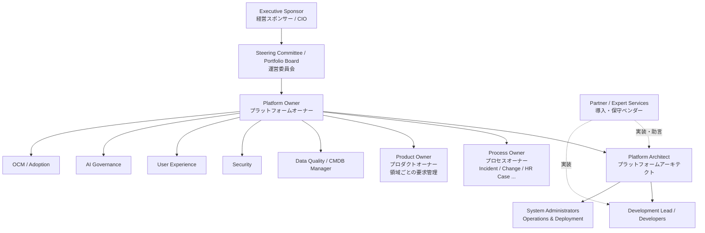
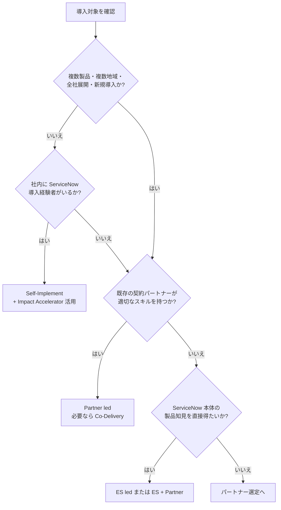

# プロジェクト体制とパートナー（Project Organization & Partners）

## 概要

ServiceNow の導入プロジェクトと、その後のプラットフォーム運用を成功させるには、**顧客側の責任体制**と**外部支援（パートナー／ServiceNow 自身のサービス）**を組み合わせて設計する必要がある。本ファイルは以下に答える。

| 問い | 該当節 |
|---|---|
| 顧客側にどんな役割（Platform Owner、Process Owner、Product Owner 等）を置くべきか | [顧客側の体制と役割](#顧客側の体制と役割) |
| 導入を誰が担うか（自社／Expert Services／パートナー／協業）をどう決めるか | [導入モデルの選択](#導入モデルの選択) |
| パートナーのランク（Elite / Premier 等）は何を意味するか | [ServiceNow Partner Program](#servicenow-partner-program) |
| ServiceNow 社の直接サービス（Expert Services）とは何か | [ServiceNow Expert Services](#servicenow-expert-services) |
| 成功支援サブスクリプション Impact で何が得られるか | [ServiceNow Impact](#servicenow-impact) |
| 日本の主要パートナーはどこか | [日本の主要パートナー](#日本の主要パートナー) |

関連ファイル：導入方法論は [04-implementation-methodology.md](04-implementation-methodology.md)、運用ガバナンスは [12-operations-governance.md](12-operations-governance.md)、CoE の実践は [../04_応用編/09-governance-coe-practice.md](../04_応用編/09-governance-coe-practice.md)、サポート体制（Now Support、ケース優先度）は [14-support-monitoring.md](14-support-monitoring.md)、日本市場特有の事情は [15-japan-market.md](15-japan-market.md)、認定資格は [../01_入門編/09-learning-path.md](../01_入門編/09-learning-path.md) を参照。

> **リリースとの関係:** 本ファイルの内容（体制・パートナー制度・Impact）はプラットフォームのリリースファミリー（Australia / Brazil）とは独立して改定される。Impact のドキュメントは Impact アプリ自体のバージョン（v7〜v12 等）で管理され、servicenow.com/docs 上では Australia 版・Brazil 版のページがそれぞれ存在する。本ファイルでは 2026-11-02 時点で確認できた Australia 版（2026-03-12 更新）と Brazil 版（2026-09-10 更新）のページを基にしている。

---

## 顧客側の体制と役割

### 全体像

ServiceNow の顧客側体制は、**プロジェクト期間中の体制**と**稼働後のプラットフォーム運営体制（CoE / CoEI）**に分けて考える。ServiceNow は近年、CoE（Center of Excellence）を **CoEI（Center of Excellence and Innovation）** と呼び、Impact の Strategy Accelerator にも「Center of Excellence & Innovation Design」「Center of Excellence and Innovation Maturity Assessment」がある [出典](https://www.servicenow.com/docs/r/impact/accelerator-and-initiative-list/accelerator-catalog.html)。

*図: 一般的な ServiceNow 顧客側体制の例。役割名は ServiceNow 公式ドキュメント（Impact、Customer Success Management）および ServiceNow Community の社員投稿を基に構成した。組織規模により兼務する。*

### 役割一覧（公式・準公式情報ベース）

以下は ServiceNow 公式ドキュメントで記述が確認できた役割である。Executive Sponsor・Platform Owner・Team Lead は Impact Accelerator（Staffing and Roles Review）の参加者定義に基づく。Customer Executive / CIO・Process Owner・Platform Architect は、**Customer Success Management アプリ（自社顧客のカスタマーサクセスを管理する製品）の役割定義を援用したもの**であり、ServiceNow 導入顧客の体制として ServiceNow が公式に定義したものではない。

| 役割（英語 / 日本語） | 責任 | 公式出典での位置づけ |
|---|---|---|
| Executive Sponsor（エグゼクティブスポンサー） | ServiceNow に関する主たる戦略的窓口。投資判断・優先順位・組織横断の調整を担う | Impact「Staffing and Roles Review」で **Required（必須）** 参加者 [出典](https://www.servicenow.com/docs/r/OLEAh14mAEPe8fUlW2F9wQ/9v1H0kdF4CB1Q9GYJWI3oQ) |
| Customer Executive / CIO（顧客側エグゼクティブ / CIO） | 顧客側の戦略的意思決定者。事業目標と ServiceNow 採用戦略の整合、IT・デジタル戦略との整合に責任を持つ | Customer Success Management アプリ（Zurich）の役割定義を援用（ServiceNow 導入体制としての公式定義ではない）。同ページの表記は「Customer Executive」「Customer Information Officer」 [出典](https://www.servicenow.com/docs/r/lUgPb7pdpGK5_sS7oizX7A/IeJHQ29jhCYY83oIDgGI3w) |
| Platform Owner（プラットフォームオーナー） | ServiceNow プラットフォーム全体の説明責任（accountability）を負う。System Administrator へのリーダーシップと監督、ビジネス戦略・ServiceNow ロードマップとの整合、プラットフォームガバナンスへの能動的関与 | Staffing and Roles Review で **Required（必須）** [出典](https://www.servicenow.com/docs/r/OLEAh14mAEPe8fUlW2F9wQ/9v1H0kdF4CB1Q9GYJWI3oQ) |
| ServiceNow AI Platform & Development Team Lead（プラットフォーム・開発チームリード） | プラットフォーム運用と開発を管理する | Staffing and Roles Review で **Recommended（推奨）** [出典](https://www.servicenow.com/docs/r/OLEAh14mAEPe8fUlW2F9wQ/9v1H0kdF4CB1Q9GYJWI3oQ) |
| Process Owner（プロセスオーナー） | 特定の業務プロセス（例：Incident、Change）に説明責任を負う。KPI を定義し、改善を推進し、プロセス成熟度を確認する | Customer Success Management アプリ（Zurich）の役割定義を援用（ServiceNow 導入体制としての公式定義ではない） [出典](https://www.servicenow.com/docs/r/lUgPb7pdpGK5_sS7oizX7A/IeJHQ29jhCYY83oIDgGI3w) |
| Platform Architect（プラットフォームアーキテクト） | ターゲットアーキテクチャを設計し、拡張性・セキュリティ・長期的な事業ニーズとの整合を確認する | Customer Success Management アプリ（Zurich）の役割定義を援用（ServiceNow 導入体制としての公式定義ではない） [出典](https://www.servicenow.com/docs/r/lUgPb7pdpGK5_sS7oizX7A/IeJHQ29jhCYY83oIDgGI3w) |

> **注記:** Customer Success Management（Zurich 版、2025-07-31 更新）の役割表には Relationship Manager、Escalation Manager、Service Delivery Manager、Implementation Specialist、Product Specialist、Customer Enablement Specialist、Solution Consultant も並ぶが、これらは主に**サービス提供側（ベンダー側）**の役割である。同ページで「customer side（顧客側）」と明記されるのは Customer Executive のみで、Customer Information Officer、Process Owner、Platform Architect には顧客側との記述はない [出典](https://www.servicenow.com/docs/r/lUgPb7pdpGK5_sS7oizX7A/IeJHQ29jhCYY83oIDgGI3w)。

### プラットフォーム運営の 9 つのステークホルダー役割

ServiceNow 社員による Community 記事（2025-01-24）は、ServiceNow プラットフォームの運営を監督するために **9 つのステークホルダー「役割」** が必要だと整理している。1 人が複数役割を兼ねることは前提とされている [出典](https://www.servicenow.com/community/developer-articles/governance-or-no-governance-that-is-the-question/ta-p/3158504)。

| # | 役割 | 責任 |
|---|---|---|
| 1 | Platform Owner | 最終決定権を持ち、あらゆる対立・判断の最上位エスカレーション先。他のすべての役割が埋まっていることを保証する |
| 2 | Demand（需要管理） | 要求を特定・優先順位付けし、新規・変更機能を承認・テストする |
| 3 | Product Owners（プロダクトオーナー） | 定義されたプラットフォーム領域、または一群の業務/IT プロセスについて要求を文書化し優先順位付けする。Demand の日々の要求作業を担うことが多い |
| 4 | Development（開発） | 開発成果物の品質を保証し、コーディングガイドラインと自動テスト（ATF）を維持し、開発着手前の要求の受入基準（Definition of Ready）を定める |
| 5 | Operations and Deployment（運用・デプロイ） | 全インスタンスの管理者作業と、非開発インスタンスへのアプリケーション展開に説明責任を持つ。運用安定性を重視 |
| 6 | Data Quality（データ品質） | 本番データの正確性・完全性を保ち、不要データのアーカイブ・削除を保証する。Instance Scan のチェック追加を要求することがある |
| 7 | User Experience（UX） | 機能の妥当性・使いやすさ・アクセシビリティを保証し、要求と画面設計に影響を与え、利用者満足度を監視する |
| 8 | Security（セキュリティ） | アクセス要件の定義からテスト、本番監視までプラットフォームのセキュリティを監督する。Instance Scan のチェック追加を要求することがある |
| 9 | Artificial Intelligence（AI） | 開発・本番における AI ベースの活動（結果の監督・分析・監視）に責任を持つ |

`【経験則】` 日本の導入プロジェクトでは、Platform Owner を情報システム部門の課長〜部長クラス、Process Owner を業務部門（サービスデスク責任者、人事部門の責任者など）に置き、Product Owner は Process Owner 配下または情報システム部門の担当者が担う構成が多い。

### Platform Owner / Process Owner / Product Owner の違い

3 つの「Owner」は混同されやすい。Platform Owner はプラットフォーム全体、Process Owner は業務プロセスの成果、Product Owner は特定領域の要求バックログに責任を持つ。

| 観点 | Platform Owner | Process Owner | Product Owner |
|---|---|---|---|
| 責任範囲 | ServiceNow プラットフォーム全体（全インスタンス・全アプリ） | 特定業務プロセス（Incident、Change、HR Case など） | 特定のプラットフォーム領域・アプリ（例：ITSM、HRSD、Employee Center） |
| 主な成果物 | プラットフォーム戦略・ロードマップ、ガバナンス規程、予算、体制、ライセンス管理 | プロセス定義、KPI、プロセス成熟度、改善計画 | 要求（ストーリー）バックログ、優先順位、受入判定 |
| 意思決定 | 最終決定・最上位エスカレーション先 | プロセス設計・ポリシー（例：変更承認基準） | スプリントに入れる要求と順序 |
| 典型的な出身 | IT 部門のマネージャー | 業務部門の責任者 | 業務分析者 / IT 部門担当 |
| 公式での扱い | Impact の Staffing and Roles Review で Required。Impact アプリに `Impact Platform Owner` ロールがある | 公式ドキュメントでの導入体制としての明示的定義は確認できず（Customer Success Management アプリの役割定義に類似記述あり） | ServiceNow 社員の Community 記事で定義（公式ドキュメントでの明示的定義は確認できず） |

出典：[Staffing and Roles Review](https://www.servicenow.com/docs/r/OLEAh14mAEPe8fUlW2F9wQ/9v1H0kdF4CB1Q9GYJWI3oQ)、[Customer success management responsibilities](https://www.servicenow.com/docs/r/lUgPb7pdpGK5_sS7oizX7A/IeJHQ29jhCYY83oIDgGI3w)、[Governance or no governance](https://www.servicenow.com/community/developer-articles/governance-or-no-governance-that-is-the-question/ta-p/3158504)

### 導入プロジェクト期間中の体制例

`【経験則】` 以下はパートナー主導の中規模（ITSM Pro + Employee Center、1 インスタンス、本番稼働まで 6〜9 か月程度）導入でよく見られる体制例である。人数は目安であり公式基準ではない。

| 区分 | 役割 | 顧客 / ベンダー | 人数目安 | 主な責任 |
|---|---|---|---|---|
| 意思決定 | Executive Sponsor | 顧客 | 1 | 予算・スコープ・優先度の最終決定、組織横断の調整 |
| 意思決定 | Steering Committee | 双方 | 4〜8 | 月次の進捗・課題・変更要求の承認 |
| PM | 顧客 PM（多くは Platform Owner 候補） | 顧客 | 1 | 社内調整、意思決定の取り付け、受入 |
| PM | ベンダー PM / Engagement Manager | ベンダー | 1 | 計画・進捗・品質・リスク管理 |
| 業務 | Process Owner | 顧客 | プロセス数に応じ 2〜5 | Fit to Standard ワークショップでの判断、KPI 定義、UAT 承認 |
| 業務 | Business Process Consultant / BA | ベンダー | 1〜2 | 業務要件の整理、標準プロセスとの差分分析 |
| 技術 | Platform Architect / Technical Architect | ベンダー（顧客側にも 1 名推奨） | 1 | アーキテクチャ・連携・データモデル（CSDM）設計 |
| 技術 | Developer / Technical Consultant | ベンダー | 2〜4 | 構成・開発・単体テスト |
| 技術 | System Administrator（運用引継先） | 顧客 | 1〜2 | 構成の理解、運用手順の習得 |
| データ | Data / CMDB Owner | 顧客 | 1 | 移行データの責任、CMDB 品質 |
| 定着化 | OCM / Training Lead | 双方 | 1 | 教育、コミュニケーション、Champion 網 |
| テスト | QA Lead | 双方 | 1 | テスト戦略、ATF、UAT 管理 |

Expert Services 主導の場合、ServiceNow 側チームは通常 **3〜5 名**（Engagement Manager、Technical Consultant、Business Process Consultant など）とされる [出典](https://www.servicenow.com/community/onboarding-hub-articles/choosing-an-implementation-model-for-your-servicenow-deployment/ta-p/2751714)。

自社導入（Self-Implement）の場合も、顧客側に Project Manager、技術リソース、Business Process Owner が必要とされる [出典](https://www.servicenow.com/community/onboarding-hub-articles/choosing-an-implementation-model-for-your-servicenow-deployment/ta-p/2751714)。

### マルチベンダー運営モデル（CoEI + 複数ベンダー）

大企業・公共機関で複数の導入・保守ベンダーを使う場合の役割分担として、ServiceNow Community の記事（2025-10-07）は CoEI を中心とした RACI を提示している `【第三者情報】`（ServiceNow Community のユーザー投稿）[出典](https://www.servicenow.com/community/developer-blog/defining-roles-and-responsibilities-in-a-multi-vendor-operating/ba-p/3400171)。

| 領域 | Portfolio Board / Steering | ServiceNow CoEI | ベンダー（導入パートナー） | QA（CoEI 配下） | OCM（CoEI 配下） |
|---|---|---|---|---|---|
| アイデア・需要管理 | 承認・優先順位付け | 需要の標準化 | 実現可能性の意見 | — | — |
| 戦略・ガバナンス | 戦略的監督 | 標準・ポリシー定義 | 協議を受ける | — | — |
| アーキテクチャ・運用 | — | 説明責任（Accountable） | 実行 | 準拠確認 | — |
| 自動化・イノベーション | — | ロードマップ主導 | アクセラレーター提供 | 報告を受ける | 報告を受ける |
| 品質保証・テスト | — | — | 機能・単体テスト | 戦略・最終承認 | — |
| リリース・デプロイ | — | リリース内容承認 | ビルド準備 | デプロイ・ロールバック実施 | — |
| 組織変革管理 | — | 指標追跡 | コンテンツ作成 | — | 定着化推進 |
| 継続的改善・ベンダー評価 | 報告を受ける | KPI 監視 | 改善実施・報告 | — | — |

ポイントは、**アーキテクチャとリリース承認の Accountable を顧客側 CoEI に残し、ベンダーには実行（Responsible）を委ねる**ことである。詳細な CoE 運営は [../04_応用編/09-governance-coe-practice.md](../04_応用編/09-governance-coe-practice.md) を参照。

### 必要人数の見積もり：Platform Team Estimator と Staffing and Roles Review

ServiceNow は体制規模の見積もり支援として以下を提供している。

| ツール / サービス | 内容 | 入手方法 |
|---|---|---|
| Platform Team Estimator | Customer Success Center のセルフサービス Web アプリ。インスタンスの属性、プラットフォーム利用状況、運営モデルに関する **11 の質問**に答えると、推奨 FTE（フルタイム換算）人数の範囲と必要な役割を提示する（2021-01 公開） | ServiceNow Customer Success Center [出典](https://www.servicenow.com/community/in-other-news/build-the-team-you-need-to-succeed-with-your-servicenow/ba-p/2285583) |
| Staffing and Roles Review（Impact Accelerator） | ServiceNow の専門家が顧客の役割・責任・スキルギャップを分析し、採用・パートナー活用・アウトソースの判断を支援する。CoEI Design Accelerator と併用が推奨される | Impact（Total ページ上の対象は Impact Guided+（Strategic Value アドオン）、Advanced（旧パッケージ）、Total）[出典](https://www.servicenow.com/docs/r/OLEAh14mAEPe8fUlW2F9wQ/9v1H0kdF4CB1Q9GYJWI3oQ)。セルフ型の「Staffing and Roles Review – On Demand」（Impact Guided、Guided + Strategic Value、Total が対象）もある [出典](https://www.servicenow.com/docs/r/OLEAh14mAEPe8fUlW2F9wQ/IrFOCyMFq5we4zvwW8jJxQ) |

**Staffing and Roles Review – Total（Australia 版、2026-03-12 更新）の進め方:**

| # | セッション | 時間上限 | 内容 |
|---|---|---|---|
| 1 | Introductory Customer Session | 1 時間 | プロセス・成果物の期待値合わせ、データ・インプットの依頼 |
| 2 | Discovery Sessions | 8 時間 | 顧客資料のレビュー、役割・責任の現状と目標成熟度の議論 |
| 3 | Customer Readout | 3 時間 | 組織構造・人員・役割の提案と実行リソースの説明 |
| 4 | Follow-Up Customer Session（任意） | 60 分 | Q&A、追加のリーディングプラクティス |

事前に求められる情報は、組織図と人員概要（個人名・機微情報・人員削減計画は不要）、ServiceNow 関連のガバナンス憲章、完了済みの Vision & Strategy Accelerator（ビジョン・戦略マップ）、既存 ServiceNow パートナーの状況、役割・責任定義である。**ServiceNow は顧客の人選プロセスには関与しない** [出典](https://www.servicenow.com/docs/r/OLEAh14mAEPe8fUlW2F9wQ/9v1H0kdF4CB1Q9GYJWI3oQ)。

> **注記:** Staffing and Roles Review – On Demand（Australia 版、2026-05-06 更新）は、顧客が自分のペースで進めるセルフガイド型で、Platform Owner の参加は「Recommended（推奨）」とされ、ServiceNow は提案された構成変更を実装しない [出典](https://www.servicenow.com/docs/r/OLEAh14mAEPe8fUlW2F9wQ/IrFOCyMFq5we4zvwW8jJxQ)。Total 版では Platform Owner は「Required（必須）」である [出典](https://www.servicenow.com/docs/r/OLEAh14mAEPe8fUlW2F9wQ/9v1H0kdF4CB1Q9GYJWI3oQ)。

---

## 導入モデルの選択

### 4 つの導入モデル

ServiceNow の Onboarding Hub 記事は、導入モデルを次の 4 つに分類している [出典](https://www.servicenow.com/community/onboarding-hub-articles/choosing-an-implementation-model-for-your-servicenow-deployment/ta-p/2751714)。

| モデル | 説明 | 向いているケース | 推奨されないケース |
|---|---|---|---|
| Self-Implement（自社導入） | 自社リソースで導入する。顧客側に PM、技術リソース、Business Process Owner を置く。ServiceNow からはリーディングプラクティス・製品ドキュメント・Webinar で支援 | 新製品を通常自社で導入している組織、パートナー予算がない組織。適合表では既存環境への製品追加、小規模組織の全社展開に適合 | 複数製品、複数地域、大企業の全社展開、新規導入（net-new）、適切なスキルのパートナーが既にいる場合 |
| Expert Services (ES) led | ServiceNow Expert Services がプロジェクトを端から端まで管理。チームは通常 3〜5 名（Engagement Manager、Technical Consultant、Business Process Consultant 等）。パッケージ型サービスで特定成果を加速できる | ServiceNow 製品知識への直接アクセスが欲しい場合。適合表では複数製品、複数地域、大企業・小規模組織の全社導入、既存環境への製品追加、新規導入（net-new）のいずれにも適合 | 適切なスキルのパートナーが既にいる場合 |
| Partner led | 認定パートナーと直接契約し端から端まで導入。パートナーは ServiceNow の導入方法論を利用できる。派生形として、パートナー主導で ServiceNow が要所で処方的ガイダンスを提供する **Co-Delivery** がある | 適切なパートナーと既に契約している組織。記事の適合表では全シナリオに適合 | （記事に明示なし） |
| ES + Partner | 認定パートナーと Expert Services の組み合わせ | パートナーの支援に加え、ServiceNow 製品・導入の専門知識に直接アクセスしたい場合 | 小規模組織の全社導入 |

*図: 公式記事の適合表を基に作成した導入モデル選択フロー（簡略化）。*

### パートナー選定の観点

`【経験則】` 日本でのパートナー選定では、ティア（Elite 等）だけで判断せず、以下を RFP で確認する。

| 観点 | 確認内容 | 根拠となる公開情報 |
|---|---|---|
| ルート別ティア | Consulting & Implementation（導入）でのティア。Resale（再販）でのティアと別物 | Partner Finder の各社プロファイル |
| 製品領域の実績 | 対象製品（ITSM / HRSD / CSM / ITOM / IRM 等）の **Product Line Achievement（PLA）**、**Validated Practice**、**Specialization** の有無 | Partner Finder、各社プレスリリース |
| 認定資格保有者数 | CSA、CIS-ITSM 等の保有者数、アサイン予定者個人の資格 | 提案書、[学習パスと認定資格](../01_入門編/09-learning-path.md) |
| 方法論 | ServiceNow の導入方法論（Now Create（ServiceNow Create）。Now Create ポータルは 2025-12-05 に廃止され、My Now の Best Practices サイトに置き換え）の利用、Fit to Standard の進め方 | [導入方法論](04-implementation-methodology.md)、[Now Create retirement FAQs](https://www.servicenow.com/community/in-other-news/now-create-retirement-faqs-and-introduction-to-best-practices/ba-p/3425556) |
| 運用移行 | 稼働後の保守（AMS: Application Management Services）、マネージドサービスの提供可否 | 提案書 |
| 日本語対応 | 日本語での要件定義・ドキュメント・教育、日本の商習慣（稟議、帳票）への理解 | [日本市場における導入](15-japan-market.md) |
| 顧客満足度 | パートナー評価に使われる CSAT（パートナー提供情報では、完了案件の回答の直近 365 日のローリング平均）`【第三者情報】` | Partner Finder のプロファイル記述 |

---

## ServiceNow Partner Program

### パートナープログラムの構成（ルート × ティア）

ServiceNow Partner Program は、**ルート・トゥ・マーケット（Route to market / パートナー種別）** と **ティア（Tier / Segment / 区分）** の 2 軸で構成される。2023-03 の改定で、従来の 37 領域に及ぶポイント制が廃止され、ルートごとにティアが付与される方式になった。パートナーは複数ルートに参加でき、ルートごとに異なるティアを持ちうる `【第三者情報】` [出典](https://techtarget.com/searchitchannel/news/365529755/ServiceNow-partner-program-ups-standards-differentiation)。

| ルート（英語） | 日本語 | 内容 |
|---|---|---|
| Consulting and Implementation（C&I） | コンサルティング・導入 | 導入・コンサルティングを提供する SI / コンサル |
| Resale（Reseller） | 再販 | ライセンスを再販する |
| Service Provider | サービスプロバイダー | マネージドサービス（MSP）、ホスティング、BPO 等として ServiceNow を用いたサービスを提供する |
| Build | ビルド | ISV 等が ServiceNow 上でアプリを開発し ServiceNow Store で提供する |

2023 年改定時の評価軸は、**Capability（提供能力）**、**Competency（製品知識・認定）**、**Customer Success（顧客成功）** の 3 つで、C&I では案件登録、新規顧客獲得（new logo）、技術リソース、顧客満足度スコアが基準とされた。移行猶予は 18 か月であった `【第三者情報】` [出典](https://techtarget.com/searchitchannel/news/365529755/ServiceNow-partner-program-ups-standards-differentiation)。ServiceNow のプレスリリースもパートナー賞の評価軸として「capabilities, competencies, customer success」の 3 本柱に言及している（NTT データの受賞発表で引用）[出典](https://www.nttdata.com/global/ja/news/topics/2025/031300)。

### ティア（区分）

ティア名称は時期とルートによって異なり、公開情報間で表記揺れがある。2026-11 時点で確認できた情報を整理する。

**C&I / Resale / Service Provider ルート（第三者情報）:**

| ティア | 英語 | 一般的な説明 |
|---|---|---|
| Global Elite | Global Elite | Elite の基準をすべて満たし、グローバル規模で事業を行い、経営レベルでのコミットメントを示す最上位の称号 |
| エリート | Elite | 5 つ以上の製品・ワークフローに特化し、複数地域で事業を行う |
| プレミア | Premier | 5 未満の製品に注力し、複数地域で事業を行う |
| スペシャリスト | Specialist（Specialized） | 1 つ以上の製品・領域で深いスキルを持つ |
| 登録 | Registered | エコシステムへの新規参加。最低限の参加要件を満たした段階 |

`【第三者情報】` 出典：[Ondaro: ServiceNow Partnership Tiers 2026](https://ondarowave.com/resources/blog/servicenow-partnership-tiers-2026)（2026-01-29 公開）。製品数・地域数の閾値は同記事の記述であり、ServiceNow 公式の要件定義は公開情報では確認できず。2025 年の APAC パートナー賞では「Consulting and Implementation Partner of the Year」が Elite / Premier / Specialist の区分別に授与されており、この 3 区分が実運用されていることは確認できる [出典](https://www.techpartner.news/news/servicenow-honours-apac-partners-in-2025-awards-615505)。

**Global Elite（公式）:** 2025-01-21 の ServiceNow 公式発表で、Infosys と Cognizant が Global Elite に昇格し、既存の Accenture、Deloitte、EY、KPMG と合わせて 6 社となった。Global Elite は「最大級のグローバルリーチと専門性を持つパートナー向けの最上位称号」とされる [出典](https://newsroom.servicenow.com/press-releases/details/2025/ServiceNow-enhances-global-partner-program-unlocking-new-revenue-and-market-opportunities-for-AI-solutions-01-21-2025-traffic/default.aspx)。

**Build Program（2026-01 改定、公式）:** 2026-01-20 の公式発表で Build Program が刷新され、ティアは **Registered → Select → Premier → Elite** の 4 段階となり、加えて本加入前の参加者向けに **Access Tier** が新設された。1,000 社超の既存パートナーが 2026 年 3 月までに新 Build Program へ移行する予定と発表された（移行完了の公式確認は公開情報では確認できず）。また、全グローバルパートナーが即時に共通の**単一の年会費**へ移行するとされた（金額は非公開）。インセンティブとして MDF（Market Development Fund、一部活動は 100% 償還）、SIF（Strategic Investment Fund）、販売・デプロイ・Specialization インセンティブが整理された [出典](https://investor.servicenow.com/news/news-details/2026/ServiceNow-enhances-global-Partner-Program-to-accelerate-AI-agent-innovation/default.aspx)。

> **注記:** Build Program の「Select」ティアが C&I 等の他ルートにも適用されるかは、公開情報では確認できず。C&I ルートでは Specialist の名称が 2025 年の受賞区分で使われている。

### パートナー数

| 時点 | パートナー数 | 出典 |
|---|---|---|
| 2025-01 | 2,200 社超 | [ServiceNow 公式発表 2025-01-21](https://newsroom.servicenow.com/press-releases/details/2025/ServiceNow-enhances-global-partner-program-unlocking-new-revenue-and-market-opportunities-for-AI-solutions-01-21-2025-traffic/default.aspx) |
| 2026-01 | 2,700 社超（グローバル） | [ServiceNow 公式発表 2026-01-20](https://investor.servicenow.com/news/news-details/2026/ServiceNow-enhances-global-Partner-Program-to-accelerate-AI-agent-innovation/default.aspx) |

### ティア以外の能力証明（PLA / Specialization / Validated Practice）

ティアは会社全体の規模感を示すにすぎない。特定製品領域の実力は以下の追加認定で確認する。

| 認定 | 内容 | 確認できた事例 |
|---|---|---|
| Product Line Achievement（PLA / 製品ライン達成） | 製品ライン単位で、デプロイ実績と実務レベルの認定資格保有を満たしたパートナーに付与。最低基準を下回ると失う可能性がある `【第三者情報】`。2025-01 に **Now Assist PLA** が新設され、ServiceNow AI の「検証済みの信頼できるアドバイザー」であることを示す | [公式発表 2025-01-21](https://newsroom.servicenow.com/press-releases/details/2025/ServiceNow-enhances-global-partner-program-unlocking-new-revenue-and-market-opportunities-for-AI-solutions-01-21-2025-traffic/default.aspx) |
| Specialization（スペシャライゼーション） | GenAI・業界向けの専門認定。2025-01 時点で Customer Experience GenAI、Employee Experience GenAI、ServiceOps GenAI、Cybersecurity、Tech Risk が発表された | 同上 |
| Validated Practice（検証済みプラクティス） | ServiceNow がパートナーの実務（組織戦略・ガバナンス、人材育成、販売・導入プロセス、顧客成功の実績）を詳細に審査し、導入品質と顧客成功のグローバル基準を満たしたことを認定する | 日立ソリューションズが 2026-01-21 に CSM・ITSM で国内初の取得を発表 [出典](https://www.hitachi-solutions.co.jp/company/press/news/2026/0121_2.html) |

### Partner Finder（パートナー検索）

ServiceNow 公式サイトの **Partner Finder**（`https://www.servicenow.com/partners/partner-finder.html`、日本語版は `/jp/partners/partner-finder/`）で、パートナーごとのルート、ティア（Segment）、対応地域、認定（Accreditations）、PLA 等を確認できる。各社プロファイルは `/partners/partner-finder/<会社スラッグ>.html` の形式である（例：`hitachi-solutions-ltd.html`、`nec-corp.html`、`scsk-corp.html`）。

> **画面の文章説明（Partner Finder）:** 検索条件として Partner Type（ルート）、Segment（ティア）、Product Line、Industry、Country/Region を指定でき、結果一覧から各社プロファイルに遷移する。プロファイルには会社概要、ルートごとの Segment、認定数（Accreditations）、Product Line Achievement、拠点が表示される。※Partner Finder 画面は本ナレッジ作成時に取得・確認できず、スクリーンショットは未掲載。最新の表示項目は実画面で確認すること。

### パートナーアワード

ServiceNow は毎年 Partner of the Year を地域（Americas / EMEA / APAC / Japan）別・カテゴリ別に表彰する。グローバル・APAC 賞は Partner Kickoff 前後（1〜3 月）に発表され（2026 年 APAC 賞の報道は 2026-03-04）、Japan 地域の賞は別途発表される（2026 年は 5 月に受賞企業が発表。例：日立ソリューションズ 2026-05-13）。2025 年には「GenAI Customer Value Partner of the Year」が新設された [出典](https://newsroom.servicenow.com/press-releases/details/2025/ServiceNow-enhances-global-partner-program-unlocking-new-revenue-and-market-opportunities-for-AI-solutions-01-21-2025-traffic/default.aspx)。

> **注記:** 2026 年の APAC 賞では部門体系が変わり、Partner Program 部門（例：Reseller Partner of the Year）、Domain Expertise 部門（例：IT Partner of the Year）、Rising Star（Reseller、Consulting & Implementation、Service Provider、ServiceNow Store）などで構成された。2025 年のような Elite / Premier / Specialist 区分別の C&I 賞の記載は 2026 年の報道では確認できない `【第三者情報】` [出典](https://www.techpartner.news/news/servicenow-honours-2026-apac-partner-awards-winners-623995)。日本の受賞企業は [日本の主要パートナー](#日本の主要パートナー) を参照。

---

## ServiceNow Expert Services

### 概要

**ServiceNow Expert Services（エキスパートサービス）** は、ServiceNow 社自身のプロフェッショナルサービス部門である。Expert Services は 800 名超の実務者を擁し、ServiceNow 全製品の導入を支援でき、あらゆる業種・地域で 9,000 件超の導入実績があるとされる [出典](https://www.servicenow.com/community/onboarding-hub-articles/chart-your-path-to-implementation-success/ta-p/2735416)（Onboarding Hub 記事時点の数値。同じ Onboarding Hub の別記事「Choosing an implementation model」では 8,500 件超とされ、記事により数値が異なる [出典](https://www.servicenow.com/community/onboarding-hub-articles/choosing-an-implementation-model-for-your-servicenow-deployment/ta-p/2751714)）。

### サービス区分

ServiceNow Community の Expert Services 公式記事（2025-01-15 更新）は、次の 3 区分を示している [出典](https://www.servicenow.com/community/expert-services-articles/achieve-more-value-faster-with-servicenow-expert-services-nbsp/ta-p/3150202)。

| 区分 | 英語 | 内容 |
|---|---|---|
| 導入サービス | Implementation Services | ServiceNow ポートフォリオのあらゆる製品の導入（設計と実行）。Now Assist、DevOps、データモデル設計など対象を絞った付加価値型導入サービスもある |
| アドバイザリー | Advisory Services | 既存実装の価値最大化の助言。セルフサービス、CSDM 活用、ローコードアプリ開発など |
| 最適化・是正 | Optimization and Remediation Services | プラットフォームの健全性・性能を確保。改善機会の特定、優先度の高い問題の是正、CMDB・テクノロジーワークフロー等のリーディングプラクティス助言 |

問い合わせ窓口は ServiceNow の **Services Account Executive（サービス担当営業）** である [出典](https://www.servicenow.com/community/expert-services-articles/achieve-more-value-faster-with-servicenow-expert-services-nbsp/ta-p/3150202)。

### Expert Services の特徴とパートナーとの関係

| 観点 | Expert Services | パートナー |
|---|---|---|
| 製品知識 | 製品開発部門への直接アクセス、最新機能への知見 | パートナーにより差が大きい |
| 方法論 | 1,100 超のベストプラクティスからなる導入方法論（Now Create（ServiceNow Create）。現在は My Now の Best Practices）を使用 [出典](https://www.servicenow.com/community/onboarding-hub-articles/chart-your-path-to-implementation-success/ta-p/2735416) | 同方法論を利用可能＋自社方法論 |
| 業務知識・日本対応 | 業務パッケージは標準寄り | 業種知見・日本語・既存システム連携（基幹系）に強いことが多い `【経験則】` |
| 規模 | 通常 3〜5 名のチーム | 大規模体制・長期保守が可能 |
| 運用保守 | 原則として導入・助言中心 | AMS / マネージドサービスを提供するパートナーが多い |
| 価格 | 公開情報では確認できず（日額単価は非公開） | 公開情報では確認できず |

`【経験則】` 日本では Expert Services 単独より、**パートナー主導 + Expert Services による設計レビュー・アーキテクチャ助言（ES + Partner）** の組み合わせが大規模案件でよく採られる。

### Impact Integrated Success との関係

Impact の **Integrated Success** パッケージには、Expert Services のチーム（Engineering Manager、Business Process Consultant、Solution Architect）による導入・設計・アーキテクチャ・技術実装の支援が含まれ、Impact 内の **Free Form initiative** として起票される [出典](https://www.servicenow.com/docs/r/australia/impact/impact-packages.html)。詳細は次節。

---

## ServiceNow Impact

### Impact とは

**ServiceNow Impact（インパクト）** は、ServiceNow の有償カスタマーサクセス（成功支援）サブスクリプションである。サポートツール、セルフヘルプ資料、人による支援（Accelerator、Impact Squad）、デジタル体験（ダッシュボード、推奨エンジン）を組み合わせて提供する。全 Impact 顧客共通の特典は次のとおり [出典](https://www.servicenow.com/docs/r/impact/impact-packages.html)。

- 価値実現ダッシュボードと直感的なジャーニービルダーを備えたデジタル体験
- ロードマップと役割に紐づくパーソナライズされた学習・コーチング
- プロアクティブな洞察、処方的アラート、カスタム推奨を出す推奨エンジン

### パッケージ（Australia 版）

Australia 版の Impact packages ページ（2026-03-12 更新）で確認できるパッケージは以下の 3 つである [出典](https://www.servicenow.com/docs/r/australia/impact/impact-packages.html)。

| パッケージ | 位置づけ | Impact Squad / 専任チーム | Accelerator の同時実行数 |
|---|---|---|---|
| Guided | エントリーレベル。プレミアムなデジタル体験、強化された技術サポート、厳選コンテンツ | Customer Success Manager（CSM） | 全サブカタログを通じて同時に 1 件まで（One Accelerator at a time across all sub-catalogs） |
| Total | 完全版。専任エキスパートチーム、パーソナライズされた推奨、予防ツール | Customer Success Executive、Platform Architect、CSM、Support Account Manager（SAM） | 最大 7 件（Architecture・Strategy・Technical 各 2 件＋Optimization 1 件）。Optimization は最新バージョンのみ対象 |
| Integrated Success | Total の全特典＋プログラムデリバリー、設計、アーキテクチャ、技術実装の専門家支援 | Total の Squad＋Engineering Manager、Business Process Consultant、Solution Architect | 全 Accelerator 種別。Expert Services による Platform Optimization を含み、Free Form initiative で起票 |

**Guided と Total の詳細比較**（Brazil 版 Impact Packages ページ、2026-09-10 更新）[出典](https://www.servicenow.com/docs/r/impact/impact-packages1.html)：

| 項目 | Guided | Total |
|---|---|---|
| 24 時間 365 日サポート（P1/P2） | あり | あり |
| P1 初回応答目標 | 30 分 | 15 分 |
| P2 初回応答目標 | 120 分 | 60 分 |
| Developer Support シート | なし（Managed Support アドオンで 5 シート） | 10 シート |
| Accelerator カタログ | Technical、Strategy（一部）、Architecture（一部） | 全カタログ（Strategy・Architecture 全量＋Optimization） |
| Scan Engine カスタム定義 | 最大 10 | 無制限 |
| Scan Engine 修正案（proposed fix） | なし | あり |
| Instance Observer シート | 5 | 10 |
| データ参照期間（look-back） | 45 日 | 6 か月 |
| アラート種類 | 6 | 40 |
| Instance Observer アナリティクス | なし | あり |

> **Brazil での変更:** Brazil 版（2026-09-10 更新）でもパッケージ構成は Guided / Total / Integrated Success で Australia 版と同一である。上表の応答目標・Instance Observer の数値は Brazil 版ページで確認した値であり、Australia 版ページでは同数値の記載を確認できず。

> **旧パッケージ:** Zurich 以前のドキュメントには **Advanced** パッケージ（Guided と Total の中間、エンドツーエンドの技術サポート、アドバイザリーセッション、オンデマンド研修）が存在した。Staffing and Roles Review のページには現在も「Guided+（Strategic Value アドオン）、Advanced、Total」の記載が残る。また、第三者記事では全顧客無償の **Base** を含む 4 段階として説明されることがあるが、Australia 版公式ドキュメントでは Base は確認できない `【第三者情報】` [出典](https://upperedge.com/servicenow/servicenow-impact-negotiations-key-contract-terms-for-enterprises/)。

> **価格:** Impact の価格は公開されていない。第三者記事では Advanced で ServiceNow 契約額の約 20%、Total で約 30% という目安が示されている `【推定】`（出典：[Livingstone Knowledge](https://blog.livingstone-tech.com/en/knowledge/unveiling-servicenow-impact-a-game-changer-for-your-enterprise-journey)、取得日 2026-11-02）。価格の詳細は [02-pricing.md](02-pricing.md) を参照。

### アドオン

アドオンは SKU 単位・年単位で個別に価格設定される [出典](https://www.servicenow.com/docs/r/impact/impact-packages.html)。

| アドオン | 主な内容 |
|---|---|
| Strategic Value | Value IDI のアップグレード、Strategy Accelerator の同時実行枠 +2、CSM カバレッジ追加 |
| Platform Governance | Health IDI のアップグレード、Architecture Accelerator の同時実行枠 +2、CSM カバレッジ追加 |
| Platform Optimization | Optimization Accelerator の同時実行枠 +1 |
| Managed Support | P1/P2 初回応答目標の短縮、1 インスタンスへの SAM カバレッジ追加、Impact Developer Support 5 シート |
| Instance Observer features | 6 か月ローリングの性能・可用性監視とレポート、セルフサービスのアラート・通知 |
| Instance Observer seats | 10 シート |
| Preventive Care | 年 2 回の本番インスタンス健全性の詳細診断（パフォーマンスエンジニア主導）、ステークホルダー向け報告、ガイド付き是正 |
| Platform Health | 無制限のアクティブなカスタム定義と修正案（主に Guided 向け） |

※ IDI = Impact Delivery Instance（Impact の提供用インスタンス）。

> **提供制限:** FedRAMP、NSC DOD IL5、Australia IRAP-Protected、セルフホスト環境、および MSP（自社内利用を除く）では一部機能が利用できない場合がある [出典](https://www.servicenow.com/docs/r/impact/impact-packages1.html)。

### Accelerator（アクセラレーター）

**Accelerator** は、ServiceNow の専門家による**スコープ固定型のエンゲージメント**である（例：アップグレード準備、成熟度評価、製品の Jumpstart）。Expert-led（専門家主導）の Accelerator には同時実行数の制限があり、On Demand（セルフ型）には制限がない [出典](https://www.servicenow.com/docs/r/impact/accelerator-and-initiative-list/impact-initiatives.html)。

Brazil 版 Accelerator catalog（2026-09-10 更新）でのサブカタログ構成 [出典](https://www.servicenow.com/docs/r/impact/accelerator-and-initiative-list/accelerator-catalog.html)：

| サブカタログ | 件数 | 体制・組織に関係する主な Accelerator |
|---|---|---|
| Architecture | 10 | Architecture Blueprint、Technical Governance、Multi-instance Topologies、Design Review、Health Assessment、Integration Strategy、CSDM Maturity Assessment |
| Strategy | 27 | **Staffing and Roles Review**、**Center of Excellence & Innovation Design**、Center of Excellence and Innovation Maturity Assessment、**Develop Partner Strategy**、ServiceNow Governance、Vision and Strategy、Stakeholder Path to Value、Champion Engagement、Citizen Development Program Design、OCM: Preparing / Managing / Reinforcing and Sustaining Change、各製品の Maturity Assessment（ITSM、ITOM、HRSD、CSM、IRM、PPM、SAM、LSD、Knowledge Management）、Adopt AI Governance、Foundations of AI Governance |
| Technical | 92 | Jumpstart Your ○○（CMDB、AI Agents for ITSM/CSM、Employee Center、Upgrade 等）、TuneUp Your ○○、UX 系、Access to Experts、Health Findings Review |
| Optimization | 2 | Optimization Capability Configuration、Optimization Capability Design |

`【経験則】` 体制立ち上げ期には、Vision and Strategy → Staffing and Roles Review → Center of Excellence & Innovation Design → ServiceNow Governance / Technical Governance の順で Accelerator を使うと、CoEI の設計を ServiceNow 標準のフレームワークに沿って進めやすい。Staffing and Roles Review は Vision & Strategy Accelerator の完了を前提情報として要求する [出典](https://www.servicenow.com/docs/r/OLEAh14mAEPe8fUlW2F9wQ/9v1H0kdF4CB1Q9GYJWI3oQ)。

新規 Accelerator は Impact のリリースごとに追加される（例：v11.0.0 で Health Findings Review、Jumpstart Your AI Agent Advisor、Jumpstart Your Build Agent 等、v12.0.0 で ITSM / Portfolio Governance / Strategy Governance の On Demand 成熟度評価）[出典](https://www.servicenow.com/docs/r/impact/accelerator-and-initiative-list/new-accelerators-australia-release.html)。

### Initiative（イニシアチブ）

**Initiative** は Impact Squad がパッケージの権利範囲に基づいて推奨するエンゲージメント・ワークストリームで、アドバイザリーセッションや Squad 主導のプロジェクトを含む。Impact アプリには次のビューがある [出典](https://www.servicenow.com/docs/r/impact/accelerator-and-initiative-list/impact-initiatives.html)。

| ビュー | 内容 |
|---|---|
| Your initiatives | パッケージ権利の一部として提供される Initiative |
| Initiatives roadmap | 他チームの作業を含む進行中ワークストリームの統合ビュー |
| Initiatives Catalog | Impact Initiative の全カタログ |

Accelerator と Initiative はいずれも Impact Store アプリと Impact Delivery Instance（IDI）の「Accelerators and Initiatives」ページに表示される。

### Impact のロール

Impact を利用するには、顧客インスタンスに **Impact アプリ（ServiceNow Store から導入）** を入れ、顧客側の担当者にロールを割り当てる。Platform Owner には `Impact Platform Owner` ロールを付与するのが前提設計である [出典](https://www.servicenow.com/docs/r/zurich/impact/impact-roles.html)。

**Impact Store アプリ（顧客インスタンス）のロール:**

| ロール（表示名） | 含まれるロール | 権限 |
|---|---|---|
| Impact App Admin | Impact App Admin、Scan Engine Admin | Impact アプリと Scan Engine の構成、全スキャン実行・結果参照、IDI 連携設定、ロール割り当て、Impact テーブルへのフル CRUD |
| Impact Platform Owner | Impact Platform Owner | Impact テーブルへの CRUD、サービス（Accelerator 等）のリクエスト。連携設定・ロール割り当ては不可 |
| Impact Portfolio Owner | Impact Portfolio Owner | Platform Owner と同等の権限を、Platform Owner でない利用者に付与 |
| Impact Executive | Impact Executive | 長期戦略の定義、ほぼ全機能の参照と一部の書き込み、会話（conversation）の作成・更新 |
| Impact User | Impact User | 一般アクセス、会話の作成・更新、会話以外の全テーブル参照 |
| Impact Developer | Impact Developer、Scan User | Developer Dashboard、オンデマンドスキャン実行（スケジュールスキャンは不可）、スキャン結果参照 |
| Impact Development Team Lead | Impact Development Team Lead | Development Team Lead ダッシュボード |

**Impact Delivery Instance（IDI、ServiceNow 側の提供インスタンス）のロール:** Impact User、Impact Permissions Authorizer（同意が必要な機能の許可）、Impact Executive（ロードマップのオーナー）、Impact Platform Owner（Accelerator・アドバイザリーセッションの要求、ガバナンスと System Administrator の監督）、Impact Admin（ユーザー管理、Instance Observer・Developer Support 等のプレミアムアクセス管理）。

> **注記:** ロールの技術名（`sn_` で始まるスコープ付き名称）は公式ページの表に記載がなく、公開情報では確認できず。実際のインスタンスで User Administration > Roles を「Impact」で検索して確認すること。

### Impact Squad の役割（ServiceNow 側）

| 役割 | 主な責任 | 含まれるパッケージ |
|---|---|---|
| Customer Success Manager（CSM） | 顧客の成功計画・価値実現の窓口。Accelerator の計画 | Guided、Total |
| Customer Success Executive | エグゼクティブレベルの関係構築と戦略整合 | Total |
| Platform Architect | ビジネス成果をアーキテクチャのブループリントに落とし込み、技術ガバナンスの確立を支援 | Total |
| Support Account Manager（SAM） | サポートケースのエスカレーション・予防的サポートの窓口 | Total（Guided は Managed Support アドオンで追加） |
| Engineering Manager / Business Process Consultant / Solution Architect | 導入・設計・技術実装（Expert Services） | Integrated Success |

出典：[Impact packages（Australia）](https://www.servicenow.com/docs/r/australia/impact/impact-packages.html)

---

## 日本の主要パートナー

### 前提

日本の ServiceNow パートナーは、グローバル SI・コンサル（Global Elite を含む）、国内大手 SI、ServiceNow 専業系、通信事業者系に大別できる。パートナーのティアは年度ごとに見直されるため、**最新のティアは必ず Partner Finder で確認する**こと。以下は 2026-11-02 時点の公開情報で確認できた事実のみを記載する。

### 国内企業（公開情報で確認できた事項）

| パートナー | 確認できた事項 | 出典 |
|---|---|---|
| 日立ソリューションズ | 2012 年に販売代理店契約を締結し、日本で初めて ServiceNow を販売した企業（2013-01-25 の同社発表では、国内初の重要パートナー契約を締結し同日から販売・導入・教育・一次サポートを開始と記載）。最上位の Elite を維持（2026-05-13 時点の同社発表）。140 社超の導入支援実績。2026-01-21 に CSM・ITSM で国内初の **Validated Practice** 認定を取得。**ServiceNow Partner Awards 2026**（国内パートナー対象の賞）で Consulting and Implementation / Reseller / Data & Analytics の 3 部門で Partner of the Year を受賞（2026-05-13 発表） | [2026-05-13 発表](https://www.hitachi-solutions.co.jp/company/press/news/2026/0513.html)、[2013-01-25 発表](https://www.hitachi-solutions.co.jp/company/press/news/2013/0125.html)、[2026-01-21 発表](https://www.hitachi-solutions.co.jp/company/press/news/2026/0121_2.html) |
| 富士通 | 2024-05-07 に ServiceNow とグローバルな戦略的パートナーシップを発表（Fujitsu Uvance のオファリング、Fujitsu-ServiceNow Innovation Center、最初の対象は製造業の ECM・SCM 統合）。2025 年 APAC パートナー賞で Consulting and Implementation（Elite）、Reseller（Elite）、Employee / Creator / Technology Workflow の各 Partner of the Year、日本市場でも 2 部門を受賞。2026 年 APAC 賞で Reseller Partner of the Year、IT Partner of the Year | [Cloud Watch 2024-05](https://cloud.watch.impress.co.jp/docs/news/1589675.html)、[techpartner.news 2025](https://www.techpartner.news/news/servicenow-honours-apac-partners-in-2025-awards-615505)、[techpartner.news 2026](https://www.techpartner.news/news/servicenow-honours-2026-apac-partner-awards-winners-623995) |
| NTT データ | 2025 ServiceNow Partner of the Year「Service Provider Partner of the Year - Japan region」受賞（2025-03-13 発表）。FY2020 に専任組織を設置し、約 250 名のコンサルタント・エンジニアを擁する。2022 年に「2022 ServiceNow APJ Accelerated Growth Partner of the Year」受賞（2022-03-15 の APJ Partner Awards 授賞式、2022-03-18 発表） | [NTT データ 2025-03-13](https://www.nttdata.com/global/ja/news/topics/2025/031300)、[NTT データ 2022-03-18](https://www.nttdata.com/global/ja/news/information/2022/031801) |
| NEC | 2025 年 Japan の ServiceNow Store Partner of the Year を受賞 `【第三者情報】`（検索結果に表示された ServiceNow 公式ブログの記載に基づく。本文は直接取得できず）。同社サイトでは Reseller の Elite ランク、2026 年 Core Business Partner of the Year 受賞と記載されている旨の検索結果があるが、本文は直接確認できず | [ServiceNow ブログ 2025](https://www.servicenow.com/blogs/2025/servicenow-partner-awards-leading-ai)、[NEC ServiceNow ページ](https://jpn.nec.com/service/servicenow/index.html) |
| ジャパンシステム / Blueship | 2025-01 付で Reseller ルートの Elite に昇格（国内 Reseller で唯一のアップグレードとされる）、Consulting & Implementation でも Elite に昇格。2025 年 Customer Workflow Partner of the Year（日本地域）受賞 `【第三者情報】`（同社 PDF 発表の検索結果要約に基づく） | [ジャパンシステム 2025-01 発表](https://japan-systems.co.jp/wp-content/uploads/2025/01/JS2025-01.pdf) |
| SCSK | Partner Finder に Consulting & Implementation / Reseller のプロファイルあり。Reseller で Premier と表示 `【第三者情報】`（検索結果の要約） | [Partner Finder](https://www.servicenow.com/it/partners/partner-finder/scsk-corp.html) |
| NTT ドコモビジネス（旧 NTT コミュニケーションズ） | Partner Finder で Premier と表示。東京・大阪に「Nexcenter」を活用した ServiceNow の国内データセンターを開設したと記載 `【第三者情報】`（検索結果の要約） | [Partner Finder](https://www.servicenow.com/partners/partner-finder/ntt-docomo-business-inc.html) |
| ファーストキューエー・システムズ（FirstQA Systems） | 最も古い ServiceNow Premier パートナーの一つと記載（横浜） `【第三者情報】` | [Partner Finder](https://www.servicenow.com/jp/partners/partner-finder/firstqa-systems-kk.html) |
| その他 Partner Finder 掲載企業 | 野村総合研究所、伊藤忠テクノソリューションズ、JSOL、三井情報（Mitsui Knowledge Industry）、エクシオ・デジタルソリューションズ、aoranow 等のプロファイルが存在する（ティアは未確認） | [Partner Finder](https://www.servicenow.com/jp/partners/partner-finder/) |

### グローバル SI・コンサル（日本法人）

| パートナー | 確認できた事項 |
|---|---|
| Accenture（アクセンチュア） | Global Elite [出典](https://newsroom.servicenow.com/press-releases/details/2025/ServiceNow-enhances-global-partner-program-unlocking-new-revenue-and-market-opportunities-for-AI-solutions-01-21-2025-traffic/default.aspx)。2025 年 Japan の Partner Program 部門（Elite セグメント）で受賞、Deloitte がファイナリスト `【第三者情報】`（検索結果に表示された ServiceNow 公式ブログの記載に基づく） |
| Deloitte（デロイト トーマツ） | Global Elite |
| EY（EY ストラテジー・アンド・コンサルティング） | Global Elite |
| KPMG（KPMG コンサルティング） | Global Elite |
| Infosys | Global Elite（2025-01 昇格） |
| Cognizant | Global Elite（2025-01 昇格）。ServiceNow 専業の Thirdera を傘下に持つ（公式発表で「Thirdera (a Cognizant company)」と記載） |

> **注記:** Global Elite は**グローバル本社単位**の称号であり、日本法人の ServiceNow 導入体制の規模は各社で異なる。日本での体制・実績は個別に確認すること。

### 日本市場の動向

ServiceNow Japan は 2024 年の事業方針として「日本発のパートナーエコシステムの確立」を掲げ、富士通とのグローバルパートナーシップ発表を含め計画どおり進捗したとし、パートナー数も順調に増加していると説明している（具体的な社数は非公表）[出典](https://cloud.watch.impress.co.jp/docs/news/2003774.html)。日本市場固有の事情は [15-japan-market.md](15-japan-market.md) を参照。

### 確認できなかった事項

- 日本のパートナー総数、ティア別社数（公開情報では確認できず）
- 2026 年 ServiceNow Partner Awards の Japan 地域全受賞一覧（日立ソリューションズの 3 部門以外は確認できず）
- NEC、野村総合研究所、伊藤忠テクノソリューションズ、SCSK 等の現時点の C&I ルートのティア（Partner Finder 本体を直接取得できず）
- C&I ルートのティア要件（認定者数・案件数などの数値基準）の公式定義

---

## 実務チェックリスト

`【経験則】` プロジェクト立ち上げ時に確認する項目。

| # | 項目 | 確認ポイント |
|---|---|---|
| 1 | Executive Sponsor の任命 | 予算・スコープの最終決定権を持つ役員が明確か |
| 2 | Platform Owner の任命 | 稼働後も継続して責任を持つ人物か（プロジェクト PM と兼務する場合、稼働後の後任計画があるか） |
| 3 | Process Owner の任命 | 対象プロセスごとに業務部門側の責任者がいるか。Fit to Standard で「標準に合わせる」判断ができる権限があるか |
| 4 | Product Owner / 要求窓口 | 要求の一元受付（Demand）とバックログ管理の仕組みがあるか |
| 5 | アーキテクチャ責任 | 顧客側に Platform Architect（または技術リード）がいるか。ベンダー任せになっていないか |
| 6 | 導入モデル | Self / ES / Partner / ES + Partner のどれか、その理由 |
| 7 | パートナー選定 | C&I ルートのティア、対象製品の PLA / Validated Practice、アサイン者の認定資格 |
| 8 | Impact の活用 | 契約パッケージ（Guided / Total / Integrated Success）、利用可能な Accelerator と同時実行枠、`Impact Platform Owner` ロールの付与 |
| 9 | 運用移行 | 稼働後の CoEI 体制、AMS ベンダー、System Administrator の育成計画 |
| 10 | 人数見積 | Platform Team Estimator / Staffing and Roles Review の活用 |

---

## 参照元

**ServiceNow 公式ドキュメント**
- Impact packages（Australia）: https://www.servicenow.com/docs/r/australia/impact/impact-packages.html
- Impact packages（Brazil / 最新）: https://www.servicenow.com/docs/r/impact/impact-packages.html
- Impact Packages（Brazil、詳細比較）: https://www.servicenow.com/docs/r/impact/impact-packages1.html
- Impact packages（Zurich）: https://www.servicenow.com/docs/r/zurich/impact/impact-packages.html
- Accelerator catalog: https://www.servicenow.com/docs/r/impact/accelerator-and-initiative-list/accelerator-catalog.html
- Accelerators - new accelerators: https://www.servicenow.com/docs/r/impact/accelerator-and-initiative-list/new-accelerators-australia-release.html
- Impact initiatives: https://www.servicenow.com/docs/r/impact/accelerator-and-initiative-list/impact-initiatives.html
- Staffing and Roles Review – Total（Australia）: https://www.servicenow.com/docs/r/OLEAh14mAEPe8fUlW2F9wQ/9v1H0kdF4CB1Q9GYJWI3oQ
- Staffing and Roles Review – On Demand（Australia、2026-05-06 更新）: https://www.servicenow.com/docs/r/OLEAh14mAEPe8fUlW2F9wQ/IrFOCyMFq5we4zvwW8jJxQ
- Roles installed with Impact（Zurich）: https://www.servicenow.com/docs/r/zurich/impact/impact-roles.html
- Customer success management responsibilities（Zurich）: https://www.servicenow.com/docs/r/lUgPb7pdpGK5_sS7oizX7A/IeJHQ29jhCYY83oIDgGI3w

**ServiceNow 公式発表・Community（ServiceNow 社員投稿）**
- ServiceNow enhances global Partner Program（2026-01-20）: https://investor.servicenow.com/news/news-details/2026/ServiceNow-enhances-global-Partner-Program-to-accelerate-AI-agent-innovation/default.aspx
- ServiceNow enhances global partner program（2025-01-21）: https://newsroom.servicenow.com/press-releases/details/2025/ServiceNow-enhances-global-partner-program-unlocking-new-revenue-and-market-opportunities-for-AI-solutions-01-21-2025-traffic/default.aspx
- Choosing an implementation model for your ServiceNow deployment: https://www.servicenow.com/community/onboarding-hub-articles/choosing-an-implementation-model-for-your-servicenow-deployment/ta-p/2751714
- Chart your path to implementation success: https://www.servicenow.com/community/onboarding-hub-articles/chart-your-path-to-implementation-success/ta-p/2735416
- Achieve more value faster with ServiceNow Expert Services: https://www.servicenow.com/community/expert-services-articles/achieve-more-value-faster-with-servicenow-expert-services-nbsp/ta-p/3150202
- Governance or no governance – that is the question（2025-01-24）: https://www.servicenow.com/community/developer-articles/governance-or-no-governance-that-is-the-question/ta-p/3158504
- Build the team you need to succeed with your ServiceNow（Platform Team Estimator, 2021-01-14）: https://www.servicenow.com/community/in-other-news/build-the-team-you-need-to-succeed-with-your-servicenow/ba-p/2285583
- Now Create retirement FAQs and introduction to Best Practices（2025-11-12）: https://www.servicenow.com/community/in-other-news/now-create-retirement-faqs-and-introduction-to-best-practices/ba-p/3425556
- ServiceNow Partner Awards 2025 blog: https://www.servicenow.com/blogs/2025/servicenow-partner-awards-leading-ai

**ServiceNow Community（ユーザー投稿）**
- Defining roles and responsibilities in a multi-vendor operating model（2025-10-07）: https://www.servicenow.com/community/developer-blog/defining-roles-and-responsibilities-in-a-multi-vendor-operating/ba-p/3400171

**パートナー・第三者**
- TechTarget: ServiceNow partner program ups standards, differentiation（2023-01-30）: https://techtarget.com/searchitchannel/news/365529755/ServiceNow-partner-program-ups-standards-differentiation
- Ondaro: ServiceNow Partnership Tiers 2026: https://ondarowave.com/resources/blog/servicenow-partnership-tiers-2026
- techpartner.news: ServiceNow honours APAC partners in 2025 awards: https://www.techpartner.news/news/servicenow-honours-apac-partners-in-2025-awards-615505
- techpartner.news: ServiceNow honours 2026 APAC Partner Awards winners: https://www.techpartner.news/news/servicenow-honours-2026-apac-partner-awards-winners-623995
- UpperEdge: ServiceNow Impact negotiations: https://upperedge.com/servicenow/servicenow-impact-negotiations-key-contract-terms-for-enterprises/
- Livingstone Knowledge: Unveiling ServiceNow Impact: https://blog.livingstone-tech.com/en/knowledge/unveiling-servicenow-impact-a-game-changer-for-your-enterprise-journey
- 日立ソリューションズ（2026-05-13）: https://www.hitachi-solutions.co.jp/company/press/news/2026/0513.html
- 日立ソリューションズ（2026-01-21）: https://www.hitachi-solutions.co.jp/company/press/news/2026/0121_2.html
- 日立ソリューションズ（2013-01-25）: https://www.hitachi-solutions.co.jp/company/press/news/2013/0125.html
- NTT データ（2025-03-13）: https://www.nttdata.com/global/ja/news/topics/2025/031300
- NTT データ（2022-03-18）: https://www.nttdata.com/global/ja/news/information/2022/031801
- Cloud Watch（富士通との戦略的パートナーシップ、2024-05）: https://cloud.watch.impress.co.jp/docs/news/1589675.html
- Cloud Watch（ServiceNow Japan 2025 年事業方針、2025-04-03）: https://cloud.watch.impress.co.jp/docs/news/2003774.html
- ジャパンシステム（2025-01）: https://japan-systems.co.jp/wp-content/uploads/2025/01/JS2025-01.pdf
- NEC ServiceNow: https://jpn.nec.com/service/servicenow/index.html
- ServiceNow Partner Finder（各社プロファイル）: https://www.servicenow.com/jp/partners/partner-finder/
  - SCSK: https://www.servicenow.com/it/partners/partner-finder/scsk-corp.html
  - NTT ドコモビジネス: https://www.servicenow.com/partners/partner-finder/ntt-docomo-business-inc.html
  - ファーストキューエー・システムズ: https://www.servicenow.com/jp/partners/partner-finder/firstqa-systems-kk.html
