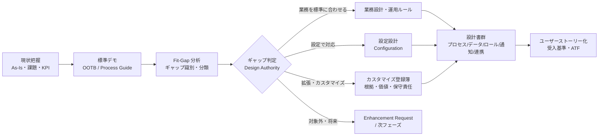
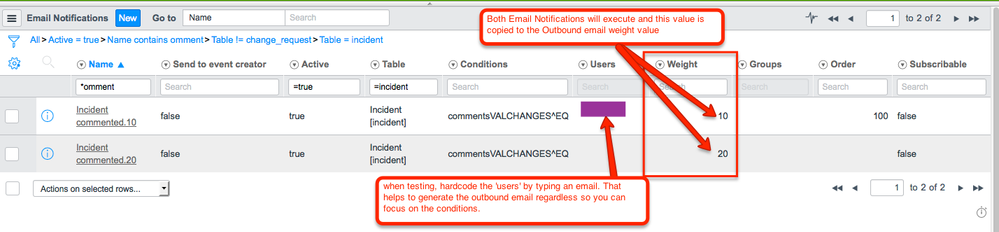
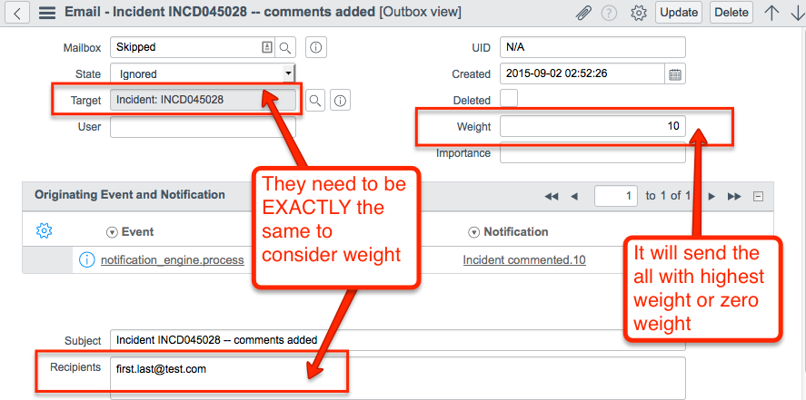
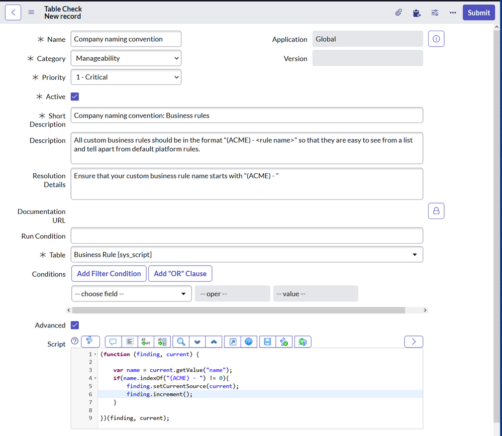

# 要件定義と設計（Requirements & Design）

## 概要

ServiceNow 導入における要件定義・設計フェーズは、「何を作るか」を決める工程であると同時に、**「何を作らないか（標準機能で済ませるか）」を決める工程**である。ServiceNow の公式ドキュメントは「カスタマイズの前に設定（Configuration）を最大限使う」「アプリ本来の目的を超える拡張は新規アプリとして作る」ことを推奨しており、ここで下した判断が、その後のアップグレード工数・サポート可否・技術的負債をほぼ決定する。[出典](https://www.servicenow.com/docs/r/application-development/app-engine-studio/aes-custom-vs-config.html)

本ファイルは、コンサルタント・PM・アーキテクトが要件定義〜基本設計を進める際に、そのまま成果物の枠組みとして使える粒度で以下を整理する。

| 節 | 内容 |
|---|---|
| 1. 全体像 | 要件定義・設計の位置づけ、成果物一覧、設計原則 |
| 2. OOTB 優先 | Configuration / Customization / Personalization の公式定義、カスタマイズの影響、判断の階層 |
| 3. Fit-Gap 分析 | 進め方、ギャップ分類と対応方針、Fit-Gap 一覧表の列定義、判定基準、要件テンプレート資産 |
| 4. プロセス設計 | 状態（State）設計、State Model、割り当て、自動化手段（Flow / Decision table 等）の選定 |
| 5. データ設計 | テーブル利用・拡張・新規作成の判断、命名規約、カスタムテーブルとライセンス、選択肢、基盤データ |
| 6. ロール設計 | グループへの付与、ロール包含、ペルソナ・マトリクス、ライセンスへの影響、管理者ロール |
| 7. 通知設計 | 通知の構成要素、通知マトリクス、Weight と重複抑止、カテゴリと購読 |
| 8. 設計書テンプレート | 設計書体系、Solution Architecture & Design（SAD）の構成、設計品質ゲート（Instance Scan） |
| 9. チェックリスト | 要件定義・設計の完了判定 |

関連ファイル：導入方法論と Fit to Standard ワークショップは [04-implementation-methodology.md](04-implementation-methodology.md)、体制は [05-project-organization.md](05-project-organization.md)、インスタンス戦略は [07-instance-strategy.md](07-instance-strategy.md)、データ移行は [08-data-migration.md](08-data-migration.md)、連携設計は [09-integration-design.md](09-integration-design.md)、セキュリティ設計は [10-security-compliance.md](10-security-compliance.md)、カスタマイズと技術的負債は [../04_応用編/02-customization-technical-debt.md](../04_応用編/02-customization-technical-debt.md)、ITSM プロセス設計の実践知は [../04_応用編/11-itsm-process-design-tips.md](../04_応用編/11-itsm-process-design-tips.md)。

---

## 1. 要件定義・設計の全体像

### 1.1 導入方法論における位置づけ

ServiceNow 公式の導入方法論 Now Create（現在は My Now の Best Practices サイトで提供）では、要件定義・設計に相当する作業は主に **Plan フェーズ**の「Conduct Process Workshops（プロセスワークショップ）」と「Conduct Platform Workshops（プラットフォームワークショップ）」で行われる。ワークショップには Process Workshop Presentation（プロセスワークショップ資料）と Process Guide（製品ごとの推奨プロセス）が用意され、合意結果は Starter Stories（ユーザーストーリーのひな形）をベースにバックログ化する。[出典](https://www.servicenow.com/community/manufacturing-articles/implementation-assets-on-nowcreate/ta-p/3277266) フェーズ構成の詳細は [04-implementation-methodology.md](04-implementation-methodology.md) を参照。

アジャイル（スプリント）型で進める場合でも、要件定義・設計は「最初に全部決める」のではなく、**Plan フェーズで全体方針（設計原則・データモデル・ロールモデル・通知方針）を固め、個々の機能はスプリント内のストーリー詳細化で設計する**ハイブリッド型が一般的である。【経験則】

### 1.2 要件定義・設計フェーズの成果物一覧

成果物の名称・粒度はプロジェクトにより異なるが、ServiceNow 導入で通常求められるものは次のとおり。【経験則】（各成果物の構成例は「8. 設計書のテンプレート観点」を参照）

| 成果物 | 主な内容 | 主な作成者 | 参照節 |
|---|---|---|---|
| 要件一覧（Requirements Backlog） | 業務要件・機能要件・非機能要件、優先度、受入基準 | BA / コンサルタント | 3.7 |
| Fit-Gap 一覧 | 要件ごとの OOTB 適合度、ギャップ分類、対応方針、判定結果 | コンサルタント / アーキテクト | 3.4 |
| カスタマイズ登録簿（Customization Register） | 承認されたカスタマイズ、業務上の根拠、影響、保守責任 | アーキテクト | 2.5, 3.6 |
| プロセス設計書 | 状態遷移、割り当て、承認、SLA、通知、クローズ条件 | プロセスオーナー / コンサルタント | 4 |
| データ設計書 | テーブル・フィールド定義、選択肢、参照関係、基盤データ、CMDB クラス | アーキテクト / 開発者 | 5 |
| ロール・権限設計書 | ペルソナ、グループ、ロール、ACL 方針、ライセンス種別 | アーキテクト / セキュリティ | 6 |
| 通知設計書（通知マトリクス） | 通知イベント、受信者、条件、テンプレート、言語 | コンサルタント | 7 |
| 連携設計書 | 連携先、方式、データマッピング、エラー処理 | 連携アーキテクト | [09-integration-design.md](09-integration-design.md) |
| ソリューションアーキテクチャ設計書（SAD） | 上記の全体像、設計判断、前提・リスク、技術的負債 | アーキテクト | 8.2 |

### 1.3 設計原則（プロジェクト開始時に合意すべき事項）

要件定義に入る前に、以下の設計原則をステアリングコミッティまたは Design Authority（設計承認機関）で合意しておくと、個別要件の議論がぶれにくい。

| 原則 | 内容 | 根拠 |
|---|---|---|
| OOTB を出発点にする | ServiceNow の OOTB ベストプラクティスとテンプレートを将来像プロセスの出発点にし、Flow Designer、CSDM 等の OOTB 機能を最大限使う | [出典](https://www.servicenow.com/community/architect-articles/the-servicenow-architect-s-guide-to-a-successful-implementation/ta-p/3423012)【第三者情報】 |
| 設定を優先する | カスタマイズ前に設定を最大限使う | [出典](https://www.servicenow.com/docs/r/application-development/app-engine-studio/aes-custom-vs-config.html) |
| 目的外の拡張は新規アプリ | アプリ本来の目的を超える機能は既存アプリに作り込まず、App Engine で新規アプリとして作る | [出典](https://www.servicenow.com/docs/r/application-development/app-engine-studio/aes-custom-vs-config.html) |
| 新規開発はスコープアプリ | すべての新規カスタム開発にはスコープアプリケーションを使う | [出典](https://www.servicenow.com/docs/r/application-development/app-engine-studio/aes-custom-vs-config.html) |
| カスタマイズは記録・承認 | すべてのカスタマイズを業務上の根拠とともに記録し、アップグレード前に見直す | [出典](https://www.servicenow.com/docs/r/application-development/app-engine-studio/aes-custom-vs-config.html) |
| 権限はグループ経由 | ロールは個々のユーザーではなくグループに付与する | [出典](https://www.servicenow.com/docs/r/platform-administration/user-administration/t_AssignARoleToAUser.html) |
| 「標準」の定義を明文化 | 「設定は許容、ベースライン変更は原則禁止」など、OOB／標準の範囲をポリシーで定義する | [出典](https://www.servicenow.com/community/architect-forum/seeking-official-servicenow-guidance-on-fit-to-standard/m-p/3298315)【第三者情報】 |

---

## 2. OOTB 優先の原則

### 2.1 Configuration・Customization・Personalization の公式定義

ServiceNow 公式ドキュメント（App Engine Studio の「Customization vs. configuration」ページ、Brazil 版 2026-09-10 更新を確認）は、変更を次の 3 種類に区別している。区別の基準は **使うツールではなく、ベースラインのフローやインストール済みコードを変更するかどうか** である。[出典](https://www.servicenow.com/docs/r/application-development/app-engine-studio/aes-custom-vs-config.html)

| 区分 | 公式の定義 | アップグレード・サポートへの影響 |
|---|---|---|
| Configuration（設定） | ServiceNow 組み込みのツール・機能を使い、フローやベースラインのインストールコードを変更せずにアプリの動作を変える。テーブル追加、インスタンス全体のパラメータ設定、機能拡張のためのコード追加も、ベースラインコードに触れなければ設定に含まれる。設定を元に戻す際にベースラインコードの変更が不要であるべき | 小さい（ただし追加したコードの所有者は顧客） |
| Customization（カスタマイズ） | ServiceNow 製品またはコードを使って、フローまたはベースラインのインストールコードを変更すること | 大きい（スキップレコード化、サポート対象外の可能性） |
| Personalization（個人設定） | ユーザーが自分だけのためにアプリの見た目を変えること。管理者が全ユーザーに同じ変更をした場合は Configuration になる | なし（ベースラインに影響しない） |

### 2.2 公式ドキュメントが挙げる例

同ページは次の例を挙げている。[出典](https://www.servicenow.com/docs/r/application-development/app-engine-studio/aes-custom-vs-config.html)

| 区分 | 例 |
|---|---|
| Configuration | フォーム（テーブル、フィールド、データ型、既定値、フィールド依存関係）、UI 要素（レイアウト、関連リスト、ボタン、フィールド名）、Service Catalog（カタログアイテム申請用ポータル）、ACL（フォーム・データへのアクセス制限）、System properties（全ユーザーの体験の変更） |
| Customization | JavaScript によるスクリプト（ベースラインを変更するクライアントスクリプト、サーバースクリプト、ビジネスルール）、特殊データ用のカスタムテーブル、API・Web サービスによる外部連携、カスタムウィジェット・ポータル、Workflow Studio で作るワークフロー（フローのアップグレード時にカスタマイズの再適用が必要） |
| Personalization | ダークモードの有効化、テーブルに表示する列の選択 |

> **注意（記述の揺れ）:** 同じページの中で「テーブル追加は Configuration に含まれ得る」という定義と、「カスタムテーブル」「外部連携」「Workflow Studio のワークフロー」を Customization の例に挙げる記述が併存している。実務では「ベースラインを変更するか」を一次基準とし、カスタムテーブル・スクリプト・連携・独自 UI は **"保守責任が顧客に発生する変更"** として、Configuration であっても Fit-Gap 上は別区分（後述の「拡張」）で管理すると整理しやすい。【経験則】

なお UI Policy、Business Rule、UI Action、クライアント／サーバースクリプトなどのツールは、それ自体では Configuration とも Customization とも決まらない。フローやインストール済みコードベースを変更するかどうかで決まる。[出典](https://www.servicenow.com/docs/r/application-development/app-engine-studio/aes-custom-vs-config.html)

### 2.3 カスタマイズがもたらす影響

公式ドキュメントが列挙するカスタマイズの影響は次のとおり。[出典](https://www.servicenow.com/docs/r/application-development/app-engine-studio/aes-custom-vs-config.html)

| 影響 | 内容 |
|---|---|
| Customer Updates への記録 | カスタマイズは Customer Updates テーブル（`sys_update_xml`）にレコードを作る。新規カタログアイテムやワークフローなどの設定メタデータの変更もこのテーブルに現れる |
| アップグレード時のスキップ | カスタマイズされたレコードはプラットフォームのアップグレードでスキップされ（Skipped records）、手作業での対応が必要になる |
| 保守の複雑化 | カスタマイズごとに保守の複雑さが増す。コスト増、技術的負債、アップグレードサイクルの長期化、標準機能への意図しない変更を招き得る |
| 保守責任 | カスタマイズの保守責任は顧客にある |
| サポートの制約 | ServiceNow Customer Service and Support は、カスタムコードに起因する問題をトラブルシュートせず、OOTB コードへの戻しを推奨する場合がある。サポートは顧客のビジネスロジックや期待動作を知らず、OOTB インスタンスで再現できず、エンジニアはカスタムコードのレビュー資格を持たないため |

スキップレコードは、OOB のフォーム、クライアントスクリプト、ビジネスルール、ワークフローなどを直接変更した結果、アップグレードで提供される更新と競合することで発生する。コミュニティでは、OOB レコードを直接変更せずにカスタムバージョンを作る、Upgrade Center を活用する、カスタマイズを定期的に監査し文書化する、といった低減策が挙げられている。【第三者情報】[出典](https://www.servicenow.com/community/developer-blog/reducing-skipped-records-in-servicenow-upgrades/ba-p/3102307)

> 公式ドキュメントのガイドラインは「オブジェクトはコピーせずにその場で更新する（update in place）」ことを推奨しており（Service Portal ウィジェット等の再利用部品を除く）、上記コミュニティ記事の「カスタムバージョンを作る」とは方向性が異なる。公式の意図は「コピーして隠すと、変更が競合解決（スキップレコード）として可視化されず、ベースラインの改善を取り込めなくなる」ことにある。設計方針としては公式ガイドラインに従うのが無難である。[出典](https://www.servicenow.com/docs/r/application-development/app-engine-studio/aes-custom-vs-config.html)

アップグレード時のスキップレコード対応は [13-upgrade-management.md](13-upgrade-management.md) を参照。

### 2.4 カスタマイズの代替策

公式ドキュメントは、カスタマイズの代わりに次の 3 つを検討するよう求めている。[出典](https://www.servicenow.com/docs/r/application-development/app-engine-studio/aes-custom-vs-config.html)

1. **Configuration を使う。**
2. **Enhancement Request（機能改善要望）を ServiceNow に提出する。** 承認された要望は将来のリリースに取り込まれる。
3. **App Engine 開発製品で新規アプリを作る。**

### 2.5 カスタマイズのガイドライン（公式）

カスタマイズが避けられない場合のガイドラインとして、公式ドキュメントは以下を挙げている。設計書・開発標準にそのまま転記できる。[出典](https://www.servicenow.com/docs/r/application-development/app-engine-studio/aes-custom-vs-config.html)

| # | ガイドライン | 設計書への落とし込み例【経験則】 |
|---|---|---|
| 1 | 設定オプションを最大限使う | Fit-Gap で「設定で対応」を先に検討した記録を残す |
| 2 | オブジェクトはコピーせずその場で更新する（Service Portal ウィジェット等の再利用部品は例外） | OOB レコードを複製して無効化する手法を禁止 |
| 3 | "Add before edit"：既存フィールドの型を変えるのではなくフィールドを追加する。OOTB のオブジェクト・メソッド・クラス名を再利用しない | 命名規約に「OOB 名の再利用禁止」を明記 |
| 4 | フォームのフィールド数を最小化して読み込み時間を減らす | フォーム設計でフィールド数上限・セクション構成を規定 |
| 5 | 元レコードをバックアップとしてエクスポートし、OOTB の sys_id を記録する | カスタマイズ登録簿に元 sys_id 列を設ける |
| 6 | すべての新規カスタム開発にスコープアプリを使う | アプリケーション一覧（スコープ設計）を作る |
| 7 | すべてのカスタマイズを業務上の根拠とともに文書化し、アップグレード前に見直す | カスタマイズ登録簿の必須項目にする |
| 8 | 可能な限り Automated Test Framework（ATF）テストを書く | 受入基準に ATF テストの有無を含める |
| 9 | HealthScan を定期的に実行し不要なカスタマイズを見つける | 運用設計に実行周期を明記（8.4 参照） |
| 10 | ベースラインオブジェクトへの必要なカスタマイズは、隠さずに行い競合解決が記録されるようにする | 2 と同旨 |
| 11 | 性能や意図しない影響を含め、全ユースケースをテストする | テスト計画に回帰範囲を明記 |
| 12 | 管理者はアップグレード後にカスタマイズを検証し、全変更を追跡する | アップグレード手順書に検証項目を含める |

### 2.6 対応手段の優先順位（判断の階層）

公式ガイドラインを要件ごとの判断手順に落とすと、次の「上から順に検討する」階層になる。【経験則】（公式の原則を実務の判断順序として整理したもの）

| 順位 | 対応手段 | 例 | 保守負担 |
|---|---|---|---|
| 1 | 業務を標準に合わせる（運用で吸収） | OOTB の状態モデル・承認フローをそのまま採用 | なし |
| 2 | 標準機能の有効化・プロパティ設定 | プラグイン有効化、System properties、Guided setup | 極小 |
| 3 | 宣言的な設定（ノーコード） | フォームレイアウト、選択肢追加、UI Policy、Assignment rules、Data lookup、通知、SLA 定義、ACL | 小 |
| 4 | ローコードの追加（ベースライン非変更） | Workflow Studio のフロー・サブフロー、Decision table、カタログアイテム、追加ビジネスルール | 中（追加分の所有者は顧客） |
| 5 | スコープアプリでの拡張 | カスタムテーブル、Script Include、独自 UI（UI Builder） | 中〜大（ライセンス影響あり：5.5） |
| 6 | ベースラインの変更（狭義のカスタマイズ） | OOB ビジネスルール・Script Include・UI Page の直接編集 | 大（スキップレコード、サポート制約） |

### 2.7 既存アプリを拡張するか、新規アプリを作るか

公式ドキュメントは「変更がアプリ本来の目的を拡張するものならカスタマイズ、そうでなければ新規アプリ」とし、例として「ITSM に IT 機能を追加するのは適切だが、ITSM のワークフローを出張申請に流用すべきではない」と述べている。新規アプリが適するシナリオは次のとおり。[出典](https://www.servicenow.com/docs/r/application-development/app-engine-studio/aes-custom-vs-config.html)

- 既存製品のワークフローに当てはまらない新しいユースケース
- そのために設計されていないアプリを大幅にカスタマイズしないと実現できないユースケース
- OOTB ワークフローから分離すべきユーザーグループや業務プロセス

新規アプリの開発手段（App Engine Studio / ServiceNow Studio / ServiceNow SDK）は [../02_リファレンス/platform/app-development.md](../02_リファレンス/platform/app-development.md) を参照。

---

## 3. Fit-Gap 分析

### 3.1 Fit-Gap と Fit to Standard

従来型の **Fit-Gap（Fit & Gap）分析**は、現行業務の要件を起点に製品との差分（ギャップ）を洗い出してアドオンで埋める手法である。一方 **Fit to Standard** は、製品標準を先に見せて業務を合わせ、差分を最小化する手法である。ServiceNow 公式ドキュメントに「Fit to Standard」という名称の方法論は確認できないが、Now Create の Process Guide・Process Workshop、および「Configuration over customization」の原則が同じ思想を体現している。[出典](https://www.servicenow.com/community/architect-forum/seeking-official-servicenow-guidance-on-fit-to-standard/m-p/3298315)【第三者情報】 詳細は [04-implementation-methodology.md の 5 節](04-implementation-methodology.md) を参照。

本ファイルでは、**Fit to Standard 型ワークショップで標準を見せ、その結果を Fit-Gap 一覧で管理する**という組み合わせを前提に、一覧表と判定の実務を扱う。

### 3.2 Fit-Gap 分析の進め方

| ステップ | 作業 | 実務上のポイント | 根拠 |
|---|---|---|---|
| 1. 準備 | Process Guide・Process Workshop Presentation を準備。対象モジュールのフィールドシートをエクスポートし、As-Is のフィールドと ServiceNow のフィールドのマッピング表を作る（特に Reference／Choice／Boolean 型） | 現行システムの画面・帳票・マスタを事前回収しておく | [出典](https://www.servicenow.com/community/manufacturing-articles/implementation-assets-on-nowcreate/ta-p/3277266)、[出典](https://www.servicenow.com/community/now-platform-articles/pack-amp-break-green-amp-brown-field-implementation/ta-p/3101282)【第三者情報】 |
| 2. 標準デモ | 要件ヒアリングから入らず、OOTB の画面・プロセスを先に見せる（PDI やデモインスタンス） | 「現行と同じにしたい」ではなく「標準で困ることは何か」を問う | [出典](https://www.servicenow.com/community/now-platform-articles/pack-amp-break-green-amp-brown-field-implementation/ta-p/3101282)【第三者情報】 |
| 3. ギャップ識別 | OOTB 機能とのマッピングでギャップを特定 | ギャップは「要件」単位で 1 行にする（画面単位にしない） | 同上 |
| 4. 分類 | 3.3 の分類に当てはめ、対応案と概算工数を付ける | 1 つのギャップに複数案（例：運用で吸収／設定／拡張）を並べ、比較させる | 【経験則】 |
| 5. 判定 | Design Authority でカスタマイズ・拡張の可否を判定し、根拠を記録 | 判定者・判定日・根拠を一覧に残す | 【経験則】 |
| 6. ストーリー化 | 合意結果を Starter Stories ベースのユーザーストーリーにしてバックログへ | 受入基準を付け、ATF テスト対象を識別 | [出典](https://www.servicenow.com/community/manufacturing-articles/implementation-assets-on-nowcreate/ta-p/3277266) |

### 3.3 ギャップ分類と対応方針

ギャップの分類は、2.6 の判断階層と対応させると判定が機械的になる。【経験則】

| 分類コード | 分類 | 定義 | 対応方針 | 承認レベル（例） |
|---|---|---|---|---|
| F | Fit（適合） | OOTB でそのまま満たす | 標準採用 | 不要 |
| O | 運用で吸収 | 業務手順・組織ルールの変更で満たす | 業務設計・マニュアル・トレーニング | プロセスオーナー |
| C | 設定で対応 | 宣言的設定・プロパティで満たす（2.6 の 2〜3） | 設定設計書に記載 | チームリード |
| L | ローコード拡張 | フロー・Decision table・カタログ等の追加で満たす（2.6 の 4） | 設計書＋ATF | アーキテクト |
| X | 拡張開発 | スコープアプリ・カスタムテーブル・独自 UI・連携（2.6 の 5） | カスタマイズ登録簿へ登録、ライセンス確認 | Design Authority |
| M | ベースライン変更 | OOB コード・フローの変更（2.6 の 6） | 原則却下。例外承認時は登録簿へ登録し、アップグレード時の再検証を義務化 | Design Authority＋ステアリング |
| E | Enhancement Request | 製品側の改善を待つ | ServiceNow に要望提出、暫定運用を定義 | プロセスオーナー |
| N | 対象外・将来 | 今回スコープ外 | バックログに残し次フェーズで再評価 | ステアリング |

### 3.4 Fit-Gap 一覧表の列定義（テンプレート）

Fit-Gap 一覧は Excel やスプレッドシートで管理されることが多いが、ServiceNow 自体の Agile Development / Collaborative Work Management のストーリーとして管理する方法もある（[04-implementation-methodology.md](04-implementation-methodology.md) の 4.3 参照）。列定義の例は次のとおり。【経験則】

| 列 | 内容 | 入力例 |
|---|---|---|
| ID | 要件 ID | REQ-INC-012 |
| 領域 / モジュール | 製品・プロセス | ITSM / Incident |
| 要件（As-Is 起点の記述） | 業務要件を 1 文で | 夜間は重大インシデントを当番者へ電話通知したい |
| 要件の背景・目的 | なぜ必要か、KPI との関係 | MTTR 短縮、夜間の取りこぼし防止 |
| 優先度 | MoSCoW 等 | Must |
| OOTB 対応機能 | 該当する標準機能名・プラグイン | On-Call Scheduling、Notify |
| 適合度 | Fit / Partial / Gap | Partial |
| 分類コード | 3.3 の分類 | L |
| 対応案（複数可） | 案ごとの概要 | 案1: On-Call のエスカレーション通知（設定）／案2: 電話連携を Notify で実装 |
| 推奨案と理由 | 採用案・不採用案の理由 | 案1（OOTB、ライセンス追加不要） |
| 影響範囲 | テーブル・ロール・通知・連携への影響 | `incident`、`cmn_rota` |
| ライセンス影響 | 追加サブスクリプション、カスタムテーブル消費、Fulfiller 増減 | なし |
| 概算工数 | 人日 | 3 |
| アップグレード影響 | ベースライン変更の有無、スキップレコード発生見込み | なし |
| 判定 | 承認 / 却下 / 保留 | 承認 |
| 判定者・判定日 | Design Authority 等 | DA 2026-xx-xx |
| ストーリー ID | バックログとのリンク | STRY0010234 |
| ATF 対象 | テスト自動化の要否 | 要 |

### 3.5 ギャップ判定の基準

Design Authority での判定を属人的にしないため、以下の観点をスコアリングしておくと有効である。【経験則】

| 観点 | 問い | カスタマイズを否決する方向のシグナル |
|---|---|---|
| 業務価値 | 実現しない場合の定量的損失は何か | 「現行と同じだから」以外の理由が説明できない |
| 標準代替 | 運用変更・設定で 80% 以上満たせないか | 満たせる |
| 利用頻度・対象者数 | 何人が、どれくらいの頻度で使うか | 少数・低頻度 |
| アップグレード影響 | ベースライン変更を伴うか | 伴う |
| ライセンス影響 | カスタムテーブル消費、追加 Fulfiller が発生するか | 発生し、費用対効果が説明できない |
| サポート影響 | 障害時に ServiceNow サポートを受けられなくなるか | なる |
| 製品ロードマップ | 近い将来のリリースで提供予定か（Enhancement Request、リリースノート） | 提供予定 |
| 保守体制 | リリース後に誰が保守するか（CoE・内製・パートナー） | 保守者が決まらない |

> **【経験則】** Fit-Gap のギャップ率（Gap 件数 ÷ 全要件）や「設定で対応」の比率を KPI としてステアリングに報告すると、カスタマイズ要求の総量が可視化され、個別判定の妥当性を説明しやすくなる。具体的な目標値の公式な基準は公開情報では確認できず。

### 3.6 Design Authority（設計承認）の運営

設計判断を一元的に承認する会議体（Design Authority、Technical Design Authority、Architecture Review Board などと呼ばれる）を設け、拡張開発（X）とベースライン変更（M）は必ずここを通す運用が一般的である。【経験則】 プラットフォームアーキテクトが作成する設計書（SAD）は「ガバナンス会議でのレビュー用」と位置づけられている。[出典](https://www.servicenow.com/community/architect-articles/recommended-format-solution-design-format-for-your/ta-p/2929116)【第三者情報】 CoE・ガバナンス体制の詳細は [12-operations-governance.md](12-operations-governance.md) と [../04_応用編/09-governance-coe-practice.md](../04_応用編/09-governance-coe-practice.md) を参照。

### 3.7 要件の書き方

ServiceNow 導入ではアジャイル型の進行が多いため、機能要件はユーザーストーリー形式で記述し、受入基準を付けるのが一般的である。Now Create の Starter Stories はこの形式のひな形として提供されている。[出典](https://www.servicenow.com/community/manufacturing-articles/implementation-assets-on-nowcreate/ta-p/3277266)

| 要素 | 書き方 | 例 |
|---|---|---|
| ストーリー | As a（役割）, I want（機能）, so that（目的） | サービスデスク担当として、発信者の未解決インシデントをフォーム上で確認したい。重複起票を防ぐため |
| 受入基準 | Given / When / Then、または箇条書き | 発信者を選択すると、同一発信者の Active なインシデントが関連リストに表示される |
| 優先度 | MoSCoW（Must / Should / Could / Won't） | Should |
| OOTB 参照 | 対応する標準機能 | Caller の関連インシデント表示（OOTB の関連リスト） |
| 非機能 | 性能・可用性・監査・言語 | 表示 3 秒以内 |

非機能要件（性能、可用性、データ保持、監査、多言語、アクセシビリティ）は、ServiceNow ではプラットフォーム側で既定の水準が決まっている項目が多いため、「顧客が決める項目」と「プラットフォーム仕様を確認・受容する項目」に分けて整理すると効率的である。【経験則】 インスタンス構成・可用性は [../02_リファレンス/platform/instance-architecture.md](../02_リファレンス/platform/instance-architecture.md)、日本語化は [../02_リファレンス/platform/localization.md](../02_リファレンス/platform/localization.md) を参照。

### 3.8 要件定義に使えるテンプレート資産

| 資産 | 提供元 | 内容 | 出典 |
|---|---|---|---|
| Process Workshop Presentation / Process Guide | Now Create（現 My Now Best Practices） | 製品別のワークショップ資料と推奨プロセス。CSM、FSM、SOM、FSO など製品別版がある | [出典](https://www.servicenow.com/community/manufacturing-articles/implementation-assets-on-nowcreate/ta-p/3277266) |
| Starter Stories | 同上 | ユーザーストーリーのひな形 | 同上 |
| Scoping guides | 同上 | スコープ定義のガイド。下記の要件収集ツールの補完として ServiceNow 社員が推奨 | [出典](https://www.servicenow.com/community/onboarding-hub-articles/guidelines-for-requirements-gathering/ta-p/2618053) |
| Requirements gathering tool（Word） | ServiceNow 社員によるコミュニティ記事（2023-07-19 投稿） | 要件収集のテンプレート兼ガイドライン。全製品は網羅しないが拡張の土台になる（添付ファイルとして配布） | [出典](https://www.servicenow.com/community/onboarding-hub-articles/guidelines-for-requirements-gathering/ta-p/2618053) |
| Business Requirement Template – Incident Management（Excel） | コミュニティ記事（2020-04-21 投稿） | 11 シート構成：Incident forms、Additional Requirement、Choice Fields、Tasks、Notifications、State Propagation Matrix、SLA、Roles & Privileges、Priority Matrix、Plugin、Reporting。各シートに OOB の動作と経験に基づくベストプラクティスを記載 | [出典](https://www.servicenow.com/community/itsm-articles/business-requirement-template-itsm-part-1-incident-management/ta-p/2304378)【第三者情報】 |

> Incident Management 用テンプレートの 11 シート構成は、そのまま「プロセス設計書の章立て」としても使える。4 節（プロセス設計）、6 節（ロール設計）、7 節（通知設計）はこの構成に沿って項目を整理している。

---

## 4. プロセス設計

### 4.1 プロセス設計で決めるべき要素

ServiceNow のプロセス（Incident、Problem、Change、Request、HR Case、CSM Case など）は、ほぼすべてが `task` テーブルを拡張したテーブル上で動く。そのため、どのプロセスでも設計すべき要素は共通している。【経験則】（3.8 のテンプレート構成を一般化したもの）

| 要素 | 設計内容 | 主な ServiceNow 機能 | 参照 |
|---|---|---|---|
| 起票チャネル | ポータル、メール、電話、チャット、イベント、連携 | Employee Center、Inbound Email Actions、Virtual Agent、Event Management | [portals](../02_リファレンス/platform/portals-employee-center.md) |
| 分類 | カテゴリ／サブカテゴリ、サービス、CI | Choice list、Service / Service offering、CMDB | 5.6 |
| 状態（State） | 状態一覧、遷移条件、必須項目、保留理由 | State 選択肢、State Model、UI Policy、Data Policy | 4.2 |
| 優先度 | Impact × Urgency → Priority | Priority Lookup Rules | 4.3 |
| 割り当て | 割り当てグループの決定ロジック | Assignment rules、Data lookup、CI/Service の担当グループ、Predictive Intelligence | 4.3 |
| 承認 | 承認者、承認条件、並列／直列 | Workflow Studio の Ask for Approval、承認ルール | [flow](../02_リファレンス/platform/flow-designer-workflow-studio.md) |
| SLA | 対象、開始・停止・一時停止条件、スケジュール | SLA Definition、Schedule | [sla](../02_リファレンス/platform/sla-schedules.md) |
| 子タスク | 子タスクの種類と親子の状態伝播（State Propagation） | `incident_task` 等、ビジネスルール、フロー | 4.2 |
| 通知 | 誰に・いつ・何を | Notification | 7 |
| クローズ | 解決コード、自動クローズ期間、再オープン | Resolution code、自動クローズのプロパティ | [incident](../02_リファレンス/itsm/incident-management.md) |
| 報告 | KPI、ダッシュボード | Reports、Platform Analytics | [reporting](../02_リファレンス/platform/reporting-analytics.md) |

### 4.2 状態（State）の設計

#### 4.2.1 OOTB の状態モデルを起点にする

Incident Management の OOTB 状態は New／In Progress／On Hold／Resolved／Closed／Canceled の 6 つである。On Hold は他者（発信者、ベンダー等）に情報・証拠・解決策の提供責任が一時的に移る状態で、クローズまでに複数回入ることができる。Resolved から一定期間経過し解決が確認されると Closed になる。[出典](https://www.servicenow.com/docs/r/australia/it-service-management/incident-management/c_IncidentManagementStateModel.html) 状態値・保留理由・自動クローズの詳細は [../02_リファレンス/itsm/incident-management.md](../02_リファレンス/itsm/incident-management.md) を参照。

状態設計で最も重要な原則は、**OOTB の状態の選択肢値（数値）を変更・転用しないこと**である。公式ドキュメントは、`incident_state` が 7（Closed）未満かつ Active が false の場合に Active を true に戻すビジネスルールなど、状態値に依存するロジックが存在し、選択肢の値を変えるとそれらが期待どおり動かなくなる可能性があると注意している。[出典](https://www.servicenow.com/docs/bundle/zurich-platform-administration/page/administer/field-administration/concept/c_IntValsForDfltChoiceList.html)

| 要求の例 | 推奨する対応 | 避けるべき対応 |
|---|---|---|
| 「一次対応中」「二次対応中」を区別したい | State は In Progress のまま、Assignment group やエスカレーションレベルで区別する【経験則】 | State に新しい値を追加し、OOB のロジックを書き換える |
| 「ベンダー待ち」を表したい | On Hold ＋ On hold reason（保留理由）の選択肢追加で表す | State に「ベンダー待ち」を追加する |
| 状態ラベルを日本語の業務用語にしたい | 翻訳（ラベル）で対応し、値は変えない | 既存の値を別の意味に転用する |

#### 4.2.2 State Model（状態遷移の制御）

`task` を拡張したテーブルで「どの状態からどの状態へ遷移できるか」を制御したい場合、プラットフォームの **State Management** 機能を使える。State Management は全インスタンスで有効である。[出典](https://www.servicenow.com/docs/r/VbEA8DxUy61CFZ25mbYrcQ/sIunXuTFmUEe8ssiN7S_SA)

| テーブル | 内容 |
|---|---|
| `sys_state_model`（State Model） | 状態モデル名、適用先の task テーブル、モデルを適用する条件 |
| `sys_state_transition`（State Transitions） | 各状態に入る・出るための条件 |

設定手順の要点は次のとおり。[出典](https://www.servicenow.com/docs/r/VbEA8DxUy61CFZ25mbYrcQ/sIunXuTFmUEe8ssiN7S_SA)

1. State Model テーブルで名前と task テーブル（`task` を拡張したテーブル）を指定する。
2. 条件ビルダーで、モデルを適用するレコード条件と状態間の移動に必要な条件を指定する。
3. State Transitions テーブルで、各状態の入口・出口条件を定義する。
4. 状態モデルを有効化すると、State フィールドの選択肢には遷移で許可された状態だけが表示される。

> **注意（Change の例示モデル）:** ServiceNow は Normal／Emergency／Standard の変更要求用の State Model の例を提供しているが、既定で無効であり、あくまでテンプレートである。状態モデルを持たない task テーブル用のモデルを作る参考にするものであり、既存の変更要求ワークフローを変える目的で有効化・変更すると、既存の変更要求の遷移が壊れる。[出典](https://www.servicenow.com/docs/r/VbEA8DxUy61CFZ25mbYrcQ/sIunXuTFmUEe8ssiN7S_SA) Change の状態設計は [../02_リファレンス/itsm/change-management.md](../02_リファレンス/itsm/change-management.md) を参照。

HR Service Delivery、Customer Service Management、Field Service Management などでは、製品ごとに **State flows** の仕組みが提供されている。State flows は状態遷移とフィールド制御を強制するスクリプトや UI 要素を生成・管理するもので、カスタムの State flow の作成にはスクリプトの知識が必要とされる。製品ごとの仕様は各リファレンス（[HRSD](../02_リファレンス/employee/hr-service-delivery.md)、[CSM](../02_リファレンス/customer/customer-service-management.md)、[FSM](../02_リファレンス/customer/field-service-management.md)）を参照。

#### 4.2.3 状態設計書に記載する項目

| 項目 | 内容 |
|---|---|
| 状態一覧 | 値（数値）、ラベル（英語／日本語）、OOTB か追加か、意味 |
| 遷移表 | From × To のマトリクス、遷移を起こす操作（UI Action、フロー、メール返信など） |
| 状態ごとの必須・読み取り専用項目 | UI Policy / Data Policy で実装する項目 |
| 保留理由 | On hold reason の選択肢と、保留解除のトリガー |
| 親子の状態伝播（State Propagation Matrix） | 親が Resolved / Closed になったときの子タスクの扱い |
| SLA との関係 | どの状態で SLA を開始・一時停止・停止するか |
| 通知との関係 | どの遷移で誰に通知するか（7 節の通知マトリクスと突合） |

### 4.3 優先度と割り当ての設計

| 機能 | 用途 | メニュー / テーブル | 出典 |
|---|---|---|---|
| Priority Lookup Rules（優先度ルックアップルール） | Impact × Urgency の組み合わせから Priority を決める | All > System Policy > Rules > Priority Lookup Rules | [incident 参照](../02_リファレンス/itsm/incident-management.md) |
| Assignment rules（割り当てルール） | 条件に合うレコードを指定のグループ／ユーザーに割り当てる | All > System Policy > Rules > Assignment（`assignment_rule_admin` または `admin`） | [出典](https://www.servicenow.com/docs/r/australia/it-service-management/incident-management/t_DefinAnAssignRuleIncidents.html) |
| Data lookup rules（データルックアップ） | 入力値の組み合わせから別フィールドの値を設定する | Data Lookup Definitions | [出典](https://www.servicenow.com/docs/r/platform-administration/table-administration-and-data-management/c_DataLookupRules.html) |
| CI／Service offering の担当グループ | CI やサービスオファリングに定義した担当グループを割り当てに使う | プロパティで使用フィールドを指定 | [incident 参照](../02_リファレンス/itsm/incident-management.md) |

Data lookup rules と Assignment rules は同時に定義できる。レコードが一度割り当てられた後の重複ルールは、データルックアップ定義で既存値の置換オプションを使っていない限り無視される。[出典](https://www.servicenow.com/docs/r/platform-administration/table-administration-and-data-management/c_DataLookupRules.html)

割り当て設計のポイント【経験則】：

- 割り当てロジックは「1 つの仕組みに寄せる」。Assignment rules・Data lookup・ビジネスルール・フローが混在すると、どこで値が決まったか追跡できなくなる。
- グループは「作業キュー」として設計し、組織図の部署とは分ける（組織は `cmn_department`、作業キューは `sys_user_group`）。
- 割り当てグループの数は、SLA・レポート・通知・ロール付与のすべてに影響するため、最初に一覧（グループ設計書）として確定させる。

### 4.4 自動化の実装手段の選定

#### 4.4.1 新規の自動化は Workflow Studio（Flow Designer）で作る

ServiceNow の Flow / Workflow 製品チームを率いる ServiceNow 社員は、2026-01 のコミュニティ回答で「現時点で Legacy Workflow エンジンを非推奨にする計画はない」「新しい自動化はすべて Flow Designer で作ることを推奨する」と述べている。また **Zurich 以降、新規インスタンスには Legacy Workflow が OOTB で同梱されなくなった**（既存インスタンスの既存 Legacy Workflow は引き続き動作する）。[出典](https://www.servicenow.com/community/workflow-automation-forum/when-is-the-deprecation-date-for-legacy-workflow-engine/td-p/3460362/page/2)【第三者情報】（ServiceNow 社員のコミュニティ回答）

コミュニティでは、新規 Zurich インスタンスで Workflow Editor から New Workflow を選ぶと Flow Designer にリダイレクトされるという報告もある。【第三者情報】[出典](https://www.servicenow.com/community/workflow-automation-forum/when-is-the-deprecation-date-for-legacy-workflow-engine/td-p/3460362/page/2)

#### 4.4.2 手段の使い分け

| 手段 | 適する用途 | 設計上の注意 |
|---|---|---|
| Flow（フロー） | レコード起点・スケジュール起点の業務処理、承認、通知、連携 | 1 フロー 1 目的。同じテーブル・同じトリガーのフローを乱立させない【経験則】 |
| Subflow（サブフロー） | 複数フローで再利用する手順 | 入出力を明確に定義し、共通部品として管理 |
| Action（アクション） / Spoke | 再利用可能な処理単位、外部システム連携 | 連携は Integration Hub の spoke を優先（[integrationhub](../02_リファレンス/platform/integrationhub.md)） |
| Decision table（デシジョンテーブル） | 条件分岐ロジック（承認者決定、割り当て先決定など）を表として管理 | 非開発者がロジックを保守する必要がある場合、同じロジックを複数のフロー・サブフロー・スクリプトで使う場合に適する。フロー／サブフローの「Make a decision」、Playbook の「Make a Decision - First Match」、スクリプトから参照できる |
| Playbook（Process Automation Designer） | 複数部門・複数ステップにまたがるケース型業務のエージェント向けガイド | 製品ごとの提供状況を確認 |
| Business Rule（ビジネスルール） | レコード保存時の同期的なデータ整合性処理 | 業務プロセスのオーケストレーションはフローに寄せる【経験則】（[scripting](../02_リファレンス/platform/scripting-server-side.md)） |
| Legacy Workflow | 既存資産の維持のみ | 新規作成しない。移行は必須ではないが、改修のタイミングでフロー化を検討【第三者情報】 |

Decision table の用途は公式ドキュメント（Decision tables workflow）による。[出典](https://www.servicenow.com/docs/r/build-workflows/workflow-studio/exploring-decision-builder.html) Decision table を格納するテーブルは `sys_decision`（Decision Tables）、`sys_decision_input`、`sys_decision_question` などである（[../02_リファレンス/platform/flow-designer-workflow-studio.md](../02_リファレンス/platform/flow-designer-workflow-studio.md) 参照）。

> **【経験則】** 承認者や割り当て先の決定ロジックを Decision table に外出しすると、組織変更時に業務部門の管理者がフローを触らずに表を更新でき、設計書の「判定表」とインスタンスの実装を 1 対 1 に保てる。

### 4.5 プロセス設計書の構成例

3.8 の Incident Management 要件テンプレート（11 シート）を参考にした、プロセス設計書の章立ての例。【経験則】

| 章 | 内容 |
|---|---|
| 1. プロセス概要 | 目的、スコープ、KPI、プロセスオーナー、関連プロセス |
| 2. 業務フロー | スイムレーン図（To-Be）、OOTB との差分を明示 |
| 3. フォーム設計 | ビュー別フィールド配置、必須・読み取り専用条件 |
| 4. 選択肢 | カテゴリ、サブカテゴリ、解決コード、保留理由 |
| 5. 状態遷移 | 4.2.3 の項目 |
| 6. 子タスク | タスク種別、親子の状態伝播マトリクス |
| 7. 優先度・割り当て | Priority マトリクス、割り当てロジック |
| 8. SLA | SLA 定義、スケジュール、一時停止条件 |
| 9. 通知 | 7 節の通知マトリクスへの参照 |
| 10. ロール・権限 | 6 節のロールマトリクスへの参照 |
| 11. レポート | KPI 定義、ダッシュボード |
| 12. 必要プラグイン | 有効化するプラグイン・Store アプリ |
| 13. Fit-Gap 参照 | 本プロセスに関係する Fit-Gap ID とカスタマイズ登録簿 ID |

---

## 5. データ設計

### 5.1 データ設計の対象

| 対象 | 内容 | 参照 |
|---|---|---|
| トランザクションデータ | インシデント、要求、変更、ケース等（`task` 系テーブル） | 5.2〜5.3 |
| 基盤データ（Foundation data） | ユーザー、グループ、会社、部署、ロケーション、コストセンター | 5.7 |
| 構成データ（CMDB） | CI クラス、リレーション、サービス | [cmdb-csdm](../02_リファレンス/platform/cmdb-csdm.md) |
| 選択肢・参照マスタ | カテゴリ、解決コード等 | 5.6 |
| 移行データ | 移行対象・方式 | [08-data-migration.md](08-data-migration.md) |

ServiceNow のデータモデル（テーブル拡張、ディクショナリ、参照、Dictionary override）の仕様は [../02_リファレンス/platform/data-model-dictionary.md](../02_リファレンス/platform/data-model-dictionary.md) を参照。

### 5.2 テーブル設計の判断順序

ServiceNow では、子テーブルは親テーブルのフィールドとレコードを継承し、**テーブルの拡張（extend）はテーブル作成時にしか指定できない**。`task` テーブルはベースシステムが提供するコアテーブルの 1 つである。[出典](https://www.servicenow.com/docs/r/VbEA8DxUy61CFZ25mbYrcQ/196W0ylohpY~Vw8XhLvKxg) 後から親テーブルを変更できないため、テーブルの新設はデータ設計で最も慎重に判断すべき事項である。

| 順位 | 選択肢 | 判断基準 | 注意点 |
|---|---|---|---|
| 1 | 既存テーブル・既存フィールドを使う | OOTB のフィールドで意味が合う | 意味の異なる転用はしない（後続のレポート・連携・AI 機能が誤解する）【経験則】 |
| 2 | 既存テーブルにフィールドを追加 | 既存プロセスの属性追加 | "Add before edit"：既存フィールドの型変更ではなく追加。フォームのフィールド数は最小化 [出典](https://www.servicenow.com/docs/r/application-development/app-engine-studio/aes-custom-vs-config.html) |
| 3 | 既存テーブルを拡張した子テーブル | 既存プロセスの「種類違い」で、親の機能（SLA、承認、ワークスペース等）を使いたい | ライセンス上の扱いは 5.5 を確認 |
| 4 | 新規テーブル（`task` 拡張） | 担当者が作業する新しいレコード種別 | 下記 5.3 |
| 5 | 新規テーブル（非 `task`） | 参照用・構造的なマスタデータ | カスタムテーブルのエンタイトルメントを消費し得る（5.5） |

### 5.3 `task` を拡張するかどうか

`task` を拡張すると、SLA、承認、割り当て、作業メモ、Activity などの OOTB 機能をそのまま使える一方、`task` に定義された ITSM 寄りのセキュリティ（ACL）やビジネスロジックも継承する。コミュニティでは次のような意見がある。【第三者情報】

| 論点 | 意見 | 出典 |
|---|---|---|
| 拡張する利点 | OOB の SLA を使う、子タスクの承認を使うなら `task` 拡張が必要 | [出典](https://www.servicenow.com/community/architect-forum/now-with-paris-what-is-the-benefit-of-extending-from-task-for-a/m-p/2194469) |
| 拡張の注意点 | `task` は ITSM 向けのセキュリティを継承するため、カスタムスコープアプリの利用者が ITIL ロールを持たないなら、`task` を直接拡張しない。スコープ内に `task` を拡張した「緩衝（buffer）テーブル」を置き、業務テーブルはそれを拡張する構成を推奨 | [出典](https://www.servicenow.com/community/app-engine-forum/never-extend-from-the-task-table-for-your-custom-scoped/m-p/3483899) |
| ワークスペース | ワークスペースは非 `task` テーブルにも作れるため、ワークスペース利用だけを理由に `task` を拡張する必要はない | [出典](https://www.servicenow.com/community/architect-forum/now-with-paris-what-is-the-benefit-of-extending-from-task-for-a/m-p/2194469) |

> **判断の目安【経験則】:** 「人がキューで作業し、担当・期限・状態を管理するレコード」は `task` 拡張、「参照されるだけのマスタや明細」は非 `task` とする。`task` を拡張する場合は、利用者のロール（Fulfiller ライセンスの要否を含む、6.4 参照）と ACL の継承をセットで設計する。

### 5.4 命名規約

| 対象 | 規約 | 出典 |
|---|---|---|
| Global スコープのカスタムテーブル | `u_` 接頭辞（例：`u_contract_request`） | [data-model-dictionary](../02_リファレンス/platform/data-model-dictionary.md) |
| スコープアプリのテーブル | スコープのネームスペース接頭辞（通常 `x_<会社コード>_<アプリ>_`。`x_<会社コード>` の形式は一般的な慣行） | 同上 |
| カラム名 | Global アプリでは `u_`、他スコープのテーブルではスコープ接頭辞、同一スコープ内では接頭辞なし。作成後は変更不可。小文字 ASCII・数字・アンダースコアのみ | 同上 |
| ロール名 | ロールは保存後に名前を変更できない | [出典](https://www.servicenow.com/docs/r/VbEA8DxUy61CFZ25mbYrcQ/J2RiI2yJx_Hz8kzmsjYH_g) |
| OOB との衝突回避 | OOTB のオブジェクト・メソッド・クラスの名前を再利用しない | [出典](https://www.servicenow.com/docs/r/application-development/app-engine-studio/aes-custom-vs-config.html) |
| スクリプト・ルール等の表示名 | 会社接頭辞を付けて OOB と区別する（例：「(ACME) - <ルール名>」）。Instance Scan で強制できる（8.4） | 【第三者情報】[出典](https://www.servicenow.com/community/developer-articles/enforcing-best-practices-and-development-standards-for-your/ta-p/2349946) |

テーブル名・カラム名・ロール名は作成後に変更できない（または変更が困難）ため、**命名規約は最初のテーブルを作る前に確定させる**。【経験則】

### 5.5 カスタムテーブルとライセンス

データ設計はライセンス費用に直結する。ServiceNow では、管理者が作成した、ベースプラットフォームに含まれず、かつ免除（exempt）対象でないテーブルを **Custom table（カスタムテーブル）** と呼び、契約するサブスクリプションに応じて **カスタムテーブルのエンタイトルメント（利用枠）** が付与される。[出典](https://www.servicenow.com/docs/r/SbrhqYG7UKQCk7uYwvgVBA/SehPmHDWDfxzAhX4D5JZgQ)

| 事項 | 内容 | 出典 |
|---|---|---|
| 定義の正本 | カスタムテーブルと免除テーブルの完全な定義は法的文書 **Custom Table Guide**（Legal schedule）にある。法的文書は契約締結日に基づいて適用される | [出典](https://www.servicenow.com/docs/r/SbrhqYG7UKQCk7uYwvgVBA/SehPmHDWDfxzAhX4D5JZgQ) |
| 枠が足りない場合 | ライセンスのアップグレード、またはカスタムテーブル枠を含む製品の購入が必要 | 同上 |
| Store アプリ | 無償の ServiceNow Store アプリでも、未割り当てのカスタムテーブル枠を必要とするものがある | 同上 |
| マッピング | Global スコープのカスタムテーブルは Subscription Management でプロダクトサブスクリプションにマッピングし、枠の消費を正確に保つ | 同上 |
| インベントリ | カスタムテーブルの一覧は `ua_custom_table_inventory`、免除テーブルは `ua_exempted_table_inventory` で確認できる | [出典](https://www.servicenow.com/docs/r/platform-administration/grandfathered-and-exempt-tables-v2.html) |
| 免除テーブル | 主に特定のシステムテーブル（`sys_portal_page`、`sys_user_preference` など）のカスタム拡張。エンタイトルメントを消費しない | 同上 |
| Grandfathered（既得）テーブル | 旧サブスクリプションからの移行で既得扱いとなった枠。移転・再利用・再分類はできず、削除しても枠は他のテーブルに移らない（削除したテーブルもインベントリに残る） | 同上 |

> **設計への反映【経験則】:** Fit-Gap 一覧の「ライセンス影響」列（3.4）でカスタムテーブルの新設数を集計し、契約上の枠と照合してから Design Authority で承認する。既存テーブルの拡張や免除対象で代替できないかを先に検討する。ライセンス全般は [01-licensing-model.md](01-licensing-model.md) を参照。

### 5.6 選択肢（Choice）の設計

| 原則 | 内容 | 根拠 |
|---|---|---|
| 値を変えない | OOTB の選択肢の値（特に数値の State）を変更・転用しない。依存するロジックが壊れる | [出典](https://www.servicenow.com/docs/bundle/zurich-platform-administration/page/administer/field-administration/concept/c_IntValsForDfltChoiceList.html) |
| 追加で対応する | 新しい区分は選択肢の追加で表す（"Add before edit"） | [出典](https://www.servicenow.com/docs/r/application-development/app-engine-studio/aes-custom-vs-config.html) |
| 不要な選択肢は非表示 | 削除ではなく非アクティブ化を検討する（既存レコード・レポートへの影響回避）【経験則】 | ― |
| ラベルは翻訳で | 日本語表示はラベル・翻訳で対応し、値は英語のままにする【経験則】 | [localization](../02_リファレンス/platform/localization.md) |
| 階層は依存関係で | カテゴリ／サブカテゴリは Dependent value（依存値）で表現する | [data-model-dictionary](../02_リファレンス/platform/data-model-dictionary.md) |
| 分類は浅く・少なく | 分類は割り当て・レポート・Predictive Intelligence の学習に影響する。深い階層や「その他」の多用を避ける【経験則】 | ― |

### 5.7 基盤データ（Foundation data）

ほぼすべてのプロセスが参照する基盤データは、要件定義の早い段階で「どのシステムを正（マスタ）とし、どう連携するか」を決める必要がある。コミュニティのワークショップチェックリストでも、ユーザー、グループ、会社、ロケーション、部署などの必須データが最初の論点に挙げられている。[出典](https://www.servicenow.com/community/now-platform-articles/pack-amp-break-green-amp-brown-field-implementation/ta-p/3101282)【第三者情報】

| データ | 主なテーブル | 典型的なマスタ | 決めるべきこと【経験則】 |
|---|---|---|---|
| ユーザー | `sys_user` | Entra ID / Active Directory、人事システム | 連携方式（SCIM、LDAP、インポート）、退職者の扱い、Identity type |
| グループ | `sys_user_group` | ServiceNow（作業キュー）または IdP | 作業キューとしてのグループ一覧、メンバー管理の責任者 |
| 会社 | `core_company` | ERP、CRM | 自社・ベンダー・顧客の区別 |
| 部署 | `cmn_department` | 人事システム | 組織階層、承認者（部門長）の取得元 |
| ロケーション | `cmn_location` | 総務・ファシリティ | 階層（国・拠点・フロア）、タイムゾーン |
| コストセンター | `cmn_cost_center` | ERP | 費用配賦に使うか |

ユーザー・グループの仕様は [../02_リファレンス/platform/users-groups-roles.md](../02_リファレンス/platform/users-groups-roles.md)、CMDB の基盤データ（CSDM の Foundation ドメイン）は [../02_リファレンス/platform/cmdb-csdm.md](../02_リファレンス/platform/cmdb-csdm.md) を参照。

### 5.8 データ可視性（どのデータを誰に見せるか）

事業部・会社・ペルソナ単位でデータの可視性を分ける要件は、**ACL、Query Business Rule、ドメインセパレーション**のどれで実現するかを要件定義の段階で決める必要がある。ドメインセパレーションは後から導入するのが難しいため、マルチテナント（グループ会社、MSP）要件の有無は最初に確認する。[出典](https://www.servicenow.com/community/now-platform-articles/pack-amp-break-green-amp-brown-field-implementation/ta-p/3101282)【第三者情報】 仕様は [access-control-acl](../02_リファレンス/platform/access-control-acl.md) と [domain-separation](../02_リファレンス/platform/domain-separation.md) を参照。

### 5.9 データ設計書（フィールド定義書）の列定義

| 列 | 内容 |
|---|---|
| テーブル（ラベル / 名前） | `incident` 等 |
| 親テーブル | `task` 等（拡張関係） |
| OOTB / 追加 | 既存フィールドか、追加フィールドか |
| カラムラベル（英 / 日） | 画面表示名 |
| カラム名 | `u_xxx` 等（5.4 の規約） |
| 型 | String、Choice、Reference、Date/Time、True/False 等 |
| 長さ | Max length |
| 参照先 / 参照修飾子 | Reference の場合の参照テーブルと Reference qualifier |
| 選択肢 | Choice の場合の値・ラベル一覧（別シート） |
| 既定値 | Default value |
| 必須・読み取り専用条件 | Dictionary（常時）か UI Policy / Data Policy（条件付き）か |
| Dictionary override | 子テーブルでの上書き内容 |
| データソース | 入力者、連携元、移行元 |
| 機密区分 | 個人情報・機密の区分（暗号化・マスキングの要否） |
| Fit-Gap ID | 追加理由となった要件 |

---

## 6. ロール設計

### 6.1 原則：ロールはグループに付与する

公式ドキュメントは、**個々のユーザーではなくグループにロールを付与する方法を推奨**している。グループに割り当てられたロールはユーザーレコードからは削除できず、ユーザーをグループから外すことで削除する。[出典](https://www.servicenow.com/docs/r/platform-administration/user-administration/t_AssignARoleToAUser.html)

ユーザーの有効ロールは、①ユーザーへの直接付与、②所属グループからの継承、③ロール包含（Contains Roles）の 3 経路の和集合で決まる（仕様は [../02_リファレンス/platform/users-groups-roles.md](../02_リファレンス/platform/users-groups-roles.md) を参照）。

### 6.2 ロールの仕様で設計に効く点

| 仕様 | 内容 | 出典 |
|---|---|---|
| 新規ロールの初期状態 | 新しいロールは、他のロールを包含させるか、アプリケーション・モジュールに追加するまで、何のアクセスも与えない | [出典](https://www.servicenow.com/docs/r/VbEA8DxUy61CFZ25mbYrcQ/J2RiI2yJx_Hz8kzmsjYH_g) |
| ロール包含 | ロールは他のロールを包含でき、包含されたロールのアクセスは包含する側のロールにも与えられる | 同上 |
| 反映タイミング | 新たに付与したロールは、ユーザーが新しいセッションでログインした後に有効になる | 同上 |
| ロール名 | 保存後に変更できない | 同上 |
| Requires Subscription | Yes＝計測対象ロール（グループをプロダクトサブスクリプションに追加して割り当て可能）、No＝非計測ロール、Unspecified＝どちらでもない | 同上 |
| Elevated privilege | 高セキュリティロールとし、ログイン時に自動付与されず、ユーザーが手動でエレベートする必要がある | 同上 |
| エレベートの有効期間 | エレベートしたロールはセッション中のみ有効で、ログアウトまたはセッションタイムアウトで外れる | [出典](https://www.servicenow.com/docs/r/platform-security/c_ElevatedPrivilege.html) |
| 大規模グループへの付与 | `glide.ui.schedule_slushbucket_save_for_group_roles` を true にするとグループロールの保存をバックグラウンド実行にできる | [出典](https://www.servicenow.com/docs/r/VbEA8DxUy61CFZ25mbYrcQ/J2RiI2yJx_Hz8kzmsjYH_g) |

### 6.3 ペルソナ → グループ → ロールの設計手順

ロール設計は「ロールから考える」のではなく、**ペルソナ（利用者像）から考えて、グループとロールに落とす**と漏れが少ない。【経験則】

1. **ペルソナを定義する**：例「依頼者」「承認者」「サービスデスク一次担当」「二次担当（基盤チーム）」「変更マネージャー」「プロセスオーナー」「プラットフォーム管理者」「監査担当」。
2. **ペルソナごとに必要な操作を CRUD で整理する**（テーブル × 作成／参照／更新／削除）。
3. **OOTB ロールで満たせるかを確認する**：`itil`、`itil_admin`、`sn_incident_write` などの粒度の細かいロール、`approver_user`、`business_stakeholder` など。ベースシステムロールの一覧は公式ドキュメント「Base system roles」を参照。[出典](https://www.servicenow.com/docs/r/platform-administration/user-administration/base-system-roles.html)
4. **カスタムロールは「OOTB ロールの束」として作る**：例「`u_service_desk_agent`（`itil` ＋ `knowledge` を包含）」。業務単位のロールを作り、グループにはその業務ロールだけを付ける。
5. **グループを決める**：作業キューのグループ（割り当て用）と、権限付与用のグループを分けるかを決める。
6. **ライセンス種別を確認する**（6.4）。
7. **ACL を設計する**：OOTB ロールで不足するデータ可視性だけを ACL で追加する（[access-control-acl](../02_リファレンス/platform/access-control-acl.md)）。

#### ロールマトリクス（テンプレート例）

| ペルソナ | 想定人数 | グループ | 付与ロール（業務ロール） | 包含する OOTB ロール | ライセンス種別 | 備考 |
|---|---|---|---|---|---|---|
| 依頼者（全従業員） | 10,000 | ―（`snc_internal` 等） | ― | ― | Requester | ポータルのみ |
| 承認者（部門長） | 300 | Approvers | `u_approver` | `approver_user` | Approver / Business Stakeholder（契約で確認） | 承認のみ |
| サービスデスク | 40 | Service Desk | `u_sd_agent` | `itil` | Fulfiller | |
| 基盤チーム | 60 | Infra L2 | `u_l2_agent` | `itil` | Fulfiller | |
| 変更マネージャー | 5 | Change Managers | `u_change_manager` | `itil`、変更管理系ロール | Fulfiller | |
| 監査担当 | 3 | Auditors | `u_auditor` | 参照系ロール | 契約で確認 | 更新不可 |
| プラットフォーム管理者 | 4 | Platform Admins | `admin` | ― | Fulfiller | `security_admin` はエレベート |

（数値・ロール名は例。ライセンス種別の判定は契約書の定義に従う）

### 6.4 ロール設計とライセンス

ServiceNow のユーザー種別（Fulfiller、Business Stakeholder、Approver、Requester など）はロールによって決まり、ロール設計はライセンス数・費用に直結する。Fulfiller は「キューの作業を実際に行う名前付きユーザー」であり、多くの製品で中心となる有償ライセンスである。[出典](https://www.servicenow.com/community/architect-articles/servicenow-licensing-fundamentals-that-shape-cost-and-design/ta-p/3521055)【第三者情報】 一般に、1 つでも Fulfiller 相当のロールを持てば Fulfiller として数えられると説明される（詳細と出典は [../01_入門編/08-users-roles-licensing-basics.md](../01_入門編/08-users-roles-licensing-basics.md)）。

| 設計上の論点【経験則】 | 対応 |
|---|---|
| 「念のため `itil` を付ける」 | Fulfiller が増える。参照だけで足りるペルソナには参照系ロールや Business Stakeholder 系のロールを検討する |
| 承認者を Fulfiller にしない | 承認だけのペルソナは `approver_user` 等で設計し、タスクの作業をさせない |
| カスタムロールの Requires Subscription | カスタムロールが OOTB の計測ロールを包含すると計測対象になり得る。Subscription Management でロールとサブスクリプションの対応を確認する |
| `task` 拡張テーブルの権限 | `task` の ACL を継承するため、カスタムアプリの利用者に ITIL 系ロールが必要になり、Fulfiller 化する可能性がある（5.3） |

ライセンスの詳細は [01-licensing-model.md](01-licensing-model.md)、コスト最適化は [../04_応用編/06-license-cost-optimization.md](../04_応用編/06-license-cost-optimization.md) を参照。

### 6.5 管理者ロールの設計

| 論点 | 内容 | 出典 |
|---|---|---|
| `security_admin` | ベースシステムで唯一のエレベーテッド特権ロールで、既定の管理者（admin）ユーザーに割り当てられている。ACL や High Security Settings の変更に必要 | [出典](https://www.servicenow.com/docs/r/platform-security/c_ElevatedPrivilege.html) |
| admin ロールへの Elevated privilege | Australia のドキュメントでは、admin ロールにエレベーテッド特権を使うことはサポートされず、代わりに管理者に手動エレベートを求めるよう記載されている | [出典](https://www.servicenow.com/docs/r/platform-security/c_ElevatedPrivilege.html) |
| エレベーションの伝播 | ロール包含はロールの付与のみを伝播し、エレベーションは伝播しない。エレベーテッドロール A がエレベーテッドロール B を包含していても、B には個別にエレベートが必要 | [出典](https://www.servicenow.com/docs/r/platform-security/c_ElevatedPrivilege.html) |
| Granular admin roles（Australia で導入） | `admin` を与えずに特定の管理作業を委譲できる細粒度の管理ロール。例：通知の設定ができる `notification_admin`（`sysevent_email_action`、`sys_email_layout`、`sysevent_email_template` の設定） | [出典](https://www.servicenow.com/docs/r/platform-administration/granular-admin-roles-notifications.html)、[出典](https://www.servicenow.com/community/platform-privacy-security-blog/granular-admin-roles-in-australia-precise-access-control-for-a/ba-p/3562990)【第三者情報】 |
| `itil_admin` の包含拡大（Australia） | Australia から `itil_admin` は既定で `sn_cmdb_admin` を包含する。`itil_admin` 保持者は CMDB 管理者相当の権限を得るため、付与対象を見直す | [出典](https://www.servicenow.com/docs/r/platform-administration/user-administration/base-system-roles.html)、[出典](https://www.servicenow.com/community/itsm-articles/expanded-role-inheritance-for-itil-and-itil-admin-australia/ta-p/3516134)【第三者情報】 |

> **設計への反映【経験則】:** Australia 以降のインスタンスでは、「業務部門の管理者に通知やカタログの保守を任せたいが `admin` は渡せない」という従来の典型的な要件を、Granular admin roles で満たせる可能性がある。ロール設計書の「管理者ペルソナ」には、`admin`（少数）、`security_admin`（エレベート）、細粒度管理ロール（業務部門の保守担当）の 3 層を設けるとよい。

### 6.6 ロール・権限設計書の項目

| 項目 | 内容 |
|---|---|
| ペルソナ定義 | 名称、業務、想定人数、ライセンス種別 |
| グループ一覧 | 名称、種別（作業キュー／権限付与）、マネージャー、メンバー管理の方法（手動／IdP 連携） |
| ロール一覧 | 名称、包含ロール、Requires Subscription、Elevated privilege、スコープ |
| ロールマトリクス | 6.3 の表 |
| CRUD マトリクス | ペルソナ × テーブル × 操作 |
| ACL 追加分 | OOTB に追加する ACL（テーブル、操作、条件、ロール） |
| 管理者ロール | `admin` 付与者、`security_admin` 運用、細粒度管理ロール |
| 付与・剥奪の運用 | 申請・承認フロー、棚卸し周期、監査（`sys_audit_role` 等） |

---

## 7. 通知設計

### 7.1 通知の構成要素

ServiceNow のメール通知は、次のテーブル群で構成される（仕様の詳細は [../02_リファレンス/platform/notifications-email.md](../02_リファレンス/platform/notifications-email.md)）。

| テーブル | 名称 | 役割 |
|---|---|---|
| `sysevent_email_action` | Notification（通知） | いつ・誰に・何を送るかの定義 |
| `sysevent_email_template` | Email Template（メールテンプレート） | 再利用可能な件名・本文 |
| `sys_email_layout` | Email Layout（メールレイアウト） | ヘッダー・フッター・ブランディングなどの再利用可能な HTML の枠。動的コンテンツ（メールスクリプト）はテンプレート側で扱う |
| `sys_script_email` | Email Script（メールスクリプト） | 本文に動的な内容を出力するスクリプト |
| `sys_notification_category` | Notification Category（通知カテゴリ） | 通知のグループ化。ユーザーの通知設定画面での分類 |
| `sysevent_register` | Event Registry（イベント登録） | イベント起点の通知で使うイベント名の登録 |
| `sys_email` | Email（送受信メール） | 送信・受信・スキップされたメールの記録 |

メールレイアウトについては公式ドキュメント（Email layouts）を参照。[出典](https://www.servicenow.com/docs/r/platform-administration/email-layouts.html)

### 7.2 通知レコードで設計判断が必要な項目

Australia の公式ドキュメント「Create an email notification」に基づく、設計時に決めるべき主な項目は次のとおり。[出典](https://www.servicenow.com/docs/r/australia/platform-administration/t_CreateANotification.html)

| タブ / 項目 | 仕様 | 設計上の判断 |
|---|---|---|
| Table | 通知を紐付けるテーブル。**`task` テーブルの通知はサポートされないため選択しない** | 具象テーブル（`incident` 等）ごとに定義 |
| Category | 関連する通知をグループ化。アクティブで購読可能な通知は、ユーザーの通知設定でカテゴリの下に表示される。Uncategorized のままにしない | 通知カテゴリ体系を設計する |
| Allow Digest | ダイジェスト（まとめ送信）を有効化 | 大量に発生する通知はダイジェストを検討 |
| Send when | レコードの挿入・更新時、イベント発火時、または Flow Designer の通知ステップから | 起点の方式を統一（7.5） |
| Weight | 必須。重複する通知（同じ対象テーブル・同じ受信者）の優先度。最も Weight の高い通知だけが送られ、他は Skipped mailbox に移る。既定値 0 | 7.3 |
| Conditions / Advanced condition | 送信条件 | 状態遷移表（4.2.3）と整合させる |
| Users / Users/groups in fields / Groups | 静的な受信者、レコードのフィールドからの動的受信者、グループ。グループのメンバーに個別に送られるのは、グループレコードで Include members が選択されている場合のみ | 受信者はフィールド参照（動的）を基本にする【経験則】 |
| Exclude delegates | 代理人（Delegate）への送信を抑止 | 代理承認運用と整合 |
| Send to event creator | 操作した本人が受信者に含まれる場合に本人にも送る。新規通知では既定で選択 | 「自分の操作の通知は不要」なら外す |
| Subscribable | 全ユーザーが購読できる。**機密データを含む通知では有効にしない** | 機密区分と突合 |
| Email template / Subject / Message HTML | テンプレートと本文。件名を入力するとテンプレートの値を上書き | テンプレート・レイアウトを共通化 |
| Content type | HTML and plain text / HTML only / plain text only。既定は HTML only | ― |
| Include attachments | 元レコードの添付を送る | 情報漏えい観点で既定オフを推奨【経験則】 |

このほか `sysevent_email_action` には、Mandatory（必須）や Force delivery（ユーザーの通知設定を無視して強制配信）などの属性があることが ServiceNow Fluent（SDK）の Email Notification API で確認できる。[出典](https://www.servicenow.com/docs/r/a3E8xg0zsiQLBPKbKO15Mg/drqUzUBvvocxxduE9UZ3zQ)

### 7.3 Weight による重複抑止

1 つの操作で複数の通知が生成された場合、**対象テーブルと受信者が同じ通知**は件名・本文が異なっていても重複とみなされ、Weight が最も高い通知だけが送信される。他の通知は Outbox から Skipped mailbox に移る。公式の例では、エージェントがインシデントにコメントしてからクローズすると「Incident commented」と「Incident Closed」の両方が発火し得るが、同じテーブル・同じ Caller 宛のため Weight の高い方のみ送られる。既定値 0 は「条件を満たせば送信する」を意味する。[出典](https://www.servicenow.com/docs/r/7LhbZn3yz3Q58qhjZoU9iQ/arqcJvflekHKxKqf4TzPqg)

ServiceNow 社員による 2015 年のコミュニティ記事では、次の挙動が検証されている（古い記事であり、現行リリースでの挙動はインスタンスで確認すること）。【第三者情報】[出典](https://www.servicenow.com/community/united-kingdom-snug/notifications-email-notification-weight-examples/ba-p/2271497)

- Weight の比較は、受信者と対象テーブルが同じメール同士でのみ行われる。
- Weight 0 の通知は条件を満たせば常に送られ、より高い Weight のメールにブロックされない。
- 受信者が異なると Weight は効かない（重複部分の受信者は 2 通受け取る）。
- 生成されるメールが 1 通だけなら Weight に関係なく送られる。
- Order 設定はこの挙動に影響しない。

**キャプション:** 同じ条件で発火する 2 つの通知に異なる Weight を設定した例（Email Notifications リスト）。

**画面の説明:** クラシック UI の Email Notifications リスト。フィルターは「Active = true ＞ Name contains omment ＞ Table != change_request ＞ Table = incident」。列は Name、Send to event creator、Active、Table、Conditions、Users、Weight、Groups、Order、Subscribable。2 行あり、「Incident commented.10」（Weight 10、Order 100）と「Incident commented.20」（Weight 20）で、いずれも Table は Incident [incident]、Conditions は `commentsVALCHANGES^EQ`（コメント変更時）、Send to event creator は false、Subscribable は false。注記として「両方の通知が実行され、この値が送信メールの Weight にコピーされる」「テスト時は Users にメールアドレスを直接入力すると条件の検証に集中できる」と書かれている。

**出典:** https://www.servicenow.com/community/united-kingdom-snug/notifications-email-notification-weight-examples/ba-p/2271497 （ServiceNow Community、2015-09-02 投稿。取得日 2026-11-02）【第三者情報】

**キャプション:** Weight が低いため送信されなかったメールレコード（`sys_email`、Outbox view）。

**画面の説明:** 「Email - Incident INCD045028 -- comments added [Outbox view]」のフォーム。Mailbox は Skipped、State は Ignored、Target は「Incident: INCD045028」、Weight は 10。Originating Event and Notification 関連リストに Event「notification_engine.process」、Notification「Incident commented.10」。Subject は「Incident INCD045028 -- comments added」、Recipients は 1 件のメールアドレス。注記として「Target と Recipients が完全に一致する場合に Weight が比較される」「最も高い Weight、または Weight 0 のメールがすべて送られる」と書かれている。

**出典:** https://www.servicenow.com/community/united-kingdom-snug/notifications-email-notification-weight-examples/ba-p/2271497 （ServiceNow Community、2015-09-02 投稿。取得日 2026-11-02）【第三者情報】

**設計への反映【経験則】:**

- 通知マトリクス（7.4）で、**同じ操作で同時に発火し得る通知の組み合わせ**を洗い出し、意図的に Weight を設計する（例：Closed 通知 > Resolved 通知 > Commented 通知）。
- 「Weight を付ければ重複が防げる」とは限らない（受信者が異なると効かない）。重複を確実に避けたい場合は、条件（Conditions）側で排他にする。

### 7.4 通知マトリクス（通知設計書）の列定義

| 列 | 内容 | 入力例 |
|---|---|---|
| 通知 ID | 一意の ID | NTF-INC-005 |
| 通知名 | `sysevent_email_action` の Name（命名規約に従う） | (ACME) Incident resolved - caller |
| OOTB / 新規 / 変更 | OOTB 通知の流用、無効化、新規作成 | OOTB 流用（文面のみ変更） |
| テーブル | 対象テーブル（`task` は不可） | `incident` |
| 契機（Send when） | 挿入／更新／イベント／フロー | 更新 |
| 条件 | 状態遷移表と対応 | State changes to Resolved |
| 受信者 | 静的 / フィールド参照 / グループ | Caller |
| 除外 | Send to event creator、Exclude delegates | Send to event creator = false |
| Weight | 同時発火する通知との優先関係 | 20 |
| カテゴリ | 通知カテゴリ | Incident |
| 購読可否 | Subscribable、Mandatory、Force delivery | 購読不可 |
| テンプレート / レイアウト | 使用するテンプレート・レイアウト | ACME standard layout |
| 件名・本文 | 文面（日本語・英語） | 別紙 |
| 言語 | 受信者の言語設定による出し分けの要否 | 日・英 |
| 添付 | Include attachments | なし |
| 代替チャネル | SMS、プッシュ、Microsoft Teams 等 | なし |
| ダイジェスト | Allow Digest | なし |

> **【経験則】** OOTB で有効になっている通知は多数あるため、要件定義の初期に「OOTB 通知の棚卸し（有効のまま／無効化／文面変更）」を行い、その結果を通知マトリクスの初期行として登録しておくと、テスト段階での「想定外のメールが飛ぶ」問題を防ぎやすい。

### 7.5 通知設計のガイドライン

| ガイドライン | 内容 | 根拠 |
|---|---|---|
| `task` テーブルに通知を作らない | サポートされない | [出典](https://www.servicenow.com/docs/r/australia/platform-administration/t_CreateANotification.html) |
| カテゴリを必ず設定する | Uncategorized を避け、ユーザーの通知設定画面で分かる分類にする | 同上 |
| 機密情報は購読可能にしない | Subscribable を有効にしない | 同上 |
| 起点の方式を統一する | レコード条件起点・イベント起点・フロー起点（Workflow Studio の Send Notification アクションは既存の通知レコードを選んで送る）を、プロセスごとに統一する。条件起点とフロー起点を混在させると重複・漏れの原因になる【経験則】 | [notifications-email](../02_リファレンス/platform/notifications-email.md) |
| テンプレート・レイアウトを共通化 | ブランディングはレイアウト、動的内容はテンプレートとメールスクリプトに分離 | [出典](https://www.servicenow.com/docs/r/platform-administration/email-layouts.html) |
| 大量通知はダイジェスト | 高頻度の通知は Allow Digest を検討 | [出典](https://www.servicenow.com/docs/r/australia/platform-administration/t_CreateANotification.html) |
| 非本番での誤送信防止 | 非本番インスタンスのメール送信設定（送信停止やテスト用宛先への集約）をインスタンス戦略で決める | [07-instance-strategy.md](07-instance-strategy.md)、[notifications-email](../02_リファレンス/platform/notifications-email.md) |
| 保守の委譲 | Australia 以降は `notification_admin` で通知・テンプレート・レイアウトの保守を `admin` なしで委譲できる | [出典](https://www.servicenow.com/docs/r/platform-administration/granular-admin-roles-notifications.html) |

### 7.6 Australia と Brazil の通知関連の変更

Australia では、Notifications に次の新機能が導入された。[出典](https://www.servicenow.com/docs/r/delta-australia-brazil/brazil-australia-notifications-release-notes.html)

| 新機能（Australia） | 設計への影響 |
|---|---|
| Notification agent | 管理者が自然言語のプロンプトでメール通知とテンプレートを作成・変更できる（Implementation Agent（IA）Orchestration フレームワークが必要）。通知マトリクスを入力として作成を効率化できる可能性がある |
| User mailbox integration | エージェントが個人の企業メールボックスを接続してメールを送受信できる |
| Granular admin roles | 特定の通知設定作業を `admin` なしで実施できる（6.5） |

Australia ではこのほか、Microsoft Graph 経由の送信メール、受信メール添付ファイルの Column Level Encryption、ログアウト中のユーザーへのプッシュ通知などの変更が行われた。[出典](https://www.servicenow.com/docs/r/delta-australia-brazil/brazil-australia-notifications-release-notes.html)

> **Brazil での変更:** Notifications の New features 欄に新機能の記載はない。Changes として、グローバルインテントライブラリを使ったオムニチャネルのインテント検出と解決、Privacy Policy Advanced Configuration の専用チャネルによる受信メール中の機微データのマスキング、受信メールヘッダーからの送信元メールボックス識別、Bounce Email Address Logs レコードからのバウンス元メール参照が挙げられている。非推奨・削除はない。[出典](https://www.servicenow.com/docs/r/delta-australia-brazil/brazil-australia-notifications-release-notes.html)

---

## 8. 設計書のテンプレート観点

### 8.1 設計書体系

ServiceNow 導入の設計書は、ウォーターフォール型の詳細設計書（画面単位・プログラム単位）よりも、**「プラットフォームの設定値そのものが詳細設計である」**ことを前提に、判断と全体像に重点を置く構成が適している。インスタンス上の設定（テーブル、フィールド、ACL、通知、フロー）は、それ自体がリスト出力やアップデートセットで追跡できるためである。【経験則】

| 層 | 設計書 | 目的 | 粒度 |
|---|---|---|---|
| 方針 | 設計原則・開発標準 | 全体の判断基準（1.3、2.5、5.4） | プロジェクト共通 |
| 全体 | ソリューションアーキテクチャ設計書（SAD） | 全体像と主要な設計判断 | 製品・フェーズ単位（8.2） |
| 判断記録 | Fit-Gap 一覧、カスタマイズ登録簿、設計判断記録（ADR） | なぜそうしたか | 要件・判断単位 |
| 機能 | プロセス設計書、データ設計書、ロール・権限設計書、通知設計書、連携設計書 | 何をどう設定するか | プロセス・領域単位 |
| 実装 | ユーザーストーリー（受入基準）、ATF テスト | 実装・検証単位 | ストーリー単位 |

### 8.2 Solution Architecture & Design（SAD）の構成例

ServiceNow Community のプラットフォームアーキテクトが推奨する SAD の構成は次のとおり。ガバナンス会議でのレビュー用と位置づけられ、著者自身は出発点のフォーマットであるとしている。[出典](https://www.servicenow.com/community/architect-articles/recommended-format-solution-design-format-for-your/ta-p/2929116)【第三者情報】（2024-05-13 投稿）

| # | 章 | 内容 | 本ファイルの関連節 |
|---|---|---|---|
| 1 | Context（背景） | 背景、セキュリティ・規制遵守の要件、指導原則 | 1.3 |
| 2 | Business Function Impact | 業務機能への影響 | 3 |
| 3 | Scope & Requirements | スコープ内・スコープ外、要件 | 3.4, 3.7 |
| 4 | Solution Design | 現状・将来のアーキテクチャ、ハイレベル設計、概念設計、データセット、ServiceNow のデータモデル、基盤データ、既存システムへの影響、主要な設計判断、ServiceNow のコンポーネント（カタログ、プラグイン等） | 4, 5 |
| 5 | Integrations In Scope | 連携の概念図、連携の詳細、データマッピング | [09-integration-design.md](09-integration-design.md) |
| 6 | Mobile App | モバイルアプリの詳細 | [mobile](../02_リファレンス/platform/mobile.md) |
| 7 | Technology Impacts | 技術ランドスケープ全体への影響 | ― |
| 8 | Assumptions | 設計の前提 | ― |
| 9 | Risk & Issues | 既知のリスク・課題 | ― |
| 10 | Data Classifications | データセット、アーカイブ・匿名化・正規化の方針 | 5.9, [10-security-compliance.md](10-security-compliance.md) |
| 11 | Exemptions / Technical Debt | 承認された例外と既知の技術的負債 | 2.5, 3.6 |
| 12 | Glossary | 用語定義 | ― |
| 13 | References | 関連文書 | ― |

> **【経験則】** 上記に、本ファイルで扱った「ロール・権限モデル（6）」と「通知方針（7）」の章を SAD に追加しておくと、Fulfiller 数（ライセンス）と運用負荷（メール量）という、導入後に問題化しやすい 2 点を設計段階でレビューできる。

### 8.3 設計書レビューの観点チェックリスト

| 観点 | 確認内容【経験則】 |
|---|---|
| OOTB 適合 | すべての拡張・カスタマイズに Fit-Gap ID と承認記録があるか。OOTB 代替案を検討した記録があるか |
| アップグレード耐性 | ベースライン変更（分類 M）が登録簿に載っているか。OOB レコードの複製・無効化をしていないか |
| スコープ | 新規開発がスコープアプリになっているか。スコープの切り方（アプリ単位）が妥当か |
| データ | 新規テーブルの必要性、`task` 拡張の判断、カスタムテーブル枠の消費、命名規約 |
| 選択肢・状態 | OOTB の値を変更・転用していないか |
| ロール | ロールがグループ経由で付与されているか。Fulfiller が過剰でないか。管理者ロールの範囲 |
| 通知 | 通知マトリクスと状態遷移表の整合、Weight の設計、機密通知の購読不可 |
| 自動化 | 新規の自動化が Workflow Studio で設計されているか。ロジックの重複（ルール・フロー・ビジネスルール）がないか |
| 非機能 | 性能（フォームのフィールド数、同期処理）、監査、データ保持、多言語 |
| テスト | 受入基準と ATF 対象が定義されているか |

### 8.4 設計品質ゲート：Instance Scan と HealthScan

設計書で定めた開発標準を「書いただけ」にしないため、ServiceNow の **Instance Scan** で標準違反を自動検出する方法がある。

Instance Scan は、インスタンスの異常や改善機会を検出するルール（Check）を実行してインスタンスの健全性を評価するツールで、Check はユーザーが作成でき、Suite（スイート）にまとめられる。スキャンには、全アクティブ Check をインスタンス全体に実行する Full Scan、特定のレコード・アップデートセット・アプリケーションを対象とする Point Scan、個別 Check を試す Test Scan がある。開発サイクル、リリース管理、アップグレード前後でベストプラクティスの実装を強制する用途に使える。なお Instance Scan はドメインセパレーションを完全にはサポートしない。[出典](https://www.servicenow.com/docs/r/VbEA8DxUy61CFZ25mbYrcQ/ziDko6iXFc8zzvGEVXg2UA)

コミュニティ記事では、開発標準を強制するカスタム Check の作り方が紹介されている。【第三者情報】[出典](https://www.servicenow.com/community/developer-articles/enforcing-best-practices-and-development-standards-for-your/ta-p/2349946)（2022-10-12 投稿）

| Check の種類 | 用途 |
|---|---|
| Table check | テーブルにフィルター条件を適用し、一致したレコードごとに Finding（指摘）を作る。最も一般的 |
| Column type check | Script、XML、HTML など特定の型の全フィールドを対象に実行（例：ハードコードされた 32 文字の sys_id を正規表現で検出） |
| Script only check | 任意のスクリプト。Table / Column check で表現できない場合のみ |
| Linter check | スクリプトフィールドに Linting API を使う高度な Check |

- Check にはカテゴリ（Upgradability、Performance、Security、Manageability、User Experience 等）と優先度を設定する。
- **Instance Scan > Suites** でスイートを作り、Checks の Edit ボタンからカスタム Check を追加する。
- Update Set テーブルの Related Links にある **Scan Update Set** UI アクションでアップデートセットをスキャンできる。同記事は、最近のスキャンがない、または優先度 1・2 の Finding がある場合にアップデートセットの完了をブロックする Before Update ビジネスルールを追加する運用を紹介している。

**キャプション:** 開発標準（ビジネスルールの命名規約）を検査する Instance Scan の Table Check の新規作成画面。

**画面の説明:** 「Table Check / New record」フォーム。Name は「Company naming convention」、Category は「Manageability」、Priority は「1 - Critical」、Active はオン、Application は Global。Short Description は「Company naming convention: Business rules」、Description は「All custom business rules should be in the format "(ACME) - <rule name>" so that they are easy to see from a list and tell apart from default platform rules.」、Resolution Details は「Ensure that your custom business rule name starts with "(ACME) - "」。Table は「Business Rule [sys_script]」。Advanced がオンで、Script 欄に `current.getValue("name")` が「(ACME) - 」で始まらない場合に `finding.setCurrentSource(current)` と `finding.increment()` で指摘を作るスクリプトが記述されている。

**出典:** https://www.servicenow.com/community/developer-articles/enforcing-best-practices-and-development-standards-for-your/ta-p/2349946 （ServiceNow Community、2022-10-12 投稿。取得日 2026-11-02）【第三者情報】

**HealthScan** は、ServiceNow が数千のインスタンスの分析から集めたベストプラクティスの定義を使い、Security、Upgradability、Performance、Manageability、Usability の 5 カテゴリでインスタンスをスキャンするもので、結果は Health Assessment Dashboard で重大度別に確認できる。[出典](https://www.servicenow.com/docs/r/impact/healthscan.html) 公式ドキュメントはカスタマイズのガイドラインとして「HealthScan を定期的に実行して不要なカスタマイズを見つける」ことを挙げている。[出典](https://www.servicenow.com/docs/r/application-development/app-engine-studio/aes-custom-vs-config.html)

| ゲート | タイミング【経験則】 | 手段 |
|---|---|---|
| 設計レビュー | 各スプリントの設計確定時、Design Authority | 8.3 のチェックリスト |
| 開発完了 | アップデートセットの完了時 | Instance Scan（Point Scan、Scan Update Set） |
| リリース前 | 本番移送前 | Instance Scan の Suite、ATF |
| 定期 | 四半期・アップグレード前 | HealthScan、カスタマイズ登録簿の棚卸し |

### 8.5 設計判断記録（ADR）

Fit-Gap 一覧が「要件ごとの判断」を記録するのに対し、テーブル構成、スコープの切り方、連携方式、ドメインセパレーションの採否など、**複数要件にまたがるアーキテクチャ上の判断**は設計判断記録（Architecture Decision Record）として別に残すとよい。SAD の「Key design decisions」の章と対応させる。【経験則】

| 項目 | 内容 |
|---|---|
| ID・タイトル | ADR-007：受付管理アプリを `task` 拡張ではなく独立テーブルで構築 |
| 状況 | 判断が必要になった背景 |
| 選択肢 | 検討した案（OOTB 利用、拡張、新規アプリなど） |
| 決定 | 採用案 |
| 理由 | ライセンス、アップグレード、保守、性能の観点 |
| 影響 | 関連する設計書、Fit-Gap ID、技術的負債 |
| 決定者・日付 | Design Authority |

---

## 9. 要件定義・設計の完了チェックリスト

| # | チェック項目 | 参照 |
|---|---|---|
| 1 | 設計原則（OOTB 優先、スコープアプリ、グループ経由のロール付与、標準の定義）がステアリングで合意されている | 1.3 |
| 2 | すべての要件に Fit-Gap 分類と判定結果があり、X（拡張）・M（ベースライン変更）は Design Authority の承認記録がある | 3.3〜3.6 |
| 3 | カスタマイズ登録簿があり、業務上の根拠・元 sys_id・保守責任者が記載されている | 2.5 |
| 4 | 主要プロセスの状態遷移表があり、OOTB の状態値を変更していない | 4.2 |
| 5 | 割り当て・優先度・承認ロジックの実装手段が一本化されている | 4.3〜4.4 |
| 6 | 新規の自動化が Workflow Studio で設計され、Legacy Workflow を新規作成していない | 4.4 |
| 7 | 新規テーブルの一覧があり、`task` 拡張の判断とカスタムテーブル枠の消費が確認されている | 5.2〜5.5 |
| 8 | 命名規約（テーブル、カラム、ロール、スクリプト）が確定している | 5.4 |
| 9 | 基盤データのマスタと連携方式が決まっている | 5.7 |
| 10 | ペルソナ別のロールマトリクスがあり、ライセンス種別（Fulfiller 数）が見積もられている | 6.3〜6.4 |
| 11 | 管理者ロール（`admin`、`security_admin`、細粒度管理ロール）の付与方針がある | 6.5 |
| 12 | OOTB 通知の棚卸しを含む通知マトリクスがあり、Weight とカテゴリが設計されている | 7.4 |
| 13 | SAD が作成され、前提・リスク・技術的負債が記載されている | 8.2 |
| 14 | 開発標準を Instance Scan のチェックとして実装する計画がある | 8.4 |
| 15 | 各ストーリーに受入基準があり、ATF の対象が識別されている | 3.7 |

---

## 確認できなかった事項

- **公式の設計書テンプレート:** ServiceNow 公式の「設計書（Design Document）」テンプレートや Fit-Gap 一覧の公式フォーマットは、公開情報では確認できず。Now Create（現 My Now Best Practices）の資産はログインが必要で、本文は確認できていない。本ファイルの列定義・章立ての多くは【経験則】として示した。
- **Custom Table Guide の具体的な判定基準:** どの親テーブルを拡張したテーブルが免除されるか、フィールド数などの具体的な基準は、Legal schedule（PDF）を本調査では確認できず。公式ドキュメントの記載範囲（免除は主に `sys_portal_page`、`sys_user_preference` 等のシステムテーブルの拡張）にとどめた。
- **`task` 拡張テーブルとライセンスの関係:** `task` 拡張のカスタムテーブルが利用者の Fulfiller 化を必ず招くかどうかは、契約と ACL 設計に依存し、公式の一般則は確認できず。
- **Weight が同値の場合の挙動:** 公式ドキュメント（リファレンス編の引用）は「件名・本文を比較して重複を判定する」とし、2015 年のコミュニティ記事は「同じ Weight・対象・受信者なら両方送られる」と報告している。Australia での挙動はインスタンスで確認すること。
- **Brazil での State Management・Instance Scan・ロール設計関連の変更:** 本調査では、Brazil で State Model、Instance Scan、Granular admin roles に関する変更点は確認できず（Notifications の変更点のみ確認）。
- **Legacy Workflow の正式な非推奨日:** 公式ドキュメント上の非推奨・廃止日は確認できず。ServiceNow 社員のコミュニティ回答（2026-01）では「非推奨の計画はない」とされている。

---

## 参照元

### ServiceNow 公式ドキュメント

- Customization vs. configuration（App Engine Studio、Brazil 版）: https://www.servicenow.com/docs/r/application-development/app-engine-studio/aes-custom-vs-config.html
- State Management（Yokohama 版）: https://www.servicenow.com/docs/r/VbEA8DxUy61CFZ25mbYrcQ/sIunXuTFmUEe8ssiN7S_SA
- Incident Management state model（Australia）: https://www.servicenow.com/docs/r/australia/it-service-management/incident-management/c_IncidentManagementStateModel.html
- Integer values for default choice lists（Zurich）: https://www.servicenow.com/docs/bundle/zurich-platform-administration/page/administer/field-administration/concept/c_IntValsForDfltChoiceList.html
- Define an assignment rule for incidents（Australia）: https://www.servicenow.com/docs/r/australia/it-service-management/incident-management/t_DefinAnAssignRuleIncidents.html
- Data lookup rules: https://www.servicenow.com/docs/r/platform-administration/table-administration-and-data-management/c_DataLookupRules.html
- Decision tables workflow: https://www.servicenow.com/docs/r/build-workflows/workflow-studio/exploring-decision-builder.html
- Exploring ServiceNow AI Platform tables（Yokohama 版）: https://www.servicenow.com/docs/r/VbEA8DxUy61CFZ25mbYrcQ/196W0ylohpY~Vw8XhLvKxg
- Custom tables（Xanadu 版）: https://www.servicenow.com/docs/r/SbrhqYG7UKQCk7uYwvgVBA/SehPmHDWDfxzAhX4D5JZgQ
- Grandfathered and exempted tables（Brazil 版）: https://www.servicenow.com/docs/r/platform-administration/grandfathered-and-exempt-tables-v2.html
- Create a role（Yokohama 版）: https://www.servicenow.com/docs/r/VbEA8DxUy61CFZ25mbYrcQ/J2RiI2yJx_Hz8kzmsjYH_g
- Assign a role to a user: https://www.servicenow.com/docs/r/platform-administration/user-administration/t_AssignARoleToAUser.html
- Base system roles: https://www.servicenow.com/docs/r/platform-administration/user-administration/base-system-roles.html
- Elevated privilege roles: https://www.servicenow.com/docs/r/platform-security/c_ElevatedPrivilege.html
- Granular admin roles for Notifications: https://www.servicenow.com/docs/r/platform-administration/granular-admin-roles-notifications.html
- Create an email notification（Australia）: https://www.servicenow.com/docs/r/australia/platform-administration/t_CreateANotification.html
- Create an email notification（Weight の挙動）: https://www.servicenow.com/docs/r/7LhbZn3yz3Q58qhjZoU9iQ/arqcJvflekHKxKqf4TzPqg
- Email Notification API（ServiceNow Fluent）: https://www.servicenow.com/docs/r/a3E8xg0zsiQLBPKbKO15Mg/drqUzUBvvocxxduE9UZ3zQ
- Email layouts: https://www.servicenow.com/docs/r/platform-administration/email-layouts.html
- Brazil vs. Australia Notifications release notes: https://www.servicenow.com/docs/r/delta-australia-brazil/brazil-australia-notifications-release-notes.html
- Exploring Instance Scan（Yokohama 版）: https://www.servicenow.com/docs/r/VbEA8DxUy61CFZ25mbYrcQ/ziDko6iXFc8zzvGEVXg2UA
- HealthScan for the Impact Delivery Instance: https://www.servicenow.com/docs/r/impact/healthscan.html

### ServiceNow Community（【第三者情報】を含む）

- Seeking official ServiceNow guidance on Fit to Standard: https://www.servicenow.com/community/architect-forum/seeking-official-servicenow-guidance-on-fit-to-standard/m-p/3298315
- Implementation assets on Now Create: https://www.servicenow.com/community/manufacturing-articles/implementation-assets-on-nowcreate/ta-p/3277266
- Pack & Break: Green & Brown field implementation: https://www.servicenow.com/community/now-platform-articles/pack-amp-break-green-amp-brown-field-implementation/ta-p/3101282
- The ServiceNow Architect's guide to a successful implementation: https://www.servicenow.com/community/architect-articles/the-servicenow-architect-s-guide-to-a-successful-implementation/ta-p/3423012
- Recommended format: Solution design format for your ServiceNow solution: https://www.servicenow.com/community/architect-articles/recommended-format-solution-design-format-for-your/ta-p/2929116
- Guidelines for requirements gathering: https://www.servicenow.com/community/onboarding-hub-articles/guidelines-for-requirements-gathering/ta-p/2618053
- Business Requirement Template ITSM Part 1 – Incident Management: https://www.servicenow.com/community/itsm-articles/business-requirement-template-itsm-part-1-incident-management/ta-p/2304378
- When is the deprecation date for Legacy Workflow engine?: https://www.servicenow.com/community/workflow-automation-forum/when-is-the-deprecation-date-for-legacy-workflow-engine/td-p/3460362/page/2
- Never extend from the task table for your custom scoped app: https://www.servicenow.com/community/app-engine-forum/never-extend-from-the-task-table-for-your-custom-scoped/m-p/3483899
- Now with Paris, what is the benefit of extending from task for a custom scoped application?: https://www.servicenow.com/community/architect-forum/now-with-paris-what-is-the-benefit-of-extending-from-task-for-a/m-p/2194469
- Expanded Role Inheritance for ITIL and ITIL_ADMIN (Australia): https://www.servicenow.com/community/itsm-articles/expanded-role-inheritance-for-itil-and-itil-admin-australia/ta-p/3516134
- Granular admin roles in Australia: https://www.servicenow.com/community/platform-privacy-security-blog/granular-admin-roles-in-australia-precise-access-control-for-a/ba-p/3562990
- ServiceNow licensing fundamentals that shape cost and design: https://www.servicenow.com/community/architect-articles/servicenow-licensing-fundamentals-that-shape-cost-and-design/ta-p/3521055
- Notifications: Email notification weight examples: https://www.servicenow.com/community/united-kingdom-snug/notifications-email-notification-weight-examples/ba-p/2271497
- Enforcing best practices and development standards for your instance (Instance Scan): https://www.servicenow.com/community/developer-articles/enforcing-best-practices-and-development-standards-for-your/ta-p/2349946
- Reducing skipped records in ServiceNow upgrades: https://www.servicenow.com/community/developer-blog/reducing-skipped-records-in-servicenow-upgrades/ba-p/3102307
