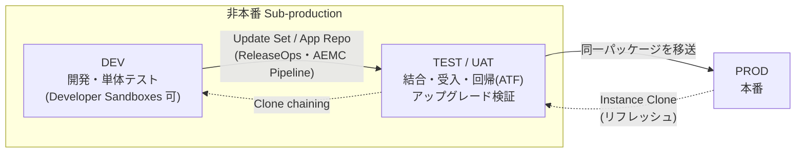
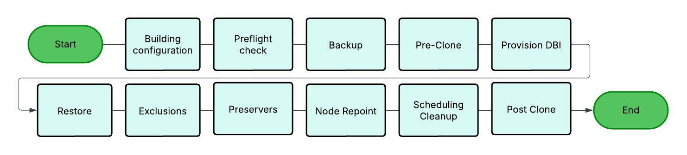
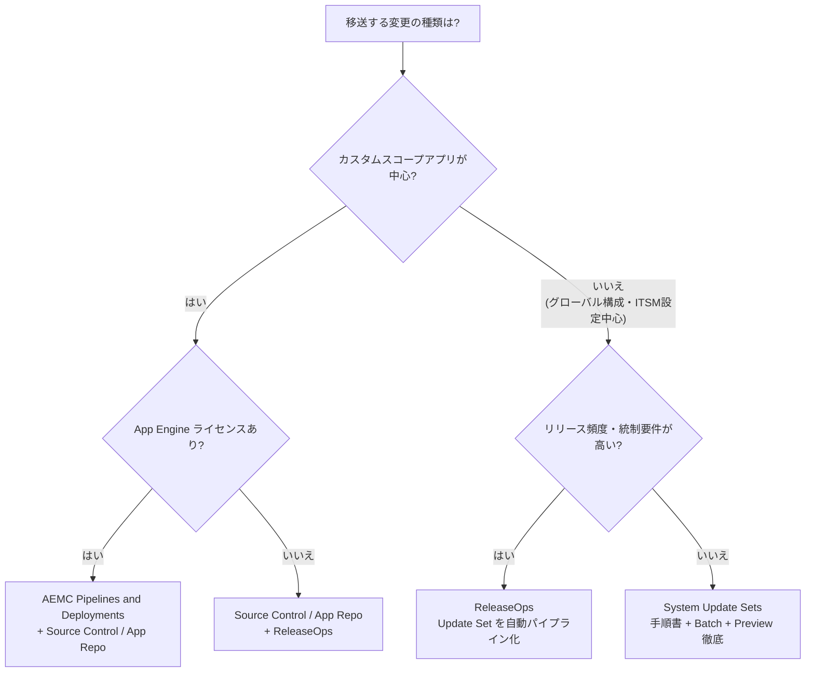
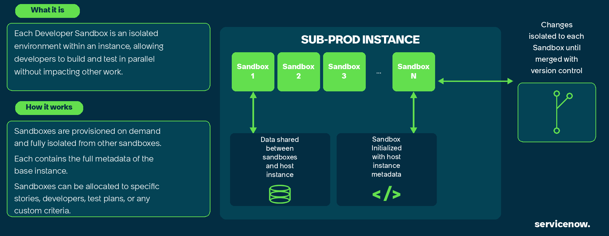
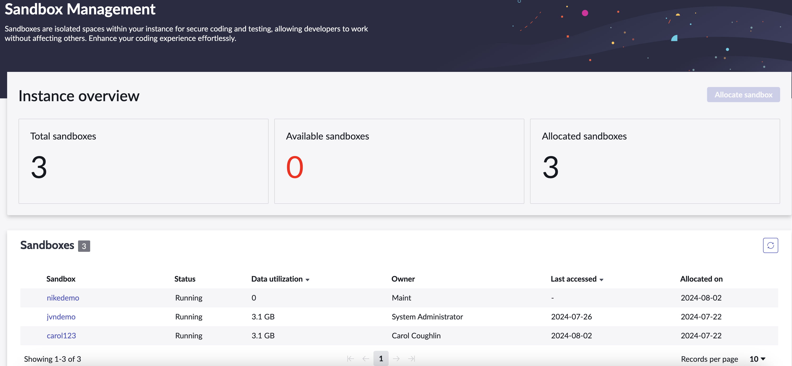
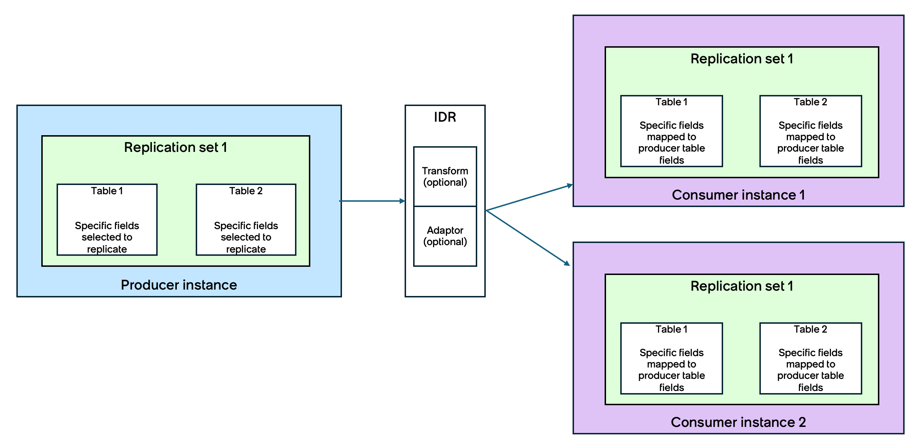
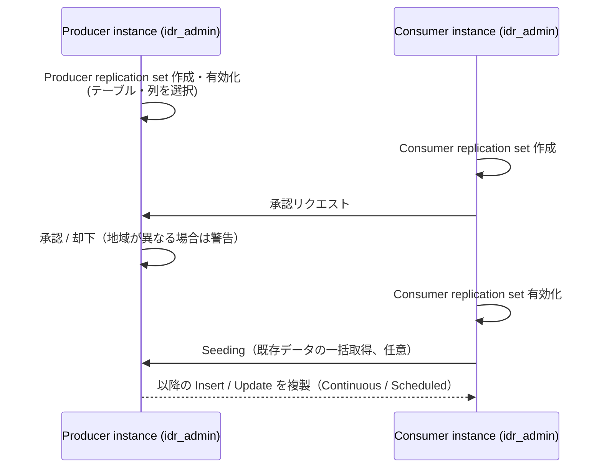

# インスタンス戦略と環境（Instance Strategy and Environments）

## 概要

ServiceNow の「インスタンス（Instance）」は、顧客ごとに払い出される 1 つのアプリケーション＋データベースの環境（例：`https://<name>.service-now.com`）である。導入プロジェクトでは、最初に **何台のインスタンスを、どの用途で、どの順序で変更を流すか** を決める必要があり、これがその後の開発・テスト・アップグレード・運用のすべてを規定する。

本ファイルは導入編として、次の問いに実務レベルで答える。

| 問い | 本ファイルの該当章 |
|---|---|
| 本番以外に何台のインスタンスが必要か、どう使い分けるか | 1〜2 章 |
| 非本番インスタンスはどう追加購入・改名・廃止するか | 3 章 |
| 本番→非本番のクローン（リフレッシュ）をどう計画するか | 4 章 |
| 変更をどの仕組みで DEV→TEST→PROD へ移送するか | 5 章 |
| インスタンス間でデータを同期したい場合、何を使うか（IDR） | 6 章 |
| 本番インスタンスを複数持つべきか | 7 章 |

テーブル・プロパティ・Clone の各フェーズや Update Set の操作詳細は [アップデートセットとクローン](../02_リファレンス/platform/update-sets-cloning.md)、インスタンスの物理構成（データセンター、ノード、HA）は [インスタンスアーキテクチャ](../02_リファレンス/platform/instance-architecture.md) を参照。

---

## 1. インスタンスの種類と用途

### 1.1 本番（Production）と非本番（Non-production / Sub-production）

ServiceNow の契約では、本番インスタンス（Production instance）と 1 台以上の非本番インスタンス（Non-production instance）がサブスクリプションに含まれる。公式の契約文書（Product Management Addendum 等）は「non-production」、Community や現場では「sub-production（サブプロダクション）」と呼ぶことが多いが、両者は同じものを指す。[出典](https://www.servicenow.com/community/incident-management-forum/differences-between-non-production-and-sub-production-instances/m-p/2413712)【第三者情報】（Community 回答）

| 区分 | 用途 | 特徴 |
|---|---|---|
| Production（本番） | 実業務の運用。エンドユーザー・フルフィラーが日常的に利用 | 契約上のライセンス（ユーザー数・パッケージ）が適用される本体。Clone の Target にしない運用が推奨（4.6 節） |
| Non-production / Sub-production（非本番） | 開発・テスト・検証・トレーニング | 本番業務に使ってはならない。Community 回答では「本番が持つ Advanced High Availability（AHA）構成のフル版を含まない」とされる【第三者情報】 |
| Personal Developer Instance（PDI） | 個人学習・検証（developer.servicenow.com で無償取得） | 契約外。顧客データを置かない。制御されたベースライン構成を持たない（Developer Sandboxes との違い）[出典](https://www.servicenow.com/docs/r/australia/application-development/developer-sandboxes/exploring-sandboxes.html) |
| Developer Sandbox | 1 台の非本番インスタンス上に作る分離された開発環境（5.5 節） | 有償オプション（Brazil で非本番 1 台あたり 4 個の無償枠が追加） |

> 何台の非本番が含まれるかは **契約（Order Form）ごとに異なり、公開情報では一律の数は確認できず**。書籍では「本番 1＋非本番 2 の 3 環境が一般的」「注文規模により合計 2〜5 台」と説明されている。[出典（Packt: ServiceNow for Architects and Project Leaders, Ch.6）](https://subscription.packtpub.com/book/cloud-and-networking/9781803245294/8/ch08lvl1sec41/designing-your-servicenow-landscape)【第三者情報】

### 1.2 公式が示す標準的な環境区分

ServiceNow 公式ドキュメント（Australia）は、アプリケーションライフサイクルの標準的なマルチインスタンス構成として次の 4 区分を示している。[出典](https://www.servicenow.com/docs/r/australia/application-development/moving-applications-between-instances.html)

| 略称 | 名称 | 役割（公式記述） |
|---|---|---|
| DEV | Development（開発） | アプリの構築・反復開発 |
| TEST | Testing / QA（テスト） | 変更の検証とテスト |
| STAGE | Staging / UAT（ステージング・受入テスト） | 変更の検証とテスト（本番相当データでの最終確認） |
| PROD | Production（本番） | 日常業務を支える本稼働環境 |

公式の基本原則は **「本番で直接開発しない（never develop directly in production）」**。すべての構成変更・コードは DEV で発生し、1 段以上の非本番検証（ATF、Instance Scan、関係者承認）を経て PROD に到達させる。また、アプリケーションスコープに属する成果物（Business Rule、Script Include、UI Page、ACL、テーブル、Flow など）は**一体の単位として移送**し、部分的なデプロイを避けることが求められている（部分デプロイは本番インシデントの主要因）。[出典](https://www.servicenow.com/docs/r/australia/application-development/moving-applications-between-instances.html)

---

## 2. 環境構成パターン（何台・どう並べるか）

### 2.1 代表的な構成パターン

以下は実務でよく採られる構成である。公式は 1.2 節の 4 区分を示すのみで、台数の推奨値は公開していない。【経験則】

| パターン | 構成 | 向いているケース | 注意点 |
|---|---|---|---|
| 2 面 | DEV → PROD | 小規模・OOTB 中心・カスタマイズ最小 | テストを DEV で兼ねるため、開発中の変更とテストが干渉する。アップグレード検証も DEV で行うことになる |
| 3 面（最も一般的） | DEV → TEST → PROD | 中規模の ITSM 導入など大半のプロジェクト | TEST を UAT・アップグレード検証・トレーニングで共用するため、利用カレンダーの調整が必要 |
| 4 面 | DEV → TEST(QA/SIT) → STAGE(UAT/Pre-prod) → PROD | 大規模・連携が多い・規制業種・複数ベンダー並行開発 | 環境維持コスト（Clone、連携先の非本番接続、データマスキング）が増える |
| 4 面＋α | 上記＋ Training／Hotfix／Upgrade 検証専用／Integration（連携テスト）専用 | 大規模グローバル展開、長期の並行リリース | 移送経路が複雑化しやすい。経路を固定し文書化する |

### 2.2 典型的な 3 面構成のフロー

- 実線は **構成（メタデータ）の流れ**（下流→上流ではなく DEV→PROD の一方向）、点線は **データ＋構成のリフレッシュ（Clone）の流れ**（PROD→非本番の逆方向）である。
- 公式 Update Set ガイドラインも「移送経路を固定する（DEV→TEST→PROD）」「同じ Update Set を複数の Source から移送しない」としている（詳細は [アップデートセットとクローン 13.1 節](../02_リファレンス/platform/update-sets-cloning.md)）。

### 2.3 環境ごとの設計チェックリスト

各インスタンスについて、プロジェクト初期に以下を決めて文書化しておくと、後工程での事故（非本番から顧客へメール送信、本番連携先の誤更新など）を防げる。【経験則】

| 項目 | DEV | TEST/UAT | PROD |
|---|---|---|---|
| 目的・利用者 | 開発者、管理者 | テスター、業務ユーザー（UAT）、トレーナー | 全ユーザー |
| 変更の入り方 | 直接構成（Update Set に記録） | 移送のみ（直接変更禁止） | 移送のみ（直接変更禁止、緊急時も手順化） |
| データ | 本番 Clone（マスキング済み）または最小データ | 本番 Clone（マスキング済み） | 本番データ |
| メール送信 | 無効（`glide.email.smtp.active` = false）または送信先を限定 | 原則無効、検証時のみテストアドレスへ | 有効 |
| 連携先 | 連携先の開発環境／スタブ | 連携先のテスト環境 | 連携先の本番 |
| MID Server | 非本番専用 MID | 非本番専用 MID | 本番専用 MID |
| SSO / IdP | 非本番用 IdP 設定（Preserver で保護） | 同左 | 本番 IdP |
| Clone Target 許可 | 許可 | 許可 | **禁止**（`glide.db.clone.allow_clone_target` = false） |
| アップグレード順序 | 1 番目 | 2 番目 | 最後 |

> 非本番と本番で連携先の URL・資格情報を分離する方法（プライベートなシステムプロパティ、資格情報ストア）は公式の「Credential isolation」として要求されている。[出典](https://www.servicenow.com/docs/r/australia/application-development/moving-applications-between-instances.html)

---

## 3. 非本番インスタンスの追加・改名・廃止

### 3.1 追加購入（Additional Non-Production Instance）

- ServiceNow のエンタイトルメント（Entitlements for Subscription Products）一覧には、基本の「Non-Production Instance」とは別に、**「Additional Non-Production Instance」** が独立したサブスクリプション製品として掲載されている（製品コード例：`PROD00065`、`PROD02074`）。つまり追加の非本番インスタンスは**有償の追加購入**である。[出典](https://www.servicenow.com/products/entitlements.html)（検索結果の抜粋により確認。ページ本体は取得時に 403 で直接確認できず）
- 価格は公開されていない。追加・アップグレードした非本番インスタンスが有償である旨はライセンス系の第三者ブログでも述べられている。[出典](https://itsmnegotiations.pages.dev/blog/servicenow-sandbox-and-non-production-instance-costs)【第三者情報】価格の目安は [価格情報](02-pricing.md) を参照。
- 申込窓口は **ServiceNow のアカウント担当（Account Manager / Territory Manager）**。Now Support（旧 HI）から新規インスタンスを直接注文する公式手順は公開情報では確認できず。Community の古い回答（2019）では HI チームへの依頼が案内されていた。[出典](https://www.servicenow.com/community/upgrades-and-patching-forum/how-to-request-a-new-sub-production-instance-for-the-production/m-p/312643)【第三者情報】
- 新しく払い出された非本番インスタンスは通常、空の状態（OOTB）か本番と異なるバージョンで届くため、**最初に本番から Clone して揃える**のが一般的。【経験則】

追加購入を検討すべき典型的な場面【経験則】：

| 場面 | 追加する環境の例 |
|---|---|
| 複数ベンダー／複数チームの並行開発で DEV が競合する | 2 台目の DEV、または Developer Sandboxes（5.5 節） |
| UAT とアップグレード検証・トレーニングが同時期に重なる | STAGE（Pre-prod）、Training |
| 本番障害のホットフィックスを通常リリースと別経路で流したい | Hotfix 用インスタンス（Clone 頻度を高く保つ） |
| 大規模データ移行のリハーサルを繰り返す | 移行リハーサル専用（[データ移行](08-data-migration.md)） |

### 3.2 インスタンスの改名（Rename）

インスタンス名（URL のサブドメイン）の変更は Now Support の Service Catalog から申請する。以下は Community 記事（KB0550841 に基づく、2018 年最終更新）に基づく情報で、現行手順は Now Support で確認すること。[出典](https://www.servicenow.com/community/itsm-articles/instance-rename-policy-for-production-and-sub-production/ta-p/2315873)【第三者情報】

| 項目 | 内容 |
|---|---|
| 申請経路 | Sub-production：Now Support → Service Catalog → Instance Management → `Rename an Instance`。Production：Service Catalog では申請できず Customer Support 経由 |
| 命名規則 | 英数字のみ（特殊文字不可）。本番・非本番とも末尾を `demo`／`pov`／`poc` にできない。3 文字以下は追加審査 |
| ダウンタイム | Sub-production 約 2 時間、Production 約 15 分 |
| 旧 URL の保持 | 既定で 2 営業日、要望により最大 7 日 |
| 改名後の影響 | Clone 機能が 2〜7 営業日無効になる場合がある。メール設定が OOTB 既定に戻る場合がある |
| 事前作業 | Multi-Provider SSO の IdP レコードの URL、インバウンド連携（ODBC 含む）、プロキシ・Vanity URL、Edge Encryption Proxy、MID Server 設定、メール転送ルールの更新 |

改名時にはナレッジ記事やメールテンプレートにハードコードされたインスタンス URL、外部システム（イントラネット、LMS）のリンク、利用者への周知も見直す必要がある。[出典](https://www.servicenow.com/community/servicenow-ai-platform-blog/renaming-a-servicenow-instance-considerations-for-a-change-in/ba-p/3289486)【第三者情報】

### 3.3 インスタンスの廃止（Retire）

不要になったインスタンスは Now Support の Service Catalog から廃止を申請できる（2020 年の公式 Community 告知）。[出典](https://www.servicenow.com/community/in-other-news/retire-an-instance-service-catalog-on-now-support-hi-has-been/ba-p/2291166)

- 経路：Now Support → Service Catalog → Instance Management → `Retire an Instance`。Customer Administrator / Partner Administrator のみ利用可。
- 日時を指定して申請すると Change request が作成され、計画開始前であればキャンセル・再スケジュールが可能。
- 指定日にインスタンスは **Suspend（停止）され、30 日後に Retired** となる。本番インスタンスを選ぶと警告が表示される。
- 子会社のインスタンスは `Switch Company` で切り替えてから申請する。

---

## 4. クローン戦略（Instance Clone）

### 4.1 Clone の役割と前提

`Instance Clone` は Source インスタンスのデータと構成を Target インスタンスへコピーし、**Target を上書き**する機能である。Target が Source とほぼ同一になるため、変更を安全にテストできる。主な用途はアップグレード検証、新規アプリケーションのテスト、新機能のテスト。[出典](https://www.servicenow.com/docs/r/australia/platform-administration/exploring-instance-clone.html)

| 前提・仕様 | 内容 |
|---|---|
| データ源 | Source の直近の日次バックアップ（最大 36 時間前）。On-demand backup も選択可 |
| 開始 | 予定日時になってから準備（バックアップ選択を含む）を開始 |
| バージョン | 異なるファミリー間でも可。**Target は Source のバージョンになる**（例：Zurich→Yokohama の Clone で Target は Zurich） |
| UI | Australia から `Clone Admin Console` が既定。旧 `clone_instance.do` は Clone Admin Console へリダイレクト。Australia 以前の履歴は Clone History（`clone_instance`）テーブルで参照 |
| ロール | Source：`clone_admin`（申請・キャンセル・スケジュール・Clone Profile 管理）。Target：`oauth_admin`（一回限りの OAuth 設定）。`soap`（Basic 認証時） |

[出典](https://www.servicenow.com/docs/r/australia/platform-administration/exploring-instance-clone.html)

**図 1：Instance Clone のワークフロー（Instance clone workflow diagram）**

- 画面説明：左の緑の「Start」から右の「End」まで、2 段に折り返した 11 個の水色のボックスが矢印でつながる流れ図。上段は Building configuration（構成の構築）→ Preflight check（Source/Target の健全性確認）→ Backup → Pre-Clone → Provision DBI（新しい Target DB インスタンスの作成）、下段は Restore（バックアップの復元）→ Exclusions（除外テーブルのデータ削除）→ Preservers（旧 Target から保持データを複写）→ Node Repoint（旧 Target から新 DB へ切替）→ Scheduling Cleanup → Post Clone。Exclusions と Preservers が Restore の後に適用される点、Node Repoint までは旧 Target が生きている（キャンセル可能）点が読み取れる。
- 出典：ServiceNow Docs「Exploring Instance Clone」（Australia）Figure 1 https://www.servicenow.com/docs/r/australia/platform-administration/exploring-instance-clone.html （取得日：2026-11-03）。画像の著作権は ServiceNow, Inc. に帰属。

### 4.2 Clone の方向と Clone chaining

- **方向の原則**：本番 → 非本番（データと構成のリフレッシュ）。非本番 → 本番の Clone は本番データを失うため行わない（4.6 節）。構成を本番に入れるのは Clone ではなく移送（5 章）である。【経験則】（公式も本番を Target にした後は FALSE に戻すよう求めている）
- **Clone chaining（クローンチェーン）**：公式用語。Clone を 2 段階に分ける戦略で、①本番 → テスト（非本番）、②テスト → その他すべての環境、と流す。Post-clone の Cleanup script や「Task の 90 日以前を除外」などの重い処理を 1 回だけで済ませられ、2 段目の Clone は軽量で速く終わる。複数インスタンスがあり Clone に時間がかかる場合に有効。[出典](https://www.servicenow.com/docs/r/australia/platform-administration/clone-terminology.html)
- データマスキング（4.5 節）を 1 段目で行えば、2 段目以降の環境にはマスキング済みデータだけが流れる、という設計にもできる。【推定】

### 4.3 Clone の頻度とタイミング

Clone Admin Console の申請オプション `Clone frequency` では、`None`（既定）／`Weekly`／`Every 2 weeks`／`Every 4 weeks` から定期 Clone を設定でき、最大回数（occurrences）も指定する。[出典](https://www.servicenow.com/docs/r/australia/platform-administration/clone-options.html)

公式は頻度の推奨値を示していない。実務でよく採られるタイミングは以下。【経験則】

| タイミング | 対象 | 理由 |
|---|---|---|
| プロジェクト開始時・新規インスタンス払い出し直後 | 全非本番 | sys_id とベースラインを揃える（Update Set 移送の前提） |
| ファミリーアップグレードの検証前 | TEST/STAGE（必要に応じ DEV） | 本番と同じデータ・カスタマイズでアップグレード結果を確認する（[アップグレード管理](13-upgrade-management.md)） |
| 大型リリースの UAT 前 | TEST/STAGE | 本番相当データでの受入 |
| 定期（四半期〜半年ごと） | DEV/TEST | ドリフト（環境差分）の解消 |
| 本番リリース直後 | TEST | 次サイクルを本番と同一状態から始める |

> **注意**：Clone は Target 上の進行中の作業（In-progress Update Set、Target にしかないスコープアプリ、Developer Sandboxes）を上書きする。開発の谷間（リリース直後）に計画し、事前に WIP を退避する（4.4 節）。

### 4.4 Clone 前後の作業（WIP の退避と確認）

| フェーズ | 作業 | 根拠 |
|---|---|---|
| 計画 | Clone 日程を開発チーム・テストチーム・連携先に周知。Clone Admin Console の予約カレンダーで ServiceNow のメンテナンス時間帯との衝突を避ける | [出典](https://www.servicenow.com/docs/r/xanadu/platform-administration/Clone-UI.html) |
| 事前 | Target の In-progress Update Set をエクスポート、またはバッチ化して Source に Retrieve（Commit しない）し日次バックアップに含める（On-demand backup でも可） | [出典](https://www.servicenow.com/docs/r/australia/platform-administration/clone-update-sets-example.html) |
| 事前 | Clone オプション `No. of days of In-progress Global Update Sets to be preserved` は直近 90 日の **グローバル** In-progress Update Set のみ保持し、スコープ付きは保持しない | [出典](https://www.servicenow.com/docs/r/australia/platform-administration/clone-options.html) |
| 事前 | 開発中のスコープアプリは Source Control へコミットまたは Publish して退避 | [アップデートセットとクローン 11.3 節](../02_リファレンス/platform/update-sets-cloning.md) |
| 事前 | Developer Sandboxes の作業は手動で保存（Clone 後に自動再作成されない） | [出典](https://www.servicenow.com/docs/r/australia/application-development/developer-sandboxes/dev-sbx-supported-features.html) |
| 事前 | Preserver・Exclusion・Cleanup script を Source 側で見直す（Preserver は Source で定義） | 4.5 節 |
| 事後 | メール無効化、スケジュールジョブ、MID Server、連携先 URL・資格情報、SSO、ユーザー/ロールを確認 | 【経験則】 |

### 4.5 Exclude / Preserve / データマスキングの設計

Clone 設計の中心は「何を本番から持ってこないか（Exclusion）」「何を Target に残すか（Preserver）」「何を Clone 後に書き換えるか（Cleanup script・データマスキング）」の 3 点である。操作詳細は [アップデートセットとクローン 10 章](../02_リファレンス/platform/update-sets-cloning.md) を参照。

**主な Clone オプションの既定値（Australia）** [出典](https://www.servicenow.com/docs/r/australia/platform-administration/clone-options.html)

| オプション | 選択肢・既定 | 戦略上の判断ポイント |
|---|---|---|
| Amount of data copied from the Task table | `Full`（既定）／`Last 90 days` | 90 日に絞るとデータ量は減るが、復元後に古い Task を削除する処理が走るため **Clone 時間はむしろ延びる** と公式が注意 [出典](https://www.servicenow.com/docs/r/australia/platform-administration/clone-duration-optimization.html) |
| Exclude tables specified in Exclusion List | 既定で除外 | 監査・ライセンス利用・ログ・通知などのシステム既定除外は設定に関係なく除外 |
| Exclude audit and log data | 既定で除外 | 除外すると Target のアクティビティストリームが Source と一致しない |
| Exclude attachment data | 既定で除外 | `sys_attachment` の大容量バイナリを除外。`sys_certificate`、`sc_cat_item` 等は対象外 |
| Preserve theme | 既定で保持 | Target のテーマで本番と見分けやすくする |
| Clone frequency | `None` 既定 | 4.3 節 |

**Exclusion の公式ガイドライン** [出典](https://www.servicenow.com/docs/r/australia/platform-administration/clone-exclusions-guidelines.html)

- ワークフローコンテキスト（`wf_context`、`wf_` で始まる関連テーブル）は既定で除外される（Clone 中のタイマー同期問題を防ぐため）。
- ワイルドカード指定可（例：`sys_script.*`。ドットを含める必要がある）。
- ユーザー関連テーブルを保持／除外する場合は `sys_user`、`sys_user_role`、`sys_user_group`、`sys_user_grmember`、`sys_group_has_role`、`sys_user_role_contains`（CSM 有効時は `customer_contact`）を**まとめて**扱う。1 つでも漏れると Clone 後にログインできなくなる可能性がある。
- `sys_db_object` と `sys_db_object.*` は除外できない。

**Clone 時間を短くするための公式ガイドライン** [出典](https://www.servicenow.com/docs/r/australia/platform-administration/clone-duration-optimization.html)

- 大量データを Preserve しない。ユーザー・グループ・ロールなどを残したい場合はファイルにエクスポートし、Clone 後にインポートすることも検討する。
- Preserver に条件を付けて必要なデータだけ保持する。
- Clone chaining（4.2 節）で分割する。

**データマスキング（Data Privacy clone）**

本番の個人情報を非本番に持ち込まないことは公式のセキュリティ要件でもある（「非本番のテストデータにマスキングされていない本番 PII が含まれないことを確認し、Clone 時にデータマスキングまたは匿名化を使う」）。[出典](https://www.servicenow.com/docs/r/australia/application-development/moving-applications-between-instances.html)

- Data Privacy プラグイン（`sn_dp_store_app`）を Source で有効化すると PostClone script がインストールされ、Clone 後に Target 上で匿名化ポリシーに基づく Data privacy job が実行される。利用者は匿名化後のデータしか見られない。[出典](https://www.servicenow.com/docs/r/australia/platform-security/data-privacy-classic/dp-clone.html)
- 設定：`data_privacy_admin` に昇格 → `System Security > Data Privacy > Anonymization` → `Create new policy` → データクラスを選び `Activate the policy during cloning` を選択 → ポリシー順序を指定 → 公開 → 匿名化ジョブをスケジュール → Data privacy admin として Clone を申請。必要ロール：`data_privacy_clone_processor`、`data_privacy_admin`、`admin`。Target 側では `dp_federated_job` と `dp_job` で進捗を監視する。[出典](https://www.servicenow.com/docs/r/australia/platform-security/data-privacy-classic/dps-configure-data-anonymization-clone.html)
- Data privacy のテーブル（`dp_*`）は既定で Clone Data Preservers に含まれ、Exclude に追加しようとすると警告が出る。**セルフホスト（オンプレミス）インスタンスでは Data privacy clone は利用できない**。[出典](https://www.servicenow.com/docs/r/australia/platform-security/data-privacy-classic/dp-clone.html)
- Data Privacy のライセンス要否は公開情報では確認できず（契約・エンタイトルメントで確認）。セキュリティ全般は [セキュリティとコンプライアンス](10-security-compliance.md) を参照。

### 4.6 本番を Clone Target にしない設定

- システムプロパティ `glide.db.clone.allow_clone_target` が `true` の間、そのインスタンスは Clone Target になれる（本番も含む）。本番を Target にした場合は、その後 `false` に戻すことが推奨される。[出典](https://www.servicenow.com/docs/r/australia/platform-administration/exploring-instance-clone.html)
- Instance Security Hardening Settings（Security Center）でも本項目は「Disallow target cloning」としてチェック対象で、推奨値 `false`、重大度 CVSS 4.4（Medium）。同ページは「既定値 true」と「本番は既定 false、dev/QA 等の非本番は既定 true」の両方の記述を含み、記載が不一致である。**本番で実際の値を必ず確認する**。[出典](https://www.servicenow.com/docs/r/platform-security/instance-security-hardening-settings/sc-disallow-target-cloning.html)

### 4.7 失敗時の戻し方

- **キャンセル**：Node Repoint ステージまでキャンセル可能で、Target は Clone 前の状態のまま残る。
- **ロールバック**：直近の Clone のみ、Clone 後 **7 日以内**（シャード化インスタンスは 2 日以内）。`clone_admin` で Clone Admin Console から実行し、State は `Rollback requested` → `Rolled back`／`Rollback failure`。[出典](https://www.servicenow.com/docs/r/australia/platform-administration/roll-back-a-cac-clone.html)
- 実務上は「ロールバックがあるから大丈夫」ではなく、WIP 退避（4.4 節）を前提に計画する。【経験則】

> **Brazil での変更:** Clone Admin Console の OAuth 2.0 Target 認証が強化（一回限りの Target 登録、申請ごとのトークン自動生成と有効期限）され、Instance Overview がタブ化された。詳細は [アップデートセットとクローン 14 章](../02_リファレンス/platform/update-sets-cloning.md)。[出典](https://www.servicenow.com/docs/r/delta-zurich-brazil/brazil-zurich-cloneadminconsole-release-notes.html)

---

## 5. 移送パイプライン（DEV → TEST → PROD）

### 5.1 3 つのデプロイ管理方式（公式比較）

ServiceNow 公式（Australia）は、デプロイの管理方式として **ReleaseOps**、**App Engine Management Center（AEMC）の Pipelines and Deployments**、**System Update Sets** の 3 つを示し、組織の成熟度・ライセンス・運用方針で選ぶよう求めている。[出典](https://www.servicenow.com/docs/r/australia/application-development/management-options.html)

| 観点 | ReleaseOps | AEMC Pipelines and Deployments | System Update Sets |
|---|---|---|---|
| 導入リリース | Zurich（2025） | San Diego（2022） | レガシー（プラットフォーム基盤） |
| デプロイ単位 | Update Set＋自動パイプライン | Application Repository 上のアプリケーションバージョン | まとめた構成変更 |
| 自動化 | Playbook による自動検証とパイプライン実行。Multi-instance framework（MIF）でインスタンス間を連携 | 承認ゲート付きのガイド付きパイプライン、ATF と Instance Scan を組み込み | 手作業（Retrieve → Preview → Commit） |
| バージョン管理 | Update Set Batch とリリースパッケージ | セマンティックバージョニング（Major.Minor.Patch） | 限定的（Update Set 名のみ） |
| 向いている用途 | あらゆる種類のデプロイを CI/CD 的に自動化したい組織 | App Engine 製品でカスタムスコープアプリを作るチーム。監査用に Change request も生成 | 軽微な運用変更、グローバルスコープの構成、レガシーなワークフロー |
| ライセンス | プラットフォームに含まれる | **App Engine のライセンスが必要** | プラットフォームに含まれる |

- Update Set 方式はスコープの混入（scope contamination）や依存関係の欠落といった問題が起きやすい、と公式自身が注意している。[出典](https://www.servicenow.com/docs/r/australia/application-development/management-options.html)
- カスタムスコープアプリについては **Source Control（Git）＋ Application Repository が推奨**、Update Set も承認された移送手段とされる。[出典](https://www.servicenow.com/docs/r/australia/application-development/get-started-deployment.html)
- ReleaseOps は規制環境・オンプレミスでは非サポート。詳細（Release、Deployment request、Playbook、ロール）は [アップデートセットとクローン 12 章](../02_リファレンス/platform/update-sets-cloning.md)、アプリ開発全般は [アプリケーション開発](../02_リファレンス/platform/app-development.md) を参照。

### 5.2 方式選定の考え方

上図は公式比較表（5.1 節）を判断フローに整理したもの。【推定】実際には ITSM 系のグローバル構成（Update Set）とスコープアプリ（App Repo）が混在するため、**「グローバル構成＝Update Set（ReleaseOps で自動化）、スコープアプリ＝App Repo/Source Control」** と二本立てにし、混在させない運用が多い。【経験則】

### 5.3 デプロイ標準手順（SOP）に入れるべき事項（公式）

公式は「すべての ServiceNow 組織は文書化されたデプロイ SOP を持つべき」とし、承認された方式、パイプラインのステージと承認ゲート、デプロイ権限を持つロールを明記するよう求めている。[出典](https://www.servicenow.com/docs/r/australia/application-development/standard-operating-procedure-for-deployment.html)

**デプロイ前チェックリスト（公式）**

| # | 項目 |
|---|---|
| 1 | 組織で承認されたデプロイ方式（ReleaseOps / AEMC / Update Sets）をプラットフォームオーナーまたはリリースマネージャーに確認 |
| 2 | アプリに Instance Scan を実行し、セキュリティ違反・コーディング規約違反・ガイドライン逸脱を確認 |
| 3 | すべての ATF スイートを実行し合格を確認（[Automated Test Framework](../02_リファレンス/platform/automated-test-framework.md)） |
| 4 | ACL を最小権限の観点でレビュー（空または過剰に緩い ACL がないこと） |
| 5 | 資格情報・API キー・環境固有プロパティがプライベートなシステムプロパティで分離されていること |
| 6 | 組織の変更管理プロセスに従い Change request の承認を得る（[Change Management](../02_リファレンス/itsm/change-management.md)） |
| 7 | 非本番に先にデプロイして十分検証し、すべての品質ゲート通過後に本番へ昇格 |

**パイプラインのセキュリティ要件（公式）**：デプロイ担当の対話型アカウントへの MFA、自動パイプライン用サービスアカウントへの IP allow list、連携アカウントの資格情報ローテーション、全デプロイ操作の監査ログ、セキュリティ劣化時のロールバック手順。また「開発者に本番の admin 権限を与えない。必要最小限のロールのみを持つデプロイ専用サービスアカウントを使う」こと。[出典](https://www.servicenow.com/docs/r/australia/application-development/standard-operating-procedure-for-deployment.html)、[出典](https://www.servicenow.com/docs/r/australia/application-development/moving-applications-between-instances.html)

### 5.4 環境ごとの品質ゲート例

| ゲート | DEV → TEST | TEST → STAGE/UAT | STAGE → PROD |
|---|---|---|---|
| ピアレビュー | 必須 | － | － |
| Instance Scan（Update Set スキャン） | 必須 | 必須 | 必須（結果を Change に添付） |
| ATF | 単体・回帰の一部 | 回帰スイート全体 | スモーク |
| 業務承認 | － | UAT サインオフ | CAB／Change 承認 |
| 実施者 | 開発者 | リリース担当 | リリース担当（デプロイ専用アカウント） |

上表は公式 SOP（5.3 節）の要素を環境別に割り付けた例。【経験則】本番稼働時のテスト計画は [テストと本番稼働](11-testing-golive.md)、運用時のリリース統制は [運用とガバナンス](12-operations-governance.md) を参照。

### 5.5 Developer Sandboxes（並行開発の分離）

`Developer Sandboxes` は、共有の開発（ベース）インスタンスの上に、開発者ごと・ストーリーごとに分離された開発環境をオンデマンドで払い出す機能である。各 Sandbox はベースインスタンスのメタデータ全体を持ち、他の Sandbox から完全に分離される。従来の共有 DEV で起きるコード競合・構成の重なり・デプロイ遅延を減らすことを狙う。[出典](https://www.servicenow.com/docs/r/australia/application-development/developer-sandboxes/exploring-sandboxes.html)

**図 2：Developer Sandboxes のアーキテクチャと動作（How Developer Sandboxes work）**

- 画面説明：濃紺背景の概念図。左に「What it is（各 Developer Sandbox はインスタンス内の分離環境で、他の作業に影響せず並行に構築・テストできる）」「How it works（オンデマンドで払い出され完全に分離／ベースインスタンスの全メタデータを持つ／ストーリー・開発者・テスト計画などに割り当て可能）」の説明枠。中央の「SUB-PROD INSTANCE」枠内に緑色の Sandbox 1、2、3 … N が並び、下に「Data shared between sandboxes and host instance（データは Sandbox とホストで共有）」と「Sandbox Initialized with host instance metadata（ホストのメタデータで初期化）」の 2 つのボックスがある。右側には Git ブランチのアイコンと「Changes isolated to each Sandbox until merged with version control（変更はバージョン管理でマージされるまで各 Sandbox に閉じる）」の注記。非本番インスタンス上の機能であることが図からも分かる。
- 出典：ServiceNow Docs「Exploring Developer Sandboxes」（Australia）Figure 1 https://www.servicenow.com/docs/r/australia/application-development/developer-sandboxes/exploring-sandboxes.html （取得日：2026-11-03）。画像の著作権は ServiceNow, Inc. に帰属。

**仕様と制約（Australia）**

| 項目 | 内容 | 出典 |
|---|---|---|
| 提供形態 | 有償。10 個単位のパックで販売、1 インスタンスあたり最低 1 パック。各 Sandbox は専用の app node で動くため 10 個購入で 10 ノード追加 | [出典](https://www.servicenow.com/docs/r/australia/application-development/developer-sandboxes/dev-sbx-installing.html) |
| 対象インスタンス | 非本番インスタンス（ADCv3 が前提。未対応なら設定時にアップグレード）。プラグインは本番または Clone の Source にも導入し、Clone 時にエンタイトルメントを維持する | 同上 |
| 導入申請 | 調達完了後、Now Support にケースを起票（インスタンス名とライセンス数を指定）。Sandbox はインスタンス固有で移動不可 | 同上 |
| 上限 | 1 インスタンスあたり最大 30 Sandbox | [出典](https://www.servicenow.com/docs/r/australia/application-development/developer-sandboxes/dev-sbx-supported-features.html) |
| SSO | ベースインスタンスで `glide.sso.acr.enable` = false、`glide.authenticate.multisso.enabled` = true を設定。Vanity URL でも SSO 可 | [出典](https://www.servicenow.com/docs/r/australia/application-development/developer-sandboxes/dev-sbx-installing.html) |
| 対応機能 | Update Set、レガシー Source Control（Sandbox ごとに Git ブランチ）、ServiceNow IDE、Workflow Studio、アプリ/プラグインの個別インストール、Build Agent。受信連携は Sandbox 固有 URL に合わせて手動変更が必要 | [出典](https://www.servicenow.com/docs/r/australia/application-development/developer-sandboxes/dev-sbx-supported-features.html) |
| アップグレード時 | Update Set を自動でベースにバックアップし、Sandbox を基本状態で再作成（作業は復元が必要） | 同上 |
| Clone 時 | **Sandbox は自動再作成されない**。事前に作業を保存し、Clone 後に手動で戻す | 同上 |
| 非対応 | セルフホストは既定で非対応（独自のネットワーク/ルーティング構成が必要）。UI/Worker ノード構成のインスタンスは非対応 | 同上 |
| 利用者 | Delegated developer（Sandbox を申請）、Admin（割当・廃止、変更を共有インスタンスへ Clone）、Sandbox manager（admin なしでライフサイクル管理）、Sandbox user | [出典](https://www.servicenow.com/docs/r/australia/application-development/developer-sandboxes/exploring-sandboxes.html) |

**標準ワークフロー（公式）**：Sandbox manager / admin が Sandbox を割り当て → 開発者が分離環境で変更・テスト → 共有の上流インスタンス（TEST/QA など）へ Source Control（推奨）または Update Set でプッシュ → admin が TEST/QA からベースインスタンスへ Clone し、次の Sandbox のベースラインを更新する。[出典](https://www.servicenow.com/docs/r/australia/application-development/developer-sandboxes/exploring-sandboxes.html)

**図 3：Sandbox Management ホームダッシュボード**

- 画面説明：上部に「Sandbox Management」の見出しと説明文。「Instance overview」セクションに 3 枚のタイル（Total sandboxes＝3、Available sandboxes＝0（赤字）、Allocated sandboxes＝3）と右上の `Allocate sandbox` ボタン。下の「Sandboxes」一覧には Sandbox 名、Status（Running）、Data utilization（例：3.1 GB）、Owner、Last accessed、Allocated on の列が並ぶ。空き枠の有無とデータ使用量を一目で確認できる。
- 出典：ServiceNow Docs「Exploring Developer Sandboxes」（Australia） https://www.servicenow.com/docs/r/australia/application-development/developer-sandboxes/exploring-sandboxes.html （取得日：2026-11-03）。画像の著作権は ServiceNow, Inc. に帰属。

> **Australia での変更:** Build Agent が Sandbox で利用可能に、アップグレード時の Sandbox 再作成と Update Set 自動バックアップ、Sandbox を含むインスタンスの Clone 時の保持を支援する新プラグイン、共有テーブルにスキーマ変更（列追加等）を行うとそのテーブルが当該 Sandbox で分離テーブルになる変更（2026-04）など。[出典](https://www.servicenow.com/docs/r/australia/release-notes/developer-sandboxes-rn.html)

> **Brazil での変更:** Developer Sandbox License Management（`com.glide.dsb.licensing`）プラグインにより、AEMC の Developer Sandbox Management タブから購入済みパックを非本番インスタンスへ**サポートケースなしで自己割当**できるようになった（1 パック 10 個、1 非本番インスタンスに最大 3 パック）。新テーブル `sys_dsb_instance_allocation`、新ロール `sn_dsb_commons.sandbox_license_admin` が追加。さらに**すべての非本番インスタンスに 4 個の無償 Sandbox** が付与され、購入分と合わせて 1 インスタンス最大 34 個となる（2026-10 リリース）。[出典](https://www.servicenow.com/docs/r/release-notes/developer-sandboxes-rn-static.html)

**環境戦略への影響**【推定】：並行開発のために DEV インスタンスを追加購入する代わりに、1 台の DEV 上で Sandbox を使う選択肢ができた。ただし Clone 時に Sandbox が消える点から、DEV の Clone 計画（4.3 節）と Sandbox 利用ルールをセットで設計する必要がある。

---

## 6. Instance Data Replication（IDR）

### 6.1 IDR とは何か・何ではないか

`Instance Data Replication（IDR）` は、**Producer instance（プロデューサー）** のデータ更新を 1 台以上の **Consumer instance（コンシューマー）** へ複製し、インスタンス間のデータ整合を保つ機能である。同一企業の部門間、または別会社のインスタンス間でのデータ同期に使う。[出典](https://www.servicenow.com/docs/r/australia/servicenow-platform/instance-data-replication-idr/exploring-instance-data-replication.html)

**図 4：Instance Data Replication の構成（Data replicates from a producer instance to one or more consumer instances）**

- 画面説明：左の水色枠「Producer instance」内に「Replication set 1」があり、その中に「Table 1」「Table 2」（Specific fields selected to replicate＝複製するフィールドを選択）がある。中央の「IDR」枠には「Transform (optional)」と「Adaptor (optional)」が縦に並び、矢印は右の紫色枠「Consumer instance 1」「Consumer instance 2」に分岐する。各 Consumer にも「Replication set 1」と「Table 1」「Table 2」（Specific fields mapped to producer table fields＝プロデューサーのフィールドにマッピング）がある。テーブル全体ではなくフィールド単位で選び、変換・アダプタを任意で挟んで複数 Consumer に配る仕組みであることが分かる。
- 出典：ServiceNow Docs「Exploring Instance Data Replication」（Australia）Figure 1 https://www.servicenow.com/docs/r/australia/servicenow-platform/instance-data-replication-idr/exploring-instance-data-replication.html （取得日：2026-11-03）。画像の著作権は ServiceNow, Inc. に帰属。

| IDR を使う場面（公式） | IDR を使わない場面（公式） |
|---|---|
| インスタンス間のデータ整合の維持 | **インスタンスの Clone（→ Instance Clone を使う）** |
| 同一企業の組織間、または別会社間でのデータ同期 | 大容量添付の定常的な複製 |
| クラッシュ時に送信中だったデータの回復 | CMDB テーブルの継続（Continuous）複製（→ Scheduled か条件で件数を絞る） |
| ローカライズ（通貨・タイムゾーン変換） | 暗号化フィールド・パスワードフィールドの複製 |
| 複製後の通知・検証（Business Rule） | アーカイブ済みレコードの同期 |

[出典](https://www.servicenow.com/docs/r/australia/servicenow-platform/instance-data-replication-idr/exploring-instance-data-replication.html)。また Community 記事は「構成・設定（メタデータ）は複製されない」「連携・データエクスポート用途には向かない」と整理している。[出典](https://www.servicenow.com/community/now-platform-articles/instance-data-replication-and-its-configuration-plugins-version/ta-p/2323579)【第三者情報】

> **戦略上のポイント**：IDR は「構成の移送」にも「非本番のリフレッシュ」にも使えない。主用途は **複数本番インスタンス間（7 章）や、本番と別用途インスタンス間での業務データ同期** である。【推定】

### 6.2 ライセンス・プラグイン・ロール

| 項目 | 内容 |
|---|---|
| ライセンス | **別サブスクリプション**が必要。アカウント担当経由で購入し、ServiceNow 担当者がプラグインを有効化（本番・非本番とも、通常数日以内）。非本番での無償評価は `All > System Applications > All Available Applications > All` → `Request plugin`（Now Support の Activate Plugin フォーム）から申請可能 |
| プラグイン | `com.glide.idr`。依存：`com.snc.db.data_replicate`、`com.glide.transform`、`com.glide.kmf`（New York 以降でサポート） |
| 稼働環境 | **ServiceNow データセンターのみ**（オンプレミス／セルフホストは非サポート） |
| ロール | `idr_admin`（全 IDR テーブルへの管理アクセス）、`idr_read`（参照）、`idr_rest`（診断リクエストに必要。前 2 者に含まれる）。既定でグループへの割当なし |

[出典](https://www.servicenow.com/docs/r/australia/servicenow-platform/instance-data-replication-idr/request-instance-data-replication.html)、[出典](https://www.servicenow.com/docs/r/australia/servicenow-platform/instance-data-replication-idr/instance-data-replication-roles.html)

### 6.3 構成手順の流れ

[出典](https://www.servicenow.com/docs/r/australia/servicenow-platform/instance-data-replication-idr/exploring-instance-data-replication.html)、[出典](https://www.servicenow.com/docs/r/australia/servicenow-platform/instance-data-replication-idr/data-privacy-consumers-idr.html)

### 6.4 複製方式

| 方式 | 内容 | 使いどころ |
|---|---|---|
| Continuous（継続） | Insert/Update をほぼリアルタイムで複製 | 件数が多すぎない業務テーブル |
| Scheduled（定期） | 1 日の中の決められた間隔で履歴分をまとめて複製。作成できるのは 1 つの Scheduled replication set（Outbound entry 1 つ）のみ | 更新頻度が高い大きなテーブル、CMDB |
| Bidirectional（双方向） | Producer↔Consumer の双方向。Consumer 側に `-<番号>-reverse` 付きの Producer set が自動生成される。**自動の競合解決なし**、アダプタは Number adapter のみ | 2 インスタンスで同じ Incident 等を同期する場合（競合設計が必須） |
| Discrete（個別） | 特定の Consumer にのみ特定データを送る | 複数会社・地域で配布先を分ける場合 |

[出典](https://www.servicenow.com/docs/r/australia/servicenow-platform/instance-data-replication-idr/exploring-instance-data-replication.html)、[出典](https://www.servicenow.com/docs/r/australia/servicenow-platform/instance-data-replication-idr/bidirectional-replication.html)、[出典](https://www.servicenow.com/docs/r/australia/servicenow-platform/instance-data-replication-idr/scheduled-replication.html)

### 6.5 制約と設計上の注意

**数値上の制約（公式）** [出典](https://www.servicenow.com/docs/r/australia/servicenow-platform/instance-data-replication-idr/exploring-instance-data-replication.html)

| 項目 | 上限・制約 |
|---|---|
| 1 レコードの最大サイズ | 10 MB |
| Continuous 複製の処理量 | 1 日あたり約 100 万レコード |
| Seeding | 7 日以内に完了する必要あり（Community 記事では「Seeding 上限 300 万レコード」との記載もある【第三者情報】） |
| 複製不可 | Edge Encryption、Field Encryption、Password (2-Way Encrypted) フィールド |
| 除外テーブル | メタデータテーブル（`sys_metadata` 継承：`sys_script`、`sc_catalog`、`wf_workflow` 等）、ほとんどのユーザー・システムテーブル |
| アーカイブ | 同期されない（アーカイブルールは各インスタンスで個別管理） |

**準備段階の公式ガイダンス** [出典](https://www.servicenow.com/docs/r/australia/servicenow-platform/instance-data-replication-idr/prepare-instance-data-replication.html)

- Producer と Consumer は**同じ地理リージョン・同じ顧客**に置くとレイテンシを抑えられる（異なるリージョン間も可能だが遅延が生じうる）。
- `sys_` 接頭辞のシステムテーブル（`sys_user`、`sys_user_group`、`sys_user_grmember` 等）は、Consumer 側に既存データがあると Insert/Update 失敗の原因になるため避ける。
- 親子階層を持つテーブルは、参照フィールドの整合のために**階層内の親子テーブルをすべて複製**する。
- Replication set はテーブル単位または関連テーブルのグループで構成し、グループは 5 テーブル程度までに抑える。sys 列など不要な列は選ばない。
- Consumer 側の対象テーブルは開始前に空にする。Business Rule・ACL・Data Policy を事前に見直す。エラーは `Instance Data Replication > Replication Payload Error` で追跡する。

**データプライバシー（公式）**：IDR は**データを上書きし、機微データも複製しうる**ため、本番前の環境でテストすること。Producer と Consumer が異なる地理リージョンにある場合は承認時に Producer へ警告が出る。地域間転送は異なる個人データ規制の対象になりうる。稼働中の Replication set の Discrete ルールを変更すると、意図しない Consumer にデータが露出する可能性がある。[出典](https://www.servicenow.com/docs/r/australia/servicenow-platform/instance-data-replication-idr/data-privacy-consumers-idr.html)

**ドメインセパレーション**：Community の回答では「IDR はドメインセパレーションをサポートしない」とされているが、公式ドキュメントでは確認できず。【第三者情報】[出典](https://www.servicenow.com/community/now-platform-articles/instance-data-replication-and-its-configuration-plugins-version/ta-p/2323579)

> **Australia での変更:** IDR Diagnostics ページが刷新され、診断テストの説明と結果が詳しく表示されるようになった。アップグレード後、`idr_replication_payload_error` テーブルのログローテーションが自動で有効化され（7 シャード × 各 5 日）、アップグレード前のエントリは切り捨てられる。[出典](https://www.servicenow.com/docs/r/australia/release-notes/instance-data-replication-rn.html)

> **Brazil での変更:** IDR に関する Brazil 固有の変更は公開情報では確認できず。

---

## 7. 複数本番インスタンスの是非

### 7.1 基本スタンス：原則は単一本番

ServiceNow 社員（アーキテクト）による Community 記事は、複数本番インスタンスを検討する際の 6 つのルールを示し、**正当なビジネス上の理由（ルール 1）がない限り単一インスタンスを既定とする**立場を取っている。[出典](https://www.servicenow.com/community/architect-articles/multi-instance-architecture-yes-no-when/ta-p/2330584)（2021-09、ServiceNow Employee）

| # | ルール | 要旨 |
|---|---|---|
| 1 | 健全なビジネス上の理由を持つ | 分離には正当化が必要 |
| 2 | 顧客（エンドユーザー）は単一インスタンスを使う | サービスの一部のために別システムへログインさせるのは体験が悪い |
| 3 | フルフィラーの大半は単一インスタンスを使う | インスタンスごとにアカウントが必要になり **ライセンス費用が倍増**。全フルフィラーが全インスタンスに入るなら分離の価値は低い |
| 4 | 各インスタンスはエンドツーエンドに必要なデータを持つ | プロセス単位ではなくバリューストリーム単位で分ける。例：ITSM と HR は分離可能だが、同一顧客向けの CMDB・ITOM・ITSM は一緒に置く |
| 5 | 重い連携を避ける | 連携は構築より保守が高くつく。CMDB やチケットの大規模同期が必要なら分離する価値は低いサイン |
| 6 | 周辺ツールがマルチインスタンスに対応している | 監視ツール等がインスタンス別にデータを分けられないとドミノ式に影響が広がる |

**分離の正当な理由の例**（同記事）：同一企業の部門が別法人として振る舞う必要がある／法令・契約でデータを特定国・地域に置く必要がある／閲覧を厳しく制限すべき機微データを扱う／事業売却（Divestiture）が予定されている／高度にカスタマイズされたサービスに依存する／ServiceNow を顧客に提供して使わせる。

同じく ServiceNow 社員による「Consolidating Production Instances」（2017）は、統合のメリットとして**単一の利用窓口（System of engagement）・一貫した体験と単一のレポーティング、連携とガバナンスの一本化、アップグレード対象が 1 つになること、インスタンス購読数とサポート要員の削減**を挙げ、分離の妥当な理由は規制・法的要件、データ主権、機微データを持つ公開向けインスタンスで、「社内政治」「プラットフォームチームが需要に応えられない」は弱い理由、「規模」「固有の構成」はほとんど成り立たない理由としている。[出典](https://www.servicenow.com/community/architect-articles/consolidating-production-instances/ta-p/2330477)

### 7.2 判断マトリクス

| 要件 | 単一本番＋論理分離で対応 | 複数本番を検討 |
|---|---|---|
| 事業部ごとにデータ・プロセスを分けたい | スコープアプリ、ACL、[ドメインセパレーション](../02_リファレンス/platform/domain-separation.md) | 事業部が独立した法人として振る舞い、共有フルフィラーがほぼいない |
| データ所在地（データ主権）の法規制 | 単一リージョン内で満たせるならそちら | 国・地域ごとに保存先を分ける法的義務がある |
| 機微データ（人事、セキュリティ、規制業務）の厳格な隔離 | ACL、暗号化（[プラットフォームセキュリティと暗号化](../02_リファレンス/platform/platform-security-encryption.md)）、専用スコープ | 監査上、物理的な分離が求められる |
| 事業売却・カーブアウト予定 | ドメインで分けておき売却時に切り出し | 近い将来の売却が確定している |
| MSP（他社へサービス提供） | ドメインセパレーション（MSP 型） | 顧客ごとの完全分離が契約要件 |
| 組織間でのチケット連携 | 単一インスタンス内で完結 | 連携が必要なら IDR（6 章）や eBonding（[連携設計](09-integration-design.md)） |

上表は 7.1 節の公式 Community 記事とドメインセパレーションの一般的な使い方を整理したもの。【推定】

### 7.3 複数本番を選んだ場合のコスト要因

| コスト要因 | 内容 |
|---|---|
| ライセンス | フルフィラーが複数インスタンスに入るとアカウント（＝ライセンス）が重複する（7.1 節ルール 3） |
| 非本番 | 本番ごとに DEV/TEST が必要になり、環境数が掛け算で増える【経験則】 |
| 連携 | インスタンス間連携（IDR は別サブスクリプション）、周辺ツールの接続先が増える |
| ガバナンス | 共通構成の標準化、アップグレードの並行実施（[アップグレード管理](13-upgrade-management.md)） |
| 監視・運用 | Clone Admin Console の Multi-Instance View（Australia Patch 2 以降）で Clone 状況を一元監視するなど、管理ツールの活用が必要（[アップデートセットとクローン 9 章](../02_リファレンス/platform/update-sets-cloning.md)） |

第三者のライセンスコンサルタントは「140 社超の支援で、マルチインスタンス環境の 60〜75% は機能・運用を損なわずに単一インスタンスへ統合可能だった」と主張しており、統合の代替としてドメインセパレーションを推奨している（独立検証されていない数値）。[出典](https://redresscompliance.com/servicenow-multi-instance-guide.html)【第三者情報】一方、Synechron のホワイトペーパーは「単一インスタンスが理想となることが多いが、大規模・複雑な企業ではパフォーマンス・規制・運用上の要求からマルチインスタンスが必要になる場合がある」とバランスを取った見解を示す。[出典](https://www.synechron.com/white-papers/managing-a-multi-instance-service-now-strategy)【第三者情報】コスト最適化の観点は [ライセンスコスト最適化](../04_応用編/06-license-cost-optimization.md) を参照。

### 7.4 公式の検討支援：Multi-instance Topologies Accelerator

ServiceNow Impact の **Multi-instance Topologies Accelerator** は、複数本番インスタンスが必要になりうる主要なビジネス要因と、**4 つのマルチインスタンス・トポロジー**（ユースケース、強み・弱み、プロセスフロー例）を教育セッション形式で解説するプログラムである。[出典](https://www.servicenow.com/docs/r/australia/impact/accelerator-and-initiative-list/multi-instance-topologies.html)

| 項目 | 内容 |
|---|---|
| 構成 | 導入セッション（最大 60 分）→ 教育セッション 2 回（各最大 120 分、顧客提供のユースケースに基づく演習）→ 任意のフォローアップ（最大 60 分） |
| 顧客側の参加者 | Platform Owner、Platform Administrator、ServiceNow Platform Architect、Enterprise Architect（任意で Service Owner） |
| 前提 | 「How to Tackle Architectural Implementation Models」ワークショップの完了 |
| 提供対象 | Impact Guided+（Platform Governance アドオン）、Advanced、Total |
| 対象外 | 詳細な技術アーキテクチャ設計、連携設計、**非本番（DEV/TEST/UAT）の構成**、マルチテナント／MSP シナリオ |

4 つのトポロジーの具体名・内容は公開ドキュメントでは確認できず（Accelerator 内でのみ提供）。Impact 全般は [サポートと監視](14-support-monitoring.md) を参照。

---

## 8. 導入プロジェクトでの進め方（チェックリスト）

| フェーズ | 決めること・やること | 関連章 |
|---|---|---|
| 契約前 | 本番数（原則 1）、非本番台数、Developer Sandboxes・IDR・App Engine（AEMC）の要否を見積に含める | 1, 3, 5.5, 6, 7 |
| Initiate / Plan | 環境構成図（2.2 節）と環境別設計表（2.3 節）を作成。移送方式（5.1 節）とデプロイ SOP（5.3 節）を決定 | 2, 5 |
| Plan | Clone 方針（方向・Clone chaining・頻度・Exclude/Preserve・データマスキング）を決定し、Clone Profile を作成 | 4 |
| Execute 開始時 | 全非本番を本番から Clone して sys_id とバージョンを揃える。本番の `glide.db.clone.allow_clone_target` = false を確認 | 4.6 |
| Execute 中 | 移送経路を固定し、品質ゲート（Instance Scan・ATF・承認）を運用 | 5.4 |
| UAT 前 | TEST/STAGE を本番から Clone（マスキング適用）し、受入テストを実施 | 4.3, 4.5 |
| Go-live 後 | 定期 Clone、アップグレード時の環境順序（非本番 → 本番）、不要インスタンスの廃止 | 3.3, 4.3 |

実務上のよくある失敗【経験則】：

- 非本番の台数を契約時に決めきれず、UAT とアップグレード検証が同じ TEST で衝突する。
- Clone 後に非本番から実ユーザーへメール・通知が送られる（メール設定の Preserver / Cleanup script 漏れ）。
- 非本番から連携先の本番システムを更新してしまう（連携 URL・資格情報を Preserver で保護していない）。
- 本番で直接設定変更する「緊急対応」が常態化し、DEV/TEST との差分が拡大する。

これらの失敗パターンの詳細は [導入失敗パターンと対策](../04_応用編/01-implementation-failure-patterns.md)、[ガバナンスとCoEの実践](../04_応用編/09-governance-coe-practice.md) を参照。

---

## 9. 関連ファイル

- [インスタンスアーキテクチャ](../02_リファレンス/platform/instance-architecture.md)
- [アップデートセットとクローン](../02_リファレンス/platform/update-sets-cloning.md)
- [アプリケーション開発](../02_リファレンス/platform/app-development.md)
- [Automated Test Framework (ATF)](../02_リファレンス/platform/automated-test-framework.md)
- [ドメインセパレーション](../02_リファレンス/platform/domain-separation.md)
- [Release Management と DevOps](../02_リファレンス/itsm/release-management.md)
- [ライセンスモデル](01-licensing-model.md) ／ [価格情報](02-pricing.md)
- [データ移行](08-data-migration.md) ／ [連携設計](09-integration-design.md)
- [セキュリティとコンプライアンス](10-security-compliance.md)
- [テストと本番稼働](11-testing-golive.md) ／ [運用とガバナンス](12-operations-governance.md)
- [アップグレード管理](13-upgrade-management.md) ／ [サポートと監視](14-support-monitoring.md)

---

## 参照元

ServiceNow 公式ドキュメント（Australia）— アプリケーションのデプロイ・環境
- https://www.servicenow.com/docs/r/australia/application-development/moving-applications-between-instances.html
- https://www.servicenow.com/docs/r/australia/application-development/management-options.html
- https://www.servicenow.com/docs/r/australia/application-development/standard-operating-procedure-for-deployment.html
- https://www.servicenow.com/docs/r/australia/application-development/get-started-deployment.html

ServiceNow 公式ドキュメント（Australia）— Developer Sandboxes
- https://www.servicenow.com/docs/r/australia/application-development/developer-sandboxes/exploring-sandboxes.html
- https://www.servicenow.com/docs/r/australia/application-development/developer-sandboxes/dev-sbx-installing.html
- https://www.servicenow.com/docs/r/australia/application-development/developer-sandboxes/dev-sbx-supported-features.html
- https://www.servicenow.com/docs/r/australia/release-notes/developer-sandboxes-rn.html
- https://www.servicenow.com/docs/r/release-notes/developer-sandboxes-rn-static.html （Brazil）

ServiceNow 公式ドキュメント — Instance Clone
- https://www.servicenow.com/docs/r/australia/platform-administration/exploring-instance-clone.html
- https://www.servicenow.com/docs/r/australia/platform-administration/clone-options.html
- https://www.servicenow.com/docs/r/australia/platform-administration/clone-terminology.html
- https://www.servicenow.com/docs/r/australia/platform-administration/clone-duration-optimization.html
- https://www.servicenow.com/docs/r/australia/platform-administration/clone-exclusions-guidelines.html
- https://www.servicenow.com/docs/r/australia/platform-administration/clone-update-sets-example.html
- https://www.servicenow.com/docs/r/australia/platform-administration/roll-back-a-cac-clone.html
- https://www.servicenow.com/docs/r/australia/platform-administration/upgrade-management/um-clone-explore.html
- https://www.servicenow.com/docs/r/xanadu/platform-administration/Clone-UI.html
- https://www.servicenow.com/docs/r/SbrhqYG7UKQCk7uYwvgVBA/UL3TFHge3FAe6fcxyD_KVQ （Request a clone、Xanadu）
- https://www.servicenow.com/docs/r/delta-zurich-brazil/brazil-zurich-cloneadminconsole-release-notes.html
- https://www.servicenow.com/docs/r/platform-security/instance-security-hardening-settings/sc-disallow-target-cloning.html

ServiceNow 公式ドキュメント（Australia）— Data Privacy（Clone 時の匿名化）
- https://www.servicenow.com/docs/r/australia/platform-security/data-privacy-classic/dp-clone.html
- https://www.servicenow.com/docs/r/australia/platform-security/data-privacy-classic/dps-configure-data-anonymization-clone.html

ServiceNow 公式ドキュメント（Australia）— Instance Data Replication
- https://www.servicenow.com/docs/r/australia/servicenow-platform/instance-data-replication-idr/exploring-instance-data-replication.html
- https://www.servicenow.com/docs/r/australia/servicenow-platform/instance-data-replication-idr/request-instance-data-replication.html
- https://www.servicenow.com/docs/r/australia/servicenow-platform/instance-data-replication-idr/prepare-instance-data-replication.html
- https://www.servicenow.com/docs/r/australia/servicenow-platform/instance-data-replication-idr/instance-data-replication-roles.html
- https://www.servicenow.com/docs/r/australia/servicenow-platform/instance-data-replication-idr/bidirectional-replication.html
- https://www.servicenow.com/docs/r/australia/servicenow-platform/instance-data-replication-idr/scheduled-replication.html
- https://www.servicenow.com/docs/r/australia/servicenow-platform/instance-data-replication-idr/data-privacy-consumers-idr.html
- https://www.servicenow.com/docs/r/australia/release-notes/instance-data-replication-rn.html
- https://www.servicenow.com/docs/r/q4dSP2Icgr1SFv5wanVXvQ/nKHkmZ8R0cQhch2IlFe2jw （Instance Data Replication ランディング）

ServiceNow 公式ドキュメント（Australia）— Impact
- https://www.servicenow.com/docs/r/australia/impact/accelerator-and-initiative-list/multi-instance-topologies.html

ServiceNow 公式サイト
- https://www.servicenow.com/products/entitlements.html （Additional Non-Production Instance。検索結果抜粋で確認）

ServiceNow Community
- https://www.servicenow.com/community/architect-articles/multi-instance-architecture-yes-no-when/ta-p/2330584
- https://www.servicenow.com/community/architect-articles/consolidating-production-instances/ta-p/2330477
- https://www.servicenow.com/community/incident-management-forum/differences-between-non-production-and-sub-production-instances/m-p/2413712
- https://www.servicenow.com/community/upgrades-and-patching-forum/how-to-request-a-new-sub-production-instance-for-the-production/m-p/312643
- https://www.servicenow.com/community/itsm-articles/instance-rename-policy-for-production-and-sub-production/ta-p/2315873
- https://www.servicenow.com/community/servicenow-ai-platform-blog/renaming-a-servicenow-instance-considerations-for-a-change-in/ba-p/3289486
- https://www.servicenow.com/community/in-other-news/retire-an-instance-service-catalog-on-now-support-hi-has-been/ba-p/2291166
- https://www.servicenow.com/community/now-platform-articles/instance-data-replication-and-its-configuration-plugins-version/ta-p/2323579

第三者情報
- https://subscription.packtpub.com/book/cloud-and-networking/9781803245294/8/ch08lvl1sec41/designing-your-servicenow-landscape
- https://itsmnegotiations.pages.dev/blog/servicenow-sandbox-and-non-production-instance-costs
- https://redresscompliance.com/servicenow-multi-instance-guide.html
- https://www.synechron.com/white-papers/managing-a-multi-instance-service-now-strategy
