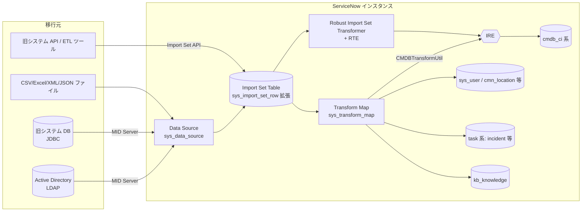
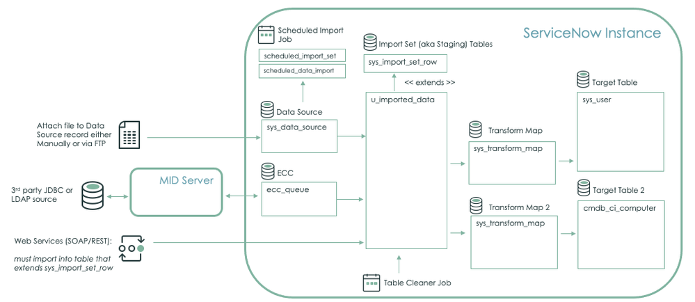
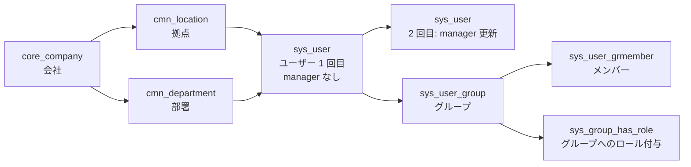
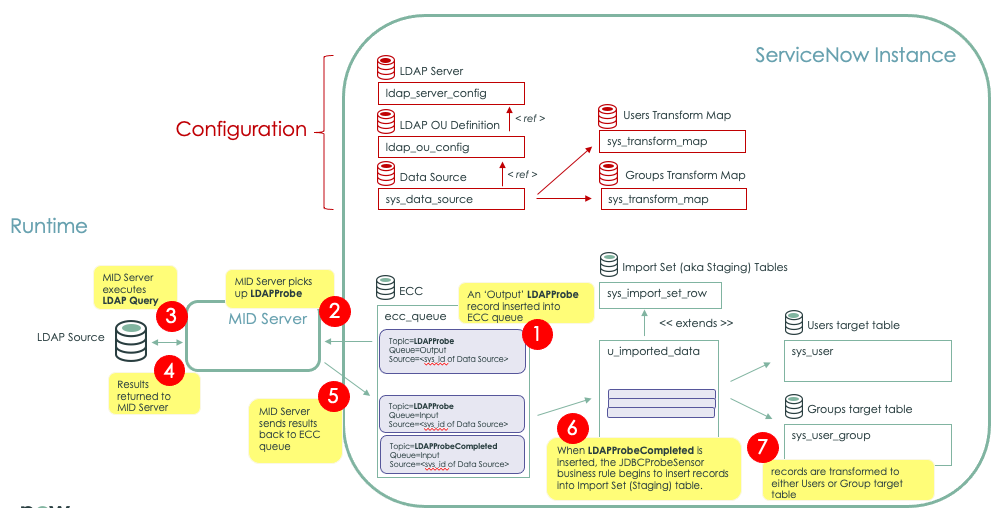
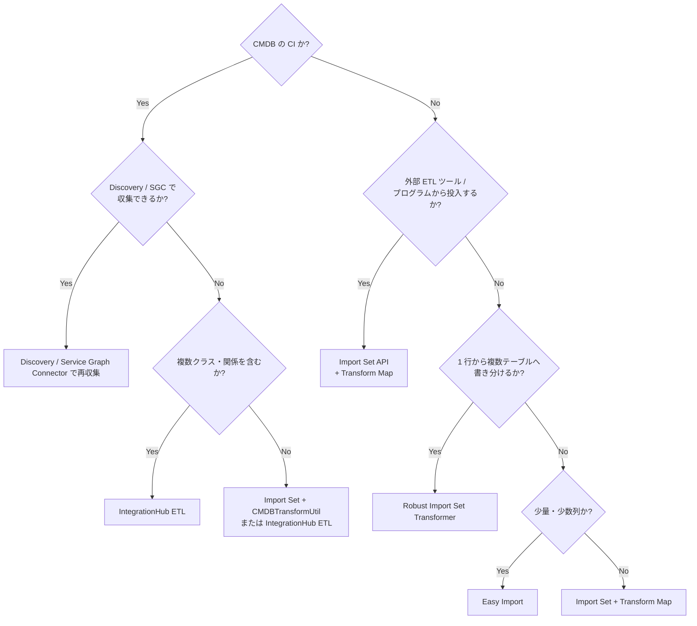
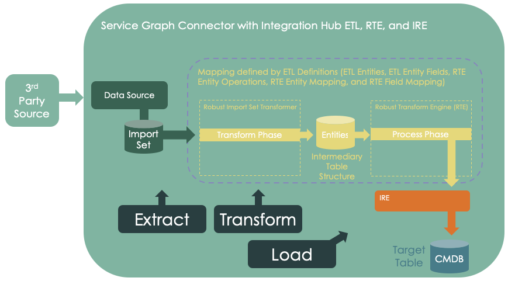
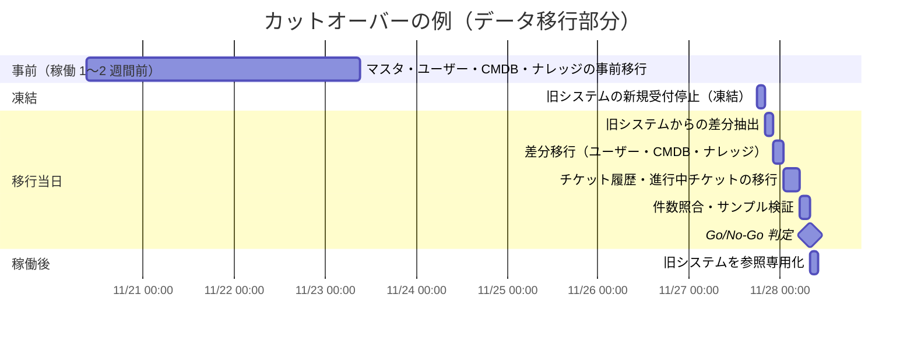

# データ移行（Data Migration）

## 概要

ServiceNow 導入プロジェクトにおけるデータ移行（Data Migration）は、既存システム（旧 ITSM ツール、Excel 台帳、Active Directory、旧 CMDB、旧ナレッジ基盤など）から ServiceNow インスタンスのテーブルへデータを移し替える作業である。ServiceNow のデータ移行は、ほぼすべてのケースで **Import Set（インポートセット）** という「ステージングテーブル → 変換 → ターゲットテーブル」の仕組みを基盤とし、CMDB については **Identification and Reconciliation Engine（IRE、識別・調整エンジン）** を経由させることが原則となる。

本ファイルは導入編として、実務で判断・設計・実行に使える粒度で以下を扱う。

| 節 | 内容 |
|---|---|
| 移行方針の決め方 | 「移行しない」を含む選択肢、移行対象の判断基準 |
| 移行対象別の設計 | ユーザー／組織、CMDB、チケット履歴、ナレッジ、添付ファイル |
| 移行手法 | Import Set + Transform Map、Robust Import Set Transformer、IntegrationHub ETL、Import Set API / Table API / Attachment API、Easy Import |
| データクレンジング | クレンジング観点、ServiceNow 側でできる処理と外部で行う処理 |
| 移行リハーサル | リハーサル計画、計測、カットオーバー手順 |

Import Set の画面・テーブル・スクリプト仕様の網羅的な説明は [データインポート/エクスポート](../02_リファレンス/platform/import-export-data.md)、CMDB のデータモデルと IRE の仕様は [CMDB と CSDM](../02_リファレンス/platform/cmdb-csdm.md)、恒常的な連携（移行後の定期連携）の設計は [連携設計](09-integration-design.md) を参照。

---

## 1. データ移行の全体像

### 1.1 ServiceNow におけるデータ移行の基本構造

ServiceNow のデータ移行は、次の 3 段階で構成される。[出典](https://www.servicenow.com/docs/r/u~ldaY8ZPxJiUgZ1Inf6mw/I1J3ifzWRL7k5C8oZuGVMw)

1. **Extract / Load（ロード）**: Data source（データソース、`sys_data_source`）が定義する取得元（ファイル、JDBC、LDAP、REST など）からデータを読み、Import set table（インポートセットテーブル、ステージングテーブル）へ格納する。インポートセットテーブルは `sys_import_set_row` を拡張したテーブルで、列は入力データから自動生成される。
2. **Transform（変換）**: Transform map（トランスフォームマップ、`sys_transform_map`）または Robust import set transformer（ロバストインポートセットトランスフォーマー）が、ステージングテーブルの行をターゲットテーブル（`sys_user`、`incident`、`cmdb_ci_*` など）へ変換・書き込みする。
3. **Reconcile（調整、CMDB の場合）**: CMDB クラスへの書き込みは IRE を通し、重複 CI の防止・データソース優先順位に基づく属性更新を行う。





- **キャプション:** Import Set によるデータ取り込みの構成要素図（ServiceNow Community 記事「Import/Transform Learning Path」より）。
- **図の説明:** 左側に 3 種類の入力経路がある。①ファイルを Data Source レコード（`sys_data_source`）に手動または FTP で添付する経路、②サードパーティの JDBC / LDAP ソースから MID Server と ECC キュー（`ecc_queue`）を経由する経路、③Web サービス（SOAP/REST）で `sys_import_set_row` を拡張したテーブルへ直接投入する経路。いずれも Import Set（ステージング）テーブル（例 `u_imported_data`、`sys_import_set_row` を extends）に格納され、Transform Map（`sys_transform_map`）を通じて Target Table（例 `sys_user`）へ、別の Transform Map 2 を通じて Target Table 2（例 `cmdb_ci_computer`）へ書き込まれる。上部には Scheduled Import Job（`scheduled_import_set` / `scheduled_data_import`）、下部には Table Cleaner Job（古いインポートセットの削除ジョブ）が配置されている。
- **出典:** https://www.servicenow.com/community/servicenow-ai-platform-articles/import-transform-learning-path/ta-p/2306952 （取得日: 2026-11-02）

### 1.2 移行フェーズと導入方法論の対応

データ移行は導入プロジェクトの各フェーズに組み込む。導入方法論全体は [導入方法論](04-implementation-methodology.md)、要件定義との関係は [要件定義と設計](06-requirements-design.md) を参照。【経験則】

| フェーズ | データ移行の主要タスク | 主な成果物 |
|---|---|---|
| 計画・要件定義 | 移行対象・範囲・保存期間の決定、移行しないデータの保管方針決定 | データ移行方針書、移行対象一覧 |
| 設計 | ソース→ターゲットのマッピング、コアレスキー（一致キー）の決定、クレンジングルール定義、移行順序の決定 | マッピング定義書、クレンジングルール、移行順序表 |
| 構築 | Data Source / Transform Map / スクリプト作成、抽出プログラム作成 | 移行ツール一式（Update Set 化） |
| テスト | 単体（20 件テストロード）、件数・内容照合、性能計測 | 照合結果、性能計測結果 |
| リハーサル | 本番相当データでの通し実行（複数回）、カットオーバー手順の確定 | 移行手順書（Runbook）、所要時間実績 |
| 本番移行 | カットオーバー、差分移行、検証、旧システム参照化 | 移行完了報告、検証エビデンス |

---

## 2. 移行方針の決め方：何を移行し、何を移行しないか

### 2.1 「移行しない」という選択肢

ServiceNow Community の Onboarding Hub ブログ（ServiceNow コミュニティ寄稿、2025-08-23）は、データ移行を「設計上の意思決定」と位置づけ、次の 3 つの選択肢を提示している。【第三者情報】[出典](https://www.servicenow.com/community/onboarding-hub-blog/designing-smarter-data-migration-for-servicenow/ba-p/3360053)

| 選択肢 | 内容 | 向いているケース |
|---|---|---|
| ① No Migration（移行しない） | ServiceNow を「System of Action（業務実行の場）」と捉え、サービス提供に必要なデータだけを持つ。履歴トランザクションは持ち込まない | 旧データが「念のため」保持されているだけで日常的に参照されていない |
| ② 低コストストレージへ退避 | 旧データを Azure SQL、AWS RDS、Google Cloud SQL、フラットファイル DB などへエクスポートし、暗号化・保持ポリシー・ロールベースアクセスで保護。必要時に軽量な連携やレポートツールで参照 | 法令・監査で一定年数の保持・参照可能性が必要だが、ServiceNow 上での業務利用は不要 |
| ③ Limited Migration（限定移行） | チケットの主要項目（Short description、カテゴリ、解決内容など）だけを移行。添付ファイル、メールログ、チケット履歴、進行中チケットは移行しない | ServiceNow 上での検索・レポート・ナレッジ化に旧データが必要 |

同ブログは、限定移行の場合でも以下を推奨している。【第三者情報】

- **添付ファイル・メールログ・チケット履歴は移行しない**（ストレージ消費の最大要因）。
- **進行中（Active）チケットは移行せず**、移行期間を設けて旧ツール上でクローズさせる。
- 旧システム固有のカスタム項目のために ServiceNow に新規フィールドを作らない（技術的負債になる）。必要なら「項目名: 値」形式にまとめて Work notes やコメントに格納する。
- 移行した場合でもアーカイブを検討し、データアクセス性能を落とさない。

### 2.2 移行判断のチェックリスト

移行対象ごとに次の観点で判断する。【経験則】

| 観点 | 問い | 判断への影響 |
|---|---|---|
| 業務利用 | 移行後、利用者が日常業務でそのデータを参照・更新するか | 参照のみなら ②退避 で足りることが多い |
| 規制・監査 | 保持年数・参照可能性の要件はあるか（監査証跡、J-SOX 等） | 保持要件がある場合、改ざん防止と参照手段を含めて設計 |
| レポート継続性 | 移行前後で KPI の時系列比較が必要か | 集計値だけを別途保持する方法（Performance Analytics のスコア投入等）も検討 |
| AI / ナレッジ活用 | Predictive Intelligence や Now Assist の学習・検索に旧チケットを使うか | 使うなら解決内容（Close notes 等）の品質と件数が重要 |
| データ品質 | 旧データのカテゴリ体系・CI 紐付けが ServiceNow の設計と整合するか | 整合しないデータの移行はレポート品質を下げる |
| コスト | ストレージ、マッピング工数、リハーサル工数 | 件数×項目数×リハーサル回数で工数が膨らむ |

### 2.3 移行対象別の典型方針

| 移行対象 | 典型的な方針 | 主なターゲットテーブル | 主な手法 |
|---|---|---|---|
| 組織マスタ（会社・部署・拠点） | **必須で移行**。ユーザーより先に投入 | `core_company`、`cmn_department`、`cmn_location`、`cmn_cost_center` | Import Set（Excel/CSV）、HR システム連携 |
| ユーザー | **必須**。ただし「一括移行」ではなく ID 管理基盤からの**連携として構築**するのが原則 | `sys_user` | LDAP、SCIM、Import Set |
| グループ・メンバー・ロール | 移行（新しいグループ設計に合わせて再定義） | `sys_user_group`、`sys_user_grmember`、`sys_user_has_role`（ロールは原則グループ経由で付与） | Import Set |
| CMDB（CI・関係） | **Discovery / Service Graph Connector で再収集**できるものは移行せず再収集。台帳でしか持てない CI（ビジネスサービス、アプリケーション等）は移行 | `cmdb_ci_*`、`cmdb_rel_ci` | IntegrationHub ETL、Import Set + IRE、Discovery |
| 資産（HAM/SAM） | 契約・資産番号など台帳情報を移行 | `alm_hardware`、`alm_asset`、`ast_contract` 等 | Import Set |
| 進行中チケット | 原則移行しない（旧ツールでクローズ）。やむを得ず移行する場合は件数を絞り、オープン状態で投入 | `incident`、`sc_req_item` 等 | Import Set |
| クローズ済みチケット履歴 | 移行しない／退避／直近 12〜18 か月など期間限定で移行 | `incident`、`problem`、`change_request` または専用アーカイブテーブル | Import Set、退避先 DB |
| ナレッジ | 棚卸し後、有効な記事のみ移行 | `kb_knowledge` | Import Articles（Word）、Easy Import、Import Set、Table API |
| 添付ファイル | 原則最小化。必要なもののみ | `sys_attachment` | Attachment API |
| カタログ・ワークフロー定義 | データ移行ではなく**再設計・再構築**（アップデートセットで移送） | `sc_cat_item` 等 | 構築・Update Set |

> 補足: パートナー企業の記事では、本番テーブルへは直近 12〜18 か月分のみ移行し、それ以前は検索可能なコールドストレージまたは ServiceNow 上の副次的なアーカイブテーブルへ退避する、という段階的アーカイブが推奨されている。【第三者情報】[出典](https://www.aegissofttech.com/insights/servicenow-migration-challenges)

---

## 3. 移行対象別の設計ポイント

### 3.1 ユーザー・組織データ

#### 3.1.1 投入順序（参照関係の依存）

`sys_user` テーブルは `company`（会社、`core_company` 参照）、`department`（部署、`cmn_department` 参照）、`location`（拠点、`cmn_location` 参照）、`manager`（上長、`sys_user` 自己参照）、`cost_center`（`cmn_cost_center` 参照）などの参照フィールドを持つ。参照先が存在しない状態で投入すると、Transform Map の Choice action / 参照解決の設定次第で**参照先レコードが自動作成される（Foreign record insert）か、空になる**。このため参照先から順に投入する。[出典](https://www.servicenow.com/docs/r/u~ldaY8ZPxJiUgZ1Inf6mw/I1J3ifzWRL7k5C8oZuGVMw)



- `manager` は同じ `sys_user` を参照するため、**1 回目で全ユーザーを投入、2 回目で manager のみ更新**する 2 パス方式が一般的である。【経験則】
- ロールはユーザーへ直接付与せず、グループに付与して継承させるのが ServiceNow の推奨設計である。詳細は [ユーザー・グループ・ロール](../02_リファレンス/platform/users-groups-roles.md) を参照。

#### 3.1.2 ユーザーの取り込み方式

| 方式 | 仕組み | 特徴 | 参照 |
|---|---|---|---|
| LDAP（Active Directory 等） | LDAP Server（`ldap_server_config`）、LDAP OU Definition（`ldap_ou_config`）、Data Source を設定し、MID Server 経由で取得したデータを Import Set に入れ、Users / Groups の Transform Map で `sys_user`・`sys_user_group` へ変換 | オンプレ AD と定期同期できる。移行後もそのまま運用連携になる | [MID Server](../02_リファレンス/platform/mid-server.md) |
| SCIM | `SCIM v2 - ServiceNow Cross-domain Identity Management`（`com.snc.integration.scim2`）プラグインを有効化し、Microsoft Entra ID 等の IdP から SCIM でプロビジョニング | IdP 主導のプッシュ型。Entra ID のギャラリーアプリ標準設定は SOAP を使う点に注意【第三者情報】 | [出典](https://www.servicenow.com/community/developer-blog/scim-provisioning-from-microsoft-entra-id/ba-p/2984734) |
| Import Set（CSV / Excel） | 人事データ等のファイルを Data Source に添付し Transform Map で変換 | 初期一括投入、外部委託者など IdP 外のユーザーに使う | 本ファイル 4 章 |
| HR システム連携 | Workday 等の HR システムから Integration Hub スポーク等で連携 | HRSD 導入時。人事属性は HR プロファイル側でも管理 | [HR Service Delivery](../02_リファレンス/employee/hr-service-delivery.md) |



- **キャプション:** LDAP からのユーザー・グループ取り込みの設定要素と実行時フロー（ServiceNow Community 記事「Import/Transform Learning Path」より）。
- **図の説明:** 上部「Configuration」は設定レコードの参照関係で、LDAP Server（`ldap_server_config`）← LDAP OU Definition（`ldap_ou_config`）← Data Source（`sys_data_source`）が参照で結ばれ、Data Source から Users Transform Map と Groups Transform Map（いずれも `sys_transform_map`）が使われる。下部「Runtime」は番号付きの処理順で、①ECC キュー（`ecc_queue`）に Topic=LDAPProbe の Output レコードが挿入される → ②MID Server が LDAPProbe を取得 → ③MID Server が LDAP クエリを実行 → ④結果が MID Server に返る → ⑤MID Server が結果を ECC キュー（Input）に返す → ⑥LDAPProbeCompleted が挿入されると JDBCProbeSensor ビジネスルールが Import Set（ステージング）テーブル（`u_imported_data`、`sys_import_set_row` を extends）へレコード挿入を開始 → ⑦レコードが Users 対象テーブル（`sys_user`）または Groups 対象テーブル（`sys_user_group`）へ変換される。
- **出典:** https://www.servicenow.com/community/servicenow-ai-platform-articles/import-transform-learning-path/ta-p/2306952 （取得日: 2026-11-02）

#### 3.1.3 ユーザーのコアレスキー（一致キー）

ユーザー移行では「どの項目で既存レコードと一致させるか（Coalesce）」が重複防止の要である。[出典](https://www.servicenow.com/docs/r/integrate-applications/system-import-sets/c_ImportSetCoalesce.html)

| 候補キー | フィールド | 長所 | 注意点 |
|---|---|---|---|
| ログイン ID | `user_name`（User ID） | SSO の NameID と一致させやすい | 旧システムと命名規則が異なると不一致 |
| メールアドレス | `email` | 一般的に一意 | 退職者再雇用・共有メールで重複、変更が起こり得る |
| 社員番号 | `employee_number` | 人事上不変 | 外部委託者は持たないことがある。Entra ID 連携で非アクティブ旧レコードとの重複エラー事例あり【第三者情報】 |
| AD の objectGUID 等 | `source`、`ldap_server` 等 | LDAP 連携標準 | LDAP 以外のソースでは使えない |

- ServiceNow の公式ドキュメントは、**一意な値を持つフィールドでコアレスする**ことを求めている。複数レコードが一致した場合は最初の 1 件だけが更新される。[出典](https://www.servicenow.com/docs/r/integrate-applications/system-import-sets/c_ImportSetCoalesce.html)
- 「メール一致、なければ User ID 一致」のような OR 条件は、`sys_id` フィールドマップの Source script（Conditional coalesce）で `sys_user` を `email` OR `user_name` で検索し、一致レコードの `sys_id` を返すことで実装できる（公式ドキュメントにユーザーの例あり）。[出典](https://www.servicenow.com/docs/r/integrate-applications/system-import-sets/c_ImportSetCoalesce.html)
- SSO の設計（NameID にどの属性を使うか）とコアレスキーは必ず揃える。詳細は [認証とSSO](../02_リファレンス/platform/authentication-sso.md)。【経験則】

#### 3.1.4 ユーザー移行時の注意

| 注意点 | 内容 |
|---|---|
| 退職者・非アクティブユーザー | 過去チケットの `caller_id` や `assigned_to` の参照先として必要なら `active=false` で移行する。ライセンス集計の対象外になるよう、ロールを付与しない【経験則】 |
| パスワード | SSO 前提とし、パスワードは移行しない。ローカル認証が必要なユーザーは初回ログイン時リセット運用【経験則】 |
| 暗号化フィールド | Import Set の変換はユーザー「System」として実行されるため、**暗号化フィールド（Edge Encryption / Column Level Encryption 対象）には書き込めない**。[出典](https://www.servicenow.com/docs/r/u~ldaY8ZPxJiUgZ1Inf6mw/I1J3ifzWRL7k5C8oZuGVMw) |
| `NULL` の扱い | 大文字の `NULL` は Transform Map で予約語（フィールドをクリアする指示）であり、First name / Last name などの値として使ってはならない（`Null`、`null` は可）。[出典](https://www.servicenow.com/docs/r/integrate-applications/system-import-sets/t_CreateATransformMap.html) |
| タイムゾーン・言語 | `time_zone`、`preferred_language` を移行すると日本語 UI・日時表示が利用者ごとに決まる。日本語化は [ローカライゼーション](../02_リファレンス/platform/localization.md) |
| ライセンス | `itil` 等のフルフィラーロールを持つユーザー数がライセンス数に直結する。移行時のロール付与は [ユーザー・ロール・ライセンスの基本](../01_入門編/08-users-roles-licensing-basics.md) を参照 |

### 3.2 CMDB（構成管理データベース）

#### 3.2.1 原則: CMDB への書き込みは IRE を通す

CMDB の CI（Configuration Item、構成アイテム）は、**Identification and Reconciliation Engine（IRE）** を通して書き込むことが原則である。IRE は Discovery、Event Management、Import Set、手入力など複数ソースからのデータに対して、重複 CI の防止、属性の調整（Reconciliation）、CI の再分類を行い、権威あるデータソースだけが CI を更新できるよう制御する中央フレームワークである。[出典](https://www.servicenow.com/community/developer-blog/best-practices-for-cmdb-data-integration/ba-p/2266129)

- 通常の Transform Map で `cmdb_ci_*` テーブルに直接書き込むと、IRE の識別ルール（Identification rules）・調整ルール（Reconciliation rules）・データソース優先順位（Data source precedence）が働かず、**Discovery 等の後続ソースと重複 CI を作る原因**になる。【経験則】
- IRE 経由にしないとデータソース別の最終更新記録が残らず、複数データソースの調整ルールが機能しないという報告がある。【第三者情報】[出典](https://www.servicenow.com/community/cmdb-articles/understanding-ire-reconciliation-rules/ta-p/3289239)
- CMDB のクラス設計・CSDM（Common Service Data Model）は [CMDB と CSDM](../02_リファレンス/platform/cmdb-csdm.md)、成功要因は [CMDB成功の要因](../04_応用編/05-cmdb-success-factors.md) を参照。

#### 3.2.2 CMDB 移行手法の選択

| 手法 | 適用場面 | IRE | 備考 |
|---|---|---|---|
| **Discovery** による再収集 | サーバー、ネットワーク機器、PC など自動検出できる CI | 自動で通る | 旧 CMDB からの移行より再収集のほうが品質が高いことが多い【経験則】。[Discovery](../02_リファレンス/itom/discovery.md) |
| **Service Graph Connector** | SCCM / Intune / Jamf / クラウド等、既存管理ツールが CI 情報を持つ場合 | 自動で通る（IntegrationHub ETL ベース） | [Service Graph Connectors](../02_リファレンス/itom/service-graph-connectors.md) |
| **IntegrationHub ETL** | 旧 CMDB や台帳（CSV/Excel/JDBC）からの複数クラス・関係を含む移行 | 自動で通る | 4.3 節 |
| **Import Set + `CMDBTransformUtil`** | 単一テーブル・関係なしの比較的単純な CI 移行 | onBefore スクリプトで明示的に呼ぶ | 4.2.6 節 |
| スクリプト IRE（`sn_cmdb.IdentificationEngine.createOrUpdateCI`） | 複数クラス・関係を含む複雑なデータで、ETL で表現しにくい場合 | 明示的に呼ぶ | [出典](https://www.servicenow.com/community/developer-blog/best-practices-for-cmdb-data-integration/ba-p/2266129) |
| 手入力・Easy Import | ビジネスサービス、アプリケーションサービスなど少量の論理 CI | 直接書き込み（IRE は通らない） | 少量・設計段階で作る CI に限定【経験則】 |

#### 3.2.3 CMDB 移行の設計ポイント

| ポイント | 内容 |
|---|---|
| クラスマッピング | 旧 CMDB の CI 種別を ServiceNow の既存クラス（`cmdb_ci_win_server`、`cmdb_ci_linux_server`、`cmdb_ci_computer`、`cmdb_ci_netgear` 等）へマッピングし、文書化する。安易にクラスを新設しない。[出典](https://www.servicenow.com/community/developer-blog/best-practices-for-cmdb-data-integration/ba-p/2266129) |
| 識別項目 | IRE の識別ルール（例: ハードウェアならシリアル番号、名前、MAC アドレス等の組み合わせ）を満たす項目を必ず移行データに含める。識別項目が欠けた CI は IRE で識別できない【経験則】 |
| データソース登録 | IRE 用のデータソース名（Discovery source）を事前に登録し、データソース優先順位を設計する。IntegrationHub ETL では CMDB アプリケーション用のデータソース設定が前提条件。[出典](https://www.servicenow.com/docs/r/zurich/servicenow-platform/integration-hub-etl/integrationhub-etl.html) |
| 関係（Relationship） | `cmdb_rel_ci`（親 CI、子 CI、関係タイプ）を CI 投入後に投入する。依存識別ルールを持つ CI（Dependent CI）は Import Set + `CMDBTransformUtil` では処理できないため、IntegrationHub ETL またはスクリプト IRE を使う。[出典](https://www.servicenow.com/docs/r/zS6yb8e~gR8BPjeviYdV9g/iL9Wsw4f4Z63cCJBH4Dq9A) |
| 資産との関係 | ハードウェア CI と資産（`alm_hardware`）は連動作成される設定がある。資産管理を導入する場合は投入順序と同期ルールを ITAM 側と調整する。[Hardware Asset Management](../02_リファレンス/itam/hardware-asset-management.md) |
| 移行後の検証 | CMDB Health ダッシュボード（完全性・正確性・コンプライアンス）や CMDB Integrations Dashboard で重複・孤立 CI を確認する |

### 3.3 チケット履歴（インシデント・問題・変更・リクエスト）

#### 3.3.1 履歴移行の論点

チケット履歴の移行は最も工数がかかり、かつ価値が問われる領域である。次の論点を先に決める。【経験則】

| 論点 | 選択肢 | 推奨傾向 |
|---|---|---|
| 移行範囲 | 全件 / 期間限定（例: 直近 1 年）/ クローズ済みのみ / 移行しない | 期間限定 or 移行しない |
| 格納先 | 本番テーブル（`incident` 等）/ 専用の読み取り専用カスタムテーブル / 外部 DB | 業務で再オープンしないなら専用テーブルか外部 DB【第三者情報】[出典](https://www.servicenow.com/community/itsm-forum/data-migration-approach-10-years-x-tool-to-servicenow/td-p/3547738) |
| 項目の深さ | ヘッダー項目のみ / Work notes・Comments（ジャーナル）も / 監査履歴・添付も | ヘッダー + 必要なら解決内容まで |
| 採番 | ServiceNow で新番号を採番し旧番号を別フィールドに保持 / 旧番号を `number` に入れる | 新番号採番 + 旧番号保持（例: `correlation_id` やカスタム `u_legacy_number`）【経験則】 |
| 作成日時・作成者 | 移行実行日時になる / 旧システムの値を再現 | 旧値を再現（`autoSysFields(false)`）または別フィールド保持 |
| SLA | 移行チケットに SLA を付与しない | 付与しない（SLA 定義の条件で除外）【経験則】 |

#### 3.3.2 ステータス・選択肢のマッピング

`incident` テーブルの `state`（状態）は整数値の選択肢で管理され、ベースシステムでは New=1、In Progress=2、On Hold=3、Resolved=6、Closed=7、Canceled=8 である。旧ツールの状態値を ServiceNow の状態値へ**対応表で変換**し、旧システム固有の状態は On Hold の `hold_reason` などに寄せるか、Work notes に記録する。状態遷移の詳細は [Incident Management](../02_リファレンス/itsm/incident-management.md) を参照。【経験則】

| マッピング対象 | 注意点 |
|---|---|
| `state` | Closed / Resolved で投入する場合、`close_code`（Resolution code）、`close_notes`（Resolution notes）、`resolved_at`、`closed_at` も設定しないと、レポートやデータポリシーで不整合になる【経験則】 |
| `category` / `subcategory` | 新しいカテゴリ体系に読み替える。Transform Map のフィールドマップの Choice action を `create` にすると未知の値が選択肢として自動追加されてしまうため、移行時は `ignore` または `reject` にする【経験則】（Choice action の挙動は [出典](https://www.servicenow.com/docs/r/integrate-applications/system-import-sets/t_CreateATransformMap.html)） |
| `assignment_group` / `assigned_to` | 新グループ体系への読み替え表を用意。廃止グループは「移行用グループ」に寄せる |
| `cmdb_ci` | CMDB 移行完了後に投入。CI が特定できない場合は空とする |
| `caller_id` | 退職者を含むため、非アクティブユーザーも移行しておく |
| `priority` / `impact` / `urgency` | ベースシステムでは Priority は Impact × Urgency から算出される（Priority lookup rules）。移行時に値を直接入れても、ビジネスルールを動かすと再計算される点に注意【経験則】 |

#### 3.3.3 作成日時・作成者などシステム項目の保持

`sys_created_on`、`sys_created_by`、`sys_updated_on`、`sys_updated_by`、`sys_mod_count` はシステムが自動設定するため、通常の変換では移行実行時の値になる。旧システムの値を保持したい場合、ServiceNow のテクニカルサポート担当者はコミュニティで、`GlideRecord.autoSysFields(false)` で自動設定を止めてから旧値を設定する方法を示している（`sys_mod_count` も対処しないと書き換わる）。【第三者情報】[出典](https://www.servicenow.com/community/developer-forum/migrate-records-from-one-table-to-another-and-still-retaining/td-p/2070045/page/3)

Transform Map では onBefore スクリプトで `target.autoSysFields(false)` を呼ぶ方法が紹介されている。【第三者情報】[出典](https://www.servicenow.com/community/developer-forum/how-to-import-work-notes-comments-to-incidents-when-migrating/m-p/1762695)

```javascript
// onBefore transform script（例）: 旧システムの作成日時・作成者を保持する
(function runTransformScript(source, map, log, target) {
    target.autoSysFields(false);              // システム項目の自動設定を停止
    target.sys_created_on = source.u_created_on;  // 旧システムの作成日時（GMT で渡すこと）
    target.sys_created_by = source.u_created_by;  // 旧システムの作成者（user_name 文字列）
})(source, map, log, target);
```

- `sys_created_by` / `sys_updated_by` は参照フィールドではなく **ユーザー名（`user_name`）の文字列** である。【経験則】
- 日時はインスタンス内部では GMT（UTC）で保持される。JST の値をそのまま入れると 9 時間ずれる。Field map の Date format 指定またはスクリプトで変換する。【経験則】
- `autoSysFields(false)` は公式に「特殊な用途向け」とされる操作であり、必ず非本番でテストする。【第三者情報】

#### 3.3.4 Work notes / Additional comments（ジャーナル）の移行

Work notes（作業メモ）や Additional comments（追加コメント）はジャーナルフィールドで、実体は `sys_journal_field` テーブル（`element`=フィールド名、`element_id`=対象レコードの `sys_id`、`name`=テーブル名、`value`=本文）に格納される。Transform Map から `work_notes` に値を書くと、**1 回の書き込みで 1 件のジャーナルが移行実行日時・実行ユーザーで作成**される。【経験則】

旧システムの各コメントを元の日時・投稿者で再現したい場合、ServiceNow 社員の開発者ブログ（2025-10-30）は、`sys_journal_field` を `autoSysFields(false)` で直接作成し、併せて `sys_history_set`（レコード単位の履歴セット）と `sys_history_line`（履歴行、`journal_sysid` でジャーナルと関連付け）を作成する方法を紹介している。ただし筆者自身が「経験に基づくもので保証はない」としており、公式にドキュメント化された手法ではない。【第三者情報】[出典](https://www.servicenow.com/community/developer-blog/creating-historical-data-in-a-journal-field/ba-p/3416315)

実務上の代替案は次のとおり。【経験則】

| 方式 | 内容 | 長所 | 短所 |
|---|---|---|---|
| 連結して 1 件で投入 | 旧コメントを「[2024-01-05 10:00 山田] 本文…」形式に連結し、1 件の Work notes として投入 | 実装が簡単、高速 | アクティビティ上は 1 件にまとまる |
| 1 コメント 1 行で投入 | ジャーナル専用のステージングテーブルを作り、1 行ずつ対象チケットへ `work_notes` を書く | 時系列が分かれる | 日時・投稿者は移行時の値になる |
| `sys_journal_field` 直接作成 | 上記ブログの方式 | 完全再現 | 非公式、テスト負荷大 |
| 移行しない | 旧システム／退避 DB で参照 | 工数ゼロ | 画面上で参照不可 |

#### 3.3.5 移行時に止めるべき処理

チケット移行時は、ビジネスルール・通知・SLA・承認・ワークフローが動くと、**大量のメール送信、SLA の誤計算、承認依頼の発行、番号の再採番**などの事故につながる。【経験則】

| 対策 | 方法 |
|---|---|
| ビジネスルール・ワークフロー・監査を止める | Transform Map の **Run business rules** をオフにする（`GlideRecord.setWorkflow(false)` 相当。ビジネスルール、ワークフロー、承認エンジン、監査、フィールド正規化が実行されない）。[出典](https://www.servicenow.com/docs/r/integrate-applications/system-import-sets/t_CreateATransformMap.html) |
| メール送信を止める | 移行中は送信メールを無効化する（System Properties > Email Properties の送信有効化設定）。通知の仕組みは [通知とメール](../02_リファレンス/platform/notifications-email.md)【経験則】 |
| SLA の付与を防ぐ | Run business rules をオフにすると SLA 処理も動かない。オンにする必要がある場合は SLA 定義の開始条件で移行データを除外する【経験則】 |
| 必要なビジネスルールだけ動かす | Run business rules をオフにすると、本来必要な派生値（例: 計算フィールド）も設定されない。必要な値は Transform Map の Script / onBefore で明示的に設定する【経験則】 |

### 3.4 ナレッジ記事

#### 3.4.1 ナレッジ移行の方式

ナレッジ記事は `kb_knowledge` テーブルに格納され、ナレッジベース（`kb_knowledge_base`）とカテゴリ（`kb_category`）に属する。移行方式は件数・形式により選ぶ。[出典](https://www.servicenow.com/community/knowledge-management-articles/options-for-importing-external-articles-into-servicenow/ta-p/2673388)

| 方式 | 適用 | 仕様・制約 |
|---|---|---|
| **Import Articles（Word 取り込み）** | 少量、Word 原稿 | メニュー: **All > Knowledge > Articles > Import Articles**。`.doc` / `.docx`（拡張子は小文字）に対応。複数ファイルをアップロードすると 1 ファイル 1 記事。既定の見出しスタイルのみ対応、表のスタイル・罫線は非対応、リンクが保持されるのは `.docx` のみ、画像の配置はずれることがある。Publish チェックなしなら Draft 状態で作成。対象ナレッジベースの Contributor 権限が必要（権限がないと Import Articles ボタン自体が表示されない）。[出典](https://www.servicenow.com/docs/r/servicenow-platform/knowledge-management/import-word-platform.html) |
| **Easy Import（Excel テンプレート）** | 中量、埋め込みメディアなし | Knowledge > Articles > All のリストからテンプレートを生成し、Text 列に HTML を貼り付けて取り込む。小分けのバッチで実行し、タイムアウトを避ける。【第三者情報】 |
| **Import Set + Transform Map** | 中〜大量、旧 DB / CSV からの変換が必要 | ステージングから `kb_knowledge` へ変換。本文は `text`（HTML）、タイトルは `short_description`、状態は `workflow_state` |
| **REST Table API + Attachment API** | 大量、画像・添付が多い、自動化したい | `kb_knowledge` を Table API で作成し、画像・ファイルは Attachment API で添付。並列化可能。【第三者情報】 |

#### 3.4.2 ナレッジ移行の注意点

| 注意点 | 内容 |
|---|---|
| 状態（`workflow_state`） | 取り込んだ記事は既定で Draft になる。ベースシステムのビジネスルールが insert 時に Draft を設定するため、Published で投入したい場合は Run business rules をオフにするなどの対応が必要という報告がある。【第三者情報】[出典](https://www.servicenow.com/community/knowledge-forum/can-an-knowledge-article-which-is-imported-directly-move-to/m-p/2900651) |
| 公開日・有効期限 | `published`（公開日）、`valid_to`（有効期限）を設定しないと、全記事が同じ日付・期限になる。棚卸しのため有効期限は移行時に設定し直す【経験則】 |
| 画像・添付 | Word / Excel 取り込みの画像は添付ファイルとなり本文に埋め込まれる。いずれもインスタンスのディスク容量を消費する。[出典](https://www.servicenow.com/community/knowledge-management-articles/options-for-importing-external-articles-into-servicenow/ta-p/2673388) |
| 記事テンプレート | Word 取り込みは標準テンプレートの本文にのみ入る。独自のナレッジ記事テンプレート（項目分割型）へ入れる場合は Import Set か API を使う【第三者情報】 |
| バージョン | Knowledge Management のバージョニング有効時に Transform Map で更新すると、旧バージョンの記事まで更新されてしまった事例がある。小規模で試し、事前バックアップを取る。【第三者情報】[出典](https://www.servicenow.com/community/virtual-agent-forum/previous-versions-of-kb-articles-got-updated-via-trasnform-map/td-p/3406253) |
| 品質棚卸し | 移行前に閲覧数・最終更新日で棚卸しし、古い記事・重複記事を移行しない。AI Search / Now Assist の回答品質はナレッジの品質に依存する【経験則】 |
| 権限 | User criteria（ユーザー条件）で閲覧・投稿権限を設定する。旧システムの公開範囲を User criteria に読み替える |

ナレッジ管理の仕様は [ナレッジ管理](../02_リファレンス/platform/knowledge-management.md) を参照。

### 3.5 添付ファイル

添付ファイルは `sys_attachment`（メタデータ）と `sys_attachment_doc`（分割された本体）に格納され、データベース容量を大きく消費する。移行が必要な場合は **Attachment API** を使う。[出典](https://www.servicenow.com/docs/r/zurich/api-reference/rest-apis/c_AttachmentAPI.html)

| 項目 | 仕様 |
|---|---|
| エンドポイント | `POST /api/now/attachment/file?table_name={テーブル}&table_sys_id={レコードsys_id}&file_name={ファイル名}`（本文にバイナリ、`Content-Type` にファイルの MIME タイプ） |
| 1 リクエストのファイル数 | 1 リクエストにつき 1 ファイル |
| 最大サイズ | プロパティ `com.glide.attachment.max_size`（既定 1024 MB）で制御 |
| 拡張子制限 | プロパティ `glide.attachment.extensions` |
| 権限 | 実行ユーザーが `sys_attachment` レコードを作成できるロールを持つこと |
| タイムアウト | REST の添付リクエストは既定 60 秒でキャンセルされるとの記載あり【第三者情報】[出典](https://www.servicenow.com/community/knowledge-management-articles/options-for-importing-external-articles-into-servicenow/ta-p/2673388) |

---

## 4. 移行手法

### 4.1 手法の比較と選び方

| 手法 | 概要 | 主な用途 | 必要ロール | 長所 | 短所 |
|---|---|---|---|---|---|
| **Import Set + Transform Map** | データソース→ステージング→Transform Map→ターゲット | ユーザー、組織、チケット、ナレッジ、資産など大半 | `import_admin` / `import_transformer` 等 | 標準機能、GUI 中心、スクリプト拡張可能 | 1 Transform Map = 1 ターゲットテーブル |
| **Robust Import Set Transformer（RTE）** | ETL 定義（エンティティ）で 1 回の読み取りから複数ターゲットへ | 1 行から複数テーブルへ書き分ける移行 | `import_transformer` | 複数ターゲット、ネスト JSON 対応 | 設定概念がやや難しい |
| **IntegrationHub ETL** | RTE + IRE をガイド付き UI で設定 | CMDB（および IRE がサポートする一部の非 CMDB テーブル） | `cmdb_inst_admin` | IRE 自動適用、テスト実行可能 | CMDB 用途中心 |
| **Import Set API** | REST でステージングテーブルへ投入し変換を実行 | 外部 ETL ツール・スクリプトからの移行 | 対象ステージングテーブルへの書き込み権限 | Transform Map を再利用できる | 1 リクエストのサイズ・回数設計が必要 |
| **Table API** | `/api/now/table/{table}` で直接 CRUD | 少量の補正、ナレッジ等 | 対象テーブルの ACL 権限 | シンプル | 変換・コアレスを外部で実装する必要。ビジネスルールが動く |
| **Attachment API** | 添付ファイルの投入 | 添付・画像 | `sys_attachment` 作成権限 | 唯一の標準的な添付投入手段 | 1 ファイル 1 リクエスト |
| **Easy Import** | リストから Excel テンプレートを作り、少数列を取り込む | マスタの少量投入・一括更新 | `admin` のみ | 最も手軽 | 大量・複雑変換には不向き |



### 4.2 Import Set + Transform Map

#### 4.2.1 関連ロール

Import Set 関連のロールは次のとおり。[出典](https://www.servicenow.com/docs/r/VbEA8DxUy61CFZ25mbYrcQ/J_rHuRIkkrvfyB0OO9aM~Q)

| ロール | 権限 |
|---|---|
| `import_admin` | インポートセットとインポートのすべてを管理 |
| `import_transformer` | Transform Map の管理と変換の実行 |
| `import_scheduler` | インポートのスケジュール設定。**スクリプトを管理者権限で実行できるため、`admin` 付与と同等**と公式に警告されている |
| `import_set_loader` | インポートセットのロード |

#### 4.2.2 データソースの種類と制約

Data source（`sys_data_source`）の主な種類と制約は次のとおり。[出典](https://www.servicenow.com/docs/r/u~ldaY8ZPxJiUgZ1Inf6mw/I1J3ifzWRL7k5C8oZuGVMw)

| 種類 | 主な制約 |
|---|---|
| CSV | RFC4180 準拠。1 行目はヘッダー。フィールド内の二重引用符は不可 |
| Excel | 拡張子 `.xls` / `.xlsx` |
| XML | 各データ行に一貫した XPath が必要 |
| JSON | 配列パスはルート要素を繰り返す（例: `/incidents/incidents`）。述語・軸は非対応 |
| Custom（Parse by Script） | 独自 JavaScript で行をマップに変換 |
| JDBC | 有効な Transform Map が必要。MID Server が必要な場合あり |
| LDAP / OIDC | 有効な Transform Map が必要 |
| ServiceNow REST（Integration Hub） | 有効な Transform Map が必要 |
| Custom（Load by Script） | 有効な Transform Map が必要 |

- 日本語データを CSV で投入する場合は文字コード（UTF-8 推奨）を事前に統一する。Data source の CSV 設定で文字コードを指定できる。【経験則】
- 旧システム DB に直接接続できる場合は JDBC + MID Server で、ファイルの受け渡しを省ける。【経験則】

#### 4.2.3 作成手順の概要

| 手順 | メニュー位置 / 操作 |
|---|---|
| 1. データのロード | **All > System Import Sets > Load Data**。新規インポートセットテーブルを作成し、ファイルまたはデータソースを指定 |
| 2. テストロード | Data source 画面の **Test Load 20 Records** で 20 件だけロードし、列定義を確認 |
| 3. Transform Map 作成 | **All > System Import Sets > Create Transform Map**（必要ロール: `import_transformer`、`import_admin`、または `admin`）[出典](https://www.servicenow.com/docs/r/integrate-applications/system-import-sets/t_CreateATransformMap.html) |
| 4. フィールドマップ | **Auto Map Matching Fields**（同名列の自動対応）または **Mapping Assist** でソース列とターゲット列を対応付け、コアレス列を指定 |
| 5. 変換実行 | **Transform** を実行し、結果（Inserted / Updated / Ignored / Skipped / Error）を確認 |
| 6. 本ロード | **Load All Records** で全件ロード → Transform |
| 7. 定型化 | **Scheduled Data Import**（`scheduled_import_set`）でスケジュール・再実行可能にする |

> 注意: インポートセットテーブルに列を手動で追加すると、スケジュールされたクリーンアップが失敗して孤立レコードが残る原因になる。列を増やすときは入力データに列を追加し、Test Load 20 Records または Load All Records を実行する。[出典](https://www.servicenow.com/docs/r/u~ldaY8ZPxJiUgZ1Inf6mw/I1J3ifzWRL7k5C8oZuGVMw)

#### 4.2.4 Transform Map の主要設定項目

Transform Map フォーム（`sys_transform_map`）の主な項目は次のとおり。[出典](https://www.servicenow.com/docs/r/integrate-applications/system-import-sets/t_CreateATransformMap.html)

| 項目 | 説明 | 移行時の推奨【経験則】 |
|---|---|---|
| Name（名前） | Transform Map の識別名 | 「MIG_01_User」など移行順番号付きで命名 |
| Source table（ソーステーブル） | インポートセットテーブル（`sys_import_set_row` を拡張したもの）。現在のアプリケーションスコープのテーブルのみ選択可 | — |
| Target table（ターゲットテーブル） | 書き込み先。現在のスコープ、グローバル、または他アプリへの書き込みを許可したテーブル | — |
| Active | 有効化 | — |
| Run business rules | ビジネスルール、ワークフロー、承認エンジン、監査、フィールド正規化を実行する。オフは `setWorkflow(false)` 相当 | 履歴チケットはオフ。ユーザー・マスタは要件次第 |
| Enforce mandatory fields | 必須項目の強制: No / Only Mapped Fields / All Fields | 移行検証では Only Mapped Fields 以上を推奨 |
| Copy empty fields | 空値をコピーして既存値を上書きする | 差分更新時はオフ（空で上書き事故を防ぐ） |
| Create new record on empty coalesce fields | コアレス列がすべて空のとき、無視・上書きではなく新規作成する | 原則オフ（キー欠落データは別途扱う） |
| Order | 複数 Transform Map の適用順（小さい順） | 参照の依存順に設定 |
| Use Secondary Storage for References | 参照解決の一部をセカンダリ DB へ逃がす。Secondary Database Pools プラグイン有効時のみ表示。セカンダリのデータは遅延し得るため、最新データが必要なインポートには使わない | 移行では通常使わない |
| Run script / Script | フィールドマップに加えて実行する変換スクリプト | 複雑な変換はここか onBefore に集約 |

フィールドマップ（Field map）単位の主な設定は次のとおり。[出典](https://www.servicenow.com/docs/r/integrate-applications/system-import-sets/c_ImportSetCoalesce.html)

| 項目 | 説明 |
|---|---|
| Coalesce | この列の値で既存レコードを検索し、一致すれば更新、なければ新規作成 |
| Coalesce case sensitive | 大文字小文字まで一致させる（既定は区別しない） |
| Coalesce empty fields | ソース・ターゲットの両方が空の場合も一致とみなす |
| Choice action | 選択肢・参照の値が存在しないときの動作（create / ignore / reject） |
| Use source script / Source script | スクリプトで値を算出。`sys_id` フィールドに設定すると条件付きコアレスになる |
| Date format | ソースの日付書式 |
| Referenced value field name | 参照フィールドを `sys_id` 以外の列（例: `user_name`）で解決する |

#### 4.2.5 コアレスの構成パターン

| 構成 | 動作 | 移行での用途 |
|---|---|---|
| コアレスなし | 全行を新規作成。既存は更新されない | 1 回きりの初期投入（ただし再実行で重複する） |
| 単一列コアレス | 1 列が一致すれば更新 | 旧 ID を保持した列での再実行可能な移行（推奨） |
| 複数列コアレス | すべてのコアレス列が一致した場合のみ更新 | 複合キー |
| 条件付きコアレス | `sys_id` フィールドマップの Source script で一致レコードの `sys_id` を返す（一致なしは `-1`） | OR 条件、ドットウォーク条件 |
| 更新のみ | コアレス列を指定し、onBefore で `if (action == 'insert') ignore = true;` | 差分補正、既存レコードの属性更新 |

[出典](https://www.servicenow.com/docs/r/integrate-applications/system-import-sets/c_ImportSetCoalesce.html)

- 移行では**旧システムの ID をコアレスキーにし、何度再実行しても重複しない（冪等な）移行**にするのが基本である。リハーサルで同じ手順を繰り返すために不可欠である。【経験則】
- コアレス列にはインデックスを張る。インデックスのない列でのコアレスは既知の性能低下要因である。[出典](https://www.servicenow.com/community/servicenow-ai-platform-articles/import-transform-learning-path/ta-p/2306952)

#### 4.2.6 変換イベントスクリプト

Transform Map には次のイベントスクリプト（Transform scripts）を設定できる。[出典](https://www.servicenow.com/docs/r/u~ldaY8ZPxJiUgZ1Inf6mw/~Q_19EvGVFyk2FAqT4_16A)

| イベント | 実行タイミング | 移行での典型用途 |
|---|---|---|
| `onStart` | インポート実行の開始時に 1 回（行の読み込み前）。`ignore = true` で変換全体を中止 | 前提チェック（プラグイン有効、マスタ件数）、カウンタ初期化 |
| `onBefore` | 各行の変換前 | 値の正規化・コード変換、スキップ判定（`ignore = true` でその行のみスキップ）、`autoSysFields(false)`、IRE 呼び出し |
| `onAfter` | 各行がターゲットに保存された後 | 子レコード作成（ジャーナル、関係、メンバーシップ） |
| `onComplete` | 全行の変換後に 1 回 | 件数ログ出力、後処理 |
| `onChoiceCreate` | 新しい選択肢値の作成前 | 未定義選択肢の作成を拒否 |
| `onForeignInsert` | 参照先レコード（Foreign record）の作成前 | 参照先の自動作成を拒否・制御 |
| `onReject` | 参照先・選択肢の作成が拒否され、行全体が保存されなかったとき | 拒否行のログ記録 |

スクリプトで使える主な変数は `source`（ステージング行）、`target`（ターゲットレコード）、`map`、`log`、`action`（`insert` / `update`）、`ignore`、`error` などである。[出典](https://www.servicenow.com/docs/r/u~ldaY8ZPxJiUgZ1Inf6mw/~Q_19EvGVFyk2FAqT4_16A)

> 実行順序は onStart → onBefore → Transform Map の Script → フィールドマップ → onAfter → onComplete と説明されることが多いが、これはコミュニティ回答に基づくもので、公式に順序表として確認できたものではない。【第三者情報】

#### 4.2.7 CMDB への Import Set 適用（`CMDBTransformUtil`）

Import Set から CMDB に書き込む場合は、onBefore スクリプトで `CMDBTransformUtil` を呼んで IRE を適用し、`ignore = true` で Import Set 自身による二重作成を止める。公式ドキュメントの例は次のとおり。[出典](https://www.servicenow.com/docs/r/zS6yb8e~gR8BPjeviYdV9g/iL9Wsw4f4Z63cCJBH4Dq9A)

```javascript
(function runTransformScript(source, map, log, target) {
    // 現在の行について CMDB の識別・調整（IRE）を実行
    var cmdbUtil = new CMDBTransformUtil();
    cmdbUtil.setDataSource('ImportSet');
    cmdbUtil.identifyAndReconcile(source, map, log);
    ignore = true;  // Import Set による重複作成を防ぐ

    if (cmdbUtil.hasError()) {
        var errorMessage = cmdbUtil.getError();
        log.error(errorMessage);
    } else {
        log.info('IE Output Payload: ' + cmdbUtil.getOutputPayload());
        log.info('Imported CI: ' + cmdbUtil.getOutputRecordSysId());
    }
})(source, map, log, target);
```

| 制約 | 内容 |
|---|---|
| Transform Map 数 | 各インポートセットは 1 つの Transform Map に関連付ける |
| 必須項目 | API は必須項目を検証しない。必須項目が空だと、Enforce mandatory fields の設定に関わらずインポートが失敗する |
| 依存 CI | 依存識別ルールを持つ CI（例: ホストに依存するアプリケーション CI）には適用できない |
| 複数クラスへの振り分け | ソースファイルにクラス名列（例: `cmdb_ci_computer`）を設け、その列を Target field `Class` にマップすると行ごとにクラスを振り分けられる（この場合 Transform Map の Target table は無視される） |

### 4.3 IntegrationHub ETL

#### 4.3.1 概要

IntegrationHub ETL は、サードパーティのデータを CMDB（および IRE がサポートする一部の非 CMDB テーブル）へ、データ整合性を保ちながら取り込むための ServiceNow Store アプリケーションである。ガイド付き UI でマッピングを作成し、サンプルデータでテスト実行できる。プラグインは `sn_int_studio`。進捗・結果・エラーは Integration Commons for CMDB アプリに含まれる **CMDB Integrations Dashboard** で確認する。[出典](https://www.servicenow.com/docs/r/zurich/servicenow-platform/integration-hub-etl/integrationhub-etl.html)

| 構成要素 | 役割 |
|---|---|
| Robust Transform Engine（RTE） | ステージングテーブルの生データを ETL Transform Map で変換し、IRE ペイロードを作成 |
| Identification and Reconciliation Engine（IRE） | 重複 CI 防止などの調整を行い、データを統合 |



- **キャプション:** Service Graph Connector における IntegrationHub ETL・RTE・IRE の処理構成（ServiceNow Community 記事「Import/Transform Learning Path」より）。
- **図の説明:** 左の 3rd Party Source から Data Source を経て Import Set（Extract）に取り込まれる。点線枠「Mapping defined by ETL Definitions（ETL Entities、ETL Entity Fields、RTE Entity Operations、RTE Entity Mapping、RTE Field Mapping）」の中で、Robust Import Set Transformer の **Transform Phase**（Transform）がデータを中間テーブル構造である **Entities** に変換し、Robust Transform Engine（RTE）の **Process Phase** を経て、オレンジ色の **IRE** を通り、ターゲットテーブル **CMDB** に書き込まれる（Load）。
- **出典:** https://www.servicenow.com/community/servicenow-ai-platform-articles/import-transform-learning-path/ta-p/2306952 （取得日: 2026-11-02）

#### 4.3.2 作業ステップ

IntegrationHub ETL の作業手順は次のとおり。[出典](https://www.servicenow.com/docs/r/zurich/servicenow-platform/integration-hub-etl/integrationhub-etl.html)

1. CMDB アプリケーション用のデータソース（Discovery source）を設定する。
2. ソースデータをステージングテーブルへインポートする（Import Set を利用）。
3. 必要に応じて変換（Transform）でデータを標準化する（例: 文字列の分割・結合、正規化）。
4. データを対象クラス（テーブル）と属性にマッピングする。関係（Relationship）もここで定義する。
5. サンプルデータでテスト統合を実行し、結果を確認して設定を調整する。
6. 大量データ向けに定期実行をスケジュールする。開発インスタンスで作成・テストしてから本番へ移送できる。

| 項目 | 仕様 |
|---|---|
| 必要ロール | `cmdb_inst_admin`（統合の作成・カスタマイズ） |
| 対象 | CMDB クラス、IRE がサポートする非 CMDB テーブル（例: Location、User） |
| 非 CMDB テーブル | クラスの関連付けは任意、CMDB 関係は適用されず、関連付けは参照フィールドに基づく |
| ネスト JSON | データソースで「Data in single column」を有効にする必要。フィールド名は英字または `_` で始まり英数字と `_` のみ、`temp`・`object` は予約語、各階層で配列・オブジェクトの使い方を一貫させる |
| 制約 | 受信データが検出されない場合は読み取り専用で開く。データソースごとに 1 つの ETL Transform Map |

> 非 CMDB テーブルへの対応は、IntegrationHub ETL の Store リリースノートではバージョン 3.1.0（2023-02）で追加と記載されている。一方、リリース別ドキュメントでは「Zurich から」「Australia から」と記載が揺れており、ファミリーリリースとの対応は公開情報では確定できず。[出典](https://www.servicenow.com/docs/r/C17ZqvSaMwUVpMBg8Nc5sg/UtdRkuLteVXa8K9vWCYFZg)

> 最新版: IntegrationHub ETL の Store 版は 3.4.0（2026-06、WCAG 2.2 AA 対応）、3.6.0（2026-09、IRE Adoption バナー表示）、3.6.1（2026-10）が公開されている。移行で使うバージョンはインスタンスのファミリー互換性（Store の System Requirements）で確認する。[出典](https://www.servicenow.com/docs/r/C17ZqvSaMwUVpMBg8Nc5sg/UtdRkuLteVXa8K9vWCYFZg)

IntegrationHub 全体の仕様は [IntegrationHub](../02_リファレンス/platform/integrationhub.md)、Service Graph Connector は [Service Graph Connectors](../02_リファレンス/itom/service-graph-connectors.md) を参照。

### 4.4 Robust Import Set Transformer

Robust Import Set Transformer は、従来の Transform Map よりも柔軟・効率的に 1 つ以上のターゲットテーブルへ ETL する仕組みである。Transform Map は 1 つのステージングテーブルから 1 つのターゲットテーブルへの対応を定義するため、3 テーブルへ書き分けるには 3 つの Transform Map が必要だが、Robust Import Set Transformer は 1 回の読み取りで複数ターゲットへ書き込める。[出典](https://www.servicenow.com/docs/r/integrate-applications/system-import-sets/create-robust-import-set-transformer.html)

| 項目 | 仕様 |
|---|---|
| メニュー | **All > System Import Sets > Administration > Robust Import Set Transformers** |
| 必要ロール | `import_transformer` |
| 主な設定 | Source table（インポートセットテーブル）、Robust Transform Engine（ETL 定義または CMDB 定義を選択）、Batch size（100 から始めて調整を推奨） |
| ETL 定義 | エンティティ（テーブルに相当する抽象）、エンティティフィールド、エンティティオペレーション、マッピングを定義 |
| 優先 | データソースに Transform Map と Robust Import Set Transformer の両方がある場合は後者が使われる [出典](https://www.servicenow.com/docs/r/u~ldaY8ZPxJiUgZ1Inf6mw/I1J3ifzWRL7k5C8oZuGVMw) |
| ネストデータ | Paris 以降、1 列に格納したネスト JSON / XML を扱える |

### 4.5 API による移行（Import Set API / Table API）

外部の ETL ツール（Informatica、Talend、自作スクリプト等）から投入する場合は、**Import Set API** を使い、ServiceNow 側の Transform Map / RTE を再利用するのが推奨である。Table API でターゲットテーブルへ直接書き込むと、コアレス・変換ロジックを外部で持つことになり、ビジネスルールも動作する。【経験則】

#### 4.5.1 Import Set API のエンドポイント

[出典](https://www.servicenow.com/docs/r/api-reference/rest-apis/c_ImportSetAPI.html)

| メソッド | パス | 用途 | 変換の同期性 |
|---|---|---|---|
| POST | `/api/now/import/{stagingTableName}` | 1 レコードをステージングテーブルへ投入し変換を実行 | 同期（レスポンスに変換結果） |
| POST | `/api/now/import/{stagingTableName}/insertMultiple` | 複数レコードを一括投入し変換 | **既定は非同期**。同期にするには Rest Insert Multiples（`sys_rest_insert_multiple`）にレコードを作成し、ソーステーブルを選んで変換を同期に設定 |
| GET | `/api/now/import/{stagingTableName}/{sys_id}` | ステージングレコードと変換結果を取得 | — |

バージョン付きパス（`/api/now/{api_version}/import/...`）も利用できる。

| 項目 | 仕様 |
|---|---|
| `insertMultiple` のボディ（既定形式） | `{ "records": [ { "<列ラベルまたは列名>": "<値>" }, ... ] }` |
| `insertMultiple` のボディ（データソース形式） | ソースファイルと同じ JSON 構造。JSON データソースから作成したステージングテーブル、`sys_data_source` でのパス定義、`sys_rest_insert_multiple` の「Use data source format」有効化が必要 |
| クエリパラメーター | `multi_import_set_id`（Multi Import Sets `sys_multi_import_set` の `sys_id`。同じ集合に追加）、`run_after`（先に完了すべき Import Sets `sys_import_set` の `sys_id`。非同期時のみ有効） |
| `insertMultiple` のレスポンス | `import_set_id`、`multi_import_set_id` |
| 単一 POST のレスポンス | `import_set`、`staging_table`、`result[]`（`display_name`、`display_value`、`record_link`、`status`、`sys_id`、`table`、`transform_map`） |
| データ型 | 単一 POST は文字列の名前と値のペアのみ受け付ける（ネスト JSON の `:` が `=` に変わるなど、他の型は正しく保存されない場合あり） |
| 認証 | Basic 認証など。ACL は常に適用される |
| GET の 404 | インポートセットはスケジュール削除されるため、変換結果が消えた後の GET は 404 になる |
| レート制限・最大件数 | 公開情報では確認できず（インスタンスの REST API レート制限設定や、トランザクションのタイムアウトに依存）|

- `run_after` を使うと「ユーザー投入完了後にグループメンバー投入」のような**依存関係のある非同期投入**を API 側で連鎖できる。【経験則】
- 1 リクエストあたりの件数は、リハーサルで応答時間とエラー率を見ながら決める（数百件単位から試すのが一般的）。【経験則】

REST API 全般は [Web Services / REST API](../02_リファレンス/platform/web-services-api.md) を参照。

### 4.6 Easy Import

Easy Import は、リストからインポートテンプレート（Excel）を作成し、必要な列だけを取り込める簡易インポートである。[出典](https://www.servicenow.com/docs/r/integrate-applications/easy-import/c_EasyImport.html)

| 項目 | 仕様 |
|---|---|
| 利用者 | `admin` のみ |
| 対象テーブル | 現在のスコープのテーブル、および他アプリへの書き込みを許可したテーブル |
| テンプレート形式 | XLSX 推奨（XLS はレガシー互換）|
| エクスポート上限 | テンプレートにデータを含めてエクスポートする場合、既定 10,000 件まで（プロパティ `glide.import_template.row_limit`）【第三者情報】 |
| シート | テンプレートの最初のシートのみ取り込まれる |
| 用途 | マスタ（拠点・部署）の少量投入、移行後の一括補正 |

### 4.7 性能と大量データの扱い

| テーマ | 内容 | 出典 |
|---|---|---|
| 大きすぎる一括投入を避ける | 極端に大きなチャンクの投入は遅延やシステム障害の原因になる | [公式](https://www.servicenow.com/docs/r/u~ldaY8ZPxJiUgZ1Inf6mw/I1J3ifzWRL7k5C8oZuGVMw) |
| Concurrent Import（並列インポート） | Scheduled Data Import フォームの **Concurrent Import** を選ぶと、データを複数のインポートセットに分割して並列変換する。インポートセット数の上限はシステムプロパティ（既定 10。プロパティ名はドキュメント間で `glide.scheduled_import.max.concurrent.import_sets` 等の表記揺れがあり、インスタンスで要確認） | [公式](https://www.servicenow.com/docs/r/u~ldaY8ZPxJiUgZ1Inf6mw/gTHKMNpw8kIcgcG0U39aMA) |
| 並列時の順序 | 並列インポートは変換順序が予測できない。順序が重要な場合は **Partition（パーティション）** を使い、同じパーティションキーの行を同じインポートセットで順次処理する（Partition Method: Round Robin 等） | [公式](https://www.servicenow.com/docs/r/u~ldaY8ZPxJiUgZ1Inf6mw/gTHKMNpw8kIcgcG0U39aMA) |
| 並列のオーバーヘッド | 処理・監視のオーバーヘッドが増えるため大量データに限定する。数百万件・数日かかる規模で、他の調整を尽くした後に使う。変換は速くなるがロード時間は変わらない | [公式](https://www.servicenow.com/docs/r/u~ldaY8ZPxJiUgZ1Inf6mw/gTHKMNpw8kIcgcG0U39aMA)、[Community](https://www.servicenow.com/community/servicenow-ai-platform-articles/import-transform-learning-path/ta-p/2306952) |
| コアレス列のインデックス | インデックスのないコアレスは既知の低速要因 | [Community](https://www.servicenow.com/community/servicenow-ai-platform-articles/import-transform-learning-path/ta-p/2306952) |
| ビジネスルール・変換スクリプト | 全行で動く重いビジネスルール・スクリプトを見直す。Run business rules をオンにすると変換フェーズが遅くなる | 同上 |
| 参照フィールド | 参照フィールドの検証はオーバーヘッドになる。不要なら onBefore 等で回避できる | [公式](https://www.servicenow.com/docs/r/u~ldaY8ZPxJiUgZ1Inf6mw/eY~hb42v93guk4uZypzHRA) |
| 同時実行を避ける | 複数インポートの同時実行はできるだけ避ける | [Community](https://www.servicenow.com/community/servicenow-ai-platform-articles/import-transform-learning-path/ta-p/2306952) |
| ステージングのビジネスルール | ステージングテーブルのビジネスルールはインポート時に動作しない | 同上 |

性能全般は [パフォーマンスチューニング](../04_応用編/03-performance-tuning.md) を参照。

### 4.8 インポートセットのクリーンアップ

| 項目 | 仕様 |
|---|---|
| Import Set Deleter | 毎日深夜 0 時に実行されるスケジュールジョブ。既定で **7 日より古いインポートセットとそのステージング行**を削除 [出典](https://www.servicenow.com/docs/r/u~ldaY8ZPxJiUgZ1Inf6mw/I1J3ifzWRL7k5C8oZuGVMw) |
| 有効化前の確認 | ジョブが無効だった場合、有効化前にインポートセットテーブルの合計が 500 万件以下であることを確認。超える場合は先に手動削除するか、サポートに相談 [出典](https://docs.servicenow.com/bundle/xanadu-integrate-applications/page/administer/import-sets/task/delete-import-sets.html) |
| 保持期間短縮 | 7 日でも巨大になる場合は 3 日などへ短縮を検討【第三者情報】[出典](https://www.servicenow.com/community/servicenow-ai-platform-articles/import-transform-learning-path/ta-p/2306952) |
| 移行時の注意 | 7 日で変換履歴・エラー行が消えるため、**移行の照合・エビデンスは削除前に取得**しておく。長期のリハーサル期間中は保持期間を一時的に延ばすことも検討【経験則】 |

---

## 5. データクレンジング

### 5.1 クレンジングの基本方針

データクレンジング（Data cleansing）は「ServiceNow に入れる前に、移行元または中間ファイルで行う」ことを基本とし、ServiceNow 側（Transform Map の onBefore / Field map script）では**機械的なコード変換・正規化**に限定するのが運用しやすい。業務判断を伴う修正（重複ユーザーの統合、CI の要否判断）は業務部門のレビューを経てから移行元データに反映する。【経験則】

| 実施場所 | 向いている処理 | 例 |
|---|---|---|
| 移行元システム / 業務部門 | 業務判断を伴う修正 | 重複の統合、退職者の判定、不要 CI の廃棄判断、ナレッジの棚卸し |
| 中間 ETL / スクリプト（Excel、Python、ETL ツール） | 大量の機械的変換、名寄せ | 文字コード統一、全角半角統一、日付書式統一、コード表変換 |
| ServiceNow Transform Map | ServiceNow のマスタを参照した変換 | 部署名→`cmn_department` の参照解決、カテゴリの読み替え、旧グループ→新グループ |
| ServiceNow IntegrationHub ETL | CMDB 向けの正規化 | 製造元名の正規化、文字列分割、クラス判定 |
| 移行後（ServiceNow 上） | 継続的な品質管理 | CMDB Health、重複 CI の解消（De-duplication tasks）、データ品質レポート |

### 5.2 クレンジング観点チェックリスト

| 観点 | チェック内容 | 対象 |
|---|---|---|
| 一意性 | コアレスキーの重複がないか（メール、社員番号、シリアル番号、旧チケット番号） | 全般 |
| 完全性 | 必須項目（ServiceNow 側で必須にする項目、IRE の識別項目）が埋まっているか | ユーザー、CMDB |
| 参照整合性 | 参照先（部署、拠点、グループ、ユーザー、CI）が移行対象に存在するか | 全般 |
| コード値 | 状態・カテゴリ・優先度が対応表に全件載っているか（未定義値の洗い出し） | チケット |
| 形式 | 日付書式・タイムゾーン（JST→GMT）、数値、文字コード（UTF-8）、改行コード、全角・半角、機種依存文字 | 全般 |
| 鮮度 | 退職者、廃棄済み機器、廃止サービス、更新されていない記事 | ユーザー、CMDB、ナレッジ |
| 表記ゆれ | 製造元名（例: 「Dell Inc.」「DELL」「デル」）、部署名、拠点名 | CMDB、組織 |
| HTML / 本文 | ナレッジ本文の不正な HTML、外部リンク切れ、旧システムへの画像リンク | ナレッジ |
| 個人情報 | 移行不要な個人情報、旧チケット本文中のパスワード等の機微情報 | チケット、ナレッジ |
| `NULL` 文字列 | 大文字 `NULL` の値（Transform Map ではフィールドクリアと解釈される） | 全般 |

### 5.3 日本語環境特有の注意

【経験則】

- **文字コード**: 旧システムから Shift_JIS / CP932 で出力された CSV は UTF-8 へ変換してから投入する。機種依存文字（丸数字、㈱ など）、半角カナは変換時に化けやすい。
- **氏名**: `sys_user` は `first_name`（名）と `last_name`（姓）を分けて持ち、`name` は表示順のルールで組み立てられる。日本語の「姓 名」表示順やフリガナ項目の要否は設計で決める。詳細は [ローカライゼーション](../02_リファレンス/platform/localization.md)。
- **翻訳**: 選択肢（カテゴリ等）を日本語表示にする場合、値（value）は英数字、表示ラベルを日本語にする設計にしておくと、移行の対応表とレポートが安定する。

---

## 6. 移行リハーサル

### 6.1 リハーサルの目的

移行リハーサル（Mock migration / Dress rehearsal）は、本番移行と同じ手順・同じ規模のデータを非本番インスタンスで実行し、①手順の正しさ、②所要時間、③データ品質、④切り戻し可否を確認する活動である。ServiceNow ではインスタンスのクローン（Clone）で本番相当の環境を用意できるため、リハーサル→クローンで初期化→再リハーサルを繰り返しやすい。クローンの仕様は [アップデートセットとクローン](../02_リファレンス/platform/update-sets-cloning.md)、環境構成は [インスタンス戦略と環境](07-instance-strategy.md) を参照。【経験則】

### 6.2 リハーサル計画の例

【経験則】

| 回 | 名称 | 環境 | データ | 主な確認事項 | 完了基準 |
|---|---|---|---|---|---|
| 0 | 単体テスト | 開発（dev） | サンプル（Test Load 20 Records、数百件） | マッピング・コアレス・スクリプトの正しさ | 全 Transform Map がエラーなし |
| 1 | リハーサル 1（Mock 1） | テスト（test） | 本番データの全件（または代表サンプル） | 件数照合、未定義コード値の洗い出し、性能の初回計測 | 不整合の原因が特定済み |
| 2 | リハーサル 2（Mock 2） | テスト（test） | クレンジング後の全件 | 修正の反映確認、業務部門による内容検証（UAT 用データとしても利用） | エラー率が許容範囲内、業務承認 |
| 3 | 本番前リハーサル（Dress rehearsal） | 本番相当（本番クローン、または本番インスタンスの稼働前状態） | 本番移行時点に近いデータ | 本番手順書どおりの通し実行、タイムライン確定、切り戻し手順の検証 | 所要時間がカットオーバー枠に収まる |

- 稼働前の本番インスタンスでリハーサルし、終了後に移行データを削除して本番移行に臨む方式もあるが、削除漏れ・番号採番の進みなどの副作用に注意する。【経験則】
- 非本番インスタンスでもメール送信がオンになっていないか、各リハーサル前に確認する（クローン後は既定で送信が無効化されるが、設定を変えている場合がある）。【経験則】

### 6.3 照合（リコンサイル）の方法

| 照合レベル | 方法 |
|---|---|
| 件数照合 | 移行元抽出件数 = ステージング行数 = 変換結果（Inserted + Updated + Ignored/Skipped + Error）の一致を確認。インポートセットの変換履歴（Transform History）とインポートログで確認する |
| 合計値・分布照合 | 状態別・カテゴリ別・グループ別件数を移行元と ServiceNow のレポートで突き合わせる |
| サンプル照合 | ランダム抽出したレコードを画面で 1 件ずつ旧システムと比較（参照フィールド、日時、ジャーナル、添付） |
| 参照整合性 | 参照フィールドが空のレコード（例: `caller_id` が空の incident、`department` が空の user）をリストのフィルターで抽出 |
| CMDB 品質 | 重複 CI、孤立 CI、識別項目欠落を CMDB Health / CMDB Integrations Dashboard で確認 |
| 業務検証 | 業務部門が日常業務のシナリオ（自分のチケット一覧、ナレッジ検索）で確認 |

> Import Set のトラブル調査には、Import Set Summary Tool と Instance Troubleshooter が紹介されている。【第三者情報】[出典](https://www.servicenow.com/community/servicenow-ai-platform-articles/import-transform-learning-path/ta-p/2306952)

### 6.4 所要時間の計測とカットオーバー枠

リハーサルでは各ステップの所要時間を記録し、本番移行のタイムラインを組み立てる。【経験則】

| 計測項目 | 内容 |
|---|---|
| 抽出時間 | 旧システムからのデータ抽出 |
| ロード時間 | ステージングテーブルへの取り込み（ファイルサイズ・行数に比例） |
| 変換時間 | Transform（行数、スクリプト、ビジネスルール、参照解決、IRE に依存） |
| 後処理時間 | 関係・ジャーナル・添付の投入、manager 等の 2 パス更新 |
| 検証時間 | 件数照合・サンプル検証・業務確認 |
| 予備時間 | 再実行・切り戻しのバッファ（通常 30〜50% 程度を確保） |

速度の判断では「処理レートが遅い」のか「件数が多く総時間が長い」のかを切り分けてからボトルネックを探す。[出典](https://www.servicenow.com/community/servicenow-ai-platform-articles/import-transform-learning-path/ta-p/2306952)

### 6.5 カットオーバー（本番移行）の進め方



【経験則】

| ステップ | 内容 | ポイント |
|---|---|---|
| 事前移行 | 変化の少ないデータ（組織、ユーザー、CMDB、ナレッジ）を稼働前に移行しておく | コアレスキーで冪等にしておけば、当日は差分だけ再実行すればよい |
| 凍結（Freeze） | 旧システムでの新規登録・更新を停止 | 凍結期間中の問い合わせ受付手段（電話・メール）を決めておく |
| 差分移行 | 事前移行以降の変更分を再実行 | 「更新日時 > 前回抽出時刻」で抽出 |
| 進行中チケット | 移行する場合は最後に投入。担当者・状態を確認 | 原則は旧システムでクローズ（2.1 節） |
| 検証・Go/No-Go | 事前に定めた基準（件数一致率、重大不整合ゼロ等）で判定 | 判定者・判定基準をリハーサル時点で合意 |
| 切り戻し | No-Go 時は旧システムの凍結を解除し、ServiceNow 側の移行データを削除または利用停止 | 移行データの一括削除手順（移行バッチ ID やタグで識別）をリハーサルで検証しておく |
| 旧システムの扱い | 参照専用として一定期間残す、または退避 DB へ移す | 監査・問い合わせ対応用の参照手段を確保 |

テスト全体と本番稼働の判定は [テストと本番稼働](11-testing-golive.md) を参照。

### 6.6 移行成果物の管理

| 成果物 | 管理方法【経験則】 |
|---|---|
| Data Source / Transform Map / スクリプト | 移行専用のアップデートセットまたはスコープアプリにまとめ、dev → test → prod へ移送する。稼働後は無効化する |
| マッピング定義書・対応表 | 版管理し、リハーサルごとの変更履歴を残す |
| 移行手順書（Runbook） | 手順・担当・所要時間・判定基準・切り戻し手順を記載 |
| 照合エビデンス | 件数照合表、エラー行一覧、業務承認記録。Import Set Deleter による削除前に保存 |
| 移行用アカウント | 移行専用の統合ユーザーを用意し、必要最小限のロールのみ付与。稼働後に無効化する（`import_scheduler` は `admin` 相当である点に注意） |

---

## 7. よくある失敗と対策

| 失敗 | 原因 | 対策 |
|---|---|---|
| 再実行のたびにレコードが重複する | コアレスなし、または一意でない列でコアレス | 旧システム ID でコアレスし冪等化 |
| CMDB に重複 CI ができる | Transform Map で `cmdb_ci_*` に直接書き込み、IRE を通していない | IntegrationHub ETL か `CMDBTransformUtil` を使う |
| 移行中に大量のメール通知が送信された | Run business rules オン、メール送信が有効 | 移行時は Run business rules をオフ、メール送信を停止 |
| 未知のカテゴリ値が選択肢に大量追加された | Choice action が create | ignore / reject にし、onChoiceCreate で拒否 |
| 参照先の部署・ユーザーが勝手に作られた | Foreign record insert が発生 | 参照先から先に移行、onForeignInsert で制御 |
| 作成日時がすべて移行日になった | システム項目の自動設定 | `autoSysFields(false)` か、別フィールドに旧日時を保持 |
| 日時が 9 時間ずれた | JST を GMT として投入 | Date format / スクリプトで変換 |
| 照合しようとしたら変換結果が消えていた | Import Set Deleter が 7 日で削除 | エビデンスを先に保存、リハーサル中は保持期間を調整 |
| リハーサルで時間が読めず本番で超過 | 全件でのリハーサル未実施 | 本番同規模のリハーサルを最低 1 回 |
| 暗号化フィールドに値が入らない | インポートはユーザー System で実行され暗号化フィールドに書けない | 暗号化対象項目は別手段で投入するか設計を見直す |

導入全体の失敗パターンは [導入失敗パターンと対策](../04_応用編/01-implementation-failure-patterns.md)、連携の落とし穴は [連携の落とし穴](../04_応用編/08-integration-pitfalls.md) を参照。

---

## 8. Brazil での変更

> **Brazil での変更:** 2026-11-02 時点で、Import Set、Transform Map、Import Set API、Robust Import Set Transformer の仕様について、Brazil で変更・廃止されたことを示すリリースノートは公開情報では確認できず。Brazil 版ドキュメントでも、Import Set Deleter（7 日保持）、インポートがユーザー System として実行され暗号化フィールドに書けない点、`CMDBTransformUtil.identifyAndReconcile()` の後に `ignore = true` を設定する手順は従来と同じ内容で記載されている。

> **Brazil での変更:** IntegrationHub ETL は Store アプリとしてファミリーリリースとは独立に更新されており、2026-09 の 3.6.0 で IRE Adoption（IRE 採用状況）を示すバナーメッセージが追加、2026-10 の 3.6.1 でアクセシビリティ（400% ズーム時のリフロー）対応が行われている。Brazil 固有の機能差は公開情報では確認できず。[出典](https://www.servicenow.com/docs/r/C17ZqvSaMwUVpMBg8Nc5sg/UtdRkuLteVXa8K9vWCYFZg)

---

## 9. 確認できなかった事項

- Import Set API（`insertMultiple`）の 1 リクエストあたり最大件数・ペイロードサイズの公式上限（公開情報では確認できず）。
- `sys_import_set` の状態値（State）の正式な選択肢一覧（公開情報では確認できず。インスタンスの選択肢定義で確認すること）。
- Transform のイベントスクリプトとフィールドマップの公式な実行順序表（コミュニティ回答のみ）。
- Concurrent Import の上限を決めるシステムプロパティの正式名称（ドキュメント間で表記揺れ）。
- ジャーナル（Work notes）を元の日時・投稿者で再現する ServiceNow 公式の手順（コミュニティ記事のみ）。
- IntegrationHub ETL の非 CMDB テーブル対応が始まったファミリーリリース（ドキュメント間で Zurich / Australia の記載揺れ）。

---

## 参照元

### ServiceNow 公式ドキュメント
- Import sets key concepts: https://www.servicenow.com/docs/r/u~ldaY8ZPxJiUgZ1Inf6mw/I1J3ifzWRL7k5C8oZuGVMw
- Updating records using coalesce: https://www.servicenow.com/docs/r/integrate-applications/system-import-sets/c_ImportSetCoalesce.html
- Create a transform map: https://www.servicenow.com/docs/r/integrate-applications/system-import-sets/t_CreateATransformMap.html
- Transform maps: https://www.servicenow.com/docs/r/u~ldaY8ZPxJiUgZ1Inf6mw/eY~hb42v93guk4uZypzHRA
- Map with transformation event scripts: https://www.servicenow.com/docs/r/u~ldaY8ZPxJiUgZ1Inf6mw/~Q_19EvGVFyk2FAqT4_16A
- Concurrent imports: https://www.servicenow.com/docs/r/u~ldaY8ZPxJiUgZ1Inf6mw/gTHKMNpw8kIcgcG0U39aMA
- Create a robust import set transformer: https://www.servicenow.com/docs/r/integrate-applications/system-import-sets/create-robust-import-set-transformer.html
- Delete import sets: https://docs.servicenow.com/bundle/xanadu-integrate-applications/page/administer/import-sets/task/delete-import-sets.html
- IntegrationHub ETL: https://www.servicenow.com/docs/r/zurich/servicenow-platform/integration-hub-etl/integrationhub-etl.html
- IntegrationHub ETL release notes: https://www.servicenow.com/docs/r/C17ZqvSaMwUVpMBg8Nc5sg/UtdRkuLteVXa8K9vWCYFZg
- Applying IRE to Import Sets: https://www.servicenow.com/docs/r/zS6yb8e~gR8BPjeviYdV9g/iL9Wsw4f4Z63cCJBH4Dq9A
- Import Set API: https://www.servicenow.com/docs/r/api-reference/rest-apis/c_ImportSetAPI.html
- Attachment API: https://www.servicenow.com/docs/r/zurich/api-reference/rest-apis/c_AttachmentAPI.html
- Easy import: https://www.servicenow.com/docs/r/integrate-applications/easy-import/c_EasyImport.html
- Import a Word document to a knowledge base: https://www.servicenow.com/docs/r/servicenow-platform/knowledge-management/import-word-platform.html
- System roles: https://www.servicenow.com/docs/r/VbEA8DxUy61CFZ25mbYrcQ/J_rHuRIkkrvfyB0OO9aM~Q

### ServiceNow Community（公式コミュニティ・社員ブログ等）
- Import/Transform Learning Path: https://www.servicenow.com/community/servicenow-ai-platform-articles/import-transform-learning-path/ta-p/2306952
- Designing Smarter Data Migration for ServiceNow（2025-08-23）: https://www.servicenow.com/community/onboarding-hub-blog/designing-smarter-data-migration-for-servicenow/ba-p/3360053
- Best Practices for CMDB Data Integration（2019-06-26）: https://www.servicenow.com/community/developer-blog/best-practices-for-cmdb-data-integration/ba-p/2266129
- Creating historical data in a journal field（2025-10-30）: https://www.servicenow.com/community/developer-blog/creating-historical-data-in-a-journal-field/ba-p/3416315
- Options for Importing External Articles into ServiceNow Knowledge Management（2023-09-15）: https://www.servicenow.com/community/knowledge-management-articles/options-for-importing-external-articles-into-servicenow/ta-p/2673388
- SCIM provisioning from Microsoft Entra ID: https://www.servicenow.com/community/developer-blog/scim-provisioning-from-microsoft-entra-id/ba-p/2984734
- Understanding IRE Reconciliation Rules: https://www.servicenow.com/community/cmdb-articles/understanding-ire-reconciliation-rules/ta-p/3289239

### ServiceNow Community（フォーラム投稿）
- Migrate records ... still retaining（システム項目の保持）: https://www.servicenow.com/community/developer-forum/migrate-records-from-one-table-to-another-and-still-retaining/td-p/2070045/page/3
- How to import work notes / comments to incidents when migrating: https://www.servicenow.com/community/developer-forum/how-to-import-work-notes-comments-to-incidents-when-migrating/m-p/1762695
- Data migration approach 10 years X-tool to ServiceNow: https://www.servicenow.com/community/itsm-forum/data-migration-approach-10-years-x-tool-to-servicenow/td-p/3547738
- Can an knowledge article which is imported directly move to published: https://www.servicenow.com/community/knowledge-forum/can-an-knowledge-article-which-is-imported-directly-move-to/m-p/2900651
- Previous versions of KB articles got updated via transform map: https://www.servicenow.com/community/virtual-agent-forum/previous-versions-of-kb-articles-got-updated-via-trasnform-map/td-p/3406253

### 第三者情報
- 6 ServiceNow Migration Challenges & Best Practices（Aegis Softtech）: https://www.aegissofttech.com/insights/servicenow-migration-challenges
