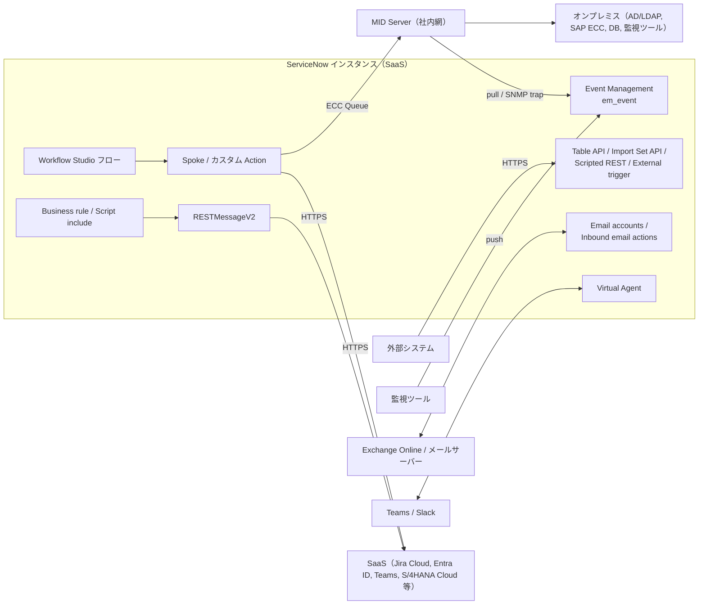
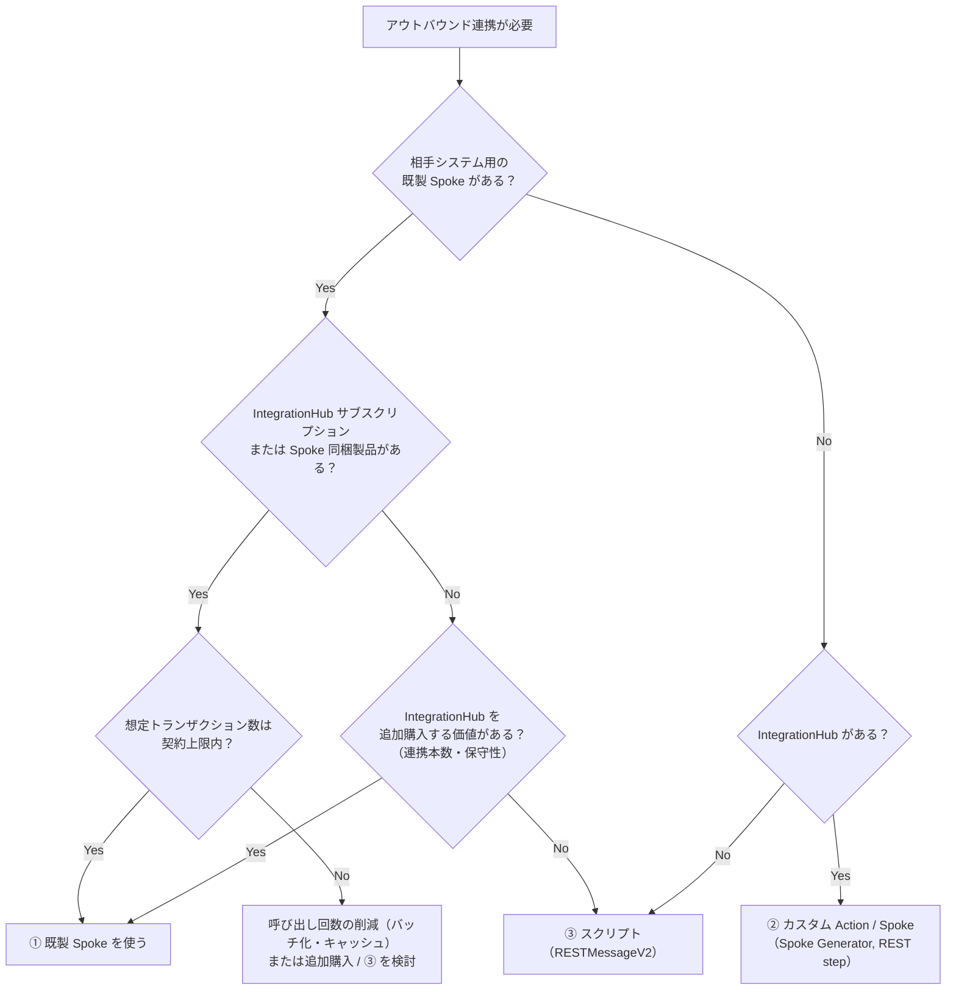
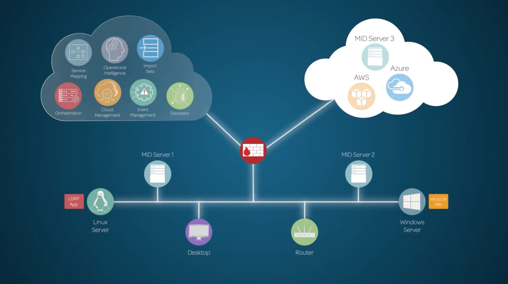
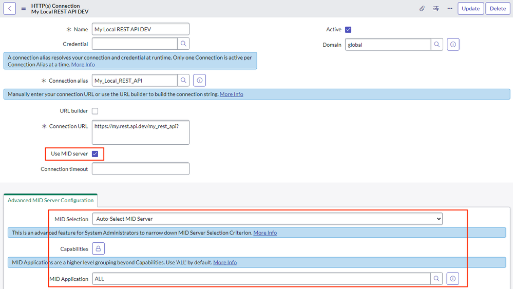
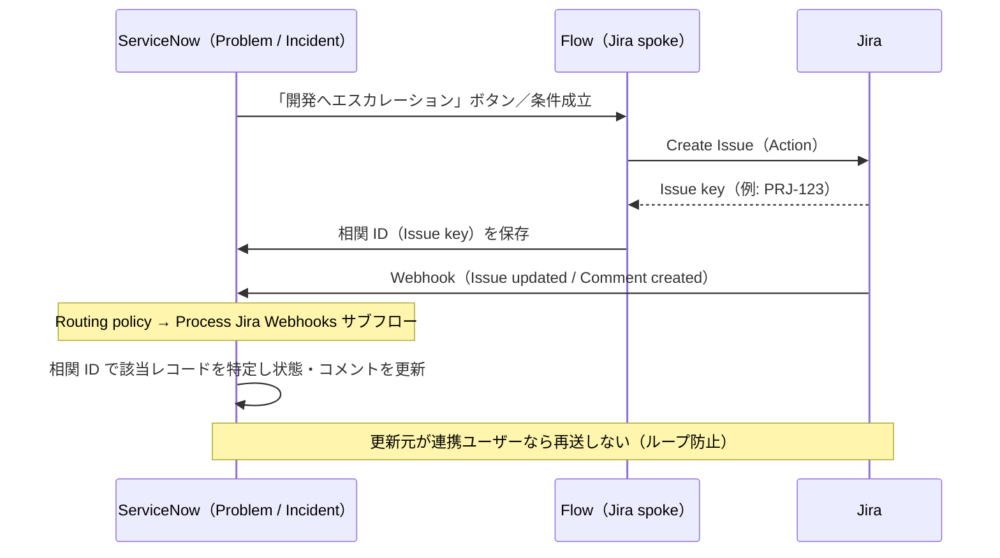

# 連携設計（Integration Design）

## 概要

ServiceNow 導入プロジェクトにおける連携設計（Integration Design）とは、ServiceNow インスタンスと周辺システム（ディレクトリ、IdP、メール基盤、監視ツール、開発ツール、ERP、コラボレーションツール等）との間で「何を・どちら向きに・どのタイミングで・どの方式で」やり取りするかを決め、方式ごとの前提（ライセンス、プラグイン、MID Server、認証、ネットワーク）を確定させる作業である。

ServiceNow インスタンスは ServiceNow のデータセンター（SaaS）上で稼働するため、連携設計では次の 3 点が他の業務システムより重要になる。

1. **到達性**：インスタンスから社内ネットワークのシステムへは直接届かない。社内システムと連携する場合は MID Server（ミッドサーバー）を置くか、社内システム側を公開するかを決める必要がある [出典](https://www.servicenow.com/docs/r/australia/servicenow-platform/mid-server/explore-mid-server.html)。
2. **ライセンス**：ServiceNow 製 Spoke（スポーク）の利用には IntegrationHub（Integration Hub）サブスクリプション、または当該 Spoke を含む Subscription Product が必要で、IntegrationHub トランザクション（Integration Hub transaction）は Subscription Product に含まれない。Spoke の利用権とトランザクションの課金を意識する必要がある [出典](https://www.servicenow.com/docs/r/integrate-applications/integration-hub/subscription-usage.html)。
3. **アップグレード耐性**：年 2 回のファミリーリリースに追随するため、スクリプトによる個別実装より、ServiceNow が保守する Spoke や標準機能を優先するのが原則である【経験則】。

本ファイルは導入編として、以下を実務で使える粒度で扱う。

| 章 | 内容 |
|---|---|
| [1. 連携設計の進め方](#1-連携設計の進め方) | 連携の棚卸し、設計項目、ServiceNow 側の連携手段の全体像 |
| [2. IntegrationHub とスクリプトの使い分け](#2-integrationhub-とスクリプトの使い分け) | Spoke / カスタム Action / RESTMessageV2 / Scripted REST の比較と判断基準、トランザクション課金 |
| [3. MID Server の要否](#3-mid-server-の要否) | MID Server が必要になる条件、パターン別の要否早見表、配置設計 |
| [4. 代表的な連携パターン](#4-代表的な連携パターン) | AD/Entra ID、SSO、メール、監視ツール、Jira、SAP、Teams/Slack、ServiceNow 間連携 |
| [5. 共通の非機能設計](#5-共通の非機能設計) | 認証情報、エラー処理・再試行、ループ防止、環境差異、監視 |
| [6. 連携設計書のテンプレート](#6-連携設計書のテンプレート) | 連携 1 本ごとに埋める項目 |
| [7. Brazil での変更点](#7-brazil-での変更点) | 判明している差分 |

製品仕様の詳細は以下のリファレンスを参照のこと。

- IntegrationHub の構成要素・課金：[IntegrationHub](../02_リファレンス/platform/integrationhub.md)
- REST/SOAP API・Scripted REST・レート制限：[Web Services / REST API](../02_リファレンス/platform/web-services-api.md)
- MID Server のインストール・構成：[MID Server](../02_リファレンス/platform/mid-server.md)
- SSO・MFA：[認証とSSO](../02_リファレンス/platform/authentication-sso.md)
- メール：[通知とメール](../02_リファレンス/platform/notifications-email.md)
- 一括データ投入：[データ移行](./08-data-migration.md)、[データインポート/エクスポート](../02_リファレンス/platform/import-export-data.md)
- 連携で失敗しやすい点：[連携の落とし穴](../04_応用編/08-integration-pitfalls.md)

---

## 1. 連携設計の進め方

### 1.1 連携設計のタイミングと成果物

連携設計は、要件定義（[要件定義と設計](./06-requirements-design.md)）で「連携一覧（Integration inventory）」を作り、設計フェーズで連携 1 本ごとの「連携設計書（Interface specification）」に落とし込むのが一般的である【経験則】。連携はインスタンス戦略（[インスタンス戦略と環境](./07-instance-strategy.md)）と密接に関係し、開発・テスト・本番の各インスタンスがどの接続先（相手側の開発/検証/本番）とつながるかを最初に決めておく必要がある【経験則】。

| フェーズ | 連携設計の主な作業 | 成果物 |
|---|---|---|
| 要件定義 | 連携対象システムの洗い出し、連携の目的・方向・頻度・データ量の把握、ライセンス影響の確認 | 連携一覧 |
| 基本設計 | 方式選定（Spoke / API / メール / MID Server 等）、認証方式、エラー時の扱い、環境マッピング | 連携方式設計書、ネットワーク構成図 |
| 詳細設計 | 項目マッピング、コード値変換、状態遷移の対応、再試行・ループ防止ロジック | 連携設計書（インターフェース仕様） |
| 構築・テスト | Connection & Credential alias（接続・資格情報エイリアス）の環境別設定、結合テスト、性能テスト | テスト仕様書、運用手順 |
| 移行・稼働 | 本番の資格情報投入、クローン後の接続先切り替え手順の確立 | 運用手順書 |

### 1.2 連携一覧で押さえる項目

連携一覧では、連携 1 本ごとに少なくとも以下を記録する。これらは方式選定とライセンス見積もりの前提になる【経験則】。

| 項目 | 確認すること | 方式選定への影響 |
|---|---|---|
| 相手システム | 製品名・バージョン、SaaS かオンプレミスか | オンプレミスなら MID Server 候補。既製 Spoke の有無 |
| 方向 | アウトバウンド（ServiceNow → 相手）／インバウンド（相手 → ServiceNow）／双方向 | アウトバウンドは IntegrationHub トランザクション消費の可能性 |
| トリガー | イベント駆動（レコード更新時）／スケジュール／オンデマンド（ユーザー操作） | フロー、スケジュールジョブ、UI アクション等の起点 |
| 同期／非同期 | 応答を待つ必要があるか | 同期呼び出しはタイムアウト設計が必要 |
| データ量・頻度 | 1 回あたり件数、1 日あたり回数、ピーク | トランザクション数、Data Stream（データストリーム）の要否、レート制限 |
| データの正（マスター） | どちらが正のデータを持つか | 双方向更新時の競合解決ルール |
| 認証 | OAuth 2.0、API トークン、Basic、証明書、mTLS | Credential 種別、IdP 側の登録作業 |
| ネットワーク | 相手が社内網か、IP 制限の有無 | MID Server、IP 許可リスト |
| 失敗時の扱い | 再送、手動対応、業務影響 | Retry policy（再試行ポリシー）、エラーキュー、監視 |
| 機密性 | 個人情報・認証情報を含むか | 暗号化、ログに残る内容、ACL |

### 1.3 ServiceNow 側の連携手段の全体像

ServiceNow の連携手段は「方向」と「実装形態」で整理できる。

| 方向 | 手段 | 概要 | ライセンス上の注意 | 詳細 |
|---|---|---|---|---|
| アウトバウンド | IntegrationHub Spoke（既製） | ServiceNow 製の Spoke（Jira、Microsoft Entra ID、SAP 等）のアクションを Workflow Studio のフローから呼ぶ | IntegrationHub サブスクリプション、または Spoke を同梱する Subscription Product が必要。トランザクションを消費しうる | [IntegrationHub](../02_リファレンス/platform/integrationhub.md) |
| アウトバウンド | IntegrationHub カスタム Action（REST/SOAP/PowerShell/SSH/JDBC step） | Action Designer（アクションデザイナー）で Integration step（連携ステップ）を使って自作 | Integration step の多くは IntegrationHub サブスクリプションが必要 | 同上 |
| アウトバウンド | スクリプト（`sn_ws.RESTMessageV2`、`sn_ws.SOAPMessageV2`） | Business rule、Script include、スケジュールジョブ等から HTTP 呼び出し | Flow Designer 外での従来型 Web サービス機能は IntegrationHub トランザクションを消費しないとされる（ServiceNow 社員のコミュニティ記事） | [Web Services / REST API](../02_リファレンス/platform/web-services-api.md) |
| インバウンド | Table API / Import Set API / Attachment API 等 | 相手から ServiceNow の標準 REST API を呼ぶ | 標準機能。ただし呼び出しユーザーのライセンス・ロールに注意 | 同上 |
| インバウンド | Scripted REST API | 独自エンドポイントを定義し、受信処理をスクリプトで書く | 標準機能 | 同上 |
| インバウンド | External trigger（外部トリガー、Webhook）/ Spoke の Webhook 受信 | 外部の Webhook でフローを起動 | IntegrationHub の機能 | [IntegrationHub](../02_リファレンス/platform/integrationhub.md) |
| インバウンド | Inbound email action（受信メールアクション）/ Inbound email flow（受信メールフロー） | メール受信をきっかけにレコード作成・更新 | 標準機能 | [通知とメール](../02_リファレンス/platform/notifications-email.md) |
| インバウンド | Event Management connector | 監視ツールのイベント／アラートを `em_event` に取り込む | ITOM（Event Management）のライセンスが必要 | [Event Management と AIOps](../02_リファレンス/itom/event-management-aiops.md) |
| データ取り込み | Import Set（JDBC/LDAP/ファイル）、IntegrationHub ETL、Service Graph Connectors | 定期・一括のデータ取り込み | Service Graph Connector は製品により要件が異なる | [データ移行](./08-data-migration.md)、[Service Graph Connectors](../02_リファレンス/itom/service-graph-connectors.md) |
| 双方向（会話） | Conversational Integration（Teams / Slack） | Virtual Agent をチャットツールに公開 | Virtual Agent の利用権が前提 | [Virtual Agent](../02_リファレンス/platform/virtual-agent.md) |
| インスタンス間 | Remote Process Sync、Remote Instance spoke、Instance Data Replication | ServiceNow 同士の連携 | Remote Process Sync は IntegrationHub サブスクリプションが必要 | [4.8](#48-servicenow-インスタンス間連携) |

[出典（Exploring Integration Hub）](https://www.servicenow.com/docs/r/u~ldaY8ZPxJiUgZ1Inf6mw/_Z13Mf2fauK1FAT029a_WA)、[出典（subscription usage）](https://www.servicenow.com/docs/r/integrate-applications/integration-hub/subscription-usage.html)、[出典（Spoke 解説：ServiceNow Community）](https://www.servicenow.com/community/automation-engine-blog/integration-hub-spokes-and-how-to-build-them/ba-p/2788254)



上図は公式ドキュメントの記述を基に本ナレッジで作成した概念図である。

---

## 2. IntegrationHub とスクリプトの使い分け

### 2.1 選択肢の整理

アウトバウンド連携の実装手段は大きく 4 つある。

| 手段 | 実装場所 | 長所 | 短所 |
|---|---|---|---|
| ① 既製 Spoke | Store からインストールし、フローで Action を使う | ServiceNow が開発・保守・新リリース対応を行う。認証・ページング・エラー評価が組み込み済み。ローコード | IntegrationHub サブスクリプション（または同梱製品）が必要。OOB Action は直接編集できない（複製して拡張） |
| ② カスタム Spoke / Action | Action Designer（REST/SOAP/JDBC 等の step）、Spoke Generator（スポークジェネレーター） | Connection & Credential alias、Retry policy、実行履歴（Execution details）など基盤機能を使える。フローから再利用可能 | Integration step の利用に IntegrationHub サブスクリプションが必要。使える step はパッケージ階層に依存しうる【第三者情報】。トランザクションを消費 |
| ③ スクリプト（`RESTMessageV2` 等） | Business rule、Script include、スケジュールジョブ | 自由度が高い。Flow Designer 外であれば IntegrationHub トランザクションを消費しないとされる | 認証・再試行・ログ・エラー処理を自前で実装。保守性・可視性が低い。アップグレード時の確認範囲が増える |
| ④ 外部 iPaaS / 連携製品 | MuleSoft、Boomi、Workato、Exalate 等の外部製品 | 全社の連携基盤に統合できる。多対多の連携に強い | 別製品のライセンス・運用が必要。ServiceNow 側は標準 API で受けるだけになる【第三者情報】 |

[出典（Spoke 解説：ServiceNow Community, 2024-01）](https://www.servicenow.com/community/automation-engine-blog/integration-hub-spokes-and-how-to-build-them/ba-p/2788254)、[出典（Integration Hub vs REST Message：Community）](https://www.servicenow.com/community/developer-forum/why-we-should-go-with-integration-hub-for-integration-rather/m-p/2693847)

### 2.2 判断基準

ServiceNow Community の回答では「他の条件が同じなら IntegrationHub を既定にすべき」とされ、Jira のように既製 Spoke がある場合はそれを使うことが推奨されている [出典](https://www.servicenow.com/community/developer-forum/why-we-should-go-with-integration-hub-for-integration-rather/m-p/2693847)【第三者情報】。一方で、IntegrationHub のライセンスがない、またはトランザクション数が見積もりを大きく超える場合はスクリプトが現実的な選択肢になる【経験則】。



> 分岐 C と I の「IntegrationHub がある」は、「契約しているパッケージ階層で、必要な Spoke・Integration step（REST / PowerShell / SSH / JDBC 等）・Data Stream が使えるか」まで確認すること。階層によって使える step が異なるとする情報があるため（[2.3](#23-integrationhub-のライセンスとトランザクション) 参照）【第三者情報】。

判断時の補足ポイントは以下のとおり。

| 観点 | IntegrationHub（①②）が有利 | スクリプト（③）が有利 |
|---|---|---|
| 担当者のスキル | ローコード中心、管理者が保守 | 開発者が常駐し、コードレビュー体制がある |
| 連携本数 | 多い（共通の alias・再試行・監視を使い回せる） | 少数・単純（1〜2 本の通知程度） |
| 可視性 | フロー実行履歴で入出力を追える | 自前でログテーブル・`gs.info` 等を整備する必要 |
| 環境差異 | Connection & Credential alias で環境ごとの接続先を切り替えやすい | REST Message レコードやシステムプロパティで自前管理 |
| 大量データ | Data Stream action（データストリームアクション）でページング・10 MB 超の応答を分割処理できる（契約パッケージで Data Stream が使えることが前提【第三者情報】） | 自前でページング処理を書く |
| 課金 | トランザクション数が予測可能で上限内 | トランザクション消費を避けたい |
| インバウンド | External trigger（Webhook）でフロー起動 | Scripted REST API で受信して自由に処理 |

[出典（Data Stream）](https://www.servicenow.com/docs/r/integrate-applications/integration-hub/data-stream-actions.html)、[出典（Exploring Integration Hub）](https://www.servicenow.com/docs/r/u~ldaY8ZPxJiUgZ1Inf6mw/_Z13Mf2fauK1FAT029a_WA)

> 実務上の折衷案として、インバウンドは Scripted REST API（または Import Set API）で受け、アウトバウンドは Spoke を使う構成が多い。インバウンドの受信は標準 API の機能であり、IntegrationHub の利用権を前提としないためである【経験則】。

### 2.3 IntegrationHub のライセンスとトランザクション

IntegrationHub のインストーラープラグインは、Starter（`com.glide.hub.integrations`）、Standard（`com.glide.hub.integrations.standard`）、Professional（`com.glide.hub.integrations.professional`）、Enterprise（`com.glide.hub.integrations.enterprise`）の 4 つが公式ドキュメントに載っている。各階層に何が含まれるかは、同ページでも Legal schedules（契約書類）を参照するよう案内されている [出典（Integration Hub plugins, Australia）](https://www.servicenow.com/docs/r/t2jQMKLZFp9AGt3V12O7mQ/SaI5XON9w7okFJQteYQNBA)。Starter がベースシステムや Subscription Product に同梱されるかどうかは公開情報では確認できず、Legal schedules で確認する必要がある（第三者の解説には「Starter は同梱」とするものもある【第三者情報】）。ライセンス上の主な注意点を、確度別に整理する。

| 項目 | 内容 | 確度 |
|---|---|---|
| Spoke の利用権 | ServiceNow 製 Spoke を本番で使うには、IntegrationHub サブスクリプション、または当該 Spoke を含む Subscription Product（ITSM Pro 等）が必要 | 公式 [出典](https://www.servicenow.com/docs/r/integrate-applications/integration-hub/subscription-usage.html) |
| トランザクション | IntegrationHub トランザクションは Subscription Product に含まれず、消費する場合は IntegrationHub または Workflow Data Fabric サブスクリプションの追加購入が必要になりうる | 公式 [出典](https://www.servicenow.com/docs/r/integrate-applications/integration-hub/subscription-usage.html) |
| Data Stream | 各要求が 1 トランザクション。次ページの要求もそれぞれ 1 トランザクション | 公式 [出典](https://www.servicenow.com/docs/r/integrate-applications/integration-hub/data-stream-actions.html) |
| カウント対象 | IntegrationHub、Flow Designer、Remote Tables、Orchestration から発生するアウトバウンド呼び出し。Flow Designer 外の `RESTMessageV2` 等は対象外 | ServiceNow 社員のコミュニティ記事 [出典](https://www.servicenow.com/community/automation-engine-blog/integration-hub-spokes-and-how-to-build-them/ba-p/2788254) |
| パッケージ別の年間上限 | 情報源により数値が一致しない（1M / 3M / 6M 等） | 【第三者情報】 [出典](https://www.servicenow.com/community/servicenow-ai-platform-forum/how-does-servicenow-count-integration-hub-transactions/td-p/1099879) |
| Spoke Generator（OpenAPI・Postman・AI からの生成） | Zurich で Integration Hub Professional が必要と明記 | 公式（リリースノート）[出典](https://www.servicenow.com/docs/r/delta-zurich-brazil/brazil-zurich-integrationhub-release-notes.html) |
| Integration step・Data Stream の階層依存 | PowerShell / SSH / JDBC 等の Integration step や Data Stream が使えるかどうかは、パッケージ階層（Professional / Enterprise 等）によって変わるとする情報がある（例：SSH・PowerShell は Professional 以上、Data Stream は Enterprise とする解説）。正式な対応は Legal schedules で確認する | 【第三者情報】 |

正式なトランザクション定義は契約書類（Legal schedules の IntegrationHub overview）に記載される。見積もり段階では、営業担当から最新の定義と各パッケージの上限を書面で入手しておくこと【経験則】。詳細は [IntegrationHub](../02_リファレンス/platform/integrationhub.md) と [ライセンスモデル](./01-licensing-model.md) を参照。

#### トランザクション見積もりの考え方

トランザクション数は「アウトバウンド呼び出し 1 回 = 1」と考えて、以下のように見積もる【推定】。

```
年間トランザクション ≒ Σ（連携ごとの 1 回あたり API 呼び出し数 × 日次実行回数 × 365）
```

- ループ内でアクションを呼ぶと、ループ回数分だけ消費する（コミュニティ回答）【第三者情報】 [出典](https://www.servicenow.com/community/servicenow-ai-platform-forum/how-does-servicenow-count-integration-hub-transactions/td-p/1099879)。
- ポーリング型（例：5 分ごとに相手の更新を確認）は、データがなくても呼び出し回数分を消費するため、Webhook（相手からのプッシュ）に置き換えられないか検討する【経験則】。
- 使用量は IntegrationHub の Usage Dashboard で、年間上限と比較して確認できる（[IntegrationHub](../02_リファレンス/platform/integrationhub.md) 参照）。

### 2.4 スクリプト連携を選ぶ場合の設計ルール

スクリプト（`sn_ws.RESTMessageV2` 等）で実装する場合も、IntegrationHub が提供する仕組みを自前で用意する必要がある【経験則】。

| 項目 | 推奨 |
|---|---|
| エンドポイント定義 | スクリプト内にハードコードせず、REST Message レコード（`sys_rest_message`）またはシステムプロパティで管理する |
| 認証情報 | Basic 認証のパスワードをスクリプトに書かない。REST Message の認証プロファイル、OAuth プロファイルを使う |
| 実行場所 | 画面操作中の同期呼び出しを避け、`executeAsync()`、イベント + Script Action、スケジュールジョブ等で非同期化する |
| MID Server 経由 | `setMIDServer()` で MID Server を指定できる（[Web Services / REST API](../02_リファレンス/platform/web-services-api.md) 参照） |
| ログ | 連携ログ用のカスタムテーブル、または Outbound HTTP Log（`sys_outbound_http_log`）を使う |
| スコープ | 連携ごとにスコープアプリケーションを分ける（Spoke と同じ考え方） |

---

## 3. MID Server の要否

### 3.1 MID Server が必要になる条件

MID Server は顧客ネットワーク内で動作する Java アプリケーションで、インスタンスへは **TCP 443 のアウトバウンド通信のみ** を行い、インバウンド接続を必要としない。インスタンスは ECC Queue（`ecc_queue`）に処理を書き込み、MID Server がそれを取りに来て社内網で実行し、結果を返す [出典](https://www.servicenow.com/docs/r/australia/servicenow-platform/mid-server/c_MIDServerConnectionPrerequisites.html)、[出典](https://www.servicenow.com/docs/r/australia/servicenow-platform/mid-server/explore-mid-server.html)。

MID Server が必要（または強く推奨）となるのは、次のいずれかに当てはまる場合である。

| 条件 | 例 |
|---|---|
| 相手システムがインターネットから到達できない | オンプレミスの AD/LDAP、SAP ECC、社内 DB、社内 API |
| 相手システムを外部公開したくない（セキュリティポリシー） | LDAP をファイアウォールで開放したくない |
| プロトコルがインスタンスから直接使えない | PowerShell、SSH、WMI、JDBC、SNMP trap、SAP RFC（JCo ライブラリ） |
| ITOM の収集処理 | Discovery、Service Mapping、Event Management の pull 型コネクタ、SNMP trap 受信 |
| 社内ファイルの取り込み | 社内ファイルサーバー上の CSV 等を Import Set で取り込む |

逆に、相手が SaaS（Jira Cloud、Microsoft Graph、Slack、Teams 等）で、インターネット経由の HTTPS で到達できる場合は、通常 MID Server は不要である【経験則】。



- **キャプション:** MID Server の概要図（公式ドキュメント「Exploring MID Server」の図）。
- **図の説明:** 左上のクラウド（ServiceNow インスタンス）に Service Mapping、Operational Intelligence、Import Sets、Orchestration、Cloud Management、Event Management、Discovery のアイコンが並ぶ。中央にファイアウォールがあり、その内側の社内ネットワーク上に MID Server 1 と MID Server 2 が接続され、Linux Server（LDAP アプリ）、Desktop、Router、Windows Server（MS SCCM アプリ）につながっている。右上のパブリッククラウド（AWS、Azure）上にも MID Server 3 が配置されている。すなわち、MID Server は社内網にもクラウド IaaS 上にも置けて、ファイアウォールの内側で各アプリケーションの処理を代行することを示す。
- **出典:** https://www.servicenow.com/docs/r/australia/servicenow-platform/mid-server/explore-mid-server.html （取得日: 2026-11-02）

### 3.2 連携パターン別の MID Server 要否早見表

| 連携パターン | MID Server | 理由・備考 |
|---|---|---|
| オンプレミス AD（LDAP）でのユーザー取り込み | ほぼ必須（または LDAP の外部公開＋IP 制限／VPN） | LDAP サーバーを外部ネットワークに公開せずに済む。ただし MID Server 経由では LDAP 認証と SSL 接続は使えない（[4.1.2](#412-ldap-連携オンプレミス-ad)） |
| Microsoft Entra ID（SCIM / Entra ID spoke） | 不要 | Microsoft Graph / SCIM はインターネット上の HTTPS |
| SSO（SAML 2.0 / OIDC） | 不要 | ブラウザーのリダイレクトで IdP とやり取りする（AD FS 等のオンプレミス IdP でも、ユーザーのブラウザーから到達できればよい）【経験則】 |
| Exchange Online / Microsoft Graph メール | 不要 | クラウド間の通信 |
| オンプレミス Exchange / 社内 SMTP・IMAP | 原則不要だが、インスタンスから到達可能な公開が必要 | 公式ドキュメント「Create an email account」の設定項目には、MID Server 経由で接続する指定が見当たらない【推定】（MID Server 非対応を明記した公式出典は公開情報では確認できず）。公開できない場合は ServiceNow のメール基盤＋転送ルールを検討【推定】 |
| 監視ツール（SaaS、push 型：Datadog、Dynatrace、New Relic 等） | 不要 | インスタンスがイベントを直接受信する |
| 監視ツール（オンプレミス、pull 型：SCOM、Zabbix、SolarWinds 等）／SNMP trap | 必要 | pull 型コネクタと SNMP trap は MID Server 上で動作する（[4.4](#44-監視ツール連携)） |
| Jira Cloud | 不要 | Jira Cloud の REST API |
| Jira Data Center（社内設置） | 必要な場合が多い | 社内網にあり外部公開されていない場合【経験則】 |
| SAP ECC / S/4HANA（オンプレミス、RFC） | 実質的に必要 | 社内網にあり、JCo ライブラリを MID Server に配置する構成が一般的（[4.6](#46-sap-連携)） |
| SAP S/4HANA Cloud（Public Cloud） | 不要 | OData / REST の HTTPS |
| Teams / Slack | 不要 | SaaS 間 |
| 社内 DB（JDBC）、ファイル取り込み | 必要 | JDBC / ファイルは MID Server 経由。IntegrationHub の JDBC step を使う場合は、契約パッケージで利用できるか確認する【第三者情報】 |
| PowerShell / SSH による社内サーバー操作 | 必要 | PowerShell step、SSH step は MID Server 上で実行。これらの step はパッケージ階層（Professional 以上等）に依存するとする情報があるため、契約内容を確認する【第三者情報】 |

[出典（Exploring MID Server）](https://www.servicenow.com/docs/r/australia/servicenow-platform/mid-server/explore-mid-server.html)、[出典（Define an LDAP server, Australia）](https://www.servicenow.com/docs/r/oL66E_cwDD_tnWQYzYPRdA/JJdkpBibwnesJEgF8SZRoA)、[出典（Event Management connectors, Australia）](https://www.servicenow.com/docs/r/u7nZu9GEUxWr9UkuDmbe6w/7edm782WwL4~9GS9pftgtQ)、[出典（Integration Hub plugins, Australia）](https://www.servicenow.com/docs/r/t2jQMKLZFp9AGt3V12O7mQ/SaI5XON9w7okFJQteYQNBA)、[出典（SAP ECC RFC spoke）](https://www.servicenow.com/docs/r/integrate-applications/integration-hub/sap-ecc-rfc-spoke.html)

### 3.3 IntegrationHub の Connection で MID Server を使う設定

IntegrationHub の HTTP(s) Connection レコードには **Use MID server** チェックボックスがあり、オンにすると、その接続を使う REST step 等が MID Server 経由で実行される。チェックをオンにすると Advanced MID Server Configuration（MID Server の詳細設定）セクションが表示され、MID Selection（MID の選択方法）で Auto-Select MID Server（既定）、Specific MID Server、Specific MID Cluster のいずれかを選ぶ。Auto-Select の場合は Capabilities（機能）と MID Application（MID アプリケーション）で候補の MID Server を絞り込める [出典（Create an HTTP(s) connection, Australia）](https://www.servicenow.com/docs/r/hX5GtoLUEU58KgyL7CW5Ag/lCOrTJrPSDa5Yvp7oBVrig)。Connection alias（接続エイリアス）の実体である Connection はインスタンスごとに設定できるため、「開発環境は MID 経由、本番は直接」といった切り替えもフローを変えずに行える【経験則】。



- **キャプション:** Connection & Credential alias に紐づく HTTP(s) Connection レコードのフォーム。
- **画面説明:** ヘッダーに「HTTP(s) Connection」と表示され、上部に Name、Credential、Connection alias（必須）、右側に Active と Domain が並ぶ。Connection alias の下に「A connection alias resolves your connection and credential at runtime. Only one Connection is active per Connection Alias at a time.」という説明がある。続いて URL builder、Connection URL（必須）、赤枠で強調された **Use MID server** チェックボックス（オン）、Connection timeout。下部の Advanced MID Server Configuration タブで MID Selection（Auto-Select MID Server）、Capabilities、MID Application（ALL）を設定する。
- **出典:** [Understanding Connection & Credential Alias - Part 2（ServiceNow Community, Queensland SNUG）](https://www.servicenow.com/community/queensland-snug/understanding-connection-amp-credential-alias-part-2/ba-p/3011764)（取得日: 2026-11-02）【第三者情報】

### 3.4 MID Server の配置設計のポイント

| 観点 | 設計ポイント |
|---|---|
| 台数・冗長化 | 本番連携に使う MID Server は 2 台以上でクラスター（Load Balance / Failover）を組む【経験則】。クラスター仕様は [MID Server](../02_リファレンス/platform/mid-server.md) 参照 |
| 用途分離 | Discovery 等の ITOM 用と、IntegrationHub・LDAP 用の MID Server を分けると、負荷やメンテナンスの影響を切り分けやすい【経験則】 |
| 環境ごと | 開発・テスト・本番インスタンスごとに MID Server を用意する。MID Server は 1 つのインスタンスにのみ接続する【経験則】 |
| ネットワーク | MID Server ホストからインスタンス（`*.service-now.com`）の TCP 443 と `install.service-now.com` への通信を許可する。プロキシや SSL インスペクションを使う場合は証明書の扱いに注意 [出典](https://www.servicenow.com/docs/r/australia/servicenow-platform/mid-server/c_MIDServerConnectionPrerequisites.html) |
| サービスアカウント | MID Server ユーザー（`mid_server` ロール）を連携ごとの用途に合わせて設定する。LDAP を MID 経由で使う場合、MID Server ユーザーには `user_admin` ロールが必要 [出典](https://www.servicenow.com/docs/r/oL66E_cwDD_tnWQYzYPRdA/JJdkpBibwnesJEgF8SZRoA) |
| アップグレード | インスタンスのアップグレード後、MID Server は自動でバージョンを合わせる。ファイアウォールで `install.service-now.com` を遮断している場合は手動手順が必要（[MID Server](../02_リファレンス/platform/mid-server.md) 参照） |
| 監視 | MID Server の状態（Up / Down 等）を監視し、Down 時に通知する【経験則】。運用は [サポートと監視](./14-support-monitoring.md) 参照 |

---

## 4. 代表的な連携パターン

### 4.1 Active Directory / Microsoft Entra ID（ユーザー・グループ連携）

#### 4.1.1 方式の選択肢

ユーザー（`sys_user`）・グループ（`sys_user_group`）・グループメンバー（`sys_user_grmember`）を社内ディレクトリから取り込む方式は 4 つある。

| 方式 | 向き | 主な対象 | MID Server | 特徴 |
|---|---|---|---|---|
| LDAP 連携（Import Set + LDAP Listener） | ServiceNow が LDAP を読む（pull） | オンプレミス AD、OpenLDAP 等 | 推奨（または LDAP の外部公開） | 標準機能。読み取り専用。LDAP 認証にも使える |
| SCIM（Entra ID → ServiceNow） | Entra ID が ServiceNow の SCIM API を呼ぶ（push） | Microsoft Entra ID、Okta 等の IdP | 不要 | `com.snc.integration.scim2` プラグイン。ユーザー・グループの CRUD |
| SSO 時の Just-in-Time プロビジョニング | ログイン時に作成・更新 | SAML / OIDC の IdP | 不要 | 未登録ユーザーをログイン時に自動作成・更新。ログイン時にしか動かないため、IdP 側で削除・無効化されたユーザーは ServiceNow 側に反映されない【経験則】 |
| Microsoft Entra ID spoke（ServiceNow → Entra ID） | ServiceNow が Graph API を呼ぶ（アウトバウンド） | Entra ID | 不要 | ServiceNow 側を起点に Entra ID のアカウント作成・グループ追加・無効化を行う（入社・退職フロー等） |

[出典（LDAP）](https://www.servicenow.com/docs/r/zurich/platform-security/ldap-integration/r_LDAPIntegrationFAQs.html)、[出典（SCIM API）](https://www.servicenow.com/docs/r/zurich/api-reference/rest-apis/scim-api.html)、[出典（Entra ID spoke）](https://www.servicenow.com/docs/r/u~ldaY8ZPxJiUgZ1Inf6mw/_m4XzxyR5S_cY1AN~6hqXA)

選択の目安は以下のとおり【経験則】。

| 状況 | 推奨 |
|---|---|
| オンプレミス AD が人事・組織のマスターで、Entra ID と同期していない | LDAP 連携（MID Server 経由） |
| Entra ID（Entra Connect で AD と同期済み）を IdP として使う | SCIM（ユーザー・グループの登録・無効化）＋ SAML/OIDC SSO |
| ユーザー数が少なく、ログインできれば十分 | SSO の Just-in-Time プロビジョニング |
| ServiceNow の入社・退職リクエストから Entra ID アカウントを操作したい | Entra ID spoke（上記のいずれかと併用） |

> 1 つのユーザー属性に複数のソース（例：LDAP と SCIM）から書き込むと、上書き合戦が起きる。属性ごとにマスターを 1 つに決めること【経験則】。

#### 4.1.2 LDAP 連携（オンプレミス AD）

LDAP 連携は、ServiceNow が LDAP v3 準拠のディレクトリ（Microsoft Active Directory、Novell、Domino、OpenLDAP 等。JNDI を使用）を読み取り、Import Set と Transform Map で `sys_user` / `sys_user_group` に取り込む標準機能である。ServiceNow は LDAP を**読むだけで書き込まない** [出典](https://www.servicenow.com/docs/r/zurich/platform-security/ldap-integration/r_LDAPIntegrationFAQs.html)。

**前提条件**

| 項目 | 内容 |
|---|---|
| ディレクトリ | LDAP v3 準拠 |
| ネットワーク | LDAP サーバーへのインバウンドのファイアウォール許可、または MID Server |
| 接続情報 | LDAP サーバーの外部 IP または名前 |
| アカウント | 読み取り専用のサービスアカウント |
| LDAPS | LDAP サーバーの SSL 証明書の公開鍵側（PKI 証明書） |
| VPN | ポイントツーポイントの IPSec VPN トンネルもオプションで利用可能（営業担当に要相談、有償） |

[出典](https://www.servicenow.com/docs/r/zurich/platform-security/ldap-integration/r_LDAPIntegrationFAQs.html)

**LDAP サーバー定義（Australia）**

メニュー：**All > System LDAP > Create New Server**（新規）、**System LDAP > LDAP Servers**（変更）。必要ロール：`admin`。

| フィールド | 内容 |
|---|---|
| Name | サーバー名 |
| Active | 有効化。有効時は各接続をテストする |
| LDAP Server URLs | プライマリ・バックアップの URL |
| Login distinguished name / Login password | 接続ユーザーの DN とパスワード（パスワードなしの場合は匿名ログインが必要） |
| Starting search directory | 検索の起点となる RDN |
| MID Server | MID Server 経由で接続する。LDAP サーバーを外部公開・VPN せずに済む |
| Connect timeout | MID Server 設定時は 10 秒固定（変更不可） |
| Read timeout | 読み取りタイムアウト（秒） |
| SSL | SSL 接続を要求。**MID Server 選択時は使えない**。ポート 636 で SSL が自動的に有効になる |
| Listener / Listen interval | 永続検索（persistent search）に対応した AD/LDAP の変更をリッスンする |
| Paging | 結果を複数の結果セットに分割する |

[出典（Define an LDAP server, Australia）](https://www.servicenow.com/docs/r/oL66E_cwDD_tnWQYzYPRdA/JJdkpBibwnesJEgF8SZRoA)

**MID Server 経由の制約**：MID Server 経由の LDAP 接続では **LDAP 認証（LDAP パスワードによるログイン）と SSL 接続は使えない** [出典](https://www.servicenow.com/docs/r/oL66E_cwDD_tnWQYzYPRdA/JJdkpBibwnesJEgF8SZRoA)。そのため、「ユーザー取り込みは MID Server 経由の LDAP、ログインは SSO」という組み合わせが実務上の定番になる【経験則】。

**同期と削除の扱い**

- ユーザーとグループメンバーは、LDAP Listener と毎日の全件ブラウズ（daily full LDAP browse）で最新に保たれる [出典](https://www.servicenow.com/docs/r/zurich/platform-security/ldap-integration/r_LDAPIntegrationFAQs.html)。
- LDAP から削除されたユーザー・グループ・部門は ServiceNow 側で自動削除されない。部門を削除すると CI、SLA、ソフトウェアライセンス、購買発注、カタログ等の参照がクリアされるため、削除は顧客判断とされている [出典](https://www.servicenow.com/docs/r/zurich/platform-security/ldap-integration/r_LDAPIntegrationFAQs.html)。実務では削除ではなく `active=false` にする設計が一般的【経験則】。
- 複数ドメインの AD では、ドメインごとに LDAP サーバーレコードを作り、一意な属性（AD では `objectSid`、ほかに `email`、`userPrincipalName`）を coalesce（一致キー）に使う [出典](https://www.servicenow.com/docs/r/zurich/platform-security/ldap-integration/r_LDAPIntegrationFAQs.html)。
- AD はクエリあたり既定 1,000 件（maxPageSize）の上限があるため、Paging を有効にするか、クエリを分割する [出典](https://www.servicenow.com/docs/r/zurich/platform-security/ldap-integration/r_LDAPIntegrationFAQs.html)。

LDAP の詳細設定（Transform Map、`LDAPUtils` 等）は [ユーザー・グループ・ロール](../02_リファレンス/platform/users-groups-roles.md) を参照。

#### 4.1.3 SCIM（Microsoft Entra ID からのプロビジョニング）

SCIM API は、SCIM v2 プラグイン「SCIM v2 - ServiceNow Cross-domain Identity Management」（`com.snc.integration.scim2`）を有効化すると使えるインバウンド API である。

| 項目 | 内容 |
|---|---|
| プラグイン | `com.snc.integration.scim2`（All > System Applications > All Available Applications から導入。ロール `admin`） |
| エンドポイント | `/api/now/scim/Users`、`/api/now/scim/Groups` 等（バージョン付き `/api/now/{api_version}/scim/...` もある） |
| リソース | Users、Groups のほか Company、CostCenter、Department、Location |
| ロール | `scim_admin`（SCIM 用テーブルと非公開 SCIM エンドポイントへのアクセス） |
| マッピング | SCIM ユーザー → `sys_user`、SCIM グループ → `sys_user_group`。既存テーブルに収まらない属性は `sys_scim_user` / `sys_scim_group` に格納 |
| 逆方向 | SCIM v2 Client（`com.snc.integration.scim2.client`）は、ServiceNow から外部 SCIM プロバイダーへのアウトバウンドのプロビジョニング用で別コンポーネント |

[出典（SCIM API）](https://www.servicenow.com/docs/r/zurich/api-reference/rest-apis/scim-api.html)

**Entra ID 側の設定上の注意**【第三者情報】（ServiceNow Community の開発者ブログ）[出典](https://www.servicenow.com/community/developer-blog/scim-provisioning-from-microsoft-entra-id/ba-p/2984734)

- Entra ID のギャラリーアプリ「ServiceNow」のプロビジョニングは SCIM ではなく SOAP 呼び出しで動作する。SCIM で連携するには「ギャラリー以外のアプリケーション（Non-gallery）」としてエンタープライズアプリを作成する。
- Tenant URL は `https://<instance>.service-now.com/api/now/scim` を指定する。
- ServiceNow 側は Application Registry の「SCIM API」OAuth レコードを使ってトークンを発行する。Access Token Lifespan によって Entra ID 側のシークレットトークンを再入力する頻度が決まるため、有効期限を運用設計に含める。
- SCIM による変更はプロビジョニング用のサービスアカウントの操作として記録されるため、専用アカウントを用意する。

#### 4.1.4 Microsoft Entra ID spoke（ServiceNow から Entra ID を操作）

Microsoft Entra ID spoke（旧 Microsoft Azure Active Directory spoke）は、ServiceNow のフローから Microsoft Graph を通じて Entra ID のユーザー・グループ・ライセンス等を操作する Spoke である。

| 項目 | 内容（Australia ドキュメント、2026-03-12 更新） |
|---|---|
| 最新バージョン | v4.8.2 |
| サブスクリプション | Integration Hub サブスクリプションが必要 |
| 依存プラグイン | Complex Object、IntegrationHub Runtime、IHUB Spoke Util Pack、IntegrationHub Action Step (PowerShell)、IntegrationHub Action Template (Data Stream)、IntegrationHub Action Step (REST)、Remote Directory Sync |
| Entra ID 側 | OAuth 2.0 トークン発行用のアプリ登録が必要。Authorization Code の場合は委任（Delegated）権限、Client Credentials の場合はアプリケーション権限が適用される |
| 接続 alias | `AzureAD`（URL：`https://graph.microsoft.com`） |
| Action カテゴリ | Audit Logs、Group Management、License Management、Application Management、Device Management、Organization Management、User Authentication、Service Principal Management、Password Management、User Management |
| サンプルフロー | User Onboarding（ユーザー有効化時に Entra ID アカウントを作成・有効化）、User Offboarding（無効化時にアカウント無効化・グループ削除）。ドラフト状態で提供され、新しいスコープに複製してから使う |
| AI 関連 | Conversational subflow（Now Assist for Conversational Spokes が必要）、AI agent 3 種（Now Assist for Integration Hub が必要） |

[出典](https://www.servicenow.com/docs/r/u~ldaY8ZPxJiUgZ1Inf6mw/_m4XzxyR5S_cY1AN~6hqXA)

> 権限の最小化：例えば「Disable User」アクションについて、公式ページではアプリケーション権限として `User.Read.All` / `User.ReadWrite.All` / `Directory.Read.All` / `Directory.ReadWrite.All` が、委任権限（職場または学校アカウント）として `User.ReadWrite` / `User.ReadWrite.All` / `User.ManageIdentities.All` / `Directory.ReadWrite.All` / `Directory.AccessAsUser.All` が列挙されている（Graph 方式の権限一覧で、すべてが必須とは限らない）[出典](https://www.servicenow.com/docs/r/u~ldaY8ZPxJiUgZ1Inf6mw/_m4XzxyR5S_cY1AN~6hqXA)。実際に必要な最小権限は Microsoft Graph の当該 API リファレンスで確認する。使う Action を先に決め、必要な Graph 権限だけを Entra ID 管理者に申請すること【経験則】。

### 4.2 SSO（シングルサインオン）

#### 4.2.1 方式

ServiceNow の SSO は **Multi-Provider SSO**（プラグイン：Integration - Multiple Provider Single Sign-On Installer、`com.snc.integration.sso.multi.installer`）で構成し、SAML 2.0、OIDC（OpenID Connect）、Digest Token の IdP を複数登録できる。メニューは **All > Multi-Provider SSO > Identity Providers** [出典](https://www.servicenow.com/docs/r/platform-security/authentication/sso-acct-recovery.html)。Xanadu の Authentication release notes には、MultiSSO v1 プラグイン、SAML 1.1（SAML 1.1 Single Sign-On - Update 1 を含む）プラグイン、OpenID SSO プラグインが非推奨（deprecated）と記載されている [出典（Authentication release notes, Xanadu）](https://www.servicenow.com/docs/r/xanadu/release-notes/authentication-rn.html)。ただし、Washington DC→Yokohama の統合リリースノートでは SAML 1.1 の非推奨が Washington DC の項目に載っており、最初に非推奨になったリリースは情報源により異なる [出典](https://www.servicenow.com/docs/r/yokohama/delta-washingtondc-yokohama/yokohama-washingtondc-authentication-release-notes.html)（詳細は [認証とSSO](../02_リファレンス/platform/authentication-sso.md) 参照）。

Microsoft Entra ID との SAML 連携は、Microsoft 側のチュートリアルでも手順が公開されている。Entra のギャラリーから ServiceNow を追加して SAML を選び、ServiceNow 側で Multi-Provider SSO プラグインを有効化する。Multi-Provider SSO プラグインがあれば自動構成も選べる。ServiceNow は SP-initiated SSO をサポートする [出典](https://learn.microsoft.com/en-us/entra/identity/saas-apps/servicenow-tutorial)【第三者情報】（Microsoft 公式）。

#### 4.2.2 SSO 設計で決めること

| 設計項目 | 選択肢・論点 |
|---|---|
| プロトコル | SAML 2.0（実績が多い）／OIDC。モバイルアプリやエージェント連携の要件も確認 |
| ユーザー識別子 | NameID（UPN、メールアドレス等）と ServiceNow のどのフィールド（`user_name`、`email`）を照合するか。ユーザー取り込み（LDAP / SCIM）のキーと一致させる |
| 自動プロビジョニング | Identity Provider フォームの User Provisioning タブ（Automatic user provisioning、Update user record on every login）。Zurich で自動プロビジョニング時のグループ選択（SAML / OIDC）が追加された [出典（Multi-Provider SSO）](https://www.servicenow.com/docs/r/oL66E_cwDD_tnWQYzYPRdA/1dL2d_G_dUyzIgq7qYUjqQ) |
| 対象ユーザー | 社員（SSO）、外部ユーザー・ポータル利用者（ローカル認証または別 IdP）、連携用サービスアカウント（SSO 対象外、API 専用） |
| 緊急時のログイン | IdP 障害時に管理者がログインできる経路（Account Recovery、ローカルログイン URL）を確保する |
| MFA | Yokohama 以降、SSO 以外のログイン（ユーザー名/パスワード、LDAP）には MFA が既定で強制適用される（ポリシー名 `Enforce MFA for non-SSO logins`）。SSO ユーザーの MFA は IdP 側（Entra ID の条件付きアクセス等）で担保する設計が一般的 |
| ドメインセパレーション | ドメインごとに異なる IdP を使い分け可能 |

[出典（MFA 強制）](https://www.servicenow.com/docs/r/platform-security/authentication/mfa-enforcement.html)、詳細は [認証とSSO](../02_リファレンス/platform/authentication-sso.md)、セキュリティ要件は [セキュリティとコンプライアンス](./10-security-compliance.md) を参照。

> 連携用アカウント（Web サービス用ユーザー）は、`sys_user` の **Web service access only** をオンにし、対話型ログインできないようにするのが定石である【経験則】。連携用アカウントのライセンス要否は [ライセンスモデル](./01-licensing-model.md) を参照。

### 4.3 メール連携

#### 4.3.1 方式

ServiceNow は既定で ServiceNow 提供のメール基盤を使ってメールを送受信できる。自社ドメインのメールボックスで送受信したい場合は、Email accounts（メールアカウント）で顧客自身の SMTP / POP3 / IMAP サーバー、または Microsoft Graph（Exchange Online）を設定する（Alternate configuration）。

| 方式 | 送信 | 受信 | 主な用途 |
|---|---|---|---|
| ServiceNow 既定のメール基盤 | ServiceNow の SMTP | `<instance>@service-now.com` 宛て | 小規模、PoC。社内メールから自動転送するケースもある |
| SMTP / IMAP（OAuth 2.0） | 自社 SMTP | 自社 IMAP | Exchange Online、Gmail 等 |
| Microsoft Graph | Microsoft Graph (Send) | Microsoft Graph (Receive) | Exchange Online。基本認証の廃止に対応 |

**設定の要点**

| 項目 | 内容 |
|---|---|
| メニュー | All > System Mailboxes > Administration > Email Accounts > New |
| ロール | `admin`（ページにより `email_account_admin`） |
| OAuth プラグイン | Email: OAUTH support for IMAP, Microsoft Graph (Receiving), and SMTP（`com.glide.email.oauth`）。有効化しないと OAuth の選択肢が表示されない |
| SMTP アカウント | 同時に有効にできる SMTP アカウントは 1 つのみ |
| 制約 | localhost やループバック（127.0.0.1）の SMTP サーバーは受け付けない |

[出典（Create an email account）](https://www.servicenow.com/docs/r/UrSRFFKWBbfQBgoRlt~ltw/YRcRFOSUJxRtgvq5356UnQ)、[出典（Microsoft Graph プラグイン）](https://www.servicenow.com/docs/r/platform-administration/ms-graph-plugin.html)

**Microsoft 365 の OAuth 設定でつまずきやすい点**【第三者情報】（ServiceNow Community）[出典](https://www.servicenow.com/community/sysadmin-articles/office-365-email-oauth-2-0-integration-with-servicenow/ta-p/3318904)

- Azure（Entra ID）側のアプリ登録は Azure 管理チームの作業になることが多いため、早めに依頼する。IMAP/SMTP の場合はスコープ（`IMAP.AccessAsUser.All`、`SMTP.Send`、`offline_access`）を付与する。
- 認可に使ったアカウントと ServiceNow に設定したメールボックスのユーザー名が一致しないと受信できない。
- Microsoft 365 のユーザー側で IMAP が有効になっている必要がある。

#### 4.3.2 受信メールの処理設計

受信メールは Email Reader ジョブが取得し、Inbound email flows（優先）または Inbound email actions（`sysevent_in_email_action`、Order 昇順で評価）で処理される。種別は New / Reply / Forward に分類され、Reply は件名や本文のウォーターマーク（Watermark）で既存レコードに紐づく [出典](https://www.servicenow.com/docs/r/platform-administration/inbound-action-processing.html)。

連携設計で決めること【経験則】：

| 項目 | 論点 |
|---|---|
| 受信アドレス | 窓口別アドレス（例：servicedesk@、hr@）を複数設けるか。アドレスごとにターゲットテーブルや割り当てグループを変える |
| 送信者の扱い | 未登録の送信者（社外）からのメールを受け付けるか（Guest ユーザーとして処理するか） |
| ループ防止 | 自動返信・不達メールによる無限ループを、件名・ヘッダーのフィルター（Email filters）で防ぐ |
| 添付ファイル | サイズ上限、許可する拡張子 |
| システム間メール連携 | 監視ツールなどからのメール通報は、可能であれば API / Event Management コネクタに置き換える（メールは構造化しづらく、取りこぼしの検知も難しい） |

> **Australia での変更:** Notifications release notes によると、Thread-Index ヘッダーによる Microsoft / Outlook メールの返信分類（システムプロパティ `glide.inbound.email.classify.by.thread_index` を `true` にして有効化）、受信メールの複数インテントの識別・処理（複数の Reply email action の実行）などが追加された [出典（Notifications release notes）](https://www.servicenow.com/docs/r/release-notes/notifications-rn.html)、[出典（Inbound action type criteria）](https://www.servicenow.com/docs/r/platform-administration/inbound-action-type-criteria.html)。Column Level Encryption 対象テーブルでの受信添付の暗号化については、本ファイルでは外部出典を確認できていない（[通知とメール](../02_リファレンス/platform/notifications-email.md) 参照）。

### 4.4 監視ツール連携

#### 4.4.1 方式の選択肢

監視ツール（Zabbix、SCOM、Datadog、Dynatrace 等）のアラートを ServiceNow に取り込む方式は、ITOM の **Event Management** を使うかどうかで大きく変わる。

| 方式 | 流れ | 長所 | 短所・前提 |
|---|---|---|---|
| A. Event Management（推奨） | 監視ツール → イベント（`em_event`）→ アラート（`em_alert`）→ ルールで Incident 自動作成 | 重複排除、相関、CI との紐付け（CMDB）、メンテナンス期間の抑止、AIOps | ITOM（Event Management を含むパッケージ）のライセンスが必要 |
| B. API で直接 Incident 作成 | 監視ツール → Table API / Scripted REST → `incident` | 追加ライセンスなしで始められる | 重複排除・クローズ連動・CI 紐付けを自前で実装。アラート数が多いとインシデントが氾濫する |
| C. メール通報 | 監視ツール → メール → Inbound email action → `incident` | 監視ツール側の改修が不要 | 構造化しにくい。取りこぼしの検知が難しい。最終手段【経験則】 |

Event Management の製品仕様は [Event Management と AIOps](../02_リファレンス/itom/event-management-aiops.md)、ライセンスは [ITOM 概要とパッケージ](../02_リファレンス/itom/itom-overview.md) を参照。

#### 4.4.2 Event Management のコネクタ（push / pull）

Event Management は外部のイベントを pull（ServiceNow 側から取りに行く）または push（監視ツールから送ってくる）で収集するコネクタを提供する。コネクタは ServiceNow Store から提供され、事前に Event Management Connectors プラグインをインスタンスに導入しておく必要がある。以下は Australia の公式ドキュメント（2026-03-12 更新）に記載された一覧の抜粋であり、対応バージョンやコネクタの種類はリリースにより異なる [出典（Configure Event Management connectors, Australia）](https://www.servicenow.com/docs/r/u7nZu9GEUxWr9UkuDmbe6w/7edm782WwL4~9GS9pftgtQ)。

**Pull 型コネクタ（抜粋）**

| コネクタ | 対応バージョン（Australia ドキュメント記載） |
|---|---|
| SCOM | 2007（6.1.7221.0）、2012（7.1.10226.0）、2016（7.2.117190） |
| Zabbix | 5.0.9 |
| SolarWinds | NPM 12.0、SAM 6.2.4 |
| NagiosXI | 5.5.2 |
| IBM Netcool | 8.1.0 |
| OBM（OMi v2） | 10.01、10.10、10.11、10.12、10.60、10.61、11.01 |
| PRTG | 21.3.71 |
| vCenter | 6.5 |
| vRealize Operations Manager | 8.10.0 |
| SAP Solution Manager | 7.2 740 SP16 |
| Apache Kafka Consumer | 3.0.0、3.2.0 |
| ServiceNow Cloud Observability | 2.1.1 以降 |
| LogicMonitor / Icinga2 / Opsview / Op5 | 156 / 2.4.1 / 5.4.0 / 7.3.15 |
| HPOM / Hyperic / NNMi | 08.60.005 / 5.8.4.0 / 10.30.653 |
| Azure Monitor | 記載なし |

**Push 型コネクタ（抜粋）**

| コネクタ | 収集経路 |
|---|---|
| Datadog、Dynatrace、New Relic、Prometheus、Grafana、ThousandEyes、Sentry、Catchpoint、Honeycomb、Instana、Scout APM、Panopta | インスタンス |
| AWS、Azure（OAuth または標準認証）、Google Cloud Platform、Oracle Cloud、LogicMonitor（Webhook） | インスタンス |
| Email、Generic JSON URL | インスタンス |
| Microsoft Azure MID Push Connector、GCP MID Push Connector、LogicMonitor MID Push Connector | MID Server |
| BMC TrueSight、EIF listener | MID Server |
| SNMP traps | MID Server |

[出典（Australia）](https://www.servicenow.com/docs/r/u7nZu9GEUxWr9UkuDmbe6w/7edm782WwL4~9GS9pftgtQ)。旧版との比較用に Xanadu 版の一覧も参照できる [出典（Xanadu）](https://www.servicenow.com/docs/r/LZHoJyH9VPKmhdIph_6gSw/T8t48FKkGrgaobx~Bot8XQ)。

Pull 型コネクタの MID Server 要否は一覧ページでは明示されていないが、オンプレミスの監視サーバーに対して ServiceNow 側から接続する方式であるため、MID Server 経由の構成が一般的である【推定】。カスタムの pull コネクタを作るには、スクリプト、Connector definition、Connector instance が必要で、コネクタのスケジュールが収集頻度を決める [出典](https://www.servicenow.com/docs/r/LZHoJyH9VPKmhdIph_6gSw/T8t48FKkGrgaobx~Bot8XQ)。

#### 4.4.3 Web サービスでイベントを送る（汎用 push）

既製コネクタがない監視ツールは、Web サービス API でイベントを送れる。

| 経路 | URL | 特徴 |
|---|---|---|
| インスタンス直接 | `https://<instance>.service-now.com/api/global/em/jsonv2` | 1 回の呼び出しで `records` 配列に複数イベントを含められる。この URL ではイベントテーブルの Business rule が実行されない。性能が高い |
| インスタンス直接（代替） | `em_event.do?JSONv2&sysparm_action=insertMultiple` | Business rule を実行できるが、性能は上記に劣る |
| MID Server 経由 | `http://{MID_Server_IP}:{MID_Web_Server_Port}/api/mid/em/jsonv2` | MID WebService Event Collector を使い、社内の監視ツールから MID Server へ送る。公式例のポートは 8097 |
| MID Server 経由（任意形式） | `/api/mid/em/inbound_event?Transform=TransformEvents_xxx` | JSONv2 以外の形式を Transform スクリプト（名前は `TransformEvents_` で始まる）で変換 |

[出典（Pushing events using web service API）](https://www.servicenow.com/docs/r/sPnEbors95h6DhgBlE~f0A/iLiXUWd9WH27soFTKn4ZvQ)、[出典（MID WebService Event Collector）](https://www.servicenow.com/docs/r/guxhDnVk8OUAJKLm7WZsYA/xz_3EnP5twMrVy9mNuOSIQ)

> MID Server 経由の push は、監視ツールがインターネットへ出られない環境で有効である。監視ツール → MID Server（社内）→ ECC Queue → `em_event` という経路になる。

#### 4.4.4 監視連携の設計ポイント

| 項目 | 設計ポイント |
|---|---|
| 粒度 | すべてのアラートを Incident にしない。Event rule（イベントルール）と Alert management rule（アラート管理ルール）で「Incident を作る条件」を絞る【経験則】 |
| CI の紐付け | イベントのノード名（`node`）が CMDB の CI 名・IP・FQDN と一致する必要がある。CMDB の整備が前提（[CMDB と CSDM](../02_リファレンス/platform/cmdb-csdm.md)） |
| クローズ連動 | 監視側で復旧したら、アラートをクローズし、Incident を解決するかどうかを決める |
| 逆方向 | ServiceNow 側でアラートを確認したことを監視ツールに戻す（双方向コネクタ、Spoke）かどうか |
| 量 | イベントの流量（件数/分）を見積もり、ストーム時の抑止策を決める |

### 4.5 Jira 連携

#### 4.5.1 典型ユースケース

| ユースケース | 方向 | 例 |
|---|---|---|
| 開発エスカレーション | ServiceNow → Jira（＋状態の戻り） | Problem や Incident から Jira の Bug を起票し、Jira 側で解決したら ServiceNow を更新 |
| 変更管理との連動 | Jira → ServiceNow | Jira のリリースやデプロイを契機に Change Request を作成（DevOps 連携） |
| 要望管理 | ServiceNow → Jira | 業務部門の改善要望（Demand / Request）を開発バックログへ連携 |

DevOps Change Velocity などの DevOps 製品での連携は [Release Management と DevOps](../02_リファレンス/itsm/release-management.md) を参照。

#### 4.5.2 Jira spoke

Jira spoke は ServiceNow 製の Spoke で、Jira の課題・コメント・スプリント等を操作する Action と、Jira からの Webhook を受けるトリガーを提供する。

| 項目 | 内容（Australia ドキュメント、2026-03-12 更新） |
|---|---|
| 最新バージョン | 6.0.0（ページ内のアンカーには v3.0.2 の表記もあり、版表記が不統一） |
| サブスクリプション | Integration Hub サブスクリプションが必要 |
| 依存プラグイン | IntegrationHub Action Template (Datastream)、Complex Object、IntegrationHub Action Step: Get Connection Info、IntegrationHub Runtime、IntegrationHub Action Step: REST、Flow Designer Dynamic Inputs、Integrations External Authentication Framework |
| API | Jira REST API v2 を既定とする（Connection レコードの属性で他バージョンを指定可能） |
| 対象外 | Jira Service Desk（Jira Service Management）は対象外。別の Jira Service Management spoke を使う |
| Server / Cloud 差 | Action により「Jira Server 9 以前」「Jira Server 10 以降」「Jira Cloud のみ」等の区別がある |
| 認証 | Jira アカウントで発行した API トークン。OAuth 2.0 の記載もある |
| トリガー（15 種） | Board（作成・更新・削除）、Comment（作成・更新・削除）、Issue（作成・更新・割り当て・削除。更新は解決・クローズ・再オープン・移動を含む）、Sprint（作成・開始・クローズ・更新・削除） |
| Action（約 57） | Issue 管理（作成・更新・削除・割り当て・遷移・コメント・添付・ウォッチャー・検索）、Project、Sprint、Story、Group、User、Audit、Metadata 取得、Webhook 管理、ユーティリティ（添付のレコードへのコピー等） |
| Webhook | Jira Webhooks アプリの「Webhook registrations（Webhook 登録）」でトークンと API パスを設定してコールバック URL を生成し、Jira 側に登録する。「Routing policies（ルーティングポリシー）」で ServiceNow に通知する条件と、起動するサブフローを定義する。Webhook は Spoke の Action を使わずに単独でも利用可能 |
| サンプルサブフロー | 「Process Jira Webhooks」（Jira のペイロード全体を入力として受け取る）。複製してからカスタマイズする。既定ではユーザーとして実行され、system 実行に変更可能 |
| 注意 | 無限ループにならないようサブフローを設計すること |

[出典（Jira Spoke, Australia）](https://www.servicenow.com/docs/r/PjeVwAzGnEEzroXtwXYanw/pKmPVba6bU~S_MFjtKATug)、[出典（Jira spoke の設定例：ServiceNow Community）](https://www.servicenow.com/community/now-platform-articles/integration-with-jira-using-jira-spoke/ta-p/2323402)

#### 4.5.3 Jira 連携の設計ポイント



| 項目 | 設計ポイント |
|---|---|
| 相関 ID | ServiceNow 側に Jira の Issue key を保存するフィールド、Jira 側に ServiceNow の番号を保存するカスタムフィールドを用意する【経験則】 |
| 状態マッピング | Jira のワークフロー（プロジェクトごとに異なる）と ServiceNow の State の対応表を作る。Jira 側の遷移は「Transition」Action で ID 指定が必要になる |
| ループ防止 | 連携ユーザーによる更新は再送しない条件をフロー・Routing policy に入れる（公式も無限ループへの注意を明記） |
| コメント・添付 | 公開コメント（Additional comments）と作業メモ（Work notes）のどちらを同期するか。添付の同期方向とサイズ |
| トランザクション | Jira の更新を ServiceNow から定期ポーリングするのではなく Webhook で受ける（ポーリングはトランザクションを消費し続ける）【経験則】 |
| 代替手段 | 双方向同期の要件が複雑な場合、Exalate 等の連携製品を使う選択肢もある（双方向同期の柔軟性を売りにしている）【第三者情報】 |

### 4.6 SAP 連携

#### 4.6.1 SAP 向け Spoke の種類

ServiceNow は SAP 向けの Spoke を ServiceNow Store で提供している。用途と接続方式で選ぶ。

| Spoke | 接続方式 | 主な用途 | 要点 |
|---|---|---|---|
| SAP ECC RFC spoke | RFC（SAP JCo） | SAP ECC との品目・仕訳・調達・販売・在庫・財務等の連携 | Brazil ドキュメント（2026-10-05 更新）で最新 v2.12.0。Integration Hub サブスクリプションが必要。SAP JCo 3.0.20 以降（`sapjco3.jar` 必須、Linux MID は `libsapjco3.so`、Windows MID は `sapjco3.dll`）を SAP 管理者から入手。SAP ECC6.0 Base pack〜EHP8 for ERP6.0 に対応 |
| SAP S4 HANA RFC spoke | RFC（SAP 標準 BAPI） | S/4HANA（オンプレミス／Private）の BAPI 呼び出し | カスタム BAPI に対応する設計パターンも提示されている |
| SAP S4 HANA OData spoke | OData（HTTPS） | ビジネスパートナー住所、品目参照、サービス入庫作成等 | Brazil ドキュメントで最新 v1.13.0、SAP S/4HANA 2023 で検証。Integration Hub サブスクリプションが必要 |
| SAP S4 HANA IDoc spoke | IDoc（ALE 上の RFC） | IDoc による非同期連携 | `sapidoc3.jar` と `sapjco3.jar` が必要。インスタンスまたは MID Server で実行 |
| SAP S4 HANA Public Cloud spoke | REST / OData（HTTPS） | S/4HANA Cloud Public Edition | CSRF トークン取得用の Fetch Token and Cookie ユーティリティ Action を持つ |

[出典（SAP ECC RFC spoke）](https://www.servicenow.com/docs/r/integrate-applications/integration-hub/sap-ecc-rfc-spoke.html)、[出典（SAP S4 HANA RFC spoke, Australia）](https://www.servicenow.com/docs/r/u~ldaY8ZPxJiUgZ1Inf6mw/LBsBieW~bYiUfqd7mDWUPA)、[出典（SAP S4 HANA OData spoke）](https://www.servicenow.com/docs/r/integrate-applications/integration-hub/sap-s4-odata-spoke.html)、[出典（SAP S4 HANA IDoc spoke）](https://www.servicenow.com/docs/r/integrate-applications/integration-hub/sap-hana-idoc.html)

#### 4.6.2 SAP RFC 連携と MID Server

SAP ECC RFC spoke の公式ドキュメントは、RFC ベースの Action は**インスタンスまたは MID Server のどちらでも実行でき、Spoke の alias に紐づく Connection レコードが実行場所と MID Server の選択属性を決める**としている。Linux の MID Server では追加設定が必要で、Windows の MID Server では追加設定は不要とされる [出典](https://www.servicenow.com/docs/r/integrate-applications/integration-hub/sap-ecc-rfc-spoke.html)。

実際には SAP ECC / オンプレミスの S/4HANA は社内網にあり、RFC ポートをインターネットに公開することは通常ないため、**MID Server 経由が事実上の標準**となる【経験則】。

SAP ECC RFC spoke の追加設定として、システムプロパティ `com.snc.process_flow.reporting.serialized.val_size_limit` と `glide.rest.max_content_length`（最大 25 MB）の設定が求められている [出典](https://www.servicenow.com/docs/r/integrate-applications/integration-hub/sap-ecc-rfc-spoke.html)。

#### 4.6.3 SAP 連携の典型ユースケースと設計ポイント

| ユースケース | 方式例 | ポイント |
|---|---|---|
| 調達（Procurement）・資産購買との連携 | RFC / OData spoke で購買発注・入庫を SAP に連携 | ITAM・調達プロセスのマスターがどちらかを決める（[Hardware Asset Management](../02_リファレンス/itam/hardware-asset-management.md)） |
| SAP の障害・アラートの取り込み | Event Management の SAP Solution Manager pull コネクタ | Event Management ライセンスが前提（[4.4](#44-監視ツール連携)） |
| SAP ユーザー・権限申請 | サービスカタログ → フロー → RFC spoke（ユーザー作成等） | SAP 側の職務分掌（SoD）チェックとの関係を整理する【経験則】 |
| 財務・人事のマスター参照 | Import Set（定期取り込み）または Remote table | リアルタイム参照が必要か、定期同期で十分かを判断する【経験則】 |

> SAP 連携は SAP 側の Basis・ABAP チームの作業（RFC ユーザー作成、権限ロール、BAPI の公開、JCo の提供）が必須になる。SAP 側の作業リードタイムをプロジェクト計画に織り込むこと【経験則】。

### 4.7 Microsoft Teams / Slack 連携

#### 4.7.1 連携の種類

| 種類 | 内容 | 主な前提 |
|---|---|---|
| 会話型（Virtual Agent） | Teams / Slack 上で Virtual Agent と対話し、チケット作成・状況確認・ナレッジ検索・承認を行う | Virtual Agent（`com.glide.cs.chatbot`）、Conversational Integration プラグイン |
| 通知 | ServiceNow のレコード更新を Teams / Slack に通知する（アクション可能な通知を含む） | Virtual Agent の通知機能、または Spoke |
| 業務連携（Spoke） | フローから Teams のチャット作成、チャネル投稿、チーム作成等を行う（メジャーインシデントの War room 等） | Microsoft Teams Graph spoke（IntegrationHub） |
| ポータル埋め込み | Employee Center を Teams / Outlook / Microsoft 365 アプリ内で使う | ServiceNow for Microsoft 365 |

[出典（Integrate ServiceNow Virtual Agent with Microsoft Teams）](https://www.servicenow.com/docs/r/Xh633tLbz1TiB0XwDksy6A/jFEoFrHHw5ue6sA2E_bN1Q)、[出典（ServiceNow for Microsoft Teams and Microsoft 365, Xanadu）](https://www.servicenow.com/docs/r/xanadu/employee-service-management/c_ServiceNowForMSTeams.html)、[出典（Microsoft Teams Graph Spoke, Australia）](https://www.servicenow.com/docs/r/u~ldaY8ZPxJiUgZ1Inf6mw/3OuLoCRaUoyklG0h1kEUoQ)、[出典（Install the Conversational Integration with Slack）](https://www.servicenow.com/docs/r/Xh633tLbz1TiB0XwDksy6A/S_4OJJWAydeiJek5tRiFNA)

#### 4.7.2 Microsoft Teams

**Virtual Agent の Teams 連携**

| 項目 | 内容 |
|---|---|
| プラグイン | Conversational Integration with Microsoft Teams（`sn_va_teams`） |
| ロール | `virtual_agent_admin` または `admin` |
| 手順 | Add Integration メニューから「Integrate with Now Virtual Agent」を選び、Teams アカウントでサインインしてアプリの権限に同意する |
| 自己構成ボット | Microsoft Store で公開されている既定の「Now Virtual Agent」アプリを使わずに連携する方法（self-configured bot）もある |

[出典（Integrate ServiceNow Virtual Agent with Microsoft Teams）](https://www.servicenow.com/docs/r/Xh633tLbz1TiB0XwDksy6A/jFEoFrHHw5ue6sA2E_bN1Q)

**ServiceNow for Microsoft Teams / Microsoft 365**

Xanadu の公式ドキュメントでは、以下の機能とライセンス前提が示されている。

| 機能 | 内容 |
|---|---|
| Virtual Agent | Teams 上で Virtual Agent の全機能（会話、通知、AI Search の結果）を利用 |
| Major Incident Management workbench | チケットから Teams チャットを開始し、トランスクリプトをコメントとして取り込む。Teams 会議中の Meeting Extensions。Notify プラグイン、Major Incident Management、Chat to Call が前提 |
| Notify connector | インシデントやタスクから Teams 会議を開始・管理 |
| Employee Center の埋め込み | Teams、Outlook、Microsoft 365 アプリから Employee Center を利用 |
| ライセンス | ServiceNow for Microsoft 365 は IT Service Management Pro または Standard が前提。Employee Center への直接アクセスは ITSM for Microsoft 365 / HR Service Delivery for Microsoft 365 に限定 |
| カスタム連携 | Microsoft Teams Graph spoke と Microsoft Teams Communications spoke で構築 |

[出典（ServiceNow for Microsoft Teams and Microsoft 365, Xanadu）](https://www.servicenow.com/docs/r/xanadu/employee-service-management/c_ServiceNowForMSTeams.html)

> Australia 時点のライセンス前提は Xanadu ページから変わっている可能性があるため、導入時に最新ドキュメントと営業担当に確認すること。

**Microsoft Teams Graph spoke と旧 Teams spoke**

| Spoke | 方式 | 状態 |
|---|---|---|
| Microsoft Teams Graph spoke | Microsoft Graph API。Chat Management（Create Chat、Post Message to Chat 等）、チャネル作成、チャネル投稿・返信、チーム作成等 | 推奨。チーム作成には Entra ID にグループが存在する必要がある。委任権限が必要な Action と Client Credentials 接続で動く Action がある |
| Microsoft Teams spoke（旧） | Webhook URL によるチャネル投稿のみ | Yokohama から将来の非推奨に向けた準備段階。Graph spoke の利用が推奨 |

[出典（Microsoft Teams Graph Spoke, Australia）](https://www.servicenow.com/docs/r/u~ldaY8ZPxJiUgZ1Inf6mw/3OuLoCRaUoyklG0h1kEUoQ)、[出典（Microsoft Teams Spoke）](https://www.servicenow.com/docs/r/integrate-applications/integration-hub/microsoft-teams-spoke.html)

> 個人宛てのメッセージには Chat Management の「Create Chat」（ユーザー間のチャットを作成）と「Post Message to Chat」を使う。Microsoft Teams Graph spoke には、割り当て先ユーザーにインシデントの最新 Work notes を Teams チャットで送るサンプルフロー「Post ServiceNow Incident Worknotes Updates to Microsoft Teams Chat」が用意されている（使う場合はスコープに複製する）[出典](https://www.servicenow.com/docs/r/u~ldaY8ZPxJiUgZ1Inf6mw/3OuLoCRaUoyklG0h1kEUoQ)。
>
> Australia の公式ページでは、Create Chat に `Chat.Create`、`Chat.ReadWrite`、Post Message to Chat に `ChatMessage.Send`、`Chat.ReadWrite`、`Group.ReadWrite.All` が、いずれも委任（Delegated、職場または学校アカウント）権限として記載されている。これらは Microsoft Teams Spoke の接続（委任権限）で動き、Client Credentials 接続では使えない [出典（Microsoft Teams Graph Spoke, Australia）](https://www.servicenow.com/docs/r/u~ldaY8ZPxJiUgZ1Inf6mw/3OuLoCRaUoyklG0h1kEUoQ)。Graph 権限の付与には Entra ID 管理者の承認が必要になる【経験則】。

#### 4.7.3 Slack

| 項目 | 内容 |
|---|---|
| アプリ | Conversational Integration with Slack（`sn_va_slack`）。ServiceNow Store からインストール |
| 前提プラグイン | Glide Virtual Agent（`com.glide.cs.chatbot`、全機能）または Virtual Agent Lite（`com.glide.cs.chatbot.lite`、機能限定） |
| ロール | `virtual_agent_admin` と `external_app_install_admin`、または `admin` |
| インストール手順 | All > Conversational Interfaces > Settings → Channels and routing の Channels で View all → Slack タイルで Get Slack plugin → Store で Get → Request Install（自動承認） |
| ワークスペース | **インスタンスと Slack ワークスペースは 1 対 1**。インスタンスごとに別ワークスペースを使う。非本番のテストには Self-configured bot を使う |
| Enterprise Grid | ユーザーはワークスペースをまたいでボットを利用でき、インストール後にメッセージングユーザーが ServiceNow アカウントに自動リンクされる |
| クローン | 非本番テスト用にクローンしたインスタンスでは、インストールをやり直す |
| 機能 | AI Search の結果（Genius result カード等）、表形式の応答、画像カード等。Slack で非対応の Virtual Agent 機能もあるため一覧を確認する |
| 制約 | オンプレミスの ServiceNow インスタンスでは非対応 |

[出典（Install the Conversational Integration with Slack, Zurich）](https://www.servicenow.com/docs/r/Xh633tLbz1TiB0XwDksy6A/S_4OJJWAydeiJek5tRiFNA)、[出典（Virtual Agent features supported in Slack）](https://www.servicenow.com/docs/r/Xh633tLbz1TiB0XwDksy6A/jtAETGUMTFN8GvfMdx40sA)

#### 4.7.4 チャット連携の設計ポイント

| 項目 | 設計ポイント |
|---|---|
| ユーザーの紐付け | Teams / Slack のユーザーと `sys_user` の紐付け（メールアドレス／UPN が一致していること）。ユーザー取り込み方式（[4.1](#41-active-directory--microsoft-entra-idユーザーグループ連携)）と整合させる |
| 環境 | 本番・非本番で別のボット／ワークスペースを用意する。クローン後の再設定手順を運用手順書に入れる（[インスタンス戦略と環境](./07-instance-strategy.md)） |
| 通知の量 | メール通知とチャット通知の重複を避け、ユーザーの Notification preferences の既定値を決める |
| 会話設計 | Virtual Agent のトピック設計は [Virtual Agent](../02_リファレンス/platform/virtual-agent.md) を参照 |
| テナント承認 | Teams アプリの組織内展開や Graph 権限は Microsoft 365 管理者の承認が必要。申請リードタイムを計画に入れる【経験則】 |

### 4.8 ServiceNow インスタンス間連携

グループ会社やサービス提供事業者（MSP）との連携など、ServiceNow 同士を接続するケースでは次の選択肢がある。

| 手段 | 用途 | 要点 |
|---|---|---|
| Remote Process Sync | 複雑なプロセス連携（片方向・双方向） | Integration Hub サブスクリプションが必要。レコード・添付・ジャーナルの同期と相関、順序保証（相関エンジンとキュー）、ドメインセパレーション対応。ロール `ih_process_sync`、`ih_process_sync_api`、`ih_process_sync_run_as`。旧 eBonding spoke を置き換える |
| Remote Instance spoke | 単純な連携 | 他インスタンスのレコード作成・更新等 |
| Instance Data Replication | 単純なデータ複製 | テーブルデータの複製 |

[出典（Integration Hub Remote Process Sync, Australia）](https://www.servicenow.com/docs/r/u~ldaY8ZPxJiUgZ1Inf6mw/oZWx_TDSyhYmUV4x4_vgOA)

---

## 5. 共通の非機能設計

### 5.1 認証情報と接続先の管理

| 項目 | 推奨 |
|---|---|
| Connection & Credential alias | IntegrationHub では接続先と資格情報を alias で抽象化し、環境ごとに Connection / Credential を切り替える。alias 1 つにつき有効な Connection は 1 つ |
| 認証方式 | OAuth 2.0（Client Credentials 等）や API トークンを優先し、個人アカウントのパスワードを使わない【経験則】 |
| 連携用ユーザー | インバウンド API 用のユーザーは連携ごとに分け、必要最小限のロール・ACL を付与する。`Web service access only` をオンにする【経験則】 |
| 証明書・トークンの期限 | OAuth クライアントシークレット、証明書、SCIM トークンの有効期限を台帳化し、期限切れ前に更新する【経験則】 |
| 外部 Vault | 資格情報を外部のパスワード管理製品（CyberArk 等）で管理する選択肢もある（[MID Server](../02_リファレンス/platform/mid-server.md) 参照） |

### 5.2 エラー処理・再試行・冪等性

| 項目 | 推奨 |
|---|---|
| Retry policy | IntegrationHub の REST / SOAP / JDBC step は Retry policy（Fixed Interval、Exponential Backoff、Retry-After ヘッダーの尊重）を設定できる。GET は 408/429/タイムアウトで再試行し、更新系は慎重に設定する（[IntegrationHub](../02_リファレンス/platform/integrationhub.md)） |
| 冪等性 | 再送されても二重登録にならないよう、相関 ID や coalesce キーで既存レコードを更新する【経験則】 |
| エラーの見える化 | 失敗時に「連携エラー」レコード（またはタスク）を作り、担当グループに割り当てる。メールだけの通知は見落とされやすい【経験則】 |
| レート制限 | インバウンドは ServiceNow の REST API レート制限（Rate Limiting）、アウトバウンドは相手 API のレート制限（HTTP 429）を考慮する（[Web Services / REST API](../02_リファレンス/platform/web-services-api.md)） |
| 大量データ | 10 MB 超の応答やページング API は Data Stream action を使う。Data Stream は各ページが 1 トランザクション |

### 5.3 ループ防止と競合解決

双方向連携では、A の更新が B に送られ、B の更新通知が A に戻ってくる「エコー」による無限ループが典型的な障害になる【経験則】。

- 連携ユーザーによる更新は送信しない（Business rule / フローの条件に `gs.getUserName() != '<連携ユーザー>'` 相当の条件を入れる）。
- 変更されたフィールドが連携対象のときだけ送信する。
- 双方で同じフィールドを更新しうる場合は、マスター（どちらの値を正とするか）か「最終更新時刻が新しい方を優先」のルールを決める。

具体的な失敗事例は [連携の落とし穴](../04_応用編/08-integration-pitfalls.md) を参照。

### 5.4 環境・クローン・移送

| 項目 | 注意点 |
|---|---|
| 環境マッピング | 開発インスタンス ↔ 相手の開発環境、テスト ↔ 検証、本番 ↔ 本番を対応させる。本番データでのテストで相手の本番に誤送信しない【経験則】 |
| クローン | 本番から非本番へのクローン後、接続先・資格情報・メール送信・MID Server・Slack/Teams 連携の再設定が必要になる。Clone の除外・保持設定で接続先レコードを保持する設計にする（[アップデートセットとクローン](../02_リファレンス/platform/update-sets-cloning.md)） |
| 移送 | Connection / Credential の値はアップデートセットで移送せず、環境ごとに設定する（資格情報の漏洩防止と誤接続防止）【経験則】 |
| メール | 非本番インスタンスはメール送信を無効化、またはテスト用アドレスへ転送する（`glide.email.test.user` 等）（[通知とメール](../02_リファレンス/platform/notifications-email.md)） |

### 5.5 監視と運用

| 監視対象 | 方法 |
|---|---|
| フロー実行エラー | Workflow Studio の実行履歴（Execution details）、エラー時のサブフローでタスク作成 |
| MID Server | MID Server の状態（Up / Down）、ECC Queue の滞留 |
| IntegrationHub トランザクション | Usage Dashboard で年間上限との比較 |
| インバウンド API | Transaction log、REST API の利用状況、レート制限の違反 |
| メール | Email logs、受信エラー、Email Diagnostics |

運用体制は [運用とガバナンス](./12-operations-governance.md)、[サポートと監視](./14-support-monitoring.md) を参照。

---

## 6. 連携設計書のテンプレート

連携 1 本ごとに、以下の項目を埋めた設計書を作成する【経験則】。

| 区分 | 項目 | 記入例 |
|---|---|---|
| 基本 | 連携 ID・連携名 | INT-005 Problem → Jira 開発エスカレーション |
| 基本 | 目的・業務シナリオ | 根本原因の修正を開発チームに依頼し、修正完了を Problem に反映する |
| 基本 | 相手システム・バージョン・設置場所 | Jira Cloud（SaaS） |
| 方式 | 方向・トリガー・同期/非同期 | 双方向。ServiceNow → Jira はボタン操作、Jira → ServiceNow は Webhook。非同期 |
| 方式 | 実装手段 | Jira spoke（Create Issue、Add Comment）、Jira Webhooks（Routing policy） |
| 方式 | MID Server | 不要 |
| 方式 | ライセンス | Integration Hub サブスクリプション（契約パッケージ名を記入。必要な階層は契約書類で確認）、想定トランザクション：年 X 件 |
| データ | 項目マッピング表 | short_description → summary、description → description、… |
| データ | コード値変換 | Priority 1〜5 → Highest〜Lowest、State 対応表 |
| データ | 相関キー | ServiceNow: `u_jira_key`、Jira: カスタムフィールド「SN Number」 |
| 認証 | 方式・アカウント | Jira API トークン（連携専用アカウント）、Webhook はトークン付きコールバック URL |
| 非機能 | 頻度・件数・ピーク | 1 日最大 50 件 |
| 非機能 | エラー処理・再試行 | Retry policy（Exponential Backoff、3 回）。失敗時は連携エラータスクを作成 |
| 非機能 | ループ防止 | 連携ユーザーの更新は送信しない |
| 環境 | 環境マッピング | dev → Jira Sandbox、test → Jira Sandbox、prod → Jira 本番 |
| 運用 | 監視・問い合わせ先・トークン更新手順 | Jira 管理者（○○チーム）、トークン期限 1 年 |

---

## 7. Brazil での変更点

> **Brazil での変更:** Zurich→Brazil の Integration Hub リリースノート（AI 生成の注記あり）は、Brazil で Integration Hub に特定の更新・変更はなく、Zurich から Brazil の間に削除・非推奨となった機能もないと記載している。Australia で追加された主な機能として、CDC（変更データキャプチャ）技術により ServiceNow のテーブル変更を Kafka トピックにリアルタイム配信する Stream Producer が挙げられている [出典](https://www.servicenow.com/docs/r/delta-zurich-brazil/brazil-zurich-integrationhub-release-notes.html)。

> **Brazil での変更:** MID Server について、Zurich→Brazil のリリースノートは Brazil での新機能・更新はないとしている。Australia で追加された機能として、Discovery の PowerShell 7 対応、CyberArk Credential Provider の REST ベース方式（AIM SDK に加えて）、MID Server クラスターでのワークロード分散の改善が記載されている [出典](https://www.servicenow.com/docs/r/delta-zurich-brazil/brazil-zurich-midserver-release-notes.html)、[出典](https://www.servicenow.com/docs/r/delta-australia-brazil/brazil-australia-midserver-release-notes.html)。

> **Brazil での変更:** 個別 Spoke は Store で独立してバージョンアップされる。本ファイル作成時点で、Brazil ドキュメントでは SAP ECC RFC spoke が v2.12.0、SAP S4 HANA OData spoke が v1.13.0 と記載されている [出典](https://www.servicenow.com/docs/r/integrate-applications/integration-hub/sap-ecc-rfc-spoke.html)、[出典](https://www.servicenow.com/docs/r/integrate-applications/integration-hub/sap-s4-odata-spoke.html)。

---

## 8. 確認できなかった事項

以下は公開情報では確認できなかった。

- IntegrationHub の各パッケージ（Starter / Standard / Professional / Enterprise）の年間トランザクション上限と、トランザクションの正式な定義（Legal schedules の原文）。インバウンド呼び出しや SSO ログインがカウント対象かどうか。
- Event Management の pull 型コネクタのうち、どれが MID Server 必須かを一覧で示した公式記述（一覧ページには収集経路が明記されていない）。
- IntegrationHub の各パッケージ階層に含まれる Integration step・Data Stream の正式な対応、および Starter がベースシステムや Subscription Product に同梱されるかどうか（Legal schedules を参照する必要がある）。
- Australia での Column Level Encryption 対象テーブルでの受信添付の暗号化について、リリースノート上の記述。
- ServiceNow for Microsoft 365 のライセンス前提の Australia 時点での最新内容（本ファイルでは Xanadu ドキュメントの記載を引用）。
- Microsoft Teams Graph spoke と Slack 連携の各 Australia 版で追加された機能の網羅的な一覧。
- オンプレミスのメールサーバー（Exchange Server 等）がインターネット非公開の場合の公式推奨構成。

---

## 参照元

**ServiceNow 公式ドキュメント**

- Exploring Integration Hub（Australia）: https://www.servicenow.com/docs/r/u~ldaY8ZPxJiUgZ1Inf6mw/_Z13Mf2fauK1FAT029a_WA
- Integration Hub subscription usage: https://www.servicenow.com/docs/r/integrate-applications/integration-hub/subscription-usage.html
- Data Stream actions: https://www.servicenow.com/docs/r/integrate-applications/integration-hub/data-stream-actions.html
- Create an HTTP(s) connection（Australia）: https://www.servicenow.com/docs/r/hX5GtoLUEU58KgyL7CW5Ag/lCOrTJrPSDa5Yvp7oBVrig
- Exploring MID Server（Australia）: https://www.servicenow.com/docs/r/australia/servicenow-platform/mid-server/explore-mid-server.html
- MID Server connection prerequisites（Australia）: https://www.servicenow.com/docs/r/australia/servicenow-platform/mid-server/c_MIDServerConnectionPrerequisites.html
- Understand LDAP integration（Zurich）: https://www.servicenow.com/docs/r/zurich/platform-security/ldap-integration/r_LDAPIntegrationFAQs.html
- Define an LDAP server（Australia）: https://www.servicenow.com/docs/r/oL66E_cwDD_tnWQYzYPRdA/JJdkpBibwnesJEgF8SZRoA
- SCIM API: https://www.servicenow.com/docs/r/zurich/api-reference/rest-apis/scim-api.html
- Microsoft Entra ID Spoke（Australia）: https://www.servicenow.com/docs/r/u~ldaY8ZPxJiUgZ1Inf6mw/_m4XzxyR5S_cY1AN~6hqXA
- Multi-Provider SSO / Account Recovery: https://www.servicenow.com/docs/r/platform-security/authentication/sso-acct-recovery.html
- MFA enforcement: https://www.servicenow.com/docs/r/platform-security/authentication/mfa-enforcement.html
- Create an email account: https://www.servicenow.com/docs/r/UrSRFFKWBbfQBgoRlt~ltw/YRcRFOSUJxRtgvq5356UnQ
- Microsoft Graph plugin for email: https://www.servicenow.com/docs/r/platform-administration/ms-graph-plugin.html
- Inbound action processing: https://www.servicenow.com/docs/r/platform-administration/inbound-action-processing.html
- Configure Event Management connectors（Australia）: https://www.servicenow.com/docs/r/u7nZu9GEUxWr9UkuDmbe6w/7edm782WwL4~9GS9pftgtQ
- Configure Event Management connectors（Xanadu）: https://www.servicenow.com/docs/r/LZHoJyH9VPKmhdIph_6gSw/T8t48FKkGrgaobx~Bot8XQ
- Integration Hub plugins（Australia）: https://www.servicenow.com/docs/r/t2jQMKLZFp9AGt3V12O7mQ/SaI5XON9w7okFJQteYQNBA
- Authentication release notes（Xanadu）: https://www.servicenow.com/docs/r/xanadu/release-notes/authentication-rn.html
- Combined Authentication release notes（Washington DC→Yokohama）: https://www.servicenow.com/docs/r/yokohama/delta-washingtondc-yokohama/yokohama-washingtondc-authentication-release-notes.html
- Multi-Provider single sign-on (SSO)（Australia）: https://www.servicenow.com/docs/r/oL66E_cwDD_tnWQYzYPRdA/1dL2d_G_dUyzIgq7qYUjqQ
- Notifications release notes: https://www.servicenow.com/docs/r/release-notes/notifications-rn.html
- Inbound action type criteria: https://www.servicenow.com/docs/r/platform-administration/inbound-action-type-criteria.html
- Pushing events to the instance using web service API: https://www.servicenow.com/docs/r/sPnEbors95h6DhgBlE~f0A/iLiXUWd9WH27soFTKn4ZvQ
- Configure the MID WebService Event Collector Context: https://www.servicenow.com/docs/r/guxhDnVk8OUAJKLm7WZsYA/xz_3EnP5twMrVy9mNuOSIQ
- Jira Spoke（Australia）: https://www.servicenow.com/docs/r/PjeVwAzGnEEzroXtwXYanw/pKmPVba6bU~S_MFjtKATug
- SAP ECC RFC spoke（Brazil）: https://www.servicenow.com/docs/r/integrate-applications/integration-hub/sap-ecc-rfc-spoke.html
- SAP S4 HANA RFC Spoke（Australia）: https://www.servicenow.com/docs/r/u~ldaY8ZPxJiUgZ1Inf6mw/LBsBieW~bYiUfqd7mDWUPA
- SAP S4 HANA OData spoke: https://www.servicenow.com/docs/r/integrate-applications/integration-hub/sap-s4-odata-spoke.html
- SAP S4 HANA IDoc Spoke: https://www.servicenow.com/docs/r/integrate-applications/integration-hub/sap-hana-idoc.html
- ServiceNow for Microsoft Teams and Microsoft 365（Xanadu）: https://www.servicenow.com/docs/r/xanadu/employee-service-management/c_ServiceNowForMSTeams.html
- Integrate ServiceNow Virtual Agent with Microsoft Teams: https://www.servicenow.com/docs/r/Xh633tLbz1TiB0XwDksy6A/jFEoFrHHw5ue6sA2E_bN1Q
- Microsoft Teams Graph Spoke（Australia）: https://www.servicenow.com/docs/r/u~ldaY8ZPxJiUgZ1Inf6mw/3OuLoCRaUoyklG0h1kEUoQ
- Microsoft Teams Spoke: https://www.servicenow.com/docs/r/integrate-applications/integration-hub/microsoft-teams-spoke.html
- Install the Conversational Integration with Slack（Zurich）: https://www.servicenow.com/docs/r/Xh633tLbz1TiB0XwDksy6A/S_4OJJWAydeiJek5tRiFNA
- Virtual Agent features supported in Slack conversations: https://www.servicenow.com/docs/r/Xh633tLbz1TiB0XwDksy6A/jtAETGUMTFN8GvfMdx40sA
- Integration Hub Remote Process Sync（Australia）: https://www.servicenow.com/docs/r/u~ldaY8ZPxJiUgZ1Inf6mw/oZWx_TDSyhYmUV4x4_vgOA
- Integration Hub release notes（Zurich→Brazil）: https://www.servicenow.com/docs/r/delta-zurich-brazil/brazil-zurich-integrationhub-release-notes.html
- MID Server release notes（Australia→Brazil）: https://www.servicenow.com/docs/r/delta-australia-brazil/brazil-australia-midserver-release-notes.html
- MID Server release notes（Zurich→Brazil）: https://www.servicenow.com/docs/r/delta-zurich-brazil/brazil-zurich-midserver-release-notes.html

**その他（Microsoft 公式、ServiceNow Community）**

- Microsoft Entra SSO integration with ServiceNow（Microsoft Learn）: https://learn.microsoft.com/en-us/entra/identity/saas-apps/servicenow-tutorial
- Integration Hub Spokes and How to Build Them（ServiceNow Community, 2024-01）: https://www.servicenow.com/community/automation-engine-blog/integration-hub-spokes-and-how-to-build-them/ba-p/2788254
- Why we should go with Integration Hub rather than REST Message?（Community）: https://www.servicenow.com/community/developer-forum/why-we-should-go-with-integration-hub-for-integration-rather/m-p/2693847
- How does ServiceNow count Integration Hub transactions?（Community）: https://www.servicenow.com/community/servicenow-ai-platform-forum/how-does-servicenow-count-integration-hub-transactions/td-p/1099879
- SCIM Provisioning from Microsoft Entra ID（Community 開発者ブログ）: https://www.servicenow.com/community/developer-blog/scim-provisioning-from-microsoft-entra-id/ba-p/2984734
- Integration with Jira using Jira Spoke（Community）: https://www.servicenow.com/community/now-platform-articles/integration-with-jira-using-jira-spoke/ta-p/2323402
- Office 365 Email OAuth 2.0 Integration with ServiceNow（Community）: https://www.servicenow.com/community/sysadmin-articles/office-365-email-oauth-2-0-integration-with-servicenow/ta-p/3318904
- Understanding Connection & Credential Alias - Part 2（Community, Queensland SNUG）: https://www.servicenow.com/community/queensland-snug/understanding-connection-amp-credential-alias-part-2/ba-p/3011764
