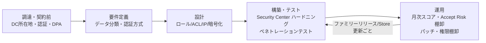
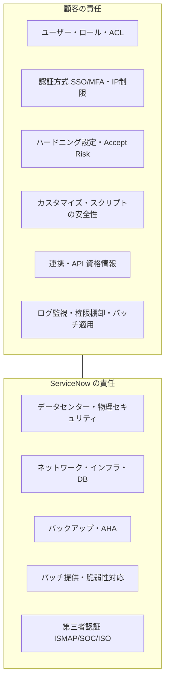
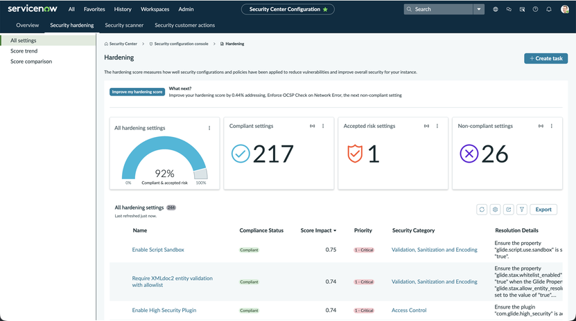
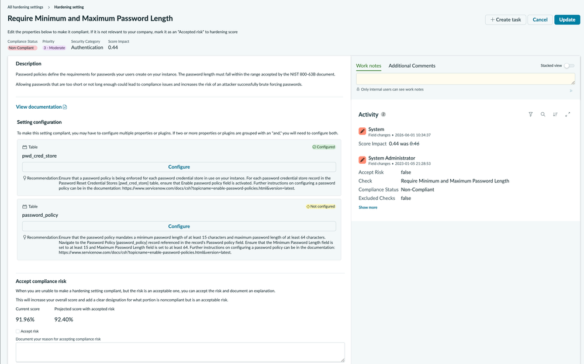
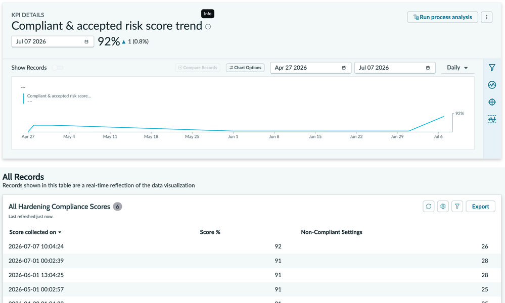

# セキュリティとコンプライアンス（Security and Compliance）

## 概要

ServiceNow 導入プロジェクトにおけるセキュリティとコンプライアンスの検討は、大きく次の 2 つに分かれる。

1. **ServiceNow 社（クラウド事業者）側の統制を確認する作業**：データセンターの所在地（データレジデンシー）、可用性・バックアップ、第三者認証（ISMAP、SOC 1/SOC 2、ISO/IEC 27001 系、FedRAMP 等）、個人データの取扱い契約（DPA、GDPR 対応）を、顧客企業のセキュリティ審査・調達基準と突き合わせる。
2. **顧客（契約者）側の統制を設計・実装する作業**：ServiceNow のインスタンスはマルチインスタンス型の SaaS であり、インフラは ServiceNow 社が運用するが、**ACL（アクセス制御）、認証方式、MFA、IP 制限、暗号化オプション、ハードニング設定は顧客の責任**である（責任共有モデル、Shared responsibility model）。ServiceNow は無償の **Security Center**（Store アプリ、Vancouver 以降は既定でインストール）で、ハードニング設定の準拠率（Hardening compliance score）を可視化する。

本ファイルは導入編として、セキュリティ審査票（チェックシート）への回答、調達要件の確認、設計・本番稼働前のハードニングで「何を、どこで確認し、どの値にするか」を具体的に示す。プラットフォームの暗号化機能・認証機能の仕様詳細はリファレンス編（[プラットフォームセキュリティと暗号化](../02_リファレンス/platform/platform-security-encryption.md)、[認証とSSO](../02_リファレンス/platform/authentication-sso.md)、[アクセス制御（ACL）](../02_リファレンス/platform/access-control-acl.md)）を、運用定着後の実践知は[セキュリティ強化の実践](../04_応用編/12-security-hardening-practice.md)を参照する。

> **情報取得上の注意（2026-11-03 時点）:** ServiceNow の Trust サイト（`servicenow.com/company/trust/...`）は本調査のツールから本文を直接取得できず（HTTP 403）、検索エンジンが返した同ページの抜粋に基づいて記述した箇所がある。該当箇所は本文中で明記する。認証の最新状況は、契約前に必ず Trust サイトと CORE Compliance Portal で確認すること。

---

## 1. 検討の全体像

ServiceNow 導入時のセキュリティ・コンプライアンス検討は、プロジェクトの各フェーズで次のように行う。

| フェーズ | 主な検討事項 | 主な成果物 | 関連ファイル |
|---|---|---|---|
| 調達・契約前 | データセンター所在地、第三者認証、DPA、可用性・バックアップ、サブプロセッサー | セキュリティ審査票の回答、クラウド利用申請 | 本ファイル §2〜§5 |
| 要件定義 | 個人情報・機密情報の分類、認証方式（SSO/MFA）、外部ユーザーの有無、暗号化要否、ログ保管 | 非機能要件（セキュリティ要件）定義書 | [要件定義と設計](06-requirements-design.md) |
| 設計 | ロール設計、ACL 設計、IP 制限、暗号化方式、非本番データのマスキング | セキュリティ設計書 | §6〜§7 |
| 構築・テスト | Security Center のハードニング準拠、ペネトレーションテスト（サブプロダクションのみ） | ハードニングチェック結果、診断報告書 | §7〜§8、[テストと本番稼働](11-testing-golive.md) |
| 運用 | 月次スコア確認、Accept Risk の棚卸、パッチ適用、ログ監視、管理者権限の棚卸 | セキュリティ運用手順書 | [運用とガバナンス](12-operations-governance.md) |

---

## 2. データセンターとデータレジデンシー（日本リージョン）

### 2.1 データセンターペアの考え方

ServiceNow のインスタンスは、同一地域内の 2 か所のデータセンター（Data center pair、データセンターペア）で冗長化される。ServiceNow 公式ドキュメントは、各データセンターは冗長化とフェイルオーバーのために別のデータセンターとペアになり、一方が Active、他方が Standby として指定されると説明している [出典](https://www.servicenow.com/docs/r/zS6yb8e~gR8BPjeviYdV9g/KufA2mI6WfAIsf2ymqoWdg)。

ServiceNow 社員によるコミュニティブログ（2023-12）は、ペアは地理的に離れた 2 拠点の active-active 構成で、本番データは非同期のデータベースレプリケーションで両拠点に保持されると説明している [出典](https://www.servicenow.com/community/platform-privacy-security-blog/data-backup-for-my-servicenow-instances/ba-p/2772922)。

> **注:** 公式ドキュメントの「Active / Standby」と公式ブログの「active-active」は表現が異なる。前者はインスタンス単位（ある時点で 1 拠点がプライマリ）、後者はデータセンター単位（両拠点がそれぞれ別インスタンスのプライマリを担う）の説明と読める【推定】。

### 2.2 日本のデータセンター（Tokyo / Osaka）

| 項目 | 内容 | 確度・出典 |
|---|---|---|
| 発表 | 2018-10-17、ServiceNow が NTT Communications と提携し、東京・大阪に 2 つのクラウドデータセンターを開設すると発表 | 公式（NTT Com プレスリリース）[出典](https://www.ntt.com/about-us/press-releases/news/article/2018/1017.html)、[@IT 記事](https://atmarkit.itmedia.co.jp/ait/articles/1810/19/news068.html) |
| サービス開始 | 2019 年春（2019 年上期完成予定と報道） | 報道 [出典](https://atmarkit.itmedia.co.jp/ait/articles/1810/19/news068.html) |
| ペア | Japan: **Tokyo と Osaka** | 【第三者情報】コミュニティ回答（2023-02）[出典](https://www.servicenow.com/community/developer-forum/is-there-a-way-to-know-the-detailed-addresses-of-service-now/m-p/2485416) |
| 正式な全拠点一覧 | ServiceNow が全データセンター（38 拠点以上とされる）の所在地一覧を公式に公開しているドキュメントは見つからない、とのコミュニティでの指摘あり | 【第三者情報】[出典](https://www.servicenow.com/community/architect-forum/looking-for-official-docs-mentioning-the-details-of-all-38/m-p/3304333) |

参考として、コミュニティ回答（2023-02 時点）が挙げるリージョン別ペアは次のとおりである【第三者情報】[出典](https://www.servicenow.com/community/developer-forum/is-there-a-way-to-know-the-detailed-addresses-of-service-now/m-p/2485416)。

| リージョン | ペア（都市） |
|---|---|
| US Commercial | Santa Clara, CA / Ashburn, VA；Sterling, VA / Phoenix, AZ |
| US Federal | Miami, FL / Culpeper, VA |
| Canada | Calgary, Brampton, Woodridge, Montreal, Barrie |
| Brazil | Campinas / Sao Paulo |
| UK | London (Slough) / Newport, Wales |
| European Union | Amsterdam / Dublin |
| Germany（ドイツ顧客限定） | Düsseldorf / Frankfurt |
| Switzerland | Geneva / Zurich |
| Australia | Melbourne / Sydney |
| **Japan** | **Tokyo / Osaka** |
| Asia | Singapore / South Korea |
| India | Bangalore / Mumbai |

### 2.3 データレジデンシーの実務上の確認ポイント

日本企業・官公庁が「データを国内に保持したい」という要件を持つ場合、次の点を契約前に ServiceNow（アカウントチーム）へ書面で確認する。

| # | 確認項目 | 説明 | 備考 |
|---|---|---|---|
| 1 | 本番・非本番インスタンスのホスティング先 | 本番・サブプロダクション（開発・テスト）とも Japan ペアに配置されるか | 契約（Order Form）でのデータセンターリージョン指定の有無を確認【経験則】 |
| 2 | バックアップの保管場所 | バックアップは同一データセンターペア内のディスクに保管され、オフサイト・第三者には送られない（ServiceNow 社員ブログ） | [出典](https://www.servicenow.com/community/platform-privacy-security-blog/data-backup-for-my-servicenow-instances/ba-p/2772922) |
| 3 | 生成 AI（Now Assist）利用時のデータ処理場所 | Now Assist はインスタンスのデータを **集中型の ServiceNow 環境（インスタンスと異なるデータセンターリージョンの場合がある）、さらに Microsoft Azure 等の第三者クラウド**に送る場合がある（公式・Australia） | [出典](https://www.servicenow.com/docs/r/XRgEFx7nPN6ciT_BBIvnbg/naFFc3uk~rCIpyPKBHkFZg)。詳細は §2.5 |
| 4 | サポート担当者による国外からのアクセス | サポート・運用要員がどこからアクセスするか | 公開情報では確認できず。DPA・Data Security Addendum とアカウントチームへの確認が必要 |
| 5 | サブプロセッサー | DPA の Clause 6 に基づくサブプロセッサー変更通知の仕組みがある（Privacy FAQ の検索抜粋） | [出典](https://www.servicenow.com/company/trust/privacy/faq.html) |
| 6 | 連携先・MID Server 経由のデータ | MID Server や IntegrationHub で外部 SaaS に送るデータは、ServiceNow のデータレジデンシーの対象外 | 設計で管理。[連携設計](09-integration-design.md) 参照【経験則】 |
| 7 | メール・通知 | 通知メールに個人情報を含めると、メール基盤側の所在地に依存する | 【経験則】 |

### 2.4 可用性とバックアップ（AHA）

ServiceNow 社員によるコミュニティブログ（2023-12-26）は、バックアップと可用性を次のように説明している [出典](https://www.servicenow.com/community/platform-privacy-security-blog/data-backup-for-my-servicenow-instances/ba-p/2772922)。

| 項目 | 内容 |
|---|---|
| 可用性アーキテクチャ | Advanced High Availability（AHA、高度な高可用性）。データセンターペア間で transfer（計画的切替）または failover（障害時切替）を行う |
| RTO / RPO | **RTO 2 時間 / RPO 1 時間**（AHA に基づく目標値）。年次の ISCP（クラウド DRP）テストではこれを上回る結果とされる |
| バックアップ頻度 | 週次フルバックアップ＋日次差分バックアップ |
| 保持期間 | 最低 14 日。28 日の延長保持はオプション購入 |
| 暗号化 | AES-256 |
| 保管場所 | 同一データセンターペア内のディスク（オフサイト・第三者送付なし） |

> **注意:** 上記はコミュニティブログの記載であり、契約上の SLA ではない。契約上の可用性 SLA・RTO/RPO は契約書（Subscription Service Guide 等）で確認する必要がある。アップグレード・クローン・インスタンス戦略については [インスタンス戦略と環境](07-instance-strategy.md) を参照。

### 2.5 Now Assist / AI Agents とデータの所在

公式ドキュメント「ServiceNow AI implementation」（Australia、2026-03-12 更新）は次のように記載している [出典](https://www.servicenow.com/docs/r/XRgEFx7nPN6ciT_BBIvnbg/naFFc3uk~rCIpyPKBHkFZg)。

- Now Assist は、インスタンスのデータを「別のデータセンターリージョンにある可能性のある集中型の ServiceNow 環境」、および「Microsoft Azure などの第三者クラウドプロバイダー」に送る場合がある。データ取扱いのポリシーは `KB0564067` を参照。
- **in-country SKU（国内限定 SKU）の顧客には、すべてのモデルプロバイダーが提供されるわけではない**。最新の提供状況は `KB1584492` を参照。
- FedRAMP、NSC DoD IL5、Australia IRAP-Protected のデータセンターでは一部機能が提供されない（`KB0743854`）。Regulated Markets で使えない AI 製品・スキルは `KB2593939` を参照。
- ServiceNow はアプリケーションの入力・出力・出力の編集を自社技術の改善に使う。**Now Assist Admin console の Settings ページからデータ共有をオプトアウトできる**。

日本リージョンの顧客が Now Assist を使う場合に LLM 推論がどのリージョンで実行されるかは、公開情報では確認できず。データレジデンシー要件がある場合は `KB1584492` とアカウントチームへの確認が必須である。Now Assist の機能仕様は [Now Assist と AI Agents](../02_リファレンス/platform/now-assist-ai-agents.md) を参照。

---

## 3. 第三者認証・監査報告（コンプライアンス）

### 3.1 主要な認証・証明の一覧

ServiceNow の Trust サイト（Compliance ページ）および関連発表に基づく主要な認証・証明は次のとおり。年は取得（初回）時期。

| 認証・報告 | 種類 | 取得時期・範囲 | 出典・確度 |
|---|---|---|---|
| **ISMAP**（政府情報システムのためのセキュリティ評価制度） | 日本政府のクラウドサービスリスト登録 | Now Platform（現 ServiceNow AI Platform）が **2022 年 3 月から** ISMAP クラウドサービスとして登録。2026-06-04 に Now Assist と AI Agents for ServiceNow が追加登録 | Compliance ページ検索抜粋 [出典](https://www.servicenow.com/company/trust/compliance.html)、[PR TIMES](https://prtimes.jp/main/html/rd/p/000000206.000029239.html) |
| **SOC 1 Type 2** | 財務報告に係る内部統制の保証報告（SSAE 18 / ISAE 3402 系） | 2011 年から維持 | Compliance ページ検索抜粋 [出典](https://www.servicenow.com/company/trust/compliance.html) |
| **SOC 2 Type 2** | セキュリティ等のトラストサービス規準に関する保証報告 | 年次（オーストラリア版ページでは 2013 年から）。報告対象期間は **10/1〜9/30**。期間の隙間は Bridge letter で補完 | [出典](https://www.servicenow.com/company/trust/compliance.html)、[AU 版](https://www.servicenow.com/au/company/trust/compliance.html) |
| **ISO/IEC 27001** | 情報セキュリティマネジメントシステム | 2012 年から | [出典](https://www.servicenow.com/company/trust/compliance.html) |
| **ISO/IEC 27017** | クラウドサービスの情報セキュリティ管理策 | 2018 年から（UK 版ページ） | [出典](https://www.servicenow.com/uk/company/trust/compliance.html) |
| **ISO/IEC 27018** | パブリッククラウドにおける PII 保護 | **ページにより 2016 年 / 2020 年と記載が不一致** | [UK 版](https://www.servicenow.com/uk/company/trust/compliance.html)、[グローバル版](https://www.servicenow.com/company/trust/compliance.html) |
| **ISO/IEC 27701** | プライバシー情報マネジメント | 取得済み（APEC PRP と同時に発表） | [出典](https://www.servicenow.com/company/media/press-room/servicenow-achieves-iso27701-and-apec-prp-certification.html) |
| **ISO/IEC 42001:2023** | AI マネジメントシステム | 取得済み（2026-06 のプレスリリースで言及） | [出典](https://prtimes.jp/main/html/rd/p/000000206.000029239.html) |
| **FedRAMP High** | 米国連邦政府クラウド認可 | Government Community Cloud（GCC）が FedRAMP High P-ATO を保有（2019-08 初回）。GCC は DoD IL4 も保有 | [出典](https://www.servicenow.com/company/trust/compliance.html)、[IL5 プレス](https://newsroom.servicenow.com/press-releases/details/2022/ServiceNow-Secures-U-S--Department-of-Defense-Impact-Level-5-Provisional-Authorization-03-30-2022-12-00-AM/default.aspx) |
| **DoD IL5** | 米国防総省 Impact Level 5 | National Security Cloud（NSC）が 2022-03 に IL5 PA を取得。NSC は Microsoft Azure Government 上で提供 | [プレス](https://newsroom.servicenow.com/press-releases/details/2022/ServiceNow-Secures-U-S--Department-of-Defense-Impact-Level-5-Provisional-Authorization-03-30-2022-12-00-AM/default.aspx)、[Carahsoft インフォグラフィック](https://static.carahsoft.com/concrete/files/4916/5661/0302/National_Security_Cloud_IL-5_Infographic_1.pdf) |
| **BSI C5**（ドイツ） | クラウドコンピューティング準拠基準 | 2020 年に C5 Attestation Report 取得 | Compliance ページ検索抜粋 [出典](https://www.servicenow.com/company/trust/compliance.html) |
| **IRAP**（オーストラリア） | 政府向け評価 | OFFICIAL / PROTECTED（IRAP-Protected データセンターあり） | [PR TIMES](https://prtimes.jp/main/html/rd/p/000000206.000029239.html)、[AI implementation](https://www.servicenow.com/docs/r/XRgEFx7nPN6ciT_BBIvnbg/naFFc3uk~rCIpyPKBHkFZg) |

> **注:** FISC 安全対策基準（日本の金融機関向け）について、ServiceNow 専用の対応リファレンス（AWS・Azure・Google Cloud のような公開資料）は公開情報では確認できず。金融機関案件では ServiceNow Japan・SIer に個別に照会する必要がある。PCI DSS、TISAX の認証状況も公開情報では確認できず。

### 3.2 FedRAMP / GCC / NSC の位置付け

FedRAMP High や DoD IL は**米国政府向けの専用環境（GCC、NSC）に対する認可**であり、日本の商用リージョン（Tokyo/Osaka）のインスタンスに直接適用されるものではない。日本企業の審査票で「FedRAMP 認証の有無」を問われた場合は、「ServiceNow は米国政府向け環境で FedRAMP High を保有するが、当社が利用する日本リージョンの商用インスタンスは対象外」と区別して回答する【経験則】。

なお、Now Assist の一部機能は FedRAMP、NSC DoD IL5、IRAP-Protected データセンターでは提供されない [出典](https://www.servicenow.com/docs/r/XRgEFx7nPN6ciT_BBIvnbg/naFFc3uk~rCIpyPKBHkFZg)。

### 3.3 監査報告書（SOC 2 レポート等）の入手方法

SOC 1/SOC 2 レポート、ISO 証明書、ペネトレーションテスト要約などの監査資料は、顧客が Now Support 経由で入手する。

| 手段 | 内容 | 出典 |
|---|---|---|
| CORE Compliance Portal | 最新の SOC 2 レポートは ServiceNow CORE Compliance portal で提供される。アクセス手順は `KB0564067` | [出典（2026-03 コミュニティ）](https://www.servicenow.com/community/app-governance-forum/need-the-latest-soc2-report-of-servicenow-to-submit-to-internal/m-p/3517954) |
| Now Support の Trust Center | support.servicenow.com 上部メニューの Trust Center → CORE Compliance Portal | [出典](https://www.servicenow.com/community/denmark-snug/link-to-download-compliance-documentation-for-servicenow/m-p/2435572) |
| 権限 | カテゴリーが表示されない場合はユーザー権限が不足している可能性がある。アカウントチーム経由の依頼も可 | 同上【第三者情報】 |

実務上は、**契約前（Now Support アカウント発行前）の審査では、アカウントチームに NDA を締結のうえで SOC 2 レポートを依頼する**のが一般的である【経験則】。

### 3.4 ISMAP の基礎知識（官公庁・自治体案件向け）

| 項目 | 内容 | 出典 |
|---|---|---|
| 制度 | ISMAP（Information system Security Management and Assessment Program、イスマップ）は、政府が求めるセキュリティ要求を満たすクラウドサービスを事前に評価・登録する制度。2020-06 運用開始。政府機関は原則として登録サービスから調達する | [PR TIMES](https://prtimes.jp/main/html/rd/p/000000206.000029239.html) |
| ISMAP-LIU | リスクの小さな業務・情報を扱う SaaS 向けの簡易版。2022-11-01 運用開始 | 【第三者情報】[PwC](https://www.pwc.com/jp/ja/knowledge/prmagazine/pwcs-view/202303/43-02.html) |
| 制度改定 | 2023-10 に外部監査の負荷軽減等の改定 | 【第三者情報】[KPMG](https://kpmg.com/jp/ja/insights/2024/05/ismap-revision-overview.html) |
| ServiceNow の登録 | ServiceNow AI Platform（2022-03〜）、Now Assist・AI Agents for ServiceNow（2026-06 追加） | §3.1 |

**ISMAP 案件での実務上の注意:**

- ISMAP の登録対象は「クラウドサービス名」単位である。利用予定の製品・機能（例：Now Assist の特定スキル、Store アプリ、Workflow Data Fabric の外部接続など）が登録範囲に含まれるか、ISMAP ポータルのクラウドサービスリストで**登録番号・登録範囲・有効期限**を確認する。本調査ではポータル（JavaScript 描画）から ServiceNow の登録番号・有効期限を取得できなかった（公開情報では確認できず）。
- ISMAP 登録は「クラウドサービス事業者の統制」を保証するものであり、**利用者側の設定（ACL、MFA、ログ監視）は政府機関側の責任**として残る（責任共有モデル、§5）。
- 2026-06 の AI 追加登録により、問い合わせ対応・文書起案・申請処理（Now Assist）や承認ワークフロー（AI Agents）が機密性の高い業務でも利用しやすくなったと発表されている [出典](https://prtimes.jp/main/html/rd/p/000000206.000029239.html)。

---

## 4. GDPR・個人情報保護

### 4.1 契約上の枠組み（DPA）

ServiceNow の Privacy FAQ（検索抜粋）によれば、個人データの取扱いは次の契約文書で定められる [出典](https://www.servicenow.com/company/trust/privacy/faq.html)。

| 文書 | 内容 |
|---|---|
| Data Processing Addendum（DPA、データ処理補遺） | グローバル共通の標準 DPA。ServiceNow は**顧客の指示に基づいてのみ**、サービス提供のために個人データを処理する（ServiceNow = Processor、顧客 = Controller） |
| Data Security Addendum（データセキュリティ補遺） | ServiceNow が実施するセキュリティ対策を規定 |
| サブプロセッサー通知 | DPA の Clause 6 にサブプロセッサー変更の通知メカニズム |

### 4.2 国外移転の仕組み

| 移転元 | 根拠 | 出典 |
|---|---|---|
| EU（GDPR） | EU の十分性認定（adequacy decisions）、EU 標準契約条項（SCC） | [Privacy FAQ](https://www.servicenow.com/company/trust/privacy/faq.html)、[Trust FAQ](https://www.servicenow.com/company/trust/faq.html) |
| 英国 | UK International Data Transfer Addendum | [Privacy FAQ](https://www.servicenow.com/company/trust/privacy/faq.html) |
| スイス | スイス向けの移転条項 | 同上 |

> 第三者サイトには ServiceNow の DPA が Processor 向け Binding Corporate Rules（BCR）を含むとの記載もあるが、ServiceNow 公式ページでは確認できず。

日本の個人情報保護法（APPI）の越境移転規制（第 28 条）に関する ServiceNow 公式の説明は公開情報では確認できず。日本リージョンを利用していても、サポートアクセスや Now Assist の処理場所（§2.5）によって外国にある第三者への提供・委託に該当しうるため、法務部門と DPA の内容を確認する【経験則】。

### 4.3 プラットフォーム側の個人情報保護機能

GDPR 等の要求（データ最小化、非本番環境での匿名化、消去要求）に対応するためのプラットフォーム機能は次のとおり。

| 機能 | 概要 | 出典 |
|---|---|---|
| Data Privacy（Store アプリ `sn_dp_store_app`） | 機密データを分類し、本番環境からの PII 除去、**非本番インスタンスのデータ匿名化**（ランダム値・管理者定義値）を行う。Right To Be Forgotten（RTBF、忘れられる権利）要求に関連する PII の匿名化にも対応。サブプロダクションで 30 日の無償トライアル後はサブスクリプションが必要 | [出典](https://www.servicenow.com/docs/r/platform-security/data-privacy.html) |
| Data Privacy の制約 | ジャーナル（コメント・作業メモ）、添付ファイル、ログ等の非構造化データ内の PII は匿名化されない。`sys_user` の匿名化は恒久性が保証されず、SSO 連携で再同期される場合がある | 同上 |
| Data Discovery | 別 Store アプリ。機密データの検出 | 同上 |
| 暗号化（Column Level Encryption / Field Encryption 等） | フィールド・添付の暗号化。Enterprise 版は有償で Key Management Framework（KMF、FIPS 140-2 Level 3 HSM）を利用。**Zurich から CLE/CLEE は将来の廃止に向けた準備段階** | [出典](https://www.servicenow.com/docs/r/oJu9n0q6rU~F9UHAnNCt5w/xCLd3n6FPwSbXqd5X0UaeQ)。詳細は [プラットフォームセキュリティと暗号化](../02_リファレンス/platform/platform-security-encryption.md) |

> **Brazil での変更:** 暗号化領域では Australia→Brazil 間で廃止・名称変更はなく、Edge Encryption プロキシが Java 21 以降に対応した（Java 17.0.3 以降の 17.x も引き続きサポート）。外部 KMS 連携プラグイン `com.glide.encryption.external_kms` は別サブスクリプションが必要（Australia と同じ）。Australia では Field Encryption Enterprise の管理画面刷新と External Key Management Service（EKMS）連携が追加された [出典](https://www.servicenow.com/docs/r/delta-australia-brazil/brazil-australia-encryption-release-notes.html)。

---

## 5. 責任共有モデル（Shared Responsibility Model）

### 5.1 ServiceNow と顧客の責任分界

ServiceNow 社員のコミュニティ記事（2018-02、"Cloud security is a shared responsibility"）は、セキュリティは ServiceNow と顧客の共有責任であるとし、次のように分担を説明している [出典](https://www.servicenow.com/community/in-other-news/cloud-security-is-a-shared-responsibility/ba-p/2279299)。記事は 2018 年のものであるため、リリース名等は現行に読み替える。

| 領域 | ServiceNow の責任 | 顧客の責任 |
|---|---|---|
| 物理・インフラ | データセンター、ネットワーク、ハードウェア、OS、DB の運用・冗長化・バックアップ | — |
| プラットフォームのパッチ | パッチプログラムによるパッチの提供・スケジューリング。サポートは現行（N）と直前（N-1）リリースのみで、古いバージョンは強制アップグレード対象 | パッチを**可能な限り早く適用**する。アップグレード計画 → [アップグレード管理](13-upgrade-management.md) |
| 脆弱性診断 | 社内の機能ペネトレーションテストと第三者ペネトレーションテストの実施 | **年 1 回のアプリケーションレベルのペネトレーションテストをサブプロダクションで実施**（§8） |
| セキュリティ設定 | ハードニング推奨値・Security Center の提供 | 保存データ暗号化オプション、ロールベースアクセス制御（ACL）、認証方式の設定。Instance Hardening Guide に従い、セキュリティダッシュボード（現 Security Center）で進捗を追跡 |
| 連絡体制 | 重大なセキュリティ情報を顧客の指定セキュリティ連絡先に通知 | **Now Support にセキュリティ連絡先（Security contact）を登録・維持** |
| 監視 | プラットフォームの監視 | インスタンスの定期監視、システムログのレビュー、admin アカウントの制限 |

### 5.2 責任共有モデルを軽視した事例：ACL 設定不備

2023 年、SaaS セキュリティベンダー AppOmni は、検査した ServiceNow インスタンスの約 70% で、**顧客が管理する ACL の設定不備と guest（未認証）ユーザーへの過剰な権限付与**により、未認証ユーザーがデータを抽出できる状態だったと報告した【第三者情報】[出典](https://appomni.com/blog/appomni-discovers-security-misconfiguration-impacting-servicenow/)。

ServiceNow はこれに対し `KB1553688`（Potential Public List Widget Misconfiguration）でガイダンスを公開した。コミュニティで引用された内容は次のとおり【第三者情報】[出典](https://www.servicenow.com/community/developer-forum/regarding-quot-potential-public-list-widget-misconfiguration/m-p/2718223)。

- ロール指定が空の ACL、または `public` ロールを含む ACL を見直す
- Public フラグが付いた Service Portal ウィジェット（Simple List 等）を見直し、不要なら Public = false にする
- IP Address Access Control または Adaptive Authentication で接続元を制限する
- Explicit Roles プラグインの導入を検討する（§7.5）

これは「プラットフォーム自体の脆弱性ではなく、顧客側の設定責任の範囲で起きる事故」の典型であり、導入プロジェクトでは**ポータル公開範囲と ACL の設計レビューを必須工程**にすべきである【経験則】。Australia の Security Center v3.3 では Access Findings（空 ACL、テーブル ACL、クライアント呼び出し可能な Script Include の ACL 等を 24 時間ごとにチェック）が追加された（§7.4）。

---

## 6. 導入プロジェクトで決めるべきセキュリティ要件

要件定義・設計フェーズで、少なくとも次の項目を決定・文書化する。

| # | 要件項目 | 決定内容の例 | 関連機能・参照 |
|---|---|---|---|
| 1 | データ分類 | 取り扱う情報（個人情報、人事情報、機密案件）とテーブル・フィールドの対応 | Data Privacy / Data Discovery |
| 2 | 認証方式 | 社員は SSO（SAML/OIDC）、ローカルログインは break-glass 管理者のみ | [認証とSSO](../02_リファレンス/platform/authentication-sso.md) |
| 3 | MFA | SSO 側（IdP）で MFA を強制。ローカル／LDAP ログインは ServiceNow の MFA（Yokohama 以降は既定で強制、§7.6） | MFA enforcement |
| 4 | 接続元制限 | 社内 VPN・プロキシ・連携先の IP のみ許可するか | `ip_access`、Adaptive authentication（§7.7） |
| 5 | 外部ユーザー | 顧客・取引先がポータルを使うか（B2B/B2C） | Explicit Roles（`snc_external`） |
| 6 | ロール設計 | `admin` 保有者の最小化、委任管理ロール | [ユーザー・グループ・ロール](../02_リファレンス/platform/users-groups-roles.md) |
| 7 | 暗号化 | 保存データ（Cloud Encryption）・フィールド暗号化の要否、鍵管理（KMF/BYOK） | [プラットフォームセキュリティと暗号化](../02_リファレンス/platform/platform-security-encryption.md) |
| 8 | 非本番データ | クローン後のマスキング・匿名化方針 | Data Privacy、[インスタンス戦略](07-instance-strategy.md) |
| 9 | ログ・監査 | 監査ログ（`sys_audit`）の対象、保管期間、SIEM 連携 | [システム管理](../02_リファレンス/platform/system-administration.md) |
| 10 | 連携の資格情報 | 連携ユーザー（Web service access only）、OAuth、資格情報の保管 | [連携設計](09-integration-design.md) |
| 11 | 生成 AI | Now Assist のデータ処理場所、データ共有オプトアウト、ガードレール | §2.5、[Now Assist と AI Agents](../02_リファレンス/platform/now-assist-ai-agents.md) |
| 12 | 脆弱性診断 | ペネトレーションテストの時期・範囲・実施者 | §8 |
| 13 | ハードニング目標 | 本番稼働時の Security Center スコア目標（例：非準拠の Critical/High ゼロ） | §7 |

---

## 7. セキュリティハードニング（Security Center）

### 7.1 Security Center と Instance Security Center（ISC）

| 項目 | ServiceNow Security Center（SSC、`sn_vsc`） | Instance Security Center（ISC、旧） |
|---|---|---|
| 提供形態 | ServiceNow Store の**無償**アプリ。**Vancouver 以降は既定でインストール**。ファミリーリリースの間に**四半期ごとに新バージョンを Store で公開** | プラットフォーム機能 |
| 状態 | 現行・推奨 | **2024-09 に販売終了、サポート終了・新規有効化不可**。SSC への移行が推奨 |
| メニュー | All > **Security Center**（Next Experience のワークスペース型 UI） | System Security > Instance Security Center |
| 出典 | [出典](https://www.servicenow.com/docs/r/platform-security/security-center/sec-center-v2.html) | [出典](https://www.servicenow.com/docs/r/oJu9n0q6rU~F9UHAnNCt5w/KgGK56BHwEvJShUSKPrivg) |

Security Center（Brazil 版ドキュメント）の構成要素は次のとおり [出典](https://www.servicenow.com/docs/r/platform-security/security-center/sec-center-v2.html)。

| 画面・機能 | 内容 |
|---|---|
| Security Center landing page | 全体の入口 |
| Security configuration console（セキュリティ構成コンソール） | ハードニング準拠スコア、スコア推移、優先度の高い非準拠設定、セキュリティスキャン結果 |
| Security monitoring console（セキュリティ監視コンソール） | セキュリティ通知と、潜在的リスクに関するメトリクス（50 以上の指標） |
| Security posture console（セキュリティポスチャーコンソール） | 脅威の特定・対応・復旧をステップごとに支援 |
| Security Tasks | セキュリティタスクの監視・優先度付け・割り当て（Zurich で導入） |
| Security learning | 学習コンテンツの集約 |
| Security banner announcements | 緊急・重大なセキュリティ問題を管理者 UI にバナー表示 |
| Identity and Access Management | IAM ツールとメトリクス（Access Controls console / Access Findings） |

### 7.2 Security Center のロール

| ロール | 権限 | 出典 |
|---|---|---|
| `admin` | すべての機能。より限定的なロールがある場合は使用を避けることが推奨 | [出典](https://www.servicenow.com/docs/r/oJu9n0q6rU~F9UHAnNCt5w/KgGK56BHwEvJShUSKPrivg) |
| `sn_vsc.security_center_admin` | Security Center Admin。**フル admin なしで** Security Center の構成・アクセス制御を管理（Security Center 3.2 以降、Zurich/Australia リリースノートに記載） | [出典](https://www.servicenow.com/docs/r/delta-zurich-brazil/brazil-zurich-securitycenter-release-notes.html) |
| `sn_vsc.security_center_viewer` | 参照のみ | [出典](https://www.servicenow.com/docs/r/oJu9n0q6rU~F9UHAnNCt5w/KgGK56BHwEvJShUSKPrivg) |

> 旧 ISC のドキュメントでは閲覧ロールとして `security_dashboard_user` という名称も記載されている。ロール名はインスタンス上で確認すること。

### 7.3 ハードニング準拠スコア（Hardening compliance score）の仕組み

Security Center の Security hardening（Australia）は、インスタンスの設定が推奨値にどれだけ合致しているかを百分率で示す [出典](https://www.servicenow.com/docs/r/australia/platform-security/security-center/sc-hardening.html)。

| 項目 | 内容 |
|---|---|
| 計算式（Australia） | **(準拠した設定のリスクスコア合計 ＋ Accept Risk した設定のリスクスコア合計) ÷ 全設定のリスクスコア合計 × 100**。例：25.4 ÷ 34.9 × 100 = 72.7 → 切り上げて 73 |
| リスクスコア | 各設定に 0〜10 のリスクスコア（CVSS ベース） |
| 再計算タイミング | **毎月 1 日に自動**、Security Center のインストール／再インストール後、および画面の **Update score** ボタンで随時 |
| サブページ | All settings（全設定一覧）、Hardening compliance score trend（スコア推移、チャート／表）、Hardening score comparison（2 時点の比較） |

各ハードニング設定は次の属性を持つ（Yokohama 版ドキュメント）[出典](https://www.servicenow.com/docs/r/GypxAX2jEErwkCxugICKdg/OfMvliRNXdqq_yXNnyJR8Q)。

| 属性 | 説明 |
|---|---|
| Overview | 推奨の概要 |
| Configuration name | プロパティ名またはプラグイン名 |
| Configuration type | Security Center 以外で変更する場所（例：System Properties） |
| Data type | boolean / installation / plugin / string 等 |
| Recommended value | 推奨値 |
| Default value | ベースシステムの既定値 |
| Category | セキュリティカテゴリー |
| Security risk | CVSS ベースのスコア（0.0〜10.0）、重大度（None / Low / Medium / High / Critical）、推奨値を使わない場合のリスク |
| Dependencies and prerequisites | 前提・同時に必要な設定 |
| Functional impact | 運用への影響 |
| References | 設定手順のドキュメント |

ハードニング設定のカテゴリーは次の 14 種である [出典](https://www.servicenow.com/docs/r/zurich/platform-security/instance-security-hardening-settings/security-hardening-settings.html)：Access control、API and web service、Architecture, design, and threat modeling、Authentication、Business Logic、Communications、Configuration、Data protection、Error handling and logging、File and resources、Malicious code、Session management、Stored cryptography、Validation, sanitization, and encoding。

*図 1: Security Center > Security configuration console > Hardening の All settings 画面（Australia 世代）*

画面の説明：上部ナビゲーションは「Security Center Configuration」ワークスペースで、タブは Overview / **Security hardening** / Security scanner / Security customer actions。左ペインに All settings、Score trend、Score comparison。本文上部に「Improve my hardening score」ボタンと、次に対処すべき非準拠設定（例：Enforce OCSP Check on Network Error、改善幅 0.44%）の提案。ウィジェットは「All hardening settings」（ゲージ 92%、Compliant & accepted risk）、「Compliant settings」217、「Accepted risk settings」1、「Non-compliant settings」26。下部の一覧「All hardening settings（244 件）」の列は Name / Compliance Status / Score Impact / Priority / Security Category / Resolution Details で、例として Enable Script Sandbox（`glide.script.use.sandbox` = true）、Require XMLdoc2 entity validation with allowlist（`glide.stax.whitelist_enabled`）、**Enable High Security Plugin（`com.glide.high_security`）** が 1 - Critical として並ぶ。右上に「Create task」「Export」。
出典：ServiceNow Community「Your hardening score isn't just a number」（2026-07-15、ServiceNow 社員投稿）https://www.servicenow.com/community/security-on-now-blog/your-hardening-score-isn-t-just-a-number-here-s-what-it-s/ba-p/3574268 （取得日：2026-11-03）

### 7.4 Accept Risk（リスク受容）— Australia の新機能

Australia で、適用できないハードニング設定についてリスクを正式に受容する **Accept risk for hardening settings** が追加された。受容には**理由（Justification）の記入が必須**で、保存前にスコアへの影響（予測スコア）が表示される。受容した設定はスコア計算上「準拠」と同等に扱われる [出典](https://www.servicenow.com/docs/r/delta-zurich-brazil/brazil-zurich-securitycenter-release-notes.html)、[出典](https://www.servicenow.com/community/security-on-now-blog/your-hardening-score-isn-t-just-a-number-here-s-what-it-s/ba-p/3574268)。

同じく Australia で **Version-Based Hardening Settings**（インスタンスのファミリーバージョンに該当する設定のみ表示）が追加された。ServiceNow 社員の解説（2026-07-17）では、これらは **Security Center v3.3** の機能として紹介され、Access Management Console に **Access Findings**（24 時間ごとのアクセスチェック）が追加されたとされる [出典](https://www.servicenow.com/community/platform-privacy-security-blog/what-s-new-for-security-center-in-australia/ba-p/3575152)。Access Findings のチェック項目は次のとおり。

- ロールを持つ非アクティブユーザー
- 休眠ユーザーアカウント
- UI Page のアクセス制御
- 分類済みデータにアクセスできる外部ユーザー
- テーブルのアクセス制御
- グループを介さない直接ロール付与
- クライアント呼び出し可能な Script Include のアクセス制御
- 空の ACL

> **Brazil での変更:** Security Center について Brazil 固有の新機能はない（リリースノート上 "No new features"）。Security Center は Store アプリとしてファミリーリリースの間に更新される [出典](https://www.servicenow.com/docs/r/delta-zurich-brazil/brazil-zurich-securitycenter-release-notes.html)。

*図 2: Hardening setting の詳細画面（例：Require Minimum and Maximum Password Length）*

画面の説明：パンくずは All hardening settings > Hardening setting。ヘッダーに Compliance Status（Non-Compliant）、Priority（3 - Moderate）、Security Category（Authentication）、Score Impact（0.44）。右上に「Create task」「Cancel」「Update」。左側の Description に、パスワード長は NIST 800-63B の範囲内にすべきという説明。「Setting configuration」に構成対象が並び、`pwd_cred_store` テーブル（Configured、各 Password credential store で Enable password policy を有効化）と `password_policy` テーブル（Not configured、最小 15 文字・最大 64 文字以上）にそれぞれ「Configure」ボタンがある。下部の「Accept compliance risk」セクションに、Current score 91.96% と Projected score with accepted risk 92.40%、「Accept risk」チェックボックスと理由入力欄。右側は Work notes / Additional Comments と Activity（Accept Risk、Compliance Status、Excluded Checks 等のフィールド変更履歴）。
出典：ServiceNow Community「Your hardening score isn't just a number」https://www.servicenow.com/community/security-on-now-blog/your-hardening-score-isn-t-just-a-number-here-s-what-it-s/ba-p/3574268 （取得日：2026-11-03）

*図 3: Compliant & accepted risk score trend（ハードニング準拠スコアの推移）*

画面の説明：KPI DETAILS の「Compliant & accepted risk score trend」で、対象日（例：Jul 07 2026）のスコア 92%（前回比 +1）。期間（Apr 27 2026〜Jul 07 2026）と粒度（Daily）を指定でき、折れ線グラフでスコア推移を表示。右上に「Run process analysis」。下部の「All Hardening Compliance Scores」表は Score collected on / Score % / Non-Compliant Settings の列で、毎月 1 日の自動計算と随時計算の履歴（例：2026-07-01 91% / 非準拠 28 件、2026-07-07 92% / 26 件）が並ぶ。
出典：ServiceNow Community「Your hardening score isn't just a number」https://www.servicenow.com/community/security-on-now-blog/your-hardening-score-isn-t-just-a-number-here-s-what-it-s/ba-p/3574268 （取得日：2026-11-03）

### 7.5 主要なハードニング設定（Security Center baseline 4.0 ほか）

Security Center baseline version 4.0 で更新されたハードニング設定のうち、プロパティと推奨値が明示されているものは次のとおり（Xanadu 版ドキュメント）[出典](https://www.servicenow.com/docs/r/8yND1KuvF7tjP~F577YThQ/q3VTM7zM2iuKKhfPNPM3Hg)。

| プロパティ | 推奨値 | 目的 |
|---|---|---|
| `glide.security.use_csrf_token` | `true` | 書き込み要求に CSRF トークン（セッションに紐づく）を要求 |
| `glide.security.csrf.strict.validation.mode` | `true` | 被害者の別セッションから漏えいしたトークンの再利用を防止 |
| `glide.basicauth.required.soap` | `true`（または `glide.soap.require_ws_security` = true と WS Security Profile） | SOAP の認証必須化 |
| `glide.basicauth.required.wsdl` | `true` | WSDL 取得の認証必須化 |
| `glide.ui.escape_all_script` | `true` | スクリプトのエスケープ（XSS 対策） |
| `glide.ui.escape_html_list_field` | `true` | リストの HTML フィールドのエスケープ |
| `com.glide.cs.html.sanitizer.enabled` | `true` | HTML サニタイザー |
| `glide.security.explicit_roles.enable_internal_user_blacklist` | `true` | Explicit Roles の内部ユーザー除外リストを有効化 |
| `com.glide.snap.infected_download_allowed` | `false` | ウイルス検出された添付のダウンロード禁止 |
| `glide.attachment.enforce_security_validation` | `true` | 添付ファイルのセキュリティ検証 |
| `glide.ip.authenticate.strict` | `true` | ServiceNow 内部 IP の許可範囲を厳格化 |
| `glide.db.loguser` | `false` | — |
| `glide.cms.catalog_uri_relative` | `true` | オープンリダイレクト対策 |
| `glide.xmlutil.max_entity_expansion` | `3000` 以下 | XML エンティティ展開攻撃対策 |
| `glide.stax.allow_entity_resolution` | `false`（カスタマイズで不要な場合） | XXE 対策 |
| `glide.sg.clear_pasteboard_when_backgrounded` | `true` | モバイルのクリップボード消去 |
| `glide.active.session.timeout.invalidate.session` | `true` | タイムアウト時にセッションを無効化 |
| `glide.authenticate.session_access.log_audit_event` | `true` | セッションアクセスの監査イベント記録 |
| `glide.authenticate.multisso.debug` | `false` | 本番での SSO デバッグ無効化 |

値の明示がない更新項目として、`glide.ip.authenticate.allow.secured`（信頼できる IP 範囲のみ）、`glide.ui.attachment.force_download_all_mime_types`（`text/html`、`image/svg+xml`、`application/xml` 等の危険な MIME タイプを強制ダウンロード）、`sn_ext_usr_reg.allowed_email_domains`（外部ユーザー登録の許可ドメイン）、`glide.http.response.get_body.limit.enabled` / `glide.http.response.get_body.limit`、`glide.record.legacy_cross_scope_access_policy_in_script`（`true` は非安全）がある [出典](https://www.servicenow.com/docs/r/8yND1KuvF7tjP~F577YThQ/q3VTM7zM2iuKKhfPNPM3Hg)。

Anti-CSRF については、`glide.security.use_csrf_token` の関連として `glide.security.csrf_previous.time_limit`、`glide.security.csrf_previous.allow` も確認対象になる [出典](https://www.servicenow.com/docs/r/platform-security/instance-security-hardening-settings/anti-csrf-token.html)。

図 1 の画面からは、Critical 優先度の設定として `glide.script.use.sandbox`（Enable Script Sandbox）、`glide.stax.whitelist_enabled`、`com.glide.high_security`（High Security Plugin）も確認できる。

> **実務上の注意【経験則】:** プロパティ変更は全ユーザー・全連携に影響する。特に `glide.basicauth.required.*`、`glide.ip.authenticate.strict`、CSRF 関連、添付の強制ダウンロードは、既存の連携・カスタム UI を壊すことがあるため、サブプロダクションで ATF・連携テストを実施してから本番に適用する。Security Center の各設定画面にある **Functional impact** を必ず読む。

### 7.6 MFA 強制（Yokohama 以降）

Yokohama 以降にアップグレードしたインスタンスでは、**ローカル（ユーザー名＋パスワード）および LDAP ログインに対して MFA が既定で強制**される。SSO（SAML、OIDC、証明書認証）ログインには既定の安全な MFA ポリシーでは MFA を要求しない（IdP 側で MFA を強制できない場合は ServiceNow 側 MFA を SSO にも有効化可能）[出典](https://www.servicenow.com/docs/r/zurich/platform-security/authentication/mfa-enforcement-scope.html)。

MFA 強制のタイムライン（Australia 版ドキュメント）[出典](https://www.servicenow.com/docs/r/oL66E_cwDD_tnWQYzYPRdA/4g2XUcwwnfQ03SQ6bdDn5A)：

| 項目 | プロパティ | 既定値・上限 |
|---|---|---|
| 自己登録期間（初回ログイン成功後に MFA を登録できる猶予） | `glide.authenticate.multifactor.self_enrolment_period` | 既定 30 日、上限 90 日（それ以上は 90 扱い）。0 は初回ログイン時に即登録 |
| アップグレード後の猶予期間（この期間を過ぎると内部ユーザーは初回ログインから MFA 必須） | `glide.authenticate.multifactor.enforcement.max_relaxation_period` | 上限 270 日 |
| エンドユーザー向けメッセージ | `glide.authenticate.multifactor.enforcement.show_user_info_message` | `false` で非表示 |
| 管理者向けメッセージ | `glide.authenticate.multifactor.enforcement.acknowledged` | `true` にするまで表示 |

対象と除外：

| 対象 | 扱い |
|---|---|
| 内部ユーザー（`snc_external` を持たない）のローカル／LDAP ログイン | 強制対象（Web とモバイルアプリの両方） |
| `snc_external` ロールのユーザー | 既定ポリシーでは除外 |
| SSO ログインの非 admin ユーザー | 登録メッセージは表示されない |
| 既に Adaptive authentication の MFA context ポリシーが有効なインスタンス | 新しい既定ポリシーは適用されない |
| API 連携 | `glide.authenticate.multifactor.for_integrations` = `true` の場合のみ、かつ MFA 登録済みユーザーに限り強制 |
| OAuth ROPC（Resource Owner Password Credentials） | MFA なしで動作。Authorization code grant は同意前に MFA が必要 |
| RPA ボット（対話型ログイン） | MFA が必要。MFA Exempted User Group に入れて除外可能 |

**導入プロジェクトでの論点【経験則】:** 連携用アカウント（ローカル認証の Basic 認証）や break-glass 管理者アカウントの MFA 扱いを、本番稼働前に必ず設計する。連携ユーザーは「Web service access only」とし、OAuth 化を検討する。

### 7.7 IP アドレス制限

| 項目 | 内容 | 出典 |
|---|---|---|
| テーブル | IP Address Access Control（`ip_access`） | [出典](https://www.servicenow.com/docs/r/1nuU0tTksWZZbL8T4WKSDg/LkDTmsCeGLq4TZLZd4YQbg) |
| プラグイン | `com.snc.ipauthenticator` | 同上 |
| 判定ロジック | **一致する Deny ルールがあり、かつ一致する Allow ルールがない場合のみ**ブロック。既定では制限なし | 同上 |
| 典型パターン | Deny 0.0.0.0〜255.255.255.255 を登録し、社内プロキシ・VPN・連携先の IP 範囲を Allow で登録 | 同上 |
| 制約 | 自分のパブリック IP を拒否するルールは作成できない。ServiceNow 内部 IP はブロックされない（`glide.ip.authenticate.strict` で内部許可範囲を縮小）。アップデートセット転送にも影響する | 同上 |

条件付きの制御（ロールや IP に応じて MFA を要求する等）は Adaptive authentication のポリシーで行う。詳細は [認証とSSO](../02_リファレンス/platform/authentication-sso.md) を参照。

### 7.8 Explicit Roles（外部ユーザーの分離）

顧客・取引先がポータルにログインする構成（CSM、外部ユーザー登録）では、Explicit Roles プラグイン（`com.glide.explicit_roles`）の導入を検討する [出典](https://www.servicenow.com/docs/r/washingtondc/platform-security/explicit-role-plugin.html?contentId=Kz6Y3SzGSHaxI6jT5cO5rA)。

| 項目 | 内容 |
|---|---|
| 付与されるロール | `snc_internal`（全内部ユーザー。新規ユーザーには初回ログイン／なりすまし時に付与）、`snc_external`（外部ユーザー。ACL で明示的に許可しない限りリソースにアクセス不可） |
| 排他 | Paris 以降、1 ユーザーが両ロールを同時に持つことはできない |
| 既存データ | インストール時点の `sys_user` の全ユーザーを内部ユーザーとみなし、Fix script で `snc_internal` を付与。ロール指定のない ACL にも `snc_internal` を付与 |
| 除外プロパティ | `glide.security.explicit_roles.internal_user_blacklist`（特定のユーザー種別を `snc_internal` 対象外にする） |
| 前提 | Contextual Security Manager プラグインが必要 |
| 注意 | 保守時間帯（ログインユーザーが少ない時間）に有効化する。Explicit Roles の有無が異なるインスタンス間でシステムのアップデートセットを移送しない |

**導入タイミングの判断【経験則】:** 既存 ACL への一括影響があるため、プロジェクト初期（開発インスタンス構築直後）に全インスタンスで有効化するのが最も安全である。本番稼働後の追加導入は影響調査のコストが大きい。

### 7.9 本番稼働前のハードニングチェックリスト

導入プロジェクトで本番稼働判定（Go/No-Go）に含めるべき項目の例。

| # | チェック項目 | 確認方法 |
|---|---|---|
| 1 | Security Center を Store の最新版に更新済み | System Applications > All Available Applications、または Store |
| 2 | ハードニングスコアを Update score で再計算し、Priority 1 - Critical / 2 - High の非準拠がゼロ、または Accept Risk の理由が承認済み | Security Center > Security configuration console > Hardening |
| 3 | Accept Risk の一覧と理由をセキュリティ責任者が承認 | All settings を Compliance Status でフィルター |
| 4 | Security scanner の検出結果を確認・対処 | Security configuration console |
| 5 | 空 ACL・`public` ロール ACL・Public ウィジェットを棚卸し | Access Findings、ACL 一覧 |
| 6 | `admin` ロール保有者を最小化。break-glass 管理者の管理手順あり | `sys_user_has_role` |
| 7 | MFA の適用範囲（ローカル／LDAP／SSO／連携）を確認 | MFA ポリシー、プロパティ |
| 8 | IP 制限（必要な場合）を本番に適用し、連携・MID Server の疎通を確認 | `ip_access` |
| 9 | 連携ユーザーは Web service access only、資格情報は Credential レコードで保管 | `sys_user`、`discovery_credentials` 等 |
| 10 | Now Support に Security contact を登録 | Now Support |
| 11 | サブプロダクションでペネトレーションテスト実施済み、指摘対処済み | §8 |
| 12 | 非本番インスタンスのデータ匿名化方針がクローン手順に組み込まれている | Data Privacy、クローン後スクリプト |
| 13 | Now Assist のデータ共有オプトアウト要否を判断済み | Now Assist Admin console > Settings |

---

## 8. 脆弱性診断（ペネトレーションテスト）

ServiceNow インスタンスへの顧客によるペネトレーションテストは、**Customer Penetration Test Policy（`KB0538598`）**に従い、**サブプロダクションインスタンスに対してのみ**実施できる。ポリシー外のセキュリティテストは許可されない【第三者情報】[出典](https://www.servicenow.com/community/architect-forum/article-how-vulnerability-assessment-and-penetration-testing/m-p/2685423)。

| 項目 | 内容（コミュニティ情報に基づく） |
|---|---|
| 申請方法 | Now Support（旧 HI ポータル）の Self-Service > Service Requests > **Schedule a Penetration Test** |
| 流れ | 申請 → ServiceNow Security が前提条件（Instance Hardening 等）を確認 → テスト用 URL を提供 → テスト実施 → 結果提出 → ServiceNow が指摘に回答 |
| 頻度 | 1 暦年に 1 回とする記述がある（要ポリシー確認） |
| リードタイム | 前提条件の充足とスケジュール調整に数週間かかる場合がある |
| 対象 | サブプロダクションのみ（本番は不可） |

> ポリシー本文は Now Support ログインが必要で、本調査では直接確認できなかった。実施前に `KB0538598` の最新版を必ず確認する。テスト計画全体は [テストと本番稼働](11-testing-golive.md) を参照。

---

## 9. セキュリティ審査票（チェックシート）回答の作り方

日本企業の情報システム部門・セキュリティ部門が求める「クラウドサービス利用審査票」への回答を準備する際の対応表。

| 審査項目（例） | 回答の根拠 | 入手先 |
|---|---|---|
| データ保管場所（国内か） | Japan データセンターペア（Tokyo/Osaka）。契約上のリージョン指定 | Order Form、アカウントチーム |
| 第三者認証 | ISMAP、ISO/IEC 27001/27017/27018/27701/42001、SOC 1/SOC 2 Type 2 | Trust サイト、CORE Compliance Portal |
| 監査報告書の提出 | SOC 2 Type 2 レポート（10/1〜9/30 期間）＋ Bridge letter | CORE Compliance Portal（`KB0564067`） |
| 可用性・DR | AHA、データセンターペア間フェイルオーバー（ブログ上の目標 RTO 2h / RPO 1h） | 契約書・サービスガイド（SLA は契約で確認） |
| バックアップ | 週次フル＋日次差分、14 日保持（28 日延長オプション）、AES-256、同一ペア内 | 同上 |
| 暗号化（通信） | TLS による通信暗号化 | [プラットフォームセキュリティと暗号化](../02_リファレンス/platform/platform-security-encryption.md) |
| 暗号化（保存） | Cloud Encryption、Field Encryption（Column Level Encryption）、KMF / 外部 KMS | 同上 |
| 認証 | SSO（SAML 2.0/OIDC）、MFA（Yokohama 以降ローカルログインは既定で強制） | [認証とSSO](../02_リファレンス/platform/authentication-sso.md) |
| アクセス制御 | ロールベース＋ACL、Explicit Roles、IP 制限 | §7 |
| ログ | 監査ログ（`sys_audit`）、トランザクションログ、Security Center の監視メトリクス | [システム管理](../02_リファレンス/platform/system-administration.md) |
| 個人情報の委託契約 | DPA（Processor としての処理）、SCC 等 | Trust サイト、契約書 |
| 脆弱性診断 | ServiceNow による内部・第三者ペネトレーションテスト、顧客はサブプロダクションで年次テスト可 | §8 |
| 生成 AI のデータ取扱い | 集中型環境・第三者クラウド（Azure 等）への送信可能性、オプトアウト、ISMAP 追加登録 | §2.5、§3.1 |
| 事業者の責任範囲 | 責任共有モデル | §5 |

---

## 10. よくある落とし穴【経験則】

| 落とし穴 | 内容 | 対策 |
|---|---|---|
| 「ISMAP 登録済みだから安全」と考える | ISMAP は事業者側統制の評価であり、利用者側の ACL・MFA 設定不備は対象外 | 責任共有モデルを要件定義書に明記し、§7.9 のチェックを Go/No-Go 条件にする |
| ポータル公開範囲の設計漏れ | Public ウィジェット・空 ACL による未認証データ露出（§5.2） | Access Findings と ACL レビューを設計レビューに組み込む |
| ハードニング設定の一括適用で連携が停止 | Basic 認証必須化・IP 厳格化・CSRF 厳格化で既存連携が失敗 | サブプロダクションで ATF・連携回帰テストを実施してから適用 |
| Accept Risk の乱用 | スコアを上げる目的で理由の薄い受容を行い、監査で説明できない | 受容には承認者と見直し期限を設け、四半期ごとに棚卸し |
| 非本番環境の個人情報 | 本番クローンでテスト環境に実データが残り、委託先開発者が閲覧 | クローン後の匿名化（Data Privacy）、クローン除外テーブル設定 |
| Now Assist の有効化を情報セキュリティ審査なしで実施 | データ処理場所・第三者クラウド送信が審査対象外のまま | §2.5 の確認とデータ共有オプトアウト判断を AI 有効化の前提にする |
| Security Center を更新しない | 最新のハードニングベースライン・チェックが反映されない | 四半期の Store 更新を運用カレンダーに組み込む |

運用定着後の詳細な実践知は [セキュリティ強化の実践](../04_応用編/12-security-hardening-practice.md)、ガバナンス体制は [ガバナンスとCoEの実践](../04_応用編/09-governance-coe-practice.md) を参照。

---

## 11. 確認できなかった事項

- ServiceNow の全データセンター所在地の公式一覧（コミュニティでも公式資料は未発見とされる）。Japan ペア（Tokyo/Osaka）は 2018 年の公式発表と 2023 年のコミュニティ情報に基づく。
- ISMAP クラウドサービスリスト上の ServiceNow の登録番号・有効期限・登録範囲の詳細（ISMAP ポータルが動的描画のため取得できず）。
- 日本リージョン顧客の Now Assist における LLM 推論の実行リージョン（`KB1584492` は要ログイン）。
- 契約上の可用性 SLA、RTO/RPO（コミュニティブログの目標値のみ確認）。
- ServiceNow の FISC 安全対策基準対応リファレンス、PCI DSS・TISAX の認証状況。
- 日本の個人情報保護法（越境移転）に関する ServiceNow 公式の説明。
- Customer Penetration Test Policy（`KB0538598`）の最新本文。
- Trust サイト（Compliance ページ、Privacy FAQ）の本文は直接取得できず、検索エンジンの抜粋に依拠した。

---

## 参照元

**ServiceNow 公式ドキュメント**

- Security Center（Brazil）: https://www.servicenow.com/docs/r/platform-security/security-center/sec-center-v2.html
- Security hardening（Australia）: https://www.servicenow.com/docs/r/australia/platform-security/security-center/sc-hardening.html
- Hardening settings（Yokohama）: https://www.servicenow.com/docs/r/GypxAX2jEErwkCxugICKdg/OfMvliRNXdqq_yXNnyJR8Q
- Hardening settings（Zurich）: https://www.servicenow.com/docs/r/zurich/platform-security/instance-security-hardening-settings/security-hardening-settings.html
- Updated hardening settings for baseline version 4.0: https://www.servicenow.com/docs/r/8yND1KuvF7tjP~F577YThQ/q3VTM7zM2iuKKhfPNPM3Hg
- Anti-CSRF token（instance security hardening）: https://www.servicenow.com/docs/r/platform-security/instance-security-hardening-settings/anti-csrf-token.html
- Instance Security Center（Zurich）: https://www.servicenow.com/docs/r/oJu9n0q6rU~F9UHAnNCt5w/KgGK56BHwEvJShUSKPrivg
- Security Center release notes（Zurich→Brazil）: https://www.servicenow.com/docs/r/delta-zurich-brazil/brazil-zurich-securitycenter-release-notes.html
- Encryption release notes（Australia→Brazil）: https://www.servicenow.com/docs/r/delta-australia-brazil/brazil-australia-encryption-release-notes.html
- MFA enforcement timeline（Australia）: https://www.servicenow.com/docs/r/oL66E_cwDD_tnWQYzYPRdA/4g2XUcwwnfQ03SQ6bdDn5A
- MFA enforcement scope（Zurich）: https://www.servicenow.com/docs/r/zurich/platform-security/authentication/mfa-enforcement-scope.html
- Explicit Role plugin: https://www.servicenow.com/docs/r/washingtondc/platform-security/explicit-role-plugin.html?contentId=Kz6Y3SzGSHaxI6jT5cO5rA
- IP Address Access Control: https://www.servicenow.com/docs/r/1nuU0tTksWZZbL8T4WKSDg/LkDTmsCeGLq4TZLZd4YQbg
- Exploring Data Privacy: https://www.servicenow.com/docs/r/platform-security/data-privacy.html
- Column Level Encryption Enterprise: https://www.servicenow.com/docs/r/oJu9n0q6rU~F9UHAnNCt5w/xCLd3n6FPwSbXqd5X0UaeQ
- ServiceNow AI implementation（Australia）: https://www.servicenow.com/docs/r/XRgEFx7nPN6ciT_BBIvnbg/naFFc3uk~rCIpyPKBHkFZg
- Advanced High Availability transfer with Hermes: https://www.servicenow.com/docs/r/zS6yb8e~gR8BPjeviYdV9g/KufA2mI6WfAIsf2ymqoWdg

**ServiceNow 公式サイト・プレスリリース**

- Trust – Compliance: https://www.servicenow.com/company/trust/compliance.html
- Trust – Compliance（UK）: https://www.servicenow.com/uk/company/trust/compliance.html
- Trust – Compliance（AU）: https://www.servicenow.com/au/company/trust/compliance.html
- Privacy FAQ: https://www.servicenow.com/company/trust/privacy/faq.html
- Trust FAQ: https://www.servicenow.com/company/trust/faq.html
- Now Assist をはじめとする AI 機能が ISMAP のクラウドサービスリストに登録（2026-06-04）: https://prtimes.jp/main/html/rd/p/000000206.000029239.html
- ServiceNow achieves ISO 27701 and APEC PRP certification: https://www.servicenow.com/company/media/press-room/servicenow-achieves-iso27701-and-apec-prp-certification.html
- ServiceNow Secures DoD Impact Level 5 Provisional Authorization（2022-03-30）: https://newsroom.servicenow.com/press-releases/details/2022/ServiceNow-Secures-U-S--Department-of-Defense-Impact-Level-5-Provisional-Authorization-03-30-2022-12-00-AM/default.aspx
- NTT Communications プレスリリース（2018-10-17）: https://www.ntt.com/about-us/press-releases/news/article/2018/1017.html

**ServiceNow Community**

- Your hardening score isn't just a number（2026-07-15）: https://www.servicenow.com/community/security-on-now-blog/your-hardening-score-isn-t-just-a-number-here-s-what-it-s/ba-p/3574268
- What's new for Security Center in Australia（2026-07-17）: https://www.servicenow.com/community/platform-privacy-security-blog/what-s-new-for-security-center-in-australia/ba-p/3575152
- Data backup for my ServiceNow instances（2023-12-26）: https://www.servicenow.com/community/platform-privacy-security-blog/data-backup-for-my-servicenow-instances/ba-p/2772922
- Cloud security is a shared responsibility（2018-02-12）: https://www.servicenow.com/community/in-other-news/cloud-security-is-a-shared-responsibility/ba-p/2279299
- Data center pairs（2023-02）: https://www.servicenow.com/community/developer-forum/is-there-a-way-to-know-the-detailed-addresses-of-service-now/m-p/2485416
- Looking for official docs mentioning the details of all 38+ ServiceNow Data centers: https://www.servicenow.com/community/architect-forum/looking-for-official-docs-mentioning-the-details-of-all-38/m-p/3304333
- Need the latest SOC2 report（2026-03）: https://www.servicenow.com/community/app-governance-forum/need-the-latest-soc2-report-of-servicenow-to-submit-to-internal/m-p/3517954
- Link to download compliance documentation: https://www.servicenow.com/community/denmark-snug/link-to-download-compliance-documentation-for-servicenow/m-p/2435572
- Regarding "Potential Public List Widget Misconfiguration" [KB1553688]: https://www.servicenow.com/community/developer-forum/regarding-quot-potential-public-list-widget-misconfiguration/m-p/2718223
- How vulnerability assessment and penetration testing (VAPT) is done: https://www.servicenow.com/community/architect-forum/article-how-vulnerability-assessment-and-penetration-testing/m-p/2685423

**第三者情報**

- @IT「ServiceNow、東京と大阪にデータセンターを開設」（2018-10）: https://atmarkit.itmedia.co.jp/ait/articles/1810/19/news068.html
- AppOmni「Nearly 70% of Tested Instances Are Leaking Data Through Improper Customer ACL Configurations」: https://appomni.com/blog/appomni-discovers-security-misconfiguration-impacting-servicenow/
- Carahsoft「National Security Cloud IL-5 Infographic」: https://static.carahsoft.com/concrete/files/4916/5661/0302/National_Security_Cloud_IL-5_Infographic_1.pdf
- PwC（ISMAP-LIU 解説）: https://www.pwc.com/jp/ja/knowledge/prmagazine/pwcs-view/202303/43-02.html
- KPMG（ISMAP 制度改定の概要）: https://kpmg.com/jp/ja/insights/2024/05/ismap-revision-overview.html
