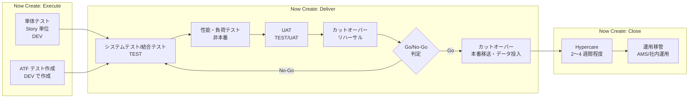
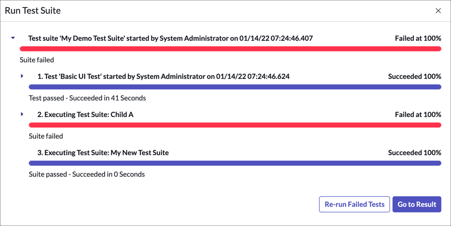
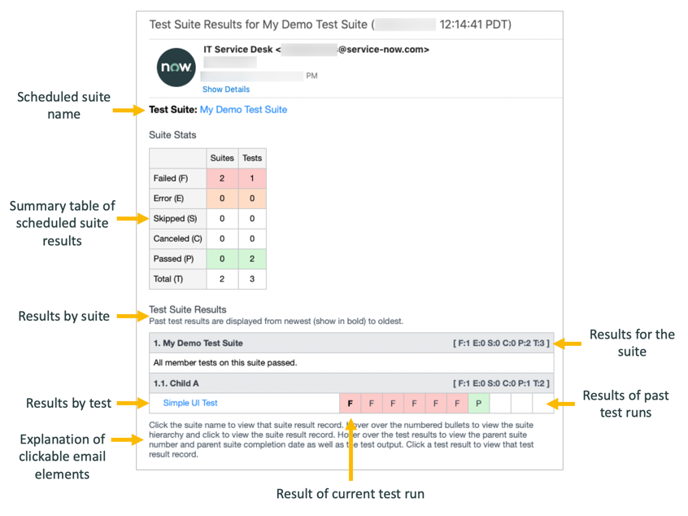
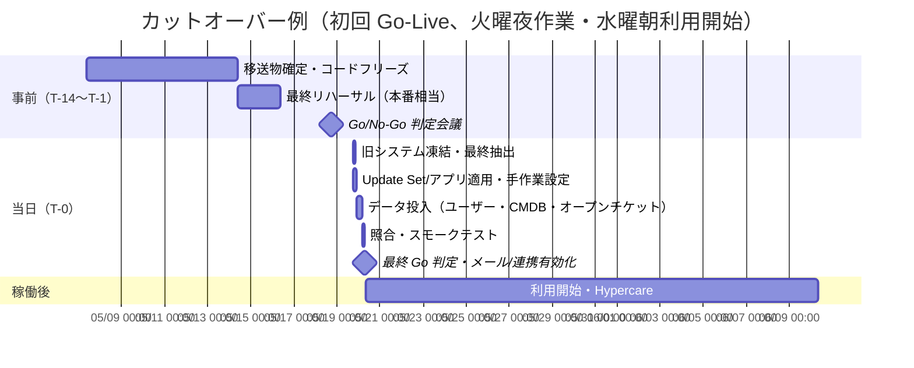
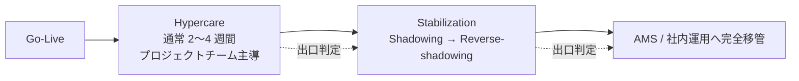

# テストと本番稼働（Testing and Go-Live）

## 概要

ServiceNow 導入プロジェクトの「テストと本番稼働」は、構築したインスタンスの品質を保証し（テスト）、本番インスタンスへ設定・データを移して利用者に開放し（カットオーバー / Go-Live）、稼働直後の集中支援期間（Hypercare、ハイパーケア）を経て運用組織へ引き渡すまでの一連の工程である。ServiceNow の公式導入方法論 Now Create では、システムテスト・負荷テスト・UAT・Go-Live は **Deliver** フェーズ、Hypercare と運用移管は **Close** フェーズに置かれている（詳細は [導入方法論](04-implementation-methodology.md)）。

ServiceNow のテストと本番稼働には、オンプレミス型パッケージの導入と異なる次の特徴がある。

| 特徴 | 内容 | 本ファイルの該当節 |
|---|---|---|
| 設定はメタデータ | 設定・開発の成果物は Update Set またはアプリケーション（スコープアプリ）として移送する。「本番へ何をどの順で移すか」がカットオーバーの中心になる | 5 章 |
| 標準の自動テスト機能 | Automated Test Framework（ATF、自動テストフレームワーク）がプラットフォーム標準で使える。ただし**実行は非本番のみ**、既定で無効 | 3 章 |
| 本番インスタンスでの制約 | 本番で有効化したプラグインは原則として戻せない（rollback context に対応したプラグインのみ、期限内に限定的なロールバックが可能）、ATF は本番で実行しない、負荷テストは非本番で行う | 2.6、3.1、4、5 章 |
| ホスティングは ServiceNow | インフラ監視・バックアップは ServiceNow 側が自動で行う。Go-Live 監視用の「プレースホルダーケース」は推奨されない | 6 章 |
| 年 2 回のリリース | Go-Live 時点のリリース（パッチ）を揃え、Go-Live 後すぐにアップグレード計画が始まる。ATF の回帰テスト資産がアップグレードで再利用される | 3.6、7 章 |

関連ファイル：ATF の製品仕様は [Automated Test Framework (ATF)](../02_リファレンス/platform/automated-test-framework.md)、Update Set と Clone の仕様は [アップデートセットとクローン](../02_リファレンス/platform/update-sets-cloning.md)、環境構成とクローン戦略は [インスタンス戦略と環境](07-instance-strategy.md)、データの本番投入は [データ移行](08-data-migration.md)、連携テストの設計観点は [連携設計](09-integration-design.md)、稼働後の運用は [運用とガバナンス](12-operations-governance.md) と [サポートと監視](14-support-monitoring.md) を参照。

---

## 1. 全体像

### 1.1 テストから Hypercare までの流れ

ServiceNow 導入における標準的なテスト～本番稼働の流れは次のとおり。テストの種類と担当は公式ドキュメント「Validate app functionality」（Australia）に基づき、カットオーバー以降は公式・Community 情報と実務慣行を組み合わせている。[出典](https://www.servicenow.com/docs/r/zUlSbxoxKPAWFDGUdAoSCw/zqr~gFhQN2U7V9ntGgpiQg)

### 1.2 工程と主な成果物

| 工程 | 主な成果物 | 判定者（典型） |
|---|---|---|
| テスト計画 | テスト計画書（範囲・種類・環境・データ・合否基準・体制・日程）、テストケース | PM、プロセスオーナー |
| 単体テスト | Story ごとの検証記録、Story のクローズ | 開発者、プロセスオーナー |
| システム/結合テスト | テスト結果、欠陥一覧、ATF スイート結果、Instance Scan 結果 | QA リード |
| 性能テスト | 性能測定結果（応答時間、スループット、バッチ処理時間） | アーキテクト |
| UAT | UAT 結果、UAT 承認（サインオフ） | 業務部門・プロセスオーナー |
| カットオーバー計画 | カットオーバー Runbook（時刻・担当・依存・切り戻し）、リハーサル結果 | PM、運用責任者 |
| Go/No-Go 判定 | Go-Live 判定チェックリスト、判定会議議事録 | ステアリングコミッティ |
| Hypercare | 問い合わせ・インシデント記録、日次報告、出口判定 | PM、運用責任者 |
| 運用移管 | 運用手順書、ナレッジ、引継ぎ記録 | 運用責任者 |

上表は Now Create の Deliver/Close アクティビティ（システムテスト、負荷テスト、UAT、運用準備確認、Go-Live Transition、Hypercare、サポート組織への移管）を、一般的なプロジェクト成果物に置き換えたもの【経験則】。Now Create のアクティビティ一覧は [導入方法論](04-implementation-methodology.md) の 2 章を参照。

---

## 2. テスト計画

### 2.1 テストの種類と ServiceNow 公式の位置づけ

ServiceNow の公式ドキュメント「Validate app functionality」（Australia、2026-03 更新）は、アプリケーションの検証を次の 4 種類に分けている。[出典](https://www.servicenow.com/docs/r/zUlSbxoxKPAWFDGUdAoSCw/zqr~gFhQN2U7V9ntGgpiQg)

| テスト種別 | 目的 | 実施者 | 実施場所・タイミング |
|---|---|---|---|
| Unit testing（単体テスト、Story テスト） | 各 Story の要件を満たすことを確認してから Story をクローズする | 開発者が実施し、プロセスオーナーまたは指名されたステークホルダーが Story クローズ前に検証 | Story と、部品を共有する関連 Story の文脈で実施 |
| System testing（システムテスト） | スコープ内のコンポーネントと連携が一体として動くことを確認 | QA / テストチーム。開発者は QA・プロセスオーナーとテストケース作成を支援し、検出不具合を修正 | 開発完了後、完成したシステム全体に対して |
| Automated testing（自動テスト、ATF） | 機能的なシステムテストを自動化する | 開発者がテストを作成、QA が実行 | Development インスタンスで作成し、Test インスタンスで実行 |
| User acceptance testing（UAT、受入テスト） | アプリが業務要件を満たし、提供可能な状態であることを確認 | 利用者、顧客、その他の権限あるステークホルダー | 最終検証。不具合は開発者が修正 |

本ナレッジではこれに、導入プロジェクトで一般に必要となる **結合（連携）テスト**、**性能・負荷テスト**、**回帰テスト**、**移行リハーサル** を加えて整理する。

| テスト種別 | ServiceNow 特有の観点 | 詳細 |
|---|---|---|
| 結合（連携）テスト | IntegrationHub / REST / MID Server 経由の外部システム連携、SSO、メール送受信 | 2.4 |
| 性能・負荷テスト | ServiceNow 側のインフラは顧客が負荷試験で検証する対象ではない。顧客の作り込み（スクリプト、ACL、レポート、連携量）の性能を非本番で確認する | 4 章 |
| 回帰テスト | パッチ・アップグレードや追加リリースの後に既存機能を確認する。ATF で自動化する | 3 章 |
| 移行リハーサル | データ移行と本番移送の手順・所要時間を本番クローン上で検証 | 5.4、[データ移行](08-data-migration.md) |
| セキュリティテスト | ACL・ロール・データ可視性の確認（なりすましによる確認）。顧客が第三者のペネトレーションテスト・脆弱性診断を行う場合は、ServiceNow の Customer Penetration Testing ポリシー（Now Support の KB0538598「Customer Application Penetration Testing \| Policy & Procedure」）に従う。ServiceNow 社員による Community 記事によると、対象は**非本番インスタンス**で、Now Support の「Schedule a Penetration Test」から申請し、ServiceNow の Application Security チームが申請を確認して開始日を合意する。インスタンスの堅牢化（High Security Plugin 等）と最新パッチ適用が前提で、準備と日程調整に数週間かかることがある。このプログラム以外のセキュリティテストは認められていない。日本の導入では第三者診断を求められることが多いため、テスト計画に申請リードタイムを入れる | 2.4、[セキュリティとコンプライアンス](10-security-compliance.md)。KB 名は公式ドキュメント [Other security hardening resources（Australia）](https://www.servicenow.com/docs/r/q0JUS4fl39QNjim0ATT18w/eij5jYePyc5hG69oMQ2kZA) で確認。手続きの内容は【第三者情報】[出典](https://www.servicenow.com/community/in-other-news/what-customers-can-expect-from-a-penetration-test/ba-p/2266292)、[出典](https://www.servicenow.com/community/in-other-news/validate-controls-defenses-with-customer-security-testing/ba-p/2294441)（2016〜2018 年の記事。最新の条件は KB0538598 で確認する） |

### 2.2 テスト計画書に書くべき項目

ServiceNow 導入のテスト計画書には、一般的な項目に加えて ServiceNow 固有の項目を明記する【経験則】。

| 項目 | 記載内容 | ServiceNow 固有の注意 |
|---|---|---|
| テスト範囲 | 対象アプリケーション（ITSM 各プロセス、カタログアイテム、ポータル、ワークスペース、連携、通知、SLA、レポート） | OOTB（標準機能）をそのまま使う部分は「標準動作の確認」に留め、カスタマイズ部分に工数を寄せる |
| テスト種別とフェーズ | 2.1 の各テストの開始・終了条件 | Now Create の Execute（単体）と Deliver（システム〜UAT）の Exit Gate と揃える |
| 環境 | テストごとのインスタンス（DEV / TEST / UAT / STAGING） | どの時点で本番からクローンしてテスト環境を作るか（[インスタンス戦略と環境](07-instance-strategy.md)） |
| テストデータ | ユーザー、グループ、ロール、CI、カタログ、ナレッジ、移行データ | 本番クローンを使う場合はデータマスキング・メール抑止を考慮（2.6） |
| ロール別シナリオ | エンドユーザー（ロールなし）、`itil`、承認者、マネージャー、管理者など | ロールごとにテストする。ATF / 手動ともに Impersonate（なりすまし）で切り替える |
| UI 範囲 | Core UI（Classic）、Next Experience、Service Operations Workspace、Service Portal / Employee Center、モバイル | ATF の UI テスト対応範囲には制約がある（3.1） |
| 合否基準 | 合格率、残存欠陥の重大度別上限、性能目標 | Go/No-Go 判定基準と一致させる（5.2） |
| 欠陥管理 | 欠陥の起票先、重大度定義、トリアージ会議 | Test Management 2.0 を使う場合、欠陥は自動起票されない（2.7） |
| 移送管理 | テスト対象の Update Set / アプリバージョンの特定 | 「どのバージョンをテストしたか」を記録しないと、本番に未テストの変更が入る |
| 体制 | テストリード、テスター、業務側 UAT 担当、開発者（修正）、ServiceNow 管理者 | 業務側テスターへの事前トレーニング（2.5） |

### 2.3 単体テスト（Story テスト）

ServiceNow の単体テストは、アジャイル型（Now Create のハイブリッド型）では **Story 単位** で行う。公式ドキュメントは「開発者がテストし、プロセスオーナーまたは指名されたステークホルダーが Story のクローズ前に検証する」としている。[出典](https://www.servicenow.com/docs/r/zUlSbxoxKPAWFDGUdAoSCw/zqr~gFhQN2U7V9ntGgpiQg)

単体テストの実務ポイント【経験則】：

- **Definition of Done（完了の定義）に含める**：Story の受入基準を満たし、ATF テスト（作成対象の場合）を作成済み、Update Set に正しく記録済み、を完了条件にする。
- **Update Set の記録漏れ確認**：Update Set に記録されないもの（データレコード、一部のプロパティ、スケジュール、ユーザー・グループなど）を Story ごとに洗い出し、別途移送手順に入れる。記録対象・対象外は [アップデートセットとクローン](../02_リファレンス/platform/update-sets-cloning.md) を参照。
- **Instance Scan の Point scan**：Update Set またはスコープアプリ単位で Instance Scan の Point scan を実行し、ベストプラクティス違反（Security、Performance、Manageability、Upgradability、User Experience）を早期に検出する（2.8）。
- **スクリプトのサーバー側単体テスト**：Script Include や Business Rule のロジックは、ATF の Run Server Side Script ステップ（Jasmine ベース）で検証できる。詳細は [ATF リファレンス](../02_リファレンス/platform/automated-test-framework.md) の 7 章を参照。

### 2.4 システムテスト・結合テスト

システムテストは、開発完了後に完成したシステム全体に対して QA / テストチームが行う。[出典](https://www.servicenow.com/docs/r/zUlSbxoxKPAWFDGUdAoSCw/zqr~gFhQN2U7V9ntGgpiQg) ServiceNow 導入で漏れやすい観点を以下にまとめる【経験則】。

| 観点 | 確認内容 | 参照 |
|---|---|---|
| プロセス E2E | インシデント起票→割り当て→エスカレーション→解決→クローズ、リクエスト→承認→タスク→完了、変更の各タイプ（Normal / Standard / Emergency）の承認とスケジュール | [Incident Management](../02_リファレンス/itsm/incident-management.md)、[Change Management](../02_リファレンス/itsm/change-management.md) |
| ロール・ACL | ロール別にフィールド・レコード・UI アクションの可視性・編集可否を確認。エンドユーザーが他人のチケットを見られないこと | [アクセス制御（ACL）](../02_リファレンス/platform/access-control-acl.md) |
| SLA | SLA 定義の開始・一時停止・停止条件、スケジュール（営業日・祝日）、タイムゾーン | [SLA とスケジュール](../02_リファレンス/platform/sla-schedules.md) |
| 通知 | 通知のトリガー条件、宛先、テンプレート、言語。メール受信（Inbound Email Action）による更新 | [通知とメール](../02_リファレンス/platform/notifications-email.md) |
| 連携 | 正常系・異常系（タイムアウト、認証失敗、重複、リトライ）、MID Server 経由の到達性、データ量 | [連携設計](09-integration-design.md) |
| SSO・認証 | SAML / OIDC の IdP 連携、ローカルログインの例外運用、セッションタイムアウト | [認証と SSO](../02_リファレンス/platform/authentication-sso.md) |
| ポータル・ワークスペース | Service Portal / Employee Center のカタログ申請、検索、ナレッジ閲覧。Service Operations Workspace の操作 | [Service Portal と Employee Center](../02_リファレンス/platform/portals-employee-center.md) |
| 日本語化 | 翻訳漏れ、文字化け、日付・時刻・タイムゾーン表示、全角半角を含む検索 | [ローカライゼーション（日本語化）](../02_リファレンス/platform/localization.md) |
| レポート・ダッシュボード | 集計値の正しさ、ロール別の閲覧可否 | [レポートとアナリティクス](../02_リファレンス/platform/reporting-analytics.md) |
| 移行データ | 移行後データでの業務操作（参照切れ、選択肢値の不整合、SLA の再計算有無） | [データ移行](08-data-migration.md) |

### 2.5 UAT（受入テスト）

UAT は、利用者・顧客・その他の権限あるステークホルダーが、アプリケーションが業務要件を満たし提供可能であることを確認する最終検証である。UAT で見つかった不具合は開発者が修正する。[出典](https://www.servicenow.com/docs/r/zUlSbxoxKPAWFDGUdAoSCw/zqr~gFhQN2U7V9ntGgpiQg)

**UAT を形骸化させない工夫**

ServiceNow Community の記事（15 年の導入経験を持つ実務者の投稿）は、UAT が「契約上の義務」とみなされ、未トレーニングのエンドユーザーに丸投げされることで遅延・コスト増・不満につながると指摘し、次を推奨している。【第三者情報】[出典](https://www.servicenow.com/community/in-other-news/5-common-pitfalls-in-servicenow-implementations-and-how-to-avoid/ba-p/3217075)

- **Guided UAT（ガイド付き UAT）**：スプリントのショーケース（デモ）直後に、構造化されたハンズオンセッションを行い、機能を一つずつ案内し、その場で質問に答え、不具合を素早く直す。
- UAT とハンズオントレーニングを組み合わせ、コミュニケーションを継続して問題を早期に表面化させる。
- 怠った場合の帰結：スケジュール遅延、コスト超過、満足度・定着率の低下、稼働後のサポート負荷増。

**UAT の設計ポイント**【経験則】

| 項目 | 推奨 |
|---|---|
| シナリオ | 業務シナリオ単位（「PC が壊れた社員が申請し、サービスデスクが対応して解決する」）で書き、画面操作手順は最小限にする |
| テスター | 実際の業務担当（サービスデスク、承認者、各解決グループ、エンドユーザー代表）。ロール別にアカウントを用意 |
| 事前準備 | UAT 前にテスター向けトレーニングと UAT 手順説明。UAT 環境のデータ（ユーザー、グループ、CI、カタログ）は本番相当にする |
| 範囲凍結 | UAT 中は新機能の追加を止め、修正だけを移送する。修正の移送ルール（いつ、誰の承認で）を決める |
| 判定 | 重大度の定義（例：業務停止 / 回避策あり / 軽微）と、Go-Live までに解消すべき範囲を事前に合意 |
| 変更要求 | UAT で出る「要望」は欠陥と区別し、Go-Live 後のバックログへ回す判断基準を持つ |
| サインオフ | プロセスオーナーによる UAT 承認を Go/No-Go 判定の入力にする |
| 多言語・多拠点 | 翻訳の意味が通じるか、各言語の Day 1 資料が揃っているかを UAT で確認する（[出典](https://www.servicenow.com/community/international-localization/global-go-live-considerations/ta-p/2327308)） |

> **AI 機能（Now Assist / AI Agents）の UAT**：生成 AI・エージェントの UAT は出力が毎回同じとは限らないため、「受け入れ可能な振る舞い／受け入れ不可の振る舞い」と成功指標を先に定義する、という考え方が Community で紹介されている。【第三者情報】[出典](https://www.servicenow.com/community/now-assist-articles/unpredictable-paths-the-complexity-of-uat-in-the-age-of-agentic/ta-p/3250533) AI 機能の評価と本番化は [Now Assist と AI Agents](../02_リファレンス/platform/now-assist-ai-agents.md)、[Now Assist / AI Agents 導入の知見](../04_応用編/10-ai-adoption-lessons.md) を参照。

### 2.6 テスト環境とテストデータ

| 論点 | 内容 | 出典・確度 |
|---|---|---|
| テストを実行するインスタンス | ATF は非本番（開発・テスト等）でのみ実行する。本番での実行はデータ破損・障害のおそれがある | [出典](https://www.servicenow.com/docs/r/zUlSbxoxKPAWFDGUdAoSCw/4hkh6VNi_eAnyfY91R522Q) |
| ATF テストの作成と実行の場所 | Development インスタンスで作成し、Test インスタンスへ昇格（移送）して実行 | [出典](https://www.servicenow.com/docs/r/zUlSbxoxKPAWFDGUdAoSCw/zqr~gFhQN2U7V9ntGgpiQg) |
| 本番クローンによるテスト環境の更新 | 本番からサブ本番へクローンしてテスト環境を最新に保てる | [出典](https://www.servicenow.com/docs/r/zUlSbxoxKPAWFDGUdAoSCw/lpsJurpvpk8DaqAdSJX3Fg) |
| クローンでテストが消える | クローンは ATF テストを消してしまう。スコープアプリにまとめて Git に保存する、クローン前に退避する、または本番へ（実行せずに）昇格して保管する | [出典](https://www.servicenow.com/docs/r/zUlSbxoxKPAWFDGUdAoSCw/zqr~gFhQN2U7V9ntGgpiQg) |
| 非本番のメール | 非本番では `glide.email.test.user`（Send all email to this test email address）にテスト用アドレスを設定し、全送信メールをそのアドレスへ送る | [出典](https://www.servicenow.com/docs/r/UrSRFFKWBbfQBgoRlt~ltw/bv0fJhcFJU0KUWWDeL7slw) |
| クローン後のメール | Clone オプション「Disable emails」で Target の `glide.email.read.active` と `glide.email.smtp.active` が false になる | [アップデートセットとクローン](../02_リファレンス/platform/update-sets-cloning.md) |
| 個人情報 | 本番クローンをテストに使う場合、マスキング・匿名化の要否を判断する | [インスタンス戦略と環境](07-instance-strategy.md) |

> 非本番で特定グループのメンバーにだけメールを届けたい場合、`sys_email` への Before Insert の Business Rule で宛先を絞り込む方法が ServiceNow Community の開発者ブログで紹介されている。【第三者情報】[出典](https://www.servicenow.com/community/developer-blog/use-sub-production-notifications-like-a-boss/ba-p/2287129)

### 2.7 手動テストの管理：Test Management 2.0

ServiceNow には手動テストを計画・実行・記録するアプリケーション **Test Management 2.0** がある。Excel でテストケースを管理する代わりに、インスタンス上でテスト計画と進捗を管理できる。[出典](https://www.servicenow.com/docs/r/4~5Anqt12idfVzJWPcxoHw/gSaJNPeibjuKZHnF5gT0xg)

| 項目 | 内容 |
|---|---|
| プラグイン | `com.snc.test_management.2.0`。既定では有効化されていないため、管理者が有効化する |
| ロール | Test manager（`sn_test_management.test_manager`）【第三者情報】、Tester（`sn_test_management.tester`）【第三者情報】。公式の概要ページは表示名（Test Manager / Tester）のみを示しており、技術名は第三者記事による |
| 関連製品 | Agile Development 2.0 と連携し、Sprint Tracking ビューからテストを作成して Story に紐付けられる |
| ライセンス | 公式ページにライセンス上の位置づけの記載なし。Community では「プロジェクト・ポートフォリオ（PPM / SPM）系のプラグイン群に含まれる」との投稿がある【第三者情報】 |

出典：[Test Management 2.0 overview（Australia）](https://www.servicenow.com/docs/r/4~5Anqt12idfVzJWPcxoHw/gSaJNPeibjuKZHnF5gT0xg)、[Add and modify test cycles and test execution suites](https://www.servicenow.com/docs/r/4~5Anqt12idfVzJWPcxoHw/OrZZ_Jylq4wpmQZmsy1AzQ)、[Medium（Globant）](https://medium.com/globant/servicenow-test-management-2-0-150da41da856)【第三者情報】、[Community](https://www.servicenow.com/community/spm-forum/test-management-close-out/m-p/973569)【第三者情報】

**Test Management 2.0 の構成要素**

| 要素 | 英語名 | 説明 |
|---|---|---|
| テスト | Test | 機能が動くことを確認する条件・手順（期待結果は任意）。Tests モジュールで管理し、複数バージョンを持てる |
| テストセット | Test set | 関連するテストのグループ。1 つのテストは複数のテストセットに属せる |
| テスト計画 | Test plan | 製品・機能を「いつ・どう」テストするかを記述。テストサイクルに分割される。Test Plans モジュールで管理 |
| テストサイクル | Test cycle | テスト計画内のフェーズ・反復（回帰テスト、スモークテスト、スプリント等）。Test Board の Planning タブで作成 |
| テスト実行スイート | Test execution suite | テストサイクルを細分化した最小単位。テスターへの個別のテスト割り当てを含む |
| テストケース | Test case | テストスイートに保存され、テスト計画に追加される関連テストの集合。テスターが割り当てられる |
| 実行結果 | Run | 開始・終了時刻、環境、結果などの詳細。Run モジュールで参照 |
| テストボード | Test Board | テスト計画の作成、Planning タブでのサイクル・スイート作成 |

**ロール別にできること**

| ロール | できること |
|---|---|
| Tester | テスト・テストセットの作成、テストの実施、結果の記録、ステータス更新、失敗したテストに紐付く欠陥レコードの手動作成 |
| Test manager | 手動テストの準備と監視。テスト・テストセットの作成・保守、テスターが作成した内容のレビュー、テスト計画・サイクル・実行スイートの作成、テスターへの割り当て、進捗追跡、テスト計画のクローズ |

**操作の流れ（Test manager）**

1. Test Board でテスト計画（Test plan）を作成する。
2. Planning タブでテストサイクル（例：「SIT サイクル 1」「UAT」「回帰」）を追加する。
3. テストサイクルを選んで右クリック → **Add Execution Suite** で実行スイートを追加する。
4. 実行スイートを選んで右クリック → **Add tests** で個別テストまたはテストセットを追加し、テスターに割り当てる。

[出典](https://www.servicenow.com/docs/r/4~5Anqt12idfVzJWPcxoHw/OrZZ_Jylq4wpmQZmsy1AzQ)

**制約・注意**

- 失敗したテストの欠陥（Defect）は**自動生成されない**。欠陥レコードを手動で作成し、説明欄でテストを参照する。[出典](https://www.servicenow.com/docs/r/4~5Anqt12idfVzJWPcxoHw/gSaJNPeibjuKZHnF5gT0xg)
- 公式の概要ページには ATF との連携の記載がない。自動テストは ATF、手動テスト（UAT 等）は Test Management 2.0 という使い分けになる【推定】。
- テスト計画・テーブル名・状態値の一覧は公開情報では確認できず（旧 Test Management 1.0 世代では `tm_test_plan` 等のテーブル名が Community で言及されている）。
- 多くの導入プロジェクトでは、テストケースと欠陥を Excel・外部テスト管理ツール・ServiceNow の Agile Development 2.0（Defect）で管理しているのが実態である【経験則】。導入プロジェクト自体をインスタンス上で管理する方法は [導入方法論](04-implementation-methodology.md) の 4.3 を参照。

### 2.8 品質ゲートとしての Instance Scan

**Instance Scan** は、インスタンスの健全性を確認するプラットフォーム標準のツールである。Check（チェック）は「インスタンスの異常や改善機会を検出する単一目的のルール」で、Security（セキュリティ）、Upgradability（アップグレードのベストプラクティス）、Manageability（管理性）、User Experience（ユーザー体験）、Performance（パフォーマンス）のカテゴリーがある。[出典](https://www.servicenow.com/docs/r/UrSRFFKWBbfQBgoRlt~ltw/8S4QcFvEX3qC749Q8ZqTGg)

| 項目 | 内容 |
|---|---|
| ロール | `scan_user`（スキャン実行、チェックの閲覧・実行、Findings と結果の閲覧）、`scan_check_writer`（`scan_user` を内包し、チェックの作成が可能） |
| Full scan | 全アクティブチェックをインスタンス全体に対して実行（Execute Full Scan） |
| Point scan | 1 レコード、Update Set、またはアプリケーションに対して該当チェックを実行（Run Point Scan）。App scan と Update Set scan は Point scan の一種 |
| Suite scan | チェックスイート（チェックのグループ）を実行。Full scan と Suite scan はスケジュール可能 |
| Test scan | 1 つのチェックの動作確認（Check フォームの Test Check） |
| 制約 | ドメインセパレーションに完全対応していない。Quota rule（タイムアウト）を超えたスキャンは失敗。Update Set scan では「Update Set 内のバージョンにだけ存在する問題」は検出されない |

出典：[Exploring Instance Scan（Australia）](https://www.servicenow.com/docs/r/UrSRFFKWBbfQBgoRlt~ltw/8S4QcFvEX3qC749Q8ZqTGg)

**導入プロジェクトでの使い方**【経験則】

- 開発中：Update Set / スコープアプリ単位で Point scan を回し、重大な Finding を Story の完了条件に含める。
- システムテスト開始前と Go/No-Go 判定前：DEV または TEST で Full scan を実行し、Security・Performance カテゴリーの未解決 Finding を判定資料にする。
- Update Set scan だけでは Update Set 内でのみ存在する問題を検出できないため、コミット後のインスタンスでのスキャンも行う（公式の制約に基づく）。

> Impact（ServiceNow の有償成功支援サービス）の契約者は、ServiceNow がサブ本番インスタンスを HealthScan でスキャンする Health Assessment アクセラレーターを利用できる。対象はセキュリティ、パフォーマンス、管理性、アップグレード性、ユーザー体験の 5 領域で、最近クローンした本番相当の非本番インスタンスが対象。推奨変更の実装は範囲外。[出典](https://www.servicenow.com/docs/r/VD5jAD3VgRc~i0AwgqwfEQ/5E8VY~BrR32UDfvo7KUaag)

---

## 3. ATF（Automated Test Framework）の導入プロジェクトでの使い方

本章は、導入プロジェクトで ATF を「どう使うか」に絞る。テーブル、ロール、プロパティ、テストステップ、Cloud Runner の仕様の詳細は [Automated Test Framework (ATF)](../02_リファレンス/platform/automated-test-framework.md) を参照。

### 3.1 ATF の要点

| 観点 | 内容 | 出典 |
|---|---|---|
| 提供形態 | プラットフォーム標準機能。追加プラグイン不要 | [出典](https://www.servicenow.com/docs/r/zUlSbxoxKPAWFDGUdAoSCw/4hkh6VNi_eAnyfY91R522Q) |
| 用途 | アップグレード、アプリ開発、設定移送などの変更後に、インスタンスが期待どおり動作することを自動で確認 | [出典](https://www.servicenow.com/docs/r/zUlSbxoxKPAWFDGUdAoSCw/4hkh6VNi_eAnyfY91R522Q) |
| テスト実行の既定 | **無効**。`sn_atf.runner.enabled`（Enable test/test suite execution）を true にする。スケジュール実行には `sn_atf.schedule.enabled` も必要 | [出典](https://www.servicenow.com/docs/r/application-development/automated-test-framework-atf/atf-admin-properties.html) |
| 実行環境 | 非本番のみ | [出典](https://www.servicenow.com/docs/r/zUlSbxoxKPAWFDGUdAoSCw/4hkh6VNi_eAnyfY91R522Q) |
| ロール | `atf_test_admin`（プロパティ含む管理）、`atf_test_designer`（テスト・スイートの作成と実行） | [ATF リファレンス 3 章](../02_リファレンス/platform/automated-test-framework.md) |
| データ | テスト中に作成・変更したデータは終了時に自動ロールバック（メール、履歴、ECC Queue、番号カウンター等の除外テーブルは戻らない） | [ATF リファレンス 13 章](../02_リファレンス/platform/automated-test-framework.md) |
| 対象 UI | Core UI（Classic のリスト・フォーム）、Service Portal、Custom UI（Page Inspector で取得できるコンポーネント）、REST、サーバー側処理 | [出典](https://www.servicenow.com/docs/r/zUlSbxoxKPAWFDGUdAoSCw/VPxGPoKOWTBxIAdcA5dNcw) |
| 非対応 | UI Builder で作成したページ（リスト・フォームコンポーネントを含む）、Landing page は「将来リリースで対応予定」 | [出典](https://www.servicenow.com/docs/r/zUlSbxoxKPAWFDGUdAoSCw/VPxGPoKOWTBxIAdcA5dNcw) |
| 性能テスト | ATF は負荷テスト・性能テストのためのアプリケーションではない（ServiceNow Success の Quick Answer 資料。本文は取得できず検索結果の抜粋で確認） | [出典](https://www.servicenow.com/content/dam/servicenow-assets/public/en-us/doc-type/success/quick-answer/automated-test-framework-use.pdf) |

### 3.2 どのテストを ATF にするか

ATF の作成・保守には工数がかかるため、導入プロジェクトでは「アップグレードのたびに繰り返し確認したい、業務上重要な、安定した機能」から自動化する【経験則】。

| 優先度 | 対象 | 理由 |
|---|---|---|
| 高 | カスタマイズしたビジネスロジック（Business Rule、Script Include、Flow のサーバー側結果） | アップグレードで壊れやすく、サーバー側ステップは安定して速い |
| 高 | 主要カタログアイテムの申請→承認→タスク生成 | 業務影響が大きく、Service Catalog 用ステップがある |
| 高 | ロール別の可視性・編集可否（ACL） | Impersonate + フォームステップで確認でき、手動だと漏れやすい |
| 中 | 主要フォームの UI Policy / Client Script の動き | UI ステップは実行が遅く、UI 変更で壊れやすい |
| 中 | インバウンド REST API | REST ステップで確認可能 |
| 低 | OOTB をそのまま使う機能 | Quick start tests で代替可能（3.4） |
| 対象外 | 負荷・性能、外部システム側の結果、モバイルアプリ、UI Builder ページの一部 | ATF の対象外または非対応 |

公式ドキュメントの推奨事項（Validate app functionality、Australia）：[出典](https://www.servicenow.com/docs/r/zUlSbxoxKPAWFDGUdAoSCw/zqr~gFhQN2U7V9ntGgpiQg)

- 重複するテストケースを避けるため Parameterized test（パラメーター化テスト）を使う。
- テスト名は「<アプリ略称>: <確認する機能>」（例：「CSM: Resolve case」）とし、説明欄にユースケースを書く。
- テストは自己完結にする（他のテストや既存データに依存しない）。
- 標準ステップがない場合（例：メール本文の検証）は、サーバー側または REST のテストステップを新規作成する。
- スクリーンショットが重要でない限り、サーバー側ステップを優先する。
- 各テストは Impersonate ステップから始める。
- ブラウザーのスロットリング（非アクティブタブの処理抑制）を考慮する。
- 失敗時は Test Logs と Test Transactions で調査する。
- テストスイートは命名規約（例：「ITSM INT: Use cases」）に従い、目的を説明に書き、機能領域ごとに編成する。

### 3.3 導入フェーズ別の ATF 活用

| フェーズ | ATF の作業 | 担当 |
|---|---|---|
| Plan | ATF の対象範囲・命名規約・スイート構成・実行環境（Client Test Runner / Cloud Runner）を決める | テストリード、アーキテクト |
| Execute（スプリント） | Story ごとに ATF テストを DEV で作成（完了の定義に含める）。テストはスコープアプリにまとめるか Update Set で移送 | 開発者 |
| Deliver：システムテスト | TEST でスイートを実行し、システムテストの一部を自動化。修正のたびに再実行（回帰） | QA |
| Deliver：UAT 中 | 修正移送のたびに回帰スイートを実行し、既存機能の破壊を検出 | QA |
| Deliver：Go-Live 前 | 本番相当の環境（本番クローン、またはリハーサル環境）で全スイート合格を Go/No-Go 判定の入力にする | QA、PM |
| Close 以降 | テストを本番へ（**実行せずに**）保管し、以後のアップグレード・リリースの回帰テスト資産として運用組織に引き継ぐ | 運用チーム |

ATF の結果確認画面の例：

- **キャプション:** テストスイートを実行したときに表示される「Run Test Suite」進捗ダイアログ（親スイートが失敗した例）。
- **画面の説明:** 最上段に「Test suite 'My Demo Test Suite' started by System Administrator on 01/14/22 07:24:46.407」と赤い進捗バー、右端に「Failed at 100%」、その下に「Suite failed」。子要素として「1. Test 'Basic UI Test'」（青いバー、Succeeded 100%、「Test passed - Succeeded in 41 Seconds」）、「2. Executing Test Suite: Child A」（赤いバー、Failed at 100%、「Suite failed」）、「3. Executing Test Suite: My New Test Suite」（青いバー、Succeeded 100%）が並ぶ。右下に「Re-run Failed Tests」（失敗したテストのみ再実行）と「Go to Result」（結果レコードへ移動）ボタンがある。子スイートの 1 つが失敗すると親スイートも失敗になることが読み取れる。
- **出典:** ServiceNow Developer「Using the Automated Test Framework」（Zurich 版ラーニングモジュール）https://developer.servicenow.com/print_page.do?release=zurich&category=learning-module&identifier=ATF_About_zurich%2Cservicenow_application_developer&module=learning+plan （取得日: 2026-11-03）

### 3.4 Quick start tests の扱い

ServiceNow は主要アプリケーション向けに **Quick start tests（クイックスタートテスト）** を提供している。ただし Quick start tests は **ベースシステム＋既定デモデータ** でのみ合格が保証される（Australia で記述が明確化）。カスタマイズ済みインスタンスでは、コピーして自社の設定・データに合わせて修正したテストで判定する。[出典](https://www.servicenow.com/docs/r/delta-zurich-brazil/brazil-zurich-automatedtestframework-release-notes.html) 提供アプリケーションの一覧は [ATF リファレンス 14 章](../02_リファレンス/platform/automated-test-framework.md) を参照。

### 3.5 テストランナーの選択と定期実行

| 実行方式 | 向いている用途 | 注意 |
|---|---|---|
| Client Test Runner（手動） | テスト作成時の対話的実行 | 実行ユーザーのブラウザータブが必要 |
| Scheduled Client Test Runner | 夜間の定期実行（自前 PC / VM で常時起動） | 条件に合うランナーが起動していないとスケジュール実行されない。画面ロックで遅くなるため VM 推奨 |
| Cloud Runner（Store アプリ「ATF Test Generator and Cloud Runner」） | ローカル準備なしの定期実行・並列実行・CI/CD | ADCv2 ロードバランサー必須（未対応なら Now Support に依頼）。SPP Singapore、National Security Cloud（NSC）、オンプレミス、一部の規制市場では利用不可（[ATF Test Generator and Cloud Runner（Australia）](https://www.servicenow.com/docs/access?context=atf-tg-cr-intro&version=australia&pubname=australia-servicenow-platform&ft:locale=en-US)）。既定の並列レーンは 2（追加購入可）。スイート内は並列・ランダム順で、Execution order と Abort on failure は無視される（[Executing the tests using Cloud Runner](https://www.servicenow.com/docs/r/zS6yb8e~gR8BPjeviYdV9g/jpnKWtziIAZDvh4AVIOkaA)） |
| サーバー側ステップのみ | 単体テスト | ランナー不要 |

出典：[Scheduling test execution](https://www.servicenow.com/docs/r/zS6yb8e~gR8BPjeviYdV9g/ZkT~6XbFHA4iB3VG6f5Bnw)、[Executing the tests using Cloud Runner](https://www.servicenow.com/docs/r/zS6yb8e~gR8BPjeviYdV9g/jpnKWtziIAZDvh4AVIOkaA)、[ATF Test Generator and Cloud Runner（Australia）](https://www.servicenow.com/docs/access?context=atf-tg-cr-intro&version=australia&pubname=australia-servicenow-platform&ft:locale=en-US)、詳細は [ATF リファレンス 11・15・16 章](../02_リファレンス/platform/automated-test-framework.md)

**スケジュール実行の要点**

- スケジュールできるのはテストスイートのみで、個別テストはスケジュールできない（公式ページ「Working with scheduled test suites」に "You can schedule only test suites, not individual tests." とある。版指定なしの URL で、取得時は Brazil 版が表示された）。個別テストを定期実行したい場合は、そのテストだけを含むスイートを作ってスケジュールする【経験則】。なお Cloud Runner はテストとテストスイートのどちらもクラウドで実行できるが、スケジュールの単位はスイートである。[出典](https://www.servicenow.com/docs/r/application-development/automated-test-framework-atf/atf-sched-suites.html)、[出典](https://www.servicenow.com/docs/r/zS6yb8e~gR8BPjeviYdV9g/ZkT~6XbFHA4iB3VG6f5Bnw)
- スケジュールは **All > Automated Test Framework (ATF) > Schedules** で作成する。Schedule レコードの **Run in cloud** を true にすると Cloud Runner で実行する（新規スケジュールの既定は true）。[出典](https://www.servicenow.com/docs/r/zS6yb8e~gR8BPjeviYdV9g/ZkT~6XbFHA4iB3VG6f5Bnw)
- CI/CD パイプラインからは CI/CD API の `POST /api/sn_cicd/testsuite/run` でスイートを起動できる（`sn_cicd.sys_ci_automation` または `admin` が必要）。[出典](https://www.servicenow.com/docs/r/api-reference/rest-apis/cicd-api.html)

スケジュール実行後には結果メールが送られる。

- **キャプション:** スケジュール実行したテストスイートの結果メール（各要素の注釈付き）。
- **画面の説明:** 件名「Test Suite Results for My Demo Test Suite」のメール。本文冒頭に「Test Suite: My Demo Test Suite」（スケジュールしたスイート名、クリックでスイート結果レコードへ）。「Suite Stats」の表は Suites / Tests の 2 列で、Failed (F)、Error (E)、Skipped (S)、Canceled (C)、Passed (P)、Total (T) の件数を示す（例：Failed はスイート 2・テスト 1、Passed はテスト 2）。その下の「Test Suite Results」にスイート別の結果（「1. My Demo Test Suite [F:1 E:0 S:0 C:0 P:2 T:3]」「1.1. Child A」）と、テスト別の結果（「Simple UI Test」の行に今回の結果 F と過去の実行結果 F・F・F・F・F・P が並ぶ）が表示される。過去の実行結果が横に並ぶため、継続的に失敗しているテストか今回初めて失敗したテストかを判別できる。
- **出典:** ServiceNow Developer「Using the Automated Test Framework」（Zurich 版ラーニングモジュール）https://developer.servicenow.com/print_page.do?release=zurich&category=learning-module&identifier=ATF_About_zurich%2Cservicenow_application_developer&module=learning+plan （取得日: 2026-11-03）

### 3.6 回帰テスト資産としての引き継ぎ

ATF は Go-Live 後のパッチ・アップグレードで最も価値を発揮する。ATF はアップグレード後の回帰テストを自動化し、手動テストを置き換えてアップグレード期間を短縮する位置づけである。[出典](https://www.servicenow.com/docs/r/zUlSbxoxKPAWFDGUdAoSCw/VPxGPoKOWTBxIAdcA5dNcw) 導入プロジェクトの終了時には次を引き継ぐ【経験則】。

- スイート一覧（機能領域、対象範囲、実行方式、所要時間）と、最終実行結果（Go-Live 時点の基準結果）。
- 既知の失敗（環境依存・データ依存で失敗するテスト）と、その理由。
- テストの保守担当とルール（機能追加時にテストを追加・修正する、失敗を放置しない）。
- 本番では保管のみで実行しない運用（Update Set 昇格前にテストを非アクティブ化する運用も Community 公式ブログで紹介）。[ATF リファレンス 1.2](../02_リファレンス/platform/automated-test-framework.md)

アップグレード時の使い方は [アップグレード管理](13-upgrade-management.md) と [アップグレードの教訓](../04_応用編/04-upgrade-lessons.md) を参照。

> **Brazil での変更:** Brazil の ATF 統合リリースノート（Zurich→Brazil）では、Brazil 自体の ATF の新機能・変更・非推奨・削除はいずれも「No updates for this release」と記載されている（2026-11-02 時点）。Cloud Runner（Store アプリ）や Test Agent はファミリーリリースとは別に更新される。[出典](https://www.servicenow.com/docs/r/delta-zurich-brazil/brazil-zurich-automatedtestframework-release-notes.html)

---

## 4. 性能テスト・負荷テスト

### 4.1 ServiceNow における性能テストの考え方

ServiceNow は SaaS であり、インフラ（ノード、DB、ネットワーク）の容量は ServiceNow が管理する。そのため導入プロジェクトの性能テストの主目的は、**顧客が作り込んだ部分**（スクリプト、ACL、Business Rule、Flow、レポート、連携の呼び出し量、大量データのインポート）が業務量に耐えるかを確認することにある【経験則】。

| テスト対象 | 確認内容 | 主な手段 |
|---|---|---|
| 画面応答 | 主要フォーム・リスト・ポータル・ワークスペースの表示・保存時間 | ブラウザーでの計測、Transaction log |
| 連携スループット | インバウンド REST の処理件数/秒、アウトバウンド呼び出し、MID Server 経由処理 | 負荷ツール（JMeter、LoadRunner 等）、Transaction log |
| バッチ・インポート | Import Set / Transform の処理時間、スケジュールジョブの所要時間 | 移行リハーサル（[データ移行](08-data-migration.md)） |
| メール処理 | 大量の受信メール・通知の処理遅延 | テスト送信、`sys_email` の処理時刻 |
| 同時利用 | Go-Live 直後のアクセス集中（ログイン、ポータル、カタログ申請） | 負荷ツール |

### 4.2 負荷テスト実施時のルール

| 論点 | 内容 | 出典・確度 |
|---|---|---|
| 実施インスタンス | 本番では行わず、専用のサブ本番または開発者インスタンスで行う（Store アプリ認定向けの負荷・性能テストガイドライン KB2710227。ServiceNow は特定のツールを指定しない） | [出典](https://support.servicenow.com/kb?id=kb_article_view&sysparm_article=KB2710227)（検索結果の抜粋で確認。本文は Now Support ログインが必要） |
| ServiceNow への事前連絡 | 「トラフィック増加に ServiceNow が驚かないよう事前に通知する」という実務者の助言がある。Community では「ServiceNow には負荷テストに関するポリシーがあり、事前にサポートへ連絡することが重要」との投稿もある。事前連絡の公式な要否・リードタイムは公開情報では確認できず | 【第三者情報】[出典](https://www.servicenow.com/community/developer-forum/load-testing-on-servicenow-instance/m-p/1937127) |
| ツール | Apache JMeter、LoadRunner 等の一般的な負荷ツールで、非本番に対して実施する例が Community で紹介されている | 【第三者情報】[出典](https://www.servicenow.com/community/architect-forum/how-performance-testing-is-done-in-servicenow/m-p/3558300) |
| 前提 | 性能テストの前に、対象ユースケースが機能的に安定していること | 【第三者情報】[出典](https://www.servicenow.com/community/architect-forum/how-performance-testing-is-done-in-servicenow/m-p/3558300) |
| テスト種別 | Baseline（基準）、Load（負荷）、Stress（限界）、Endurance（長時間） | 【第三者情報】同上 |
| 結果の解釈 | サブ本番は本番とハードウェア構成が異なることがあり、通常は本番相当の負荷を想定していない。結果は相対比較として扱う | 【第三者情報】Community 回答 |
| Now Create 資産 | CSM 向けに、性能テストのライフサイクル・想定期間・ベストプラクティスをまとめたホワイトペーパーが Now Create で提供されている（本文はログインが必要） | [出典](https://www.servicenow.com/community/csm-articles/leading-practices-for-performance-load-testing-for-customer/ta-p/3286016) |

> **実務上の推奨**【経験則】：負荷テストを計画したら、アカウントチームまたは Now Support に実施日時・対象インスタンス・想定負荷を事前に確認する。結果が悪い場合に「インスタンス側の容量」か「作り込みの問題」かを切り分けるため、Transaction log と Slow Transactions を併せて取得する。

### 4.3 性能の測定に使う標準機能

| 機能 | 場所 / テーブル | 内容 | 出典 |
|---|---|---|---|
| Transaction log | System Logs > Transactions（`syslog_transaction`） | ブラウザーからのトランザクションを記録。サーバー応答時間、SQL 時間、クライアントネットワーク時間、ブラウザー時間、セッション待ち時間などの項目を持つ | 【第三者情報】[出典](https://www.servicenow.com/community/developer-articles/effective-troubleshooting-of-slow-transactions-in-servicenow/ta-p/2748206) |
| Slow Transactions / Slow Queries / Slow Scripts | System Diagnostics > Stats 配下 | Stats モジュールの一部。各パターンテーブルにアクセスする。既定で有効、`admin` が必要 | [出典](https://www.servicenow.com/docs/r/platform-administration/c_StatsToolsDiagnosticsPlugin.html) |
| Transaction or response metrics | Platform performance | Classic UI トランザクションのスナップショット。応答をサーバー・ネットワーク・ブラウザー時間に分解。夜間・週末は長時間レポート等でサーバー時間が変動しやすい。エンドユーザー体感の「非常に不完全な」像である点に注意 | [出典](https://www.servicenow.com/docs/r/OLEAh14mAEPe8fUlW2F9wQ/Upf63dcjsJM2HwdI0lpnDw) |
| Instance Observer | Impact > Platform Health > Monitor > Instance Observer | Impact 契約者向けのインスタンス外部からの監視（6.4 参照） | [出典](https://www.servicenow.com/docs/r/ja-JP/impact/io-overview.html) |

性能改善の具体策は [パフォーマンスチューニング](../04_応用編/03-performance-tuning.md) を参照。

---

## 5. Go-Live 判定とカットオーバー

### 5.1 Go-Live 前に必ず決めておく事項（早期決定事項）

ServiceNow Community の Onboarding Hub 記事（Tech Support 視点の Go-Live ベストプラクティス）は、Go-Live 後の変更が困難な事項を早期に決めるよう求めている。[出典](https://www.servicenow.com/community/onboarding-hub-articles/go-live-best-practice-tech-support-perspective-onboarding/ta-p/3466586)

| 事項 | 内容 |
|---|---|
| 開発開始前の相談 | 開発を始める前に Solution Consultant（ServiceNow 側）と、開発と Go-Live に向けたインスタンス準備を相談する |
| 本番の zBoot | 本番インスタンスをデモデータなしで zBoot（初期化）する場合は、Technical Support へケースで依頼する（KB0538835） |
| プラグイン | 契約上の権利があるプラグインを本番 zBoot 直後に導入する。**プラグインには正常な無効化手段がなく**、本番で有効化したプラグインは原則として戻せない。先にサブ本番で試す（Community 記事）。例外として、rollback context に対応したプラグインに限り、有効化後の一定期間はロールバックできる。保持期間は公式では `glide.rollback.expiration_days_plugin`（Australia の表記。旧リリースのドキュメントでは `glide.rollback.expirationdaysplugin` 形式）で既定 15 日。Community 記事は 7 日としている。テーブル・列の削除などスキーマ変更を伴う場合は rollback context が作られない。ロールバックはデータを削除するため、実施前に Now Support に相談する（[Rollback context properties（Australia）](https://www.servicenow.com/docs/r/UrSRFFKWBbfQBgoRlt~ltw/~~MiSOZ7wxFGK52qh6mkhg)、[Roll back and delete recovery（Australia）](https://www.servicenow.com/docs/r/UrSRFFKWBbfQBgoRlt~ltw/_x6qSQJ4f8DWOq_nd00d0w)） |
| 通貨 | Single-currency mode（単一通貨モード）にするかを Go-Live 前に決める。稼働後の変更は「非常に複雑」（KB0596448） |
| ロケール | `glide.system.locale` を早期に設定する |
| 非契約プラグインの除去 | 購入・権利のないプラグインをサブ本番から除去してから本番へのクローンを行う（プラグインは構成としてクローンされ、除外できない） |
| Store アプリの権利 | Store アプリはサブ本番では見えても、権利（Entitlement）は本番で確認される。サブ本番で導入できても本番で使えるとは限らない。権利の反映には複数のバックエンドチームと日次のデータロードが関わるため、**アプリと依存関係が本番で見えることを十分前に確認**する |
| バックアップ | 臨時の（アドホック）バックアップは依頼できない。バックアップは自動で取得される（KB0992741） |

> 上記 Community 記事は次の KB を参照している。zBoot：KB0538835。通貨：KB0596448（Single currency mode）。プラグイン：KB0716626（Plugin FAQs）、KB0695388（Plugin Activation Overview）、KB0759221（可視性・有効化・ライセンス）、KB0716414（プラグインのアンインストール）。Store アプリ：KB1438103（Store の調達・サブ本番へのインストール）、KB0030614（アプリと依存関係の調達）、KB0030186（Opt in）。クローン：KB0715621（Clone FAQ。クローン用オンデマンドバックアップの依頼にも参照）。スコープアプリの移送：KB0961293。大量削除：KB0717791（Mass-Deletion and Excess Data Management Recommendations。テストデータの削除を含む）。インスタンス名の変更：KB0550695。復元：KB0791676。バックアップ：KB0992741。監視：KB0529232（ServiceNow Monitoring）。いずれも Now Support の KB で、本文はログインが必要。

### 5.2 Go-Live 判定（Go/No-Go）チェックリスト

Go/No-Go 判定は、カットオーバー開始前（通常は数日前）の判定会議と、カットオーバー中の最終判定（本番切替直前）の 2 段階で行うのが一般的である【経験則】。以下のチェックリストは公式・Community の情報と実務慣行を組み合わせたもの。

**A. 品質**

| # | 確認項目 | 根拠・参照 |
|---|---|---|
| A1 | システムテスト完了、合否基準を満たす（重大度別の残存欠陥が上限以内） | テスト計画 |
| A2 | UAT 完了、プロセスオーナーのサインオフ取得 | [出典](https://www.servicenow.com/docs/r/zUlSbxoxKPAWFDGUdAoSCw/zqr~gFhQN2U7V9ntGgpiQg) |
| A3 | ATF 回帰スイートが本番相当環境で合格（または既知の差異として承認） | 3.3 |
| A4 | 性能テスト結果が目標を満たす | 4 章 |
| A5 | Instance Scan の Security / Performance の重大 Finding が解消済み、または受容済み | 2.8 |
| A6 | 残存欠陥と回避策が一覧化され、サービスデスク・Hypercare チームに共有済み | 【経験則】 |

**B. 移送物とインスタンス**

| # | 確認項目 | 根拠・参照 |
|---|---|---|
| B1 | 本番へ移送する Update Set / アプリバージョンの一覧と適用順が確定（テストしたものと同一） | 5.3 |
| B2 | Update Set に記録されない手作業設定（プロパティ、スケジュール、データレコード等）の手順書がある | [アップデートセットとクローン](../02_リファレンス/platform/update-sets-cloning.md) |
| B3 | 本番に必要なプラグイン・Store アプリが有効化済み、または有効化可能（権利確認済み） | 5.1 |
| B4 | 本番と UAT 環境のリリース・パッチレベルが一致 | 【経験則】 |
| B5 | 本番のインスタンス固有設定（SSO、メール、連携先エンドポイント、資格情報、MID Server）が準備済み | [連携設計](09-integration-design.md)、[認証と SSO](../02_リファレンス/platform/authentication-sso.md) |
| B6 | 本番に ATF テストを持ち込む場合は「保管のみ・実行しない」運用 | 3.6 |
| B7 | Go-Live 枠・Hypercare 期間に、本番インスタンス（および移送元・リハーサル環境）の予定アップグレード・パッチや Now Support 側のメンテナンスが入っていないことを確認済み。重なる場合は日程を変更する。予定されたファミリーアップグレード・パッチは Now Support の **Maintenance Center** から日時を変更でき（対象外の変更・期限あり。手順は KB2178897）、許容範囲を超える延期はケースで相談する。Now Support 自体のインフラ保守中はインスタンスのアップグレード・クローン等の自動処理が最大 4 時間止まる例があり、重なる自動作業は日程変更が推奨された | 【経験則】。手段は [出典](https://www.servicenow.com/community/upgrades-and-patching-articles/reschedule-an-upgrade-or-patch-with-now-support/ta-p/3365028)、[出典](https://www.servicenow.com/community/developer-articles/now-support-scheduled-maintenance-faqs-april-8-2023/ta-p/2516591)（いずれも ServiceNow 社員の Community 記事） |

**C. データ**

| # | 確認項目 | 根拠・参照 |
|---|---|---|
| C1 | 移行リハーサルを本番相当環境で完了し、所要時間がカットオーバー枠に収まる | [データ移行](08-data-migration.md) 6 章 |
| C2 | ユーザー・グループ・ロール・ロケーション・CI・カタログ・ナレッジのマスタが準備済み | [データ移行](08-data-migration.md) |
| C3 | 照合（件数・金額・主要項目）の方法と合格基準が確定 | [データ移行](08-data-migration.md) 6.3 |

**D. 運用準備**

| # | 確認項目 | 根拠・参照 |
|---|---|---|
| D1 | ServiceNow 自体の障害・問い合わせを受け付ける窓口（ポータルの申請・インシデントのカテゴリー）が Go-Live 前に用意されている | [出典](https://www.servicenow.com/community/onboarding-hub-blog/servicenow-handover-ams-part-2/ba-p/3395109)【第三者情報】 |
| D2 | L1〜L3 のサポートグループとロール・アクセスが全インスタンスで設定済み | 同上 |
| D3 | 定型リクエスト（アクセス、パスワードリセット、データ・レポート作成）のルーティング先が決まっている | 同上 |
| D4 | サポートチーム用のナレッジベースがある | 同上 |
| D5 | ServiceNow 関連のサービス（ビジネスサービス、サービスオファリング、アプリケーションサービス）が CSDM に沿って登録済み | 同上、[CMDB と CSDM](../02_リファレンス/platform/cmdb-csdm.md) |
| D6 | Hypercare 体制（要員、時間帯、エスカレーション、日次会議）と出口基準が合意済み | 6 章 |
| D7 | Now Support のアカウント（ケース起票権限を持つ担当者）と、Solution Consultant / アカウント担当の連絡先が整理済み | [サポートと監視](14-support-monitoring.md) |

**E. 利用者・組織**

| # | 確認項目 | 根拠・参照 |
|---|---|---|
| E1 | エンドユーザー・エージェント・承認者のトレーニング完了 | [定着化と組織変革](../04_応用編/13-adoption-change-management.md) |
| E2 | Go-Live の周知（日時、旧システムの停止、新しい申請窓口、問い合わせ先）完了 | 【経験則】 |
| E3 | 各言語の Day 1 資料が揃っている（多言語展開の場合） | [出典](https://www.servicenow.com/community/international-localization/global-go-live-considerations/ta-p/2327308)【第三者情報】 |
| E4 | 旧システムの停止・読み取り専用化の時期と、並行稼働の有無が決まっている | 【経験則】 |

**F. 切り戻し**

| # | 確認項目 | 根拠・参照 |
|---|---|---|
| F1 | 切り戻し判断のポイント（Point of No Return）と判断者が決まっている | 【経験則】 |
| F2 | 切り戻し手段：旧システムの再開手順、Update Set の Back out、投入データの削除方法 | [アップデートセットとクローン](../02_リファレンス/platform/update-sets-cloning.md) |
| F3 | 「本番で有効化したプラグインは原則として戻せない（rollback context 対応プラグインの期限内の限定的なロールバックのみ）」「アドホックのバックアップは取れない」前提で切り戻し計画が立っている | 5.1 |

### 5.3 本番への移送方式

ServiceNow の本番移送方式は大きく 2 つある。Community Onboarding Hub 記事が整理している方式を以下にまとめる。[出典](https://www.servicenow.com/community/onboarding-hub-articles/go-live-best-practice-tech-support-perspective-onboarding/ta-p/3466586)

**方式 1：従来型（Update Set）**

1. DEV のすべての作業を Update Set に記録する。
2. 本番を TEST へフルクローンする（本番への影響を確認するドライラン）。
3. TEST / UAT / Sandbox で Update Set をコミットしてテストする。
4. 不具合は DEV で修正し、V1.1 のような追加 Update Set に記録する。
5. 本番データが変わっていれば再クローンして再テストする。
6. テスト合格後、**同じコミット順** で本番にコミットする。
7. sys_id の一致を保つため、メインのインスタンスからクローンする（sys_id の不一致は Update Set のデータを壊す）。
8. カスタムモジュールの移送には、スコープアプリ開発も選択肢になる。

**方式 2：より速い代替手段（アプリケーションリポジトリ + DEV→本番クローン）**

1. スコープアプリを DEV から Application Repository に公開する。
2. DEV を TEST にクローンしてテストする。不具合は DEV で修正→再公開→再テスト。
3. TEST で開発モードのままのアプリを削除し、リポジトリから再インストールする。
4. TEST からテストデータを削除し（KB0717791：大量削除・過剰データ管理の推奨事項）、再テスト後に DEV もクリーンアップする。
5. DEV のオンデマンドバックアップを Support に有効化してもらう。
6. Go-Live 日時に DEV→本番のクローンをスケジュールする（クローンエンジンは開始時刻に DEV のバックアップを取る）。クローン時にテストデータを除外する。
7. 必要に応じて、テストデータが残るテーブルからレコードを削除する。

方式 2 は「本番がまだ空（初回導入）」の場合にのみ成立する方式である点に注意する【推定】。2 回目以降のリリース（本番に業務データがある状態）では、方式 1（Update Set / アプリのバージョン移送）または App Engine Management Center・ReleaseOps 等のパイプラインを使う（[インスタンス戦略と環境](07-instance-strategy.md)）。

**推奨されない方式**（同記事）

| 方式 | 理由 |
|---|---|
| インスタンス名の変更（例：DEV を本番名に改名） | 時間がかかり、旧 URL が廃止されるまで本番名を再利用できない（KB0550695） |
| DEV のバックアップを本番に復元 | 復元用のオンデマンドバックアップは提供されない。復元はテーマなどインスタンス固有のパラメーターを置き換えるため再設定が必要（クローンは保持する）（KB0791676） |

**Batch update set（バッチ Update Set）の活用**

Update Set が多数ある場合は Batch update set（バッチ）でまとめる。バッチは Update Set の階層で、最上位を Base update set（ベース Update Set）と呼ぶ。ベースをプレビュー・コミットするとバッチ全体がプレビュー・コミットされ、システムが変更の記録日時と順序関係から処理順を決め、コリジョンを確認する。これにより適用順の誤りや適用漏れを防げる。リストの Parent 列と Batch Base 列で階層を確認できる。バックアウトはベースのバックアウト手順に従う（子は個別にバックアウト可能）。[出典](https://www.servicenow.com/docs/r/guL1zqmJkV9eywMq_6qu~w/R2bchAjL86Fk5rtCqzhSFg)

### 5.4 カットオーバー計画（Runbook）

カットオーバー Runbook は、時刻・作業・担当・所要時間・前提（依存）・確認方法・切り戻し手順を 1 行ずつ持つ作業計画である【経験則】。ServiceNow の初回 Go-Live（本番に既存業務データがない場合）の典型例を示す。

上の例は、5.6 の「月曜・金曜を避け火〜木曜が好まれる」に合わせ、火曜夜（5/19）に作業して水曜朝（5/20）に利用を開始する。データ投入は、旧システムの最終抽出と設定の適用（Update Set・手作業設定）の両方が終わってから始める（設定前に投入すると、選択肢値・参照先・Business Rule が本番の最終状態と異なる）。逆に、木曜夜作業・金曜朝開放として週末を安定化のバッファにする計画もあるが、その場合は金曜日中の問い合わせ増と週末の Hypercare 要員を確保する【経験則】。

**カットオーバー当日の作業項目（例）**

| # | 作業 | 内容 | ServiceNow 特有の注意 |
|---|---|---|---|
| 1 | 変更凍結 | 本番インスタンスへの他の変更を止める | Change Management を使っている場合、Blackout schedule で凍結期間を設定できる（5.5） |
| 2 | 移送物適用 | Update Set（バッチ）のプレビュー・コミット、またはアプリのインストール | プレビューのエラー・コリジョンをすべて解消してからコミット。適用順はテスト環境と同一にする |
| 3 | 手作業設定 | Update Set に乗らない設定（システムプロパティ、スケジュール、資格情報、接続先、MID Server の検証など） | 手順書どおり実施し、ダブルチェックする |
| 4 | データ投入 | ユーザー・グループ・ロール、ロケーション、CI、ナレッジ、オープンチケット | 投入中は通知・SLA・連携を止める（[データ移行](08-data-migration.md) 3.3.5） |
| 5 | 照合 | 件数・主要項目の照合 | 合格基準に照らして判定 |
| 6 | スモークテスト | 主要シナリオ（ログイン/SSO、インシデント起票、カタログ申請、承認、通知、ポータル表示）を本番で手動確認 | **本番では ATF を実行しない**。手動の短いスモークテストを準備する |
| 7 | メール有効化 | `glide.email.smtp.active`（Email sending enabled）、`glide.email.read.active`（Email receiving enabled）を有効化。テスト用転送先 `glide.email.test.user` が本番に残っていないことを確認 | 有効化前に Outbox に溜まったメール（投入時に生成された通知）を確認・削除する |
| 8 | 連携有効化 | スケジュールジョブ、インバウンド受付、アウトバウンド連携を有効化 | 初回同期の件数と所要時間を確認 |
| 9 | 最終 Go 判定 | 判断者が Go を宣言、利用者に開放 | 切り戻しの Point of No Return を明記 |
| 10 | 旧システム | 停止または読み取り専用化、リダイレクト | 並行稼働する場合は「どちらが正」かを周知 |

メール関連プロパティは **All > System Properties > Email Properties** で設定する。`glide.email.smtp.active`（Email sending enabled）と `glide.email.read.active`（Email receiving enabled）が送受信の有効化の必須設定である。[出典](https://www.servicenow.com/docs/r/UrSRFFKWBbfQBgoRlt~ltw/Am5Y6itDUacUIWlvGp3QQQ) `glide.email.test.user` は「Send all email to this test email address (non-production testing)」という非本番向けのプロパティで、カンマ区切りで指定したアドレスにすべてのメールを送る。[出典](https://www.servicenow.com/docs/r/UrSRFFKWBbfQBgoRlt~ltw/bv0fJhcFJU0KUWWDeL7slw)

> **Outbox の扱い**：Community では、非本番でメール送信を有効化する前に Outbox に溜まったメールを削除するよう助言されている。本番カットオーバーでも、データ投入中に生成された不要な通知が一斉送信されないよう、有効化前に Outbox（`sys_email` の送信待ち）を確認する【経験則】。

### 5.5 本番への変更凍結：Blackout schedule

ServiceNow の Change Management では、**Blackout schedule（ブラックアウトスケジュール）** で変更を禁止する期間（例：会計年度末、大規模リリース、コードフリーズ）を定義でき、**Maintenance schedule（メンテナンススケジュール）** で変更を行ってよい期間（例：定期パッチ）を定義できる。Conflict detection（競合検出）は、変更要求の CI と計画開始・終了日時を基に、関連するブラックアウト/メンテナンススケジュールや他の変更との競合を確認する（CMDB の親子 CI も評価する）。[出典](https://www.servicenow.com/docs/r/QykF2iRSIs6VXztArCSo3w/Gyeat1enp08Zj9DzXEzZrA)、[出典](https://www.servicenow.com/docs/r/it-service-management/change-management/c_ConflictDetection.html)

ServiceNow 自体の Go-Live を自社の変更管理プロセス（すでに ServiceNow 以外のツールで運用中の場合はそのツール）で変更要求として扱い、カットオーバー期間をブラックアウトにすることで、他チームの本番作業との衝突を避けられる【経験則】。設定の詳細は [Change Management](../02_リファレンス/itsm/change-management.md) を参照。

### 5.6 Go-Live の時期と方式

| 論点 | 推奨・考え方 | 出典・確度 |
|---|---|---|
| ビッグバン vs 段階的 | ビッグバン：全員が同時に開始、トレーニングを同時に実施でき旧ツール置き換え時は定常化が早い。一方で関係者調整が重く、タイムゾーンをまたぐサポートが逼迫し、テストは機能・翻訳・UX をすべて網羅する必要がある。段階的（地域・機能ごと）：地域チームの立ち上げ期間を確保でき、パイロットを先行利用者にできる。一方で旧ツールとの二重運用期間と Go-Live 支援期間が長くなる | 【第三者情報】[出典](https://www.servicenow.com/community/international-localization/global-go-live-considerations/ta-p/2327308) |
| 曜日 | 月曜（リスクが高い、祝日の可能性）と金曜（金曜夜の P1 対応を避けたい）を避け、火〜木曜が一般に好まれる | 【第三者情報】同上 |
| 時刻 | 何時に切り替えるかは計画後半まで見落とされがち。全チームのタイムゾーンと業務時間外を地図化し、各地域への影響が最小の時間帯を選ぶ（例：英国正午の切替は日本の 21 時。これは英国冬時間 GMT の場合で、英国夏時間 BST の期間〈3 月末〜10 月末〉は日本の 20 時になる） | 【第三者情報】同上 |
| リリースの時期 | Go-Live 前に最新リリースへのアップグレードが推奨されるため、年 2 回のリリース時期と重なる場合は計画を調整する | [導入方法論](04-implementation-methodology.md) 7.5 |
| 日本の事情 | 年度末（3 月）・年度初め（4 月）の人事異動、ゴールデンウィーク・年末年始の長期休暇を避ける。長期休暇直前の Go-Live は Hypercare 要員が手薄になる | 【経験則】 |

---

## 6. Hypercare（稼働直後の集中支援）

### 6.1 Hypercare の位置づけと期間

Hypercare は、Go-Live 直後の一定期間、プロジェクトチームが追加の支援を提供し、重大な問題を優先し、通常より速く対応する期間である。ServiceNow Community の AMS 移管に関する記事は、Hypercare を「Go-Live 直後から通常 2〜4 週間」とし、その後に AMS（Application Management Services、アプリケーション保守運用）が段階的に引き継ぐ **Stabilization（安定化）** フェーズを置いている。【第三者情報】[出典](https://www.servicenow.com/community/onboarding-hub-blog/servicenow-handover-ams-part-2/ba-p/3395109)

Now Create では、Close フェーズの Support ワークストリームに「Transition to Support Organization / Hypercare / Confirm Operational Support」が置かれている（[導入方法論](04-implementation-methodology.md) 2.2）。

### 6.2 Hypercare の体制と活動

| 項目 | 内容（例） | 確度 |
|---|---|---|
| 体制 | プロジェクトの開発者・コンサルタント、サービスデスク、業務側キーユーザー、ServiceNow 管理者。War room（作戦室）または専用チャネル | 【経験則】 |
| 受付 | ServiceNow 自体の問い合わせ・不具合はポータルの専用申請（またはインシデントのカテゴリー）で受け付け、ServiceNow 上で記録する | 【第三者情報】[出典](https://www.servicenow.com/community/onboarding-hub-blog/servicenow-handover-ams-part-2/ba-p/3395109) |
| 優先度 | 業務停止・データ不整合・セキュリティを最優先。要望（機能追加）は記録してバックログへ | 【経験則】 |
| 日次会議 | 新規件数・未解決件数・重大事象・修正移送予定を毎日確認 | 【経験則】 |
| 修正移送 | Hypercare 中の修正も Update Set でテスト環境を経由して移送する（緊急時の手順を事前に決める） | 【経験則】 |
| 監視 | 6.4 の機能でパフォーマンス・エラー・メール処理・連携ジョブを監視 | 6.4 |
| 利用状況 | ログイン数、ポータル利用、チケット起票経路（ポータル / メール / 電話）を確認し、定着化施策に反映 | [定着化と組織変革](../04_応用編/13-adoption-change-management.md) |

### 6.3 Now Support との関係

Go-Live 時の Now Support（ServiceNow のテクニカルサポート）との関わり方について、Community Onboarding Hub 記事は次のように説明している。[出典](https://www.servicenow.com/community/onboarding-hub-articles/go-live-best-practice-tech-support-perspective-onboarding/ta-p/3466586)

- Go-Live やモジュール導入の監視を Support に依頼する「プレースホルダーケース」は**推奨されない**。モジュールごとに担当チームと SME が異なるためである。リソース逼迫は Support の自動監視が扱い、アラートは別チケットとして処理される。
- Go-Live 中・後の問題は Now Support の Help Centre でケースを作成し、再現手順・ログ・スクリーンショットを添える。必要に応じて電話する。
- 役割分担：開発前の計画・準備は **Solution Consultant**、zBoot・クローン依頼・バックアップ・障害ケースは **Technical Support**、ライセンス・サブスクリプション・権利（Entitlement）の質問は **アカウント担当**（Support は権利を確認できない）。

サポート窓口・ケース優先度の詳細は [サポートと監視](14-support-monitoring.md) を参照。

### 6.4 Hypercare 中の監視

| 監視対象 | 手段 | 出典・確度 |
|---|---|---|
| 応答性能 | Transaction log（`syslog_transaction`）、Slow Transactions、Transaction or response metrics | 4.3 |
| インスタンス稼働・KPI | **Instance Observer**（Impact 契約者向け）：インスタンス外部のクラウドアプリからほぼリアルタイムに健全性と性能を監視し、インスタンスの可用性問題時もテレメトリーを見られる。稼働状況、性能 KPI、トランザクション・ジョブ・ノード使用率・セマフォ・スケジューラー・Update Set のトリアージデータ、根本原因相関（RCC）、カスタムアラート | [出典](https://www.servicenow.com/docs/r/ja-JP/impact/io-overview.html) |
| メール | `sys_email` の送信失敗・受信処理エラー、Outbox の滞留 | 【経験則】 |
| 連携・ジョブ | IntegrationHub の実行ログ、スケジュールジョブの失敗、MID Server の状態、ECC Queue の滞留 | [連携設計](09-integration-design.md)、[MID Server](../02_リファレンス/platform/mid-server.md) |
| エラー | System Logs のエラー・警告（スクリプトエラーの急増） | 【経験則】 |
| AI 機能 | Now Assist / AI Agents を同時に本番化した場合は、AI Analytics、AI Agent Analytics ダッシュボード、AI Guardian の分析を Go-Live 当日から有効化し、初日からベースラインを記録する（AI エージェントの導入・保護に関する Australia の公式チュートリアル） | [出典](https://www.servicenow.com/docs/r/oL66E_cwDD_tnWQYzYPRdA/LtrHVbAzQ4ggq3Kc7GTlsQ) |

Instance Observer のパッケージ別機能（公式）：Guided は可用性・KPI チャート・限定レポート・6 種のシステムアラート・45 日保持、Advanced はフルレポートと 6 か月保持、Total はさらに IO 分析（期間比較）と異常検知。Commercial と GCC 環境のプラットフォームインスタンスで利用可能。[出典](https://www.servicenow.com/docs/r/ja-JP/impact/io-overview.html)

### 6.5 Hypercare の出口基準と運用移管

Hypercare の出口基準は公開情報では標準化されていない。Community 記事は Stabilization の終わりに「AMS が実チケットを扱い、指導のもとで問題を解決し、独力でプラットフォームを運用できることを示した」時点で完全に移管できるとしている。【第三者情報】[出典](https://www.servicenow.com/community/onboarding-hub-blog/servicenow-handover-ams-part-2/ba-p/3395109)

**出口基準の例**【経験則】

| 区分 | 基準例 |
|---|---|
| 件数 | 新規問い合わせ・不具合の件数が一定水準以下で 1 週間以上推移 |
| 重大事象 | 未解決の重大度高の不具合が 0 件（または回避策付きで合意済み） |
| 修正 | Hypercare 中の修正がすべて本番に移送済み、未移送分は運用バックログへ |
| 運用 | 運用チームが Shadowing（プロジェクトチームの対応を見て学ぶ）と Reverse-shadowing（運用チームが主導しプロジェクトチームが補完）を完了 |
| ドキュメント | 運用手順書、設定一覧、連携一覧、既知の問題、ATF スイート、ナレッジ記事が引き継がれている |
| SLA | 運用 SLA（例：重大インシデントの応答・解決時間）で運用できる状態 |

**運用移管の内容**（Community 記事の整理）【第三者情報】[出典](https://www.servicenow.com/community/onboarding-hub-blog/servicenow-handover-ams-part-2/ba-p/3395109)

- Shadowing（AMS がプロジェクトチームの対応を観察）→ Reverse-shadowing（AMS が主導、プロジェクトチームがギャップを確認）。
- サポートチームが利用・追記するナレッジベース。
- 運用 SLA の例：重大インシデントは応答 15 分・解決 2 時間、標準のアクセス申請は 2 営業日。
- AMS 運用ダッシュボード（未解決のインシデント・リクエスト、SLA 違反・違反見込み、滞留チケット、アクセス・ワークフローの失敗）と、経営向けダッシュボード（解決傾向、SLA 遵守率、リクエスト充足率、変更成功率）を月次ステアリングで使う。
- サポートレベルの考え方として、ベンダー（ServiceNow）のプラットフォームに起因する事象は Level 4 として Now Support に回す整理が紹介されている。[出典](https://www.servicenow.com/community/onboarding-hub-blog/servicenow-handover-ams/bc-p/3408201)

稼働後の運用体制・ガバナンスは [運用とガバナンス](12-operations-governance.md) と [ガバナンスと CoE の実践](../04_応用編/09-governance-coe-practice.md) を参照。

---

## 7. Go-Live 後すぐに始まること

| 事項 | 内容 | 参照 |
|---|---|---|
| アップグレード計画 | ServiceNow は年 2 回のファミリーリリースがあり、サポート対象リリースに留まるためのアップグレードが Go-Live 後すぐに視野に入る。ATF 回帰スイートとテスト環境の運用が前提になる | [アップグレード管理](13-upgrade-management.md)、[リリースサイクルとバージョン](../01_入門編/07-release-cycle.md) |
| サブ本番のリフレッシュ | Go-Live 後、本番から DEV/TEST へクローンしてサブ本番を本番と揃える。クローン前に ATF テストと開発中の作業を退避する | [インスタンス戦略と環境](07-instance-strategy.md) |
| 振り返り | テスト・カットオーバーの教訓を次フェーズのテスト計画と Runbook に反映 | [導入失敗パターンと対策](../04_応用編/01-implementation-failure-patterns.md) |
| 価値の測定 | Go-Live 前のベースラインと比べた KPI（解決時間、セルフサービス率等）を報告 | [導入方法論](04-implementation-methodology.md) |

---

## 8. よくある失敗と対策

| 失敗 | 典型的な症状 | 対策 | 確度 |
|---|---|---|---|
| UAT の丸投げ | 未トレーニングの利用者がテストできず、UAT が遅延・形骸化 | Guided UAT、UAT 前のトレーニング、業務シナリオ単位のテストケース | 【第三者情報】[出典](https://www.servicenow.com/community/in-other-news/5-common-pitfalls-in-servicenow-implementations-and-how-to-avoid/ba-p/3217075) |
| テストしたものと本番適用物の不一致 | 本番だけで起きる不具合。Update Set の適用漏れ・順序違い | Batch update set、移送物一覧のバージョン管理、本番相当環境でのリハーサル | [出典](https://www.servicenow.com/docs/r/guL1zqmJkV9eywMq_6qu~w/R2bchAjL86Fk5rtCqzhSFg) |
| Update Set に乗らない設定の漏れ | プロパティ・スケジュール・資格情報・データが本番に無い | 手作業設定の手順書化とダブルチェック、リハーサルで手順を通す | 【経験則】 |
| 本番でのプラグイン誤有効化 | 不要なプラグインが本番で有効になり、原則として戻せない（rollback context 対応プラグインのみ既定 15 日以内に限定的なロールバックが可能） | プラグイン有効化を変更管理の承認対象にする。サブ本番で先に評価 | [出典](https://www.servicenow.com/community/onboarding-hub-articles/go-live-best-practice-tech-support-perspective-onboarding/ta-p/3466586)、[出典](https://www.servicenow.com/docs/r/UrSRFFKWBbfQBgoRlt~ltw/~~MiSOZ7wxFGK52qh6mkhg) |
| Store アプリの権利未反映 | 本番でアプリがインストールできず Go-Live 延期 | 十分前に本番での可視性を確認し、アカウント担当に権利を確認 | [出典](https://www.servicenow.com/community/onboarding-hub-articles/go-live-best-practice-tech-support-perspective-onboarding/ta-p/3466586) |
| 通知の誤送信 | データ投入やテストの通知が利用者に一斉送信される | 非本番は `glide.email.test.user`、本番は投入後に Outbox を確認してから送信有効化 | [出典](https://www.servicenow.com/docs/r/UrSRFFKWBbfQBgoRlt~ltw/bv0fJhcFJU0KUWWDeL7slw) |
| クローンで ATF テスト消失 | テスト環境のリフレッシュでテスト資産が消える | スコープアプリ + Git で管理、クローン前に退避、本番に保管のみ | [出典](https://www.servicenow.com/docs/r/zUlSbxoxKPAWFDGUdAoSCw/zqr~gFhQN2U7V9ntGgpiQg) |
| 本番で ATF を実行 | 本番データの破損・障害 | `sn_atf.runner.enabled` を本番では false のまま、スモークテストは手動 | [出典](https://www.servicenow.com/docs/r/zUlSbxoxKPAWFDGUdAoSCw/4hkh6VNi_eAnyfY91R522Q) |
| 性能テストを省略 | 稼働初日のアクセス集中や大量連携で遅延 | 作り込み部分と連携量を中心に非本番で負荷テスト。事前に ServiceNow に確認 | 【経験則】 |
| Hypercare の出口が曖昧 | プロジェクトチームが解散できない、運用チームが自立しない | 出口基準を事前合意、Shadowing / Reverse-shadowing で段階移管 | 【第三者情報】[出典](https://www.servicenow.com/community/onboarding-hub-blog/servicenow-handover-ams-part-2/ba-p/3395109) |
| サポートへのプレースホルダーケース | Support が監視してくれると誤解し、実際の障害対応が遅れる | 障害は再現手順・ログ付きの個別ケースで起票 | [出典](https://www.servicenow.com/community/onboarding-hub-articles/go-live-best-practice-tech-support-perspective-onboarding/ta-p/3466586) |

より詳しい導入失敗パターンは [導入失敗パターンと対策](../04_応用編/01-implementation-failure-patterns.md)、技術的負債の観点は [カスタマイズと技術的負債](../04_応用編/02-customization-technical-debt.md) を参照。

---

## 確認できなかった事項

- ServiceNow 公式の「Go-Live チェックリスト」「カットオーバー計画テンプレート」「Hypercare 出口基準」の公開版（Now Create / Best Practices サイトの資産はログインが必要で、本文を確認できず）。
- 負荷テストに関する ServiceNow の公式ポリシー（事前通知の要否、リードタイム、申請方法）。Community で言及される KB0687724 の内容、および KB2710227 の本文全体。
- Now Create の CSM 向け性能テストホワイトペーパーの内容。
- Test Management 2.0 のテーブル名、状態値、ライセンス上の位置づけ（どのサブスクリプションに含まれるか）、`sn_test_management.test_manager` と `sn_test_management.tester` のロール技術名の公式表記（公式は表示名のみ）。
- 顧客ペネトレーションテストのポリシー KB0538598 の本文（Now Support ログインが必要）。現行の対象インスタンス、申請リードタイム、実施回数の上限は Community 記事でしか確認できていない。
- どのプラグインが rollback context に対応しているかの一覧。
- ServiceNow Success の Quick Answer「Automated Test Framework use」PDF の本文（取得時に 403。ATF が負荷・性能テスト用ではない旨は検索結果の抜粋でのみ確認）。
- Go-Live を Now Support に事前通知する公式の手続きの有無（Community 記事はプレースホルダーケースを推奨しないとするのみ）。
- Go-Live 枠と ServiceNow 側の定期メンテナンス（データセンター保守）・自動パッチ予定の重なりを確認・回避する公式の手続き。アップグレード・パッチの日程変更（Maintenance Center、KB2178897）は Community 記事で確認できたが、KB 本文（Now Support ログインが必要）とデータセンター保守の通知方法は確認できず。
- Brazil におけるテスト・Go-Live 関連機能（Test Management 2.0、Instance Scan）の変更点。ATF は Brazil で変更なしと確認済み。

---

## 参照元

**ServiceNow 公式ドキュメント**

- Validate app functionality（Australia）: https://www.servicenow.com/docs/r/zUlSbxoxKPAWFDGUdAoSCw/zqr~gFhQN2U7V9ntGgpiQg
- Automated Test Framework（概要）: https://www.servicenow.com/docs/r/zUlSbxoxKPAWFDGUdAoSCw/4hkh6VNi_eAnyfY91R522Q
- Exploring ATF: https://www.servicenow.com/docs/r/zUlSbxoxKPAWFDGUdAoSCw/VPxGPoKOWTBxIAdcA5dNcw
- ATF design considerations: https://www.servicenow.com/docs/r/zUlSbxoxKPAWFDGUdAoSCw/lpsJurpvpk8DaqAdSJX3Fg
- ATF properties: https://www.servicenow.com/docs/r/application-development/automated-test-framework-atf/atf-admin-properties.html
- Scheduling test execution: https://www.servicenow.com/docs/r/zS6yb8e~gR8BPjeviYdV9g/ZkT~6XbFHA4iB3VG6f5Bnw
- Executing the tests using Cloud Runner: https://www.servicenow.com/docs/r/zS6yb8e~gR8BPjeviYdV9g/jpnKWtziIAZDvh4AVIOkaA
- CI/CD API: https://www.servicenow.com/docs/r/api-reference/rest-apis/cicd-api.html
- Brazil–Zurich ATF release notes: https://www.servicenow.com/docs/r/delta-zurich-brazil/brazil-zurich-automatedtestframework-release-notes.html
- Test Management 2.0 overview（Australia）: https://www.servicenow.com/docs/r/4~5Anqt12idfVzJWPcxoHw/gSaJNPeibjuKZHnF5gT0xg
- Add and modify test cycles and test execution suites in Test Management 2.0: https://www.servicenow.com/docs/r/4~5Anqt12idfVzJWPcxoHw/OrZZ_Jylq4wpmQZmsy1AzQ
- Exploring Instance Scan（Australia）: https://www.servicenow.com/docs/r/UrSRFFKWBbfQBgoRlt~ltw/8S4QcFvEX3qC749Q8ZqTGg
- Health Assessment – Total（Impact）: https://www.servicenow.com/docs/r/VD5jAD3VgRc~i0AwgqwfEQ/5E8VY~BrR32UDfvo7KUaag
- Working with batched update sets: https://www.servicenow.com/docs/r/guL1zqmJkV9eywMq_6qu~w/R2bchAjL86Fk5rtCqzhSFg
- Enable basic email: https://www.servicenow.com/docs/r/UrSRFFKWBbfQBgoRlt~ltw/Am5Y6itDUacUIWlvGp3QQQ
- Outbound email configuration: https://www.servicenow.com/docs/r/UrSRFFKWBbfQBgoRlt~ltw/bv0fJhcFJU0KUWWDeL7slw
- Create blackout and maintenance schedules in Change Management: https://www.servicenow.com/docs/r/QykF2iRSIs6VXztArCSo3w/Gyeat1enp08Zj9DzXEzZrA
- Conflict detection: https://www.servicenow.com/docs/r/it-service-management/change-management/c_ConflictDetection.html
- Transaction or response metrics: https://www.servicenow.com/docs/r/OLEAh14mAEPe8fUlW2F9wQ/Upf63dcjsJM2HwdI0lpnDw
- Stats tools / diagnostics: https://www.servicenow.com/docs/r/platform-administration/c_StatsToolsDiagnosticsPlugin.html
- Instance Observer overview: https://www.servicenow.com/docs/r/ja-JP/impact/io-overview.html
- Go live and monitor（AI エージェントの導入・保護チュートリアル）: https://www.servicenow.com/docs/r/oL66E_cwDD_tnWQYzYPRdA/LtrHVbAzQ4ggq3Kc7GTlsQ
- Working with scheduled test suites: https://www.servicenow.com/docs/r/application-development/automated-test-framework-atf/atf-sched-suites.html
- ATF Test Generator and Cloud Runner（Australia）: https://www.servicenow.com/docs/access?context=atf-tg-cr-intro&version=australia&pubname=australia-servicenow-platform&ft:locale=en-US
- Rollback context properties（Australia）: https://www.servicenow.com/docs/r/UrSRFFKWBbfQBgoRlt~ltw/~~MiSOZ7wxFGK52qh6mkhg
- Roll back and delete recovery（Australia）: https://www.servicenow.com/docs/r/UrSRFFKWBbfQBgoRlt~ltw/_x6qSQJ4f8DWOq_nd00d0w
- Other security hardening resources（Australia、KB0538598 の記載）: https://www.servicenow.com/docs/r/q0JUS4fl39QNjim0ATT18w/eij5jYePyc5hG69oMQ2kZA

**ServiceNow Developer / Success / Support**

- Using the Automated Test Framework（Zurich ラーニングモジュール、画像出典）: https://developer.servicenow.com/print_page.do?release=zurich&category=learning-module&identifier=ATF_About_zurich%2Cservicenow_application_developer&module=learning+plan
- Quick Answer: Automated Test Framework use（PDF）: https://www.servicenow.com/content/dam/servicenow-assets/public/en-us/doc-type/success/quick-answer/automated-test-framework-use.pdf
- KB2710227 Load and Performance Testing Guidelines for ServiceNow Store Application Certification: https://support.servicenow.com/kb?id=kb_article_view&sysparm_article=KB2710227

**ServiceNow Community**

- Go-Live best practice: Tech Support perspective（Onboarding Hub）: https://www.servicenow.com/community/onboarding-hub-articles/go-live-best-practice-tech-support-perspective-onboarding/ta-p/3466586
- ServiceNow handover to AMS part 2: https://www.servicenow.com/community/onboarding-hub-blog/servicenow-handover-ams-part-2/ba-p/3395109
- ServiceNow handover to AMS: https://www.servicenow.com/community/onboarding-hub-blog/servicenow-handover-ams/bc-p/3408201
- Global go-live considerations: https://www.servicenow.com/community/international-localization/global-go-live-considerations/ta-p/2327308
- 5 common pitfalls in ServiceNow implementations: https://www.servicenow.com/community/in-other-news/5-common-pitfalls-in-servicenow-implementations-and-how-to-avoid/ba-p/3217075
- Reschedule an upgrade or patch with Now Support: https://www.servicenow.com/community/upgrades-and-patching-articles/reschedule-an-upgrade-or-patch-with-now-support/ta-p/3365028
- Now Support scheduled maintenance FAQs: https://www.servicenow.com/community/developer-articles/now-support-scheduled-maintenance-faqs-april-8-2023/ta-p/2516591
- Leading practices for performance load testing for CSM: https://www.servicenow.com/community/csm-articles/leading-practices-for-performance-load-testing-for-customer/ta-p/3286016
- Load testing on ServiceNow instance: https://www.servicenow.com/community/developer-forum/load-testing-on-servicenow-instance/m-p/1937127
- How performance testing is done in ServiceNow: https://www.servicenow.com/community/architect-forum/how-performance-testing-is-done-in-servicenow/m-p/3558300
- Effective troubleshooting of slow transactions: https://www.servicenow.com/community/developer-articles/effective-troubleshooting-of-slow-transactions-in-servicenow/ta-p/2748206
- Use sub-production notifications like a boss: https://www.servicenow.com/community/developer-blog/use-sub-production-notifications-like-a-boss/ba-p/2287129
- Unpredictable paths: the complexity of UAT in the age of agentic AI: https://www.servicenow.com/community/now-assist-articles/unpredictable-paths-the-complexity-of-uat-in-the-age-of-agentic/ta-p/3250533
- Test Management close-out: https://www.servicenow.com/community/spm-forum/test-management-close-out/m-p/973569
- What customers can expect from a penetration test: https://www.servicenow.com/community/in-other-news/what-customers-can-expect-from-a-penetration-test/ba-p/2266292
- Validate controls & defenses with customer security testing: https://www.servicenow.com/community/in-other-news/validate-controls-defenses-with-customer-security-testing/ba-p/2294441

**第三者**

- ServiceNow Test Management 2.0（Medium / Globant）: https://medium.com/globant/servicenow-test-management-2-0-150da41da856
