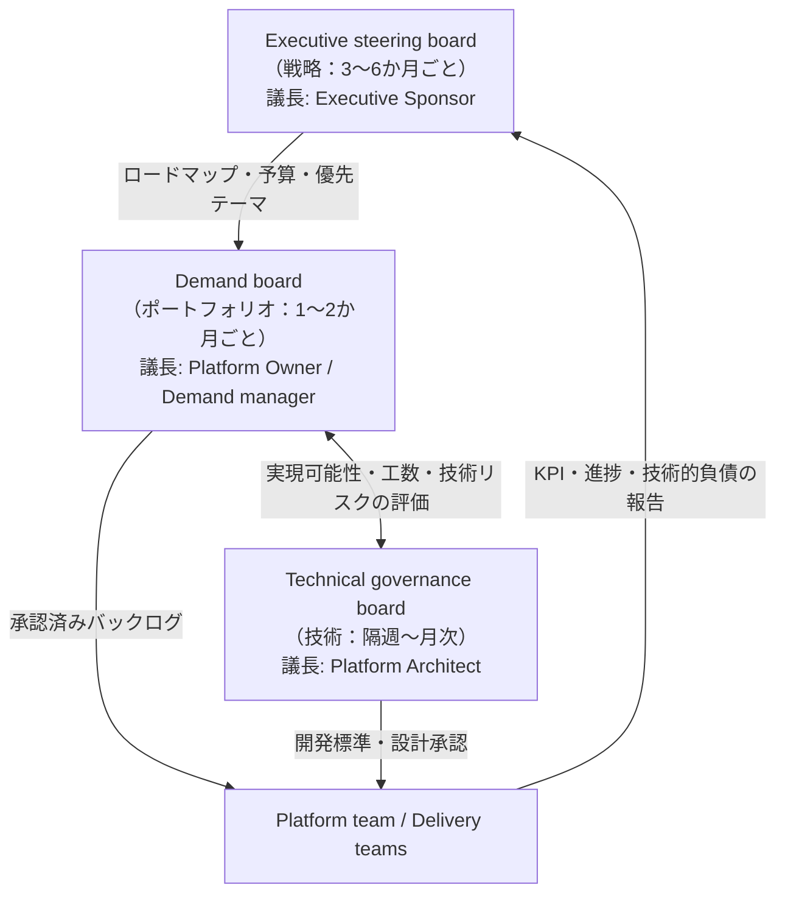
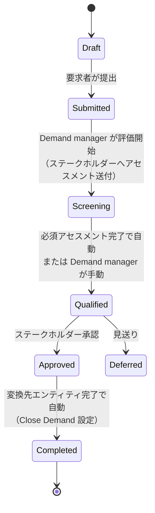
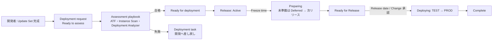
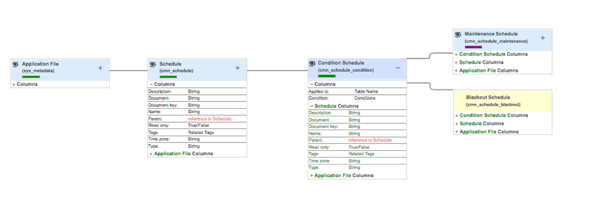
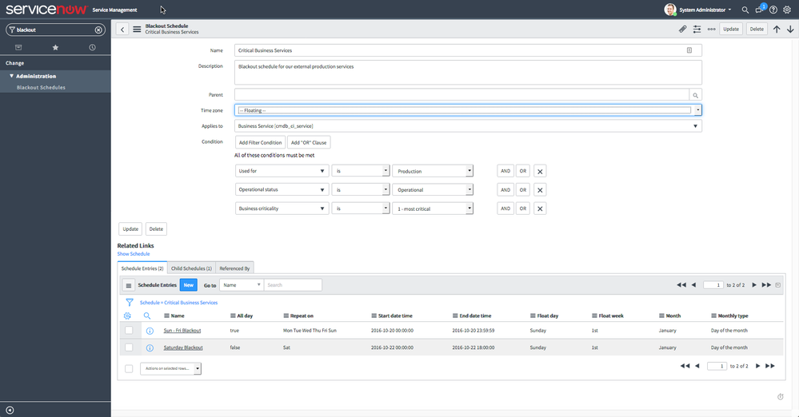
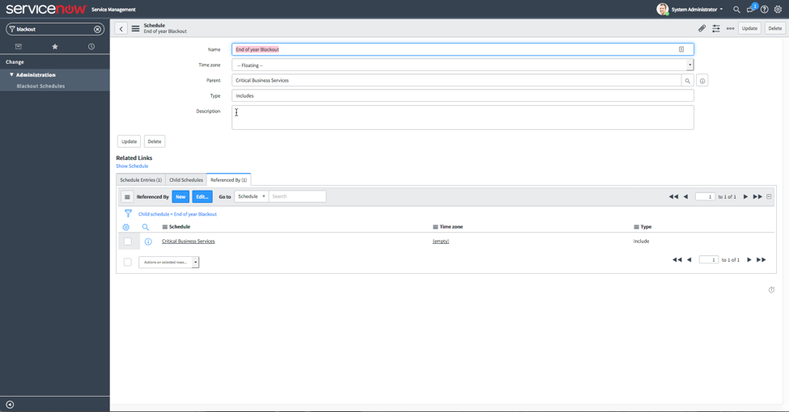

# 運用とガバナンス（Operations and Governance）

## 概要

ServiceNow の「運用とガバナンス」は、本番稼働（Go-Live）後にプラットフォームを**誰が・どの会議体で・どのルールで**育て続けるかを決める領域である。ServiceNow は SaaS であり、インフラの監視・バックアップ・パッチ適用の実作業は ServiceNow 社が担う。顧客側に残る運用の中心は、次の 6 つである。

| 運用領域 | 何を決めるか | ServiceNow 上の主な仕組み | 本ファイルの章 |
|---|---|---|---|
| 体制（Platform team / CoE） | Platform Owner を中心とした常設チームの役割と人数 | Platform Team Estimator（Customer Success Center） | 2 章 |
| ガバナンスボード | 戦略・ポートフォリオ・技術の 3 階層の意思決定 | 会議体（製品機能ではない） | 3 章 |
| Demand 管理 | 改善要望の受付・評価・優先順位・承認 | Demand Management（`dmn_demand`） | 4 章 |
| リリース管理 | 開発成果物を本番へ移す単位・頻度・品質ゲート | ReleaseOps、Pipelines and Deployments、Update Set、Change Management | 5 章 |
| 変更凍結 | 繁忙期・年末・アップグレード前後に変更を止める | Blackout schedule（`cmn_schedule_blackout`）＋ Change conflict detection | 6 章 |
| ライセンス管理運用 | 割り当て・棚卸し・超過防止 | Subscription Management（`usage_admin`） | 7 章 |
| KPI | 運用・プラットフォームの健全性と価値の測定 | Performance Analytics、Benchmarks、Instance Scan、Impact | 8 章 |

関連ファイル：導入プロジェクト中の体制は [プロジェクト体制とパートナー](05-project-organization.md)、環境構成は [インスタンス戦略と環境](07-instance-strategy.md)、Go-Live と運用移管は [テストと本番稼働](11-testing-golive.md)、年 2 回のアップグレードは [アップグレード管理](13-upgrade-management.md)、障害対応・Now Support・監視は [サポートと監視](14-support-monitoring.md)、ライセンス体系そのものは [ライセンスモデル](01-licensing-model.md)、CoE 運営の実践知は [ガバナンスとCoEの実践](../04_応用編/09-governance-coe-practice.md)、ライセンス削減の実践は [ライセンスコスト最適化](../04_応用編/06-license-cost-optimization.md) を参照。

---

## 1. 用語の整理：戦略・オペレーティングモデル・ガバナンス

ServiceNow Community の解説記事（2026-03）は、混同されやすい 3 つの概念を次のように区別している。`【第三者情報】`（Community 投稿） [出典](https://www.servicenow.com/community/developer-blog/servicenow-governance-vs-operating-model-vs-strategy/ba-p/3505321)

| 概念 | 定義 | 問い |
|---|---|---|
| Strategy（戦略） | ServiceNow がビジネス変革をどう支えるかの長期ビジョン。成果（outcome）にフォーカス | どこへ向かうか |
| Operating model（オペレーティングモデル） | ServiceNow の機能を継続的に提供・管理する方法。ロール、チーム構成、デリバリープロセス、サポートモデル、ライフサイクル | どうやって届けるか |
| Governance（ガバナンス） | オペレーティングモデルを戦略に整合させる意思決定構造。誰が決めるか、何をレビューするか、対立をどう解くか、標準をどう強制するか | 誰がどう決めるか |

同記事は典型的な失敗を 3 つ挙げている。

| 失敗パターン | 症状 |
|---|---|
| Governance without strategy | プラットフォームのビジョンがないままボードを作り、議論に方向性がない |
| Strategy without operating model | 目標は野心的だが、デリバリー能力がなく停滞する |
| Operating model without governance | 個々のチームは優秀だが、アーキテクチャ判断が衝突し実装が不統一になる |

---

## 2. Platform team と CoE

### 2.1 ServiceNow 公式が必須とする 2 ロール

ServiceNow の Impact（Customer Success 系サービス）の「ServiceNow Governance」ドキュメントは、顧客側の**必須ロール**として次の 2 つを挙げている。[出典](https://www.servicenow.com/docs/r/VD5jAD3VgRc~i0AwgqwfEQ/Nvj8oOhwhdW2rvC43pyEqA)

| ロール | 公式の定義（要旨） |
|---|---|
| Executive Sponsor（エグゼクティブスポンサー） | ServiceNow に対する主たる戦略上の窓口 |
| Platform Owner（プラットフォームオーナー） | ServiceNow プラットフォーム全体の説明責任（overall accountability）を負う。System Administrator を率いて監督し、チームをビジネス戦略と ServiceNow ロードマップに整合させ、プラットフォームのガバナンスに能動的に関与する |

> 注：このドキュメントは Yokohama 版 Impact ドキュメントとして公開されている。Australia 版で内容が変わったかは公開情報では確認できず。

### 2.2 Platform team の構成

Platform team（プラットフォームチーム）は、本番稼働後にプラットフォームを維持・改善する常設チームである。公式に固定された編成はなく、規模・利用製品・開発方針によって変わる。以下は ServiceNow Community 記事および Customer Success の情報を基にした標準的なロール構成である。`【第三者情報】` [出典](https://www.servicenow.com/community/developer-blog/servicenow-governance-vs-operating-model-vs-strategy/ba-p/3505321)

| ロール | 主な責務 | 典型的な ServiceNow ロール | 備考 |
|---|---|---|---|
| Platform Owner | ビジョン、ロードマップ、予算、Demand board の運営、ベンダー管理 | （業務ロール。インスタンス上は `admin` を持たないことも多い） | 公式必須 |
| Platform Architect（プラットフォームアーキテクト） | 技術標準、構成と開発（configure vs customize）の判断、連携パターン、Technical governance board の主宰 | `admin`（DEV）／ 本番は限定 | 小規模では Platform Owner が兼務 |
| System Administrator（システム管理者） | ユーザー・グループ・ロール、通知、プロパティ、日常の設定変更、Subscription Management | `admin`、`usage_admin` | |
| Developer（開発者） | スクリプト、Flow、カタログアイテム、連携実装 | `admin` または委任開発ロール（DEV のみ） | |
| Business Analyst（ビジネスアナリスト） | 要件整理、ストーリー作成、Demand のエンリッチ | `it_demand_user` など | |
| Process Owner（プロセスオーナー） | Incident / Change など各プロセスの設計と KPI 責任 | `itil_admin` 等 | 業務部門側に置くことが多い |
| QA / Tester | ATF の保守、回帰テスト、アップグレード検証 | `atf_test_designer` 等 | |
| Integration / Platform Engineer | 連携、MID Server、インスタンスの性能・監視 | `admin`、`mid_server` 管理 | |
| Release Manager | リリース計画、凍結日、移送判定 | ReleaseOps の Release manager | 5 章 |

ServiceNow 社の Customer Success Center は **Platform Team Estimator** を提供しており、インスタンスの規模・利用状況・オペレーティングモデルに関する 11 の質問に答えると、推奨 FTE 範囲と必要ロールを提示する。[出典](https://www.servicenow.com/community/in-other-news/build-the-team-you-need-to-succeed-with-your-servicenow/ba-p/2285583)（ツール URL: https://www.servicenow.com/success/platform-team-estimator.html 。2021 年の告知記事であり、2026-11 時点でツールが同じ形で提供されているかは公開情報では確認できず）

**規模の目安**：ServiceNow 公式の FTE 比率（ユーザー数あたり何人など）は公開情報では確認できず。`【経験則】` として、ITSM 中心・数千ユーザー規模で Platform Owner 1 名＋管理者／開発者 2〜5 名から始め、製品追加（HRSD、CSM、ITOM など）ごとに増員することが多い。

### 2.3 CoE（Center of Excellence）

CoE（センター・オブ・エクセレンス）は、Platform team を中核に、ガバナンス・標準・教育・価値測定までを担う組織機能である。ServiceNow Community の解説では、CoE は「ServiceNow プラットフォームの中央リーダーシップ機能」であり、戦略・オペレーティングモデルの実行・ガバナンスを調整するとされる。`【第三者情報】` [出典](https://www.servicenow.com/community/developer-blog/servicenow-governance-vs-operating-model-vs-strategy/ba-p/3505321)

CoE の責務：

1. プラットフォーム戦略の定義
2. ガバナンスプロセス（3 章のボード）の運営
3. 開発標準・命名規約・アーキテクチャ標準の維持
4. デリバリーチーム（社内・パートナー）の支援
5. パフォーマンス（KPI・価値）の測定

CoE の主要ロールは Platform owner、Platform architect、Process owners、Enterprise architects、Delivery leads である。

#### CoE の型（`【経験則】`）

| 型 | 特徴 | 向く組織 |
|---|---|---|
| 集中型（Centralized） | すべての構築・変更を CoE が実施 | 導入初期、単一製品、小〜中規模 |
| 連邦型（Federated） | CoE が標準・ガバナンス・共通基盤を持ち、各事業部（HR、CS 等）が自部門アプリを開発 | 複数製品・複数事業部 |
| 分散型（Decentralized） | 各部門が独立に構築、CoE は最小限 | 非推奨。技術的負債・重複が発生しやすい |

マルチベンダー（複数パートナー）体制で CoE を運営する場合の RACI 例は Community 記事「Defining roles and responsibilities in a multi-vendor operating model」を参照。`【第三者情報】` [出典](https://www.servicenow.com/community/developer-blog/defining-roles-and-responsibilities-in-a-multi-vendor-operating/ba-p/3400171)

#### 運用移管時の CoE 立ち上げチェックリスト（`【経験則】`）

| # | 項目 | 成果物 |
|---|---|---|
| 1 | Executive Sponsor と Platform Owner の任命 | 任命文書 |
| 2 | プラットフォームビジョンと 1〜3 年ロードマップ | ロードマップ |
| 3 | 3 つのボードの憲章（charter） | 憲章、メンバー表、アジェンダ雛形 |
| 4 | Demand の受付窓口（カタログアイテム / Demand Management） | 受付フォーム、スコアリング基準 |
| 5 | 開発標準（命名、スコープ、スクリプト規約、OOTB 優先方針） | 開発標準書 |
| 6 | リリースカレンダー（定例リリース、凍結期間、アップグレード） | 年間カレンダー |
| 7 | 権限ポリシー（本番 `admin` の保持者、ロール付与はグループ経由） | 権限設計書 |
| 8 | ライセンス棚卸し手順 | 月次手順書 |
| 9 | KPI セットとレポート | ダッシュボード |
| 10 | AMS／パートナーとの役割分担（RACI） | RACI 表 |

---

## 3. ガバナンスボード（3 階層）

### 3.1 公式の 3 ボードモデル

ServiceNow のガバナンスワークショップ（Impact）は、次の 3 つのガバナンスボードの立ち上げを支援対象としている。[出典](https://www.servicenow.com/docs/r/VD5jAD3VgRc~i0AwgqwfEQ/Nvj8oOhwhdW2rvC43pyEqA)

| ボード | ガバナンス領域 | ServiceNow が顧客に求めるインプット資料 |
|---|---|---|
| Executive steering board（エグゼクティブ・ステアリングボード） | Strategy（戦略） | ステアリングボード憲章、参加者リストと役割、アジェンダ |
| Demand board（デマンドボード） | Portfolio（ポートフォリオ） | Demand board 憲章、参加者、アジェンダ、デマンドのスコアリング・重み付け基準、受付・評価資料 |
| Technical governance board（技術ガバナンスボード） | Technical（技術） | 既存の技術ガバナンスボード、技術ガバナンス憲章・アジェンダ、アーキテクチャブループリント、プロジェクトバックログ |

公式ドキュメントはボードのメンバー構成・開催頻度を規定していない。以下は ServiceNow Community 記事に基づく実務上の標準である。

### 3.2 Executive steering board

| 項目 | 内容 |
|---|---|
| 目的 | 投資をビジネス目標に整合させ、進捗を監視し、リスクを管理する。ServiceNow ロードマップを事業目標に合わせる。パートナー管理を監督する |
| 議長 | Executive Sponsor |
| メンバー | CIO/CTO、事業部門の代表、ベンダーマネージャー。小さく保つ |
| 頻度 | 3〜6 か月ごと。ロードマップは数年先を見る |
| 意思決定方法 | 多数決・合意など、ボード自身が決める |
| インプット | パフォーマンスレポート、プロジェクト状況（8 章の KPI） |

`【第三者情報】` [出典](https://www.servicenow.com/community/developer-blog/executive-steering-boards-for-large-enterprises/ba-p/3177260)

### 3.3 Demand board

| 項目 | 内容 |
|---|---|
| 目的 | プラットフォームへの要求（新規アプリ、機能拡張、連携、ワークフロー展開）を戦略ロードマップに照らして評価・優先順位付け・承認する |
| 議長 | Demand manager または Platform Owner |
| メンバー | Platform Owner、プロセス／ドメインオーナー、アプリケーションアーキテクト、プログラムマネージャー、Demand manager、ビジネスリレーションシップマネージャー |
| 頻度 | 1〜2 か月ごと。未処理デマンドが多ければ増やす |
| アウトプット | 優先順位付きバックログ |

`【第三者情報】` [出典1](https://www.servicenow.com/community/developer-blog/demand-governance-for-large-enterprises/ba-p/3168245) [出典2](https://www.servicenow.com/community/in-other-news/the-4-steps-to-manage-platform-demand-for-servicenow/ba-p/2272517)

### 3.4 Technical governance board（Architecture Review Board）

| 項目 | 内容 |
|---|---|
| 目的 | アーキテクチャ標準の設定（configure vs customize の判断、連携パターン、データモデル、スコープ方針）と、個別の設計レビュー |
| 議長 | Platform Architect（または Platform Owner） |
| メンバー | Platform Architect、リード開発者、エンタープライズアーキテクト、セキュリティ担当、主要パートナーのアーキテクト |
| 頻度 | `【経験則】` 隔週〜月次。リリース前の設計レビューと連動 |
| 判断対象の例 | OOTB テーブルへのカスタム列追加、Business Rule の新規作成、`global` スコープでの開発、新規連携方式、新規プラグイン／Store アプリの導入、サブスクリプション外のテーブル・機能の利用 |
| ツール | Instance Scan（8.4 節）、ReleaseOps の Deployment Analyzer（5 章）、コードレビュー |

`【第三者情報】` [出典](https://www.servicenow.com/community/developer-blog/servicenow-governance-vs-operating-model-vs-strategy/ba-p/3505321)

> 補足：ServiceNow Community では、生成 AI／AI Agents の利用判断を扱う「AI Governance Board」を 4 つ目のボードとして置く考え方も紹介されている（記事本文は未確認）。AI 固有のガバナンスは [Now Assist と AI Agents](../02_リファレンス/platform/now-assist-ai-agents.md) と [Now Assist / AI Agents 導入の知見](../04_応用編/10-ai-adoption-lessons.md) を参照。

---

## 4. Demand 管理

### 4.1 プラットフォームデマンド管理の 4 ステップ

ServiceNow Customer Success の Best Practices Center of Excellence（2018）は、プラットフォームへのデマンド管理を 4 ステップで整理している。`【第三者情報】`（ServiceNow 社員による Community 記事） [出典](https://www.servicenow.com/community/in-other-news/the-4-steps-to-manage-platform-demand-for-servicenow/ba-p/2272517)

*図：プラットフォームデマンド管理の 4 ステップ*
左から右に「Visibility（可視化）」「Control（統制）」「Alignment（整合）」「Velocity（速度）」の 4 つの矢羽根が並ぶ図。デマンド管理を段階的に成熟させる順序を表す。出典：https://www.servicenow.com/community/in-other-news/the-4-steps-to-manage-platform-demand-for-servicenow/ba-p/2272517 （取得日：2026-11-03）

| ステップ | 内容 |
|---|---|
| 1. Visibility（可視化） | デマンド受付モデルを作る。Demand owner ロール、Demand board、訓練された要求者を置く。小さく始め、シンプルな価値スコアリングを使い、Demand Management を記録システム（system of record）にする |
| 2. Control（統制） | デマンドをエンリッチ（拡充）・優先順位付け・承認する。Demand owner を割り当て、複雑なデマンドは Demand board へエスカレーション |
| 3. Alignment（整合） | 承認済みデマンドを事業部門の戦略・KPI・ケイパビリティ・ServiceNow ロードマップに対応付ける。技術ではなく業務指標で語る |
| 4. Velocity（速度） | アジャイル手法でビジネス変更の検証頻度を上げ、デマンドとキャパシティをほぼリアルタイムに結び付ける。サービスのデマンド責任を Service Owner へ移す |

Demand board へのエスカレーション基準の例：変革的ポートフォリオに関わる、大きなリソースやリスクを伴う、複数事業部門のステークホルダーが関わる。コスト見積りは T シャツサイズから始め、必要に応じて資本・リソース・運用コストを加える。

### 4.2 Demand Management アプリケーション

Demand Management（デマンド管理）は Strategic Portfolio Management（SPM、旧 ITBM）の一部であり、アイデアや要求を「デマンド」として一元管理し、評価・承認後にプロジェクトや機能拡張へ変換する。製品仕様の詳細は [Strategic Portfolio Management（PPM）](../02_リファレンス/spm/strategic-portfolio-management.md) を参照。

> ライセンス注意：Demand Management は SPM のサブスクリプション対象である。`it_demand_manager` 等の SPM ロールは、ライセンスを購入していないユーザーに付与しないよう Community で注意喚起されている。`【第三者情報】` [出典](https://www.servicenow.com/community/spm-forum/demand-management-roles/td-p/994728/page/2)。SPM を購入していない組織は、カタログアイテム＋独自テーブル、または Agile Development の Story バックログで代替するケースもある（ただしカスタムテーブルのライセンス消費に注意。7 章）。`【経験則】`

#### 主なテーブルとロール

| 種別 | 名前 | 説明 | 出典確度 |
|---|---|---|---|
| テーブル | `dmn_demand` | Demand（デマンド）レコード。Task を拡張 | Community・第三者情報 |
| ロール | `it_demand_manager` | Demand manager。デマンドの作成・参照・変更、状態遷移、変換 | 公式（Planning for Demand Management） |
| ロール | `it_demand_user` | Demand user。ドラフトの作成、他者デマンドの参照 | 公式（同上） |
| ロール（レガシー） | `demand_manager` / `demand_user` | 旧ロール。現在は `it_` 付きに置換 | Community |

[出典（公式ロール）](https://www.servicenow.com/docs/r/4~5Anqt12idfVzJWPcxoHw/NRArlQoBT6R3E6QIzu93xg) [出典（Community）](https://www.servicenow.com/community/spm-forum/demand-management-roles/td-p/994728/page/2)

Community 回答によると `it_project_manager` は `it_demand_manager` を内包する。`【第三者情報】`

#### デマンドの状態（State）

公式ドキュメント（Brazil 版、2026-09-10 更新）の Demand workflow による状態遷移は次のとおり。[出典](https://www.servicenow.com/docs/r/it-business-management/strategic-planning/demand-process-flow.html)

| State | 意味 | 主な担当 |
|---|---|---|
| Draft | 下書き。要求者・Demand user が作成 | Business user / Demand user |
| Submitted | 提出済み | 要求者 |
| Screening | 評価中。ステークホルダーにスコアリング用アセスメントが送付される | Demand manager、Stakeholder |
| Qualified | 評価完了。必須アセスメント提出で自動遷移、または Demand manager が手動で設定（アセスメント遅延・不要時） | Demand manager |
| Approved | 承認済み。Demand manager が Category と Type に応じて変換先エンティティを作成 | Demand approver、Demand manager |
| Deferred | 見送り | Stakeholder |
| Completed | 完了。変換先が完了すると Close Demand フィールドに基づき自動、または Demand manager がどの状態からでも手動で完了可 | Demand manager |

#### 変換先エンティティ

| 変換先 | 前提 |
|---|---|
| Project（プロジェクト） | Project Portfolio Management |
| Change（変更要求） | Change Management |
| Enhancement（機能拡張） | SDLC-SCRUM プラグイン（Agile Development） |
| Defect（欠陥） | SDLC-SCRUM プラグイン |
| Epic / Feature / Capability（Enterprise Agile Planning） | Strategic Planning プラグイン |

[出典](https://www.servicenow.com/docs/r/it-business-management/demand-management/r_UsingDemandManagement.html)

#### 受付経路

デマンドは Service Catalog、Idea Portal、Next Experience for Demand Management から作成できる。[出典](https://www.servicenow.com/docs/r/it-business-management/strategic-planning/demand-process-flow.html)

> **Brazil での変更:** Brazil 版ドキュメントの Demand workflow は Next Experience for Demand Management による自動状態更新を前提に記述されている。Classic UI の手順と差があるため、利用 UI に応じたページを参照すること。Australia から Brazil での状態値の変更は公開情報では確認できず。

### 4.3 デマンドの振り分け（トリアージ）ルール

Platform Owner は、すべての要望を Demand board に上げるのではなく、規模で振り分ける。`【経験則】`（Community で一般的に語られる方式。Glen Kaminski 記事のエスカレーション基準と整合）

| 区分 | 判断基準の例 | 経路 | 記録先 |
|---|---|---|---|
| 不具合（Defect） | 既存機能が仕様どおり動かない | Platform team が直接対応。優先度は Incident/Problem に準拠 | Incident → Defect / Story |
| 小規模改善（Minor enhancement） | 目安 1〜5 人日以内、単一プロセス、データモデル変更なし | Platform Owner 判断で次回定例リリースへ | Story（Agile Development） |
| 中規模改善 | 5〜20 人日、複数チーム影響 | Demand board で優先順位付け | Demand → Enhancement |
| 大規模・新規製品 | 新製品導入、新規連携、複数事業部、追加ライセンス | Demand board →（必要に応じ）Executive steering board | Demand → Project |
| 標準変更 | 事前承認された定型の設定変更（カタログアイテム追加、通知文面変更など） | Standard change で即時実施 | Change（Standard） |

#### スコアリングの例（`【経験則】`）

| 観点 | 重み | 評価例 |
|---|---|---|
| ビジネス価値（コスト削減・売上・顧客体験） | 30% | 1〜5 |
| 戦略整合（ロードマップ上のテーマ） | 20% | 1〜5 |
| 影響ユーザー数 | 15% | 1〜5 |
| 規制・リスク対応 | 15% | 1〜5 |
| 工数（逆スコア） | 10% | 1〜5 |
| 技術リスク・技術的負債（逆スコア） | 10% | 1〜5 |

Demand Management は Value、Cost、Risk、Size、Strategic alignment 等のスコアフィールドとアセスメントによる自動スコアリングを持つため、スコアリング基準をアセスメント設問として実装するのが標準的である。`【第三者情報】`

---

## 5. リリース管理

### 5.1 ServiceNow のリリース管理の対象

ServiceNow におけるリリース管理には 2 つの意味がある。混同しないこと。

| 種類 | 内容 | 本ファイルでの扱い |
|---|---|---|
| A. 顧客側の構成変更のリリース | 顧客が開発した設定・アプリを DEV → TEST → PROD へ移送 | 本章 |
| B. ServiceNow 社のプラットフォームリリース | 年 2 回のファミリーリリース（Australia、Brazil …）とパッチ | [アップグレード管理](13-upgrade-management.md)、[リリースサイクルとバージョン](../01_入門編/07-release-cycle.md) |

また、ITSM の Release Management アプリケーション（`rm_release` テーブル、他システムのリリースを管理する ITSM プロセス）は [Release Management と DevOps](../02_リファレンス/itsm/release-management.md) を参照。

### 5.2 移送手段の選択肢

| 手段 | 単位 | 特徴 | 向くケース |
|---|---|---|---|
| Update Set（アップデートセット） | 設定変更の束 | 最も伝統的。手動の取得（Retrieve）・プレビュー・コミット | `global` スコープの設定、小規模組織 |
| Application Repository / Store 経由 | スコープアプリ | バージョン管理されたアプリのインストール | スコープアプリ開発 |
| Pipelines and Deployments（App Engine Management Center, AEMC） | スコープアプリ | Deployment request、承認、品質ゲート（Instance Scan・ATF）、本番前の Change request 自動作成 | ローコード開発者（App Engine）のガバナンス |
| ReleaseOps（Zurich で新登場） | Release ＞ Deployment request ＞ Update Set / アプリ | 凍結日付きの定例リリース（release train）、Deployment Analyzer、ATF・Instance Scan による評価、Playbook による自動デプロイ | プラットフォーム全体の定例リリース運用 |
| CI/CD API | アプリ・Update Set | 外部 CI/CD（GitHub Actions、Azure DevOps 等）からの自動化 | DevOps 成熟組織 |

Update Set の仕様は [アップデートセットとクローン](../02_リファレンス/platform/update-sets-cloning.md)、アプリ開発・Studio は [アプリケーション開発](../02_リファレンス/platform/app-development.md) を参照。

### 5.3 ReleaseOps（Australia 時点の推奨リリース基盤）

ReleaseOps は ServiceNow AI Platform 上の変更・カスタマイズ・カスタムアプリのデプロイを自動化する機能である。インスタンス間の信頼関係と認証情報を内部で管理し、ServiceNow Playbooks でデプロイを実行する。ServiceNow Studio からデプロイを起動できる。[出典](https://www.servicenow.com/docs/r/zUlSbxoxKPAWFDGUdAoSCw/vxsfciX32c_lTl7bVVR4Hg)

| 項目 | 内容 |
|---|---|
| 導入 | ServiceNow Store から入手。バージョン履歴・累積リリースノートは Store に記載 [出典](https://www.servicenow.com/docs/r/delta-zurich-brazil/brazil-zurich-releaseops-release-notes.html) |
| 制約 | 規制環境（regulated environments）とオンプレミスでは非サポート。利用可否はエンタイトルメントに依存。AI 機能はライセンス階層に依存 |
| 費用 | Community 記事は「無償で利用可能」と記載 `【第三者情報】`（公式の価格記載は確認できず） |
| 前提 | Community 記事によると `sn_releaseops` アプリと Workflow Studio を DEV/TEST/PROD に導入し、インスタンス間信頼（MIM trust）と PROD・TEST の Update Source を設定 `【第三者情報】` [出典](https://www.servicenow.com/community/upgrades-and-patching-forum/revolutionizing-servicenow-deployments-the-complete-guide-to/m-p/3484003) |

#### ReleaseOps のロール

| ロール | 責務 |
|---|---|
| Pipeline manager | パイプラインの作成・管理、Playbook のカスタマイズ |
| Release manager | リリースの作成・スケジュール、内容の確認、基準を満たさない Deployment request の除外 |
| Developer | Update Set やアプリインストールを本番へ送る Deployment request を作成 |
| Tester | ATF の失敗を承認してデプロイ継続させる、または開発へ差し戻す |

（ロールの技術名（`sn_releaseops.*` 等）は公開情報の範囲では確認できず）

#### ReleaseOps の構成要素

| 要素 | 説明 |
|---|---|
| Pipeline | デプロイの流れ。フローは Playbook で定義 |
| Release | どの変更をいつターゲットインスタンスへ移すかを定義。Scheduled（定例）と On-demand（随時）の 2 種 |
| Deployment request | Release に含まれる作業単位。1 つ以上の Update Set またはアプリインストールを保持 |
| Deployment Analyzer | カスタマイズ可能なルールで Update Set をレビューし、本番（ターゲット）状態との差分を検査。ATF コードカバレッジも利用 |
| Playbooks | Assessment playbook と Release playbook。Runbook task で手動・独自作業を追加（Australia で追加） |
| AI 機能 | Update Set の説明文・リリースノートの生成（Australia で追加） |

#### Release の状態（Australia）

[出典](https://www.servicenow.com/docs/r/zUlSbxoxKPAWFDGUdAoSCw/hk~gAQRZEr_4xeIE21DNVg)

| State | 意味 |
|---|---|
| Draft | 初期状態。ReleaseOps は処理しない。Deployment request を追加するには手動で Active にする |
| Active | オープン中で Freeze time（凍結時刻）待ち。Developer が Deployment request を追加・削除できる |
| Preparing | 凍結済み。各 Deployment request の準備状況を検査し、未準備のものは Deferred にして次のリリースへ回す。リリース順序を生成。Release administrator は削除可能 |
| Ready for Release | 内容確定、全チェック合格、手動のパイプライン手順完了 |
| Deploying | 予定時刻にビルド成果物をターゲットインスタンスへ移送中 |
| Reconciling | Deployment request に手動介入が必要（プレビューの競合など）。Playbook がタスクを作成 |
| Complete | 問題なく完了 |
| Cancelled | デプロイ開始前に手動で中止 |
| Failed | デプロイが完了できない、または問題付きで完了（Update Set の問題が多い） |

Release が Change Management のレコードに紐付いている場合、Preparing・Deploying への遷移時刻は**その Change record が決める**。これにより、ReleaseOps の本番デプロイを CAB 承認済みの変更ウィンドウに一致させられる。

> **Brazil での変更:** Release が存在する前に Deployment request を作成でき、アセスメントを早期に開始できるようになった。変更・削除・非推奨はなし。Zurich → Australia → Brazil と上げる環境でサンプル Playbook をカスタマイズしていた場合、Runbook task の Playbook activity を手動で再設定する必要がある場合がある。[出典](https://www.servicenow.com/docs/r/delta-zurich-brazil/brazil-zurich-releaseops-release-notes.html)

### 5.4 Pipelines and Deployments（App Engine）

Pipelines and Deployments は App Engine Management Center（AEMC）の機能で、App Engine Studio・Creator Studio・ServiceNow Studio から提出されたアプリの Deployment request を、Controller instance 上で承認・テスト・本番公開まで管理する。[出典](https://www.servicenow.com/docs/r/zUlSbxoxKPAWFDGUdAoSCw/N7UlF_9mlCgZmtICks6a0Q)

| 項目 | 内容（Australia、AEMC 24.1.2 以降） |
|---|---|
| 起点 | 要求者が各 Studio からアプリを提出 → ペイロード検証、App Manifest 取得、Controller instance に Deployment request を作成、要求者にメール |
| 環境 | Pipeline レコードで次の環境（Testing、Production 等）を決定し、Target environment を更新して承認を待つ |
| 品質ゲート（Testing 環境） | Scoped App Definitions の Instance Scan、Application Deployment Test Suite（ATF）、Scan Suites テーブル（`scan_suites`）の追加スイート。結果は Deployment Environment Result と Activity Stream に記録 |
| 本番前 | App Engine admin が「Approve & Create Change request」を選択 → Guided Setup で選んだテンプレートから Change request を作成。アプリを CI として登録し変更に関連付け |
| 本番デプロイ条件 | Change request が Implement 状態かつ Planned start date が現在以前 |
| 状態（Community・旧版情報） | Closed - Published、Closed - Rejected、Closed - Failed |

### 5.5 リリースカレンダーの設計（`【経験則】`）

| リリース種別 | 頻度 | 内容 | 承認 |
|---|---|---|---|
| 定例リリース（Release train） | 2 週間〜月 1 回 | 承認済みバックログの Story・Enhancement | Normal change（CAB） |
| 緊急リリース（Hotfix） | 随時 | 本番障害の修正 | Emergency change（ECAB） |
| 標準変更 | 随時 | 事前承認済みの定型設定（カタログ項目追加など） | Standard change |
| 大型リリース | 四半期 | 新製品・新プロセスの展開 | Normal change ＋ ステアリング報告 |
| ServiceNow アップグレード | 年 1〜2 回 | ファミリーアップグレード | 専用プロジェクト（13 章） |

運用上のルール例：

1. **本番に直接変更しない**：本番インスタンスでの設定変更は、Update Set に記録されないデータ（ユーザー、グループ、一部のスケジュール等）を除き原則禁止。本番 `admin` 保持者を最小化する。
2. **変更は必ず Change request で管理**：ServiceNow 自身の構成変更も ITSM の Change Management で管理する（「自分たちのドッグフード」）。CI としてインスタンスまたはアプリ（例：`cmdb_ci_service` / アプリケーション CI）を登録し、Blackout schedule の対象にする。
3. **移送順序の管理**：Update Set の依存関係（親子・バッチ）を Release 単位でまとめる。ReleaseOps は最後のインスタンスでのデプロイ順で TEST から PROD へ移す。
4. **リリースノート**：利用者向け（何が変わるか）と運用者向け（設定内容・ロールバック手順）を分ける。ReleaseOps の AI 生成リリースノートを下書きに使える（Australia）。
5. **ロールバック**：Update Set は Back out が可能だが、データ変更は戻らない。ロールバック手順を Change request に記載する。

---

## 6. 変更凍結（Change Freeze）

### 6.1 変更凍結の種類

| 種類 | 誰が凍結するか | 目的 | ServiceNow での実装 |
|---|---|---|---|
| 顧客の業務繁忙期の凍結 | 顧客 | 決算期・年末商戦・年度切替などに本番変更を止める | Blackout schedule |
| リリース凍結（コードフリーズ） | 顧客 | 定例リリースのデプロイ前に内容を確定 | ReleaseOps の Freeze time、Update Set の締切 |
| アップグレード前後の凍結 | 顧客 | ファミリーアップグレードの検証期間中に開発を止める | 運用ルール＋ Blackout schedule |
| ServiceNow 社側のホリデー凍結 | ServiceNow 社 | 年末年始に ServiceNow 主導の変更を行わない | ServiceNow 社の運用（顧客はアップグレード自体はスケジュール可能） |

ServiceNow 社は年末年始に「Holiday change freeze」を設け、その期間は ServiceNow 主導の変更を行わないが、顧客は自インスタンスのアップグレードを含む変更を開始できる、と Community 記事（2016-2017 シーズンの例：12/19〜1/3）で説明されている。最新年度の期間は Now Support の KB「ServiceNow Holiday Change Freezes」で確認すること（2025/2026 年度の内容は公開情報では確認できず）。`【第三者情報】` [出典](https://www.servicenow.com/community/in-other-news/holiday-emergency-prep-kit-for-you-and-your-servicenow-instance/ba-p/2271944)

### 6.2 凍結の考え方：Freeze か Chill か

ServiceNow Community の議論では、全面凍結（Freeze）は ServiceNow のような SaaS ではやや時代遅れで、**Change Chill**（軽微な改善・不具合修正・進行中プロジェクトは許容し、大型リリースとアップグレードを止める）を推奨する意見が採用回答になっている。また、1 か月を超える凍結はパッチ適用スケジュールと衝突するため避けるべきとされる。典型的な期間は年末年始の約 2 週間、長い組織で米国サンクスギビング前週末〜1 月上旬。`【第三者情報】` [出典](https://www.servicenow.com/community/itsm-forum/is-a-change-freeze-necessary-in-servicenow/m-p/511375)

日本企業向けの設計例（`【経験則】`）：

| 期間 | 区分 | 許容される変更 |
|---|---|---|
| 年末年始（12 月下旬〜1 月第 1 週） | Freeze | Emergency change のみ |
| 年度末・年度初め（3 月末〜4 月第 1 週） | Chill | 不具合修正、標準変更。組織改編に伴うグループ・ユーザー更新は事前計画 |
| 決算・監査対応期間 | Chill | 監査対象プロセス（Change、アクセス管理）の設定変更を禁止 |
| ServiceNow アップグレード本番適用の前後 1 週間 | Freeze | Emergency change のみ |
| ゴールデンウィーク・お盆 | Chill | 体制が手薄なため大型リリースを避ける |

### 6.3 Blackout schedule と Maintenance schedule

Change Management は、変更の実施を禁止する期間と許可する期間を schedule として定義し、Conflict detection（競合検出）で変更要求と照合する。[出典](https://www.servicenow.com/docs/r/QykF2iRSIs6VXztArCSo3w/Gyeat1enp08Zj9DzXEzZrA)

| 項目 | Blackout schedule | Maintenance schedule |
|---|---|---|
| 意味 | 通常の変更を**実施してはならない**期間（例：年末のコードフリーズ） | 変更を**実施すべき**期間（メンテナンスウィンドウ） |
| テーブル | `cmn_schedule_blackout` | `cmn_schedule_maintenance` |
| 親テーブル | `cmn_schedule_condition`（Condition Schedule）→ `cmn_schedule` | 同左 |
| メニュー（Classic） | Change > Schedules > Blackout Schedules | Change > Schedules > Maintenance Schedules |
| 必要ロール | `itil_admin` または `admin`（公式）。Community では `schedule_admin` で作成・編集可、子スケジュールの関連付けには `admin` が必要とされる | 同左 |
| 必要プラグイン | Change Management - Collision Detector（`com.snc.change.collision`） | 同左 |

スケジュールの実際の時間帯（Schedule entry）は `cmn_schedule_span` に保存される。[出典](https://www.servicenow.com/community/itsm-blog/blackout-maintenance-schedules-in-a-nutshell/ba-p/2269223)

*図：Schedule 関連テーブルの継承構造（Schema Map）*
左から Application File（`sys_metadata`）→ Schedule（`cmn_schedule`、列：Description、Document、Document key、Name、Parent、Read only、Tags、Time zone、Type）→ Condition Schedule（`cmn_schedule_condition`、追加列：Applies to［Table Name］、Condition［Conditions］）と継承し、Condition Schedule から Maintenance Schedule（`cmn_schedule_maintenance`）と Blackout Schedule（`cmn_schedule_blackout`）の 2 つが派生している。出典：https://www.servicenow.com/community/itsm-blog/blackout-maintenance-schedules-in-a-nutshell/ba-p/2269223 （ServiceNow 社員 Jason Occhialin による 2016 年の記事。取得日：2026-11-03）

#### Blackout schedule フォームの主な項目

| フィールド | 内容 |
|---|---|
| Name | 名前（一意） |
| Description | 説明 |
| Time zone | タイムゾーン。Floating を選ぶとログインユーザーのタイムゾーンで評価 |
| Source | Service（アプリケーションサービスを支える全 CI）、Change Request（条件に一致する変更要求そのもの）、CI Class（CI クラスと子クラス） |
| Applies to | Source が CI Class のときの CI クラス参照（Dynamic CI group も可） |
| Condition | 対象 CI の絞り込み条件。関連テーブルのフィールド（dot-walk）を使った条件は評価されない |
| 関連リスト | Schedule Entries（時間帯）、Child Schedules（子スケジュール：Include／Exclude）、Referenced By |

[出典](https://www.servicenow.com/docs/r/QykF2iRSIs6VXztArCSo3w/Gyeat1enp08Zj9DzXEzZrA)

*図：Blackout Schedule フォーム（Classic UI、旧リリースの画面）*
アプリケーションナビゲーターで「blackout」を検索し、Change > Administration > Blackout Schedules を開いた画面。レコード名「Critical Business Services」、Time zone は「-- Floating --」、Applies to は「Business Service [cmdb_ci_service]」、Condition は「Used for is Production」「Operational status is Operational」「Business criticality is 1 - most critical」の 3 条件。下部の Related Links に「Show Schedule」、関連リストに Schedule Entries（「Sun - Fri Blackout」終日・日〜金、「Saturday Blackout」土曜 0:00〜18:00）、Child Schedules、Referenced By のタブがある。現行の Next Experience / ITSM fulfiller experience では見た目とメニュー位置が異なる（後述）。出典：https://www.servicenow.com/community/itsm-blog/blackout-maintenance-schedules-in-a-nutshell/ba-p/2269223 （取得日：2026-11-03）

*図：子スケジュールで年末期間を追加した例*
Schedule フォームで Name「End of year Blackout」、Time zone「Floating」、Parent「Critical Business Services」、Type「Includes」を設定し、Referenced By タブに親の「Critical Business Services」（Type: Include）が表示されている。通常の Blackout（週末の一部は変更可）に対し、年末期間だけは土曜も含めて凍結する、という例外期間を子スケジュールで追加している。出典：https://www.servicenow.com/community/itsm-blog/blackout-maintenance-schedules-in-a-nutshell/ba-p/2269223 （取得日：2026-11-03）

> メニュー位置の注意：近年のリリースでは ITSM fulfiller experience（Service Operations Workspace 系）> Change Management > Change schedules から設定する手順も案内されている（Simplified Change Management 構成時）。Classic UI の Change > Schedules メニューも引き続き存在する。[出典](https://www.servicenow.com/docs/r/it-service-management/configure-schedules-for-simplified-change-management.html)

### 6.4 Conflict detection（競合検出）プロパティ

Blackout schedule は単体では変更を「ブロック」しない。Conflict detection が変更要求の Planned start/end date と CI を schedule と照合し、**競合（Conflict）として表示**する。Community でも「Blackout 期間中でも変更は提出できる。競合として表示されるだけ」と回答されている。[出典](https://www.servicenow.com/community/itsm-forum/configure-maintenance-and-black-out-schedule/td-p/445391/page/2)

Conflict properties のメニューは All > Change Administration > Conflict Properties、必要ロールは `admin`。主なプロパティ（Xanadu 版ドキュメントによる。Australia での差分は確認できず）。[出典](https://www.servicenow.com/docs/r/xanadu/it-service-management/change-management/configure-conflict-properties.html)

| プロパティ | 内容 | 既定値（記載あるもの） |
|---|---|---|
| `change.conflict.blackout` | Blackout window と照合 | — |
| `change.conflict.relatedchildblackout` | 子 CI の Blackout window と照合 | — |
| `change.conflict.relatedparentblackout` | 親 CI の Blackout window と照合 | — |
| `change.conflict.currentwindow` | CI の Maintenance window と照合 | — |
| `change.conflict.relatedchildwindow` / `relatedparentwindow` | 子／親 CI の Maintenance window と照合 | — |
| `change.conflict.ci_maint_sched` | CI の Maintenance schedule 参照フィールドと照合 | — |
| `change.conflict.relatedservices` | 関連アプリケーションサービスの Maintenance/Blackout と照合 | — |
| `change.conflict.currentci` | 同一 CI に既に予定された変更と照合 | — |
| `change.conflict.assigned_to` | 同一担当者の他の変更と照合 | — |
| `change.conflict.mode` | CI 競合チェックのモード（Basic / Advanced） | — |
| `change.conflict.refresh.conflicts` | CI・計画開始/終了・状態の変更時に自動で競合検出 | — |
| `change.conflict.refresh.scheduled` | スケジュールされた競合チェッカーを有効化 | — |
| `change.conflict.next_available.schedule_window` | 次の空き時間を探す日数 | 90 |
| `change.conflict.next_available.choice_limit` | 空き時間の候補数 | 100 |
| `change.conflict.show_conflict_message` | 競合メッセージを表示するタイミング | User Preference |
| `change.conflict.consolidated_conflicts` | 競合を種類・スケジュール単位で集約 | 有効 |
| `change.conflict.allow_contiguous_changes` | 連続する変更の重複を許容 | 有効 |
| `change.conflict.role` | 競合検出機能を使えるロール | — |

### 6.5 凍結を「強制」する方法

| 方法 | 内容 | 注意 |
|---|---|---|
| 運用ルール（CAB で却下） | 競合がある Normal change を CAB が承認しない | 最も一般的。`【経験則】` |
| 承認ルールの追加 | Conflict status が Conflict の変更に追加承認（例：CIO 承認）を必須にする | Flow / Approval policy で実装 |
| Change model の状態遷移条件 | Blackout 競合がある場合に Scheduled / Implement への遷移を禁止 | Change model（Australia 標準）で条件付与 |
| Client script / Business rule | 計画日が凍結期間に入る場合にエラーで保存を止める | Community にサンプルがあるが、`cmn_schedule_span` を直接読む実装は保守性に注意。`GlideSchedule` API の利用が望ましい `【経験則】` [出典](https://www.servicenow.com/community/itsm-articles/restrict-change-submission-when-planned-dates-fall-in-freeze/ta-p/3554883) |
| ReleaseOps の Freeze time | Release の凍結時刻以降は Deployment request の追加不可、未準備は Deferred | 構成変更の移送のみが対象 |

よくあるトラブル（Community）：

- Blackout のヘッダーだけ作り Schedule Entries を作っていない → 何も検出されない。[出典](https://www.servicenow.com/community/upgrades-and-patching-forum/change-freeze-backout-schedule-is-not-working/m-p/3460531)
- Maintenance Schedules モジュールから誤って作成し、Blackout として機能しない。
- Source = Change Request の Blackout が検出されず、CI ベースなら検出されるという報告がある。
- Show Schedule のカレンダーは子スケジュールのエントリを表示しないため混乱しやすい。[出典](https://www.servicenow.com/community/itsm-blog/blackout-maintenance-schedules-in-a-nutshell/ba-p/2269223)

### 6.6 CAB の運営

変更凍結・リリース承認は CAB（Change Advisory Board、変更諮問委員会）で運営する。CAB Workbench で CAB meeting を作成・運営するには `sn_change_cab.cab_manager` ロールが必要。[出典](https://www.servicenow.com/docs/r/QykF2iRSIs6VXztArCSo3w/dzoJSxT2vgzN2RqQySVsRg)。Change Management の詳細は [Change Management](../02_リファレンス/itsm/change-management.md) を参照。

ServiceNow プラットフォーム自身の変更に対する CAB の扱い（`【経験則】`）：

| 変更の種類 | CAB の扱い |
|---|---|
| 定例リリース（Release train） | リリース単位で 1 件の Normal change。Release の内容一覧を添付 |
| 標準変更 | Standard change catalog に登録し CAB 不要 |
| ServiceNow アップグレード（本番） | Normal change。凍結期間との競合を事前確認 |
| ServiceNow 社によるパッチ・ホットフィックス | Now Support からの通知を基に情報登録（Change として記録する組織が多い） |

---

## 7. ライセンス管理運用

ライセンス体系（Fulfiller / Requester / Business Stakeholder / Creator、Unrestricted User、Capacity、Assist など）の詳細は [ライセンスモデル](01-licensing-model.md) と [ユーザー・ロール・ライセンスの基本](../01_入門編/08-users-roles-licensing-basics.md) を参照。本章は稼働後の運用手順に絞る。

### 7.1 Subscription Management

Subscription Management（サブスクリプション管理）は、契約したサブスクリプションの割り当て（allocation）と利用状況をインスタンス上で管理する標準アプリケーションである。[出典](https://www.servicenow.com/docs/r/UrSRFFKWBbfQBgoRlt~ltw/6UMtSSXXzUm3hXDxzgoIpg)

| 項目 | 内容（Australia） |
|---|---|
| メニュー | All > Subscription Management > Subscription Management、または Admin > Subscription Management |
| 必要ロール | `usage_admin`、`sn_sub_man.admin`、または `admin` |
| バージョン | Australia では v6.1 が既定で有効。全インスタンスを 6.1 以上に更新することが推奨 [出典](https://www.servicenow.com/docs/r/m4LmCVvkm6_8u3nlIuep5Q/yyrCVKh_P76Mr0AuQAiBgg) |
| Meter type | Fulfiller User、Business Stakeholder User、Creator User、Capacity |
| Active user の定義 | 365 日ログインしていないユーザー、Web service access only のユーザー、User ID が空のユーザーを除外 |
| 割り当て反映 | Subscribed users は日次のスケジュールジョブで更新。反映に最大 1 日 [出典](https://www.servicenow.com/docs/r/UrSRFFKWBbfQBgoRlt~ltw/fw_i3~4WeK7xGPpQkbv0~g) |

#### サブスクリプション詳細画面のタブ

| タブ | 内容 |
|---|---|
| Subscribed groups | 割り当て済みグループ（Users 列付き） |
| Subscribed users | 割り当て済みのアクティブユーザー |
| Bundled Items | カスタムテーブル、ポータル訪問、トランザクションのエンタイトルメント。Purchased 列 |
| Purchase History | 購入履歴（開始日・終了日） |
| Token ratio | Workflow Data Fabric のケイパビリティ |
| Subscription applications | 対象アプリと Installation status |
| Subscription line items | 統合キャパシティサブスクリプションの明細 |

レポートとして Allocation summary（ドーナツ。上限に近い割り当てを警告）、Account-level allocations、Allocation history があり、データは `sn_sub_man_st_subscription_license_detail_metric`、`sn_sub_man_st_account_level_entitlement` テーブルに保持される。

#### 割り当て方式

| 方式 | 内容 |
|---|---|
| 自動割り当て | ユーザー・グループのロールに基づく。Subscription Management は付与ロールに基づいて推奨グループを提示 |
| 手動割り当て（グループ追加） | 製品の詳細画面で **Add groups** → グループを選択 → **Add groups**。グループメンバー全員に割り当てられる |
| 制約 | ユーザーベースのサブスクリプションの手動割り当てワークフローは、過去に一度も使っていない管理者には表示されない（Zurich patch 11 / Australia で変更）。ユーザーベースの割り当て詳細は Overview から非表示になり、完全なデータはアカウントエグゼクティブに問い合わせる |

> **Australia での変更（Zurich からの差分）:** ドメインセパレーション対応（ドメイン別にユーザーベースの加入者と Now Assist 利用を表示・フィルタ）、Workflow Data Fabric の利用監視、デモインスタンスを Now Assist 利用量から除外、Now Assist データの最終集計時刻（accrual time）フィールド追加、Australia patch 7 以降 Moveworks の消費が Assist メーターに計上。[出典](https://www.servicenow.com/docs/r/m4LmCVvkm6_8u3nlIuep5Q/yyrCVKh_P76Mr0AuQAiBgg)
>
> **Brazil での変更:** Subscription Management の Brazil 固有の変更は公開情報では確認できず。

### 7.2 ライセンス運用の原則

| 原則 | 内容 | 出典 |
|---|---|---|
| ロールはグループ経由で付与 | ロールをグループに付け、ユーザーをグループに追加する。ユーザーへの直接ロール付与はサブスクリプション消費を統制できない | `【第三者情報】` [出典](https://www.servicenow.com/community/now-platform-articles/subscription-management-amp-licensing-knowledge-amp/ta-p/2419348) |
| ライセンス対象ロールの直接付与を禁止 | `sys_user_has_role` の before insert Business Rule で、ライセンス対象ロール（`license_role` で Requester 以外の種別、`sys_user_role_contains` で内包ロールも再帰確認）の直接付与をブロック。インポートで迂回された分は Instance Scan の Table check で検出 | `【第三者情報】` [出典](https://www.servicenow.com/community/servicenow-ai-platform-articles/prevent-direct-assignment-of-licensable-roles-to-users/ta-p/2307963) |
| グループ構成 | KB0993966（Configuring Subscription Management with Groups）を参照 | 同上 |
| カスタムテーブルの把握 | `u_` / `x_` で始まるテーブルがすべて「Custom Table」として課金対象になるわけではない（KB0997373）。Zurich 以降は Custom Applications / Custom Table Inventory リストでアプリ・テーブルをサブスクリプションに対応付け | 同上、[出典](https://www.servicenow.com/docs/r/m4LmCVvkm6_8u3nlIuep5Q/yyrCVKh_P76Mr0AuQAiBgg) |
| 統合ユーザー | Web service only のユーザーは Active user から除外。ロール付きの Web service アカウントがライセンスを消費するかは KB1286916 を参照 | 同上 |
| コンプライアンスレポートとの差 | ServiceNow 社のコンプライアンスレポートと Subscription Management の差異は KB0997369 を参照 | 同上 |

### 7.3 月次・四半期のライセンス運用手順（`【経験則】`）

| 頻度 | 作業 | 担当 | 使う機能 |
|---|---|---|---|
| 日次（自動） | 割り当て反映、利用データ集計 | システム | Subscription Management のスケジュールジョブ |
| 月次 | Allocation summary で上限接近（例：90% 超）を確認 | System Administrator | Allocation summary |
| 月次 | ライセンス対象ロールを持つが 90 日以上ログインしていないユーザーの抽出・グループからの除外 | System Administrator | `sys_user.last_login_time` のレポート、Flow |
| 月次 | 直接付与ロールの検出 | System Administrator | Instance Scan（Table check） |
| 月次 | 退職者・異動者の無効化（人事連携の確認） | System Administrator | HR 連携 / LDAP / SCIM |
| 四半期 | カスタムテーブル数・Bundled Items の消費確認 | Platform Owner | Bundled Items タブ |
| 四半期 | Now Assist / Capacity メーターの消費トレンド確認 | Platform Owner | Subscription details、Token ratio |
| 年次（更新前 3〜6 か月） | 実利用に基づく更新数量の決定、未使用製品の棚卸し | Platform Owner、調達 | Allocation history |

ライセンス付与の承認フロー例：ライセンス対象グループへの追加はカタログアイテムで申請 → 上長承認 → Platform Owner（または予算管理者）承認 → Flow でグループに追加。Data Certification を組み合わせて定期的にグループメンバーの棚卸しを行う方法も Community で紹介されている。`【第三者情報】` [出典](https://www.servicenow.com/community/now-platform-articles/subscription-management-amp-licensing-knowledge-amp/ta-p/2419348)

コスト削減の具体策は [ライセンスコスト最適化](../04_応用編/06-license-cost-optimization.md) を参照。

---

## 8. KPI

### 8.1 KPI の 4 階層

運用ガバナンスで扱う KPI は、次の 4 階層に分けて設計する。`【経験則】`

| 階層 | 対象 | 報告先 | 例 |
|---|---|---|---|
| 1. ビジネス価値 | 業務成果 | Executive steering board | 自己解決率、コール削減、MTTR 短縮、CSAT |
| 2. プロセス | ITSM 等のプロセス品質 | プロセスオーナー、Demand board | 初回割当解決率、SLA 達成率、変更失敗率 |
| 3. プラットフォーム運用 | Platform team のデリバリー | Platform Owner | デマンドのリードタイム、リリース数、バックログ件数 |
| 4. プラットフォーム健全性 | 技術的負債・品質 | Technical governance board | Instance Scan の Findings、Health score、アップグレードの Skipped 数 |

### 8.2 ServiceNow Benchmarks の KPI（プロセス・ビジネス価値）

ServiceNow Benchmarks は、匿名化・集計された他社データと自社 KPI を比較する機能である。オプトインが必要で、毎月 3 日に自動アップロードし、11 日までにグローバルスコアがダウンロードされる。ロールは `sn_bm_client.benchmark_admin`、`sn_bm_client.benchmark_data_viewer`。Performance Analytics と連携して日次収集・ドリルダウンが可能。[出典](https://www.servicenow.com/docs/r/QykF2iRSIs6VXztArCSo3w/p1ZvOh5VvbtHQQQZHy1nyg)

主な ITSM KPI（Australia、2026-03-12 更新の公式ページ）：

| 領域 | KPI | 定義 |
|---|---|---|
| Incident | % of incidents resolved on first assignment | Reassignment count = 0 で解決したインシデント ÷ 解決総数 |
| Incident | % of incidents resolved within SLA | SLA 達成で解決 ÷ 解決総数 |
| Incident | % of reopened incidents | 再オープンされた解決済み ÷ 解決総数 |
| Incident | Average time to resolve an incident | 作成〜解決の総時間 ÷ 解決件数 |
| Incident | % of high priority incidents resolved / Average time to resolve a high priority incident | P0/P1 の比率と平均解決時間 |
| Incident | Number of incidents created per user | 月間のユーザーあたり作成数 |
| Problem | % of incidents resolved by problem | 問題に紐付いて解決したインシデント ÷ 解決総数 |
| Problem | Average time to close a problem | 作成〜クローズの平均時間 |
| Change | % of emergency changes | 緊急変更 ÷ クローズした変更 |
| Change | % of failed changes | 不成功の変更 ÷ クローズした変更 |
| Change | Average time to close a change | 作成〜クローズの平均時間 |
| Service Catalog | % of closed requests with breached SLAs / Average time to fulfill a request | SLA 違反率、平均充足時間 |
| Knowledge | % of incidents resolved using KB articles | ナレッジ記事で解決 ÷ 解決総数 |
| Virtual Agent | % call deflection | VA 経由のインシデント・リクエスト ÷ 全作成数 |
| Virtual Agent | % of incidents auto-resolved | VA / Issue Auto Resolution による自動解決 ÷ 解決総数 |
| 共通 | Average customer satisfaction | 正規化した CSAT スコアの平均 |
| 共通 | Number of requests per fulfiller | アクティブな非 ITIL 要求者 ÷ アクティブ ITIL ユーザー |
| CMDB | % of duplicate CIs / % of non-compliant CIs / % of stale CIs | 重複・監査不合格・陳腐化 CI の比率 |

Success Dashboard の KPI として、Self-solved %、Call deflection %、Structured tickets %、MTTR（日単位）、Breached SLA %、First assignment resolution、% Automated resolutions なども定義されている。

### 8.3 Change Management ダッシュボードの KPI

Change Management ダッシュボード（Australia）は Performance Analytics インディケーターとして次を提供する。変更凍結・リリース運用の評価に使う。[出典](https://www.servicenow.com/docs/r/australia/it-service-management/change.html)

| 区分 | KPI |
|---|---|
| Change Request KPIs | Number of open changes、Number of new emergency changes、Number of new changes、Average age of open changes、Number of closed changes、Mean time to close a change、Incidents caused by change、% Unauthorized changes、Outages due to Change |
| Change Success Score KPIs | Change success scores、% Successful changes with issue、% Successful changes、% unsuccessful changes |

Change success score は ITSM Professional 以上のサブスクリプションで利用可能とされる。詳細は [ITSM Pro/Enterprise 固有機能](../02_リファレンス/itsm/itsm-pro-features.md) を参照。

### 8.4 プラットフォーム健全性の KPI（Instance Scan / Impact）

**Instance Scan**（全顧客が利用可能な標準機能）は、インスタンスに対してチェック（Check）を実行し、問題と改善機会を Finding として記録する。カテゴリは Security、Upgrade best practices、Manageability、User experience、Performance。スキャン種別は Full scan、Point scan（単一レコード・Update Set・アプリ）、Test scan（単一チェック）、Suite scan。ロールは `scan_user`（スキャン実行・結果参照）、`scan_check_writer`（チェック作成）。[出典](https://www.servicenow.com/docs/r/UrSRFFKWBbfQBgoRlt~ltw/8S4QcFvEX3qC749Q8ZqTGg)

**ServiceNow Impact**（有償の Customer Success サービス）の Platform Owner dashboard（Zurich 版）は次の KPI を提供する。必要ロールは `impact.admin` または `impact.platform.owner`。[出典](https://www.servicenow.com/docs/r/zurich/impact/scan-engine-platform-owner-dashboard.html)

| KPI | 定義 |
|---|---|
| Outstanding findings | 未解決の Scan Engine findings 数 |
| Health score | `(1 - F/D) × 100`。F = findings 数、D = 定義の実行回数（definition occurrences） |
| Technical debt | 全 findings 解決に必要な推定開発時間（開発者 1 名換算。テスト等は含まない） |
| Technical debt by team / Findings by team | チーム別の技術的負債と findings |
| Real time preventions | 開発中に保存を阻止した findings 数（既定 30 日） |
| In progress update sets | 作業中の Update Set 数 |
| Findings by impact to instance | 影響度 1（軽微）〜10（重大）別の findings |

Impact の Tech KPIs（インスタンス健全性ダッシュボード）は Manageability、Performance、Security、Upgradeability、User experience の 5 カテゴリと、その平均の Overall score で構成される（Xanadu 版）。[出典](https://www.servicenow.com/docs/r/xanadu/impact/impact-tech-kpis.html)

### 8.5 Platform team の運用 KPI（推奨セット、`【経験則】`）

| KPI | 定義 | 目標例 | データソース |
|---|---|---|---|
| デマンドのリードタイム | Submitted → Approved の日数 | 中央値 30 日以内 | `dmn_demand` の状態遷移（Metric） |
| デマンドのスループット | 月間 Completed 件数 | 前年比増 | `dmn_demand` |
| バックログ件数・滞留 | Approved だが未着手の件数、90 日超の件数 | 減少傾向 | Story / Enhancement |
| リリース頻度 | 月間の本番リリース数 | 定例どおり | ReleaseOps の Release、Change |
| リリース起因インシデント率 | リリース後 7 日以内に発生した関連インシデント ÷ リリース数 | 低減 | Incidents caused by change |
| 緊急変更比率 | Emergency ÷ 全変更（ServiceNow 自身の変更） | 10% 未満 | Change |
| 凍結期間違反 | Blackout 競合ありで実施された変更数 | 0（緊急除く） | Change conflict |
| 技術的負債 | Instance Scan の未解決 findings 数、Health score | 減少傾向 | Instance Scan / Impact |
| OOTB 率 | カスタマイズされた OOTB レコード数（Skipped 数の代理指標） | アップグレードごとに減少 | アップグレード履歴（Skipped changes） |
| ATF カバレッジ | 主要プロセスのうち ATF テストのあるものの割合 | 80% 以上 | ATF |
| ライセンス利用率 | Allocated ÷ Purchased（製品別） | 85〜95% | Subscription Management |
| 非アクティブ有償ユーザー | 90 日以上未ログインの有償ロール保持者 | 0 に近づける | `sys_user` |
| 利用者満足度 | プラットフォーム利用者アンケート | 向上 | Survey |

KPI の可視化には Platform Analytics（Performance Analytics）を使う。仕様は [レポートとアナリティクス](../02_リファレンス/platform/reporting-analytics.md) を参照。ITSM Pro 以上には Performance Analytics のコンテンツパックが含まれるが、Standard エディションでは制限がある点に注意（[エディション比較](03-edition-comparison.md)）。

---

## 9. 年間運用カレンダー（例、`【経験則】`）

ServiceNow のファミリーリリースは年 2 回（概ね 3 月前後と 9 月前後に GA）であり、運用カレンダーはこれに合わせて組む。アップグレードの詳細は [アップグレード管理](13-upgrade-management.md) を参照。

| 時期 | ガバナンス | リリース | 凍結 | ライセンス |
|---|---|---|---|---|
| 1 月 | ステアリング（年間計画承認） | 定例リリース再開 | 年始凍結解除 | — |
| 2〜3 月 | Demand board | 定例 ＋ 春のファミリーリリース評価（PDI / サブプロダクション） | 年度末 Chill | 年度予算の反映 |
| 4〜6 月 | Demand board、Technical board（アップグレード影響評価） | アップグレード（サブプロダクション → 本番） | アップグレード前後の Freeze | 四半期棚卸し |
| 7 月 | ステアリング（半期レビュー） | 定例 | — | — |
| 8〜9 月 | Demand board | 定例 ＋ 秋のファミリーリリース評価 | お盆 Chill | 四半期棚卸し |
| 10〜12 月 | Demand board、Technical board | アップグレード | 年末年始 Freeze（ServiceNow 社のホリデー凍結期間も確認） | 更新交渉（契約更新月に合わせる） |

---

## 10. 導入プロジェクトから運用への移行時の論点

| 論点 | よくある問題 | 推奨 |
|---|---|---|
| Platform Owner 不在 | 導入 PM がそのまま去り、意思決定者がいない | Go-Live 前に任命し、プロジェクト後半から Demand board を試行 `【経験則】` |
| パートナー依存 | 設計判断・ナレッジがパートナーに残る | 設計書・開発標準・Update Set 一覧の引き継ぎを契約条件にする |
| 本番 `admin` の乱発 | 開発者・パートナーが本番 `admin` を保持し続ける | Go-Live 後に棚卸し。本番作業は Elevated role（`security_admin` 等）や期限付き付与で統制 |
| 要望の洪水 | Go-Live 直後に大量の改善要望が届き、場当たり的に対応 | Hypercare 期間中から Demand 受付窓口を一本化（[テストと本番稼働](11-testing-golive.md) の Hypercare 節） |
| ライセンス超過 | 「とりあえず `itil`」でロールを付与 | ロールはグループ経由、ライセンス付与は承認制（7 章） |
| カスタマイズの肥大化 | Technical board がなく、各要望が独自実装される | Instance Scan を定例リリースの品質ゲートに組み込む（ReleaseOps / Pipelines） |

失敗パターンの詳細は [導入失敗パターンと対策](../04_応用編/01-implementation-failure-patterns.md)、[カスタマイズと技術的負債](../04_応用編/02-customization-technical-debt.md)、[定着化と組織変革](../04_応用編/13-adoption-change-management.md) を参照。

---

## 11. 公開情報では確認できなかった事項

- Platform team の規模に関する ServiceNow 公式の FTE 比率（Platform Team Estimator の算定ロジック、および 2026 年時点でのツール提供状況）。
- ServiceNow 公式ガバナンスドキュメント（Impact）の Australia 版での改訂有無。ボードのメンバー・開催頻度の公式規定。
- `dmn_demand` テーブルと `it_demand_*` ロールの Australia 版公式ドキュメント上の完全な一覧（本ファイルは公式の Planning ページと Community に依拠）。
- ReleaseOps の技術ロール名・プラグイン ID の公式記載（Community は `sn_releaseops` と記載）、および正式な価格・エンタイトルメント条件。
- Conflict properties の Australia 版における既定値の全量。
- ServiceNow 社のホリデー変更凍結の 2025/2026 年度の期間（KB「ServiceNow Holiday Change Freezes」は要ログイン）。
- Subscription Management の Brazil での変更点。

---

## 参照元

### ServiceNow 公式ドキュメント

- ServiceNow Governance（Impact、Yokohama）: https://www.servicenow.com/docs/r/VD5jAD3VgRc~i0AwgqwfEQ/Nvj8oOhwhdW2rvC43pyEqA
- Demand workflow（Brazil）: https://www.servicenow.com/docs/r/it-business-management/strategic-planning/demand-process-flow.html
- Use Demand Management（Brazil）: https://www.servicenow.com/docs/r/it-business-management/demand-management/r_UsingDemandManagement.html
- Planning for Demand Management: https://www.servicenow.com/docs/r/4~5Anqt12idfVzJWPcxoHw/NRArlQoBT6R3E6QIzu93xg
- Exploring ReleaseOps（Australia）: https://www.servicenow.com/docs/r/zUlSbxoxKPAWFDGUdAoSCw/vxsfciX32c_lTl7bVVR4Hg
- Release states（ReleaseOps、Australia）: https://www.servicenow.com/docs/r/zUlSbxoxKPAWFDGUdAoSCw/hk~gAQRZEr_4xeIE21DNVg
- ReleaseOps release notes（Zurich → Brazil）: https://www.servicenow.com/docs/r/delta-zurich-brazil/brazil-zurich-releaseops-release-notes.html
- Pipelines and Deployments workflow（Australia）: https://www.servicenow.com/docs/r/zUlSbxoxKPAWFDGUdAoSCw/N7UlF_9mlCgZmtICks6a0Q
- Create blackout and maintenance schedules in Change Management: https://www.servicenow.com/docs/r/QykF2iRSIs6VXztArCSo3w/Gyeat1enp08Zj9DzXEzZrA
- Configure schedules for Simplified Change Management: https://www.servicenow.com/docs/r/it-service-management/configure-schedules-for-simplified-change-management.html
- Configure conflict analysis properties（Xanadu）: https://www.servicenow.com/docs/r/xanadu/it-service-management/change-management/configure-conflict-properties.html
- Create a CAB meeting: https://www.servicenow.com/docs/r/QykF2iRSIs6VXztArCSo3w/dzoJSxT2vgzN2RqQySVsRg
- Viewing product subscription details in Subscription Management（Australia）: https://www.servicenow.com/docs/r/UrSRFFKWBbfQBgoRlt~ltw/6UMtSSXXzUm3hXDxzgoIpg
- Allocate subscriptions in Subscription Management（Australia）: https://www.servicenow.com/docs/r/UrSRFFKWBbfQBgoRlt~ltw/fw_i3~4WeK7xGPpQkbv0~g
- Combined Subscription Management release notes（Zurich → Australia）: https://www.servicenow.com/docs/r/m4LmCVvkm6_8u3nlIuep5Q/yyrCVKh_P76Mr0AuQAiBgg
- Change Management dashboard（Australia）: https://www.servicenow.com/docs/r/australia/it-service-management/change.html
- Benchmark KPIs（Australia）: https://www.servicenow.com/docs/r/QykF2iRSIs6VXztArCSo3w/p1ZvOh5VvbtHQQQZHy1nyg
- Platform Health / Tech KPIs（Impact、Xanadu）: https://www.servicenow.com/docs/r/xanadu/impact/impact-tech-kpis.html
- Scan Engine Platform Owner dashboard（Impact、Zurich）: https://www.servicenow.com/docs/r/zurich/impact/scan-engine-platform-owner-dashboard.html
- Exploring Instance Scan（Australia）: https://www.servicenow.com/docs/r/UrSRFFKWBbfQBgoRlt~ltw/8S4QcFvEX3qC749Q8ZqTGg

### ServiceNow Community・公式サイト

- ServiceNow Governance vs Operating Model vs Strategy（2026-03）: https://www.servicenow.com/community/developer-blog/servicenow-governance-vs-operating-model-vs-strategy/ba-p/3505321
- Defining roles and responsibilities in a multi-vendor operating model: https://www.servicenow.com/community/developer-blog/defining-roles-and-responsibilities-in-a-multi-vendor-operating/ba-p/3400171
- Executive steering boards for large enterprises（2025-02）: https://www.servicenow.com/community/developer-blog/executive-steering-boards-for-large-enterprises/ba-p/3177260
- Demand governance for large enterprises（2025-02）: https://www.servicenow.com/community/developer-blog/demand-governance-for-large-enterprises/ba-p/3168245
- The 4 steps to manage platform demand for ServiceNow（2018、ServiceNow Best Practices CoE）: https://www.servicenow.com/community/in-other-news/the-4-steps-to-manage-platform-demand-for-servicenow/ba-p/2272517
- Build the team you need to succeed with your ServiceNow（Platform Team Estimator、2021）: https://www.servicenow.com/community/in-other-news/build-the-team-you-need-to-succeed-with-your-servicenow/ba-p/2285583
- Demand management roles（Community フォーラム）: https://www.servicenow.com/community/spm-forum/demand-management-roles/td-p/994728/page/2
- Revolutionizing ServiceNow Deployments: The Complete Guide to ReleaseOps（2026-02）: https://www.servicenow.com/community/upgrades-and-patching-forum/revolutionizing-servicenow-deployments-the-complete-guide-to/m-p/3484003
- Blackout & Maintenance Schedules in a nutshell（2016、ServiceNow 社員）: https://www.servicenow.com/community/itsm-blog/blackout-maintenance-schedules-in-a-nutshell/ba-p/2269223
- Configure Maintenance and Black out Schedule（フォーラム）: https://www.servicenow.com/community/itsm-forum/configure-maintenance-and-black-out-schedule/td-p/445391/page/2
- Change freeze/blackout schedule is not working（フォーラム）: https://www.servicenow.com/community/upgrades-and-patching-forum/change-freeze-backout-schedule-is-not-working/m-p/3460531
- Restrict change submission when planned dates fall in freeze（2026-06）: https://www.servicenow.com/community/itsm-articles/restrict-change-submission-when-planned-dates-fall-in-freeze/ta-p/3554883
- Is a change freeze necessary in ServiceNow?（フォーラム）: https://www.servicenow.com/community/itsm-forum/is-a-change-freeze-necessary-in-servicenow/m-p/511375
- Holiday emergency prep kit for you and your ServiceNow instance: https://www.servicenow.com/community/in-other-news/holiday-emergency-prep-kit-for-you-and-your-servicenow-instance/ba-p/2271944
- Subscription Management & Licensing Knowledge（Maik Skoddow、2025-11 更新）: https://www.servicenow.com/community/now-platform-articles/subscription-management-amp-licensing-knowledge-amp/ta-p/2419348
- Prevent direct assignment of licensable roles to users: https://www.servicenow.com/community/servicenow-ai-platform-articles/prevent-direct-assignment-of-licensable-roles-to-users/ta-p/2307963

### 画像の出典（取得日：2026-11-03）

- `manage-platform-demand-process.png`: https://www.servicenow.com/community/in-other-news/the-4-steps-to-manage-platform-demand-for-servicenow/ba-p/2272517
- `schedule-table-structure.png`、`blackout-schedule-form.png`、`blackout-child-schedule.png`: https://www.servicenow.com/community/itsm-blog/blackout-maintenance-schedules-in-a-nutshell/ba-p/2269223
- 画像の著作権は ServiceNow, Inc. および各投稿者に帰属する。社内参照目的に限り利用する。
