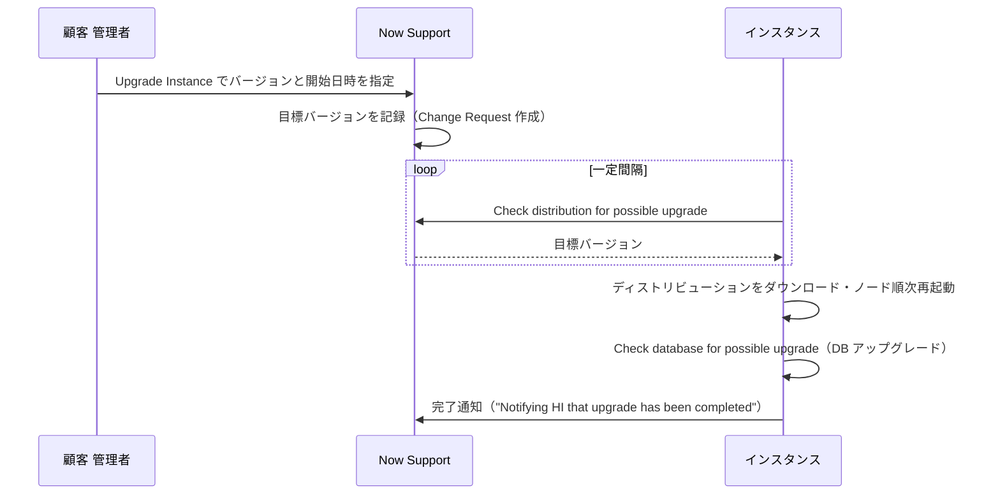
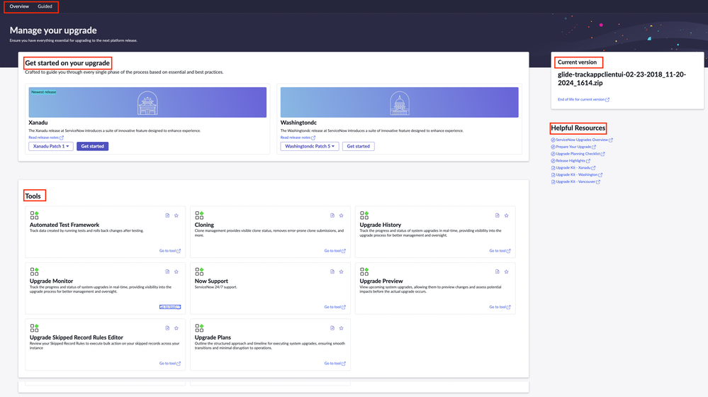
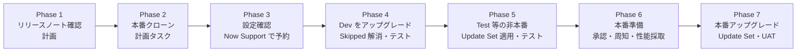
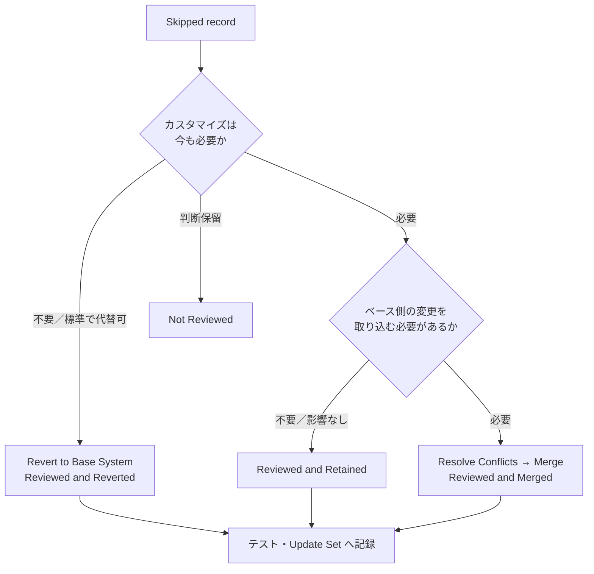
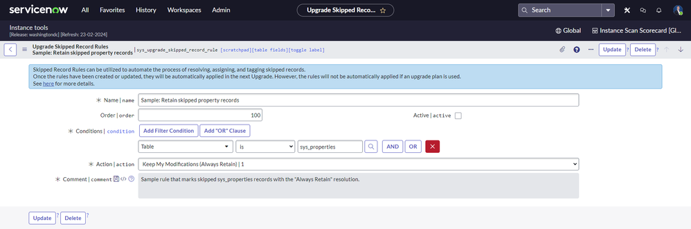
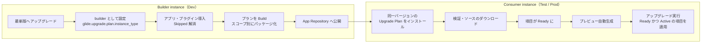
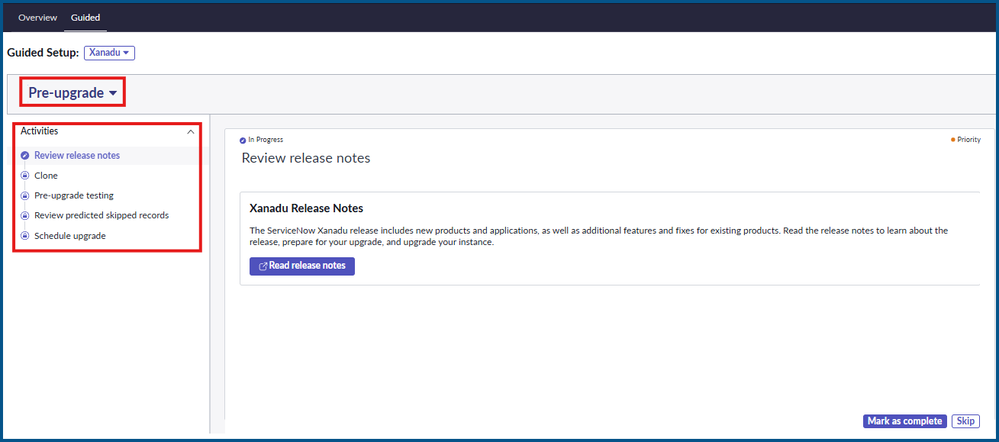
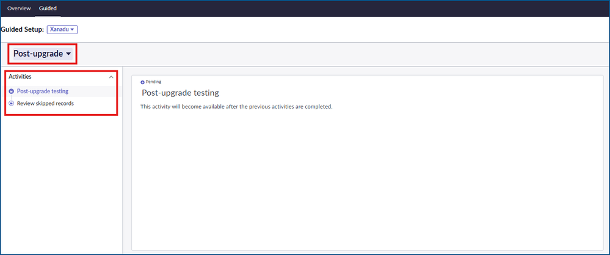
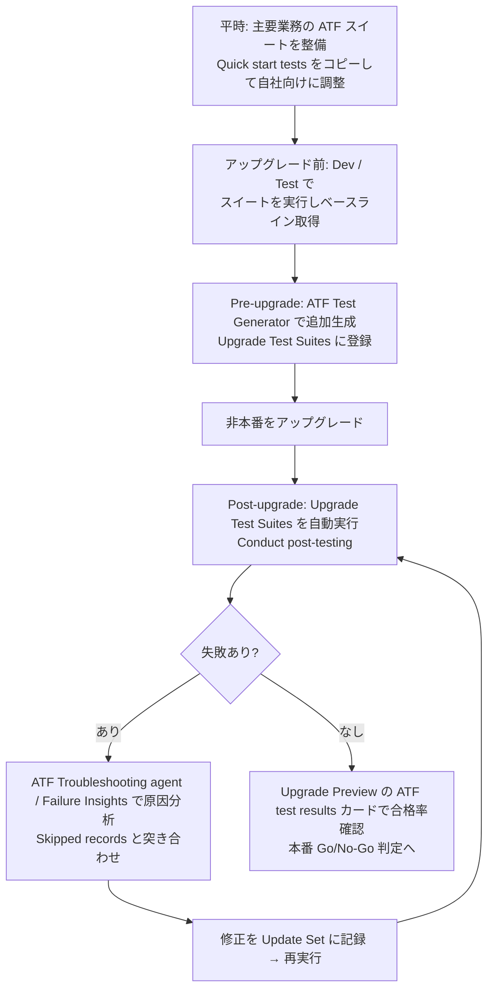

# アップグレード管理（Upgrade Management）

## 概要

ServiceNow は SaaS だが、**インスタンスのバージョンを上げるタイミングと検証は顧客の責任**である。ServiceNow は年2回のファミリーリリースと随時の Patch/Hotfix を提供し、顧客は Now Support でアップグレードをスケジュールし、非本番インスタンスで検証してから本番を上げる。本ファイルは、導入プロジェクト後の運用フェーズで毎年繰り返すアップグレードを、コンサルタント・PM・プラットフォームオーナーが計画・実行するための実務手引きである。

本ファイルで扱う範囲は次のとおり。

| 区分 | 内容 |
|---|---|
| サイクル | Upgrade と Update の違い、年2回のファミリーアップグレード、パッチプログラム、EOL |
| 計画 | 公式の 7 フェーズ／51 ステップの Upgrade planning checklist、体制、期間 |
| スケジュール | Now Support の **Upgrade Instance**、スケジュールジョブ `Check distribution for possible upgrade` |
| ツール | **Upgrade Center**（Upgrade Preview / Upgrade Monitor / Upgrade History / Upgrade Plan / Skipped Record Rules）と **Upgrade Console**（Guided upgrade） |
| 衝突解消 | **Skipped records（スキップされたレコード）** の Retain / Merge / Revert、Skipped Record VTB、Skipped Record Rules |
| 修正版 | Patch / Hotfix / Security patch、ロールバック（`glide.rollback.expiration_days`）、Store アプリの Auto-upgrade |
| テスト | スモークテスト、機能テスト、UAT、**ATF（Automated Test Framework）**、Quick start tests、ATF Test Generator / Cloud Runner |

関連ファイル:

- リリースの種類・命名・N/N-1 サポート・EOL の基礎は [リリースサイクルとバージョン](../01_入門編/07-release-cycle.md)
- クローン・Update Set の仕様は [アップデートセットとクローン](../02_リファレンス/platform/update-sets-cloning.md)
- ATF の製品仕様は [Automated Test Framework (ATF)](../02_リファレンス/platform/automated-test-framework.md)
- 導入時のテスト計画・Go-Live は [テストと本番稼働](11-testing-golive.md)
- 環境構成（Dev/Test/Prod）は [インスタンス戦略と環境](07-instance-strategy.md)
- 運用体制・変更管理は [運用とガバナンス](12-operations-governance.md)
- 失敗事例と教訓は [アップグレードの教訓](../04_応用編/04-upgrade-lessons.md)、カスタマイズの負債は [カスタマイズと技術的負債](../04_応用編/02-customization-technical-debt.md)

---

## 1. アップグレードの基本

### 1.1 Upgrade と Update の違い

ServiceNow 公式ドキュメントは、移行元と移行先のファミリー（Family）の違いによって「Upgrade」と「Update」を区別している。[出典](https://www.servicenow.com/docs/r/release-notes/upgrade.html)

| 用語 | 定義 | 例 | ロールバック |
|---|---|---|---|
| **Upgrade（アップグレード）** | 別ファミリーのリリースへ移行する | Zurich Patch 13 → Australia Patch 5a | 汎用的なロールバック手段は無い |
| **Update（アップデート）** | 同一ファミリー内で Patch / Hotfix 間を移行する | Australia Patch 3 → Australia Patch 5a | 可能（既定 10 日以内、後述） |

各ファミリーは Feature（新機能＋既存修正）、Patch（問題修正のみ、原則新機能なし）、Hotfix（特定問題の修正。以前の修正を含むとは限らない）で構成される。[出典](https://www.servicenow.com/docs/r/release-notes/upgrade.html)

### 1.2 アップグレードで何が変わり、何が変わらないか

- アップグレードは、**ベースシステムのうち顧客がカスタマイズしていないもの**、および有効化済みの機能に拡張を適用する。顧客がカスタマイズしたレコードは上書きされずに **Skipped（スキップ）** として記録される（→ 7章「Skipped records（スキップされたレコード）対応」）。[出典](https://www.servicenow.com/docs/r/release-notes/upgrade.html)
- 中間ファミリーを飛ばして、最新ファミリーへ直接アップグレードできる。ただし飛ばした各ファミリーのリリースノートは確認する必要がある。[出典](https://www.servicenow.com/docs/r/release-notes/upgrade.html)
- 新しいプラグインの多くは自動では有効化されない。どのプラグインが既定で有効かはファミリーごとの「List of plugins」で確認する。[出典](https://www.servicenow.com/docs/r/release-notes/upgrade.html)

### 1.3 アップグレードの仕組み（インスタンス主導）

ServiceNow のアップグレードは **Now Support 側ではなくインスタンス側から実行される**。Now Support は「そのインスタンスが稼働すべきバージョン」を保持しているだけで、インスタンスは定期的にその割り当てを問い合わせ、違っていればディストリビューションをダウンロードしてアップグレードを開始する。[出典](https://www.servicenow.com/docs/r/australia/release-notes/upgrades-phase-3.html)

この問い合わせは、インスタンス上の 2 つのスケジュールジョブ（`sys_trigger`）が担う。

| スケジュールジョブ | 役割 | 確認すべき設定 |
|---|---|---|
| **Check distribution for possible upgrade** | 指定間隔で Now Support に「アップグレード予定があるか」を問い合わせ、別バージョンにすべきならディストリビューションをダウンロードしてアップグレードする | Trigger type = `Interval`、System ID = `None` |
| **Check database for possible upgrade** | ディストリビューションのアップグレード後に、データベースのアップグレードを行う | Trigger type = `Run at System Startup` |

- 両ジョブは Paris リリースで旧名 `Upgrade`、`Check Upgrade Script` から改名された。
- 確認場所は **System Scheduler > Scheduled Jobs > Scheduled Jobs**。`Next action` 列で次回実行時刻が分かる。
- **アップグレード開始時刻は `Check distribution for possible upgrade` の実行の 10〜15 分前に設定する**（Now Support 側のレコード更新が間に合うようにするため）。

[出典](https://www.servicenow.com/docs/r/australia/release-notes/upgrades-phase-3.html)

### 1.4 アップグレード中の可用性

- アップグレード中は各ノードがディストリビューションのアップグレードを開始し、**全ノードが再起動する**。
- **マルチノード**インスタンスは段階的にアップグレードされ、少なくとも 1 組のアクティブノードが稼働し続けるため **UI の停止は発生しない**。
- **シングルノード**インスタンスでは短時間の停止が発生する。
- 非本番と本番のノード構成を比較し、性能影響の見込みを揃えておく。ノード状態は Upgrade Progress 画面で監視できる。

[出典](https://www.servicenow.com/docs/r/australia/release-notes/upgrades-phase-2.html)

> 実務上は、停止がなくてもアップグレード中は性能低下やキャッシュ再構築があるため、業務の閑散時間帯（週末夜間など）に本番をスケジュールし、連携バッチ・大量インポートを止めるのが一般的である。【経験則】

---

## 2. アップグレードサイクル

### 2.1 年2回のファミリーリリースと顧客の選択

ServiceNow のファミリーリリースは年2回である。2026 年は Australia（2026-03-12 EA、2026-05-05 GA）と Brazil（2026-09 EA）。リリース日程・N/N-1 サポートポリシー・EOL の詳細は [リリースサイクルとバージョン](../01_入門編/07-release-cycle.md) を参照。[出典](https://www.servicenow.com/docs/r/australia/release-notes/available-versions.html)

顧客側のアップグレード方針は、概ね次の 2 パターンに分かれる。【経験則】

| 方針 | 内容 | 向いている組織 |
|---|---|---|
| **毎リリース追随（年2回）** | 各ファミリーの GA 後、数か月以内に本番を上げる | 新機能（Now Assist / AI Agents 等）を早く使いたい。カスタマイズが少ない。ATF が整備済み |
| **年1回（1ファミリー飛ばし）** | N-1 を維持しつつ年1回だけアップグレードする | 業務繁忙期・変更凍結が多い。テスト工数を確保しにくい |

- どちらの場合でも、EOL に達したファミリーには Patch / Hotfix が提供されなくなり、ServiceNow 側でサポート対象ファミリーへのアップグレードがスケジュールされる（EOL Program）。詳細は [リリースサイクルとバージョン](../01_入門編/07-release-cycle.md) の「N / N-1 サポートポリシーと End of Life」を参照。
- 年1回方式でも、パッチ適用（次節）は年に数回発生する。

### 2.2 Patching Program（パッチ適用プログラム）

ServiceNow の **Patching Program** は、四半期ごとにファミリー別の **Patch target（パッチ適用目標バージョン）** を定め、顧客インスタンスにパッチを適用する仕組みである。

| 項目 | 内容 | 出典 |
|---|---|---|
| 定期パッチの時期 | 各四半期の **最初の月** にインスタンスをパッチ適用する | [Community（社員記事）](https://www.servicenow.com/community/upgrades-and-patching-articles/latest-patching-targets/ta-p/2485121) |
| セキュリティパッチ | 脅威の緩和が必要な場合、四半期の 2 か月目・3 か月目にも実施されうる | 同上 |
| 2026 Q4 の Patch target | Australia Patch 5a W44（KB3228435）、Zurich Patch 12 W44（KB3228357）、Yokohama Patch 13 Hotfix 5a W39（KB3159478） | [公式](https://www.servicenow.com/docs/r/australia/release-notes/available-versions.html) |
| Target の変更 | 「パッチ適用前に変更されることがある」「どうしても必要な場合のみ変更」 | 同上 |
| 連絡手段 | ServiceNow が **Parent Change Request（親 CHG）** を作成して連絡・追跡する。Now Support の **Instances > Instances Dashboard** でインスタンスを開き、親 CHG にコメントで質問・相談できる | [Community（社員記事）](https://www.servicenow.com/community/onboarding-hub-articles/getting-started-with-servicenow-patching-and-eol-programs/ta-p/3114925) |
| 状況確認 | Patching Dashboard / EOL Dashboard（Now Support） | 同上 |
| 詳細 KB | KB0995477（Patching / EOL プログラム概要）、KB1644913、KB0547244（Release Cycle） | 同上（KB 本文はログインが必要で本調査では未確認） |

> 実務上は、Patching Program で作成された親 CHG を **自社の変更管理（Change Management）にも登録**し、非本番を先に当ててスモークテストを行い、本番の適用日時が業務と衝突する場合は親 CHG 上で早めに日程変更を相談する、という運用が多い。延期可能な期間や回数の正式ルールは公開情報では確認できず（KB を参照）。【経験則】

### 2.3 バージョンの入手可否（Entitlement）

公式の「Available patches and hotfixes」ページは、各バージョンを次の 3 区分で示している。[出典](https://www.servicenow.com/docs/r/australia/release-notes/available-versions.html)

| 区分 | 意味 |
|---|---|
| **Available** | 誰でもアップグレード可能。Instance Upgrade Management Dashboard に表示され、エンタイトルメント申請は不要 |
| **Available by request** | Customer Service and Support への申請・承認が必要 |
| **Unavailable** | インストール不可 |

- 名前に **"m"** が付くバージョン（例: Patch 6m）は、ベースパッチの重要修正に加えて互換性のある ServiceNow Store アプリの更新を含む。[出典](https://www.servicenow.com/docs/r/australia/release-notes/available-versions.html)
- エンタイトルメントが必要なバージョンは、申請日時を **3 日以上先** に設定する（エンタイトルメント担当は 3 日以内に回答）。[出典](https://www.servicenow.com/docs/r/australia/release-notes/upgrades-phase-3.html)

---

## 3. アップグレードツールの全体像

### 3.1 名称の整理（Upgrade Center / Upgrade Console / Upgrade Management）

ServiceNow のアップグレード支援機能は、リリースごとに名称・メニュー位置が変わってきたため、ドキュメントや Community の記述が混在している。Australia 時点では次のように整理できる。

| 名称 | 実体 | 主な機能 | 出典 |
|---|---|---|---|
| **Upgrade Center** | プラットフォーム標準のモジュール群（既定で有効） | Upgrade Preview、Upgrade Monitor、Upgrade History、Upgrade Plan、Skipped Record Rules、Upgrade VTB | [公式](https://www.servicenow.com/docs/r/EqTdsLocR0Ylm0TDB1E9xw/Q7F3qS9fOCtdZ~~Y4AdiAQ) / [公式](https://www.servicenow.com/docs/r/zurich/release-notes/upgrade-tools.html) |
| **Upgrade Console** | ServiceNow Store アプリ（既定で有効）。Overview タブと Guided Upgrade タブを持つ | ツールへのハブ、**Guided upgrade（ガイド付きアップグレード）** | [公式](https://www.servicenow.com/docs/r/7LhbZn3yz3Q58qhjZoU9iQ/b8xBw9Kx_m6ywoaK~SOCDg) / [公式](https://www.servicenow.com/docs/r/AWjfoG0XNF6COBtQI5zL~A/5kWZi6GtCFRXkVwFKOxebQ) |
| **Upgrade Management** | Admin Center 内のメニュー区分名（Upgrade History 等の格納先）。Yokohama では Guided Setup の名称として使われた | — | [公式](https://www.servicenow.com/docs/r/UrSRFFKWBbfQBgoRlt~ltw/62QiF9EWBhogBZIgvjkfcQ) / [Community](https://www.servicenow.com/community/admin-experience-blogs/yokohama-simplifying-servicenow-upgrades-with-the-upgrade/ba-p/3178602) |

> 注意: 公式ブログ（2026-07、ServiceNow 社員）は「Yokohama では "Upgrade Management"、Xanadu 以降は "Upgrade Console"」と命名の違いに触れ、自インスタンスの名称を確認するよう勧めている。[出典](https://www.servicenow.com/community/servicenow-ai-platform-blog/upgrades-don-t-have-to-start-from-scratch-every-time/ba-p/3567920)【第三者情報】（社員ブログ）

### 3.2 メニュー位置（Australia）

Australia の公式ドキュメント内でもページによって記載が異なる。インスタンスで実際の位置を確認すること。

| 機能 | 公式ドキュメント上の位置 | 出典 |
|---|---|---|
| Upgrade Console | **All > Admin Center > Upgrade Console**、または **Administrator > Upgrade Console**、または **All > Admin Center > Administrator homepage** の Instance upgrade タイルの Upgrade console リンク | [公式](https://www.servicenow.com/docs/r/eh2NFokZCOdK5kPblQPzog/huDa4kEL9H56NtvuESN2Pg) |
| Upgrade Monitor | **All > Upgrade Center > Upgrade Monitor**（アップグレード中に admin がログインすると Upgrade Progress 画面が自動表示される） | [公式](https://www.servicenow.com/docs/r/UrSRFFKWBbfQBgoRlt~ltw/2hrcoH0LcWlkS0bgP~9MhQ) |
| Upgrade History | **All > Upgrade Center > Upgrade History**、または **All > Admin Center > Upgrade Management > Upgrade History**（Admin タブからは Admin > Upgrade Management > Upgrade History） | [公式](https://www.servicenow.com/docs/r/UrSRFFKWBbfQBgoRlt~ltw/OHq5S8yLEnkOhZze7cv8Tw) / [公式](https://www.servicenow.com/docs/r/UrSRFFKWBbfQBgoRlt~ltw/62QiF9EWBhogBZIgvjkfcQ) |
| Upgrade Plan | **All > Upgrade Center > Upgrade Plan** | [公式](https://www.servicenow.com/docs/r/UrSRFFKWBbfQBgoRlt~ltw/mBfk3GkslXoukJ4QXerM9Q) |
| Skipped Record Rules Editor | **All > Upgrade Center > Administration > Skipped Record Rules Editor** | [公式](https://www.servicenow.com/docs/r/UrSRFFKWBbfQBgoRlt~ltw/d0NgOMHeEPl_83wzDWbpfw) |
| 旧来の確認画面 | **System Diagnostics > Upgrade Monitor**、**System Diagnostics > Upgrade Log**、**System Definition > System Upgrades**、**System Diagnostics > Upgrade History** | [公式](https://www.servicenow.com/docs/r/australia/release-notes/upgrades-phase-7.html) |

### 3.3 Upgrade Console の画面

*図1: Upgrade Console の Overview タブ（Xanadu 時点の画面例）*

画面の説明: 上部に **Overview** と **Guided** の 2 タブがある。見出し「Manage your upgrade」の下に **Get started on your upgrade** 領域があり、最新リリース（例: Xanadu、"Newest release" ラベル付き）と次点リリース（例: Washingtondc）のカードが並ぶ。各カードには Patch 選択ドロップダウン（例: Xanadu Patch 1）と **Get started** ボタン、Read release notes リンクがある。右側に **Current version**（現在のビルド名と End of life for current version リンク）と **Helpful Resources**（ServiceNow Upgrades Overview、Prepare Your Upgrade、Upgrade Planning Checklist、Release Highlights、Upgrade Kit 等）。下部の **Tools** 領域には Automated Test Framework、Cloning、Upgrade History、Upgrade Monitor、Now Support、Upgrade Preview、Upgrade Skipped Record Rules Editor、Upgrade Plans のタイルが並び、各タイルに「Go to tool」リンクがある。

出典: [ServiceNow Community – Yokohama: Simplifying ServiceNow Upgrades with the Upgrade Management Guided Setup](https://www.servicenow.com/community/admin-experience-blogs/yokohama-simplifying-servicenow-upgrades-with-the-upgrade/ba-p/3178602)（取得日: 2026-11-03）

Upgrade Console の Overview タブの構成（公式、Zurich 時点）: [出典](https://www.servicenow.com/docs/r/7LhbZn3yz3Q58qhjZoU9iQ/b8xBw9Kx_m6ywoaK~SOCDg)

| セクション | 内容 |
|---|---|
| Get started on your upgrade | 最新バージョンの表示、Patch 版の選択、アップグレード開始。進行中・中断中のアップグレードがあれば名前と進捗を表示し、再開または終了できる（**終了するとその進捗とデータはロールバックされる**） |
| Upgrade scheduled | スケジュール済みの場合のみ表示。名前・開始日、Go to monitor / Go to guided upgrade ボタン |
| Instance summary | インスタンス名、URL、状態（Scheduled / Not Scheduled）、現行バージョン、最新クローン情報 |
| Current version | 現行バージョン名と EOL 日へのリンク（KB0610454） |
| Tools | ATF、Cloning、Upgrade History、Upgrade Monitor、Now Support、Upgrade Preview、Upgrade Skipped Record Rules Editor、Upgrade Plans（Australia では **ATF Test Generator and Cloud Runner** も並ぶ） |
| Helpful Resources | ドキュメント、KB ポータル、Community へのリンク |

Australia の Tools 一覧に ATF Test Generator and Cloud Runner が含まれることは [公式](https://www.servicenow.com/docs/r/UrSRFFKWBbfQBgoRlt~ltw/Duxqu3iZslJuJA~wlgOsCA) による。

### 3.4 ロール

| ロール | 用途 | 出典 |
|---|---|---|
| `admin`（System administrator） | Upgrade Center の全テーブル・情報へのアクセス、Upgrade Preview / Monitor / History / Plan / Skipped Record Rules の利用。Upgrade Console の全ツールへのアクセス。昇格（elevated）ロールではない | [公式（Upgrade Center）](https://www.servicenow.com/docs/r/EqTdsLocR0Ylm0TDB1E9xw/Q7F3qS9fOCtdZ~~Y4AdiAQ) / [公式（Upgrade Console roles）](https://www.servicenow.com/docs/r/7LhbZn3yz3Q58qhjZoU9iQ/KQTgtnxs64N2fBR9c4XQnw) |
| `upgrade_admin` | Australia の Guided upgrade の pre-upgrade / post-upgrade 手順ページで「必要なロール」として記載 | [公式](https://www.servicenow.com/docs/r/UrSRFFKWBbfQBgoRlt~ltw/amhplLagV4oakmPoL5gmAw) / [公式](https://www.servicenow.com/docs/r/UrSRFFKWBbfQBgoRlt~ltw/pIeVzBlBTf6o70VhCu37Tw) |

- Upgrade VTB のオーナーとメンバーは admin でなければならない。[出典](https://www.servicenow.com/docs/r/UrSRFFKWBbfQBgoRlt~ltw/oPV348PKWgvnsfZWhNYH_A)
- admin 以外のユーザーにアップグレード情報を見せる正式な方法は無く、カスタムロール作成は推奨されないという Community 回答がある（2023）。【第三者情報】[出典](https://www.servicenow.com/community/sysadmin-forum/what-roles-would-i-need-to-view-the-upgrade-center-without-using/m-p/2642596)
- `upgrade_admin` ロールの包含ロールや付与範囲は公開情報では確認できず。

### 3.5 その他の公式ツール・リソース

| ツール / リソース | 内容 | 出典 |
|---|---|---|
| Now Support upgrade assist | アップグレードのスケジュール作業を自動化サービスに任せる（KB0788171） | [公式](https://www.servicenow.com/docs/r/zurich/release-notes/upgrade-tools.html) |
| Known Error portal | 特定 Patch の既知の問題（KB0597477） | 同上 |
| Upgrade planning checklist / サンプルプロジェクト計画 | PDF・Excel・MPP 形式のサンプル計画をダウンロードできる | 同上 |
| Best Practices（Success Packs） | 「Upgrade quickly and maintain platform health」「Balance value and risk with platform customizations」 | 同上 |
| Impact / Expert services | 有償の成功支援・専門家支援 | 同上 |

Now Support upgrade assist の具体的な仕組み（スケジュールの決め方、承認、ブラックアウト）は KB がログイン必須のため公開情報では確認できず。

---

## 4. 公式アップグレードプロセス（7フェーズ）

### 4.1 7 フェーズの全体像

ServiceNow 公式の「Upgrade your instance」は、非本番で検証してから本番を上げる 7 フェーズを推奨している。[出典](https://www.servicenow.com/docs/r/release-notes/upgrades-overview.html)

3 インスタンス構成の場合のアップグレード順序とテスト種別は次のとおり。[出典](https://www.servicenow.com/docs/r/release-notes/upgrade.html)

| 順序 | インスタンス | 推奨テスト |
|---|---|---|
| 1 | Development（開発） | スモークテスト |
| 2 | Test（テスト） | ATF と Quick start tests。追加カバレッジとして UAT（任意） |
| 3 | Production（本番） | UAT のみ（ATF は非本番用） |

### 4.2 Upgrade planning checklist（51 ステップ）

公式の Upgrade planning checklist は 7 フェーズを 51 ステップに分解している。以下は Brazil 版チェックリストの要約である（Australia 版もフェーズ構成は同じ。ステップ番号はリリースにより多少ずれる）。[出典](https://www.servicenow.com/docs/r/release-notes/upgrades-planning-checklist.html)

**Phase 1: リリースノートを読み、アップグレードを計画する**

| # | ステップ |
|---|---|
| 1 | 目標リリース・Patch のリリースノートと製品ドキュメント（アップグレード前後のタスクを含む）を確認する |

**Phase 2: 計画タスク**

| # | ステップ |
|---|---|
| 2 | アップグレード対象のインスタンスを確定する |
| 3 | ホスティングモデル（クラウド / オンプレミス / オフプレミス）を確認する |
| 4 | アップグレード後に検証すべき新機能・注目の変更点を洗い出す |
| 5 | 有効化 / 無効化する新機能を計画する |
| 6 | ブラウザ要件を社内標準と照合し、ギャップを記録する |
| 7 | クローン・アップグレード・テストのプロジェクト計画を作る |
| 8 | テスター、パワーユーザー、ステークホルダーのコアチームを決める |
| 9 | クローン・アップグレードに影響する変更凍結期間を確認する |
| 10 | 非本番の進め方を選ぶ：①本番アップグレードまで開発を凍結する ②別インスタンスで並行アップグレードしつつ開発を続ける ③最終の本番クローンを本番アップグレード後まで遅らせる |
| 11 | 連携テストに必要な他システムの可用性を確認する |
| 12 | 連携テストに使えるインスタンスの制約を確認する |
| 13 | テスト範囲とアプローチを確定する |
| 14 | コア機能と連携を網羅したテスト計画を作る |
| 15 | テストで見つかった欠陥の管理方法を決める |
| 16 | アップグレード順序・時期、クローン対象、連携テスト用インスタンスを含む実施計画（概要）を作る |
| 17 | 変更凍結期間を再確認する（責任: ServiceNow または顧客） |
| 18 | 研修資料・ナレッジ記事等の更新要否を判断する |
| 19 | 任意：ServiceNow Configuration Review を予約する（有償の場合あり） |
| 20 | 本番から開発インスタンスへのクローンを作成し、日程を関係者に通知する（インスタンスサイズが同じなら監査ログと添付も含める） |

**Phase 3: アップグレード設定を確認し、開発インスタンスのアップグレードを Now Support で予約する**

| # | ステップ |
|---|---|
| 21 | `Check distribution for possible upgrade` ジョブの頻度と実行時刻を確認する |
| 22 | `Check distribution for possible upgrade` の `sys_trigger` 設定を確認する |
| 23 | `Check database for possible upgrade` の `sys_trigger` 設定を確認する |
| 24 | Now Support でアップグレードを予約する |
| 25 | 必要ならバージョンのエンタイトルメントを申請する |

**Phase 4: 開発インスタンスのアップグレードと検証**

| # | ステップ |
|---|---|
| 26 | Upgrade Monitor で監視し、完了を確認する |
| 27 | Upgrade Monitor で Skipped records list を処理する |
| 28 | Update Set を特定する |
| 29 | アップグレード前後にスモークテストを行い、テスト計画に沿って機能テストを行う |

**Phase 5: 該当する場合、他の非本番インスタンス（Test 等）をアップグレード・検証する**

| # | ステップ |
|---|---|
| 30 | 本番のクローンを作成する |
| 31 | Now Support で非本番のアップグレードを予約し、設定を確認する |
| 32 | 非本番のアップグレード完了を確認する |
| 33 | 開発インスタンスで導入した任意プラグインをインストールする |
| 34 | カスタムアプリケーションと post-upgrade の Fix script を必要に応じて導入する |
| 35 | Update Set を適用する |
| 36 | 機能テストを行い、性能を監視する |

**Phase 6: 本番インスタンスのアップグレード準備**

| # | ステップ |
|---|---|
| 37 | 非本番の欠陥が修正され Update Set で検証済みであることについて、IT と業務の承認を得る（顧客） |
| 38 | アップグレード後検証のコアチームを確定する（顧客） |
| 39 | Day 1 のサポート体制を確定する（顧客） |
| 40 | Production Upgrade Implementation Plan（手順、役割、連絡、連絡先、Day 1 サポート）を作る（顧客） |
| 41 | 実施計画のウォークスルーと承認を行う（顧客） |
| 42 | 変更要求（Change Request）を起票し承認を得る（顧客） |
| 43 | 本番停止と新機能について関係者・エンドユーザーに周知する（顧客） |
| 44 | アップグレード前のインスタンス性能をプロファイルする |
| 45 | ServiceNow Performance ホームページでアップグレード前の性能を記録する |
| 46 | クローン上で機能テストを行い、性能を監視する |

**Phase 7: 本番インスタンスのアップグレード**

| # | ステップ |
|---|---|
| 47 | Now Support で本番アップグレードを予約する |
| 48 | 必要ならエンタイトルメントを申請する |
| 49 | アップグレードを監視し、完了を確認する |
| 50 | Update Set と post-upgrade Fix script を適用する |
| 51 | UAT で検証し、主要機能が正常であることを関係者と確認する |

### 4.3 フェーズごとの実務ポイント

**Phase 2（本番クローン）** [出典](https://www.servicenow.com/docs/r/australia/release-notes/upgrades-phase-2.html)

- 大きなテーブルと添付を含めた **本番のフルクローン** を非本番に作り、本番アップグレードの所要時間を見積もる。
- インスタンスサイズが同じなら Request Clone フォームの **Exclude チェックボックスをすべて外し**、監査ログと添付も含める。
- 非本番で通常の本番ユーザー操作を模擬すると、所要時間の見積もりが正確になる。
- クローンの詳細仕様は [アップデートセットとクローン](../02_リファレンス/platform/update-sets-cloning.md) を参照。

**Phase 4（開発インスタンスの検証）** [出典](https://www.servicenow.com/docs/r/australia/release-notes/upgrades-phase-4.html)

- Skipped records の処理（Merge / Revert / 競合解消 / 追加カスタマイズ）は最新バージョンに対する変更として **現在の Update Set に記録される**。そのため、**処理前に専用の Update Set を作ってカレントにしておく**。
- 集める Update Set は次の 3 種類：①Skipped records のレビューで作ったもの ②カスタマイズを新リリースに適合させるために作ったもの ③次のアップグレード直後に本番へ入れる必要があるもの。
- テストはアップグレード **前と後** の両方でスモークテストを行い、結果を比較する。欠陥ごとの修正は Update Set にまとめ、本番へ適用する累積修正とする。
- ATF の Quick start tests と product testing suites を使ってアップグレード前後のテストを始められる。

**Phase 5（後続の非本番）** [出典](https://www.servicenow.com/docs/r/release-notes/upgrades-planning-checklist.html)

- アップグレード完了直後に、開発で行った post-upgrade 作業（任意プラグインの有効化、アプリのインストール / アップグレード、Update Set の適用）を再適用する。
- 2 台目以降のインスタンスでは Skipped records のレビューを繰り返さず、開発で作った Update Set をインポートして済ませる。[出典](https://www.servicenow.com/docs/r/UrSRFFKWBbfQBgoRlt~ltw/2hrcoH0LcWlkS0bgP~9MhQ)

**Phase 7（本番）** [出典](https://www.servicenow.com/docs/r/australia/release-notes/upgrades-phase-7.html)

- 完了確認は Upgrade Monitor のほか、**System Diagnostics > Upgrade Log** で「Notifying HI that upgrade has been completed」メッセージを探す、**System Definition > System Upgrades** で一覧を見る、などでも可能。
- UAT と並行して **System Logs > System Log > Errors** を確認する。ただし、記録されるエラーのすべてがアップグレード起因ではなく、多くはアップグレード前から存在するものである。

### 4.4 標準的な期間の目安

公式チェックリストは期間を規定していない。実務上の典型例は次のとおり。【経験則】

| 工程 | 目安期間 | 備考 |
|---|---|---|
| 準備（リリースノート精査、影響分析、Upgrade Preview、計画） | 2〜4 週 | 対象ファミリーの GA 後に着手することが多い |
| Dev アップグレード〜Skipped 解消〜機能テスト | 2〜4 週 | カスタマイズ量・Skipped 件数に比例 |
| Test アップグレード〜回帰テスト〜UAT | 2〜4 週 | ATF の整備度合いで大きく変わる |
| 本番アップグレード〜Hypercare | 1〜2 週 | 承認・周知のリードタイムを含む |
| **合計** | **約 2〜3 か月** | 公式社員ブログで、ある金融機関の「ほぼ 1 四半期かかっていたアップグレード期間を半減」した事例が紹介されている【第三者情報】[出典](https://www.servicenow.com/community/servicenow-ai-platform-blog/upgrades-don-t-have-to-start-from-scratch-every-time/ba-p/3567920) |

---

## 5. スケジュール手順（Now Support）

### 5.1 アップグレードの予約

Now Support でのアップグレード予約手順（開発・本番共通）。[出典](https://www.servicenow.com/docs/r/australia/release-notes/upgrades-phase-3.html) / [出典](https://www.servicenow.com/docs/r/australia/release-notes/upgrades-phase-7.html)

1. Now Support（support.servicenow.com）にログインし、左ナビゲーションの **Instances > Manage Instances** を開く。
2. （パートナーのみ）ユーザーメニューの **Switch Company** で顧客企業を選ぶ。
3. アップグレード / パッチ適用するインスタンスを選ぶ。
4. **Actions** メニューから **Upgrade Instance** をクリックする。インスタンス名と利用可能バージョンが入った「Upgrade an Instance」サービスカタログアイテムが開く。
5. **Start Date and Time** のカレンダー・時計アイコンで日時を設定する（`Check distribution for possible upgrade` の実行 10〜15 分前）。
6. **Submit** をクリックする。エンタイトルメントが不要なら **Change Request が作成される**。

エンタイトルメントが必要なバージョンの場合は、**Actions** 列の **Schedule** から 3 日以上先の日時を指定し、表示されるエンタイトルメント申請番号で状況を確認する。質問は申請レコードにコメントする。

### 5.2 Upgrade Console（Guided upgrade）からの予約

Guided upgrade の Instance upgrade フェーズでは、スケジュール済みならリスケジュール、未スケジュールなら **Schedule upgrade** を選ぶ。ServiceNow Support にリダイレクトされ、バージョンを選んで送信するとアップグレード要求が自動作成される。[出典](https://www.servicenow.com/docs/r/7LhbZn3yz3Q58qhjZoU9iQ/0tWbXFlWkp7KUDnxYTXyYw)

### 5.3 スケジュール時の注意

| 注意点 | 内容 |
|---|---|
| 開始時刻 | `Check distribution for possible upgrade` の次回実行の 10〜15 分前に設定する。[出典](https://www.servicenow.com/docs/r/australia/release-notes/upgrades-phase-3.html) |
| ジョブ設定の改変 | 上記 2 ジョブを無効化・改変するとアップグレードが開始されない。Phase 3 で必ず確認する。[出典](https://www.servicenow.com/docs/r/australia/release-notes/upgrades-phase-3.html) |
| クローンとの衝突 | アップグレード前後のクローン予定と重ならないようにする。クローン先のバージョンはクローン元と揃える必要があるため、本番アップグレード直前・直後のクローン計画を明確にする【経験則】 |
| Store アプリの自動更新 | Auto-upgrade はインスタンスのアップグレードスケジュールを暗黙のブラックアウトとして扱う（6.4 節）。[出典](https://www.servicenow.com/docs/r/platform-administration/application-manager/um-auto-upgrade.html) |
| 変更管理 | ServiceNow 側の CHG に加え、自社の Change Management に登録し、変更凍結（blackout）と照合する【経験則】 |

---

## 6. Upgrade Center の各モジュール

### 6.1 Upgrade Preview（アップグレードプレビュー）

**Upgrade Preview** モジュールは、実際にアップグレードする前に、目標バージョンへのアップグレードが現在の構成にどう影響するかを予測表示する。目標バージョンをドロップダウンから選んで **Go** を選ぶとプレビューが開始される。予測精度向上のため、プレビュー実行時間は以前より長くなっている。進捗はバナーのリンクから Run Tracker レコードで確認できる。[出典](https://www.servicenow.com/docs/r/fBdxWC~8p08POQuUubVDig/UzrPMuClbnXi6KazXAtMDw)

Upgrade Preview に表示されるカード（Australia）: [出典](https://www.servicenow.com/docs/r/fBdxWC~8p08POQuUubVDig/UzrPMuClbnXi6KazXAtMDw)

| カード | 表示内容 |
|---|---|
| **Current version** | 現行バージョン名、適用日、EOL に関する KB0610454 へのリンク |
| **Previewing version** | プレビュー作成日とプレビュー詳細フォームへのリンク。プレビューが無い場合は目標バージョンを選んで開始 |
| **Scheduled upgrade** | 次回スケジュール済みアップグレードの開始日時と推定所要時間（初回アップグレードでは所要時間は表示されない） |
| **Discover what's new and changed** | 前回リリース以降の修正、カスタムリリースノート、Known error 記事へのリンク |
| **Predicted skipped list** | 予測される総レコード変更数とスキップ数。スキップは Total / To review / Reviewed / Resolved（ルールで解消）に分かれ、優先度別の円グラフを表示。ルールが無ければ作成リンクを表示 |
| **Predicted skipped list with plans** | Skipped record rules の代わりに Upgrade Plan を使う場合のカード名 |
| **Predicted skipped records by product** | 予測スキップを製品ファミリー別に集計（ファミリー不明は Other） |
| **Application upgrade preview** | 予測されるアプリのインストール / アップグレード（アクション、From、To）。既定 10 件表示（Yokohama で追加） |
| **Predicted schema changes** | 新規カラム・テーブル・インデックス等の予測 DB 変更。既定 10 件表示（Yokohama で追加） |
| **ATF test results** | 直近 30 日に実行した ATF テストの合格率、最新実行時刻、結果へのリンク（完了・合格のみ集計、同一テストの再実行は最新のみ） |

Yokohama で Application upgrade preview と Predicted schema changes カード、プレビュー処理の監視機能が追加された。[出典](https://www.servicenow.com/docs/r/Cz0Un5C85RB3j2nhhAK1aQ/CNAreEmHlN9r9ufdNYlA4g)

Upgrade Preview の制約: [出典](https://www.servicenow.com/docs/r/fBdxWC~8p08POQuUubVDig/UzrPMuClbnXi6KazXAtMDw)

- アップグレード資格のある目標バージョンのみ表示される。資格が無い場合ドロップダウンは空になる。
- **Refresh preview（プレビューの更新）** でスキップ一覧を再生成すると、Revert 済みのレコードは再びスキップされないが、**レビュー済み・Retain 済みのレコードの状態は上書きされる**。
- **Skipped record rules と Upgrade Plan は同時に使えない**。
- 全アプリのプレビューを再生成するにはプロパティ `glide.upgrade_center.regenerate_upgrade_preview` を `true` にする。[出典](https://www.servicenow.com/docs/r/UrSRFFKWBbfQBgoRlt~ltw/pIeVzBlBTf6o70VhCu37Tw)

> 実務での使い方: アップグレード計画の初期（Phase 1〜2）に **本番クローン直後の非本番** で Upgrade Preview を実行し、予測スキップ件数・優先度 1〜2 の件数・影響する製品・スキーマ変更を見て、テスト範囲と工数を見積もる。【経験則】

### 6.2 Upgrade Monitor（アップグレードモニター）

**Upgrade Monitor** モジュールは、個々のインスタンスのアップグレードのスケジュールと進捗追跡、完了後の要約と競合レコード一覧を提供する。必要ロールは `admin`。[出典](https://www.servicenow.com/docs/r/UrSRFFKWBbfQBgoRlt~ltw/2hrcoH0LcWlkS0bgP~9MhQ)

| 画面 | 内容 |
|---|---|
| **Upgrade Progress** | アップグレード中に表示。完了済み・実行中・残りの作業。アップグレード中に admin がログインすると自動表示 |
| **Upgrade Summary Report** | 完了後に表示。アップグレードで実行された処理の概要、カスタマイズとの競合の一覧と解消へのリンク、非本番では本番所要時間の見積もりデータ |
| **Upgrade Details form** | 個々の影響レコードのレビューと競合解消 |
| **Skipped Changes to Review**（関連リスト） | 最初の非本番アップグレードで競合を解消するためのリスト |

Upgrade Monitor が想定するプロセス（公式）: ①本番を Test と非本番にクローン → ②非本番にアップグレード適用 → ③スキップ一覧を処理 → ④アップグレード前の本番ベンチマークと比較テスト → ⑤Test をアップグレードし Update Set をインポートして再テスト → ⑥本番をアップグレードし Update Set をインポートしてテスト。[出典](https://www.servicenow.com/docs/r/UrSRFFKWBbfQBgoRlt~ltw/2hrcoH0LcWlkS0bgP~9MhQ)

### 6.3 Upgrade History（アップグレード履歴）

**Upgrade History** モジュールは、インスタンスに適用されたすべてのアップグレードを記録する。一覧からアップグレードを選ぶと **System Upgrades** フォームが開く。[出典](https://www.servicenow.com/docs/r/UrSRFFKWBbfQBgoRlt~ltw/OHq5S8yLEnkOhZze7cv8Tw)

System Upgrades フォームの主なフィールド:

| フィールド | 内容 |
|---|---|
| From | 移行元の .war ファイル（バージョン） |
| To | 適用された .war ファイル（バージョン） |
| Upgrade started / Upgrade finished | 開始・終了日時 |
| **Changes skipped** | 前回アップグレードと差分があるが更新されなかったレコード数（主にカスタマイズのため） |
| **Changes applied** | 適用された変更（更新・差分のあるレコード、changed = true の削除・挿入レコード） |
| Changes processed | 処理総数（Changes skipped + Changes applied） |
| Copies to review | ベースレコードがアップグレードされた「コピーされたレコード」のうちレビューが必要なもの |

関連リンク: **Skipped Record VTB**（スキップがある場合のみ表示）、**View Upgrade Plan History**、**View Upgrade Summary Report**、**Run skipped Record Rules**。[出典](https://www.servicenow.com/docs/r/UrSRFFKWBbfQBgoRlt~ltw/OHq5S8yLEnkOhZze7cv8Tw) / [出典](https://www.servicenow.com/docs/r/UrSRFFKWBbfQBgoRlt~ltw/d0NgOMHeEPl_83wzDWbpfw)

> 補足: インスタンス上では、アップグレード履歴は `sys_upgrade_history`、個々のアップグレード対象レコードの処理ログ（スキップを含む）は `sys_upgrade_history_log` テーブルに保存されるのが一般的に知られている。Australia の該当ページではテーブル名は明記されていない。ATF のテーブル除外一覧にも両テーブル名が現れる（[ATF リファレンス](../02_リファレンス/platform/automated-test-framework.md)）。【経験則】

### 6.4 Upgrade Center のプロパティ

| プロパティ | 内容 | 既定 |
|---|---|---|
| `glide.upgrade.preview.duration.instance.id` | 非本番インスタンスがアップグレード所要時間の見積もりを問い合わせるリモートインスタンス。結果の最大値を採用 | 未設定時はすべてのリモートインスタンスレコードを使用 |
| `glide.upgrade_center.task_board.owner` | Upgrade VTB のオーナー（admin であること） | 未設定時はアクティブ admin をユーザー名順に並べた先頭 |
| `glide.upgrade_center.task_board.members` | Upgrade VTB のメンバー（admin であること） | 未設定時はアクティブ admin 全員 |
| `glide.upgrade.plan.instance_type` | インスタンスが Upgrade Plan の builder か consumer か | 記載なし |
| `glide.upgrade.plan.include.skips` | Upgrade Plan の作成・更新時に Skipped records とカスタマイズを含めるか | `false` |
| `glide.upgrade_center.regenerate_upgrade_preview` | `true` で全アプリのアップグレードプレビューを再生成 | 記載なし |

[出典（Upgrade Center properties）](https://www.servicenow.com/docs/r/UrSRFFKWBbfQBgoRlt~ltw/oPV348PKWgvnsfZWhNYH_A) / [出典（Upgrade Plan）](https://www.servicenow.com/docs/r/UrSRFFKWBbfQBgoRlt~ltw/mBfk3GkslXoukJ4QXerM9Q) / [出典（pre-upgrade）](https://www.servicenow.com/docs/r/UrSRFFKWBbfQBgoRlt~ltw/pIeVzBlBTf6o70VhCu37Tw)

---

## 7. Skipped records（スキップされたレコード）対応

### 7.1 Skipped records とは

アップグレード処理は、**Customer Updates（`sys_update_xml`）テーブルに現行バージョンがあるオブジェクト**（＝顧客がカスタマイズしたベースシステムのレコード）への変更をスキップする。これにより顧客のカスタマイズは上書きされないが、その代わり、ServiceNow がベースレコードに加えた修正・新機能もそのレコードには反映されない。スキップされたレコードは **Skipped records list（スキップ一覧）** に記録され、顧客がレビューして処置を決める必要がある。[出典](https://www.servicenow.com/docs/r/UrSRFFKWBbfQBgoRlt~ltw/62QiF9EWBhogBZIgvjkfcQ)

- カスタマイズしたが、前回アップグレード以降 ServiceNow 側でベースが変わっていないオブジェクトは、処置不要。
- Skipped records の処理は、**最初の非本番インスタンス（通常は開発）でのみ行い**、結果を Update Set で後続インスタンスへ移送する。後続インスタンスではレビューを繰り返さない。[出典](https://www.servicenow.com/docs/r/UrSRFFKWBbfQBgoRlt~ltw/2hrcoH0LcWlkS0bgP~9MhQ)
- **アップグレード詳細レコード（コメント・解消状況）はインスタンス間で移送されない**。保持が必要なら当該インスタンスからエクスポートする。[出典](https://www.servicenow.com/docs/r/platform-administration/upgrade-center/uc-process-skipped-records.html)

### 7.2 優先度（Priority）

Skipped records はファイル種別の重要度で優先度付けされる。[出典](https://www.servicenow.com/docs/r/UrSRFFKWBbfQBgoRlt~ltw/zQqGJnQ~SmZnHToAkJ~H_Q)

| Priority | 対象の例 |
|---|---|
| 1（最高） | UI pages、UI macros など |
| 2 | Business Rules、Security ACLs など |
| 3 | Reports など |
| 4 | Form Sections、Choice Sets など |
| 5（最低） | その他すべて |

> 実務では Priority 1〜2（UI page / UI macro / Business Rule / ACL / Script Include 等のスクリプト系）を必ず個別レビューし、Priority 4〜5（フォームレイアウト、選択肢、リスト列等）は一括 Retain するなど、優先度に応じてレビューの深さを変える。【経験則】

### 7.3 処置の種類（Retain / Merge / Revert）

Skipped records は、Upgrade History（または Upgrade Monitor の Upgrade Summary Report の Skipped ボックスの **Review changes** リンク）から System Upgrades フォームを開き、**Skipped Changes to Review** 関連リストでレコードを選んでレビューする。テキスト項目はクリックすると **Diff/Merge ツール** で差分を確認できる。必要ロールは `admin`。[出典](https://www.servicenow.com/docs/r/UrSRFFKWBbfQBgoRlt~ltw/62QiF9EWBhogBZIgvjkfcQ) / [出典](https://www.servicenow.com/docs/r/platform-administration/upgrade-center/uc-process-skipped-records.html)

| 処置 | 操作 | 結果（Resolution Status / Disposition） | 使いどころ |
|---|---|---|---|
| **Retain（そのまま保持）** | Resolution Status を **Reviewed and Retained** にして Update | カスタマイズを維持。ベースの変更は取り込まない | カスタマイズが業務上必須で、ベース側の変更が不要・影響なし |
| **Merge（マージ）** | **Resolve Conflicts** をクリックし、項目ごとに右矢印で取り込み、**Merge** | Resolution Status = **Reviewed and Merged** | カスタマイズを残しつつ、ベースの修正（バグ修正・新項目）も取り込みたい |
| **Revert（ベースに戻す）** | **Revert to Base System** をクリック | Disposition = Skipped → **Reverted**、Resolution Status = **Reviewed and Reverted**。Customer Update レコードが作成される。後から **Reapply Changes** で取り消し可能 | カスタマイズが不要になった、またはベース機能で代替できる |
| **Reviewed（確認のみ）** | Resolution Status を **Reviewed** | レコードは変更しない | 影響なしと判断 |
| **Defer（保留）** | Resolution を **Not Reviewed** | Skipped Changes to Review に残る | 判断を後回しにする |

- Resolution Status が Not Reviewed / --None-- 以外になったレコードは Skipped Changes to Review から **Skipped Changes Reviewed** に移る。
- Comment 欄に判断理由を残す（任意だが推奨）。
- 処置後は、スキップ一覧のレコードに加えたすべての変更を十分にテストする。

[出典](https://www.servicenow.com/docs/r/UrSRFFKWBbfQBgoRlt~ltw/62QiF9EWBhogBZIgvjkfcQ)

> **重要:** Skipped records の処置を行う前に、必ず専用の Update Set をカレントにしておく。Update Set が有効でないと処置内容が記録されず、後続インスタンスへ移送できない。[出典](https://www.servicenow.com/docs/r/australia/release-notes/upgrades-phase-4.html) / [社員ブログ](https://www.servicenow.com/community/servicenow-ai-platform-blog/upgrades-don-t-have-to-start-from-scratch-every-time/ba-p/3567920)

### 7.4 予測 Disposition（Upgrade Preview / Guided upgrade）

Guided upgrade の「Review predicted skipped records」ステップでは、予測 Disposition として **Insert、Update、Reverted、Skip、Skip (Manual Merge)、Skip (Apply Once)** が表示される。**Regenerate Preview** で再予測でき、必要に応じて Skipped record rules を作成する。[出典](https://www.servicenow.com/docs/r/UrSRFFKWBbfQBgoRlt~ltw/pIeVzBlBTf6o70VhCu37Tw)

各 Disposition の厳密な定義（特に Skip (Manual Merge) と Skip (Apply Once) の違い）は、本調査で参照した Australia のページには記載がなかった（公開情報では確認できず）。

### 7.5 Skipped Record VTB（ビジュアルタスクボード）

Upgrade History のレコードの **Skipped Record VTB** 関連リンクから、スキップされたレコードを Visual Task Board 形式で管理できる（スキップがあるアップグレードのみリンクが表示される）。過去の任意のアップグレードについて解消状況を確認できる。[出典](https://www.servicenow.com/docs/r/UrSRFFKWBbfQBgoRlt~ltw/OHq5S8yLEnkOhZze7cv8Tw)

- ボード上の状態（State）: **Not reviewed / Reviewed / Merged / Retained / Reverted**。
- タスク番号をクリックすると **Upgrade History Task** フォームが開き、Short description、Priority、Disposition（常に Skipped）、Type、State、Work notes を更新できる。ボタンは Update、Resolve Conflicts、Revert to Base System、Delete。
- **Old Resolution Details** 関連リストには、前回アップグレードでの処置（Disposition、State、Assigned to、From、To）が表示される。前回の判断を参考にできる。

[出典](https://www.servicenow.com/docs/r/UrSRFFKWBbfQBgoRlt~ltw/zQqGJnQ~SmZnHToAkJ~H_Q)

> 実務では VTB を使い、Priority やアプリ領域ごとに担当者（プロセスオーナー・開発者）を割り当てて並行レビューする。Guided upgrade の Review skipped records ステップにも **Assign to** がある。【経験則】[出典](https://www.servicenow.com/docs/r/UrSRFFKWBbfQBgoRlt~ltw/amhplLagV4oakmPoL5gmAw)

### 7.6 Skipped Record Rules（スキップレコードルール）

**Skipped Record Rules** は、Skipped records の解消・割り当て・タグ付けを条件ベースで自動化する機能で、Vancouver で導入された。ルールは `sys_upgrade_skipped_record_rule` テーブルに、実行履歴は `sys_skipped_record_rule_history` テーブルに保存される。【第三者情報】[出典](https://www.servicenow.com/community/upgrades-and-patching-articles/exploring-upgrade-center-skipped-record-rules/ta-p/2864060)

*図2: Upgrade Skipped Record Rules フォーム（サンプルルール「Sample: Retain skipped property records」、Washington DC 時点）*

画面の説明: フォームのヘッダーは「Upgrade Skipped Record Rules / Sample: Retain skipped property records」で、テーブル名 `sys_upgrade_skipped_record_rule` が表示されている。上部の青い情報バナーには「Skipped Record Rules can be utilized to automate the process of resolving, assigning, and tagging skipped records. Once the rules have been created or updated, they will be automatically applied in the next Upgrade. However, the rules will not be automatically applied if an upgrade plan is used.」と書かれている。フィールドは **Name**（必須）、**Order**（100）、**Active**（チェックなし＝非アクティブ）、**Conditions**（条件ビルダー。例: Table is `sys_properties`）、**Action**（必須。例: 「Keep My Modifications (Always Retain) | 1」）、**Comment**（例: 「Sample rule that marks skipped sys_properties records with the "Always Retain" resolution.」）。下部に Update / Delete ボタン。

出典: [ServiceNow Community – Exploring Upgrade Center: Skipped Record Rules](https://www.servicenow.com/community/upgrades-and-patching-articles/exploring-upgrade-center-skipped-record-rules/ta-p/2864060)（取得日: 2026-11-03）

ルールの主な仕様:

| 項目 | 内容 | 出典 |
|---|---|---|
| 条件 | 条件ビルダー（ノーコード）またはスクリプト。複雑な条件は Client Callable Script Include で `table_sysid` 形式の配列を返し、Sys ID is one of で参照する | [Community](https://www.servicenow.com/community/upgrades-and-patching-articles/exploring-upgrade-center-skipped-record-rules/ta-p/2864060)【第三者情報】 |
| Action | Keep My Modifications（Always Retain）、Revert and Keep Inactive、Assign Skipped Records to User、Assign Tags to Skipped Records | 同上【第三者情報】 |
| OOTB ルール | 4 件の非アクティブなサンプルルールが同梱される（Vancouver 時点）。一方、社員ブログは「Xanadu 以降 OOTB の Skipped Record Rules は既定で有効で、ベース変更を含むレコードを自動解消しうる」と述べており、記述が食い違う。**自インスタンスで Active を確認すること** | [Community](https://www.servicenow.com/community/upgrades-and-patching-articles/exploring-upgrade-center-skipped-record-rules/ta-p/2864060) / [社員ブログ](https://www.servicenow.com/community/servicenow-ai-platform-blog/upgrades-don-t-have-to-start-from-scratch-every-time/ba-p/3567920)【第三者情報】 |
| 自動実行 | アクティブなルールはアップグレード（リリース・Patch・Hotfix）時に自動実行される。結果予測は Upgrade Preview の Predicted skipped list カードで確認できる | [公式](https://www.servicenow.com/docs/r/UrSRFFKWBbfQBgoRlt~ltw/d0NgOMHeEPl_83wzDWbpfw) |
| 手動実行 | **All > Upgrade Center > Administration > Skipped Record Rules Editor** で個別ルールに **Run Now**。または System Upgrades フォームの **Run skipped Record Rules** で全アクティブルールを実行（個別選択不可）。**最新のアップグレードに対してのみ** 実行される | 同上 |
| 結果確認 | Upgrade Monitor の Upgrade Summary | 同上 |
| 制約 | **Upgrade Plan と同時に使えない**（Upgrade Plan 使用時はルールが自動適用されない） | [公式](https://www.servicenow.com/docs/r/fBdxWC~8p08POQuUubVDig/UzrPMuClbnXi6KazXAtMDw) |

> 公式社員ブログでは、ある Patch で 136 件のスキップのうち 132 件をルールで自動解消し、手動レビューは 4 件で済んだ例が紹介されている。【第三者情報】[出典](https://www.servicenow.com/community/servicenow-ai-platform-blog/upgrades-don-t-have-to-start-from-scratch-every-time/ba-p/3567920)

> 実務での注意: 「Always Retain」を広範囲に適用すると、ベース側のセキュリティ修正やバグ修正を取り込めないまま放置される。ルールは `sys_properties` やフォームレイアウトなど、取り込み漏れのリスクが低い領域に限定し、スクリプト系は人がレビューする。【経験則】

---

## 8. Upgrade Plan（アップグレードプラン）

### 8.1 概要

**Upgrade Plan** は、アップグレード時のアプリケーション・プラグインのインストールを自動化し、**Skipped records の処置や Update Set の取り込みといった post-upgrade 作業を、他のインスタンスで再生（replay）する** 機能である。手作業とダウンタイムの削減を目的とする。メニューは **All > Upgrade Center > Upgrade Plan**。[出典](https://www.servicenow.com/docs/r/UrSRFFKWBbfQBgoRlt~ltw/mBfk3GkslXoukJ4QXerM9Q)

| 用語 | 内容 |
|---|---|
| **Builder instance** | プランを作成するインスタンス。開発インスタンスを推奨し、先に最新版へアップグレードしておく。サポートされる builder は 1 台のみ |
| **Consumer instance** | プランを適用してアップグレードするインスタンス（Test、本番など） |
| **Upgrade Plan - [release name]** | プラン公開時に作成されるグローバルアプリケーション |
| **Global Customizations - Upgrade Plan** | グローバルスコープの Skipped records とカスタマイズを格納する |
| **App Repository** | パッケージ化された Skipped records とカスタマイズの保管先 |

[出典](https://www.servicenow.com/docs/r/UrSRFFKWBbfQBgoRlt~ltw/mBfk3GkslXoukJ4QXerM9Q)

### 8.2 作成と適用の流れ

1. Builder を最新版にアップグレードする。
2. アプリ・プラグインのインストールや Skipped records の解消を行う **前に**、インスタンスを builder として設定する（そうしないと記録されない）。
3. プランを Build する。プランは builder の **Patch・Hotfix まで含めた正確なバージョン** に一致する。
4. Skipped records はスコープ別にパッケージ化され（グローバルはグローバルカスタマイズアプリ、スコープ付きは各 App Customization）、App Repository に公開される。
5. Consumer では、アップグレード **前に** プランをインストールする。プランのバージョンは consumer の目標バージョンと **完全一致** していなければならない。
6. プランが検証され、ソースが App Repository からダウンロードされ、項目が Ready 状態になり、プレビューが自動生成される。
7. アップグレード時は **State = Ready かつ Active = true** の項目のみインストールされる。

[出典](https://www.servicenow.com/docs/r/UrSRFFKWBbfQBgoRlt~ltw/mBfk3GkslXoukJ4QXerM9Q)

### 8.3 含まれるもの・制約

| 対象 | 扱い |
|---|---|
| アプリ・プラグイン | インストールが追跡・再生される（ライフサイクル項目のため App Repository には公開されない） |
| Skipped records | プランに取り込まれる。個別選択は不可。レビュー済みかどうかに関わらず取り込まれる |
| カスタマイズ | `glide.upgrade.plan.include.skips = true` の場合のみ含まれる（既定 `false`。Yokohama 以降、既定では含まれない）。プラン項目ビューでは見えないため各テーブルで確認する |
| テーブル変更 | バッチブートストラップで最適化される |

制約: [出典](https://www.servicenow.com/docs/r/UrSRFFKWBbfQBgoRlt~ltw/mBfk3GkslXoukJ4QXerM9Q)

- アップグレードごとに個別のプランが必要。プランの再利用・共有は不可。
- builder は 1 台のみ。
- Update Set（upgrade set）はプランに含められない。
- maint-only プラグインは不可。
- **Consumer からプランをアンインストールできない**。ロールバックはアップグレード全体単位で、部分的には戻せない。
- Upgrade Plan に移したグローバルスコープのファイルはグローバルのまま。
- Skipped record rules と同時に使えない。

Yokohama で「プラン作成時に Skipped records とカスタマイズを含めるか / 含めないかを選べる」拡張が行われた。[出典](https://www.servicenow.com/docs/r/Cz0Un5C85RB3j2nhhAK1aQ/CNAreEmHlN9r9ufdNYlA4g)

### 8.4 Update Set 方式との使い分け

公式ドキュメントは、App Repository を積極的に使っているチームや Update Set からの移行を進めるチームに Upgrade Plan を推奨し、Update Set 方式を代替手段と位置づけている。[出典](https://www.servicenow.com/docs/r/UrSRFFKWBbfQBgoRlt~ltw/mBfk3GkslXoukJ4QXerM9Q)

| 観点 | Update Set 方式 | Upgrade Plan 方式 |
|---|---|---|
| Skipped 処置の移送 | Update Set をエクスポート / インポート / コミット | プランとして App Repository 経由で再生 |
| アプリ・プラグイン導入 | 各インスタンスで手作業 | 追跡・自動再生 |
| テーブル変更 | 通常処理 | バッチ最適化 |
| Skipped record rules | 併用可 | 併用不可 |
| 向いているケース | 従来型の運用、小〜中規模 | インスタンス数が多い、App Repository 中心の開発 |

> 社員ブログは、Upgrade Console の Guided upgrade 最終ステップ「Prepare next environment」でプランをエクスポートし、次サイクルの Pre-upgrade の起点として取り込むことで、判断（互換性判断、Skipped 解消、ATF 結果）を次回に引き継ぐ運用を勧めている。また、下位環境で解消した Skipped records の sys_id が本番と一致せず昇格が難しくなるケースがあり、きれいな解決策はまだないとしている。【第三者情報】[出典](https://www.servicenow.com/community/servicenow-ai-platform-blog/upgrades-don-t-have-to-start-from-scratch-every-time/ba-p/3567920)

---

## 9. Upgrade Console の Guided upgrade

### 9.1 フェーズ構成

**Guided upgrade** は、Upgrade Console 上で pre-upgrade 作業、インスタンスアップグレード、post-upgrade 作業を順に案内する機能である。Overview タブの Latest release タイルの **Get started** で目標バージョンを選んで開始する。アップグレード進行中のみ **Guided Upgrade** タブが表示され、**Resume upgrade** で再開、**End session** で中止できる。[出典](https://www.servicenow.com/docs/r/eh2NFokZCOdK5kPblQPzog/huDa4kEL9H56NtvuESN2Pg)

| インスタンス | フェーズ |
|---|---|
| 非本番（sub-production） | Pre-upgrade → Instance upgrade → Post-upgrade tasks（3 フェーズ） |
| 本番（production） | **Select upgrade** → Pre-upgrade → Instance upgrade → Post-upgrade tasks（4 フェーズ） |

[出典](https://www.servicenow.com/docs/r/AWjfoG0XNF6COBtQI5zL~A/5kWZi6GtCFRXkVwFKOxebQ) / [出典](https://www.servicenow.com/docs/r/7LhbZn3yz3Q58qhjZoU9iQ/xXfUwXmjfWTN6kkch7SipQ)

### 9.2 Pre-upgrade（非本番、Australia）

*図3: Guided upgrade の Pre-upgrade 画面（Xanadu 時点の画面例）*

画面の説明: 上部に Overview / Guided タブがあり、Guided タブが選択されている。「Guided Setup: Xanadu」のドロップダウンの下に「Pre-upgrade」のフェーズ選択がある。左の **Activities** 欄に Review release notes、Clone、Pre-upgrade testing、Review predicted skipped records、Schedule upgrade の各アクティビティが並ぶ。右側に選択中アクティビティ（Review release notes、状態 In Progress）の内容として「Xanadu Release Notes」の説明と **Read release notes** ボタンがあり、右下に **Mark as complete** と **Skip** ボタンがある。Australia ではステップ構成が下表のとおり拡張されている。

出典: [ServiceNow Community – Yokohama: Simplifying ServiceNow Upgrades with the Upgrade Management Guided Setup](https://www.servicenow.com/community/admin-experience-blogs/yokohama-simplifying-servicenow-upgrades-with-the-upgrade/ba-p/3178602)（取得日: 2026-11-03）

Australia の Pre-upgrade ステップ（必要ロール `upgrade_admin`）: [出典](https://www.servicenow.com/docs/r/UrSRFFKWBbfQBgoRlt~ltw/pIeVzBlBTf6o70VhCu37Tw)

| # | ステップ | 内容 |
|---|---|---|
| 1 | View release notes | 選択した版のリリースノートを確認 |
| 2 | Request a clone | 本番から非本番へのクローンを推奨。事前に Update Set をバックアップまたはクローズする。クローン中は Skip / Mark as complete 不可 |
| 3 | Choose an upgrade plan | 既存プランを選ぶ（Import update sets で取り込み・プレビュー・コミット、複数プランのマージも可。共通項目は最高バージョンを採用）／新規作成（Create a plan）／生成済みプランの表示 |
| 4 | Automate upgrade tasks | 既定で自動：**Generate upgrade preview**、**Create upgrade update sets**（Skipped レビューの変更を記録）。任意：**Generate the ATF tests**（アップグレード後に自動実行）、**Upgrade store applications** を最新版に |
| 5 | Conduct pre-testing | ATF Test Generator でテストを生成し **Upgrade Test Suites** テーブルに追加（アップグレード後に自動実行）。既存の合格済みスイートの追加や追加テスト作成も可能 |
| 6 | Preview application upgrades | 選択アプリ（カスタマイズ済み・新規・アップグレード予定の件数）を確認。Otto App Suite の版の更新、**Check app compatibility**。ダウングレード不可。スケジュール / 開始前のみ編集可 |
| 7 | Review predicted skipped records | 予測 Disposition（Insert / Update / Reverted / Skip / Skip (Manual Merge) / Skip (Apply Once)）を確認。Regenerate Preview、Skipped record rules の作成 |

### 9.3 Instance upgrade

スケジュール済みならリスケジュール、未スケジュールなら **Schedule upgrade** で Now Support へリダイレクトし、バージョンを選んで送信する（5.2 節）。[出典](https://www.servicenow.com/docs/r/7LhbZn3yz3Q58qhjZoU9iQ/0tWbXFlWkp7KUDnxYTXyYw)

### 9.4 Post-upgrade（非本番、Australia）

*図4: Guided upgrade の Post-upgrade 画面（Xanadu 時点の画面例）*

画面の説明: 「Guided Setup: Xanadu」の下で「Post-upgrade」フェーズが選択されている。左の Activities 欄に **Post-upgrade testing** と **Review skipped records** が並び、右側の Post-upgrade testing は状態 Pending で「This activity will become available after the previous activities are completed.」と表示されている（前の作業が終わるまで利用不可）。Australia ではステップ構成が下表のとおり拡張されている。

出典: [ServiceNow Community – Yokohama: Simplifying ServiceNow Upgrades with the Upgrade Management Guided Setup](https://www.servicenow.com/community/admin-experience-blogs/yokohama-simplifying-servicenow-upgrades-with-the-upgrade/ba-p/3178602)（取得日: 2026-11-03）

Australia の Post-upgrade ステップ（必要ロール `upgrade_admin`、Pre-upgrade と Instance upgrade の完了が前提）: [出典](https://www.servicenow.com/docs/r/UrSRFFKWBbfQBgoRlt~ltw/amhplLagV4oakmPoL5gmAw)

| # | ステップ | 内容 |
|---|---|---|
| 1 | Review skipped records | 変更・スキップの要約と、各スキップレコードの状態、優先度、予測 Disposition、関連テスト、オーナー、プラグイン。**Assign to** で担当割り当て |
| 2 | Store application upgrades | Pre-upgrade で選んだアプリ（Otto update suite、Store アプリ）の状態。**Update selected apps**、**Schedule updates**、**Sync Now**（App Manager 等で別途変更されたアプリの反映） |
| 3 | Conduct post-testing | 選択した ATF テストを実行。Still need additional tests（既存テスト取り込み / スイート作成）、Post-testing highlights（総数・合格・失敗・スキップ）、Upgrade test suite、**ATF troubleshooting agent**（失敗の根本原因を特定するメタデータ分析） |
| 4 | Prepare next environment | 次の環境向けに Update Set（Complete 状態であることを確認）と Upgrade Plan を準備。View generated upgrade plan、View your update set（ダウンロードして次環境でコミット） |
| 5 | Mark as complete | 非本番の作業を完了 |

### 9.5 リリースごとの主な変更

| リリース | Upgrade Console / Upgrade Center の変更 | 出典 |
|---|---|---|
| Yokohama | Upgrade Management Console experience（アップグレードに必要な情報とツールの一元化）、Upgrade Preview 強化、Upgrade Plan で Skipped / カスタマイズの包含選択 | [公式](https://www.servicenow.com/docs/r/Cz0Un5C85RB3j2nhhAK1aQ/CNAreEmHlN9r9ufdNYlA4g) |
| Zurich | Choose an upgrade plan ステップ、Preview application upgrades の強化、Store application upgrades と Sync Now、Resume upgrade、本番 4 フェーズ／非本番 3 フェーズの Guided upgrade。本番の「Ready your environment」ステップ削除 | [公式](https://www.servicenow.com/docs/r/AWjfoG0XNF6COBtQI5zL~A/5kWZi6GtCFRXkVwFKOxebQ) |
| Australia | **Bulk application update console**（複数アプリの一括更新）、**App version compatibility support**（互換性マトリクスに基づく関連アプリの自動更新）、**ATF Troubleshooting agent access**（非本番の Conduct post-testing から利用）。Upgrade Center 自体は Zurich・Australia とも変更なし | [公式](https://www.servicenow.com/docs/r/AWjfoG0XNF6COBtQI5zL~A/5kWZi6GtCFRXkVwFKOxebQ) / [公式](https://www.servicenow.com/docs/r/Cz0Un5C85RB3j2nhhAK1aQ/CNAreEmHlN9r9ufdNYlA4g) |

> 社員ブログによれば、Upgrade Console のエージェント機能（アプリ互換性の true-up、予測スキップ）は Australia 上の **バージョン 3.x** が必要で、2026-04-01 に EA、Knowledge26 で GA 予定とされていた。ATF Troubleshooting Agent には Creator Pro Plus サブスクリプション、Generative AI Controller プラグイン、Now Assist for Creator、Zurich 以降が必要とされる。【第三者情報】[出典](https://www.servicenow.com/community/servicenow-ai-platform-blog/upgrades-don-t-have-to-start-from-scratch-every-time/ba-p/3567920)

---

## 10. Patches・Hotfix・ロールバック

### 10.1 Patch / Hotfix / Security patch の扱い

| 種別 | 内容 | 実務上の扱い |
|---|---|---|
| Patch | 問題修正。原則新機能なし | Patching Program の Patch target に合わせて四半期ごとに適用。非本番 → 本番の順で、スモークテスト＋主要 ATF スイートを実行【経験則】 |
| Hotfix | 特定の問題を修正。以前の修正を含むとは限らない | 自社に影響する既知の問題（Known Error）がある場合に選択的に適用【経験則】 |
| Security patch / Security hotfix | セキュリティ修正。リリースノートは Now Support（ログイン必須） | 適用期限が短いことが多いため、最小限の回帰テストで迅速に適用できる体制を作る【経験則】 |
| "m" 付きバージョン | ベースパッチの重要修正＋互換 Store アプリの更新 | — |

[出典](https://www.servicenow.com/docs/r/release-notes/upgrade.html) / [出典](https://www.servicenow.com/docs/r/australia/release-notes/available-versions.html)

Patch（Update）でも Skipped records は発生する。Upgrade History で確認し、ファミリーアップグレードと同じ手順で処理する。Skipped Record Rules はリリース・Patch・Hotfix のいずれでも自動実行される。[出典](https://www.servicenow.com/community/upgrades-and-patching-articles/exploring-upgrade-center-skipped-record-rules/ta-p/2864060)【第三者情報】

### 10.2 ロールバックとバックアップ

| 項目 | 内容 |
|---|---|
| ロールバック可否 | **ファミリーアップグレードには汎用的なロールバック手段は無い**。Update（Patch → Patch、Patch → Hotfix）はロールバック可能 |
| ロールバック期限 | 既定 **10 日**。プロパティ `glide.rollback.expiration_days` で変更可能 |
| 依頼方法 | Customer Service and Support に連絡 |
| バックアップからの復元 | ダウンタイムとデータ損失を伴うため最終手段。ServiceNow は任意の時点への復元が可能 |
| オンデマンドバックアップ | 提供されない。毎日、非ピーク時間帯に ServiceNow のスケジュールでバックアップされる |

[出典](https://www.servicenow.com/docs/r/release-notes/upgrade.html)

> 実務上の含意: ファミリーアップグレードは「戻せない前提」で計画する。本番 Go/No-Go 判定の基準（ATF 合格率、未解消 Skipped の件数、重大欠陥ゼロ等）を事前に決め、判定会議で承認してから本番を予約する。【経験則】

### 10.3 Store アプリの Auto-upgrade

**Auto-upgrade** は、ServiceNow 管理のアプリとプラグインを定期的に自動アップグレードする仕組みで、インスタンス本体のアップグレードとは別に動く。[出典](https://www.servicenow.com/docs/r/platform-administration/application-manager/um-auto-upgrade.html)

| 項目 | 内容 |
|---|---|
| 対象 | ServiceNow 管理のアプリ・プラグインのみ（サードパーティアプリは対象外） |
| 動作 | インスタンスが 2 時間ごとに API をポーリングし、保留中のアップグレードを検出。24 時間ウィンドウ内でランダムにバッチ化してスケジュール |
| ブラックアウト | 設定した高利用時間帯（例: 平日 9〜17 時）は実行しない。**インスタンスのアップグレードスケジュールも暗黙のブラックアウト** として扱われる |
| 対象環境 | アプリ側の事業部門が、非本番・本番・両方のどれを対象にするかを決める |
| プロパティ | `sn_app_auto_upgr.enabled`（既定で有効）、`sn_appclient.scheduled_jobs_config`（ポーリング頻度等）、`sn_app_auto_upgr.platform_upgrade_lookahead_hours`（プラットフォームアップグレード検出のウィンドウ） |

> 実務上の注意: Auto-upgrade により、非本番と本番で Store アプリのバージョンがずれることがある。アップグレード前後の比較テストでは、プラットフォームの版だけでなく **主要 Store アプリの版も記録** しておく。【経験則】

---

## 11. テストと ATF 活用

### 11.1 アップグレードテストの種類

| テスト | 目的 | 実施環境 | 主な手段 |
|---|---|---|---|
| スモークテスト | 主要画面・主要処理が動くか（ログイン、Incident 起票、カタログ申請、承認、通知、連携） | Dev（アップグレード前後）、本番直後 | 手動チェックリスト＋ATF |
| 機能テスト / 回帰テスト | カスタマイズ・設定が新リリースでも期待どおり動くか | Dev、Test | ATF、手動テスト |
| Skipped records の検証 | Retain / Merge / Revert した各レコードが正しく動くか | Dev | 手動＋対象領域の ATF |
| 連携テスト | 外部システムとの REST / SOAP / MID Server / IntegrationHub 連携 | Test | 手動＋監視 |
| 性能確認 | アップグレード前後で応答時間が劣化していないか | Test、本番 | ServiceNow Performance ホームページ、トランザクションログ |
| UAT | 業務部門が主要業務を確認 | Test、本番直後 | 手動 |

公式チェックリストは、アップグレード前の性能プロファイルと ServiceNow Performance ホームページでの記録（Phase 6）、Test での機能テストと性能監視（Phase 5・6）を求めている。[出典](https://www.servicenow.com/docs/r/release-notes/upgrades-planning-checklist.html)

### 11.2 ATF の位置づけ

**ATF（Automated Test Framework）** は、アップグレードなどの変更後にインスタンスが期待どおり動くことを自動テストで確認する標準機能である。テスト実行のシステムプロパティは既定で無効であり、**非本番インスタンスでのみ実行する**。公式は「ATF は非本番用」とし、本番では UAT のみ行うとしている。[出典](https://www.servicenow.com/docs/r/zurich/release-notes/upgrade-tools.html) / [出典](https://www.servicenow.com/docs/r/release-notes/upgrade.html)

ATF のテーブル・ロール・プロパティ・ランナー等の製品仕様は [Automated Test Framework (ATF)](../02_リファレンス/platform/automated-test-framework.md) を参照。

### 11.3 アップグレードでの ATF 活用手順

| 段階 | ATF の使い方 | 出典 |
|---|---|---|
| 平時 | Quick start tests（アプリのデモデータと共に提供されるテスト）を **コピーしてカスタマイズ** し、自社データ・設定で動くようにする。Quick start tests はベースシステムとデモデータ前提で、そのままでは自社環境で通らないことが多い | [ATF リファレンス](../02_リファレンス/platform/automated-test-framework.md) |
| アップグレード前 | 非本番でスイートを実行しベースラインを取る。Upgrade Preview の **ATF test results** カードは直近 30 日の合格率を表示する | [公式](https://www.servicenow.com/docs/r/fBdxWC~8p08POQuUubVDig/UzrPMuClbnXi6KazXAtMDw) |
| Pre-upgrade | Guided upgrade の **Conduct pre-testing** で ATF Test Generator によりテストを生成し **Upgrade Test Suites** に追加。**ATF Test Generator and Cloud Runner** は AI で対象インスタンス向けの回帰テストを生成し、Cloud Runner がヘッドレスブラウザで実行する（ローカルのブラウザ準備不要） | [公式](https://www.servicenow.com/docs/r/UrSRFFKWBbfQBgoRlt~ltw/pIeVzBlBTf6o70VhCu37Tw) / [公式](https://www.servicenow.com/docs/r/UrSRFFKWBbfQBgoRlt~ltw/Duxqu3iZslJuJA~wlgOsCA) |
| Post-upgrade | **Conduct post-testing** で選択スイートを自動実行。失敗は ATF troubleshooting agent で原因分析 | [公式](https://www.servicenow.com/docs/r/UrSRFFKWBbfQBgoRlt~ltw/amhplLagV4oakmPoL5gmAw) |
| 本番判定 | Test での全スイート合格（または既知差異として承認）を本番アップグレードの判定基準にする | 【経験則】 |

### 11.4 ATF をアップグレードに使う際の注意

- ATF は **本番では実行しない**（テストデータの作成・ロールバックが本番データに影響しうる）。[出典](https://www.servicenow.com/docs/r/zurich/release-notes/upgrade-tools.html)
- Quick start tests が変更されたアップグレードでは、コピー元の変更がテストフォーム上の通知でテスト設計者に知らされる。コピーした自社テストへの反映要否を確認する。【第三者情報】（ATF 公式ドキュメント要約、[ATF リファレンス](../02_リファレンス/platform/automated-test-framework.md)）
- UI テストはフォームレイアウト変更・Next Experience の変更で壊れやすい。サーバーサイドテスト（レコード操作・スクリプト検証）を中心に組み、UI テストは主要画面に絞る。【経験則】
- テストが失敗したら、まず同じ領域の Skipped records（特に Retain したもの）を確認する。ベース側の修正を取り込まなかったことが原因であることが多い。【経験則】
- ATF の導入期の使い方・テスト計画は [テストと本番稼働](11-testing-golive.md) の ATF 章を参照。

---

## 12. 体制・コミュニケーション・ガバナンス

### 12.1 役割分担

| 役割 | 主な責任 |
|---|---|
| アップグレードリード（プラットフォームオーナー / 運用リーダー） | 計画、スケジュール、Now Support での予約、Go/No-Go 判定の招集、ステークホルダー報告 |
| プラットフォーム管理者（admin） | クローン、アップグレード監視、Skipped records の一次振り分け、Update Set 管理、プロパティ・スケジュールジョブ確認 |
| 開発者 | Priority 1〜2 の Skipped records の Merge / Revert 判断、カスタムアプリの互換性確認、欠陥修正 |
| QA リード | ATF スイートの保守・実行、回帰テスト結果の評価 |
| プロセスオーナー / 業務部門 | UAT、新機能の有効化判断、研修資料・ナレッジの更新 |
| 連携担当 | 外部システム側の連携テスト環境の確保と検証 |
| ServiceNow（Now Support） | バージョン提供、エンタイトルメント、Parent CHG、障害時のサポート |

公式チェックリストの Phase 6 は、コアチーム、Day 1 サポート体制、Production Upgrade Implementation Plan、変更要求の承認、エンドユーザーへの周知を **顧客の責任** として明記している。[出典](https://www.servicenow.com/docs/r/release-notes/upgrades-planning-checklist.html)

社員ブログでは、Upgrade Console のロール別ビュー（platform admin、developer、QA lead、business owner、upgrade lead）で各担当に必要な情報を示し、状況をアップグレードリードに集約する運用が紹介されている。【第三者情報】[出典](https://www.servicenow.com/community/servicenow-ai-platform-blog/upgrades-don-t-have-to-start-from-scratch-every-time/ba-p/3567920)

### 12.2 開発との並行（コードフリーズの考え方）

公式チェックリストのステップ 10 は、非本番の進め方として次の 3 つを挙げている。[出典](https://www.servicenow.com/docs/r/release-notes/upgrades-planning-checklist.html)

| 方式 | 内容 | メリット | デメリット |
|---|---|---|---|
| ① 開発凍結 | 本番アップグレードまで開発を止める | 単純。バージョン差による移送事故がない | 開発が止まる |
| ② 並行 | 別インスタンスを先にアップグレードし、開発は旧版で継続 | 開発を止めない | 旧版で作った Update Set を新版に入れる際の互換性確認が必要。インスタンス数が必要 |
| ③ クローン後ろ倒し | 最終の本番クローンを本番アップグレード後まで遅らせる | 本番データで再検証できる | 期間が延びる |

> 実務では、**バージョンの異なるインスタンス間で Update Set を移送しない** ことを原則とし（Update Set のプレビューで警告が出る）、移送が必要な期間は最小化する。【経験則】詳細は [アップデートセットとクローン](../02_リファレンス/platform/update-sets-cloning.md) を参照。

### 12.3 アップグレード容易性を高める平時の取り組み

| 取り組み | 内容 |
|---|---|
| カスタマイズの抑制 | ベースレコードを直接変更せず、設定・拡張ポイント（新規 Business Rule、UI Policy、Script Include のコピーではなく拡張等）を使う。公式 Best Practices「Balance value and risk with platform customizations」参照 [出典](https://www.servicenow.com/docs/r/zurich/release-notes/upgrade-tools.html) |
| Skipped の判断記録 | 毎回の処置理由を Comment に残し、Old Resolution Details で前回判断を再利用する |
| ATF の継続整備 | 新機能・改修のたびに ATF を追加し、アップグレード時の手動テストを減らす |
| Skipped Record Rules の整備 | 定型的に Retain する領域をルール化する（範囲は限定的に） |
| Instance Scan | ベストプラクティス違反（ベース改変、ハードコード等）を定期検出する（[テストと本番稼働](11-testing-golive.md) 参照） |

失敗パターンと教訓は [アップグレードの教訓](../04_応用編/04-upgrade-lessons.md)、技術的負債の管理は [カスタマイズと技術的負債](../04_応用編/02-customization-technical-debt.md) を参照。

---

## 13. アップグレード実施チェックリスト（実務用）

公式チェックリストを実務で使いやすい形にまとめたもの。【経験則】（公式 51 ステップ [出典](https://www.servicenow.com/docs/r/release-notes/upgrades-planning-checklist.html) を基に再構成）

**計画（T-8〜T-6 週）**

- [ ] 目標ファミリー・Patch を決定（Available か Available by request か確認）
- [ ] 飛ばすファミリーを含めてリリースノートと「Pre- and post-upgrade tasks」を確認
- [ ] 廃止・変更される機能、有効化する新機能を一覧化
- [ ] 変更凍結期間、業務繁忙期、他プロジェクトのリリースと照合
- [ ] 非本番の進め方（開発凍結 / 並行 / クローン後ろ倒し）を決定
- [ ] テスト計画・欠陥管理方法・体制を決定

**Dev（T-6〜T-4 週）**

- [ ] 本番 → Dev のフルクローン（Exclude を外す）
- [ ] Upgrade Preview で予測スキップ・スキーマ変更・アプリ変更を確認
- [ ] ATF ベースライン実行
- [ ] `Check distribution for possible upgrade` / `Check database for possible upgrade` を確認
- [ ] Now Support で予約（ジョブ実行の 10〜15 分前）
- [ ] 専用 Update Set をカレントにして Skipped records を処理（Priority 1〜2 は個別レビュー）
- [ ] スモーク・機能テスト、欠陥修正を Update Set に記録
- [ ] Store アプリの更新、任意プラグインの有効化を記録

**Test（T-4〜T-2 週）**

- [ ] 本番 → Test のクローン、アップグレード
- [ ] Dev の Update Set / Upgrade Plan、プラグイン、アプリを再適用
- [ ] ATF 全スイート、連携テスト、性能確認、UAT

**本番（T-2〜T+1 週）**

- [ ] IT・業務の承認、Production Upgrade Implementation Plan のウォークスルー
- [ ] 自社 Change Request の承認、ユーザー周知
- [ ] アップグレード前の性能を記録
- [ ] Now Support で本番を予約
- [ ] 当日：Upgrade Monitor で完了確認 → Update Set・Fix script 適用 → スモークテスト → UAT
- [ ] System Log のエラー確認、Day 1 サポート
- [ ] Upgrade Plan / Update Set / 判断記録を次サイクルへ引き継ぎ

---

## 14. Brazil での変更

> **Brazil での変更:** 公式「ServiceNow upgrades」ページ（Brazil 版、2026-09-10 更新）は、**Update・Upgrade ともに所要時間が大幅に短縮される** とし、「速く終わったことを失敗と見なさず、従来どおりテストすること」と記載している。[出典](https://www.servicenow.com/docs/r/release-notes/upgrade.html)

> **Brazil での変更:** Upgrade Console の Brazil リリースノート（Zurich → Brazil 差分）には、Brazil での新機能・変更・廃止の記載はない。Upgrade Center についても Yokohama → Brazil 差分で削除・非推奨はないとされる（同ページは AI 生成コンテンツである旨の注記あり）。[出典](https://www.servicenow.com/docs/r/delta-zurich-brazil/brazil-zurich-upgradeconsole-release-notes.html) / [出典](https://www.servicenow.com/docs/r/delta-yokohama-brazil/brazil-yokohama-upgradecenter-release-notes.html)

> **Brazil での変更:** Brazil 版の公式アップグレードプロセス（7 フェーズ）と Upgrade planning checklist（51 ステップ）の構成は Australia と同じである。[出典](https://www.servicenow.com/docs/r/release-notes/upgrades-overview.html) / [出典](https://www.servicenow.com/docs/r/release-notes/upgrades-planning-checklist.html)

Brazil GA 後は Brazil = N、Australia = N-1 となるため、Zurich 以前の顧客は EOL スケジュールに注意する（[リリースサイクルとバージョン](../01_入門編/07-release-cycle.md) 参照）。

---

## 15. よくある質問

| 質問 | 回答 |
|---|---|
| アップグレードを ServiceNow が勝手に実施することはあるか | Patching Program による四半期のパッチ適用と、EOL ファミリーに対する EOL Program のアップグレードは ServiceNow がスケジュールする（Parent CHG で連絡）。それ以外のファミリーアップグレードは顧客が Now Support で予約する |
| 中間のファミリーを飛ばせるか | 可能。最新ファミリーへ直接アップグレードできるが、飛ばした各ファミリーのリリースノートを確認する [出典](https://www.servicenow.com/docs/r/release-notes/upgrade.html) |
| 本番アップグレードで画面は止まるか | マルチノードは UI 停止なし、シングルノードは短時間停止 [出典](https://www.servicenow.com/docs/r/australia/release-notes/upgrades-phase-2.html) |
| アップグレード後に問題が出たら戻せるか | ファミリーアップグレードは汎用的なロールバック不可。Patch 間の Update は既定 10 日以内ならサポート経由でロールバック可能 [出典](https://www.servicenow.com/docs/r/release-notes/upgrade.html) |
| Skipped records は全件レビューが必要か | 公式はレビューと処置を求めている。実務では Priority とルールで絞り、スクリプト系・ACL・UI page を重点レビューする【経験則】 |
| 2 台目以降のインスタンスでも Skipped をレビューするのか | 不要。最初の非本番で処置し、Update Set（または Upgrade Plan）で移送する [出典](https://www.servicenow.com/docs/r/UrSRFFKWBbfQBgoRlt~ltw/2hrcoH0LcWlkS0bgP~9MhQ) |
| Upgrade Plan と Skipped Record Rules は併用できるか | できない [出典](https://www.servicenow.com/docs/r/fBdxWC~8p08POQuUubVDig/UzrPMuClbnXi6KazXAtMDw) |
| 本番で ATF を実行してよいか | 公式は非本番のみとしている [出典](https://www.servicenow.com/docs/r/release-notes/upgrade.html) |
| アップグレードのリードタイムはどれくらいか | 公式の規定なし。典型的には 2〜3 か月【経験則】 |

---

## 参照元

### ServiceNow 公式ドキュメント

- ServiceNow upgrades（Brazil 版）: https://www.servicenow.com/docs/r/release-notes/upgrade.html
- Upgrade your instance（7 フェーズ）: https://www.servicenow.com/docs/r/release-notes/upgrades-overview.html
- Upgrade planning checklist: https://www.servicenow.com/docs/r/release-notes/upgrades-planning-checklist.html
- Phase 2 – Prepare for the development instance upgrade（Australia）: https://www.servicenow.com/docs/r/australia/release-notes/upgrades-phase-2.html
- Phase 3 – Verify your upgrade configurations and schedule（Australia）: https://www.servicenow.com/docs/r/australia/release-notes/upgrades-phase-3.html
- Phase 4 – Upgrade and validate the development instance（Australia）: https://www.servicenow.com/docs/r/australia/release-notes/upgrades-phase-4.html
- Phase 7 – Upgrade the production instance（Australia）: https://www.servicenow.com/docs/r/australia/release-notes/upgrades-phase-7.html
- Upgrade tools and resources（Zurich）: https://www.servicenow.com/docs/r/zurich/release-notes/upgrade-tools.html
- Available patches and hotfixes（Australia）: https://www.servicenow.com/docs/r/australia/release-notes/available-versions.html
- Exploring Upgrade Center（Australia）: https://www.servicenow.com/docs/r/EqTdsLocR0Ylm0TDB1E9xw/Q7F3qS9fOCtdZ~~Y4AdiAQ
- Upgrade Preview module（Australia）: https://www.servicenow.com/docs/r/fBdxWC~8p08POQuUubVDig/UzrPMuClbnXi6KazXAtMDw
- Upgrade Monitor module（Australia）: https://www.servicenow.com/docs/r/UrSRFFKWBbfQBgoRlt~ltw/2hrcoH0LcWlkS0bgP~9MhQ
- Upgrade History module（Australia）: https://www.servicenow.com/docs/r/UrSRFFKWBbfQBgoRlt~ltw/OHq5S8yLEnkOhZze7cv8Tw
- Resolve a skipped update and set a resolution status（Australia）: https://www.servicenow.com/docs/r/UrSRFFKWBbfQBgoRlt~ltw/62QiF9EWBhogBZIgvjkfcQ
- Process the skipped records list（Brazil）: https://www.servicenow.com/docs/r/platform-administration/upgrade-center/uc-process-skipped-records.html
- Upgrade History Task form（Australia）: https://www.servicenow.com/docs/r/UrSRFFKWBbfQBgoRlt~ltw/zQqGJnQ~SmZnHToAkJ~H_Q
- Execute a skipped record rule（Australia）: https://www.servicenow.com/docs/r/UrSRFFKWBbfQBgoRlt~ltw/d0NgOMHeEPl_83wzDWbpfw
- Upgrade Plan overview（Australia）: https://www.servicenow.com/docs/r/UrSRFFKWBbfQBgoRlt~ltw/mBfk3GkslXoukJ4QXerM9Q
- Upgrade Center properties（Australia）: https://www.servicenow.com/docs/r/UrSRFFKWBbfQBgoRlt~ltw/oPV348PKWgvnsfZWhNYH_A
- Upgrade Console summary（Zurich）: https://www.servicenow.com/docs/r/7LhbZn3yz3Q58qhjZoU9iQ/b8xBw9Kx_m6ywoaK~SOCDg
- Upgrade Console roles（Zurich）: https://www.servicenow.com/docs/r/7LhbZn3yz3Q58qhjZoU9iQ/KQTgtnxs64N2fBR9c4XQnw
- Access guided upgrade on a non-production instance（Australia）: https://www.servicenow.com/docs/r/eh2NFokZCOdK5kPblQPzog/huDa4kEL9H56NtvuESN2Pg
- Access guided upgrade on a production instance（Zurich）: https://www.servicenow.com/docs/r/7LhbZn3yz3Q58qhjZoU9iQ/xXfUwXmjfWTN6kkch7SipQ
- Guided upgrade（Australia）: https://www.servicenow.com/docs/r/UrSRFFKWBbfQBgoRlt~ltw/LTOitjSuqf6xSlkL3u4zHA
- Implement pre-upgrade activities on a non-prod instance（Australia）: https://www.servicenow.com/docs/r/UrSRFFKWBbfQBgoRlt~ltw/pIeVzBlBTf6o70VhCu37Tw
- Implement instance upgrade activities on a sub-prod instance（Zurich）: https://www.servicenow.com/docs/r/7LhbZn3yz3Q58qhjZoU9iQ/0tWbXFlWkp7KUDnxYTXyYw
- Implement post-upgrade activities on a non-prod instance（Australia）: https://www.servicenow.com/docs/r/UrSRFFKWBbfQBgoRlt~ltw/amhplLagV4oakmPoL5gmAw
- ATF Test Generator and Cloud Runner tool in Upgrade Console（Australia）: https://www.servicenow.com/docs/r/UrSRFFKWBbfQBgoRlt~ltw/Duxqu3iZslJuJA~wlgOsCA
- Combined Upgrade Center release notes（Xanadu → Australia）: https://www.servicenow.com/docs/r/Cz0Un5C85RB3j2nhhAK1aQ/CNAreEmHlN9r9ufdNYlA4g
- Combined Upgrade Console release notes（Yokohama → Australia）: https://www.servicenow.com/docs/r/AWjfoG0XNF6COBtQI5zL~A/5kWZi6GtCFRXkVwFKOxebQ
- Combined Upgrade Console release notes（Zurich → Brazil）: https://www.servicenow.com/docs/r/delta-zurich-brazil/brazil-zurich-upgradeconsole-release-notes.html
- Combined Upgrade Center release notes（Yokohama → Brazil）: https://www.servicenow.com/docs/r/delta-yokohama-brazil/brazil-yokohama-upgradecenter-release-notes.html
- Auto-upgrade（Application Manager、Brazil）: https://www.servicenow.com/docs/r/platform-administration/application-manager/um-auto-upgrade.html

### ServiceNow Community

- Exploring Upgrade Center: Skipped Record Rules: https://www.servicenow.com/community/upgrades-and-patching-articles/exploring-upgrade-center-skipped-record-rules/ta-p/2864060
- Yokohama: Simplifying ServiceNow Upgrades with the Upgrade Management Guided Setup: https://www.servicenow.com/community/admin-experience-blogs/yokohama-simplifying-servicenow-upgrades-with-the-upgrade/ba-p/3178602
- Upgrades don't have to start from scratch every time（社員ブログ、2026-07-02）: https://www.servicenow.com/community/servicenow-ai-platform-blog/upgrades-don-t-have-to-start-from-scratch-every-time/ba-p/3567920
- Getting Started with ServiceNow Patching and EOL Programs（社員記事）: https://www.servicenow.com/community/onboarding-hub-articles/getting-started-with-servicenow-patching-and-eol-programs/ta-p/3114925
- Latest Patching Targets（社員記事）: https://www.servicenow.com/community/upgrades-and-patching-articles/latest-patching-targets/ta-p/2485121
- What roles would I need to view the upgrade center without using the admin account: https://www.servicenow.com/community/sysadmin-forum/what-roles-would-i-need-to-view-the-upgrade-center-without-using/m-p/2642596

### Now Support KB（ログイン必須・本調査では本文未確認）

- KB0547244 ServiceNow Release Cycle
- KB0610454 End-of-Life – Unsupported release family upgrades FAQ
- KB0788171 Now Support upgrade assist
- KB0597477 Known Error portal
- KB0995477 / KB1644913 Patching / EOL プログラム
- KB1271313（Upgrade Plan 関連）
