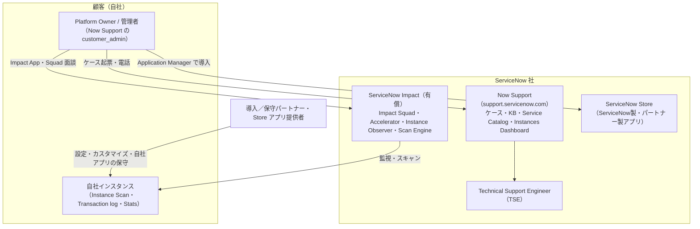
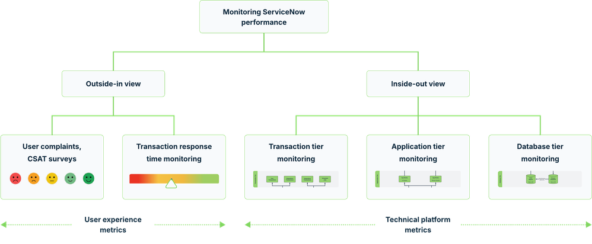
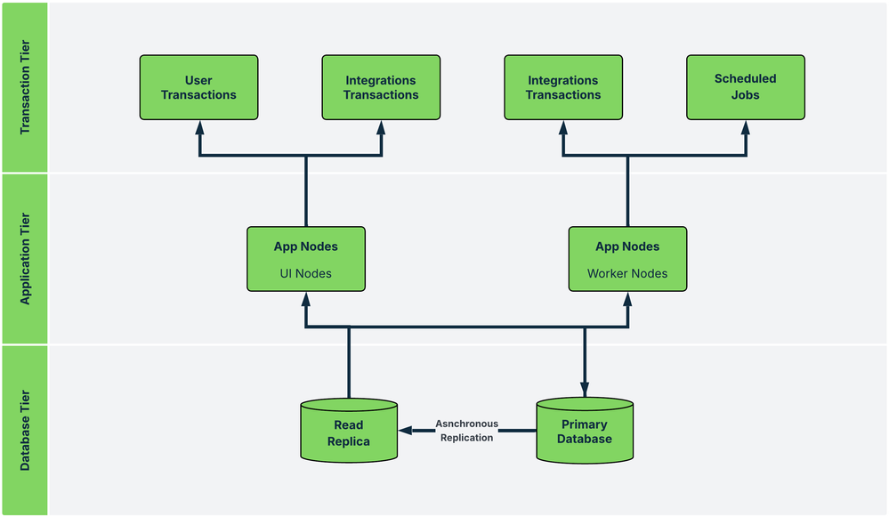
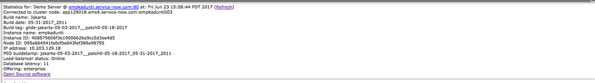

# サポートと監視（Support and Monitoring）

## 概要

ServiceNow は SaaS であるため、インフラの監視・バックアップ・パッチ適用は ServiceNow 社が行う。顧客側の運用チームが「サポートと監視」で担うのは、**ServiceNow 社のサポート窓口を正しく使うこと**と、**自社インスタンスの健全性・性能を自分たちで把握すること**の 2 つである。本ファイルは次の 7 領域を扱う。

| 領域 | 何に答えるか | 主な仕組み・名称 | 章 |
|---|---|---|---|
| Now Support（旧 HI） | 障害・不具合をどこに・どう報告するか、ユーザーとインスタンスをどう管理するか | `support.servicenow.com`、`customer_admin` ロール、Instances Dashboard、Service Catalog（Automation Store） | 1〜2 章 |
| ケース優先度 | P1〜P4 の定義と応答目標、起票とエスカレーションの実務 | Customer Support Addendum（CSA）、Impact パッケージの応答目標 | 3 章 |
| Availability SLA | 稼働率保証とサービスクレジット、メンテナンス通知 | CSA の Availability SLA（99.8%） | 4 章 |
| Success / Impact | 有償の成功支援プログラムの中身 | ServiceNow Impact（Guided／Total／Integrated Success）、Impact Squad、Accelerator | 5 章 |
| Instance health | インスタンスの設定品質・ベストプラクティス違反の評価 | Instance Scan（プラットフォーム標準）、Scan Engine／HealthScan（Impact） | 6 章 |
| パフォーマンス監視 | 応答遅延・リソース逼迫の検知と調査 | Instance Observer、Transaction log、Slow patterns、`stats.do`、Quota rules | 7 章 |
| Customer Service Portal | CSM で自社の顧客向けに提供するサポートポータル | Customer Service Portal／Business Portal（B2B）、Consumer Service Portal／Consumer Portal（B2C） | 8 章 |
| ServiceNow Store | 追加アプリの調達・導入・サポート責任 | ServiceNow Store、Application Manager、`sys_store_app` | 9 章 |

関連ファイル：運用体制・KPI・Demand 管理は [運用とガバナンス](12-operations-governance.md)、アップグレードの計画と N-1 サポートポリシーは [アップグレード管理](13-upgrade-management.md)、本番稼働直後のハイパーケアは [テストと本番稼働](11-testing-golive.md)、環境構成とクローンは [インスタンス戦略と環境](07-instance-strategy.md)、Impact の価格は [価格情報](02-pricing.md)、パフォーマンス改善の実践は [パフォーマンスチューニング](../04_応用編/03-performance-tuning.md)、CSM の製品仕様は [Customer Service Management](../02_リファレンス/customer/customer-service-management.md)、インスタンスの物理構成は [インスタンスアーキテクチャ](../02_リファレンス/platform/instance-architecture.md)、プラットフォームの管理機能全般は [システム管理](../02_リファレンス/platform/system-administration.md) を参照。

---

## 1. ServiceNow のサポート体系の全体像

ServiceNow 顧客が利用できる支援は、**契約に標準で含まれるサポート**（Customer Support Addendum に基づく不具合対応）と、**有償の成功支援**（ServiceNow Impact）、**パートナー**（導入・保守ベンダー、Store アプリ提供者）の 3 層に分かれる。

| 層 | 対象範囲 | 範囲外（代表例） | 出典 |
|---|---|---|---|
| 標準サポート（Customer Support） | Subscription Service の Product Overview に対する不適合（defect）の解決。解決は fix、workaround、その他の救済措置 | 導入・設定・連携・カスタマイズ作業、トレーニングや管理作業の支援、ServiceNow 以外が加えた変更に起因する不具合、アップグレード方針に適合しないインスタンス上の不具合 | [CSA（2020-04-15 版）](https://static.carahsoft.com/concrete/files/9116/2998/6889/customer-support-addendum-upgrades.pdf) |
| ServiceNow Impact（有償） | 専任チーム、Accelerator（専門家主導の支援メニュー）、Instance Observer、Scan Engine、Developer Support（Total） | 実装作業そのもの（Integrated Success を除く） | [Impact packages](https://www.servicenow.com/docs/r/impact/impact-packages1.html) |
| パートナー | 導入・設定変更・カスタム開発・運用代行、Store アプリの保守 | — | — |

> 実務上の要点：**「カスタマイズ起因の不具合」は標準サポートの範囲外**である。TSE はまず「ベースシステム（OOB）で再現するか」を確認するため、カスタマイズが多いインスタンスほどパートナーや社内の一次切り分けの重要性が増す（[コミュニティ](https://www.servicenow.com/community/itsm-forum/what-are-servicenow-sla-when-your-report-an-issue-to-hi/m-p/563976) でも「HI に報告する前に OOB で再現するか確認せよ」と案内されている）。

---

## 2. Now Support（旧 HI ポータル）

### 2.1 Now Support とは

Now Support は、ServiceNow 社が顧客向けに提供する**セルフヘルプ・技術サポート・インスタンス管理のポータル**である（[公式ドキュメント：Now Support administration](https://www.servicenow.com/docs/r/7LhbZn3yz3Q58qhjZoU9iQ/nbksiM0cF01qWwz5IzcIfw)）。旧称は **HI（HI portal、`hi.service-now.com`）** で、現在の URL は `https://support.servicenow.com/` である（[コミュニティ記事](https://www.servicenow.com/community/servicenow-ai-platform-articles/administration-using-the-now-support-portal-knowledge-amp/ta-p/2496445)、[Now Support メンテナンス FAQ](https://www.servicenow.com/community/developer-articles/now-support-scheduled-maintenance-faqs-april-8-2023/ta-p/2516591)）。2020 年版 CSA では Support Portal として `https://hi.service-now.com/` が記載されている（[CSA](https://static.carahsoft.com/concrete/files/9116/2998/6889/customer-support-addendum-upgrades.pdf)）。

- Now Support 自体が ServiceNow の Customer Service Management（CSM）上に構築されたポータルである（いわゆる "Now on Now"）。【第三者情報】
- 利用者：インスタンスの管理・監視・保守に責任を持つ人（管理者等）。何ができるかは Now Support 上のロールで決まる（[公式](https://www.servicenow.com/docs/r/7LhbZn3yz3Q58qhjZoU9iQ/nbksiM0cF01qWwz5IzcIfw)）。
- ログインには ServiceNow ID（Now Learning・Impact と共通のアカウント）を使い、MFA が要求されうる（CSA 1.4.1「Support Portal へのアクセスに MFA が必要となりうることを顧客は了承する」）。

### 2.2 Now Support の主な機能

| 機能 | 内容 | 出典 |
|---|---|---|
| Cases（ケース） | 不具合・質問のケース起票、進捗確認、TSE とのやり取り。添付（ログ・スクリーンショット）可 | [コミュニティ記事](https://www.servicenow.com/community/servicenow-ai-platform-articles/administration-using-the-now-support-portal-knowledge-amp/ta-p/2496445) |
| Knowledge Base | KB 記事（Known Error、FAQ、手順）。KB 番号（例：KB0547203）で参照される | 同上 |
| Service Catalog（Automation Store） | プラグインのアクティベーション依頼、アップグレードのスケジュール依頼などのセルフサービス要求。プラグイン有効化は **All Automations > Service Catalog > Activate Plugin**（一覧にない場合は「Plugin I'm looking for is not listed」を選んで名前を入力） | [Application Manager 記事](https://www.servicenow.com/community/upgrades-and-patching-articles/what-to-know-beyond-the-install-button-in-application-manager/ta-p/3546451) |
| Instances Dashboard | 自社インスタンス一覧、バージョン、アップグレードのスケジュール・再スケジュール・追跡 | [コミュニティ記事](https://www.servicenow.com/community/servicenow-ai-platform-articles/administration-using-the-now-support-portal-knowledge-amp/ta-p/2496445) |
| アップグレードのスケジュール | Australia のアップグレード計画チェックリストに「Schedule the upgrade in Now Support」「必要ならバージョンエンタイトルメントを要求」と記載 | [Upgrade planning checklist](https://www.servicenow.com/docs/r/release-notes/upgrades-planning-checklist.html) |
| Maintenance Center | メンテナンス通知を一元表示（以前はメールのみ）。KB0999157 | [コミュニティ記事](https://www.servicenow.com/community/servicenow-ai-platform-articles/administration-using-the-now-support-portal-knowledge-amp/ta-p/2496445) |
| 通知 | インスタンスに関する重要なメール通知（ユーザー種別ごとの通知内容は KB0547262） | [公式](https://www.servicenow.com/docs/r/7LhbZn3yz3Q58qhjZoU9iQ/nbksiM0cF01qWwz5IzcIfw) |
| ユーザー管理 | `customer_admin` によるユーザー作成・ロール変更・無効化。Now Learning・Now Support・Impact のユーザー作成を統合した新 User Management（KB1279988） | 同上 |
| モバイルアプリ | Now Support Mobile App（2020 年公開。セルフサービス要求、KB、ケース進捗、Virtual Agent） | [コミュニティ記事](https://www.servicenow.com/community/servicenow-ai-platform-articles/administration-using-the-now-support-portal-knowledge-amp/ta-p/2496445) |
| インスタンス自動化 | インスタンスのプロビジョニング・アップグレード・クローン等の自動化処理が Now Support 基盤と連動 | [メンテナンス FAQ](https://www.servicenow.com/community/developer-articles/now-support-scheduled-maintenance-faqs-april-8-2023/ta-p/2516591) |

> 補足：クローンの依頼・スケジュールは、現行リリースでは主にインスタンス上の **Clone Admin Console**（Australia で全クローン機能がこのメニュー配下に集約）から行う。詳細は [インスタンス戦略と環境](07-instance-strategy.md) と [アップデートセットとクローン](../02_リファレンス/platform/update-sets-cloning.md) を参照。

#### 主要 KB 記事（Now Support 上）

| KB 番号 | タイトル | 用途 |
|---|---|---|
| KB0547203 | What is the Now Support portal | ポータルの概要・主要機能 |
| KB0854198 | Tips for getting started with Now Support | 管理者の初期設定 |
| KB0547103 | Using the Now Support (HI) portal | よく使う操作のクイックリファレンス |
| KB0538359 | Roles and Responsibilities of Customer Administrators | `customer_admin` の役割 |
| KB0999157 | Now Support Maintenance Center | メンテナンス情報の確認 |
| KB0547654 | Instance Backup and Recovery | バックアップとリカバリ |
| KB1279988 | Introducing Now Support User Management | 統合ユーザー管理 |
| KB0959754 | Now Support release notes | Now Support 自体の変更履歴 |
| KB0547262 | （通知） | Now Support ユーザー種別ごとの通知内容 |

出典：[Administration: Using the Now Support Portal（コミュニティ、2025-11-21 更新）](https://www.servicenow.com/community/servicenow-ai-platform-articles/administration-using-the-now-support-portal-knowledge-amp/ta-p/2496445)、[公式 Now Support administration](https://www.servicenow.com/docs/r/7LhbZn3yz3Q58qhjZoU9iQ/nbksiM0cF01qWwz5IzcIfw)。KB 本文は Now Support へのログインが必要で、本ナレッジでは本文を確認していない。

### 2.3 Customer Administrator と Authorized Contacts

Now Support の **Customer Administrator（カスタマー管理者、`customer_admin` ロール）** は、自社の Now Support ユーザーの「ゲートキーパー」であり、開発者・アーキテクト・パートナー等のユーザーを追加・削除する（[公式](https://www.servicenow.com/docs/r/7LhbZn3yz3Q58qhjZoU9iQ/nbksiM0cF01qWwz5IzcIfw)）。公式ドキュメントには次のサブページがある。

| 操作 | 内容 |
|---|---|
| View Now Support users | アクティブ／非アクティブのユーザーとロールの一覧 |
| Create a user in Now Support | ユーザー作成とアクセスロール付与 |
| Manage user access in Now Support | ユーザーのアクセスロール変更 |

CSA（2020 版）1.4.2 では、顧客は合理的な数の **Customer Authorized Contacts** を指名し、Support Portal 上で次の連絡先を最新に保つ義務を負う（[CSA](https://static.carahsoft.com/concrete/files/9116/2998/6889/customer-support-addendum-upgrades.pdf)）。

| 連絡先種別 | 実務での割り当て例【経験則】 |
|---|---|
| Primary Business Contact | Platform Owner |
| Secondary Business Contact | IT 部門の管理職 |
| Technical Contact | プラットフォームアーキテクト |
| Support Contact | 運用チームのリーダー |
| Primary Customer Administrator | プラットフォーム管理者（`customer_admin`） |
| Security Contact | 情報セキュリティ部門（セキュリティ通知の受信者） |

> 実務上の注意【経験則】：
> - `customer_admin` は**最低 2 名**（主・副）置き、人事異動時の引き継ぎを運用手順に入れる。退職者の Now Support アカウントが残らないよう、Now Support ユーザーの棚卸しを年次の ID 棚卸しに含める。
> - パートナー要員にも Now Support アカウントを発行できるが、ケース起票権限やインスタンス操作（アップグレード日程変更等）を誰に許すかを決めておく。
> - Security Contact はセキュリティ脆弱性・インシデント通知の受信先になるため、個人ではなく共有メールボックスに紐づく担当者を推奨する。

### 2.4 Now Support が使えないとき

Now Support 自体のメンテナンス時（例：2024-10-12 20:00〜10-13 00:00 PT）は、ポータルが最大 60 分停止し、インスタンスの自動化処理（プロビジョニング・アップグレード・クローン）が最大 4 時間停止した。緊急の問題はすべての ServiceNow Support 電話番号（記事では +1 619-736-3399 を例示）で受け付け、緊急でない問題は復旧を待つよう案内された（[メンテナンス FAQ](https://www.servicenow.com/community/developer-articles/now-support-scheduled-maintenance-faqs-april-8-2023/ta-p/2516591)）。

- 電話窓口の一覧は `servicenow.com/support/contact-support.html` に掲載される（CSA 1.2）。日本の電話番号は今回の調査では公開情報で確認できず（ページがアクセス制限のため取得不可）。
- ServiceNow 社のサービス稼働状況を示す公開ステータスページ（status.servicenow.com のようなもの）は、2025 年 2 月時点のコミュニティでは「存在しない、Now Support にログインして確認する」との回答だった（[コミュニティ](https://www.servicenow.com/community/virtual-agent-forum/is-there-an-official-servicenow-service-status-page/m-p/3172582)）。【第三者情報】StatusGator 等の第三者監視サービスは存在する。

> 実務上の要点【経験則】：**P1 用の電話番号を運用手順書・障害連絡網に必ず転記しておく**。インスタンス停止時に SSO 経由で Now Support にログインできないケース、Now Support 自体が停止しているケースに備える。

---

## 3. ケース優先度（Case Priority）と応答目標

### 3.1 CSA に定める優先度の定義

ServiceNow の標準サポートの優先度は、契約書の一部である **Customer Support Addendum（CSA）** で定義される。公開されている 2020-04-15 版 CSA の定義は次のとおり（[CSA 1.3](https://static.carahsoft.com/concrete/files/9116/2998/6889/customer-support-addendum-upgrades.pdf)。リセラー Carahsoft 掲載の写し）。

| 優先度 | 定義（原文） | 日本語訳 | Target Response Time（目標初回応答時間） | Target Level of Effort（対応体制） |
|---|---|---|---|---|
| **P1** | Any defect that causes an instance not to be Available. | インスタンスが利用不能（Available でない）となる不具合 | **30 分** | 継続的に 24 時間 365 日 |
| **P2** | Any defect that causes a critical function to fail. | 重要機能が失敗する不具合 | **2 時間** | 必要に応じて 24 時間 365 日 |
| **P3** | Any defect that significantly impedes work or progress. | 業務・進捗を著しく妨げる不具合 | **1 営業日** | 必要に応じて通常営業時間内 |
| **P4** | Any defect that does not significantly impede work or progress. | 業務・進捗を著しくは妨げない不具合 | **2 営業日** | 必要に応じて通常営業時間内 |

- サポートは**電話（contact-support ページ記載の番号）またはサポートポータル経由で 24 時間 365 日（祝日含む）**受け付ける（CSA 1.2）。
- 応答時間は**初回応答の目標**であり、解決時間の保証ではない。
- 最新版の CSA は ServiceNow の upgrade-schedules ページに「Customer Support Addendum（Effective March 12, 2025）」として掲載されているとの情報があるが、本調査ではページがアクセス制限のため取得できず、2025 年版の数値は**公開情報では確認できず**。契約時は自社の Order Form と有効版 CSA を必ず確認すること。

古い Now Support（HI）画面のスクリーンショットを転記したコミュニティ投稿では、P1「Instance Unavailable」30 分・常時、P2「mission-critical function に深刻な影響」2 時間・常時、P3「significant request or defect」1 営業日・営業時間、P4「important request or defect」目標なし、と表示されていた（[コミュニティ](https://www.servicenow.com/community/itsm-forum/what-are-servicenow-sla-when-your-report-an-issue-to-hi/m-p/563976)）。【第三者情報】版によって P4 の扱いが異なる。

### 3.2 Impact パッケージによる応答目標の短縮

ServiceNow Impact（5 章）を契約すると、P1/P2 の初回応答目標が短縮される。Brazil 版の公式ドキュメントでは次のとおり（[Impact packages](https://www.servicenow.com/docs/r/impact/impact-packages1.html)）。

| 応答区分 | Guided | Total |
|---|---|---|
| P1 initial target response | 30 分 | **15 分** |
| P2 initial target response | 120 分 | **60 分** |
| Developer Support | なし | あり（10 seats） |
| 24 時間 365 日の P1/P2 対応 | あり | あり |

- Guided 向けアドオン **Managed Support** を追加すると、P1/P2 応答時間の改善、SAM（Support Account Manager）のカバー対象インスタンス +1、Developer Support 5 seats が付く。Total 向け Managed Support は SAM +1 インスタンスと Developer Support 5 seats（応答時間の改善は記載なし）。
- **Developer Support** は Impact の「Impact Developer Support」ロールを持つユーザーが、Advanced／Total パッケージで break-fix のサポートケースを起票し、カスタム開発に関する支援を依頼できる仕組みである（[Impact roles](https://www.servicenow.com/docs/r/impact/impact-roles.html)）。標準サポートの範囲外であるカスタマイズに関する相談の窓口として位置付けられる。

### 3.3 第三者情報との差異

第三者のサイトでは、P1 初回応答「1 時間」、P2「2〜4 時間」、Standard／Premier／Enterprise といった契約ティアなど、公式と異なる数値が流通している（例：[Surety Systems](https://www.suretysystems.com/insights/servicenow-support-surety-systems/)）。【第三者情報】これらは公式文書と一致しないため、**提案書・運用設計書に記載する数値は必ず顧客の契約書（Order Form、CSA、Impact Package Description）から転記する**。

### 3.4 優先度の付け方と起票の実務

ServiceNow の優先度は **「インスタンスが使えるか」「重要機能が止まっているか」** で決まり、社内のインシデント優先度（影響度×緊急度）とは別物である。社内で P1 の大障害でも、原因がカスタマイズや連携先にあれば ServiceNow 社にとっては P1 にならない。

| 社内の状況 | ServiceNow 社への優先度の目安【経験則】 | 補足 |
|---|---|---|
| 本番インスタンスにログインできない／全ユーザーで画面が開かない | P1 | ポータルに入れなければ電話 |
| 本番で特定の重要機能（例：インシデント起票、承認、MID Server 経由の連携全体）が失敗し業務が止まる | P2 | OOB 機能であることを示す |
| アップグレード後に一部の機能がエラーになるが回避策あり | P3 | 再現手順・影響ユーザー数 |
| サブプロダクション環境の不具合、仕様確認、ドキュメントの誤り | P4 | — |
| カスタムスクリプトの不具合、設定方法の質問 | ケースの対象外（パートナー／Developer Support／Community） | 標準サポートは「defect」が対象 |

**優先度を上げたいとき**：コミュニティでは「ポータルからは優先度を上げられない。サポートに電話してエスカレーションする」との回答がある（[コミュニティ](https://www.servicenow.com/community/itsm-forum/how-do-i-escalate-an-incident-in-hi/td-p/839615/page/2)）。【第三者情報】また、HI が自動的に Medium 優先度を設定したが業務影響は大きかった、という報告もある。現行の Now Support に「エスカレーション要求」ボタンがあるかは、公開情報では確認できず。Impact 契約がある場合は SAM／CSM にも並行して連絡する【経験則】。

### 3.5 ケース起票テンプレート【経験則】

TSE の初動を速くするために、起票時に次の情報をそろえる。

| 項目 | 記載内容 | 例 |
|---|---|---|
| Instance | 対象インスタンス名（本番/非本番） | `acmeprod` |
| Business impact（業務影響） | 影響ユーザー数、止まっている業務、期限 | 全社 8,000 名がインシデント起票不可。月末締め処理が 18:00 期限 |
| 発生日時とタイムゾーン | 最初に気付いた時刻（UTC 併記が望ましい） | 2026-11-02 09:15 JST（00:15 UTC） |
| 事象 | エラーメッセージ全文、画面、URL | `HTTP 500` が `incident.do` で発生 |
| 再現手順（Steps to reproduce） | 番号付き手順、使用ユーザー（impersonate 可否） | 1. itil ユーザーでログイン 2. … |
| OOB で再現するか | ベースシステム（別インスタンスや PDI）での再現結果 | PDI（Australia Patch 2）でも再現 |
| 直前の変更 | アップグレード、パッチ、Update Set 適用、プラグイン有効化 | 前夜に Update Set「REL-2026-11」を適用 |
| 調査済み事項 | Transaction log、System Log、`stats.do` の確認結果 | Slow Transactions で該当 URL が平均 45 秒 |
| アクセス許可 | TSE のインスタンスアクセス（impersonate／ログ閲覧）の可否 | 許可。ただし個人情報テーブルは閲覧不可 |
| 連絡先 | 電話・メール、対応可能時間帯 | 24 時間対応の当番電話 |

> 日本語での対応：ServiceNow は日本にサポート拠点を持つとされるが、日本語サポートの提供時間帯・言語選択の条件は公開情報では確認できず。Surety Systems は「北米・EMEA・APAC に分散し、現地語でのカバレッジがある」と記載している【第三者情報】。日本固有の事情は [日本市場における導入](15-japan-market.md) を参照。

---

## 4. Availability SLA とメンテナンス

### 4.1 Availability SLA（稼働率保証）

2020 年版 CSA の Availability SLA は次のとおり（[CSA 2 章](https://static.carahsoft.com/concrete/files/9116/2998/6889/customer-support-addendum-upgrades.pdf)）。

| 項目 | 内容 |
|---|---|
| 対象 | 顧客の**本番インスタンス**（production instance） |
| 基準 | 暦月で **99.8%** 未満の場合 |
| 救済 | 唯一の救済手段（exclusive remedy）として **Service Credit（サービスクレジット）** を請求できる。金額は Available でなかった分数 × その Subscription Service のみなし分単価 |
| 請求期限 | SLA 未達月の末日から **30 日以内に書面で**請求 |
| 発行 | クレジット額が **1,000 USD**（または Order Form 記載通貨の相当額）に達するまで発行を保留できる |
| Available の定義 | 暦月中、Excused Downtime を除き、本番インスタンスに認可ユーザーがアクセスできること |
| Excused Downtime | (a) **月 2 時間まで**の Maintenance Time、(b) ServiceNow の管理外の事由（ServiceNow 以外による改変、不可抗力、インターネット障害、顧客側インフラ・回線〔専用線・VPN を含む〕の障害、DoS 攻撃等） |
| Maintenance Time | Infrastructure Modification、Upgrade、Update によって Available でない時間 |

> 実務上の要点【経験則】：
> - SLA 未達は**顧客側から請求しないとクレジットにならない**。障害時は ServiceNow 側のケース番号・発生/復旧時刻を記録し、月次で稼働状況を確認する運用にしておく。
> - 「顧客側の回線・VPN・IdP（SSO）障害」は Excused Downtime に該当しうる。SSO 障害時の代替ログイン手段（ローカル管理者アカウント）は [認証とSSO](../02_リファレンス/platform/authentication-sso.md) を参照。

### 4.2 Upgrade／Update／Infrastructure Modification の事前通知

| 種別 | 定義 | 事前通知（合理的努力） |
|---|---|---|
| Upgrade | 新しい Release Family の適用（追加費用なし） | **30 日前** |
| Update | パッチ・ホットフィックス（新機能は通常含まない） | **10 日前** |
| Infrastructure Modification | クラウド基盤の修理・保守・改善・変更 | 本番利用に影響すると ServiceNow が判断した場合 **10 日前** |

いずれも、可用性・セキュリティ・性能の維持、法令順守、第三者 IPR 侵害回避のために必要な場合は短縮または無通知となりうる（[CSA 2〜3 章](https://static.carahsoft.com/concrete/files/9116/2998/6889/customer-support-addendum-upgrades.pdf)）。サポート対象リリース（N-1 方針）と End of Life、アップグレードの自動スケジュールは [アップグレード管理](13-upgrade-management.md) を参照。

---

## 5. Success／Impact（ServiceNow Impact）

### 5.1 ServiceNow Impact とは

**ServiceNow Impact** は、ServiceNow 社が有償で提供する成功支援（Customer Success）プログラムである。デジタル体験（Impact App：価値実現ダッシュボード、ジャーニービルダー）、学習・コーチング（ロードマップ・職務に合わせた厳選コンテンツ）、推奨エンジン（予防的インサイト・アラート）を全パッケージ共通の基本特典とし、パッケージごとに専任チーム（Impact Squad）、Accelerator、強化サポート、Instance Observer、Scan Engine を提供する（[Zurich 版 Impact packages](https://www.servicenow.com/docs/r/zurich/impact/impact-packages.html)）。

Impact はインスタンスに導入される **Impact アプリケーション（Impact plugin／Store アプリ）** と、ServiceNow 側の **Impact Delivery Instance（IDI）** で構成される（[HealthScan for the Impact Delivery Instance](https://www.servicenow.com/docs/r/impact/healthscan.html)）。

### 5.2 パッケージ

| パッケージ | 位置付け | 主な内容 | 出典 |
|---|---|---|---|
| **Guided** | 入門パッケージ | Impact App、24/7 サポート（P1 30 分／P2 120 分）、限定的な Accelerator、Customer Success Manager（CSM） | [Impact packages（Brazil）](https://www.servicenow.com/docs/r/impact/impact-packages1.html) |
| **Total** | 完全パッケージ | Guided の全内容 ＋ 応答短縮（P1 15 分／P2 60 分）、Developer Support（10 seats）、Accelerator 全カタログ、専任 Impact Squad | 同上 |
| **Integrated Success** | Total ＋ 実装サービス | Total の全エンタイトルメント ＋ 契約に応じた実装サービス（Impact の Free Form initiative から開始）。Squad に Engineering Manager、Business Process Consultant、Solution Architect が加わる | [Impact packages（Australia）](https://www.servicenow.com/docs/r/australia/impact/impact-packages.html) |
| Advanced（旧） | Guided と Total の中間 | Instance Observer の比較表や Health Assessment – Advanced 等で言及が残るが、Zurich 以降のパッケージ表には掲載されていない | [Instance Observer](https://www.servicenow.com/docs/r/OLEAh14mAEPe8fUlW2F9wQ/w~Q2UXlnDQpyIRD9r4xyUg) |

- ServiceNow のマーケティングページでは「Base」「Impact Guided」「Impact Total」「Impact Add-Ons」という並びで成功プランが示されていた（検索結果のスニペットによる。ページ本体はアクセス制限のため未確認）。Base（Impact 未契約）の内容は公開情報では確認できず。
- Impact の価格は公開されていない。[価格情報](02-pricing.md) を参照。

### 5.3 Impact Squad（専任チーム）

| 役割 | 英語名 | 主な責務【一部経験則】 | Guided | Total | Integrated Success |
|---|---|---|---|---|---|
| カスタマーサクセスマネージャー | Customer Success Manager（CSM） | 成功計画、Accelerator の調整、定例レビュー | ✓ | ✓ | ✓ |
| カスタマーサクセスエグゼクティブ | Customer Success Executive（CSE） | 経営層との関係、価値実現の責任者 | — | ✓ | ✓ |
| プラットフォームアーキテクト | Platform Architect（PA） | アーキテクチャ助言、技術的負債・健全性レビュー | — | ✓ | ✓ |
| サポートアカウントマネージャー | Support Account Manager（SAM） | サポートケースの全体管理、エスカレーション窓口、Performance Management Review | — | ✓ | ✓ |
| Engineering Manager／Business Process Consultant／Solution Architect | EM／BPC／SA | 実装サービスの提供 | — | — | ✓ |

出典：[Impact packages（Australia／Brazil）](https://www.servicenow.com/docs/r/australia/impact/impact-packages.html)。SAM との Performance Management Review の実施は [コミュニティ記事](https://www.servicenow.com/community/servicenow-ai-platform-articles/monitoring-servicenow-platform-performance-combining-outside-in/ta-p/3431199) による。

### 5.4 Platform Health（Scan Engine と Instance Observer）のエンタイトルメント

| 機能 | Guided | Total |
|---|---|---|
| Active custom Scan Engine definitions | 最大 10 | 無制限 |
| Scan Engine proposed fix（修正提案） | なし | あり |
| Instance Observer seats | 5 | 10 |
| Instance Observer data look-back | 45 日 | 6 か月 |
| Instance Observer alert types | 6 | 40 |
| Instance Observer analytics | なし | あり |

出典：[Impact packages（Brazil、2026-09-10 更新）](https://www.servicenow.com/docs/r/impact/impact-packages1.html)

### 5.5 Accelerator（アクセラレーター）

**Accelerator** は、Impact で提供される専門家主導の支援メニュー（例：Health Assessment、Introduction to Instance Observer、Jumpstart Your Database Management、TuneUp Your Platform Analytics、Access to Experts）である。サブカタログは **Technical／Strategy／Architecture／Optimization** の 4 つ。

| エンタイトルメント | Guided | Total |
|---|---|---|
| カタログ | Technical、Strategy（一部）、Architecture（一部） | Technical、Strategy、Architecture、Optimization |
| 同時実行数（concurrency） | Australia 版：全サブカタログ合計で 1 件ずつ／Brazil 版：サブカタログごとに 1 | Technical・Strategy・Architecture 各 2、Optimization 1（合計 7） |

出典：[Australia 版](https://www.servicenow.com/docs/r/australia/impact/impact-packages.html)、[Brazil 版](https://www.servicenow.com/docs/r/impact/impact-packages1.html)。Australia 版と Brazil 版で Guided の同時実行数の記述が異なるため、契約の Package Description で確認すること。

> 実務上の要点【経験則】：Accelerator は**同時実行数に上限がある「枠」**であり、使わなければ価値が出ない。導入プロジェクトの計画段階で CSM と「どの時期にどの Accelerator を使うか」（例：Go-Live 前に Health Assessment、Go-Live 後 3 か月で Instance Observer 導入）を年間計画に落とし込む。

### 5.6 アドオン

| アドオン | Guided 向けの内容 | Total 向けの内容 |
|---|---|---|
| Strategic Value | Strategy サブカタログ拡張、Strategy 同時実行 +2 | Strategy 同時実行 +2 |
| Platform Governance | Architecture サブカタログ拡張、Architecture 同時実行 +2 | Architecture 同時実行 +2 |
| Managed Support | P1/P2 応答時間の改善、SAM +1 インスタンス、Developer Support 5 seats | SAM +1 インスタンス、Developer Support 5 seats |
| Preventive Care | 年 2 回、Account Escalation Engineer による本番性能評価（データレビュー・改善提案・実施） | 年 2 回の性能評価（データレビュー・改善提案） |
| Platform Optimization | Optimization サブカタログ、同時実行 +1 | Optimization 同時実行 +1 |
| Platform Health | Scan Engine の custom definitions 無制限、proposed fixes | （Total に含まれる） |
| Instance Observer features | 6 か月ルックバック、40 アラートタイプ、analytics | （Total に含まれる） |
| Instance Observer seats | +10 seats | +10 seats |

出典：[Impact packages（Brazil）](https://www.servicenow.com/docs/r/impact/impact-packages1.html)。アドオンは SKU 単位・年額で販売される（[Zurich 版](https://www.servicenow.com/docs/r/zurich/impact/impact-packages.html)）。

### 5.7 Impact のロール（インスタンス側）

| ロール | API 名 | 権限の概要 |
|---|---|---|
| Impact Admin | `sn_impact_common.Impact Admin` | 全機能、プレミアムアクセス管理、ユーザーアカウント管理 |
| Impact App Admin | `sn_impact_common.Impact App Admin` | テーブル全権、ロール付与、Platform Health 設定、Scan Engine の設定・スキャン制御 |
| Impact Platform Owner | `sn_impact_common.Impact Platform Owner` | Impact の広範なアクセス、Instance Observer と Developer Support のプレミアムアクセス管理（ロール付与不可） |
| Impact Portfolio Owner | `sn_impact_common.Impact Portfolio Owner` | Impact テーブルの CRUD、Accelerator・Advisory セッションの要求 |
| Impact Permissions Authorizer | （表記上 API 名なし） | 権限・活動要求の承認／却下 |
| Impact Developer | `sn_impact_common.Impact Developer` | Scan Engine の指摘事項・個人の技術的負債・オンデマンドスキャン・例外申請 |
| Development Team Lead | `sn_impact_common.Impact Development Team Lead` | チームの指摘事項・スキャン結果の閲覧、メンバー管理 |
| Impact Developer Support | （表記上 API 名なし） | Advanced／Total での break-fix ケース起票、カスタム開発支援の依頼 |
| Impact Executive | `sn_impact_common.Impact Executive` | Impact・Scan Engine の閲覧、エグゼクティブダッシュボード |
| Impact User | `sn_impact_common.Impact User` | 読み取り専用 |
| Impact Partner | `sn_impact_common.Impact Partner` | 読み取り専用（ケイパビリティマップ、ロードマップ等）、Advisory 依頼（Australia で追加） |
| Scan Engine Admin | `sn_se.scan_engine_admin` | Scan Engine の設定・結果・例外理由・承認フロー・AI 修正の有効化 |
| Scan Engine User | `sn_se.scan_engine_user` | 指摘事項と結果の閲覧（スキャン開始不可） |
| Exception Approver | `sn_se.scan_engine_exception_approver` | 例外申請の承認／却下 |
| AI Fix User | `sn_impact_gen_ai_ai_fix_user` | AI 生成のコード修正提案の閲覧・適用 |
| IO Standard | `io_standard` | Instance Observer のフルアクセス（アラートルール、ダッシュボード、レポート、トリアージ、可用性） |
| IO Read Only | `io_readonly` | Instance Observer の閲覧のみ |

出典：[Roles installed with Impact（Brazil）](https://www.servicenow.com/docs/r/impact/impact-roles.html)

### 5.8 利用制約

一部の Impact 機能は、FedRAMP、NSC DOD IL5、Australia IRAP-Protected のデータセンター、セルフホスト環境、その他の制限環境、MSP（自社利用を除く）では利用できない（[Impact packages](https://www.servicenow.com/docs/r/impact/impact-packages1.html)）。Instance Observer は Commercial と GCC 環境の ServiceNow Platform インスタンスのみが対象である（[Instance Observer](https://www.servicenow.com/docs/r/impact/io-overview.html)）。Health Assessment Accelerator は、MSP（自社利用を除く）、セキュリティクリアランスが必要な顧客、ドメインセパレーション環境を対象外としている（[Health Assessment](https://www.servicenow.com/docs/r/zurich/impact/accelerator-and-initiative-list/health-assessment.html)）。

### 5.9 Australia での Impact の変更点

Australia の Impact リリースノート（[Zurich→Brazil 差分](https://www.servicenow.com/docs/r/delta-zurich-brazil/brazil-zurich-impact-release-notes.html)）には次の項目がある。

| 区分 | 内容 |
|---|---|
| 新機能（Impact） | 製品レベルの価値ページ（v9.0.0、拡張アウトカムは現在 ITSM のみ）、Impact Partner ロール、製品ライン別ケイパビリティマップ、Accelerator のセルフサービス提供、Impact Conversations |
| 新機能（Instance Observer） | Long Pending Jobs アラートカード、顧客設定の Webhook 連携失敗通知（URL 検証付き） |
| 新機能（Scan Engine） | v7.0.0：Impact Health Agent と AI 生成コード修正、v8.0.0：指摘事項の要約、統計・システムプロパティのスキャンタイプ、Recommend レベルの指摘事項に対する例外申請、v9.00：ベースシステム定義の無効化（override 不要）、Full／Suite Scan による Update Set 検証 |
| 変更 | 製品名称の「ServiceNow Otto」へのリブランド（リリースノートでは Now Assist の改称として記載）、Optimization Accelerator の標準カタログ統合、「Recommended capabilities」→「Squad-prioritized capabilities」 |
| 廃止 | On-demand value report、Value potential Accelerator |

> **Brazil での変更:** Impact のリリースノートでは Brazil は「No updates for this release」（新機能・変更・廃止なし）。Instance Scan も Brazil での更新はなし（[Instance Scan 差分](https://www.servicenow.com/docs/r/delta-zurich-brazil/brazil-zurich-instancescan-release-notes.html)）。

---

## 6. Instance health（インスタンスの健全性）

インスタンスの「健全性」は、(1) **設定品質**（ベストプラクティス違反・技術的負債）と (2) **稼働性能**（応答時間・リソース）の 2 面で評価する。本章は (1)、7 章は (2) を扱う。

| 観点 | プラットフォーム標準（全顧客） | Impact 契約時（追加） |
|---|---|---|
| 設定品質 | **Instance Scan**（`scan_user` ほか） | **Scan Engine**（Instance Health Score 0〜100）、HealthScan、Health Assessment Accelerator |
| 稼働性能 | Transaction log、Slow patterns、`stats.do`、System Diagnostics | **Instance Observer**、Preventive Care |

### 6.1 Instance Scan（プラットフォーム標準）

**Instance Scan** は、インスタンスをセキュリティ、アップグレード、管理性、ユーザー体験、性能の観点で検査し、結果を報告する標準機能である（[Exploring Instance Scan（Australia、2026-07-03 更新）](https://www.servicenow.com/docs/r/UrSRFFKWBbfQBgoRlt~ltw/8S4QcFvEX3qC749Q8ZqTGg)）。

| 構成要素 | 説明 |
|---|---|
| Checks（チェック） | 単一目的のルール。テーブル・レコード・メタデータに対して実行。カテゴリは security、upgrade best practices、manageability、user experience、performance |
| Results（結果） | 各スキャンの状態と種別 |
| Findings（指摘事項） | チェックに違反したレコードへの参照 |
| Dashboard | Full scan 結果の管理・分析ビュー |
| Quota rules | スキャン実行時間の上限。超過したスキャンは失敗 |
| Check suites | まとめて実行・スケジュールできるチェックの束 |

| スキャン種別 | 内容 |
|---|---|
| Full scan | すべてのアクティブなチェックを実行 |
| Point scan | 1 レコード、Update Set、アプリケーション単位で実行（Update Set スキャンは関連レコードの現在値を見るため、Update Set 内にのみ存在する問題は検出しない） |
| Test scan | Check フォームの Test Check で単一チェックを試験 |
| Suite scan | Check suite を実行。スケジュール可 |

| ロール | 権限 |
|---|---|
| `scan_user` | スキャン実行、チェックの読み取り・実行、指摘事項と結果の閲覧 |
| `scan_check_writer` | `scan_user` を含み、チェックの作成が可能 |

- Instance Scan はドメインセパレーションを完全にはサポートしない（指摘事項はソースレコードのドメインで分離）。`sys_metadata` を拡張したテーブルをスキャンできる。
- 運用 KPI（Instance Scan の指摘件数の推移）の使い方は [運用とガバナンス](12-operations-governance.md)、アップグレード前後の活用は [アップグレード管理](13-upgrade-management.md) を参照。

### 6.2 Scan Engine と HealthScan（Impact）

**Scan Engine** は Impact Platform Health の診断エンジンで、インスタンスをリーディングプラクティスの定義に照らして継続的に評価し、指摘事項・トレンド・**Instance Health Score** を提示する（[Scan engine overview（Brazil、2026-09-30 更新）](https://www.servicenow.com/docs/r/impact/scan-engine-overview.html)）。

| 項目 | 内容 |
|---|---|
| チェック数 | 数千の設定ポイントに対する数百のチェック |
| Instance Health Score | 全カテゴリのリスクを統合した 0〜100 の単一指標。カテゴリごとのリスクで重み付けした 4 段階の計算（重みの値はページ上で非公開、別文書「Platform Health score calculation model」） |
| カテゴリ | Security（侵害・コンプライアンス・アクセス制御）、Performance（応答性。放置すると悪化）、Manageability（管理・サポート容易性）、Upgradeability（アップグレードを阻害・遅延させる設定）、User Experience（定着・満足度。緊急度は低め） |
| Full scan | スコープ内の全レコードを全アクティブ定義で評価。同時に 1 つのみ実行 |
| Delta scan | 前回スキャン以降の変更のみ評価。Full／Delta は Scan Engine が自動選択 |
| 指摘事項 | enforcement level（block／warn／inform）とリスク評価を持つ。手動修正、または ServiceNow Otto による修正提案（コーディング中または一括）。例外申請が可能 |
| ダッシュボード | ロール別（経営層〜開発者）。スキャンごとに自動更新、未対応/対応済みとトレンドを表示 |

**HealthScan** は Impact Delivery Instance 向けの診断ツールで、数千インスタンスの分析に基づくベストプラクティス定義により、security、upgradability、performance、manageability、usability の 5 領域でデータポイントを報告する。Tech KPI（技術的リーディングプラクティスへの適合度）を提示する（[HealthScan](https://www.servicenow.com/docs/r/impact/healthscan.html)）。**Health Assessment** Accelerator（Advanced／Total）は、HealthScan による技術分析と処方的ガイダンスを提供する（[Health Assessment](https://www.servicenow.com/docs/r/zurich/impact/accelerator-and-initiative-list/health-assessment.html)）。

> 実務上の要点【経験則】：Instance Scan と Scan Engine は似ているが、**Instance Scan はプラットフォーム標準でライセンス追加不要**、Scan Engine は Impact エンタイトルメントである。Impact 未契約の顧客には、Instance Scan の Full scan を月次で実行し、指摘件数をカテゴリ別に追跡する運用を提案する。コミュニティの性能監視ガイドは「HealthScan の Performance スコアは継続的な運用監視には向かない」としている（[コミュニティ記事](https://www.servicenow.com/community/servicenow-ai-platform-articles/monitoring-servicenow-platform-performance-combining-outside-in/ta-p/3431199)）。

---

## 7. パフォーマンス監視

### 7.1 監視の考え方：Outside-in と Inside-out

ServiceNow コミュニティの性能監視ガイドは、**利用者視点（Outside-in）** と **技術プラットフォーム視点（Inside-out）** を組み合わせることを推奨している（[Monitoring ServiceNow Platform Performance: combining outside-in and inside-out](https://www.servicenow.com/community/servicenow-ai-platform-articles/monitoring-servicenow-platform-performance-combining-outside-in/ta-p/3431199)）。

*図：ServiceNow パフォーマンス監視の全体構造（Outside-in と Inside-out）*
最上段「Monitoring ServiceNow performance」から 2 つに分岐する。左の「Outside-in view」は「User complaints, CSAT surveys」（顔アイコンの 5 段階満足度）と「Transaction response time monitoring」（赤〜緑のゲージ）を含み、下部に「User experience metrics」と記される。右の「Inside-out view」は「Transaction tier monitoring」「Application tier monitoring」「Database tier monitoring」の 3 つを含み、下部に「Technical platform metrics」と記される。出典：https://www.servicenow.com/community/servicenow-ai-platform-articles/monitoring-servicenow-platform-performance-combining-outside-in/ta-p/3431199 （取得日：2026-11-03）

*図：Inside-out 監視のメトリクスフレームワーク（Transaction／Application／Database の 3 階層）*
最上段の Transaction Tier に「User Transactions」「Integrations Transactions」（2 つ）「Scheduled Jobs」が並ぶ。中段の Application Tier には「App Nodes（UI Nodes）」と「App Nodes（Worker Nodes）」があり、UI ノードがユーザー・連携トランザクションを、ワーカーノードが連携トランザクションとスケジュールジョブを処理する。最下段の Database Tier には「Primary Database」と、非同期レプリケーション（Asynchronous Replication）で複製される「Read Replica」がある。出典：https://www.servicenow.com/community/servicenow-ai-platform-articles/monitoring-servicenow-platform-performance-combining-outside-in/ta-p/3431199 （取得日：2026-11-03）

### 7.2 インスタンス上の標準ツール

| ツール | 場所（メニュー／URL） | テーブル | 何が分かるか | 出典 |
|---|---|---|---|---|
| Transaction log | System Logs > Transactions | `syslog_transaction` | Classic UI・Portal のトランザクションごとの Response time、SQL time、Business rule time、Client response time、Client network time、Browser time、Client script time、UI policy time、Semaphore wait time、Session wait time | [コミュニティ記事](https://www.servicenow.com/community/servicenow-ai-platform-articles/monitoring-servicenow-platform-performance-combining-outside-in/ta-p/3431199) |
| Client Transaction Timings | （プラグイン。新規インスタンスでは有効） | `syslog_client_transaction` | ブラウザ側の時間内訳。Response Time Indicator の有効化が前提。フォーム描画は操作単位の内訳を関連リストで確認可 | [Client transaction timings](https://www.servicenow.com/docs/r/UrSRFFKWBbfQBgoRlt~ltw/dzDDdxEkwhDHt~ysgIfPzQ) |
| Client Interactions log | System Logs > Client Interactions | `sys_client_interaction` | Configurable Workspace の PAGE_LOAD／NAVIGATION／IN-PAGE の Total UI time 等 | [コミュニティ記事](https://www.servicenow.com/community/servicenow-ai-platform-articles/monitoring-servicenow-platform-performance-combining-outside-in/ta-p/3431199) |
| Stats Tools（Slow patterns） | System Diagnostics > Stats > Slow Queries／Slow Scripts／Slow Transactions | `sys_query_pattern`、`sys_script_pattern`、`sys_transaction_pattern` | 実行パターンごとの合計・平均時間と実行回数。`syslog_transaction` のサーバー時間を集約（Semaphore・Session wait を除く）。既定で有効、`com.snc.jrobin` に依存 | [Stats Tools（Australia）](https://www.servicenow.com/docs/r/UrSRFFKWBbfQBgoRlt~ltw/vbsKTCRej6eErVcbzfTwUA) |
| Slow Patterns タブ | （Solving slow patterns） | 同上 | 選択期間で平均実行時間が全体平均より高いクエリ等を一覧化し、時系列グラフと発生源を確認 | [Solving slow patterns](https://www.servicenow.com/docs/r/7LhbZn3yz3Q58qhjZoU9iQ/Jeh7YecV9Rk75U0Aayfecg) |
| System Diagnostics | System Diagnostics | — | System Events dashboard（イベント）、Scheduled Jobs dashboard（完了ジョブ）、Stats Tools | [System Diagnostics（Brazil）](https://www.servicenow.com/docs/r/platform-administration/sys-diag.html) |
| `stats.do` | URL `https://<instance>.service-now.com/stats.do`、または System Diagnostics > Stats | — | 接続中ノードのビルド、メモリ、トランザクション数、セマフォ、スケジューラ、DB 接続、Lazy Writer、ログインセッション数。TSE がケース初動でよく確認を依頼する | [13 reasons stats.do](https://www.servicenow.com/community/now-platform-blog/13-reasons-why-the-stats-do-page-is-your-best-friend-for/ba-p/2286882) |
| `xmlstats.do` | URL | — | `stats.do` より詳細な統計（XML）。DB 性能の詳細確認に推奨 | 同上 |
| Active Transactions | User Administration > All Active Transactions | — | 実行中トランザクションの確認、暴走トランザクションの Kill | 同上 |
| Transaction Quota Rules | System Definition > Transaction Quota Rules | — | 長時間トランザクションの自動キャンセル（7.9 参照） | [Default quota rules](https://www.servicenow.com/docs/r/platform-administration/platform-performance/c_DefaultQuotaRules.html) |
| User Experience Analytics（UXA） | — | — | 全 UI の利用ダッシュボード、ジャーニー、ファネル、セッション分析（トラッキング同意ポリシーに依存） | [コミュニティ記事](https://www.servicenow.com/community/servicenow-ai-platform-articles/monitoring-servicenow-platform-performance-combining-outside-in/ta-p/3431199) |

*図：`stats.do` の第 1 セクション（インスタンス構成と状態。Jakarta 時代の画面）*
「Statistics for: Demo Server（URL）at:（日時）(Refresh)」の下に、接続中のクラスターノード名（`Connected to cluster node: app129018.ams4…`）、Build name（Jakarta）、Build date、Build tag、Instance name、Instance ID、Node ID、IP address、MID buildstamp、Load-balancer status（Online）、Database latency（11）、Offering（enterprise）が縦に並ぶ。ノード名はシステムログがノードごとに保存されるため、TSE への報告で重要になる。現行リリースでも同様の構成だが値と項目は異なる可能性がある。出典：https://www.servicenow.com/community/now-platform-blog/13-reasons-why-the-stats-do-page-is-your-best-friend-for/ba-p/2286882 （取得日：2026-11-03）

> 注意：
> - `stats.do` は**接続中の 1 ノード分**しか表示しない。マルチノード構成では全ノードの状態を一度に見られない（コミュニティでも全ノード表示の方法が繰り返し質問されている）。
> - 「System Diagnostics」ホームページと「Cluster Node Status」UI ページは San Diego 以降非推奨とされる（コミュニティ情報）。【第三者情報】
> - セマフォ設定（System Maintenance > Semaphore）は**変更前に TSE に相談**するよう案内されている（[13 reasons stats.do](https://www.servicenow.com/community/now-platform-blog/13-reasons-why-the-stats-do-page-is-your-best-friend-for/ba-p/2286882)）。

### 7.3 Application Insights の廃止

**Application Insights** は Zurich リリースから**デプロイ・機能強化・サポートの対象外**となった（KB0867184 に廃止手順）。ServiceNow は代替として Impact パッケージに含まれる **Instance Observer** の評価を推奨し、アカウントチームと Impact パッケージを検討するよう案内している（[Solving slow patterns](https://www.servicenow.com/docs/r/7LhbZn3yz3Q58qhjZoU9iQ/Jeh7YecV9Rk75U0Aayfecg)）。過去の設計書で Application Insights を前提にしている場合は見直しが必要である。

### 7.4 Instance Observer（Impact）

**Instance Observer（IO）** は、ServiceNow インスタンスの健全性と性能をほぼリアルタイムで監視し、履歴も参照できるクラウドベースのオブザーバビリティツールである。**インスタンスの外（off-instance）** で動作するため、インスタンス停止中でも性能データを参照できる（[Overview of Instance Observer](https://www.servicenow.com/docs/r/impact/io-overview.html)）。

| 項目 | 内容 |
|---|---|
| メニュー | **Impact > Platform Health > Monitor > Instance Observer** |
| 前提 | Impact パッケージ（Guided／Advanced／Total）、ServiceNow Platform インスタンス、Commercial または GCC 環境、Impact plugin（テーブル・ロール・スケジュールジョブがインストールされる） |
| UI | ブラウザ。ServiceNow モバイルアプリ非対応（モバイルブラウザは可） |
| ロール | `io_standard`（フルアクセス）、`io_readonly`（閲覧のみ）。シート数はパッケージで決まる（Guided 5／Total 10、アドオンで +10） |
| 24/7 監視とアラート | カスタム閾値。Key Alerts は 4 週間単位の履歴閾値を使用。通知先・通知方法を選択可。Guided はシステム定義の 6 アラート |
| 複数インスタンス可視化 | All Instances summary dashboard（カスタマイズ可能なホーム） |
| Availability | インスタンスの Up/Down を地図上に表示、直近 7 日の ServiceNow 生成アラート |
| Triage | トランザクション、ジョブ、ノード使用率、セマフォ、スケジューラ、Update Set の時点データを取得。**インスタンス資源を消費するため多用しない** |
| Root cause correlation（RCC） | 本番インスタンスの対応症状について、直近 24 時間のメトリクス・ログ・イベントを相関。RCC アラートで根本原因分析レポートを受信可 |
| Reporting | 健全性・性能・DB 増加・暗号化状態のレポートを生成・スケジュール・ダウンロード・共有 |
| Analytics | 期間比較、変更前後比較（Total） |

| 機能 | Guided | Advanced | Total |
|---|:-:|:-:|:-:|
| Instance availability（Up/Down） | ✓ | ✓ | ✓ |
| Performance visualization（KPI） | ✓ | ✓ | ✓ |
| Reporting | 一部（Selective） | Full | Full |
| Alerts | ✓（6 アラート） | ✓ | ✓ |
| Analytics | — | — | ✓ |
| Anomaly detection | — | — | ✓ |
| Data retention | 45 日 | 6 か月 | 6 か月 |

出典：[Overview of Instance Observer](https://www.servicenow.com/docs/r/impact/io-overview.html)、[Monitoring instance health with Instance Observer（Australia）](https://www.servicenow.com/docs/r/OLEAh14mAEPe8fUlW2F9wQ/w~Q2UXlnDQpyIRD9r4xyUg)。Brazil 版パッケージ表ではアラートタイプ数が Guided 6／Total 40 と記載（5.4 参照）。

### 7.5 Inside-out の主要メトリクスと目安

コミュニティの性能監視ガイドが Instance Observer で見るべき指標として挙げているもの（[コミュニティ記事](https://www.servicenow.com/community/servicenow-ai-platform-articles/monitoring-servicenow-platform-performance-combining-outside-in/ta-p/3431199)）。【第三者情報】数値はガイド上の目安であり、公式の閾値ではない。

| 階層 | メトリクス | 目安・解釈 |
|---|---|---|
| Transaction | Semaphore Default Mean | Default プールは 16 スレッド。1 ノードで 10 以上の使用が継続する場合は深刻な問題の可能性 |
| Transaction | Semaphore Default Qdepth | キュー上限 150。継続的なスパイクは処理上の問題を示す |
| Transaction | Integrations Semaphore in Use | `API_INT` プール。常に空きがある状態を保つべき |
| Transaction | Integrations Semaphore Qdepth | キュー上限 50。継続的なスパイクは連携の問題を示す |
| Transaction | Scheduler Queue Length | 単一ノードで 60 分以上高止まりし、Scheduler age が増加する場合は要注意 |
| Transaction | Scheduler Mean Queue Age | 高い値はノードが取得済みジョブを処理しきれていないことを示す |
| Application | Node CPU Time | ノードごとの CPU ミリ秒 |
| Application | Node Memory Max | 通常 1,000〜2,048 MB。15 分間に 5 回以上利用可能量の 95% に達したらメモリ逼迫 |
| Application | Node Garbage Collection Time | Java GC に費やした時間の割合。過大な GC は深刻な問題を引き起こす |
| Database | SQL Response Time | アプリ層で計測した DB 応答時間（ネットワーク時間を含む）。アプリ層の競合で膨らむことがあり、サービス影響と必ずしも相関しない |

`stats.do` のセマフォ欄には Default、Debug、AMB_Received、AMB_Send、API_INT、Presence の 6 プールが表示される（[13 reasons stats.do](https://www.servicenow.com/community/now-platform-blog/13-reasons-why-the-stats-do-page-is-your-best-friend-for/ba-p/2286882)）。

### 7.6 Outside-in の主要メトリクス

| 手段 | 対象 UI | 主な指標 |
|---|---|---|
| Transaction log／Slow Transactions | Classic、Portal | Client response time、Response time、SQL time（インスタンスに到達したトランザクションのみ） |
| Client Interactions log | Configurable Workspace | Total UI time、Content download time、Interruption |
| UXA | 全 UI | 利用状況、KPI、ジャーニー、リテンション、ファネル |
| RUM（Dynatrace、New Relic 等の第三者製品） | Classic、Portal（グローバル UI スクリプトで JS を注入。Workspace にはアップグレード性の懸念から非推奨） | Time to visually complete、W3C Navigation Timing の内訳、Apdex、地域・端末・ブラウザ別 |
| 満足度サーベイ | 全 UI | Assessments and Surveys による CSAT |

出典：[コミュニティ記事](https://www.servicenow.com/community/servicenow-ai-platform-articles/monitoring-servicenow-platform-performance-combining-outside-in/ta-p/3431199)。【第三者情報】

### 7.7 監視運用の設計手順

コミュニティガイドの手順（Outside-in 9 ステップ、Inside-out 10 ステップ）を、導入プロジェクトの成果物に落とすと次のようになる。

| # | ステップ | 成果物【経験則】 |
|---|---|---|
| 1 | 対象 UI（Classic、Portal／Employee Center、Workspace、モバイル）を特定 | 監視対象一覧 |
| 2 | UI ごとに上位 5 トランザクションを選定（実行回数、平均時間、合計時間、苦情件数で選ぶ） | 重要トランザクション一覧（例：インシデントフォーム表示、カタログ発注、承認） |
| 3 | ツールを選定（Transaction log／UXA／RUM／Instance Observer） | 監視ツール構成 |
| 4 | 責任者を決める（Platform team、SAM、パートナー） | RACI |
| 5 | ベースラインを取得（Go-Live 後 2〜4 週間） | ベースライン値 |
| 6 | 許容閾値を文書化 | 性能 SLO（例：フォーム表示 P90 3 秒以内）【経験則】 |
| 7 | アラートと対応オーナーを設定 | Instance Observer のアラートルール、通知先 |
| 8 | 定期レビュー（Impact 契約時は SAM との Performance Management Review、Preventive Care の結果共有） | 月次性能レポート |
| 9 | 性能に関する満足度サーベイを定期実施 | サーベイ結果 |

ガイドの結論は「Performance is not a project — it's a practice.（性能はプロジェクトではなく実践である）」。性能改善の具体策は [パフォーマンスチューニング](../04_応用編/03-performance-tuning.md) を参照。

### 7.8 外形監視（自社側の死活監視）【経験則】

ServiceNow 社が稼働監視を行っていても、顧客側から見た可用性（自社ネットワーク・プロキシ・IdP を経由した到達性）は別に確認する価値がある。

| 方式 | 内容 | 注意 |
|---|---|---|
| HTTP 外形監視 | 自社の監視ツールからログインページ等に定期アクセス | 認証付きの監視は専用の監視ユーザーを作り、ライセンス消費とパスワード管理に注意 |
| REST API の応答監視 | 軽量な Table API 呼び出し（`sysparm_limit=1`）の応答時間を計測 | 高頻度の呼び出しは `API_INT` セマフォを消費する。数分間隔に抑える |
| MID Server の監視 | MID Server の Status（Up/Down）とホストのリソース | MID Server は顧客側の資産であり、監視責任も顧客側。詳細は [MID Server](../02_リファレンス/platform/mid-server.md) |
| 連携ジョブの監視 | 失敗した Import Set・Outbound REST のエラーをイベント化 | [連携設計](09-integration-design.md) を参照 |

### 7.9 Transaction Quota Rules（長時間トランザクションの自動キャンセル）

**Transaction Quota Rules** は、一定時間を超えたトランザクションをプラットフォームが自動的にキャンセルする仕組みで、System Definition > Transaction Quota Rules で管理する（[コミュニティ記事](https://www.servicenow.com/community/in-other-news/avoiding-time-consuming-transactions-being-automatically/ba-p/2285862)）。

- 既定の「UI Transactions」ルールは、**5 分のサーバー切断の 2 秒前**に UI トランザクションをキャンセルする（[Default quota rules](https://www.servicenow.com/docs/r/platform-administration/platform-performance/c_DefaultQuotaRules.html)）。つまり **298 秒**。ServiceNow データセンターのロードバランサーが 5 分経過後に HTTP 500 を返すためである。
- 上限の引き上げは性能に影響しうるため推奨されない。長時間処理は非同期処理（スケジュールジョブ、非同期ビジネスルール、フロー）に移す【第三者情報：コミュニティ回答】。非同期ビジネスルールはスケジュールジョブとして実行され、このクォータの対象外とされる。
- 変更前に User Administration > Active Transactions で通常の処理時間を確認する。
- 「処理が 5 分でエラーになる」という問い合わせの多くはこのルールが原因であり、ServiceNow 社へのケース起票の前に Transaction log で該当トランザクションの所要時間を確認する【経験則】。

---

## 8. Customer Service Portal（CSM の顧客向けポータル）

「Customer Service Portal」は、文脈によって 2 つの意味で使われる。

| 意味 | 説明 |
|---|---|
| (a) ServiceNow 社のサポートポータル | ServiceNow 自身の顧客が使う Now Support（2 章）。CSM 上に構築されている |
| (b) CSM 製品のポータル | 自社が CSM を導入し、**自社の顧客**（法人の取引先担当者、一般消費者）向けに提供するセルフサービスポータル |

(b) について、CSM のセルフサービスポータルは次の 4 種類がある（[Self-service for Customer Service Management](https://www.servicenow.com/docs/r/wLYnGFihvmNxBr5heMf_jw/VsmG1P11T5VtuEAyfixv_Q)）。

| ポータル | 対象 | 種別 |
|---|---|---|
| Customer Service Portal | B2B | 標準 |
| Business Portal | B2B | 拡張版（ウィジェットベース） |
| Consumer Service Portal | B2C | 標準 |
| Consumer Portal | B2C | 拡張版（ウィジェットベース） |

- 公式ドキュメントは「**新規導入では拡張版ポータル（Business Portal／Consumer Portal）を使うべき**」としている。Business Portal と Consumer Portal は、Customer Service Portal／Consumer Service Portal のプラグインと一緒に自動インストールされる。
- 主な機能：ケースの起票・追跡、ナレッジ、サービスカタログ、チャットと Virtual Agent、コミュニティフォーラム、Web Embeddables、Engagement Messenger。
- `sn_customerservice.customer_admin`（顧客管理者）はポータルにサービスカタログを関連付けられる。
- 外部ユーザーには **`snc_external`** ロールが必要で、`snc_internal` と同時には持てない（Explicit Roles プラグイン。Customer Service プラグインで有効化）（[Explicit Roles in CSM](https://www.servicenow.com/docs/r/wLYnGFihvmNxBr5heMf_jw/6kib5BYmUrjN1yF7EId_7Q)）。
- URL サフィックス（`/csm`、`/csp` 等）は公式ドキュメント上では確認できず、コミュニティ情報では Consumer Service Portal が `/csp` とされる。【第三者情報】

CSM の仕様（ケースモデル、アカウント・コンタクト、エスカレーション、Major case）は [Customer Service Management](../02_リファレンス/customer/customer-service-management.md)、Service Portal 全般は [Service Portal と Employee Center](../02_リファレンス/platform/portals-employee-center.md) を参照。

---

## 9. ServiceNow Store

### 9.1 ServiceNow Store とは

**ServiceNow Store**（`store.servicenow.com`）は、ServiceNow 社およびテクノロジーパートナーのアプリケーション・連携機能を流通させるマーケットプレイスである。Store 掲載アプリは ServiceNow による認定（certification）を経ている（[The value of certified applications](https://www.servicenow.com/community/in-other-news/the-value-of-certified-applications-from-the-servicenow-store/ba-p/2273039)）。

| 調達区分 | 内容 |
|---|---|
| Free application | 無償。ただし規約同意や提供者の承認が必要な場合がある |
| ServiceNow application | ServiceNow が提供者。Store から購入（ライセンス要求） |
| Partner application | ServiceNow 以外の提供者。Store から購入（見積・発注） |
| Product | 複数アプリをまとめた機能群。ライセンス条件に基づき調達 |

Store での調達が必要になるのは、(1) 独自の利用規約への同意が必要、(2) 有償ライセンスが必要、(3) 提供者の承認が必要、のいずれかに該当するアプリである。多くのアプリに**非本番インスタンス限定の 30 日間無償トライアル**があり、Store の「Request 30-day trial」と Application Manager の「Trial Available」表示で判別する（[Getting apps and trials from the ServiceNow Store](https://www.servicenow.com/docs/r/VbEA8DxUy61CFZ25mbYrcQ/QvuuvHVQEL6w4UT4sdWx2A)）。

### 9.2 Application Manager での導入

| 項目 | 内容 |
|---|---|
| 同期 | Application Manager の **Sync Now** で Store の最新情報を取得 |
| 規約 | 標準規約は一度同意すれば、無償アプリと契約済みの有償アプリは即時インストール可能。独自規約のあるアプリは Store のアプリページで個別同意 |
| 状態表示 | Free、Paid、In Product（情報）／Not Licensed、Approval Required、Service Provider Blocked（ブロッカー）など 25 種類以上 |
| 本番と非本番 | 本番はサブスクリプションデータと照合される。非本番には本番で使えないアプリが表示されることがある。一部の Now Assist／GenAI プラグインは非本番でもエンタイトルメントを検査 |
| バンドル・依存専用製品 | Application Manager に表示されない。導入確認は `sys_plugins` と `sys_store_app` テーブルで行う |
| アップグレード時 | 最低互換バージョン未満の Store アプリはアップグレード時に更新されるが、最新版になるとは限らない。All > Upgrade Center > Upgrade Monitor の「Application Upgrade Status」で確認 |
| 新バージョン確認 | All > System Applications > All Available Applications > Installed |
| プラグイン | **一度有効化したプラグインは無効化できない**。非本番で先に検証する。Application Manager にないプラグインは Now Support の Activate Plugin で依頼 |
| クローン | クローンはターゲットのプラグイン有効化と Store アプリ導入を上書きする。クローン後に再導入が必要 |
| Go-Live 前 | 本番での表示可否を早めに確認する（解決にバックエンドチーム・契約確認・日次データ連携が絡み時間がかかる） |

出典：[What to know beyond the Install button in Application Manager（コミュニティ）](https://www.servicenow.com/community/upgrades-and-patching-articles/what-to-know-beyond-the-install-button-in-application-manager/ta-p/3546451)、[Getting apps and trials](https://www.servicenow.com/docs/r/VbEA8DxUy61CFZ25mbYrcQ/QvuuvHVQEL6w4UT4sdWx2A)

### 9.3 Store アプリのサポート責任

| アプリの提供者 | サポート窓口 |
|---|---|
| ServiceNow 製アプリ | Now Support（標準サポート） |
| パートナー製アプリ | 原則として**アプリを作成したテクノロジーパートナー**（[The value of certified applications](https://www.servicenow.com/community/in-other-news/the-value-of-certified-applications-from-the-servicenow-store/ba-p/2273039)）。Store の「Contact a seller」で提供者に問い合わせ可能 |
| 購入後に導入できない | ライセンス確認後 24 時間以内に導入可能にならない場合は Now Support に連絡（検索結果のスニペットによる。該当ページは本調査で取得できず） |

> 実務上の要点【経験則】：パートナー製アプリを採用する前に、(1) 提供者のサポート時間帯・言語・応答目標、(2) ServiceNow の新リリースへの追随実績（再認定の頻度）、(3) 提供者が撤退した場合の扱い、を確認する。パートナーアプリは提供者がアップデートを配信し、顧客が適用バージョンを選ぶ方式である。

### 9.4 Store の認定（パートナー向け）

| 項目 | 内容 |
|---|---|
| 掲載資格 | Store に掲載するには **Build Partner** であることが必要 |
| 審査 | App Review と Listing Review の 2 系統。Store Publisher Portal の Certify タブで進捗確認 |
| 提出物 | Design Document（認定チーム向け）、テスト計画と結果（認定チーム向け）、Installation Guide（顧客向け） |
| 検査観点 | セキュリティと性能、プラットフォームの安定性と UX、インストール手順、ベストプラクティスに沿ったアーキテクチャ。多数の自動テストと一部手動テスト |
| 期間 | 平均 3〜5 週間（数営業日〜数か月の幅）【第三者情報：ServiceNow 社員のコミュニティ投稿】 |
| 再認定 | コード・掲載内容の変更時、および新リリース対応時に再認定が必要 |

出典：[Guide to getting your app certified](https://www.servicenow.com/community/app-publisher-blog/guide-to-getting-your-app-certified-and-certification/ba-p/2477630)、[The value of certified applications](https://www.servicenow.com/community/in-other-news/the-value-of-certified-applications-from-the-servicenow-store/ba-p/2273039)。アプリ開発全般は [アプリケーション開発](../02_リファレンス/platform/app-development.md) を参照。

---

## 10. 導入プロジェクトでの準備チェックリスト【経験則】

Go-Live までにサポートと監視の体制を整えるためのチェックリスト。

| # | 項目 | 担当 | 時期 |
|---|---|---|---|
| 1 | Now Support の `customer_admin` を主・副 2 名以上設定し、Authorized Contacts（Primary/Secondary Business、Technical、Support、Primary Customer Administrator、Security）を登録 | Platform Owner | 契約直後 |
| 2 | プロジェクトメンバー・パートナー要員の Now Support アカウント発行と権限整理 | `customer_admin` | 構築開始時 |
| 3 | Now Support の通知（アップグレード、メンテナンス、セキュリティ）の受信者を共有メールボックスで設定 | `customer_admin` | 構築開始時 |
| 4 | 契約書から P1〜P4 定義・応答目標・Availability SLA を転記し、運用手順書に反映 | PM | 設計時 |
| 5 | ServiceNow 社の P1 電話番号を障害連絡網に転記 | 運用リーダー | Go-Live 前 |
| 6 | 社内インシデント優先度と ServiceNow 社ケース優先度の対応表を作成（3.4 参照） | 運用リーダー | Go-Live 前 |
| 7 | ケース起票テンプレート（3.5）を整備 | 運用リーダー | Go-Live 前 |
| 8 | Instance Scan の Full scan を実行し、指摘事項のベースラインを取得 | アーキテクト | Go-Live 前 |
| 9 | 重要トランザクションの性能ベースラインを取得（Transaction log、Slow patterns） | アーキテクト | Go-Live 後 2〜4 週 |
| 10 | Impact 契約がある場合、CSM と Accelerator の年間計画を作成。Instance Observer の seat 割り当てとアラート設定 | Platform Owner | Go-Live 前後 |
| 11 | Store アプリ・プラグインの本番での表示可否・ライセンスを確認 | アーキテクト | Go-Live の 1〜2 か月前 |
| 12 | パートナー製アプリのサポート窓口と応答目標を確認 | 調達担当 | 採用決定時 |
| 13 | ハイパーケア期間中の Now Support ケースの一覧管理（ケース番号・状態・社内インシデント番号の対応） | 運用リーダー | Go-Live 後 |

---

## 11. Brazil での変更

> **Brazil での変更:** 本ファイルで扱った領域について、Brazil で判明している変更は以下のとおり。
> - Impact：リリースノートでは「No updates for this release」（[リリースノート](https://www.servicenow.com/docs/r/delta-zurich-brazil/brazil-zurich-impact-release-notes.html)）。ただし Brazil 版のパッケージ表（2026-09-10 更新）では、Guided の Accelerator 同時実行数が「サブカタログごとに 1」と記載され、Australia 版（「全サブカタログ合計で 1」）と表現が異なる。Brazil 版にはパッケージごとの P1/P2 応答目標（Guided 30／120 分、Total 15／60 分）が明記された（Australia 版には数値記載なし）。
> - Instance Scan：Brazil での更新なし。
> - Scan Engine の概要ページ（Brazil 版、2026-09-30 更新）で、Instance Health Score（0〜100）と Full／Delta scan の自動選択が説明されている。これが Brazil での新機能か既存機能の文書化かは公開情報では確認できず。
> - Now Support、CSA、ServiceNow Store の Brazil 固有の変更は公開情報では確認できず。

---

## 12. 公開情報で確認できなかった事項

- 最新版 Customer Support Addendum（2025-03-12 発効とされる）の優先度定義・応答目標・Availability SLA の数値（2020 年版から変わっているかどうか）。ServiceNow 公式サイトのページがアクセス制限で取得できなかった。
- Now Support における P1 起票の条件（ポータルから P1 を選べるか、電話が必須か）と、ポータルからのエスカレーション要求機能の有無。
- 日本の Support 電話番号、日本語サポートの提供時間帯。
- Impact「Base」の内容、各パッケージの価格。
- Managed Support アドオン適用後の具体的な P1/P2 応答目標値。
- Instance Observer のアラート 6 種（Guided）の具体名。
- Scan Engine の Instance Health Score のカテゴリ別重み。
- Store アプリの「24 時間以内に導入可能にならない場合は Now Support へ」の公式ページ本文（検索スニペットでのみ確認）。
- CSM の各ポータルの URL サフィックス（公式文書上）。

---

## 参照元

**ServiceNow 公式ドキュメント**
- Now Support administration（Zurich）：https://www.servicenow.com/docs/r/7LhbZn3yz3Q58qhjZoU9iQ/nbksiM0cF01qWwz5IzcIfw
- Impact packages（Brazil）：https://www.servicenow.com/docs/r/impact/impact-packages1.html
- Impact packages（Australia）：https://www.servicenow.com/docs/r/australia/impact/impact-packages.html
- Impact packages（Zurich）：https://www.servicenow.com/docs/r/zurich/impact/impact-packages.html
- Roles installed with Impact：https://www.servicenow.com/docs/r/impact/impact-roles.html
- Impact release notes（Zurich→Brazil）：https://www.servicenow.com/docs/r/delta-zurich-brazil/brazil-zurich-impact-release-notes.html
- Instance Scan release notes（Zurich→Brazil）：https://www.servicenow.com/docs/r/delta-zurich-brazil/brazil-zurich-instancescan-release-notes.html
- Overview of Instance Observer：https://www.servicenow.com/docs/r/impact/io-overview.html
- Monitoring instance health with Instance Observer（Australia）：https://www.servicenow.com/docs/r/OLEAh14mAEPe8fUlW2F9wQ/w~Q2UXlnDQpyIRD9r4xyUg
- Scan engine overview：https://www.servicenow.com/docs/r/impact/scan-engine-overview.html
- HealthScan for the Impact Delivery Instance：https://www.servicenow.com/docs/r/impact/healthscan.html
- Health Assessment（Accelerator）：https://www.servicenow.com/docs/r/zurich/impact/accelerator-and-initiative-list/health-assessment.html
- Exploring Instance Scan（Australia）：https://www.servicenow.com/docs/r/UrSRFFKWBbfQBgoRlt~ltw/8S4QcFvEX3qC749Q8ZqTGg
- Maintaining and monitoring the ServiceNow AI Platform：https://www.servicenow.com/docs/r/platform-administration/maintain-monitor-now-platform.html
- System Diagnostics：https://www.servicenow.com/docs/r/platform-administration/sys-diag.html
- Stats Tools（Australia）：https://www.servicenow.com/docs/r/UrSRFFKWBbfQBgoRlt~ltw/vbsKTCRej6eErVcbzfTwUA
- Solving slow patterns：https://www.servicenow.com/docs/r/7LhbZn3yz3Q58qhjZoU9iQ/Jeh7YecV9Rk75U0Aayfecg
- Client transaction timings：https://www.servicenow.com/docs/r/UrSRFFKWBbfQBgoRlt~ltw/dzDDdxEkwhDHt~ysgIfPzQ
- Default quota rules：https://www.servicenow.com/docs/r/platform-administration/platform-performance/c_DefaultQuotaRules.html
- Upgrade planning checklist：https://www.servicenow.com/docs/r/release-notes/upgrades-planning-checklist.html
- Self-service for Customer Service Management：https://www.servicenow.com/docs/r/wLYnGFihvmNxBr5heMf_jw/VsmG1P11T5VtuEAyfixv_Q
- Explicit Roles in CSM：https://www.servicenow.com/docs/r/wLYnGFihvmNxBr5heMf_jw/6kib5BYmUrjN1yF7EId_7Q
- Getting apps and trials from the ServiceNow Store：https://www.servicenow.com/docs/r/VbEA8DxUy61CFZ25mbYrcQ/QvuuvHVQEL6w4UT4sdWx2A

**契約文書（第三者掲載の写し）**
- ServiceNow Customer Support Addendum（version 2020APRIL15、Carahsoft 掲載）：https://static.carahsoft.com/concrete/files/9116/2998/6889/customer-support-addendum-upgrades.pdf

**ServiceNow Community**
- Administration: Using the Now Support Portal：https://www.servicenow.com/community/servicenow-ai-platform-articles/administration-using-the-now-support-portal-knowledge-amp/ta-p/2496445
- Now Support Scheduled Maintenance FAQs：https://www.servicenow.com/community/developer-articles/now-support-scheduled-maintenance-faqs-april-8-2023/ta-p/2516591
- What are ServiceNow SLA when you report an issue to HI?：https://www.servicenow.com/community/itsm-forum/what-are-servicenow-sla-when-your-report-an-issue-to-hi/m-p/563976
- How do I escalate an incident in HI?：https://www.servicenow.com/community/itsm-forum/how-do-i-escalate-an-incident-in-hi/td-p/839615/page/2
- Is there an official ServiceNow service status page?：https://www.servicenow.com/community/virtual-agent-forum/is-there-an-official-servicenow-service-status-page/m-p/3172582
- Monitoring ServiceNow Platform Performance: combining outside-in and inside-out：https://www.servicenow.com/community/servicenow-ai-platform-articles/monitoring-servicenow-platform-performance-combining-outside-in/ta-p/3431199
- 13 reasons why the stats.do page is your best friend：https://www.servicenow.com/community/now-platform-blog/13-reasons-why-the-stats-do-page-is-your-best-friend-for/ba-p/2286882
- Avoiding time-consuming transactions being automatically cancelled：https://www.servicenow.com/community/in-other-news/avoiding-time-consuming-transactions-being-automatically/ba-p/2285862
- What to know beyond the Install button in Application Manager：https://www.servicenow.com/community/upgrades-and-patching-articles/what-to-know-beyond-the-install-button-in-application-manager/ta-p/3546451
- The value of certified applications from the ServiceNow Store：https://www.servicenow.com/community/in-other-news/the-value-of-certified-applications-from-the-servicenow-store/ba-p/2273039
- Guide to getting your app certified：https://www.servicenow.com/community/app-publisher-blog/guide-to-getting-your-app-certified-and-certification/ba-p/2477630

**第三者**
- Surety Systems, ServiceNow Support：https://www.suretysystems.com/insights/servicenow-support-surety-systems/
