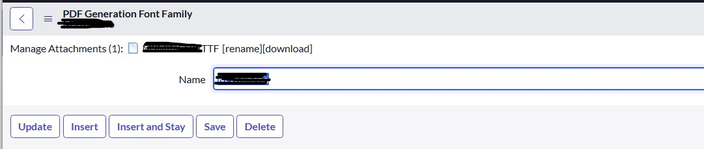
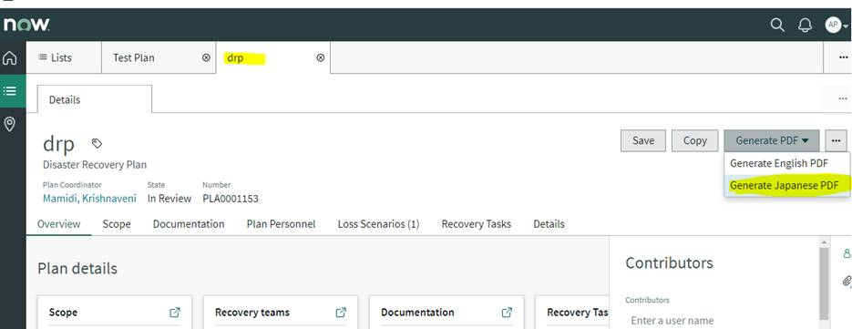

# 日本市場における導入（ServiceNow in the Japanese Market）

## 概要

本ファイルは、日本企業（および日本拠点を持つグローバル企業）で ServiceNow を導入する際に、**グローバル標準の導入方法論だけではカバーされない日本固有の検討事項**を、コンサルタント・PM・アーキテクトが実務で使えるレベルで整理する。

ServiceNow は SaaS であり、プラットフォーム自体は全世界共通である。日本市場で問題になるのは、主に次の 5 点である。

| 区分 | 典型的な論点 | 本ファイルの節 |
|---|---|---|
| ベンダー・市場 | ServiceNow Japan の体制、パートナー、投資動向 | 1 |
| データの所在 | 日本データセンター（東京・大阪）、データレジデンシー、ISMAP | 2 |
| 言語 | 日本語 UI の範囲と品質、翻訳の運用、検索・AI の日本語対応 | 3 |
| 業務慣行 | 稟議・承認、帳票（PDF）、和暦・祝日、Excel 文化、組織・人事慣行 | 4 |
| 事例 | 日本企業の導入事例と効果 | 5 |

関連する詳細仕様は次のファイルを参照する。

- 日本語化の製品仕様（翻訳テーブル、Localization Framework、Dynamic Translation の詳細）: [ローカライゼーション（日本語化）](../02_リファレンス/platform/localization.md)
- 承認フローの仕様: [Workflow Studio / Flow Designer](../02_リファレンス/platform/flow-designer-workflow-studio.md)
- スケジュール・祝日・SLA: [SLAとスケジュール](../02_リファレンス/platform/sla-schedules.md)
- エクスポート・インポート: [データインポート/エクスポート](../02_リファレンス/platform/import-export-data.md)
- インスタンスの配置・データセンター: [インスタンスアーキテクチャ](../02_リファレンス/platform/instance-architecture.md)、[セキュリティとコンプライアンス](10-security-compliance.md)
- ライセンス・価格: [ライセンスモデル](01-licensing-model.md)、[価格情報](02-pricing.md)
- パートナー選定: [プロジェクト体制とパートナー](05-project-organization.md)

---

## 1. ServiceNow Japan（日本法人）と日本市場の動向

### 1.1 日本法人の概況

ServiceNow Japan は ServiceNow, Inc. の日本法人である（法人格の正式名称は本調査では確認していない）。2025〜2026 年の事業戦略説明会では、**執行役員社長 鈴木正敏 氏**が登壇している。[出典](https://cloud.watch.impress.co.jp/docs/news/2003774.html) 【第三者情報】（報道）

| 時期 | ServiceNow Japan の主な発表・動き | 出典 |
|---|---|---|
| 2018-10 | NTT コミュニケーションズの「Nexcenter」上に東京・大阪の国内データセンター開設を発表（2019 年春サービス開始予定） | [ITmedia](https://atmarkit.itmedia.co.jp/ait/articles/1810/19/news068.html), [IT Leaders](https://it.impress.co.jp/articles/-/16855), [NTT Com](https://www.ntt.com/about-us/press-releases/news/article/2018/1017.html) |
| 2022 | ServiceNow のプラットフォーム（現 ServiceNow AI Platform）が ISMAP クラウドサービスリストに登録 | [PR TIMES 2026-06-04](https://prtimes.jp/main/html/rd/p/000000206.000029239.html) |
| 2024-05 | 富士通と新たな戦略的パートナーシップを発表（Fujitsu Uvance での ServiceNow 活用強化、まず製造業向け） | [マイナビ](https://news.mynavi.jp/techplus/article/20240510-2943041/) |
| 2024-11 | 今後数年で日本に約 20 億ドル（約 3,000〜3,100 億円）を投資する計画が報道（データセンター拡張・東京拠点拡大を含む） | [TechNews（日経報道を引用）](https://technews.tw/2024/11/19/servicenow-to-expand-investment-in-japan/), [GuruFocus](https://gurufocus.com/news/2608954/servicenow-now-plans-2-billion-investment-in-japan-to-expand-data-centers) |
| 2025-04 | 2025 年事業戦略。2024 年は日本の成長率がグローバルを上回り、製造業・金融業向けが大きく成長。2025 年の重点は「AI プラットフォーマーへの進化」「次世代 CRM」 | [クラウド Watch](https://cloud.watch.impress.co.jp/docs/news/2003774.html) |
| 2026-04 | 2026 年事業戦略。本社を**東京ミッドタウン日比谷**へ移転し「**Tokyo Innovation Center**」を開設。提供形態を **Foundation / Advanced / Prime** の 3 ティアに刷新し、最下位ティアでも AI を利用可能に、定額サブスクリプションに従量課金を組み合わせる方針 | [クラウド Watch](https://cloud.watch.impress.co.jp/docs/news/2104011.html) |
| 2026-06-04 | Now Assist と AI Agents for ServiceNow が ISMAP クラウドサービスリストに追加登録されたと発表 | [PR TIMES](https://prtimes.jp/main/html/rd/p/000000206.000029239.html) |

- 2024 年 11 月の投資計画は日経新聞報道を引用した二次報道であり、**内訳（データセンターとオフィスの配分）や新リージョン開設の有無は公開情報では確認できず**。【第三者情報】
- 同報道では、日本法人の従業員数が 1 年でほぼ倍増し約 400 人に達したとされる。[出典](https://technews.tw/2024/11/19/servicenow-to-expand-investment-in-japan/) 【第三者情報】
- 2026 年の 3 ティア（Foundation / Advanced / Prime）の詳細は [ライセンスモデル](01-licensing-model.md) と [エディション比較](03-edition-comparison.md) を参照する。

### 1.2 2026 年の事業戦略のキーワード（日本法人）

2026 年 4 月 22 日の事業戦略説明会で示された主要テーマは次のとおりである。[出典](https://cloud.watch.impress.co.jp/docs/news/2104011.html) 【第三者情報】

| テーマ | 内容（報道ベース） |
|---|---|
| EmployeeWorks | 買収した Moveworks の技術を統合し、従業員の業務窓口を AI で一元化 |
| Autonomous Workforce（AI 社員） | サービスデスクの一次対応を AI エージェントが担い、パスワードリセット等を自律完結 |
| AI Control Tower | Veza（ID 管理）・Armis（資産セキュリティ）の技術を組み合わせ、IT から OT・フィジカル AI までのガバナンス |
| 日本市場の課題認識 | 企業の AI 成熟度の低下、約 360 以上のアプリ乱立による業務サイロ化、業務生産性の向上 |

AI 機能の詳細は [Now Assist と AI Agents](../02_リファレンス/platform/now-assist-ai-agents.md) を参照する。

### 1.3 日本のパートナーエコシステム

日本の ServiceNow 導入は、**SIer（システムインテグレーター）を介した導入が主流**である【経験則】。公開情報で確認できる主なパートナーの取り組みは次のとおり。

| パートナー | 公開されている取り組み | 出典 |
|---|---|---|
| 富士通 | 2011 年にグローバルで ServiceNow を自社導入、日本では 2020 年から活用。2024 年に戦略的パートナーシップ。2023 年に Enterprise Training Agreement（ETA）を締結し全従業員が教育を受講可能に。公式サイトで 800 件以上のプロジェクト実績を案内 | [日経 BP 特集](https://special.nikkeibp.co.jp/atcl/ONB/26/servicenow0414/?P=3), [マイナビ](https://news.mynavi.jp/techplus/article/20240510-2943041/), [富士通](https://global.fujitsu/ja-jp/capabilities/business-applications/servicenow) |
| NTT コミュニケーションズ | 国内データセンター（Nexcenter）の提供、運用サービスとの組み合わせ | [ITmedia](https://atmarkit.itmedia.co.jp/ait/articles/1810/19/news068.html) |
| 日立ソリューションズ／日立製作所 | 導入事例（デンソー、大林組、三菱 HC キャピタル等）を公開 | [日立ソリューションズ](https://www.hitachi-solutions.co.jp/servicenow/cases/) |
| Kyndryl Japan | 雪印メグミルクのワークフロー刷新を支援（2026-03 発表） | [ニュース転載](https://aeo.washinmura.jp/ai/servicenow-co-jp-2/en/news/2026-03-27-servicenow-and-kyndryl-renew-snow-brand?lang=ja) 【第三者情報】 |

- パートナーの認定レベル（Elite 等）や国内の認定資格保有者数は時期により変わる。最新の一覧は ServiceNow Partner Finder および ServiceNow Community の Japan Blog（「パートナー認定資格取得状況一覧」記事）で確認する。パートナー選定の観点は [プロジェクト体制とパートナー](05-project-organization.md) を参照。

---

## 2. 日本データセンターとデータレジデンシー

### 2.1 日本データセンター（東京・大阪）の概要

ServiceNow は **東京と大阪のデータセンターペア**で日本の顧客にサービスを提供している。

| 項目 | 内容 | 出典・確度 |
|---|---|---|
| 所在地 | 東京・大阪の 2 拠点（ペア構成） | [ITmedia](https://atmarkit.itmedia.co.jp/ait/articles/1810/19/news068.html)、[Community FAQ（2023-02 更新）](https://www.servicenow.com/community/developer-forum/is-there-a-way-to-know-the-detailed-addresses-of-service-now/m-p/2485416) 【第三者情報】 |
| ファシリティ | NTT コミュニケーションズの「Nexcenter」 | [NTT Com プレスリリース 2018-10-17](https://www.ntt.com/about-us/press-releases/news/article/2018/1017.html) |
| 発表・開始 | 2018-10-17 発表、2019 年春サービス開始 | [IT Leaders](https://it.impress.co.jp/articles/-/16855) |
| 発表時の位置付け | 「全てのサービス利用とデータ保持を国内で完結」できることを訴求 | [ITmedia](https://atmarkit.itmedia.co.jp/ait/articles/1810/19/news068.html) 【第三者情報】 |
| 正確な住所 | 非公開。Community ではアカウント担当への確認が推奨されている | [Community](https://www.servicenow.com/community/developer-forum/is-there-a-way-to-know-the-detailed-addresses-of-service-now/m-p/2485416) |

ServiceNow のデータセンターはリージョン内で 2 拠点をペアにし、インスタンスのデータを相互にレプリケーションする方式（プライマリ／セカンダリ）を採る。高可用性・DR の仕組みの詳細は [インスタンスアーキテクチャ](../02_リファレンス/platform/instance-architecture.md) を参照する。

> **注意:** 2024 年 11 月の投資計画報道ではデータセンター拡張が言及されているが、**日本の追加リージョンや新拠点の稼働は公開情報では確認できず**（2026-11-02 時点）。

### 2.2 データレジデンシーで確認すべき事項

日本企業、特に金融・公共・医療・製造（機密設計情報）では、データの国内保管が要件になることが多い【経験則】。日本 DC を選べば「全データが国内」と単純には言えないため、次の点を契約前に確認する。

| # | 確認事項 | 背景 |
|---|---|---|
| 1 | 本番・サブプロダクション（開発・テスト）インスタンスがすべて日本 DC にプロビジョニングされるか | インスタンス単位でデータセンターが割り当てられる。追加インスタンスの配置も確認する |
| 2 | バックアップの保管先がペア DC（東京⇔大阪）内に閉じるか | DR・バックアップの国外保管の有無 |
| 3 | 生成 AI（Now Assist）の推論処理がどのリージョンで行われるか | LLM の処理場所は、ServiceNow 自社モデルか外部プロバイダ（Azure OpenAI 等）かで異なる。**日本国内処理の可否は公開情報では確認できず**。アカウント担当・契約書類で確認する |
| 4 | ServiceNow のサポート要員による国外からのアクセス | 運用・サポートの所在。必要に応じて Data Processing Addendum 等の契約条項を確認 |
| 5 | 連携先（IntegrationHub のスポーク、外部 SaaS、Dynamic Translation の翻訳プロバイダ等）へのデータ送信 | Dynamic Translation は Microsoft Azure / Google Cloud Translator 等の外部サービスを使う構成がある（[出典](https://www.servicenow.com/docs/r/7LhbZn3yz3Q58qhjZoU9iQ/RqlKYndUCRjhXc3pW4yjuw)） |
| 6 | Store アプリ・プラグインの一部が外部クラウドで処理されるか | AI Search、Document Intelligence、Predictive Intelligence 等の処理基盤 |

セキュリティ認証・契約条項の詳細は [セキュリティとコンプライアンス](10-security-compliance.md) を参照する。

### 2.3 ISMAP（政府情報システムのためのセキュリティ評価制度）

ISMAP は、政府が求めるセキュリティ要求を満たすクラウドサービスを事前に評価・登録する制度で、政府機関は原則として ISMAP クラウドサービスリストに掲載されたサービスから調達する。

| 対象 | 登録時期 | 出典 |
|---|---|---|
| ServiceNow AI Platform（当時の Now Platform） | 2022 年 | [PR TIMES（ServiceNow Japan、2026-06-04）](https://prtimes.jp/main/html/rd/p/000000206.000029239.html) |
| Now Assist（生成 AI 機能）、AI Agents for ServiceNow | 2026-06-04 発表 | 同上 |

- 公共・準公共案件では、利用予定の**製品・機能（特に AI 機能）が ISMAP の登録範囲に含まれるか**を、IPA の ISMAP ポータルの公開リストで必ず確認する。
- 地方公共団体での採用事例は、今回の調査では公開情報を確認できず。

---

## 3. 日本語化（Japanese Localization）の実務

日本語化の製品仕様の詳細は [ローカライゼーション（日本語化）](../02_リファレンス/platform/localization.md) に譲り、本節では**導入プロジェクトで判断・計画すべき点**に絞る。

### 3.1 日本語プラグインの有効化

| 項目 | 内容（Australia） |
|---|---|
| プラグイン名 | `I18N: Japanese Translations` |
| 前提 | `admin` ロール。デフォルト言語は American English |
| 手順 | **All > System Applications > All Available Applications > All** でプラグインを名前または ID で検索し **Install**。見つからない場合は ServiceNow への申請が必要な場合がある |
| 自動で有効化されるもの | `I18N: Knowledge Management Internationalization Plugin v2`（`com.glideapp.knowledge.i18n2`） |
| 基盤プラグイン | `I18N: Internationalization`（`com.glide.i18n`）。言語プラグインのない言語をローカライズする際の基盤 |
| ドメインセパレーション環境 | Domain separation と delegated admin が有効な場合、作業する管理者は **global ドメイン**に属している必要がある（そうでないとエラー） |
| 取り消し | **ローカライズプラグインは一度インストールするとアンインストールできない** |
| 翻訳対象外 | 製品名・アプリケーション名は英語のまま（機能名は翻訳される） |

[出典: Activate a language（Australia）](https://www.servicenow.com/docs/r/UrSRFFKWBbfQBgoRlt~ltw/Y30JfDvzXwarUH9yXwYnZA)

- Australia の言語プラグイン一覧には日本語を含む 24 言語（例: Simplified/Traditional Chinese、Korean、Thai 等）が掲載されている。[出典](https://www.servicenow.com/docs/r/UrSRFFKWBbfQBgoRlt~ltw/Y30JfDvzXwarUH9yXwYnZA)
- Community では日本語プラグイン ID として `com.snc.i18n.japanese` が言及されているが、Australia の公式ページにはプラグイン ID の記載がない。インスタンスで名前検索して確認する。【第三者情報】
- **アンインストール不可**のため、まず PDI（Personal Developer Instance）や開発インスタンスで日本語 UI を評価してから、本番への適用を計画する【経験則】。

### 3.2 セッション言語の決定順序と翻訳されない項目

ユーザーのセッション言語は次の優先順位で決まる。[出典](https://www.servicenow.com/docs/r/VbEA8DxUy61CFZ25mbYrcQ/QurF3629SykoZ_mEuWktCg)

1. ログイン時に選択した言語（ログイン時の言語選択が有効な場合）
2. ヘッダーの言語ピッカーで選択した言語
3. User [`sys_user`] テーブルの言語設定
4. システムのデフォルト言語

翻訳が存在しない場合に使う **fallback language（フォールバック言語）** を設定できる。

**翻訳されない（データとして入力した言語のまま表示される）もの:**

| 対象 | 実務上の影響 |
|---|---|
| Journal fields（ジャーナル項目: Work notes、Additional comments 等） | 日英混在のグローバルサポートでは、コメント欄の言語ルールを運用で決める必要がある |
| Report titles（レポートタイトル） | 日本語版・英語版を別レポートで作るか、命名規約を決める |
| 自由入力テキスト項目（ユーザーが作成したカスタム String 項目を含む） | Short description、Description 等は翻訳されない。必要なら Dynamic Translation を検討 |
| プラグイン名・スポーク名 | 常に英語 |
| 顧客が作成・変更したフィールド、メッセージ、UI | **ServiceNow AI Platform は翻訳を行わない**ため、自分で翻訳を登録する |

[出典](https://www.servicenow.com/docs/r/VbEA8DxUy61CFZ25mbYrcQ/QurF3629SykoZ_mEuWktCg)

- 製品名・アプリケーション名は Washington DC 以降に段階的にローカライズされており、古い名称は完全にローカライズされていない場合がある。[出典](https://www.servicenow.com/docs/r/VbEA8DxUy61CFZ25mbYrcQ/QurF3629SykoZ_mEuWktCg)
- Yokohama / Australia へのアップグレード後、ログインページの UI 言語について「guest ユーザーの言語設定が優先されなくなった」とする Community 記事がある（2026-03）。日本語のログイン画面を前提とする場合はアップグレード時に確認する。【第三者情報】

### 3.3 翻訳を格納するテーブルと「どこを直せばよいか」の特定方法

カスタマイズ部分を日本語化する際、または OOTB の訳語を自社用語に置き換える際は、文字列がどのテーブル由来かを特定してから修正する。

| テーブル | 日本語名（参考） | 主な対象 | 翻訳プレフィックス（I18N デバッグ時） |
|---|---|---|---|
| `sys_language` | Languages | 有効な言語の定義 | — |
| `sys_documentation` | Field label | テーブル名・フィールドラベル（単数・複数形） | `GMLD` |
| `sys_choice` | Choice | 選択肢（Choice list）の表示値 | `CHC` |
| `sys_ui_message` | Messages | Info メッセージ、スクリプト・ウィジェットのメッセージ | `MSG` |
| `sys_translated` | Translated Name / Field | Translated 型フィールドの値（UI Action 名、メニュー等） | `TRF` |
| `sys_translated_text` | Translated Text | Translated Text / Translated HTML 型フィールドの値（ナレッジ、カタログ等） | `TRT` |

[出典: Translation tables（公式・日本語版）](https://www.servicenow.com/docs/r/ja-JP/platform-administration/system-localization/r_TranslationTables.html?contentId=KZIdBPuvG8VtnjS84PhD8Q)、[Community: Debugging language translations](https://www.servicenow.com/community/developer-articles/debugging-language-translations-in-servicenow/ta-p/2296421)

- 「Enable I18N Debugging」を有効にすると、画面の文字列に上記プレフィックスが付き、どのテーブルを直せばよいかがわかる。[出典](https://www.servicenow.com/community/developer-articles/debugging-language-translations-in-servicenow/ta-p/2296421) 【第三者情報】
- `sys_language` テーブルは言語プラグインを 1 つ以上有効化した後に利用可能になる。

### 3.4 日本語訳の品質に関する実務上の注意

| 論点 | 内容 | 対応策 |
|---|---|---|
| 訳語と社内用語の不一致 | OOTB の訳語（例: Incident＝インシデント、Request＝リクエスト、Assignment group＝割り当てグループ）が社内で使われている言葉（「障害」「問い合わせ」「申請」「担当チーム」等）と一致しない | 要件定義の早い段階で**用語集（グロッサリー）**を作成し、OOTB 訳を使うか、`sys_documentation`／`sys_choice`／`sys_ui_message` を上書きするかを決める【経験則】 |
| アップグレードで訳語が変わる | ServiceNow Japan の記事によれば、リリース間で OOTB 翻訳テーブルに差分があり、品質改善のほか「翻訳サイクル中の技術的な要因で意図せず実装された変更点」も含まれる。Tokyo/Utah→Vancouver の差分が KB1574363・KB1574353 として公開された | アップグレード時のテスト観点に「画面文言の差分確認」を入れる。自社で上書きした訳は Update Set／スコープアプリで管理し、Skipped records の確認対象にする（[アップグレード管理](13-upgrade-management.md)） |
| 英語の残存 | 新機能・新製品・Store アプリは日本語訳が後追いになることがある。製品名・プラグイン名は仕様として英語 | 利用者向けマニュアルで英語表記を前提とした説明を用意する【経験則】 |
| 自動翻訳ドキュメントの限界 | ServiceNow の日本語ドキュメントの一部（用語集など）は自動翻訳であり、正確でない場合がある旨が明記されている | 仕様判断は英語版ドキュメントを正とする【経験則】 |
| エンドユーザー画面と管理画面 | Employee Center／Service Portal はエンドユーザーが日々使うため、訳語品質の影響が大きい | ポータル・カタログ・ナレッジは日本語ネイティブのレビューを必須にする【経験則】 |

[出典: ServiceNow Japan Blog（2023-11-15）](https://www.servicenow.com/community/japan-blog/ootb-%E5%B7%AE%E5%88%86%E3%83%AA%E3%82%B9%E3%83%88-tokyo-utah-vs-vancouver-patch4/ba-p/2733771)

**運用モデルの選択肢:**

| モデル | 概要 | 向いているケース |
|---|---|---|
| 日本語のみ | 全ユーザーの言語を日本語にし、カスタマイズも日本語で作る | 国内単一拠点 |
| 日英併用（日本語主） | UI は日本語、データ（短い説明等）は日本語。英語話者向けにラベル翻訳を整備 | 外国籍社員・海外子会社がいる国内企業 |
| 英語主・日本語追加 | グローバルテンプレートを英語で作り、日本拠点向けに日本語翻訳を追加 | グローバル企業の日本拠点 |

グローバルテンプレート型の場合、カスタマイズで作成したラベル・選択肢・メッセージ・カタログ変数・ナレッジの翻訳を、Localization Framework（翻訳依頼のワークフロー）と Dynamic Translation（機械翻訳）を使って計画的に管理する。Localization Framework の機械翻訳には Dynamic Translation プラグイン（`com.glide.dynamic_translation`）が必要である。[出典](https://www.servicenow.com/docs/r/7LhbZn3yz3Q58qhjZoU9iQ/RqlKYndUCRjhXc3pW4yjuw)

### 3.5 検索（AI Search）と生成 AI（Now Assist）の日本語対応

| 機能 | 日本語対応の要点 | 出典 |
|---|---|---|
| AI Search | 日本語は空白ではなく文脈解釈で語境界を判定（形態素解析相当）。中黒（・）を語の区切りとして認識。他言語の文中に埋め込まれた日本語も日本語として索引化。日本語のレンマ正規化・ストップワード・シノニムに対応。**タイプミス補正（typo handling）は日本語非対応** | [Internationalization support for AI Search](https://www.servicenow.com/docs/r/7LhbZn3yz3Q58qhjZoU9iQ/cokeqpa6gldjchfZglT8Kw) |
| AI Search の前提 | 日本語プラグインの有効化が必要。有効化後に日本語コンテンツの再インデックスが必要。**2024 年 8 月以前に索引化された日本語コンテンツは再インデックス推奨** | 同上 |
| Now Assist | 現行ドキュメントでは日本語は **P2**（概ね良好だがニュアンスに時折ギャップ）に分類。サポート言語ではネイティブ処理され Dynamic Translation は使われない。未サポート言語は Dynamic Translation にフォールバック | [Multilingual service for Now Assist](https://www.servicenow.com/docs/r/intelligent-experiences/enable-ai-experiences/translation-for-now-assist.html) |
| Document Intelligence | 日本語 OCR は日本語・簡体字中国語用の別モデルを使う | 同上（検索結果） 【第三者情報】 |

- AI Search の詳細は [Predictive Intelligence と AI Search](../02_リファレンス/platform/predictive-intelligence-ai-search.md)、Now Assist の言語設定は [Now Assist と AI Agents](../02_リファレンス/platform/now-assist-ai-agents.md) を参照する。
- Community では、Creator 向け AI 生成機能（ATF・フロー生成）で日本語入力が受け付けられないという報告がある。AI 機能ごとの日本語対応はリリースノートで個別に確認する。【第三者情報】

---

## 4. 日本企業特有の要件への対応

### 4.1 稟議・多段承認

日本企業の稟議は、「起案 → 回議（複数部門の確認）→ 合議 → 決裁（職務権限規程に基づく決裁者）」という多段・並列の承認経路を持つ。ServiceNow では、Workflow Studio（Flow Designer）の **Ask for Approval** アクションを組み合わせて実現するのが標準的である。

#### 4.1.1 Ask for Approval アクションの主な仕様

| 入力 | 内容 |
|---|---|
| Record / Table | 承認対象のレコード。承認状態フィールドを持つテーブル（`task` およびその拡張）が対象 |
| Approval Reason | 承認理由。監査用に `sysapproval_approver` テーブルに保存される |
| Approval Field / Journal Field | 承認結果を書き込むフィールド／履歴・コメントを書き込むジャーナル |
| Rules | 誰が承認・却下でき、その後どうなるか。承認ルールは次から選択: Anyone approves／All users approve／All responded and anyone approves／% of users approve／# of users approve。承認者はユーザー・グループ・レコードのフィールド・手動追加から指定。却下ルールは OR のルールセットとして追加 |
| Due Date | 期限。期限到達時に自動で承認・却下・取消のいずれかにできる |

| 出力: Approval State | 値 |
|---|---|
| Not Yet Requested | `not_requested` |
| Requested | `requested` |
| Approved | `approved` |
| Rejected | `rejected` |
| Cancelled | `cancelled` |
| No Longer Required | `not_required` |
| Skipped | `skipped` |

[出典: Ask for Approval action（Brazil 版ページ）](https://www.servicenow.com/docs/r/build-workflows/workflow-studio/ask-approval-flow-designer.html)

注意点（同出典）:

- 承認ルールと却下ルールは対にする。片方しかなく期待状態にならない場合、フローは待機し続けるか取消扱いになる。
- 既定では**無効化されたユーザー・グループにも承認レコードが生成される**（システムプロパティ `com.glide.hub.flow.approval.allow_inactive_entity` で制御）。人事異動・退職が多い 4 月前後は特に注意する。
- 同じレコードに対する Ask for Approval を「Do the following in parallel」の並列ブランチに重複配置しない。

#### 4.1.2 稟議要素と ServiceNow 機能の対応

| 稟議の要素 | ServiceNow での実現方法 | 備考 |
|---|---|---|
| 起案（申請書） | Service Catalog の Record Producer／カタログアイテム、または専用テーブル（`task` 拡張） | [サービスカタログ](../02_リファレンス/platform/service-catalog.md) |
| 回議（順番に確認） | Ask for Approval を順番に複数配置（直列） | 段数が多い場合はサブフロー化 |
| 合議（並列に確認、全員承認） | 1 つの Ask for Approval に複数承認者を指定し「All users approve」 | 同じレコードに対して並列ブランチで複数配置しない |
| 決裁権限（金額・案件種別で決裁者が変わる） | フロー内の If 分岐、または決裁基準を表（テーブル）で持ちフローから参照 | 職務権限規程の変更が頻繁なら、フローにハードコードせずデータで持つ【経験則】 |
| 承認理由・コメント | Approval Reason、承認レコードのコメント | 監査証跡は `sysapproval_approver` と履歴 |
| 差戻し | 却下後に起案者へ戻すフロー設計（状態を戻して再申請） | OOTB の「差戻し」という状態はないため設計が必要【経験則】 |
| 代理承認（不在時） | Delegates（`sys_user_delegate`）、Granular Delegation | 次項参照 |
| 後閲（事後回覧） | 承認後の通知・タスク（Catalog Task 等） | 承認とは分けて設計【経験則】 |
| 押印・電子印影 | OOTB の印影機能は公開情報では確認できず。帳票（PDF）側に承認者名・日時を出力する設計で代替するのが一般的【経験則】 | 4.2 参照 |

#### 4.1.3 代理承認（Delegation）

標準の Delegate 機能は、**All > Self Service > My Profile** の Delegates 関連リストで設定する（ロール不要）。[出典](https://www.servicenow.com/docs/r/servicenow-platform/self-service/t_DelegateApprovalsTasks.html)

| 項目 | 内容 |
|---|---|
| Delegate | 代理人（アクティブなユーザー） |
| Starts / Ends | 代理期間 |
| Approvals | 代理人が承認を代行できる |
| Assignments | 代理人が自分に割り当てられたタスクを参照・作業できる |
| All notifications | 自分宛てのメール通知のコピーを受け取る（Meeting Invitations を除く） |
| Meeting invitations | Meeting Invitation メールのコピーを受け取る |

- 公式ドキュメントは、Approvals を選んで All notifications を選ばない場合、代理人は承認（の通知）を受け取らない旨を注意している。代理人がポータルから承認するには `approval_admin` または `approver_user` ロールが必要とされる。[出典](https://www.servicenow.com/docs/r/servicenow-platform/self-service/t_DelegateApprovalsTasks.html)
- **Granular Delegation**（`sys_granular_delegate`、`sys_delegation_rule`）は承認・割り当てを細かく委任できるが、**フロー／ワークフローが管理する承認には適用されない**ため、フローの承認は標準 Delegate を使う。[出典](https://www.servicenow.com/docs/r/employee-service-management/granular-delegation/granular-delegation-explore.html)
- 監査上「誰の代理で承認したか」を残したい場合、Community（Workflow Automation CoE）記事ではシステムプロパティ `com.glide.hub.flow.approval.show_delegate_audit_comment` を true にすると「XY approved the task as delegate of YZ」が記録されると説明されている。[出典](https://www.servicenow.com/community/workflow-automation-articles/flow-designer-approvals-overview-workflow-automation-center-of/ta-p/2528202) 【第三者情報】

> **実務の勘所【経験則】:** 日本企業の稟議は例外経路（決裁者の追加、順番の入れ替え、条件付き承認）が多い。すべてをフローで表現しようとすると保守不能になるため、「標準経路はフロー、例外は承認者の手動追加（Approvers 関連リスト）で吸収」と割り切り、要件定義で例外の発生頻度を確認する。[導入失敗パターンと対策](../04_応用編/01-implementation-failure-patterns.md) も参照。

### 4.2 帳票（PDF 出力・日本語フォント）

日本企業では、申請書・作業報告書・見積書・BIA（業務影響分析）報告書などを**紙と同じレイアウトの帳票**として出力する要件が多い。

#### 4.2.1 ServiceNow の帳票出力手段

| 手段 | 概要 | 注意 |
|---|---|---|
| Document Templates | HTML・PDF のドキュメントテンプレートを作成し、定型文書を生成。プレビュー・PDF 生成が可能（HR Service Delivery 等で利用） | [公式](https://www.servicenow.com/docs/r/employee-service-management/hr-service-delivery/document-templates-overview.html) |
| Word テンプレート | Community では Word Document Templates（`sn_doc_word`）プラグインが言及されているが、公式ページで仕様・ライセンス要否を確認できず | 【第三者情報】 |
| Store アプリ | Office Templater（Word・Excel・PowerPoint・PDF を生成）、Document Designer for Microsoft Word 等 | 有償・サードパーティ。セキュリティ審査が必要 |
| リスト・フォームの PDF エクスポート | 標準のエクスポート機能 | レイアウトの自由度は低い |
| 外部帳票ツール連携 | 日本製の帳票ツール（SVF 等）と REST 連携 | [連携設計](09-integration-design.md) 【経験則】 |

#### 4.2.2 日本語 PDF のフォントと禁則処理

日本語 PDF では、**フォント**と**禁則処理（行頭・行末の約物の扱い）**が問題になりやすい。

ServiceNow Community の技術記事（2026-02）では、BCM（Business Continuity Management）の BIA 文書を日本語 PDF で出力するために、次の手順でカスタムフォントを設定している。[出典](https://www.servicenow.com/community/developer-forum/blog-1-tm-generate-a-japanese-pdf-with-custom-font-for-bia/m-p/3497671) 【第三者情報】

1. システムプロパティ `glide.ui.html.editor.v4.font.collection` にフォント（説明とフォント名）を追加し、HTML エディタで選択可能にする。
2. **PDF Generation Font Family** にフォント名と同じ Name のレコードを作成し、`.ttf` または `.woff` のフォントファイルを添付する。
3. スコープを該当アプリ（例: GRC: Business Impact Analysis）に切り替え、Document Template の Body HTML で対象部分にカスタムフォントを指定し、保存・公開する。
4. 対象レコードで **Generate PDF > Generate Japanese PDF** を実行して確認する。

*キャプション:* PDF Generation Font Family のフォームで、カスタムフォントを登録した状態。
*画面の説明:* フォーム上部のタイトルは「PDF Generation Font Family」。「Manage Attachments (1)」に `.TTF` ファイルが 1 件添付されており（ファイル名は黒塗り）、[rename] [download] リンクが表示されている。入力項目は「Name」のみで、フォント名（黒塗り）が入力されている。下部に Update／Insert／Insert and Stay／Save／Delete ボタンがある。
*出典:* https://www.servicenow.com/community/developer-forum/blog-1-tm-generate-a-japanese-pdf-with-custom-font-for-bia/m-p/3497671 （取得日: 2026-11-03）

*キャプション:* BCM ワークスペースで Disaster Recovery Plan レコードから日本語 PDF を生成するメニュー。
*画面の説明:* Next Experience のワークスペースで、Disaster Recovery Plan「drp」（State: In Review、Number: PLA0001153）を開いている。右上の「Generate PDF」ドロップダウンを開くと「Generate English PDF」と「Generate Japanese PDF」の 2 つが表示され、後者が強調されている。下部に Overview／Scope／Documentation／Plan Personnel／Loss Scenarios／Recovery Tasks／Details のタブがある。
*出典:* https://www.servicenow.com/community/developer-forum/blog-1-tm-generate-a-japanese-pdf-with-custom-font-for-bia/m-p/3497671 （取得日: 2026-11-03）

同じ著者の Community 投稿では、BCM ワークスペースで生成した日本語 PDF に**句読点・改行・フォントサイズの問題**があり、推定原因は「ServiceNow の PDF 生成が日本語の改行規則（禁則）を考慮していない」こと、恒久対応として Problem **PRB1745363** が起票され Zurich 以降で修正予定（ETA 未定）とされている。回避策は行頭・行末文字の手動調整である。[出典](https://www.servicenow.com/community/grc-forum/article4-bcm-tm-generated-japanese-pdf-having-issue-like-grammer/m-p/3498094) 【第三者情報】

> **実務の勘所【経験則】:**
> - 帳票は要件定義の早い段階で**サンプル出力（PoC）**を行い、フォント・禁則・罫線・改ページを確認する。
> - 「紙と 1 ピクセルも違わない帳票」が必須なら、ServiceNow 標準での実現にこだわらず外部帳票ツールとの連携を検討する。
> - フォントファイルのライセンス（サーバー上での埋め込み・再配布の可否）を確認する。

### 4.3 和暦・日付書式・タイムゾーン・祝日

#### 4.3.1 日付・時刻の書式

| プロパティ | 既定値（Australia） | 内容 |
|---|---|---|
| `glide.sys.date_format` | `yyyy-MM-dd` | システム全体の日付書式 |
| `glide.sys.time_format` | `HH:mm:ss` | システム全体の時刻書式 |

[出典: Global date and time field format（Australia）](https://www.servicenow.com/docs/r/UrSRFFKWBbfQBgoRlt~ltw/ySDtM_lTCUXKVafGybs8Cg)

- 設定は **System Properties > System** で変更し、全体に適用される。ユーザーは個人設定で日付・時刻書式を個別に上書きできる。
- 書式文字は Java の SimpleDateFormat に近い（`yyyy`、`MM`、`dd`、`HH`、`mm`、`ss`、`a`）。2 桁年 `yy` は 20 年先〜80 年前の範囲で解釈されるため 4 桁年を推奨。時刻書式への `z`（タイムゾーン）の付加はサポートされない。
- 日本で一般的な `yyyy/MM/dd` 表記にしたい場合は `glide.sys.date_format` を変更する。変更前に、日付文字列をパースしている既存スクリプト・連携・インポート変換に影響がないかテストする【経験則】。
- ドキュメント間でプロパティ名の表記ゆれ（`glide.sys.dateformat`／`glide.sys.date_format`）がある。Australia の公式ページは `glide.sys.date_format` である。

#### 4.3.2 和暦（元号）

- ServiceNow の日付フィールドを**和暦（例: 令和 8 年 11 月 2 日）で表示・入力する標準機能は、公開情報では確認できず**。日付書式プロパティは SimpleDateFormat 系の西暦書式であり、元号の書式指定子は公式ドキュメントに記載がない。
- 和暦が必要な場合の現実的な選択肢【推定】:
  | 方法 | 概要 | 注意 |
  |---|---|---|
  | 帳票側で変換 | PDF・帳票テンプレートに出力する際にスクリプトで和暦文字列を生成 | 元号の境界日（例: 2019-05-01 令和改元）をロジックに持つ。「元年」表記の扱いを決める |
  | 表示用の文字列フィールド | 西暦の日付フィールドから和暦文字列を計算して別フィールドに保持（Business Rule 等） | 検索・並べ替え・レポートは西暦の日付フィールドで行う |
  | 外部帳票ツールで変換 | 連携先で和暦に整形 | |
- Community では、サーバーサイドスクリプトでの `toLocaleDateString` が期待どおり動かないという報告があり、和暦変換はロケール機能に頼らず自前ロジックで実装するのが安全である。【第三者情報】
- **データとしては常に西暦（内部 UTC）で保持し、和暦は表示・帳票の責務とする**のが原則である【経験則】。

#### 4.3.3 タイムゾーン

- ServiceNow はすべての日時を内部で UTC で保持し、ユーザーのタイムゾーン設定に基づいて表示する。システム既定のタイムゾーンを設定できる。[出典: Time zones](https://www.servicenow.com/docs/r/7LhbZn3yz3Q58qhjZoU9iQ/6hJ_FXpdWBtTMWyZumWEBA)
- 日本のみで利用する場合でも、ユーザーごとのタイムゾーン（`Asia/Tokyo`）、スケジュールのタイムゾーン、通知の時刻表示、データ連携（UTC での受け渡し）の 4 点を設計で確認する【経験則】。
- Community では、システムプロパティを変更しても既存の `sys_user` レコードに保存された値（タイムゾーン・日付書式）は更新されない、との報告がある。ユーザー一括登録時にユーザーレコード側の値を意図的に設定するか空にするかを決める。【第三者情報】
- 日本はサマータイムがないため、海外拠点（米国・欧州）との SLA・メンテナンス時間の計算で時差が季節により変わる点に注意する【経験則】。

#### 4.3.4 日本の祝日カレンダー

SLA・営業時間・オンコールの計算には、Schedule（スケジュール）に日本の祝日を登録する必要がある。

| 要素 | テーブル | 内容 |
|---|---|---|
| Schedule | `cmn_schedule` | 営業時間スケジュール、祝日スケジュール |
| Schedule Entry | `cmn_schedule_span` | 含める期間・除外する期間（祝日）のエントリ |

[出典: Holidays（公式）](https://www.servicenow.com/docs/r/platform-administration/time-configuration/c_Holidays.html)、[Create a holiday schedule for multiple regions（公式）](https://www.servicenow.com/docs/r/bAHg1_u_N~ocpdu34t_qJA/jkHaqaHLE4FcfSzb93KAHw)

- 公式ドキュメントは、地域ごとの祝日スケジュールを作り、業務スケジュールを子スケジュール（child schedule）として関連付ける方法を説明している。
- **日本の祝日を自動配信する OOTB 機能は、公開情報では確認できず**。Community（日本語フォーラム、2025-07）では、Google カレンダーの「日本の祝日」をスクリプトで取得し、法定休日でない行事（七五三・クリスマス等）を除外して Schedule Entry に登録している例と、ServiceNow 純正の祝日カレンダー配信を求める声が投稿されている。回答では、年 1 回の確認タスクを自動起票する運用や、信頼できる公的データを Data Source（JSON）＋ Scheduled Job で取り込む構成が提案されている。[出典](https://www.servicenow.com/community/forum/sla-schedule-%E3%81%AE%E3%81%9F%E3%82%81%E3%81%AE-icalendar-%E3%81%BE%E3%81%9F%E3%81%AF%E7%B4%94%E6%AD%A3%E5%BD%A2%E5%BC%8F%E3%81%AE%E7%A5%9D%E6%97%A5%E3%82%AB%E3%83%AC%E3%83%B3%E3%83%80%E3%83%BC%E4%BE%9B%E7%B5%A6/m-p/3322430) 【第三者情報】
- 日本の祝日で考慮すべき点【経験則】:
  - **振替休日・国民の休日**は年により発生するため、毎年の登録が必要（Community でも振替休日を別エントリで管理する必要性が指摘されている）。
  - 祝日の公式情報源は内閣府の「国民の祝日」（CSV 公開あり）。年 1 回、翌年分を登録する運用タスクを [運用とガバナンス](12-operations-governance.md) の年間カレンダーに組み込む。
  - **会社休日**（年末年始 12/29〜1/3、夏季休暇、創立記念日）、**業界カレンダー**（自動車業界・銀行営業日）は祝日とは別スケジュールで管理し、組み合わせる。
- スケジュールと SLA の詳細は [SLAとスケジュール](../02_リファレンス/platform/sla-schedules.md) を参照する。

### 4.4 Excel 文化への対応

日本企業では、管理台帳・集計・報告が Excel で行われてきた経緯から、「今の Excel と同じものを出してほしい」「Excel で一括登録したい」という要望が非常に多い【経験則】。

#### 4.4.1 Excel エクスポートの制限

| プロパティ | 既定値 | 内容 |
|---|---|---|
| `glide.xlsx.max_cells` | 500,000 セル | XLSX エクスポートのセル数上限。超過するとエクスポートが停止し、CSV 利用を促すメッセージとともに部分的なファイルが返る（XLS は `glide.excel.max_cells`） |
| `glide.xlsx.export.limit` | 10,000 行 | XLSX エクスポートの行数上限（未設定時は `glide.ui.export.limit` にフォールバック） |

[出典: Export limits（Australia）](https://www.servicenow.com/docs/r/UrSRFFKWBbfQBgoRlt~ltw/TynjO949Pi14Avr_KMo2tw)

- 上限は変更できるが、引き上げるとインスタンスのメモリ問題を起こしうるため注意が必要である（同出典）。大量データのエクスポートがパフォーマンス問題を起こす点は ServiceNow 社員の Community ブログでも解説されている。[出典](https://www.servicenow.com/community/now-platform-blog/how-to-prevent-performance-issues-related-to-exports-and-export/ba-p/2291637)
- 大量データの定期抽出は、手動 Excel エクスポートではなく Export Set、REST API、データ連携（BI ツール）で設計する。詳細は [データインポート/エクスポート](../02_リファレンス/platform/import-export-data.md)。

#### 4.4.2 Excel 依存を減らす設計の考え方【経験則】

| よくある要望 | ServiceNow での代替 | ポイント |
|---|---|---|
| 毎月の報告資料を Excel で作りたい | Reports／Dashboards（Platform Analytics）、定期配信（Scheduled reports） | 「Excel を作るため」ではなく「誰が何の判断に使うか」を確認し、ダッシュボードで置き換える。[レポートとアナリティクス](../02_リファレンス/platform/reporting-analytics.md) |
| Excel で一括登録したい | Import Sets（Excel/CSV 取り込み）＋ Transform Map、カタログの一括申請 | 取り込みテンプレートを固定し、入力規則（必須・選択肢）を明確にする |
| Excel で一括更新したい | リストの一括編集、Import Sets の coalesce 更新 | 権限と監査証跡（誰が何を変えたか）を確保 |
| Excel の管理台帳（資産台帳、ID 台帳）をそのまま移したい | CMDB／Asset テーブルに移行し、Excel は廃止 | 「台帳の二重管理」を残すと定着しない。[CMDB成功の要因](../04_応用編/05-cmdb-success-factors.md) |
| 申請書が Excel 様式 | Service Catalog のフォーム化 | 様式の項目をそのまま移すのではなく、項目の必要性を棚卸しする |

> **実務の勘所【経験則】:** Excel 要望を全面的に否定すると定着化が進まない。移行期は「エクスポートして Excel で加工」を許容しつつ、KPI 報告など繰り返し使うものからダッシュボードへ置き換える段階的アプローチが現実的である。[定着化と組織変革](../04_応用編/13-adoption-change-management.md) を参照。

### 4.5 その他の日本固有の考慮事項【経験則】

| 論点 | 内容 | 対応の方向性 |
|---|---|---|
| 年度・会計期間 | 4 月始まりの会計年度が多い | レポートの期間集計、SLA・KPI の年度区切りを 4 月起点で設計する |
| 定期人事異動 | 4 月・10 月に大規模な組織変更・異動 | ユーザー・グループ・承認者・アサインメントルールを人事データ連携（IdP／人事システム）で自動更新。異動直後の承認ルート崩れ・無効ユーザーへの承認生成（4.1.1）に注意。[ユーザー・グループ・ロール](../02_リファレンス/platform/users-groups-roles.md) |
| 氏名の表記 | 姓名の順序、漢字・カナ・ローマ字の併記 | `sys_user` の First name／Last name の扱い、表示名・検索のためのカナ項目の追加を要件定義で決める |
| 全角・半角 | 英数字・カナの全角／半角混在 | 入力規則（Client Script による正規化）やインポート時の変換で統一する。AI Search は Unicode 正規化を行う（[出典](https://www.servicenow.com/docs/r/7LhbZn3yz3Q58qhjZoU9iQ/cokeqpa6gldjchfZglT8Kw)） |
| メール文化 | 通知メールの件名・本文の日本語化、文字化け | 通知テンプレートを日本語で作成し、多言語ユーザーがいる場合は言語別通知を設計。[通知とメール](../02_リファレンス/platform/notifications-email.md) |
| 外部委託（SIer・運用ベンダー） | 運用を外部ベンダーに委託することが多い | ベンダー要員のライセンス種別・ロール、アクセス範囲の設計。[ライセンスモデル](01-licensing-model.md) |
| 要件の「全部入り」化 | 現行業務を変えず、Fit to Standard より Fit & Gap で大量のカスタマイズ要件が出がち | 「OOTB 優先」の原則と、カスタマイズ判断基準を経営層と合意する。[要件定義と設計](06-requirements-design.md)、[カスタマイズと技術的負債](../04_応用編/02-customization-technical-debt.md) |
| 合意形成 | 稟議・根回しによる意思決定の長期化 | プロジェクト計画にステアリングコミッティの決裁サイクルを織り込む。[導入方法論](04-implementation-methodology.md) |

---

## 5. 日本の導入事例

公開情報で確認できた日本企業の事例を示す。効果の数値は各社・パートナーの公表値であり、独立した検証はされていない。

| 企業 | 業種 | 領域・取り組み | 公表されている効果 | 出典 |
|---|---|---|---|---|
| 富士通 | IT・製造 | インフラ運用を一元化し CMDB・ITSM に統合（ITOM Discovery、CMDB、ITSM）。独自開発の生成 AI と組み合わせたヘルプデスクの AI エージェント化。社内人材育成「SRE 大学」 | 約 5 万台のハードウェアと約 2,300 万件のソフトウェアのデータを約半年で CMDB に統合。AI エージェント導入後の生産性は「従来の 3 倍」、障害対応等への展開で 10 倍を目標 | [日経 BP 特集（2026）](https://special.nikkeibp.co.jp/atcl/ONB/26/servicenow0414/?P=3) 【第三者情報】 |
| デンソー | 製造業 | 問い合わせ窓口の一元化・プロセス標準化（運用 DX） | ヘルプデスク対応を月約 1,250 時間削減 | [日立ソリューションズ](https://www.hitachi-solutions.co.jp/servicenow/cases/) 【第三者情報】 |
| 大林組 | 建設 | サポートデスクの電話対応時間短縮 | サポートデスクへの電話問い合わせを約 30% 削減 | 同上 |
| 三菱 HC キャピタル | 金融（リース） | 紙ベースの手続きを Web サービス化 | 運用効率が約 15% 向上 | 同上 |
| 第一生命保険 | 金融（保険） | 分散した構成情報の統合管理 | 数値の公表なし | 同上 |
| 日立製作所 | 製造業 | グローバル IT サービスのガバナンス強化 | 数値の公表なし | 同上 |
| 雪印メグミルク | 食品 | クラウド型統合プラットフォームとして ServiceNow を採用しワークフローシステムを刷新（Kyndryl Japan が支援） | 数値の公表なし | [ニュース転載（2026-03）](https://aeo.washinmura.jp/ai/servicenow-co-jp-2/en/news/2026-03-27-servicenow-and-kyndryl-renew-snow-brand?lang=ja) 【第三者情報】 |

- ServiceNow 公式の日本語事例一覧（servicenow.com/jp/customers.html）は、今回の調査ではページ本文を取得できず、個別事例の内容は確認できなかった。最新の公式事例は同ページで確認する。
- 事例から読み取れる日本市場の傾向【推定】:
  - **製造業・金融業**での採用が多い（2024 年は両業種向けが大きく成長したと日本法人が説明。[出典](https://cloud.watch.impress.co.jp/docs/news/2003774.html)）。
  - 入口は **ITSM（ヘルプデスク・問い合わせ一元化）** が多く、効果指標は「問い合わせ件数・対応時間の削減」で語られることが多い。
  - 「紙・電話・メールからの脱却」が導入動機として明示される事例が多い。
  - 2025 年以降は AI エージェント（Now Assist／AI Agents）によるサービスデスク自動化が主要テーマになっている。

---

## 6. 日本語の学習リソース・コミュニティ

| リソース | 内容 | 出典・確度 |
|---|---|---|
| 日本語版公式ドキュメント | servicenow.com/docs の言語切替で日本語版（`/docs/r/ja-JP/...`）が利用可能。一部は自動翻訳 | 公式 |
| ServiceNow Community Japan Blog・日本語フォーラム | ServiceNow Japan 社員による解説記事（翻訳差分リスト、学習方法、パートナー認定状況等）、日本語の Q&A | [Japan Blog](https://www.servicenow.com/community/japan-blog/servicenow%E8%AA%8D%E5%AE%9A%E8%B3%87%E6%A0%BC-%E3%82%AA%E3%83%B3%E3%83%A9%E3%82%A4%E3%83%B3%E8%A9%A6%E9%A8%93%E3%81%A3%E3%81%A6%E3%81%A9%E3%82%93%E3%81%AA%E3%82%82%E3%81%AE/ba-p/2271188) |
| 認定資格の日本語受験 | 認定試験は日本語で受験できるものがある。Community の情報では、2025-11-18 から試験ベンダーが Webassessor から Pearson VUE に変更された | 【第三者情報】最新は ServiceNow University／Now Learning で確認 |
| 日本語のオンデマンド研修 | 無償・日本語のオンデマンドコースがある（Japan Blog で紹介） | 【第三者情報】 |

学習パス全般は [学習パスと認定資格](../01_入門編/09-learning-path.md) を参照する。

---

## 7. 日本企業向け導入チェックリスト

| フェーズ | チェック項目 | 参照 |
|---|---|---|
| 提案・契約 | 全インスタンス（本番・開発・テスト）の日本 DC 配置を契約書類で確認したか | 2.2 |
| 提案・契約 | 生成 AI（Now Assist）の処理場所・外部 LLM 利用の有無を確認したか | 2.2 |
| 提案・契約 | 公共案件の場合、利用機能が ISMAP 登録範囲に含まれるか確認したか | 2.3 |
| 要件定義 | 日本語のみ／日英併用／英語主のどの言語モデルにするか決めたか | 3.4 |
| 要件定義 | 用語集（OOTB 訳語と社内用語の対応）を作成したか | 3.4 |
| 要件定義 | 稟議の標準経路・例外経路・決裁権限表・代理承認ルールを整理したか | 4.1 |
| 要件定義 | 帳票の要否・様式・フォント・和暦表記を確認し、PoC を計画したか | 4.2, 4.3.2 |
| 設計 | 日付書式（`glide.sys.date_format`）、タイムゾーン、会計年度（4 月起点）を決めたか | 4.3 |
| 設計 | 日本の祝日・会社休日・業界カレンダーのスケジュール設計と年次メンテナンス手順を決めたか | 4.3.4 |
| 設計 | Excel 要望をダッシュボード／インポート／エクスポートのどれで満たすか整理したか | 4.4 |
| 設計 | 4 月・10 月の人事異動を想定したユーザー・グループ・承認者の自動更新を設計したか | 4.5 |
| 構築 | 日本語プラグインを開発インスタンスで評価してから本番に適用したか（アンインストール不可） | 3.1 |
| 構築 | AI Search の日本語コンテンツを再インデックスしたか | 3.5 |
| テスト | 画面文言（日本語訳）、日本語 PDF、祝日を含む SLA 計算をテスト観点に入れたか | [テストと本番稼働](11-testing-golive.md) |
| 運用 | アップグレード時の翻訳差分確認、祝日の年次登録を運用カレンダーに入れたか | [アップグレード管理](13-upgrade-management.md), [運用とガバナンス](12-operations-governance.md) |

---

## 8. Brazil での変更点

> **Brazil での変更:** 本ファイルで扱った日本固有のトピック（日本語プラグイン、日付書式、祝日、Excel エクスポート上限、日本 DC）について、Brazil で変更・追加されたことを示す公開情報は確認できなかった（2026-11-02 時点）。Ask for Approval アクションの仕様（4.1.1）は Brazil 版ドキュメントを参照して記載しており、Australia と同等の仕様であることを前提としている。Now Assist の言語サポート（P1/P2/P3 分類）はリリースごとに更新されるため、Brazil のリリースノートで日本語の分類・対応機能を確認すること。

---

## 9. 確認できなかった事項

- ServiceNow 公式の日本語事例一覧（servicenow.com/jp/customers.html）の個別事例内容（アクセス制限により取得できず）。
- 日本の新リージョン・新データセンターの開設状況、2024 年投資計画の内訳。
- Now Assist／AI Agents の推論処理が日本国内で完結するかどうか。
- 和暦（元号）を日付フィールドの表示書式として指定する標準機能の有無（公開情報では確認できず）。
- 日本の祝日を自動配信する OOTB 機能の有無（公開情報では確認できず）。
- `I18N: Japanese Translations` のプラグイン ID（Australia 公式ページに記載なし。Community では `com.snc.i18n.japanese` と言及）。
- 日本法人の 2026 年時点の顧客数・パートナー数・従業員数。
- 地方公共団体の導入事例。

---

## 参照元

**ServiceNow 公式ドキュメント**
- Activate a language（Australia）: https://www.servicenow.com/docs/r/UrSRFFKWBbfQBgoRlt~ltw/Y30JfDvzXwarUH9yXwYnZA
- Language internationalization support: https://www.servicenow.com/docs/r/VbEA8DxUy61CFZ25mbYrcQ/QurF3629SykoZ_mEuWktCg
- Translation tables（日本語版）: https://www.servicenow.com/docs/r/ja-JP/platform-administration/system-localization/r_TranslationTables.html?contentId=KZIdBPuvG8VtnjS84PhD8Q
- CMS translation: https://www.servicenow.com/docs/r/platform-user-interface/content-management-system/c_CMSTranslation.html
- ServiceNow AI Platform translation and localization: https://www.servicenow.com/docs/r/7LhbZn3yz3Q58qhjZoU9iQ/RqlKYndUCRjhXc3pW4yjuw
- Internationalization support for AI Search: https://www.servicenow.com/docs/r/7LhbZn3yz3Q58qhjZoU9iQ/cokeqpa6gldjchfZglT8Kw
- Multilingual service for Now Assist: https://www.servicenow.com/docs/r/intelligent-experiences/enable-ai-experiences/translation-for-now-assist.html
- Ask for Approval action: https://www.servicenow.com/docs/r/build-workflows/workflow-studio/ask-approval-flow-designer.html
- Delegate approvals and tasks to another user: https://www.servicenow.com/docs/r/servicenow-platform/self-service/t_DelegateApprovalsTasks.html
- Exploring Granular Delegation: https://www.servicenow.com/docs/r/employee-service-management/granular-delegation/granular-delegation-explore.html
- Document Templates: https://www.servicenow.com/docs/r/employee-service-management/hr-service-delivery/document-templates-overview.html
- Global date and time field format（Australia）: https://www.servicenow.com/docs/r/UrSRFFKWBbfQBgoRlt~ltw/ySDtM_lTCUXKVafGybs8Cg
- Time zones: https://www.servicenow.com/docs/r/7LhbZn3yz3Q58qhjZoU9iQ/6hJ_FXpdWBtTMWyZumWEBA
- Holidays: https://www.servicenow.com/docs/r/platform-administration/time-configuration/c_Holidays.html
- Create a holiday schedule for multiple regions: https://www.servicenow.com/docs/r/bAHg1_u_N~ocpdu34t_qJA/jkHaqaHLE4FcfSzb93KAHw
- Export limits（Australia）: https://www.servicenow.com/docs/r/UrSRFFKWBbfQBgoRlt~ltw/TynjO949Pi14Avr_KMo2tw

**ServiceNow 公式発表・Community**
- PR TIMES（ServiceNow Japan, 2026-06-04）Now Assist 等の ISMAP 登録: https://prtimes.jp/main/html/rd/p/000000206.000029239.html
- Japan Blog: OOTB 差分リスト Tokyo/Utah vs Vancouver Patch4（2023-11-15）: https://www.servicenow.com/community/japan-blog/ootb-%E5%B7%AE%E5%88%86%E3%83%AA%E3%82%B9%E3%83%88-tokyo-utah-vs-vancouver-patch4/ba-p/2733771
- Japan Blog: ServiceNow 認定資格 オンライン試験: https://www.servicenow.com/community/japan-blog/servicenow%E8%AA%8D%E5%AE%9A%E8%B3%87%E6%A0%BC-%E3%82%AA%E3%83%B3%E3%83%A9%E3%82%A4%E3%83%B3%E8%A9%A6%E9%A8%93%E3%81%A3%E3%81%A6%E3%81%A9%E3%82%93%E3%81%AA%E3%82%82%E3%81%AE/ba-p/2271188
- Community: Debugging language translations: https://www.servicenow.com/community/developer-articles/debugging-language-translations-in-servicenow/ta-p/2296421
- Community: Flow Designer Approvals Overview（Workflow Automation CoE）: https://www.servicenow.com/community/workflow-automation-articles/flow-designer-approvals-overview-workflow-automation-center-of/ta-p/2528202
- Community: Generate a Japanese PDF with custom font for BIA: https://www.servicenow.com/community/developer-forum/blog-1-tm-generate-a-japanese-pdf-with-custom-font-for-bia/m-p/3497671
- Community: BCM generated Japanese PDF issue（PRB1745363）: https://www.servicenow.com/community/grc-forum/article4-bcm-tm-generated-japanese-pdf-having-issue-like-grammer/m-p/3498094
- Community（日本語）: SLA Schedule のための祝日カレンダー供給: https://www.servicenow.com/community/forum/sla-schedule-%E3%81%AE%E3%81%9F%E3%82%81%E3%81%AE-icalendar-%E3%81%BE%E3%81%9F%E3%81%AF%E7%B4%94%E6%AD%A3%E5%BD%A2%E5%BC%8F%E3%81%AE%E7%A5%9D%E6%97%A5%E3%82%AB%E3%83%AC%E3%83%B3%E3%83%80%E3%83%BC%E4%BE%9B%E7%B5%A6/m-p/3322430
- Community: holiday-jp.js with ServiceNow: https://www.servicenow.com/community/developer-forum/i-want-to-implement-holiday-jp-js-with-servicenow/m-p/2650452
- Community: データセンターの所在地: https://www.servicenow.com/community/developer-forum/is-there-a-way-to-know-the-detailed-addresses-of-service-now/m-p/2485416
- Community blog: エクスポートによるパフォーマンス問題の防止: https://www.servicenow.com/community/now-platform-blog/how-to-prevent-performance-issues-related-to-exports-and-export/ba-p/2291637

**報道・パートナー・第三者**
- クラウド Watch: ServiceNow Japan 2026 年事業戦略: https://cloud.watch.impress.co.jp/docs/news/2104011.html
- クラウド Watch: ServiceNow Japan 2025 年事業戦略: https://cloud.watch.impress.co.jp/docs/news/2003774.html
- TechNews: ServiceNow 日本投資拡大（2024-11）: https://technews.tw/2024/11/19/servicenow-to-expand-investment-in-japan/
- GuruFocus: ServiceNow Plans $2 Billion Investment in Japan: https://gurufocus.com/news/2608954/servicenow-now-plans-2-billion-investment-in-japan-to-expand-data-centers
- IT Leaders: 国内データセンター開設（2018-10）: https://it.impress.co.jp/articles/-/16855
- ITmedia @IT: 東京と大阪にデータセンター開設: https://atmarkit.itmedia.co.jp/ait/articles/1810/19/news068.html
- NTT コミュニケーションズ プレスリリース（2018-10-17）: https://www.ntt.com/about-us/press-releases/news/article/2018/1017.html
- 日立ソリューションズ ServiceNow 導入事例: https://www.hitachi-solutions.co.jp/servicenow/cases/
- 日経 BP 特集（富士通の全社変革）: https://special.nikkeibp.co.jp/atcl/ONB/26/servicenow0414/?P=3
- マイナビ: 富士通と ServiceNow の戦略的パートナーシップ（2024-05）: https://news.mynavi.jp/techplus/article/20240510-2943041/
- 富士通 ServiceNow ソリューション: https://global.fujitsu/ja-jp/capabilities/business-applications/servicenow
- 雪印メグミルクのワークフロー刷新（ニュース転載, 2026-03）: https://aeo.washinmura.jp/ai/servicenow-co-jp-2/en/news/2026-03-27-servicenow-and-kyndryl-renew-snow-brand?lang=ja
