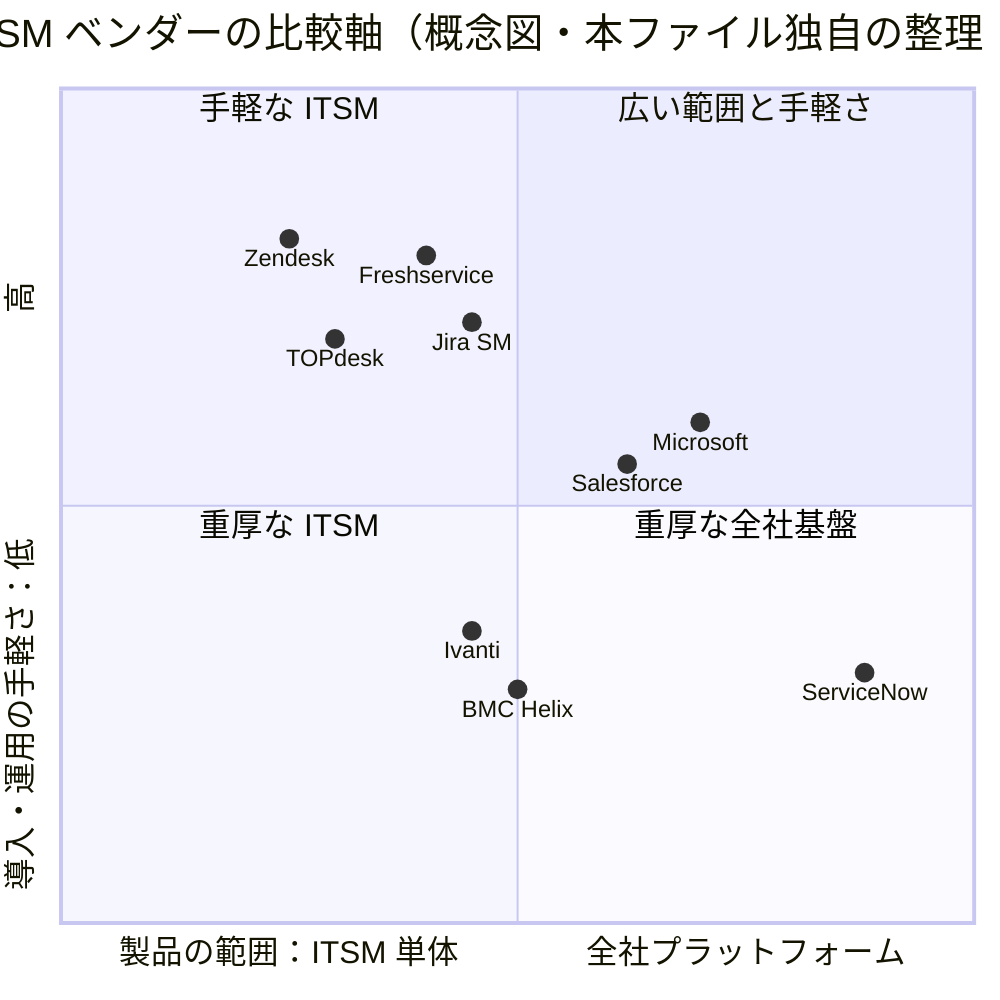

# 競合比較（Competitor Comparison）

## 概要

競合比較（Competitor Comparison）について、本ファイルは ServiceNow の導入検討・提案・リプレース案件で頻出する次の問いに答える。

1. ServiceNow と競合 8 社（Atlassian **Jira Service Management**、**BMC Helix**、**Ivanti** Neurons for ITSM、Freshworks **Freshservice**、**Salesforce** Agentforce IT Service、**Zendesk**、**TOPdesk**、**Microsoft**）は、機能範囲・価格帯・強み弱みがどう違うか。
2. アナリスト評価（Gartner Magic Quadrant 等）で各社はどう位置付けられているか。
3. どのような顧客要件なら ServiceNow が適し、どのような要件なら競合が適するか。
4. 競合と比較される場面で、コンサルタント・PM は何を確認すべきか。

> **前提と注意事項**
> - 本ファイルの比較は **ITSM（IT Service Management：IT サービス管理）と ESM（Enterprise Service Management：全社サービス管理）** を中心にする。CRM・CSM 領域の Salesforce / Zendesk との比較は、それぞれの ITSM 製品・従業員サービス製品を主対象とし、顧客サービス領域は簡潔に触れる。
> - ServiceNow は定価を公開していない。ServiceNow の金額はすべて **【推定】** であり、詳細は [価格情報](02-pricing.md) を参照。競合の価格は、公式価格ページで公開されている場合は「公式公開価格（取得日付き）」、公開されていない場合は【推定】とする。
> - 競合各社の自社比較ページ（例：Zendesk の「Zendesk vs ServiceNow」、Salesforce の「Salesforce vs ServiceNow」）は**ベンダーの主張**であり、そのまま事実として扱わない。本ファイルでは「〜と主張している」と明記する。
> - 本ファイルは ServiceNow 社の公式ドキュメントでは扱われないテーマであるため、記述の多くは第三者情報・ベンダー公表情報に依拠する。確度ラベルに注意すること。

関連ファイル：

- ServiceNow 側の課金体系：[ライセンスモデル](01-licensing-model.md)、[価格情報](02-pricing.md)、[エディション比較](03-edition-comparison.md)
- 日本市場固有の競合・導入事情：[日本市場における導入](15-japan-market.md)
- ServiceNow ITSM の機能詳細：[ITSM 概要とパッケージ](../02_リファレンス/itsm/itsm-overview.md)、[ITSM Pro/Enterprise 固有機能](../02_リファレンス/itsm/itsm-pro-features.md)
- CRM 領域：[Customer Service Management](../02_リファレンス/customer/customer-service-management.md)、[Sales and Order Management（CRM）](../02_リファレンス/customer/sales-order-management-crm.md)

---

## 1. 市場の全体像とアナリスト評価

### 1.1 Gartner Magic Quadrant for IT Service Management Platforms（2026年版）

Gartner は ITSM ツールの Magic Quadrant（MQ）を 2022 年に休止し、2026 年に「**Magic Quadrant for IT Service Management Platforms**」として再開した。2026 年版は **2026-07-27 付**で発行され、評価対象は 2022 年版の 10 社から **16 社**に増えた。[出典：ITSM.tools（2026-09-03）](https://itsm.tools/?p=38195)【第三者情報】、[Gartner 抄録](https://www.gartner.com/en/documents/8168829)（取得日 2026-11-02）

| 象限 | 2026年版の主な配置 | 2022年版からの変化 |
|---|---|---|
| Leaders（リーダー） | **ServiceNow、Atlassian、BMC Helix、Freshworks（Freshservice）** | Freshworks が Challengers から昇格。Ivanti が Leaders から外れた |
| Challengers（チャレンジャー） | ManageEngine、Halo（新規）、TeamDynamix（新規） | Freshworks が抜けた |
| Visionaries（ビジョナリー） | 該当なし | 2022年版も該当なし |
| Niche Players（ニッチプレイヤー） | **Ivanti**（Leaders から移動）、EasyVista、OpenText、SysAid、Matrix42（新規）、**Salesforce**（新規）、SymphonyAI（新規）、**TOPdesk**（新規）、Xurrent（旧 4me、新規） | IFS が対象外に。InvGate、SolarWinds は Honorable Mention |

【第三者情報】象限配置は ITSM.tools の解説記事に基づく。各社のリーダー選出は各社の発表でも確認できる：Freshworks（2026-07-29 プレスリリース）、BMC Helix（2026-08-03 プレスリリース、「10回目のリーダー選出」と主張）、Atlassian（自社ページ）、ServiceNow（自社ニュース記事）。[Freshworks](https://www.freshworks.com/pressrelease/freshworks-named-a-leader-in-the-2026-gartner-magic-quadrant-for-it-service-management-platforms/)、[BMC Helix](https://www.helixops.ai/newsroom/releases/bmc-helix-named-leader-gartner-magic-quadrant-it-service-management-platforms.html)、[Atlassian](https://www.atlassian.com/gartner/magic-quadrant-itsm-platforms)、[ServiceNow](https://www.servicenow.com/workflow/news/magic-quadrant-leader-itsm-why-that-matters.html)（取得日 2026-11-02）

- Gartner によれば ITSM プラットフォーム市場は **2025 年に約 90 億ドル**規模である（Freshworks のプレスリリースが引用）。【第三者情報】
- Microsoft と Zendesk は 2026 年版の評価対象として公開情報では確認できず。
- 2026 年版における各社の詳細な座標（Ability to Execute / Completeness of Vision の位置関係）は、Gartner 本文（有償）または各社が配布する再配布版で確認する必要がある。公開情報では確認できず。
- 同時発行の **Critical Capabilities for ITSM Platforms** について、BMC Helix は「Advanced ITSM、Intermediate ITSM、Service Desk Operations の 3 ユースケースで評価された」と発表している。ServiceNow も上位評価を主張しているが、ユースケース別の順位は公開情報では一次確認できず。【第三者情報】

### 1.2 Gartner Magic Quadrant for AI Applications in ITSM（2024・2025年版）

Gartner は 2024 年から別の MQ「**Magic Quadrant for AI Applications in IT Service Management**」も発行している。ServiceNow は **2025 年版（2025-09-02 発行）で唯一の Leader** であり、2024 年版に続き 2 年連続の Leader であると発表している。同 MQ の評価対象は 10 社で、ManageEngine は Niche Player と発表している。[出典：ServiceNow ブログ](https://www.servicenow.com/blogs/2025/leader-ai-applications-itsm)（取得日 2026-11-02）【第三者情報：ServiceNow 自身の発表】

> **実務上の読み方【経験則】**：ITSM Platforms MQ では Leaders が 4 社並んだため、「ServiceNow だけが突出している」という単純な訴求は 2026 年以降は通りにくい。差別化は「AI 適用の深さ」「全社ワークフロー（ESM）・CMDB・ITOM・SecOps・IRM まで単一プラットフォームで揃う」点に置かれるのが一般的である。逆に競合は「導入期間・TCO・使いやすさ」で攻めてくる。

### 1.3 競合の分類

ServiceNow の競合は、比較される文脈によって大きく 4 つに分類できる。【推定】（本ファイル独自の整理）

| 分類 | 該当ベンダー | ServiceNow と比較される典型場面 |
|---|---|---|
| **A. エンタープライズ ITSM 専業（老舗）** | BMC Helix、Ivanti | 大企業の既存 ITSM 刷新・リプレース。オンプレミス要件、ITOM（監視・ディスカバリー）込みの比較 |
| **B. 開発者・中堅向け SaaS ITSM** | Atlassian Jira Service Management、Freshservice、TOPdesk | コスト重視、短期導入、中堅企業、Jira を使う開発組織との連携 |
| **C. CRM / CX プラットフォームからの参入** | Salesforce（Agentforce IT Service）、Zendesk | 「既に Salesforce / Zendesk を全社導入済み」の顧客。CSM 領域での逆方向の競合も含む |
| **D. 汎用プラットフォーム・従業員接点** | Microsoft（Dynamics 365、Power Platform、Copilot / Copilot Studio、Teams） | 「Teams と Copilot で十分ではないか」という問い。ローコード開発・AI エージェントの主導権争い |

---

## 2. 早見表：機能範囲と価格帯

### 2.1 機能範囲の比較（ITSM/ESM 観点）

以下は各社の公開情報から整理した「標準提供（ネイティブ）の有無」の概観である。○＝ネイティブ提供、△＝上位エディション限定・限定的・アドオン、×＝ネイティブ提供なし（他製品・パートナーで補完）、？＝公開情報では確認できず。【推定】（各節の出典に基づく本ファイル独自の整理。エディションにより異なるため、正確な範囲は各社の最新プラン表で確認すること）

| 機能 | ServiceNow | Jira SM | BMC Helix | Ivanti Neurons | Freshservice | Salesforce IT Service | Zendesk | TOPdesk | Microsoft |
|---|---|---|---|---|---|---|---|---|---|
| Incident / Request | ○ | ○ | ○ | ○ | ○ | ○ | ○ | ○ | △（Dynamics 365 Customer Service 等で構築） |
| Problem / Change | ○（Advanced 以上） | △（Change は Premium で高度化） | ○ | ○ | △（Pro 以上） | ○ | ×（ワークフローで自作） | △（Engaged 以上） | × |
| CMDB | ○（CSDM） | △（Assets） | ○ | ○ | △ | △（CMDB Enterprise は別売） | × | △ | × |
| Discovery（ディスカバリー） | ○（ITOM） | △ | ○ | ○ | △ | △ | × | ? | △（Intune 等の管理系製品） |
| ITAM（HAM/SAM） | ○ | △（Assets） | ○ | ○ | △（Asset Unit 課金） | △（HAM 別売） | △（2025-11〜段階提供） | ○ | △（Intune 等） |
| ITOM/AIOps（監視・イベント） | ○ | △（Opsgenie 系機能を統合） | ○ | △ | △ | × | × | × | △（Azure Monitor 等、別製品） |
| ESM（HR・施設・法務等） | ○ | ○ | △ | ○ | ○ | ○（HR Service 等） | ○ | ○（施設管理に強い） | △ |
| 顧客サービス（CSM） | ○ | ○（Customer Service Management） | × | × | ×（Freshdesk は別製品） | ○（Service Cloud） | ○（主力） | △ | ○（Dynamics 365） |
| 生成 AI / AI エージェント | ○（Now Assist / AI Agents） | ○（Rovo） | ○ | ○ | ○（Freddy AI） | ○（Agentforce） | ○ | △ | ○（Copilot / Copilot Studio） |
| ローコード開発基盤 | ○（App Engine） | △（Forge / Automation） | △ | △ | △ | ○（Salesforce Platform） | △ | × | ○（Power Platform） |
| オンプレミス提供 | △（例外的。基本は SaaS） | ×（Data Center は縮小方針）※ | ○ | ○ | × | × | × | ○（一部） | ○（System Center 等） |

※ Atlassian の Data Center 製品の提供方針は本ファイルの調査範囲では一次確認できず。公開情報では確認できず。

### 2.2 価格帯の比較（ITSM の担当者 1 人あたり・月額・USD）

| 製品・プラン | 価格（USD/担当者/月） | 区分 | 出典・取得日 |
|---|---|---|---|
| **ServiceNow ITSM（旧 Standard / Pro / Enterprise）** | 約 $100 / $150 / $200（1〜99 Fulfiller、ボリュームで低下） | 【推定】 | [Redress Compliance](https://redresscompliance.com/how-much-is-servicenow-2026)（2026-11-02）／詳細は [価格情報](02-pricing.md) |
| **ServiceNow ITSM Foundation（2026-04〜の新 tier）** | 約 $70〜$100 | 【推定】 | [Redress Compliance](https://redresscompliance.com/servicenow-2026-pricing-tiers-pillar)（2026-11-02） |
| Jira Service Management（Service Collection）Free | $0（最大 3 エージェント） | 公式公開価格（第三者経由で確認） | [Unthread](https://unthread.io/blog/jira-service-management-pricing/)（2026-11-02）【第三者情報】 |
| 同 Standard | 約 $20（年払い、75 エージェント時）〜$25 | 公式公開価格（第三者経由で確認） | 同上、[Desk365](https://www.desk365.io/blog/jira-service-management-pricing/) 【第三者情報】 |
| 同 Premium | 約 $51.42（年払い、75 エージェント時）〜$57 | 公式公開価格（第三者経由で確認） | 同上 【第三者情報】 |
| 同 Enterprise | 個別見積 | — | 同上 |
| Freshservice Starter / Growth / Pro | $19 / $49 / $99（年払い） | 公式公開価格 | [Freshworks 公式](https://www.freshworks.com/freshservice/pricing/)（2026-11-02） |
| Freshservice Enterprise | 個別見積（推定 $109〜$125） | 【推定】 | [eesel.ai](https://www.eesel.ai/blog/freshservice-pricing)（2026-11-02） |
| Freshservice Freddy AI Copilot（アドオン） | $29 | 公式公開価格 | [Freshworks 公式](https://www.freshworks.com/freshservice/pricing/)（2026-11-02） |
| Salesforce IT Service Desk Enterprise / Unlimited | $75 / $150 | 公式公開価格 | [Salesforce 公式](https://www.salesforce.com/service/it-service-management/pricing/)（2026-11-02） |
| Salesforce AI Agent for Employees（依頼者向け） | $15/ユーザー | 公式公開価格 | 同上 |
| Zendesk Employee Service Suite Team / Growth / Professional | $29 / $59 / $99（年払い） | 公式公開価格（第三者経由で確認） | [eesel.ai](https://www.eesel.ai/blog/zendesk-pricing)（2026-11-02）【第三者情報】 |
| TOPdesk Essential / Engaged / Excellent | $76 / $109 / $155（50 エージェントで $58 / $83 / $114） | 【推定】 | [SmartSuite](https://www.smartsuite.com/blog/topdesk-pricing)（2026-11-02） |
| BMC Helix ITSM | 個別見積（推定 約 $115/named user） | 【推定】 | [CostBench](https://costbench.com/compare/bmc-helix-itsm-vs-servicenow-itsm/)（2026-11-02） |
| Ivanti Neurons for ITSM | 個別見積（推定 約 $95/analyst） | 【推定】 | [Xurrent](https://www.xurrent.com/blog/ivanti-pricing)（2026-11-02） |
| Microsoft Dynamics 365 Customer Service Professional / Enterprise / Premium | $50 / $105 / $195（年払い） | 公式公開価格（第三者経由で確認） | [Microsoft 公式](https://www.microsoft.com/dynamics-365/products/customer-service/pricing)（2026-11-02）【第三者情報】 |

> **価格比較の注意【経験則】**
> - **課金単位が揃っていない**。ServiceNow は Fulfiller 課金が中心で、Requester（依頼者）は無償、ITOM は Subscription Unit（SU）課金、AI は 2026-04 以降 assist プール消費である（[ライセンスモデル](01-licensing-model.md)）。Salesforce は CMDB を CI 100 件あたり（$1,000/月）、HAM を資産 100 件あたり（$200/月）で別課金し、Freshservice は資産を Asset Unit（500 単位パック）で課金する。Jira Service Management は Premium 以上で Assets オブジェクト数・仮想エージェント会話数に従量要素がある。
> - **一覧価格は割引前**。ServiceNow は大型契約で大幅な割引が入る一方、更新時の値上げ（uplift）がある（[価格情報](02-pricing.md)）。公開価格の競合も、エンタープライズ契約では個別見積になる。
> - **ライセンス以外のコスト**（導入パートナー費、社内管理者人件費、連携・移行費）は ServiceNow のほうが大きくなりやすいとされる。単価比較だけで結論を出さず、3〜5 年 TCO で比較する。

---

## 3. ベンダー別の比較

### 3.1 Atlassian Jira Service Management（JSM）

**製品の概要**：Jira Service Management は Atlassian の ITSM/ESM 製品で、2025 年以降は **Service Collection**（Jira Service Management、Customer Service Management、Assets、Rovo を束ねた単一オファリング）として販売されている。Atlassian のライセンスページは「Service Collection のアプリは個別購入できない」としている。[出典](https://www.atlassian.com/licensing/service-collection)（取得日 2026-11-02）【第三者情報：検索結果経由で確認】

| 観点 | 内容 |
|---|---|
| プラン | Free（3 エージェントまで）/ Standard / Premium / Enterprise |
| 価格 | Standard 約 $20、Premium 約 $51.42（年払い・75 エージェント時の単価、ボリュームで逓減）。Enterprise は個別見積。2025-10-16 から価格改定と Premium/Enterprise への従量課金要素が導入された【第三者情報】 |
| AI | **Rovo**（Atlassian の AI）を同梱。Premium で仮想サービスエージェント（Virtual service agent）の会話を月 1,000 件まで追加費用なし、超過は 1 会話 $0.30〜と Atlassian 価格ページが記載【第三者情報】 |
| CMDB / 資産 | **Assets**（旧 Insight）。Premium で月 50,000 オブジェクトまで追加費用なし、超過 $0.02/オブジェクト〜【第三者情報】。2026 年に Standard へも Assets が拡大されたとする情報もあり、出典間で不一致 |
| アナリスト評価 | 2026 ITSM Platforms MQ で Leader |

出典：[Unthread](https://unthread.io/blog/jira-service-management-pricing/)、[Desk365](https://www.desk365.io/blog/jira-service-management-pricing/)、[Atlassian 価格ページ](https://www.atlassian.com/collections/service/pricing)（取得日 2026-11-02）

**JSM の強み（ServiceNow と比べて）**【経験則】【第三者情報】

- 価格の透明性と低い単価。Free プランから始められ、小規模チームでも導入しやすい。
- Jira Software（開発チームのチケット管理）・Confluence（ナレッジ）とネイティブに連携でき、**DevOps 組織の「開発と運用の同一基盤」**を作りやすい。
- 設定中心で短期間に立ち上がる。社内管理者のスキル要件が ServiceNow より低い。

**JSM の弱み（ServiceNow と比べて）**【経験則】【第三者情報】

- ITIL プロセスの成熟度（Problem、Change の承認・リスク計算、SLA の複雑な条件）、CMDB の厳密さ（CSDM 相当のデータモデル、IRE による重複排除）、ITOM（Discovery、Service Mapping、AIOps）の深さでは ServiceNow が上回るとされる。
- 大規模組織（数千エージェント規模）・多数のプロセスを横断する全社ワークフロー、規制業界の統制（IRM・監査証跡）では、ServiceNow のプラットフォーム一体性が優位になりやすい。
- 従量課金（Assets オブジェクト・仮想エージェント会話）の導入で、Premium 以上の総額は予測しにくくなった。

**比較される典型場面**：開発組織が既に Jira を全面利用している企業が「IT 部門のヘルプデスクも Jira で」と考えるケース。ServiceNow 側は、ServiceNow の **Jira 連携**（IntegrationHub の Jira スポーク、DevOps Change Velocity）で「開発は Jira のまま、ITSM は ServiceNow」という共存案を示すのが定石である。【経験則】→ [IntegrationHub](../02_リファレンス/platform/integrationhub.md)、[Release Management と DevOps](../02_リファレンス/itsm/release-management.md)

### 3.2 BMC Helix（旧 BMC Remedy）

**会社の状況**：BMC Software（KKR 傘下）は 2024-10 に 2 社への分割を発表し、メインフレーム・自動化事業を **BMC**、IT サービス・運用管理ソフト（DSOM：Digital Service and Operations Management）を **BMC Helix** として分離した。分割は 2025 年に発効し、BMC Helix は 2025-04 から正式に独立したと報じられている。売上 23 億ドルのうち約 3 分の 1 が BMC Helix 側とされる。[出典：Bloomberg（2024-10-09）](https://www.bloomberg.com/news/articles/2024-10-09/kkr-owned-bmc-to-split-into-two-software-companies)（取得日 2026-11-02）【第三者情報】

| 観点 | 内容 |
|---|---|
| 主力製品 | BMC Helix ITSM（旧 Remedy の後継）、BMC Helix Discovery、BMC Helix Operations Management（AIOps/Observability） |
| 提供形態 | SaaS に加え、**オンプレミス・ハイブリッド**でも提供されるとされる【第三者情報】 |
| 価格 | 非公開。推定 約 $115/named user/月【推定】 |
| アナリスト評価 | 2026 ITSM Platforms MQ で Leader（BMC は「10回目」と主張）。2026 Observability MQ で Visionary と発表 |
| 市場動向 | PeerSpot のマインドシェアで ITSM カテゴリ 11.7% → 5.7%（2026-04 時点、前年比）と低下したとの集計がある【第三者情報】 |

出典：[BMC Helix プレスリリース（2026-08-03）](https://www.helixops.ai/newsroom/releases/bmc-helix-named-leader-gartner-magic-quadrant-it-service-management-platforms.html)、[CostBench](https://costbench.com/compare/bmc-helix-itsm-vs-servicenow-itsm/)（取得日 2026-11-02）

**BMC Helix の強み**【経験則】【第三者情報】

- 大企業・金融・通信・官公庁での長い導入実績と、Remedy 時代からの ITIL プロセスの成熟度。
- **オンプレミス・プライベートクラウド**を選べること。データ主権・閉域要件が厳しい組織で ServiceNow（原則 SaaS）の対抗馬になる。
- Discovery・Operations Management を含む ITOM 製品群があり、「ITSM + 運用監視」をまとめて比較されやすい。

**BMC Helix の弱み**【経験則】【第三者情報】

- レビューサイトの評価（G2 で ServiceNow 4.4 / BMC Helix 3.7 と集計される例）や UI の古さが指摘されやすい。
- ITSM 以外のワークフロー（HR、CSM、SecOps、IRM、SPM 等）の製品幅は ServiceNow より狭い。
- 所有構造の変化（分割、売却観測の報道）による将来性への懸念が、顧客側のリスク評価で論点になりうる。

**比較される典型場面**：Remedy からのリプレース案件。ServiceNow 側は移行の論点（カスタマイズ済みフォームの棚卸し、CMDB クラスのマッピング、履歴データの移行範囲）を早期に示すと有利である。【経験則】→ [データ移行](08-data-migration.md)、[CMDB と CSDM](../02_リファレンス/platform/cmdb-csdm.md)

### 3.3 Ivanti Neurons for ITSM（旧 Heat / Cherwell）

**製品の状況**：Ivanti は Heat Software、Cherwell を買収して ITSM 製品群を形成し、後継を **Ivanti Neurons for ITSM** に統合している。Ivanti は **Cherwell Service Management の EOL（End of Life：サポート終了）を 2026-12-31** と発表しており、クラウドテナントは EOL 後 30 日でアクセス不能になる。オンプレミスは EOL 後も稼働は続けられるがサポートは提供されない。[出典：Stratacom（Ivanti FAQ の要約）](https://stratacominc.com/cherwell-end-of-life-details/)、[University of Wisconsin–Madison](https://it.wisc.edu/seo/itsm-tool-replacement/itsm-tool-replacement-project-underway/)（取得日 2026-11-02）【第三者情報】

| 観点 | 内容 |
|---|---|
| 提供形態 | クラウドとオンプレミス |
| 価格 | 非公開。analyst（担当者）単位・資産単位のサブスクリプション（G2）。推定 約 $95/analyst/月【推定】 |
| アナリスト評価 | 2022 ITSM Tools MQ の Leader から、2026 ITSM Platforms MQ では **Niche Player** に移動【第三者情報】 |
| 周辺製品 | UEM（エンドポイント管理）、パッチ管理、ITAM、Neurons（自動化・DEX） |

出典：[G2](https://www.g2.com/products/ivanti-neurons-for-itsm/pricing)、[Xurrent](https://www.xurrent.com/blog/ivanti-pricing)、[ITSM.tools](https://itsm.tools/?p=38195)（取得日 2026-11-02）

**Ivanti の強み**【経験則】【第三者情報】

- エンドポイント管理・パッチ管理・ITAM と ITSM を同一ベンダーで揃えられる。
- オンプレミス要件に対応できる。設定の柔軟性（カスタマイズ性）が高いと評価されることがある。

**Ivanti の弱み**【経験則】【第三者情報】

- 製品統合（Heat・Cherwell → Neurons）の過程で、移行負荷と製品ロードマップの不確実性が顧客側の課題になっている。
- 使いやすさで ServiceNow に劣るとのユーザーレビューがある（PeerSpot の個別レビュー。母数が小さい点に注意）。
- 全社ワークフロー・AI エージェントの範囲は ServiceNow より狭い。

**比較される典型場面【経験則】**：**Cherwell の EOL（2026-12-31）を契機とした乗り換え案件**は 2026 年の典型的な競合場面である。顧客は「Ivanti Neurons への移行」と「他社（ServiceNow 等）への移行」を比較する。どちらに移っても再実装に近い作業が発生するため、ServiceNow 側は「どうせ移行するなら」という観点で、ESM への拡張性・AI・CMDB を訴求する。EOL 日程が迫っている顧客には、段階導入（Incident/Request を先行、Change/CMDB を後続）を提示するのが現実的である。→ [導入方法論](04-implementation-methodology.md)

### 3.4 Freshworks Freshservice

**製品の概要**：Freshservice は Freshworks の ITSM/ESM SaaS で、ITSM・ITOM・ITAM・ESM を共有データ層の「Unified ServiceOps platform」として提供すると主張している。AI は **Freddy AI**。[出典：Freshworks プレスリリース（2026-07-29）](https://www.freshworks.com/pressrelease/freshworks-named-a-leader-in-the-2026-gartner-magic-quadrant-for-it-service-management-platforms/)（取得日 2026-11-02）

| プラン | 価格（USD/エージェント/月、年払い） | 主な機能差（公式価格ページ） |
|---|---|---|
| Starter | $19 | Incident 中心。SLA 管理・サービスカタログなし。ポータル 1 |
| Growth | $49 | SLA 管理、サービスカタログ。ポータル 1 |
| Pro | $99 | **Problem / Change / Release** 管理。ポータル最大 50。Freddy AI Copilot アドオン（$29）購入可 |
| Enterprise | 個別見積 | Sandbox、監査ログ。Freddy AI Agent（Classic）、Freddy AI Insights を含む |

出典：[Freshworks 公式価格ページ](https://www.freshworks.com/freshservice/pricing/)（取得日 2026-11-02）。資産管理は Asset Unit（500 単位パック）で別課金。

**Freshservice の強み**

- 価格の公開と、**短期導入**の訴求。Freshworks は「平均 90 日未満で稼働、ROI 168%、回収期間 6 か月」（Futurum のレポートに基づく）と主張している。【第三者情報：ベンダー主張】
- ノーコード設定中心で、コンサルタント依存度が低いとされる。
- 2026 ITSM Platforms MQ で Challenger から Leader に昇格し、中堅〜準大手での採用が伸びている。【第三者情報】

**Freshservice の弱み**【経験則】【第三者情報】

- Problem/Change/Release が Pro 以上、Sandbox が Enterprise のみであり、ITIL フルセットを使うと単価は $99 以上になる。ServiceNow Foundation の推定単価（$70〜$100）との差は「公開価格どうし」で見るほど大きくない場合がある。
- 大規模・複雑な要件（ドメインセパレーション、厳密なアクセス制御、大規模 CMDB・Service Mapping、ローコードでの独自アプリ開発）は ServiceNow のほうが対応範囲が広い。

**比較される典型場面【経験則】**：従業員数 500〜5,000 人程度の企業で、「ServiceNow は高すぎる・重すぎる」という懸念から Freshservice が候補に挙がるケース。ServiceNow 側は、ITSM Foundation と短期導入パッケージ（パートナーのクイックスタート）で初期費用を抑え、将来の拡張性（ITOM、HRSD、IRM）を示すのが一般的である。→ [価格情報](02-pricing.md)（パートナーのクイックスタート価格例）

### 3.5 Salesforce（Agentforce IT Service）

**製品の概要**：Salesforce は **2025-10-09 に Agentforce IT Service** を発表し、ITSM 市場に本格参入した。Service Cloud の基盤上に構築され、IT Service Desk、従業員向け AI エージェント、組み込み CMDB・Service Graph（エージェント型・エージェントレスのディスカバリー、依存関係マッピング）を提供する。チャネルは Slack、Microsoft Teams、ポータル、Web チャット。Salesforce は「会話ファースト（conversation-first）・エージェントファースト」を掲げ、チケット中心の従来型 ITSM を「根本的に壊れている」と批判して ServiceNow との対比を打ち出している。[出典：Salesforce Ben（2025-10）](https://www.salesforceben.com/salesforce-vs-servicenow-battle-intensifies-with-agentforce-for-it-services/)（取得日 2026-11-02）【第三者情報】

| 製品 | 価格（USD/月） | 対象・内容 |
|---|---|---|
| AI Agent for Employees | $15/ユーザー | 依頼者（従業員）向け。Slack/Teams/ポータル/チャット、50 以上の既成カタログ項目 |
| IT Service Desk – Enterprise Edition | $75/ユーザー | IT 担当者向け。Incident・Problem・Change・Request・Knowledge、エンドユーザー端末の CMDB・Discovery・Service Graph |
| IT Service Desk – Unlimited Edition | $150/ユーザー | Enterprise に加え、生成 AI（メール/チャットからのインシデント自動作成、問題・ナレッジ記事生成、自動割り当て）、予測 AI（SLA 違反・重大インシデント・変更リスク予測）、Tableau ダッシュボード |
| Add-On: Agentforce for Service | $125/ユーザー | 担当者向け AI エージェント（インシデント要約、根本原因分析、解決策提案等 20 以上のアクション） |
| CMDB Enterprise | $1,000/100 CI | サーバー・ネットワーク等のインフラ CI、自動ディスカバリー、依存関係・影響分析 |
| Hardware Asset Management | $200/100 資産 | IT 資産ライフサイクル・在庫管理 |

出典：[Salesforce IT Service 価格ページ](https://www.salesforce.com/service/it-service-management/pricing/)（取得日 2026-11-02）。年間契約が一般的。

> **注意**：ServiceNow では依頼者（Requester）は通常ライセンス不要だが、Salesforce の構成では従業員向け AI エージェントが **$15/ユーザー/月** で課金される。従業員 1 万人規模では依頼者側だけで年間約 180 万ドル（一覧価格ベース）となる計算であり、比較時は依頼者側の課金有無を必ず揃える。【推定】（公式価格からの単純計算。実際の契約条件は未確認）

**Salesforce の強み**【経験則】【第三者情報】

- 既に Salesforce（Sales Cloud / Service Cloud）と **Slack** を全社利用している企業では、ID・データ・UI・管理者スキルを共通化できる。
- 価格が公開されており、Enterprise Edition（$75）の単価は ServiceNow の推定単価より低く見える。
- AI エージェント（Agentforce）を前面に出した新しい UX 設計。

**Salesforce の弱み**【経験則】【第三者情報】

- ITSM は 2025 年参入の新製品であり、2026 ITSM Platforms MQ では Niche Player（新規）。ITIL プロセスの成熟度、CMDB・ITOM の深さ、導入実績・パートナー層で ServiceNow に劣る。
- CMDB・HAM・AI アドオンを積み上げると、単価の優位は縮小する。
- 逆方向では、ServiceNow が CSM・CRM（Sales and Order Management）で Salesforce の牙城に参入しており、両社は ITSM と CRM の双方で競合関係にある。→ [Sales and Order Management（CRM）](../02_リファレンス/customer/sales-order-management-crm.md)

### 3.6 Zendesk

**製品の概要**：Zendesk は顧客サービス（CX）向けヘルプデスクの大手で、社内 IT・HR 向けに **Employee Service Suite**（Team / Growth / Professional / Enterprise）を別プランで提供している。2025-11 から **IT Asset Management（ITAM）** を段階的に提供開始（Phase 1：2025-11-05〜10、Phase 2：2026-02-25〜03-03、Phase 3：2026-04-14）し、Jamf Pro・Microsoft Intune からの資産同期テンプレートを用意している。[出典：Zendesk ヘルプセンター](https://support.zendesk.com/hc/en-us/articles/9886132130202)（取得日 2026-11-02）

| 観点 | 内容 |
|---|---|
| 価格 | Employee Service Suite Team $29 / Growth $59 / Professional $99（年払い、月払いは $39 / $79 / $125）。Enterprise は個別見積【第三者情報】。顧客サービス用 Suite とは別契約で、両方を扱う担当者は双方のシートが必要【第三者情報】 |
| AI | 2026-05 以降、高度な AI エージェントを全 Suite で利用可能にし、自動解決件数（per-automated-resolution）課金に移行したとの情報がある【第三者情報】 |
| ITIL 機能 | Change 管理・CMDB はネイティブのオブジェクトとしては提供されず、カスタムフィールドと承認ワークフローで構築する方式とされる【第三者情報：競合ベンダーの指摘を含むため注意】 |

出典：[eesel.ai](https://www.eesel.ai/blog/zendesk-pricing)（取得日 2026-11-02）

**Zendesk の主張（ベンダー比較ページ）**：Zendesk の日本語版「Zendesk vs ServiceNow」ページは、Zendesk が「簡単に導入でき、ユーザーフレンドリー」「TCO が低い」「1,800 以上のアプリ連携」「Forrester TEI で平均回収期間約 2 か月」と主張し、ServiceNow については「セットアップが面倒」「初期コストとライセンス料金が高い」「専任管理者（Glassdoor で年 7.1万〜12.8万ドル）が必要」と記載している。これらは**ベンダーの主張**である。[出典](https://www.zendesk.co.jp/service/comparison/zendesk-vs-servicenow/)（取得日 2026-11-02）

**Zendesk の強み**【経験則】

- 顧客サービスで Zendesk を使っている組織が、同じ操作感で社内ヘルプデスクを立ち上げられる。
- オムニチャネル（メール、チャット、音声、SNS）と使いやすさ。軽量な社内問い合わせ窓口（HR・総務等）に向く。

**Zendesk の弱み**【経験則】【第三者情報】

- ITIL ベースの ITSM（Problem/Change/CMDB/ITOM）はネイティブでは弱く、IT 部門の本格的な ITSM 基盤としての比較では ServiceNow が優位になりやすい。
- CX 用と従業員サービス用が別契約のため、両方を扱う組織ではシートが二重になりうる。

### 3.7 TOPdesk

**製品の概要**：TOPdesk はオランダ発の ITSM/ESM（施設管理を含む）製品で、欧州の自治体・教育機関・医療機関などに導入が多いとされる。【第三者情報】

| プラン | 推定価格（USD/エージェント/月） | 主な機能 |
|---|---|---|
| Essential | $76（50 エージェントで $58） | Incident、資産管理（資産数無制限）、セルフサービスポータル、ナレッジ、ダッシュボード。チケット・エンドユーザー無制限 |
| Engaged | $109（50 エージェントで $83） | Essential に加え Change、Problem、契約・SLA 管理、アンケート、運用管理（Operations management） |
| Excellent | $155（50 エージェントで $114） | Engaged に加え Project management、Webshop、ライブチャット、プレミアムサポート、年次ヘルスチェック |

【推定】出典：[SmartSuite](https://www.smartsuite.com/blog/topdesk-pricing)（競合ベンダーのブログ。取得日 2026-11-02）。50 エージェント超は個別見積。導入コンサルタント費用は別。

**TOPdesk の強み**【経験則】

- IT と **施設管理（Facility Management）**・総務の窓口を一体で扱える。予約・来訪者登録等のアドオンもある。
- 中規模組織向けにシンプルで、導入・運用負荷が比較的小さい。

**TOPdesk の弱み**【経験則】【第三者情報】

- 2026 ITSM Platforms MQ では Niche Player（新規）。ITOM・高度な CMDB・AI エージェント・ローコード開発では ServiceNow の範囲が大きく上回る。
- 日本市場での導入実績・日本語サポート体制は公開情報では確認できず。

### 3.8 Microsoft（Dynamics 365・Power Platform・Copilot・Teams）

**位置付け**：Microsoft は Gartner の ITSM Platforms MQ の評価対象ではなく（公開情報では確認できず）、専用 ITSM 製品で正面から競合するというより、次の 3 つの経路で ServiceNow と競合・共存する。【推定】（本ファイル独自の整理）

| 経路 | 内容 | ServiceNow との関係 |
|---|---|---|
| ① Dynamics 365 Customer Service + Power Platform | Dynamics 365 Customer Service（Professional $50 / Enterprise $105 / Premium $195、年払い）上でケース管理を社内ヘルプデスクに転用、または Power Apps / Power Automate で自作 | 「軽い ITSM で十分」な組織で代替候補になる。ITIL・CMDB は自作が必要【第三者情報】 |
| ② Copilot / Copilot Studio / Teams（従業員接点） | 従業員の「最初の窓口」を Teams と Copilot に置き、AI エージェントを Copilot Studio で構築 | ServiceNow が「裏側の記録システム（System of Record）」に格下げされるリスクとして論じられる【第三者情報】 |
| ③ 管理系製品（Intune、System Center、Azure Monitor 等） | 端末管理・監視・資産情報 | ServiceNow の Discovery・Service Graph Connectors のデータソースとして連携することが多い |

出典：[Microsoft Dynamics 365 Customer Service 価格](https://www.microsoft.com/dynamics-365/products/customer-service/pricing)、[Pulse RevOps](https://pulserevops.com/knowledge/q1614)（取得日 2026-11-02）【第三者情報】

**共存（パートナーシップ）**：ServiceNow と Microsoft は 2024-05 に Now Assist と Microsoft Copilot の統合で提携し、2025-11（Microsoft Ignite）に、ServiceNow AI Platform と **Microsoft Agent 365** の統合、ServiceNow **AI Control Tower** と Microsoft Foundry / Copilot Studio の統合（Agent 365 上のエージェントのガバナンス）、ServiceNow Build Agent と GitHub の連携を発表した。ServiceNow の AI エージェントを Agent 365 Marketplace で提供する計画も示されている。[出典：ServiceNow プレスリリース（2025-11-18）](https://newsroom.servicenow.com/press-releases/details/2025/ServiceNow-Advances-Enterprise-AI-through-Seamless-Integrations-with-Microsoft-Enabling-Collaboration-Orchestration-and-Governance/default.aspx)（取得日 2026-11-02）。各統合の 2026-11 時点の GA 状況は公開情報では確認できず。

**Microsoft の強み**【経験則】

- ほぼ全企業が Microsoft 365 を契約済みで、Teams・Entra ID・Copilot の**既存投資を活用できる**。
- Power Platform による部門内の軽量アプリ・自動化は、ServiceNow App Engine と用途が重なる。

**Microsoft の弱み**【経験則】

- ITIL ベースの ITSM・CMDB・サービスレベル管理を標準提供する製品はなく、Dynamics 365 / Power Platform で作り込むと、ServiceNow と同等の統制・監査証跡・アップグレード耐性を維持するのが難しい。
- 「作れる」ことと「運用し続けられる」ことの差（独自開発の保守負債）が大きい。

**提案上のポイント【経験則】**：Microsoft は「代替」より「従業員接点の主導権争い」として扱うのが実態に近い。ServiceNow 側は、Teams 上の **Virtual Agent / Now Assist in Microsoft Teams**、Copilot からの ServiceNow ワークフロー呼び出し、AI Control Tower による他社エージェント含めたガバナンスを示し、「窓口は Teams、処理と記録は ServiceNow」という共存アーキテクチャを提案するのが一般的である。→ [Virtual Agent と会話型AI](../02_リファレンス/platform/virtual-agent.md)、[Now Assist と AI Agents](../02_リファレンス/platform/now-assist-ai-agents.md)

---

## 4. ServiceNow の強み・弱み（競合比較の観点からの総括）

### 4.1 ServiceNow の強み

| 強み | 内容 | 根拠 |
|---|---|---|
| 単一プラットフォームの製品幅 | ITSM・ITOM・ITAM・SPM・SecOps・IRM・HRSD・CSM・FSM・業界ソリューションを単一データモデル（CMDB/CSDM）・単一 UI・単一 AI 基盤で提供 | [製品ポートフォリオ一覧](../01_入門編/03-product-portfolio.md) |
| アナリスト評価 | 2026 ITSM Platforms MQ の Leader。2025 AI Applications in ITSM MQ の唯一の Leader（ServiceNow 発表） | 1 章参照 |
| ITIL プロセスと CMDB の成熟度 | Incident/Problem/Change/Request、CSDM、IRE、Discovery、Service Mapping | [ITSM 概要](../02_リファレンス/itsm/itsm-overview.md)、[CMDB と CSDM](../02_リファレンス/platform/cmdb-csdm.md) |
| AI の統合 | Now Assist・AI Agents・AI Control Tower。2026-04 以降は全 tier に AI 同梱（assist プール） | [Now Assist と AI Agents](../02_リファレンス/platform/now-assist-ai-agents.md)、[Community 解説（2026-05-28）](https://www.servicenow.com/community/itsm-articles/itsm-licensing-in-april-2026-foundation-advanced-and-prime-in/ta-p/3544380) |
| 拡張性 | App Engine、Workflow Studio、IntegrationHub、Workflow Data Fabric | [アプリケーション開発](../02_リファレンス/platform/app-development.md) |
| 大規模・規制対応 | ドメインセパレーション、厳密な ACL、監査、各国認証 | [ドメインセパレーション](../02_リファレンス/platform/domain-separation.md)、[セキュリティとコンプライアンス](10-security-compliance.md) |
| エコシステム | 大手 SI を含む豊富なパートナー、認定資格者、コミュニティ | [プロジェクト体制とパートナー](05-project-organization.md) |

### 4.2 ServiceNow の弱み（競合が突いてくる点）

| 弱み | 競合の典型的な主張 | ServiceNow 側の対応策【経験則】 |
|---|---|---|
| ライセンス単価が高く、価格が非公開 | 「公開価格で 1/2〜1/5」（Freshservice、JSM、Zendesk） | ITSM Foundation、段階導入、ボリューム割引、3〜5年 TCO（運用・統合・拡張含む）で比較。→ [ライセンスコスト最適化](../04_応用編/06-license-cost-optimization.md) |
| 導入期間・導入費が大きい | 「90 日で稼働」「コンサル不要」 | OOTB（標準機能）重視のクイックスタート、パートナーの定額パッケージ。→ [導入方法論](04-implementation-methodology.md) |
| 専任管理者・スキルが必要 | 「専任管理者の人件費」（Zendesk） | 管理者の育成計画・CoE。→ [ガバナンスとCoEの実践](../04_応用編/09-governance-coe-practice.md) |
| 年 2 回のアップグレード負荷 | 「アップグレードとカスタマイズのコスト」（Salesforce） | カスタマイズ抑制、ATF による回帰テスト。→ [アップグレード管理](13-upgrade-management.md) |
| 更新時の値上げ（uplift）、AI 従量課金の予測困難性 | — | 契約時に更新上限・assist プール・超過単価を交渉。→ [価格情報](02-pricing.md) |
| SaaS 前提（オンプレミスの選択肢が限定的） | 「オンプレミス可」（BMC Helix、Ivanti） | データレジデンシー、暗号化（顧客管理鍵）等で代替。→ [プラットフォームセキュリティと暗号化](../02_リファレンス/platform/platform-security-encryption.md) |

---

## 5. 選定の判断基準

### 5.1 要件別の適合度（目安）

以下は一般的な適合の目安である。【経験則】【推定】

| 顧客要件 | ServiceNow が適する | 競合が適しやすい |
|---|---|---|
| IT 担当者数 | 数百人以上、複数部門・グループ会社 | 数十人以下（JSM Free/Standard、Freshservice Starter/Growth、Zendesk） |
| 対象範囲 | ITSM + ITOM + ITAM + ESM + IRM/SecOps を段階拡張 | ITSM のヘルプデスク機能のみ |
| CMDB・サービス影響分析 | Service Mapping、依存関係に基づく変更リスク評価が必要 | 資産台帳レベルで十分 |
| 既存プラットフォーム | 特定ベンダーに依存せず業務横断 | Jira 全社利用（JSM）、Salesforce + Slack（Salesforce）、Zendesk CX（Zendesk）、Microsoft 中心で軽量要件（Microsoft） |
| デプロイ形態 | SaaS 可 | オンプレミス必須（BMC Helix、Ivanti） |
| 予算・期間 | 3〜5 年の中長期投資、業務標準化を伴う変革 | 初年度コスト・稼働までの期間を最優先 |
| 施設管理との一体運用 | Workplace Service Delivery で対応 | 中規模で IT + 施設を簡素に（TOPdesk） |
| 規制・統制 | 監査証跡、職務分掌、ドメイン分離、大規模 ACL | 統制要件が軽い |

### 5.2 競合比較・RFP で確認すべき質問リスト

製品選定・RFP（Request for Proposal：提案依頼書）で、ベンダー横並びの比較を行うときに確認すべき項目である。【経験則】

| # | 質問 | 狙い |
|---|---|---|
| 1 | 担当者（Fulfiller）以外に、依頼者・承認者・AI 利用に課金はあるか | Salesforce の従業員向け AI エージェント課金、ServiceNow の Approver 扱い等、課金単位の差を揃える |
| 2 | CMDB の CI 数・資産数・ディスカバリー対象数に課金や上限はあるか | Salesforce（CI/資産 100 件単位）、JSM（Assets オブジェクト）、Freshservice（Asset Unit）、ServiceNow ITOM（SU）の比較 |
| 3 | AI の利用量（会話数・アクション数・解決件数）の上限と超過単価は | JSM の仮想エージェント会話、Zendesk の自動解決課金、ServiceNow の assist プール |
| 4 | 本番以外の環境（Sandbox / Sub-production）は何個含まれるか | Freshservice は Enterprise のみ Sandbox。ServiceNow は契約で確認。→ [インスタンス戦略と環境](07-instance-strategy.md) |
| 5 | Problem / Change / Release / SLA はどのプランから使えるか | 下位プランの安い単価で比較してしまう誤りを防ぐ |
| 6 | 更新時の値上げ上限、複数年契約の価格固定は | 3 年目以降の TCO を予測可能にする |
| 7 | データの保存リージョン・日本リージョン・暗号鍵管理は | データレジデンシー要件。→ [セキュリティとコンプライアンス](10-security-compliance.md) |
| 8 | 日本語 UI・日本語サポート・国内パートナー数は | 日本市場固有の論点。→ [日本市場における導入](15-japan-market.md) |
| 9 | 製品ロードマップと EOL ポリシー、所有構造の変化 | Cherwell EOL、BMC 分割のような事業リスク |
| 10 | 既存ツールからのデータ移行手段と実績 | → [データ移行](08-data-migration.md) |

---

## 6. 比較の構図（図解）

上図は **Gartner MQ の座標ではなく**、本ファイルの各節の情報をもとに「製品範囲の広さ」と「導入・運用の手軽さ」の 2 軸で各社の一般的な位置付けを概念的に示したものである。数値に客観的根拠はない。【推定】

---

## 7. 画像について

本ファイルでは画像を掲載していない。競合比較に関連する図版（Gartner Magic Quadrant の象限図等）は Gartner の著作物であり、Gartner 自身が再配布条件を定めているため取得・保存しなかった。最新の象限図は、ServiceNow・Atlassian・Freshworks・BMC Helix 各社の配布ページ（1.1 節の出典）で閲覧できる。各社の画面は各社の公式サイト・デモで確認すること。

---

## 8. Brazil リリースでの関連動向

Brazil（2026-09 EA）で競合比較に直接影響する変更（価格体系・パッケージの変更等）は、本ファイル作成時点（2026-11-02）の公開情報では確認できず。2026-04 の Foundation / Advanced / Prime 移行が直近の大きな変更であり、詳細は [エディション比較](03-edition-comparison.md) を参照。

---

## 参照元

（すべて取得日 2026-11-02）

アナリスト評価・市場

- ITSM.tools「The 2026 Gartner Magic Quadrant for IT Service Management Platforms: What Changed Between 2022 and 2026」 https://itsm.tools/?p=38195
- Gartner 抄録 Magic Quadrant for IT Service Management Platforms https://www.gartner.com/en/documents/8168829
- Freshworks プレスリリース（2026-07-29） https://www.freshworks.com/pressrelease/freshworks-named-a-leader-in-the-2026-gartner-magic-quadrant-for-it-service-management-platforms/
- BMC Helix プレスリリース（2026-08-03） https://www.helixops.ai/newsroom/releases/bmc-helix-named-leader-gartner-magic-quadrant-it-service-management-platforms.html
- Atlassian Gartner MQ ページ https://www.atlassian.com/gartner/magic-quadrant-itsm-platforms
- ServiceNow「Magic Quadrant leader ITSM」 https://www.servicenow.com/workflow/news/magic-quadrant-leader-itsm-why-that-matters.html
- ServiceNow ブログ（AI Applications in ITSM 2025） https://www.servicenow.com/blogs/2025/leader-ai-applications-itsm

ServiceNow

- ServiceNow Community「ITSM Licensing in April 2026: Foundation, Advanced and Prime」 https://www.servicenow.com/community/itsm-articles/itsm-licensing-in-april-2026-foundation-advanced-and-prime-in/ta-p/3544380
- ServiceNow プレスリリース（Microsoft 統合、2025-11-18） https://newsroom.servicenow.com/press-releases/details/2025/ServiceNow-Advances-Enterprise-AI-through-Seamless-Integrations-with-Microsoft-Enabling-Collaboration-Orchestration-and-Governance/default.aspx
- Redress Compliance「How much is ServiceNow 2026」 https://redresscompliance.com/how-much-is-servicenow-2026
- Redress Compliance「ServiceNow 2026 pricing tiers」 https://redresscompliance.com/servicenow-2026-pricing-tiers-pillar

Atlassian

- Atlassian Service Collection ライセンス https://www.atlassian.com/licensing/service-collection
- Atlassian Service Collection 価格 https://www.atlassian.com/collections/service/pricing
- Unthread「Jira Service Management Pricing in 2026」 https://unthread.io/blog/jira-service-management-pricing/
- Desk365「Jira Service Desk Pricing 2026」 https://www.desk365.io/blog/jira-service-management-pricing/

BMC Helix

- Bloomberg「KKR-Owned BMC to Separate Into Two Private Software Companies」（2024-10-09） https://www.bloomberg.com/news/articles/2024-10-09/kkr-owned-bmc-to-split-into-two-software-companies
- CostBench「ServiceNow ITSM vs BMC Helix ITSM Pricing (2026)」 https://costbench.com/compare/bmc-helix-itsm-vs-servicenow-itsm/

Ivanti

- Stratacom「Cherwell End of Life Details」 https://stratacominc.com/cherwell-end-of-life-details/
- University of Wisconsin–Madison ITSM Tool Replacement https://it.wisc.edu/seo/itsm-tool-replacement/itsm-tool-replacement-project-underway/
- G2 Ivanti Neurons for ITSM Pricing https://www.g2.com/products/ivanti-neurons-for-itsm/pricing
- Xurrent「Ivanti pricing」 https://www.xurrent.com/blog/ivanti-pricing

Freshworks

- Freshservice 価格ページ https://www.freshworks.com/freshservice/pricing/
- eesel.ai「Freshservice pricing in 2026」 https://www.eesel.ai/blog/freshservice-pricing

Salesforce

- Salesforce Agentforce IT Service 価格ページ https://www.salesforce.com/service/it-service-management/pricing/
- Salesforce Ben「Salesforce vs ServiceNow Battle Intensifies With Agentforce for IT Services」 https://www.salesforceben.com/salesforce-vs-servicenow-battle-intensifies-with-agentforce-for-it-services/

Zendesk

- Zendesk「Zendesk vs ServiceNow」（日本語） https://www.zendesk.co.jp/service/comparison/zendesk-vs-servicenow/
- Zendesk ヘルプセンター「Announcing the IT asset management EAP」 https://support.zendesk.com/hc/en-us/articles/9886132130202
- eesel.ai「Zendesk pricing 2026」 https://www.eesel.ai/blog/zendesk-pricing

TOPdesk

- SmartSuite「TOPdesk pricing」 https://www.smartsuite.com/blog/topdesk-pricing

Microsoft

- Microsoft Dynamics 365 Customer Service 価格 https://www.microsoft.com/dynamics-365/products/customer-service/pricing
- Pulse RevOps「How does ServiceNow compete against AI-native workflow tools?」 https://pulserevops.com/knowledge/q1614
