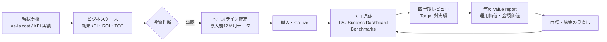
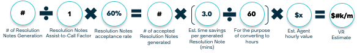
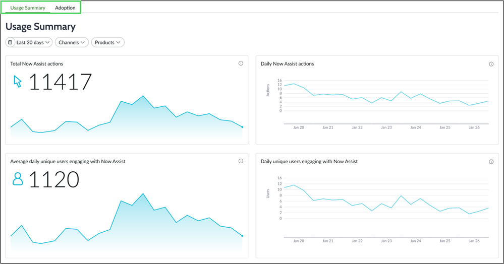
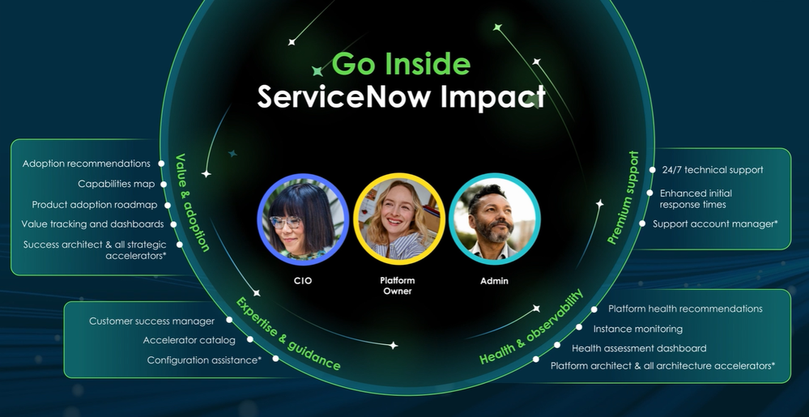
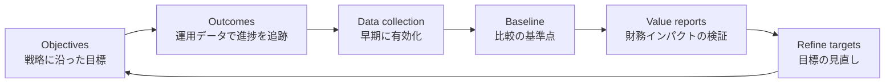

# ビジネスケース作成・ROI 算出・価値実現（Business Case / ROI / Value Realization）

## 概要

本ファイルは、ServiceNow 導入の**投資判断（導入前）**と**価値の証明（導入後）**を一貫した KPI でつなぐための実務ガイドである。ROI に関する記述は本ナレッジの各ファイル（価格、エディション比較、定着化など）に散在しているため、本ファイルでその算定方法と測定の仕組みを一か所にまとめる。

本ファイルが答える問い：

| 問い | 該当章 |
|---|---|
| ビジネスケース（Business case：投資対効果の説明書）には何を書けばよいか | 2 章 |
| 現状コスト（As-Is cost）はどう洗い出すか、チケット単価はどう計算するか | 3 章 |
| どの KPI を効果指標にし、どう金額換算するか | 4 章 |
| ROI・NPV・IRR・TCO・回収期間（Payback period）の計算式と試算例 | 5 章 |
| Forrester TEI や ServiceNow Benchmarks の数値を、どう使い、どこに注意すべきか | 6 章 |
| 導入後のベースライン（Baseline）と KPI 追跡を、ServiceNow 上でどう実装するか | 7 章 |
| ServiceNow Impact の Value management／Value report とは何で、自社の効果測定とどう関係するか | 8 章 |
| 経営層向けの説明資料はどんな構成にすればよいか | 9 章 |

前提とする考え方：**「導入判断に使った KPI」と「導入後に追跡する KPI」と「ServiceNow 上のダッシュボードの KPI」を同じ定義にする**。この一致がないと、導入後に価値を証明できない。ServiceNow Community のビジネスケース解説でも、投資判断で使った KPI をそのままダッシュボードで報告することが推奨されている [出典](https://www.servicenow.com/community/in-other-news/the-business-case-executives-actually-approve/ba-p/3423809)。

価格（ライセンス単価）の推定値は [価格情報](./02-pricing.md)、ライセンス体系は [ライセンスモデル](./01-licensing-model.md) を参照。本ファイルでは価格そのものは扱わず、「コストとしてどう積むか」だけを扱う。

---

## 1. 全体像：投資判断から価値実現までのライフサイクル

ServiceNow の価値管理は「導入前に一度 ROI を計算して終わり」ではなく、目標設定 → ベースライン → 追跡 → 価値報告 → 目標の見直し、という年次ループとして設計する。ServiceNow Impact の Value management も「価値の予測（forecasting）→ 創出 → 継続管理 → 最適化 → 実現価値の検証（validating realized value）」の連続ループとして定義されており、既定のサイクルは**年次（annually）**である [出典](https://www.servicenow.com/docs/r/NYweeRocREicYwhLVBs7lg/juV7mO~jHkpH2sjInuyIUA)。



| フェーズ | 主な成果物 | 主担当 | ServiceNow 上の仕組み |
|---|---|---|---|
| 現状分析 | As-Is コスト表、現行 KPI 実績（12 か月） | PMO、各プロセスオーナー、経理 | （レガシーツールからのデータ抽出） |
| ビジネスケース | 効果 KPI 一覧、3〜5 年 TCO、ROI/NPV/回収期間 | 事業責任者、IT 企画、財務 | なし（Excel 等）。参考値として Benchmarks・TEI |
| ベースライン確定 | KPI 定義書、ベースライン値、目標値 | プロセスオーナー | PA Indicator の定義、Impact の Objectives and Outcomes |
| 追跡 | 月次・四半期ダッシュボード | プロセスオーナー、CoE | Performance Analytics（Indicator/Target/Threshold）、ITSM Success Dashboard、Benchmarks、AI Admin Center Business Value dashboard |
| 価値報告 | 年次 Value report | CoE、財務、（Impact 契約時は Impact Squad） | Impact > Value Management > Value Reports |

---

## 2. ビジネスケースの構成要素

ビジネスケースは「ツールの機能説明」ではなく「投資メモ（investment memo）」として書く。ServiceNow Community の解説は、投資メモとして書く、防御可能なベースラインを置く、一時費用（one-time costs）と運用費（run costs）を分ける、初年度は 70〜80% 程度の実現係数を入れる、財務・HR・IT・内部監査を巻き込む、を推奨している [出典](https://www.servicenow.com/community/in-other-news/the-business-case-executives-actually-approve/ba-p/3423809)。これを裏返すと、機能から入る、ベースラインがない、運用コストを省く、初年度に効果 100% を見込む、IT 部門だけのものとして扱う、が典型的な却下要因になる【経験則】（同記事が却下要因の一覧を示しているわけではない）。

### 2.1 標準構成（推奨目次）

| # | 章 | 書く内容 | 根拠データ |
|---|---|---|---|
| 1 | エグゼクティブサマリー | 投資額、3 年（または 5 年）NPV・ROI・回収期間、主要 3 KPI の改善目標、意思決定事項 | 5 章の計算結果 |
| 2 | 現状と課題 | 現行ツール・プロセスのコスト、品質問題（SLA 違反率、再オープン率等）、リスク（監査指摘、EOL） | 3 章 |
| 3 | 目指す姿とスコープ | 対象プロセス・製品（ITSM、HRSD 等）、対象ユーザー数、段階導入計画 | [要件定義と設計](./06-requirements-design.md) |
| 4 | 効果（Benefits） | Value lever（価値レバー）ごとの KPI、改善幅、金額換算、実現時期 | 4 章 |
| 5 | コスト（Costs） | 初期費用（ライセンス初年度、導入、データ移行、連携、教育）、運用費用（ライセンス更新、プラットフォームチーム、保守） | 5.3 節 |
| 6 | 財務評価 | ROI、NPV、IRR、回収期間、感度分析 | 5 章 |
| 7 | 非財務効果 | 統制強化、監査対応、従業員体験（EX）、顧客体験（CX）、レジリエンス | 4.3 節 |
| 8 | リスクと対策 | 定着しない、カスタマイズ過多、データ品質、要員不足 | [導入失敗パターンと対策](../04_応用編/01-implementation-failure-patterns.md) |
| 9 | 実現計画と測定方法 | 90／180／365 日のチェックポイント、KPI 定義、測定ツール、責任者 | 7 章 |
| 10 | 意思決定事項 | 承認を求める事項（予算、体制、スコープ） | — |

### 2.2 当事者と役割

| 当事者 | ビジネスケースでの役割 |
|---|---|
| 事業責任者（スポンサー） | 効果の「持ち主」。KPI 改善目標にコミットする |
| 財務（経理・経営企画） | 人件費単価、割引率、償却方法など前提の検証・承認 |
| プロセスオーナー（IT／HR／CS 等） | 現状 KPI データの提供、改善幅の妥当性判断 |
| 内部監査 | 統制改善（自動証跡、承認統制）の評価 |
| IT 企画／CoE | コスト見積、技術的実現性、測定の仕組みの設計 |

ServiceNow Community の解説でも、財務が前提を検証し、HR・IT・Operations が成果を共同で持ち、内部監査が統制改善を承認する「クロスファンクショナルなケース」にすることが推奨されている [出典](https://www.servicenow.com/community/in-other-news/the-business-case-executives-actually-approve/ba-p/3423809)。

---

## 3. 現状コスト分析（As-Is Cost Analysis）

### 3.1 現状コストの洗い出し項目

現状コストは「ServiceNow を導入しなかった場合に今後も払い続けるコスト」として洗い出す。これが ROI の分母と分子（削減効果）の両方の基礎になる。

| 区分 | 項目 | 取得元 | 備考 |
|---|---|---|---|
| ツール費 | 既存 ITSM／HR／CS ツールのライセンス・保守費 | 契約書、経理 | 廃止（Decommission）できる時期を明記 |
| ツール費 | 周辺ツール（チャット、ナレッジ、資産台帳、監視ツール） | 契約書 | 統合で廃止可能なもの |
| インフラ費 | オンプレミスのサーバー、DB、バックアップ、DR | IT 運用部門 | SaaS 化で不要になる分 |
| 人件費 | サービスデスク要員（社員・委託） | 人事、委託契約 | 委託は契約単価、社員は Fully loaded rate（後述） |
| 人件費 | 二次・三次対応（エンジニア）の対応工数 | チケット実績 × 平均処理時間 | |
| 人件費 | 手作業（申請の転記、集計、レポート作成） | 業務ヒアリング、タイムスタディ | 自動化の効果算定の基礎 |
| 人件費 | 既存ツールの保守・改修要員 | IT 部門 | |
| 機会損失 | 障害によるダウンタイム（売上・生産性損失） | 障害記録、事業部門 | P1／P2 件数 × 平均影響時間 × 時間当たり損失 |
| 機会損失 | 従業員の待ち時間（申請・問い合わせ） | チケット件数 × 待ち時間 | 金額換算は保守的に（4.2 節） |
| リスク | 監査指摘対応工数、コンプライアンス違反リスク | 内部監査 | 非財務効果として扱うことも多い |
| シャドー IT | 部門独自の SaaS・Excel 管理 | 購買データ、ヒアリング | |

ServiceNow Community の解説では、ベースラインとして「1 件あたり作業時間、手戻り率、待ち時間、問い合わせ件数、シャドー IT 支出、コンプライアンス例外、ツール乱立」を測定することが挙げられている [出典](https://www.servicenow.com/community/in-other-news/the-business-case-executives-actually-approve/ba-p/3423809)。

### 3.2 人件費単価（Fully loaded labor rate）

人件費の金額換算では、給与だけでなく法定福利費・賞与・オフィス費などを含む**総額単価（Fully loaded rate）**を使う。単価は必ず財務部門と合意し、ビジネスケースの前提条件表に明記する。

```
時間単価（Fully loaded hourly rate）
  = （年間給与 + 賞与 + 法定福利費 + 福利厚生 + 間接費配賦）÷ 年間実労働時間
```

【経験則】給与のみの単価で計算すると効果が過小、間接費を過大に配賦すると効果が過大になる。どちらの場合も財務部門のレビューで差し戻されやすいため、社内標準の「部門別時間単価」がある場合はそれを使う。

### 3.3 チケット単価（Cost per ticket）

サービスデスク系のビジネスケースでは、**チケット単価**が最も重要なアンカー指標になる。

```
チケット単価（Cost per ticket）
  = サービスデスクの年間総運営費 ÷ 年間チケット件数

チャネル別単価（例：電話・メール・セルフサービス・自動解決）
  = チャネルに配賦した運営費 ÷ チャネル別件数
```

自己解決（Shift-left）による削減効果は次の形で計算する（HDI の講演資料でも同型の式が使われている [出典](https://www.thinkhdi.com/~/media/HDIFusion/Files/speaker-handouts/Session501.pdf)）【第三者情報】。

```
自己解決による削減額
  = 自己解決へ移行した件数 ×（有人対応のチケット単価 − セルフサービスのチケット単価）
```

【経験則】次の 3 点で効果を割り引く（Haircut）のが一般的である。

| 割引の観点 | 内容 |
|---|---|
| 移行可能件数の上限 | パスワードリセット等の定型案件から先に自動化されるため、パイロットの自己解決率を全件数に掛けると過大になる |
| 帰属（Attribution） | ポータル経由になっただけで解決していない（再問い合わせ）ケースを差し引く。再問い合わせ率・再オープン率とセットで測る |
| 人員削減との対応 | 1 件あたりの削減時間を合計しても、実際の人員・委託費の削減に結びつかないことがある（5.4 節「時間削減の扱い」） |

### 3.4 現状 KPI データの収集期間

ServiceNow Impact の Value report では、導入前後比較の**ヒストリカル・ベースライン（Historical baseline）として、レガシーシステム廃止前の 12 か月分のデータ**を集めることが推奨されている [出典](https://www.servicenow.com/docs/r/OLEAh14mAEPe8fUlW2F9wQ/4O8aElk0TkFj81eRtD9JEA)。季節変動（期末・年度替わり・人事異動期）を含めるためにも、ビジネスケース作成時点から 12 か月分の実績を確保しておく。

| 確保すべきデータ | 理由 |
|---|---|
| 月別のチケット件数（種別・優先度・チャネル別） | 削減効果の基礎 |
| 平均解決時間（MTTR）、SLA 達成率 | 品質 KPI のベースライン |
| 再オープン率、再割り当て率 | 品質・効率 KPI |
| 要員数・委託費の月次推移 | コスト KPI |
| 満足度調査結果 | 体験 KPI |

> 【経験則】旧ツールの廃止後にデータを取り出せなくなる事例が多い。データ移行計画（[データ移行](./08-data-migration.md)）で、移行対象外のクローズ済みチケットについても KPI 算出用の集計データだけは保存しておく。

---

## 4. 効果 KPI と価値レバー（Value levers）

### 4.1 価値レバーの分類

ServiceNow Community の解説では、プラットフォームが生む価値レバーとして「セルフサービスによる問い合わせ削減（deflection）、ストレートスルー処理、引き継ぎの削減、一次正答率（right-first-time）の向上、監査指摘の削減、従業員・顧客満足度の向上」が挙げられ、これを年換算の削減額に変換するよう推奨されている [出典](https://www.servicenow.com/community/in-other-news/the-business-case-executives-actually-approve/ba-p/3423809)。

| 価値の種類 | 価値レバー | 代表 KPI | 金額換算の方法 |
|---|---|---|---|
| コスト削減（Cost reduction） | ツール統合・廃止 | 廃止ツール数、保守費 | 廃止したツールの年間費用（確実性が高い） |
| コスト削減 | 委託費・要員の削減／抑制 | サービスデスク要員数、委託費 | 契約金額の差分 |
| 生産性向上（Productivity） | 自己解決・自動化 | 自己解決率、自動解決率、Call deflection % | 件数 × 単価差（3.3 節） |
| 生産性向上 | 処理時間短縮 | MTTR、平均処理時間、再割り当て率 | 削減時間 × 時間単価 × 実現率 |
| 生産性向上 | エンドユーザーの待ち時間削減 | 申請リードタイム、Average time to fulfill a request | 削減時間 × 時間単価 × 換算係数（保守的に） |
| リスク低減（Risk reduction） | 障害削減・影響時間短縮 | P1 件数、変更失敗率、緊急変更率 | 削減件数 × 1 件あたり損失額 |
| リスク低減 | 統制強化 | 監査指摘件数、証跡収集工数 | 指摘対応工数、または非財務効果 |
| 売上・成長（Revenue） | 新入社員の早期戦力化、顧客対応の迅速化 | オンボーディング期間、CSAT、解約率 | 事業部門と合意した換算式 |

### 4.2 ドメイン別の代表 KPI と Benchmarks KPI の対応

導入後に ServiceNow 上で同じ定義で測れるよう、ビジネスケースの KPI はできるだけ **ServiceNow Benchmarks の KPI 定義**に合わせておくと、他社比較とベースライン管理の両方に使える。下表の「Benchmarks KPI 名」は Australia の Benchmark KPIs ページに掲載されている名称である [出典](https://www.servicenow.com/docs/r/QykF2iRSIs6VXztArCSo3w/p1ZvOh5VvbtHQQQZHy1nyg)。

| ドメイン | 効果 KPI（日本語） | Benchmarks KPI 名（英語・公式） | 定義（Benchmarks） |
|---|---|---|---|
| Incident | 平均解決時間 | Average time to resolve an incident | 解決済みインシデントの合計所要時間 ÷ 解決件数 |
| Incident | 高優先度の平均解決時間 | Average time to resolve a high priority incident | P0/P1 の合計所要時間 ÷ P0/P1 解決件数 |
| Incident | 一次割り当て解決率 | % of incidents resolved on first assignment | Reassignment count = 0 の解決件数 ÷ 月内解決件数 |
| Incident | SLA 内解決率 | % of incidents resolved within SLA | SLA 達成の解決件数 ÷ 月内解決件数 |
| Incident | 再オープン率 | % of reopened incidents | 1 回以上再オープンされた件数 ÷ 月内解決件数 |
| Incident | ユーザー当たり起票数 | Number of incidents created per user | 月内起票数 ÷ ユーザー数 |
| Problem | 問題管理による解決率 | % of incidents resolved by problem | Problem に紐づく解決件数 ÷ 月内解決件数 |
| Change | 変更失敗率 | % of failed changes | 不成功の変更 ÷ 月内クローズ変更 |
| Change | 緊急変更率 | % of emergency changes | 緊急変更 ÷ 月内クローズ変更 |
| Service Catalog | 平均充足時間 | Average time to fulfill a request | 充足済みリクエストの合計所要時間 ÷ 件数 |
| Service Catalog | SLA 違反率 | % of closed requests with breached SLAs | SLA 違反のクローズ件数 ÷ クローズ件数 |
| Knowledge | ナレッジ活用解決率 | % of incidents resolved using KB articles | KB 記事で解決した件数 ÷ 月内解決件数 |
| Virtual Agent | コール削減率 | % call deflection | Virtual Agent 経由の起票 ÷ 全起票 |
| Virtual Agent | 自動解決率 | % of incidents auto-resolved | Virtual Agent／Issue Auto Resolution による自動解決 ÷ 全解決 |
| 体験 | 平均顧客満足度 | Average customer satisfaction | 正規化した調査スコア合計 ÷ 調査件数（標準の Customer Satisfaction Survey を使用） |
| CMDB | 重複 CI 率／陳腐化 CI 率 | % of duplicate CIs ／ % of stale CIs | 重複（陳腐化）CI ÷ 全 CI |
| SecOps | 脆弱性の平均修復時間 | VI mean time to remediate (MTTR) | クローズ済み脆弱性項目の合計所要時間 ÷ 件数（30 日移動平均） |
| SecOps | 修復効率 | % of remediation efficiency | 月内クローズ件数 ÷ 月内新規・再オープン件数 |

ITSM Success Dashboard 系の KPI（Benchmarks ページの「Success Dashboard」カテゴリ）には、経営層向けに使いやすい合成 KPI が定義されている [出典](https://www.servicenow.com/docs/r/QykF2iRSIs6VXztArCSo3w/p1ZvOh5VvbtHQQQZHy1nyg)。

| KPI 名（公式） | 定義（公式の式を要約） |
|---|---|
| Self-solved % | (VA 自己解決 + KB 自己解決 + 自動解決) ÷ (全チケット解決 + VA 自己解決 + KB 自己解決) × 100 |
| Call deflection % | (カタログ申請 + VA 申請 + VA 自己解決 + KB 自己解決) ÷ (全起票 + VA 自己解決 + KB 自己解決) × 100 |
| Structured tickets % | 構造化チケット（カタログ等）の完了数 ÷ 全チケット解決数 × 100 |
| MTTR | 解決時間 ÷ 解決件数 ÷ 24（日単位） |
| Breached SLA % | SLA 違反で解決した件数 ÷ 解決件数 × 100 |
| First assignment resolution | 再割り当てなしで解決した件数 ÷ 解決件数 × 100 |

ITSM 以外（HRSD、CSM、SPM 等）の KPI 詳細は各リファレンス（[HR Service Delivery](../02_リファレンス/employee/hr-service-delivery.md)、[Customer Service Management](../02_リファレンス/customer/customer-service-management.md)、[Strategic Portfolio Management](../02_リファレンス/spm/strategic-portfolio-management.md)）を参照。SPM の Benchmarks KPI は別ドキュメント「SPM Benchmarking KPIs」に分かれている [出典](https://www.servicenow.com/docs/r/QykF2iRSIs6VXztArCSo3w/p1ZvOh5VvbtHQQQZHy1nyg)。

### 4.3 非財務効果の扱い

金額換算できない（または換算すると恣意的になる）効果は、無理に ROI に入れず「非財務効果」として別掲する。

| 非財務効果 | 測定指標の例 |
|---|---|
| 統制・コンプライアンス | 監査指摘件数、承認統制の自動化率、証跡の自動収集率 |
| 従業員体験（EX） | 申請満足度、eNPS、ポータル利用率 |
| 顧客体験（CX） | CSAT、NPS、初回解決率 |
| レジリエンス | 障害の平均影響時間、変更起因障害率 |
| 可視性 | CMDB の健全性（Completeness／Correctness／Compliance）、サービス単位のコスト可視化 |
| 将来の選択肢（Flexibility） | 同一プラットフォームで他領域に展開できること（Forrester TEI の Flexibility に相当） |

### 4.4 AI（Now Assist／AI Agents）の効果 KPI

Now Assist の効果は「時間削減 × 単価」で語られることが多いが、プロセス全体で見ると小さく見える効果を見落としやすい。ServiceNow Community（CEG AI CoE）の記事は、解決メモ生成（Resolution note）の例で「工程（Close フェーズ 54 分）に対する 3 分短縮は 5.6% だが、MTTR 360 分に対しては 1% 未満」と示し、**工程単位で測る**こと、計算式の変数をすべて開示して関係者が前提を調整できるようにすること、売上等の経営指標に結びつけることを推奨している [出典](https://www.servicenow.com/community/ceg-ai-coe-articles/ai-value-a-guide-to-avoid-overlooking-value-achieved/ta-p/3475323)。



*図1：Now Assist の解決メモ生成（Resolution note generation）の価値算定式の例。*
画面ではなく計算式の図解である。左から「解決メモ生成件数（# of Resolution Notes Generation）」÷「Assist 換算係数（Resolution Notes Assist-to-Call Factor, 例 1）」×「採用率（Resolution Notes acceptance rate, 例 60%）」＝「採用された解決メモ件数」、これに「1 件あたり推定削減時間（3.0 分）」÷ 60（時間換算）×「推定エージェント時間単価（$x）」を掛けて「VR Estimate（価値実現の推定額）」を求める流れが示されている。
出典：https://www.servicenow.com/community/ceg-ai-coe-articles/ai-value-a-guide-to-avoid-overlooking-value-achieved/ta-p/3475323 （取得日：2026-11-02）

同記事はあくまで**総価値（gross value）**の算定であり、ライセンスや Assist 消費のコストを差し引いた ROI ではない点がコメント欄でも指摘されている [出典](https://www.servicenow.com/community/ceg-ai-coe-articles/ai-value-a-guide-to-avoid-overlooking-value-achieved/ta-p/3475323)。AI の ROI ではコスト側に Assist 消費量（[価格情報](./02-pricing.md)）を必ず入れる。AI 導入の知見は [Now Assist / AI Agents 導入の知見](../04_応用編/10-ai-adoption-lessons.md) を参照。

---

## 5. 財務指標の算定式と試算

### 5.1 算定式一覧

| 指標 | 英語 | 算定式 | 解釈 |
|---|---|---|---|
| ROI（投資利益率） | Return on Investment | (効果の現在価値 − コストの現在価値) ÷ コストの現在価値 × 100% | Forrester TEI もこの定義（純便益 ÷ コスト） [出典](https://tei.forrester.com/go/forrester/tei) |
| NPV（正味現在価値） | Net Present Value | Σ（t 年目の効果 − t 年目のコスト）÷ (1 + r)^t | 正なら投資価値あり。r は割引率 |
| IRR（内部収益率） | Internal Rate of Return | NPV = 0 となる割引率 r | 社内のハードルレート（資本コスト）と比較 |
| 回収期間 | Payback period | 累積の純便益が初期投資と等しくなるまでの期間 | Forrester TEI は「累積純便益が初期投資に等しくなる時点」と定義 [出典](https://tei.forrester.com/go/forrester/tei) |
| TCO（総所有コスト） | Total Cost of Ownership | 初期費用 + 分析期間中の運用費用の合計（現在価値化してもよい） | 現行維持案との比較で使う |
| 年間純便益 | Annual net benefit | 年間効果 − 年間コスト | 単年度の P/L 説明用 |

割引率（Discount rate）について、Forrester は一般的に 8〜16% が使われるとしており、TEI の多くの事例では 10% が使われている [出典](https://tei.forrester.com/go/forrester/tei)、[出典](https://tei.forrester.com/go/servicenow/HRserviceDelivery?lang=en-us)。自社の値は財務部門の定める資本コスト（WACC）またはハードルレートを使う。

### 5.2 分析期間と効果の立ち上がり（Ramp-up）

| 項目 | 推奨 | 根拠 |
|---|---|---|
| 分析期間 | 3 年（ServiceNow のサブスクリプション契約期間に合わせる）。大規模・多領域展開なら 5 年 | Forrester の ServiceNow TEI はいずれも 3 年で評価 [出典](https://tei.forrester.com/go/servicenow/HRserviceDelivery?lang=en-us) |
| 初年度の効果実現率 | 70〜80% 程度に抑える（Go-live 時期によってはさらに低く） | ServiceNow Community の解説が「初年度 70〜80% の実現」を現実的係数として例示 [出典](https://www.servicenow.com/community/in-other-news/the-business-case-executives-actually-approve/ba-p/3423809) |
| 効果の開始時期 | Go-live 月以降。旧ツールを払い続ける並行稼働期間は「ツール廃止効果ゼロ」で表す（旧ツール費をコストに足さない。5.6 節） | 【経験則】 |
| ツール廃止効果 | 旧ツールの契約満了・解約可能日以降 | 【経験則】早期解約不可の契約が多い |

### 5.3 コスト項目（TCO の内訳）

| 区分 | 項目 | 計上の注意 |
|---|---|---|
| 初期 | ServiceNow サブスクリプション（初年度） | 導入期間中も課金される（Go-live 前から払う）点に注意 |
| 初期 | 導入パートナー費用（要件定義〜Go-live） | [導入方法論](./04-implementation-methodology.md)、[プロジェクト体制とパートナー](./05-project-organization.md) |
| 初期 | データ移行・クレンジング | [データ移行](./08-data-migration.md) |
| 初期 | 連携開発（IntegrationHub スポーク等の追加ライセンス含む） | [連携設計](./09-integration-design.md) |
| 初期 | テスト（ATF 整備含む）、教育、OCM（組織変革） | [テストと本番稼働](./11-testing-golive.md)、[定着化と組織変革](../04_応用編/13-adoption-change-management.md) |
| 初期 | 社内プロジェクト要員の人件費 | 見落とされやすい。工数 × 単価で計上 |
| 初期 | 旧ツールとの並行稼働に伴う**追加**費用 | 差分法では、旧ツール費の継続は現状維持と同じなので「ツール廃止効果ゼロ」で表し、コストには入れない。コストに積むのは旧契約の短期延長に伴う割増、二重運用の追加要員など、現状維持では発生しない追加分だけ（5.6 節） |
| 運用 | サブスクリプション更新（2 年目以降） | 更新時の値上げ（uplift）を見込む。[価格情報](./02-pricing.md) |
| 運用 | プラットフォームチーム（管理者・開発者・CoE） | [運用とガバナンス](./12-operations-governance.md) |
| 運用 | 年 2 回のアップグレード対応 | [アップグレード管理](./13-upgrade-management.md) |
| 運用 | 継続的改善（エンハンス）・保守委託 | |
| 運用 | 成功支援（ServiceNow Impact 等）の費用 | [サポートと監視](./14-support-monitoring.md) |
| 運用 | AI の Assist 消費の追加購入 | 消費量の見込み違いが起きやすい |

Forrester の HR Service Delivery TEI（2024 年 2 月）では、3 年間のコスト現在価値 602 万ドルの内訳が「ライセンス 373 万ドル、ユーザーテストと教育 90 万ドル、導入 80 万ドル、保守 58 万ドル」となっており、ライセンスがコストの約 6 割を占める構成例として参考になる [出典](https://tei.forrester.com/go/servicenow/HRserviceDelivery?lang=en-us)【第三者情報】（ServiceNow が委託した調査）。

### 5.4 時間削減の扱い（Hard savings と Soft savings）

| 区分 | 定義 | 例 | ビジネスケースでの扱い |
|---|---|---|---|
| Hard savings（確定的削減） | 予算・支出が実際に減る | ツール廃止、委託費削減、増員回避（採用計画の取り消し） | ROI の主計算に入れる |
| Soft savings（生産性向上） | 時間は空くが支出は減らない | 1 件あたり 5 分短縮、待ち時間削減 | 換算係数（例：50%）を掛けて入れる、または別掲する |
| Cost avoidance（コスト回避） | 将来発生するはずのコストを回避 | 件数増加に対し要員を増やさずに済む | 前提（件数の伸び率）を明記して入れる |

【経験則】財務部門は Soft savings を「キャッシュが出ない」として割り引く傾向が強い。Soft savings を主たる根拠にする場合は、「空いた時間を何に再配置するか（例：問題管理・改善活動）」と、その成果指標をセットで示す。

### 5.5 リスク調整（Risk adjustment）

Forrester TEI では、各見積に不確実性を反映するため効果を減額・コストを増額するリスク調整を行い、ROI・NPV・回収期間はリスク調整後の値で示す。例えば Forrester 自身の製品を対象にした TEI 事例では、効果を項目別に 10〜15% 減額し、コストを 10% 増額している（調整率は調査・項目ごとに異なり、TEI 方法論の標準値ではない） [出典](https://tei.forrester.com/go/forrester/tei)。自社のビジネスケースでも同様に、楽観・標準・悲観の 3 シナリオと感度分析を付ける。

| シナリオ | 効果 | コスト | 用途 |
|---|---|---|---|
| 悲観（Conservative） | 標準 × 70〜80% | 標準 × 110〜120% | 承認判断の下限確認 |
| 標準（Expected） | 根拠データに基づく値 | 見積値 | 主たる提示値 |
| 楽観（Optimistic） | 標準 × 110〜120% | 標準 | 上振れ余地の説明 |

感度分析では、「ROI が 0 になる効果実現率」「回収期間が 3 年を超える Go-live 遅延月数」のような**損益分岐の条件**を示すと、経営層の判断材料になる。

### 5.6 試算例（3 年、ITSM、仮定値）

以下はすべて**説明用の仮定値**であり、実際の価格・効果を示すものではない（ライセンス単価の推定は [価格情報](./02-pricing.md) を参照）。

**差分法（Incremental）の原則**：効果・コストはすべて「現状維持案（ServiceNow を導入しない場合）」との差分で積む。旧ツール費を払い続ける期間は、現状維持と同じ状態なので**ツール廃止効果ゼロ**で表し、旧ツール費をコストには入れない（入れると二重計上になる）。コストに積むのは、旧契約の延長割増や二重運用の追加要員など、現状維持では発生しない追加分だけである。

**前提**

| 前提項目 | 仮定値 |
|---|---|
| 年間インシデント＋リクエスト件数 | 120,000 件 |
| 有人対応のチケット単価 | 3,000 円 |
| セルフサービス／自動解決のチケット単価 | 500 円 |
| 自己解決への移行率 | 1 年目 10%、2 年目 20%、3 年目 25% |
| 旧ツール保守・インフラ費（廃止可能） | 年 2,000 万円（2 年目から廃止。1 年目は並行稼働で効果ゼロ。並行稼働に伴う追加費用はないものとする） |
| サブスクリプション | 契約開始は 0 年目（導入期間中から課金）。3 年契約で年 4,000 万円固定、3 年目の更新時に 10% 値上げ |
| エンジニアの処理時間削減 | 年 6,000 時間 × 時間単価 5,000 円 × 換算係数 50% |
| 割引率 | 10% |

**キャッシュフロー（単位：万円）**

| 項目 | 0 年目（導入） | 1 年目 | 2 年目 | 3 年目 |
|---|---|---|---|---|
| 効果：自己解決 | 0 | 3,000 | 6,000 | 7,500 |
| 効果：ツール廃止 | 0 | 0 | 2,000 | 2,000 |
| 効果：処理時間削減（50% 換算） | 0 | 1,050（70% 実現） | 1,500 | 1,500 |
| **効果合計** | 0 | 4,050 | 9,500 | 11,000 |
| コスト：導入（パートナー・移行・連携） | 8,000 | 0 | 0 | 0 |
| コスト：サブスクリプション | 4,000 | 4,000 | 4,000 | 4,400 |
| コスト：運用（プラットフォームチーム等） | 1,000 | 2,000 | 2,000 | 2,000 |
| **コスト合計** | 13,000 | 6,000 | 6,000 | 6,400 |
| **純便益** | −13,000 | −1,950 | 3,500 | 4,600 |
| 累積純便益 | −13,000 | −14,950 | −11,450 | −6,850 |

1 年目の自己解決効果 = 120,000 件 × 10% × (3,000 − 500) 円 = 3,000 万円。

**計算結果**

| 指標 | 計算 | 結果 |
|---|---|---|
| 効果の現在価値 | 4,050/1.1 + 9,500/1.1² + 11,000/1.1³ | 約 19,800 万円 |
| コストの現在価値 | 13,000 + 6,000/1.1 + 6,000/1.1² + 6,400/1.1³ | 約 28,200 万円 |
| NPV | 19,800 − 28,200 | 約 −8,400 万円 |
| ROI | −8,400 ÷ 28,200 | 約 −30% |
| 回収期間 | 累積純便益が 3 年目末でも −6,850 万円 | 3 年以内に回収せず |
| IRR | 割引率 0% でも NPV が負（−6,850 万円） | 負（3 年の評価期間ではハードルレートを大きく下回る） |

この試算では 3 年間で投資回収できない。ここから分かる実務上のポイントは次のとおり。

- ITSM 単独・3 年では、**導入期間中から課金されるサブスクリプション（効果ゼロの 0 年目に 4,000 万円）と、旧ツール廃止効果の遅れ（1 年目は効果ゼロ）**が ROI を大きく押し下げる。
- 回収を早めるには、(1) 旧ツールの早期解約、(2) 導入期間の短縮（Go-live の前倒し）、(3) 契約開始日を Go-live に近づける交渉、(4) 同一プラットフォーム上での他領域展開（HR、CSM 等）による効果の積み増し、が必要になる。また (5) 評価期間を 5 年に延ばすと、回収が早まるわけではないが、回収時点を評価期間内に収められる。
- 公表されている TEI の ROI（6 章）が 200% 前後と高いのは、複数製品の効果、大規模組織、ベンダー委託調査であることが影響している可能性がある【推定】。自社試算が TEI より大幅に低くても、それ自体は異常ではない。

---

## 6. 公表データの使い方と注意点

### 6.1 Forrester Total Economic Impact（TEI）

**TEI の方法論**：Forrester の TEI は、効果（Benefits）、コスト（Costs）、柔軟性（Flexibility：将来の追加投資が生む戦略的価値）、リスク（Risks）の 4 要素で投資を評価する。複数顧客へのインタビューを統合した**合成組織（Composite organization）**をモデル化し、効果は減額・コストは増額するリスク調整を行い、割引率で現在価値化した ROI・NPV・回収期間を示す [出典](https://tei.forrester.com/go/forrester/tei)。

**ServiceNow 製品の主な TEI（公開情報で確認できたもの）**【第三者情報】（すべて ServiceNow が Forrester Consulting に委託した調査）

| 対象 | 公表時期 | ROI | NPV | 回収期間 | 効果 PV／コスト PV | 出典 |
|---|---|---|---|---|---|---|
| ITSM・ITOM・Performance Analytics | 2017 年 4 月 | 195% | 1,140 万ドル | 9 か月 | 1,730 万ドル／590 万ドル | [itchronicles](https://itchronicles.com/?p=185219) |
| IT Business Management（現 SPM） | 2018 年 10 月 | 397% | 1,330 万ドル | 6 か月未満 | 1,670 万ドル／— | [intelligentcio PDF](https://intelligentcio.com/wp-content/uploads/sites/12/2021/09/The-Total-Economic-Impact-Of-ServiceNow-IT-Business-Management-WP.pdf) |
| IT Applications（ITSM・ITOM・ITAM・ITBM） | 2019 年 6 月 | 229% | 1,580 万ドル | 7 か月 | 2,270 万ドル／690 万ドル | [intelligentcio PDF](https://intelligentcio.com/wp-content/uploads/sites/12/2020/05/Forrester-Total-Economic-Impact-for-ITSM-ITOM-ITAM-and-ITBM-Research-Report.pdf) |
| Customer Service Management | 2020 年 11 月 | 170%（destinationCRM の資料紹介ページの記載。ServiceNow 公式ページは本調査で取得できず） | 公開情報では確認できず | 公開情報では確認できず | — | [destinationcrm（ROI 170%）](https://www.destinationcrm.com/BestPractices/12431-Forrester-TEI-of-ServiceNow-Customer-Service-Management-.htm)、[destinationcrm（2020 年 11 月、FCR 最大 20% 改善・電話起票 40% 減・更新による収益維持 520 万ドル）](https://www.destinationcrm.com/ReportsandResearch/11784-Forrester-Study-The-Total-Economic-Impact-of-ServiceNow-Customer-Service-Management.htm) |
| HR Service Delivery | 2024 年 2 月 | 259% | 1,560 万ドル | 6 か月未満 | 2,162 万ドル／602 万ドル | [Forrester](https://tei.forrester.com/go/servicenow/HRserviceDelivery?lang=en-us) |

2017 年の ITSM 系 TEI では、7 社へのインタビューに基づき、IT 要員の生産性向上（作業キャパシティ 20% 増）、P1 等の高優先度インシデントの 25% 削減、1 リクエストあたり約 15 分の短縮などが効果として挙げられている [出典](https://itchronicles.com/?p=185219)。HR Service Delivery の TEI（2024）の合成組織は「従業員 35,000 人、売上 100 億ドル、HR 要員 250 人のグローバル B2C 企業」で、最大の効果は「新入社員の早期戦力化（930 万ドル）」と「HR ワークフロー効率化による HR 時間削減（808 万ドル）」である [出典](https://tei.forrester.com/go/servicenow/HRserviceDelivery?lang=en-us)。

Field Service Management、Strategic Portfolio Management 等の TEI も存在するが、ServiceNow のランディングページはフォーム登録制であり、本調査では数値を確認できなかった（公開情報では確認できず）。2025〜2026 年に公表された ITSM の新しい TEI も本調査では確認できなかった。

**TEI を使うときの注意点**

| 注意点 | 内容 | 対処 |
|---|---|---|
| ベンダー委託調査 | すべて ServiceNow が委託。Forrester は TEI の Disclosures 節で「Forrester makes no assumptions as to the potential ROI that other organizations will receive」と明記している（HRSD TEI の例） [出典](https://tei.forrester.com/go/servicenow/HRserviceDelivery?lang=en-us) | 「参考値」と明記し、自社試算の代替にしない |
| 合成組織 | 実在企業ではなく、数社のインタビューを合成したモデル | 合成組織の規模（従業員数、売上、件数）を自社と比較して示す |
| 調査時期が古い | ITSM 系は 2017〜2019 年。価格・製品体系（2026 年 4 月の Foundation/Advanced/Prime 移行等）が現在と異なる | 時期を明記。コスト構造は自社見積で置き換える |
| 母数が小さい | インタビュー 6〜8 社程度 | 業種・規模の近い事例を個別に探す |
| 効果の帰属 | プロセス改革・組織変更の効果もツール効果に含まれやすい | 自社ケースでは施策ごとに効果を分けて記載 |
| 競合も TEI を出している | 競合 ITSM 製品にも同種の TEI がある。例：Atlassian Jira Service Management（2024 年 12 月、Atlassian 委託） [出典](https://tei.forrester.com/go/atlassian/AtlassianJSM)、SymphonyAI ITSM（2024 年 12 月、SymphonyAI 委託、ROI 204%） [出典](https://tei.forrester.com/go/SymphonyAI/itsm)【第三者情報】 | 「TEI の ROI 比較」で製品選定しない。[競合比較](./16-competitor-comparison.md) |

**推奨する使い方**：TEI は「効果の種類（価値レバー）の洗い出しチェックリスト」と「効果の大きさの桁感の確認」に使い、ROI の数値そのものを自社のビジネスケースに転記しない【経験則】。

### 6.2 ServiceNow Benchmarks

**Benchmarks（ベンチマーク）**は、オプトインした ServiceNow 顧客の KPI を匿名集計し、自社の KPI を業種・規模・地域別のピア（Peer）と比較できる ServiceNow の機能である。仕様は次のとおり [出典](https://www.servicenow.com/docs/r/it-service-management/benchmarks/exploring-benchmarks.html)。

| 項目 | 仕様 |
|---|---|
| 利用条件 | **本番インスタンス**からのオプトインが必要 |
| 対象外 | Express 顧客、Federal（米国連邦政府）顧客、オンプレミス顧客 |
| 参加数 | 2,850 社以上がオプトイン（ドキュメント記載時点） |
| データ収集 | Performance Analytics が顧客インスタンス上で**日次**収集 → 毎月初にスケジュールジョブで前月分をアップロード（エラー時は複数回リトライ）→ 月半ばに集計結果（自社値、グローバル値、ランキング）と改善推奨候補がダウンロードされる |
| 必要なユーザー | Benchmarks とともに追加される `bm.scheduler`（Benchmark Scheduler user）。データ収集に必要 |
| 通知 | グローバルデータが利用可能になるとメール通知 |
| 設定変更の反映 | KPI 設定を月中に変更すると、月次値に反映されるまで 1〜2 か月分のデータ収集が必要 |
| 比較軸 | Global（匿名）、Industry（会社レコードの標準産業コード）、User size（アクティブユーザー数）、同業種かつ同規模、Geographic region（`core_company` の Region フィールド） |
| 匿名性の保護 | 参加 20 社未満のグループは「Other」として表示。UI では一度に 1 つのフィルターのみ適用可能 |
| 表示 | Service Portal 上の Benchmarks dashboard（モバイル対応）、「Compare with」ドロップダウン、PDF の KPI レポート、パーセンタイル順位、過去 6 か月のトレンド、月次の改善推奨（Guided setup 付き） |
| アクセス制御 | 製品カテゴリ別のロールでデータアクセスを制限（具体的なロール名は本調査では確認できず） |
| MSP | MSP データは一般ベンチマークから除外。MSP は MSP 集計データに専用アクセス可能 |

**ビジネスケースでの使い方**

| 用途 | 使い方 | 注意点 |
|---|---|---|
| 導入前（新規導入） | 公表情報としての Benchmarks 値は少ない。Benchmarks は**オプトインした自社インスタンスで閲覧する**仕組みのため、未導入企業は自社データでピア比較できない | 導入前の比較値は、パートナーや ServiceNow 営業から提示される集計値を参考にする（出典・時期を確認） |
| 導入済み（追加投資・リプレース後の改善） | 自社値がピアの何パーセンタイルかを示し、「上位 25% 水準まで改善」等の目標を設定 | KPI の定義（例：P0/P1 の扱い、Reassignment count）が自社運用と合っているか確認 |
| 導入後の価値実現 | ベースラインからの改善を、ピア比較と合わせて年次報告 | 自社の KPI 条件をカスタマイズするとピアとの比較可能性が下がる |

> 【経験則】Benchmarks の KPI は ServiceNow の標準データモデル（例：標準の Customer Satisfaction Survey、`reassignment_count`）に依存する。カスタマイズで標準フィールドを使わなくなると値が正しく出ないため、Benchmarks を価値測定に使う前提なら、要件定義の段階で標準フィールドの利用を設計方針にしておく（[要件定義と設計](./06-requirements-design.md)）。

### 6.3 その他の公表数値

| 情報源 | 使い方 | 注意点 |
|---|---|---|
| ServiceNow 公式の顧客事例（Customer stories） | 同業種・同規模の定量効果を探す | 成功事例のみが公開される（選択バイアス） |
| パートナーの導入事例・ROI 記事 | 日本企業の事例、日本の人件費水準での効果 | 【第三者情報】。自社サービス販促目的のものが多い |
| 業界団体（HDI 等）のチケット単価調査 | チケット単価の桁感 | 調査地域・年・通貨が異なる。自社データで置き換える |
| ServiceNow 営業の Value assessment | ServiceNow／パートナーが価値試算を作成する場合がある | 前提条件を必ず開示してもらい、自社データで検証する |

---

## 7. 導入後の価値実現の測定

### 7.1 ベースライン設定

ベースライン（Baseline）は「改善前の基準値」であり、価値実現の証明はベースラインの品質で決まる。ServiceNow Impact の Value report の考え方では、次の 2 種類のベースラインを使い分ける [出典](https://www.servicenow.com/docs/r/xanadu/impact/value-library/business-value-reports.html)、[出典](https://www.servicenow.com/docs/r/OLEAh14mAEPe8fUlW2F9wQ/4O8aElk0TkFj81eRtD9JEA)。

| ベースライン種別 | 頻度 | 目的 | データ |
|---|---|---|---|
| Current state baseline（現状ベースライン） | 年次 | 現在値と目標値（例：ケース数 10% 削減）を設定し、1 年後に確認 | 直近の ServiceNow 実績 |
| Historical baseline（過去ベースライン） | 年次 | 「ServiceNow に移行しなかった場合」と実現価値を比較 | 理想は旧システム廃止前 12 か月のレガシーデータ。導入前後比較でない場合は「少なくとも 1 年前に終わる 12 か月」 |

Impact の価値算定では、2 種類の価値を区別する [出典](https://www.servicenow.com/docs/r/NYweeRocREicYwhLVBs7lg/juV7mO~jHkpH2sjInuyIUA)、[出典](https://www.servicenow.com/docs/r/xanadu/impact/value-library/business-value-reports.html)。

| 価値の種類 | 英語 | 定義 | 比較対象 |
|---|---|---|---|
| 増分価値 | Incremental value | ServiceNow 導入後、その年に実現した改善の価値 | Value blueprint（現 Objectives and Outcomes）で設定した改善目標 |
| 全体価値 | Overall value | その年に ServiceNow プラットフォームが組織にもたらした総価値 | 導入前の状態（導入前データまたは過去の ServiceNow データが必要） |

**ベースライン設定の実務ルール**【経験則】

| ルール | 理由 |
|---|---|
| KPI 定義（分子・分母・除外条件・期間）を文書化し、ベースライン算出時と同じ定義で導入後も測る | 定義が変わると比較不能 |
| ベースライン値は**凍結**し、承認者・承認日を記録する | 後から「ベースラインが違う」と言われないため |
| 旧ツールと ServiceNow で定義が異なる KPI は、換算ルールを明記するか、ServiceNow 稼働後 3 か月の実績を新ベースラインにする | 例：旧ツールに「再割り当て回数」がない |
| 外部要因（組織変更、件数の季節変動、M&A）を記録する | 効果の帰属説明のため |
| データ収集は**早く開始する** | Impact の解説でも、メトリクスは追跡を有効化した時点からしか収集されないため早期の有効化を推奨 [出典](https://www.servicenow.com/community/servicenow-impact-articles/managing-your-value-journey-with-servicenow-impact/ta-p/3396535) |

### 7.2 Performance Analytics での KPI 追跡

ServiceNow 上の KPI 追跡は **Performance Analytics（PA）**で実装するのが基本である。PA の機能詳細は [レポートとアナリティクス](../02_リファレンス/platform/reporting-analytics.md) を参照し、ここでは価値実現に必要な要素だけを示す。

| PA の要素 | 価値実現での用途 |
|---|---|
| Indicator（指標） | ビジネスケースの KPI を 1 対 1 で定義（例：Average time to resolve an incident） |
| Breakdown（内訳） | 部門・サービス・チャネル・優先度別の効果を分解（どこで効果が出たか） |
| Data collection job（データ収集ジョブ） | 日次でスコアを蓄積。過去データは Historic data collection で遡及収集 |
| Target（目標） | ビジネスケースの改善目標を設定し、達成状況（Met／Not met）を判定 |
| Threshold（しきい値） | 許容範囲を外れたときにアラート |
| Dashboard／Analytics Hub／KPI Details | 経営層・プロセスオーナー向けの可視化 |

**Target（目標）の仕様**（KPI Details 上で設定） [出典](https://www.servicenow.com/docs/r/J7UfGStUvhlVOcoqiM3zlQ/Nhak6c7oZf1V6yfbNEMqWQ)

| 項目 | 内容 |
|---|---|
| 種別 | Personal（作成者のみ表示、薄い線、KPI Details のみ）／Global（全員に表示、濃い線、時系列・シングルスコアの可視化にも表示、Proactive analytics の Insight カードでアラート可能） |
| Value | 目標スコア。絶対値のほか、**ベースラインからの改善**として設定することもできる |
| Start date | 目標の適用開始日。次の目標が設定されるまで有効 |
| Review date | 目標の評価日。評価後のステータスは Met（達成）または Not met（未達） |
| Breakdown／Element | 特定の内訳要素に目標を設定可能。複数要素を選んで同じ目標を一括設定可能 |
| Aggregate | 特定の時系列集計（例：月次平均）に目標を設定可能 |
| 責任者 | Indicator／Breakdown の組み合わせ（KPI）ごとに目標の責任者を設定でき、責任者は自分の KPI の目標を変更できる |

**Threshold（しきい値）の仕様** [出典](https://www.servicenow.com/docs/r/ja-JP/now-intelligence/performance-analytics/pa-threshold.html)

| 項目 | 内容 |
|---|---|
| 条件 | スコアが過去最高に達したとき、特定値を下回ったとき等 |
| 適用範囲 | Breakdown／Element（第 2 Breakdown まで。それ以上は Data snapshots が必要）、時系列集計 |
| 種別と表示 | Personal は Analytics Hub と KPI Details のみ。Global はそれに加え、時系列ウィジェット、Responsive dashboard、Platform Analytics dashboard、Proactive analytics の Insight カード、UI Builder の時系列可視化に表示 |
| ロール | 自分の Personal threshold は任意のロールで作成可。Global threshold や他人の Personal threshold の操作は `pa_threshold_admin`（または `pa_power_user`、`pa_admin`、`admin`）が必要 |
| 通知 | しきい値到達時にメール。Global は Users 関連リストで受信者を設定。「Check PA Thresholds」ジョブが「PA threshold reached」スクリプトアクションで Indicator にコメントを追加。全しきい値到達の一覧メール「PA Thresholds Notification」も送信可能 |

> 本調査では、PA Target を格納するテーブル名と、Target 管理専用ロール名を公式ドキュメント上で確認できなかった（公開情報では確認できず）。

**価値実現ダッシュボードの推奨構成**【経験則】

| 層 | 読者 | 表示する内容 |
|---|---|---|
| 経営サマリー | 経営層、スポンサー | 主要 3〜5 KPI のベースライン対実績、目標達成状況、金額換算の累計効果 |
| プロセス KPI | プロセスオーナー | Indicator ごとのトレンド、Breakdown 別内訳、Target／Threshold |
| 利用・定着 | CoE、OCM 担当 | ポータル利用率、Virtual Agent 利用率、ナレッジ閲覧数、AI のアクション数 |
| データ品質 | プラットフォームチーム | 計測の前提となるデータ品質（必須項目の入力率、CMDB 健全性） |

### 7.3 ITSM Success Dashboard

**ITSM Success Dashboard** は ServiceNow Store で提供されるアプリで、プロセスオーナーや事業リーダーが成功指標と Benchmarks 比較を一か所で見るためのダッシュボードである。最新版は 9.1.5（2026 年 9 月）[出典](https://www.servicenow.com/docs/r/store-release-notes/store-rn-itsm-success-dashboard.html)。

| 機能 | 内容 |
|---|---|
| Success Dashboard | Performance overview、Service quality タブ。ダッシュボードレベルのフィルター、サービスグループ（BU）別フィルター |
| Admin Console | 導入時の設定、Indicator 設定の支援（4.1.3 で追加） |
| Cost Savings | Virtual Agent、Knowledge、Service Catalog による**削減額の推定**（4.1.3 で追加） |
| コンテキストサイドパネル | More Information（式・データソース・定義）、Insights（コホート比較）、Cost Savings の内訳 |
| Improvement opportunities | Automation Discovery による自動化機会（自己解決率・Call deflection 率） |
| Process Mining テンプレート | プロセス改善の提案（Process Mining が必要） |
| Benchmarks 連携 | Benchmark scorecard（オプトイン後に表示）、「View in benchmark」リンク |
| 主要 KPI | Productivity Moments（検索・ルーティング・充足の生産性）、Now Assist のインシデント要約・解決メモ生成、% Reopened tickets、Structured tickets percentage、% First assignment resolution、Now Assist VA による自己解決 |
| 通貨設定 | コスト系 KPI の通貨はプロパティ `sn_sd.success_dashboard_currency` で設定 |

> 【経験則】Cost Savings の推定は ServiceNow 側の既定前提（チケット単価等）に依存する。経営層に示す前に、前提値を自社のチケット単価（3.3 節）に置き換えたか確認する。前提値の設定箇所は本調査では確認できなかった。

### 7.4 AI の価値測定：AI Admin Center Business Value dashboard と Now Assist Analytics

Now Assist／AI Agents の効果は、専用のダッシュボードで「実行回数 × 1 回あたり削減時間 × 時間単価」として可視化できる。

**AI Admin Center Business Value dashboard** [出典](https://www.servicenow.com/docs/r/SRy58xeijUUqttfwLgfrHQ/FiADUIz3zFaIC2mght3UhA)

| 項目 | 内容 |
|---|---|
| 主要指標 | Total executions（AI 資産の実行回数）、Total time saved（累計削減時間）、Total cost saved（設定した時間単価に基づく削減額） |
| 対象 | Skill、AI Agent、Agentic workflow |
| グラフ | 時間削減・コスト削減・実行回数それぞれの月次トレンド（資産種別別）と、資産別の棒グラフ |
| 期間 | ページ上部の Date フィルターで全指標の期間を設定 |
| Value configuration | AI 資産ごとに「Average time saved per execution（分）」と「Average hourly rate」を設定（Add Value Configuration）。通貨はインスタンスの通貨設定に従う |
| 設定ロール | `sn_na_center.nac_admin`（設定ページの記載。2026-11 時点の版なし URL は Brazil 版を表示） [出典](https://www.servicenow.com/docs/r/intelligent-experiences/now-assist-center-add-value-configuration.html) |
| UI | Next Experience 版は Lux UI への移行に向けて非推奨化が予定されている |

```
Total time saved（時間） = Σ（実行回数 × Average time saved per execution（分））÷ 60
Total cost saved          = Σ（資産別の Total time saved × Average hourly rate）
```

（ドキュメントは明示的な式を示しておらず、上記は記載された関係を式にしたもの）

> 名称の変遷：Now Assist Admin Console（NAAC）は Australia Patch 5／Zurich Patch 12 で **AI Admin Hub（AIAH）**に改称されたと ServiceNow Community で説明されている [出典](https://www.servicenow.com/community/servicenow-otto-articles/tracking-now-assist-usage-measuring-roi-and-adoption-australia/ta-p/3500172)。公式ドキュメントでは「AI Admin Center」「Now Assist Center」の表記も混在している。詳細は [Now Assist と AI Agents](../02_リファレンス/platform/now-assist-ai-agents.md) を参照。

**Now Assist Analytics**（Store アプリ）は、利用・定着の側面を測る。ServiceNow Community の解説では、**All > Now Assist Admin > Performance** から Usage and Adoption、Skill Performance、Skill Details（採用率＝受け入れたアクション ÷ 全アクション）、Custom Skill Details、Guardian 系（Offensive Content、Prompt Injection）などのダッシュボードを参照でき、企業全体の Assist 消費は **Subscription Management > Subscriptions > Now Assist usage** で確認するとされている [出典](https://www.servicenow.com/community/servicenow-otto-articles/tracking-now-assist-usage-measuring-roi-and-adoption-australia/ta-p/3500172)。



*図2：Now Assist Analytics の Usage and Adoption ダッシュボード（Usage Summary タブ）。*
画面上部に「Usage Summary」「Adoption」の 2 タブ、その下に期間（Last 30 days）、Channels、Products のフィルターがある。左上に「Total Now Assist actions」（総アクション数とトレンド）、右上に「Daily Now Assist actions」（日次アクション数の折れ線）、左下に「Average daily unique users engaging with Now Assist」（日次平均ユニークユーザー数）、右下に「Daily unique users engaging with Now Assist」（日次ユニークユーザー数の折れ線）が並ぶ。
出典：https://www.servicenow.com/community/servicenow-otto-articles/tracking-now-assist-usage-measuring-roi-and-adoption-australia/ta-p/3500172 （取得日：2026-11-02）

同記事の実務 Tips（ServiceNow Community）：最初の 30 日でベースライン指標を記録する、利用ログテーブルをクローン対象外にして開発環境のデータで本番分析が歪まないようにする、AI の利用量を解決時間・CSAT 等のサービス KPI と相関させる、経営層（ROI・Deflection）・サービスデスク管理者（Fulfiller の定着）・プラットフォームオーナー（技術性能）で別ビューを作る [出典](https://www.servicenow.com/community/servicenow-otto-articles/tracking-now-assist-usage-measuring-roi-and-adoption-australia/ta-p/3500172)。

### 7.5 価値実現レビューの運営

| 会議体 | 頻度 | 参加者 | アジェンダ |
|---|---|---|---|
| KPI レビュー | 月次 | プロセスオーナー、CoE | Indicator のトレンド、Threshold アラート、データ品質 |
| 価値実現レビュー | 四半期 | スポンサー、プロセスオーナー、財務、（Impact 契約時は Impact Squad） | Target 対実績、効果の金額換算、施策の追加・中止 |
| 年次価値報告 | 年次 | 経営層 | Value report（増分価値・全体価値）、次年度の目標とロードマップ |

ServiceNow Community の解説が推奨する時間軸として、**90 日・180 日・365 日**のチェックポイントを置き、プラットフォーム内で効果を追跡する [出典](https://www.servicenow.com/community/in-other-news/the-business-case-executives-actually-approve/ba-p/3423809)。ガバナンス体制全体は [運用とガバナンス](./12-operations-governance.md)、[ガバナンスと CoE の実践](../04_応用編/09-governance-coe-practice.md) を参照。

---

## 8. ServiceNow Impact と価値実現

### 8.1 Impact の位置づけ

**ServiceNow Impact** は ServiceNow が提供する有償の成功支援（Customer success）サービスで、パッケージ（Guided／Total／Integrated Success 等）、Impact Squad（担当チーム）、Accelerator（支援メニュー）の詳細は [サポートと監視](./14-support-monitoring.md) で扱う。本節では価値実現に関する部分だけを扱う。

現行の Impact packages ドキュメントでは、パッケージは Guided と Total（および Total の全エンタイトルメントに導入サービスを加えた Integrated Success）で構成され、Impact には Platform Health、Instance Observer、**Value Management**、Product Adoption が含まれると記載されている [出典](https://www.servicenow.com/docs/r/impact/impact-packages1.html)。Washington DC 版ドキュメントには「全パッケージに価値実現ダッシュボード（value realization dashboards）とジャーニービルダーが含まれる」との記載があったが [出典](https://www.servicenow.com/docs/r/washingtondc/impact/impact-packages.html)、現行パッケージで同じ表現・範囲かは公開情報では確認できず。



*図3：「Go Inside ServiceNow Impact」— Impact の提供内容の全体図。*
中央に CIO、Platform Owner、Admin の 3 つのペルソナ。周囲に 4 つの領域が配置されている。左上「Value & adoption」：Adoption recommendations、Capabilities map、Product adoption roadmap、Value tracking and dashboards、Success architect & all strategic accelerators（*付き）。左下「Expertise & guidance」：Customer success manager、Accelerator catalog、Configuration assistance（*付き）。右上「Premium support」：24/7 technical support、Enhanced initial response times、Support account manager（*付き）。右下「Health & observability」：Platform health recommendations、Instance monitoring、Health assessment dashboard、Platform architect & all architecture accelerators（*付き）。*はパッケージにより提供有無が異なる項目と読める（図中に凡例はない）。
出典：https://www.servicenow.com/community/upgrades-and-patching-blogs/kickstart-your-australia-release-impact-value-acceleration/bc-p/3540753 （取得日：2026-11-02）

### 8.2 Value management の概念と用語

| 用語 | 定義 | 出典 |
|---|---|---|
| Value management | 価値の予測・創出・継続管理・最適化・実現価値の検証までを扱う、エンドツーエンドの継続プロセス。Impact Store アプリと統合。既定は年次サイクル | [出典](https://www.servicenow.com/docs/r/NYweeRocREicYwhLVBs7lg/juV7mO~jHkpH2sjInuyIUA) |
| Objectives（目的） | 測定可能な成果に紐づく上位目標 | 同上 |
| Outcomes（成果） | 時間経過とともに価値を示す測定可能な結果 | 同上 |
| Success metrics and capabilities | ビジョンと成果を支える成功指標・機能 | 同上 |
| Performance recap | 複数の成功指標をトレンド付きで示す表 | 同上 |
| Value report | 主要成功指標の改善効果を評価し、**運用上の価値（operational value）と金額価値（monetary value）**に換算するレポート | 同上 |
| Value Realization Assessment | 年度末（または合意した報告期間末）に Impact Squad が実施する価値実現評価。結果を Value report に記録 | [出典](https://www.servicenow.com/docs/r/xanadu/impact/value-library/business-value-reports.html) |

用語の改称（Yokohama）：**Impact Value Journey → Impact Value**、**Value Blueprint → Objectives and Outcomes** [出典](https://www.servicenow.com/docs/r/yokohama/release-notes/impact-rn.html)。古い資料で「Value Blueprint」とあれば現在の Objectives and Outcomes を指す。

Objectives and Outcomes と Outcomes Information のページには **Instance** フィルターがあり、同一製品を複数インスタンスで使っている場合に 1 つのビジネス目標を複数インスタンス横断で測定できる [出典](https://www.servicenow.com/docs/r/NYweeRocREicYwhLVBs7lg/juV7mO~jHkpH2sjInuyIUA)。

### 8.3 価値ジャーニーのループ

ServiceNow Community（Impact 記事）では、Value management を次のループとして説明している [出典](https://www.servicenow.com/community/servicenow-impact-articles/managing-your-value-journey-with-servicenow-impact/ta-p/3396535)。



### 8.4 Value management データ収集アプリ

**Impact Value Management data collection apps** は、Performance Analytics の定義済みデータ定義（predefined data definitions）を使って価値メトリクスを自動収集するアプリ群である [出典](https://www.servicenow.com/docs/r/impact/data-collection-toolkit.html)、[出典](https://www.servicenow.com/docs/r/NYweeRocREicYwhLVBs7lg/juV7mO~jHkpH2sjInuyIUA)。

| 項目 | 内容 |
|---|---|
| 提供形態 | Impact パッケージに含まれ、ServiceNow Impact Store Application から自社インスタンス内で利用（個別の Store ダウンロードやコンテンツパックの個別インストールは不要とされる。旧版ドキュメントでは Store から入手する記載もある） |
| 収集の仕組み | PA の定義済みデータ定義でメトリクスを自動収集 |
| 用途 | 価値ベースラインと目標の設定、成果パフォーマンスレビュー、Value report |
| 同期 | Data collection ジョブのデータは Impact Store Application と Impact Delivery Instance（IDI）の間で **Service Bridge Integration** により双方向同期。接続は指名された Contact administrator がプロバイダーインスタンスへの手動登録で設定 |
| 依存プラグイン | データ収集ジョブを有効にするには、少なくとも 1 つの依存プラグインのインストールが必要（Zurich→Australia の統合リリースノート） [出典](https://www.servicenow.com/docs/r/delta-zurich-australia/australia-zurich-impact-release-notes.html) |
| 対応コンテンツパック（10） | Enterprise Architecture（APM）、App Engine、Customer Service Management、IT Asset Management（SAM）、IT Service Management、IT Operations Management、HR Service Delivery、Security Operations、Strategic Portfolio Management、Governance, Risk, and Compliance（IRM） |

> 【経験則】データ収集アプリは自社インスタンスの PA を使うため、PA のデータ収集ジョブの負荷・スケジュールを他の PA ジョブと調整する。また、ServiceNow 側（IDI）へメトリクスが同期されるため、社内のデータ持ち出しルール上の確認を事前に行う（[セキュリティとコンプライアンス](./10-security-compliance.md)）。同期される具体的なフィールドは本調査では確認できなかった。

### 8.5 Value report の作成

| 項目 | 内容（Australia、2026-05-18 更新のドキュメント） |
|---|---|
| メニュー | **Impact > Value Management > Value Reports**（Impact Delivery Instance 上） |
| 前提 | 対象製品に**少なくとも 2 年分のデータ**が必要 |
| 単位 | 1 レポート = 1 つの成果モデル（Standard または Enhanced）。両方で追跡している製品は 2 つの別レポートになる |
| 手順 1 | Historical baseline：Impact Squad とベースライン期間を決める（7.1 節） |
| 手順 2 | Current actual results：直近（通常 12 か月）の成功指標をベースラインと比較 |
| 手順 3 | Value reporting actuals：Impact Squad と主要前提を検証し、改善を金額換算 |
| データ未収集の場合 | 四半期レビューサイクルを使うか、Impact Squad にデータ収集方法を相談 |
| 注意 | Impact Delivery Instance には新機能が追加されない。新機能は Impact アプリ（Store）側に追加される |

出典：[Value Reports in Impact Delivery Instance](https://www.servicenow.com/docs/r/OLEAh14mAEPe8fUlW2F9wQ/4O8aElk0TkFj81eRtD9JEA)

Value report の報告種別と頻度（Xanadu 版ドキュメント） [出典](https://www.servicenow.com/docs/r/xanadu/impact/value-library/business-value-reports.html)：

| レポート | 頻度 | 目的 |
|---|---|---|
| Current state baseline | 年次 | ベースラインと目標（例：ケース 10% 削減）を設定し 1 年後に確認 |
| Historical baseline | 年次 | ServiceNow へ移行しなかった場合との比較 |
| Quarterly actuals | 四半期 | 前四半期の結果を目標トレンドと比較（Quarterly Impact Review） |
| Value reporting actuals | 年次 | 実現した総価値の算定 |

同ドキュメントは、四半期合計ではなく**成功指標ごとに年単位でデータを収集する**ことを推奨している。

### 8.6 Australia／Brazil での変更

| リリース | 変更 | 出典 |
|---|---|---|
| Australia | **Product Value ページ**（Impact 9.0.0）を新設。製品単位の成果パフォーマンス（運用指標、金額価値、トレンドチャート、計算の透明性、前提条件）を表示。最新のプラットフォーム機能に合わせたデータ計測と計算ロジックの **Enhanced outcomes** を導入（現時点では **IT Service Management のみ**） | [出典](https://www.servicenow.com/docs/r/delta-australia-brazil/brazil-australia-impact-release-notes.html) |
| Australia | **On-demand value report** と **Value potential accelerators** を削除 | 同上 |
| Australia | Impact Store App が Impact Digital Experience を置き換え、本番インスタンス内で Impact を利用可能に。Gen AI による成果サマリー、価値レポートの強化なども紹介されている | [出典](https://www.servicenow.com/community/upgrades-and-patching-blogs/kickstart-your-australia-release-impact-value-acceleration/bc-p/3540753) |

> **Brazil での変更:** Australia→Brazil の Impact 統合リリースノートには、Value management、Product Value、Value report に関する新機能・変更・削除は記載されていない（2026-11-02 時点で確認できた範囲）。Brazil のハイライトは成果志向のリソースと AI Control Tower が中心である [出典](https://www.servicenow.com/docs/r/delta-australia-brazil/brazil-australia-impact-release-notes.html)。

### 8.7 自社の価値測定と Impact の使い分け

| 観点 | 自社の PA ダッシュボード | Impact の Value management |
|---|---|---|
| 主体 | 自社（CoE・プロセスオーナー） | 自社 + Impact Squad（パッケージによる） |
| KPI | 自社のビジネスケースの KPI をそのまま定義できる | ServiceNow 定義の成功指標・成果モデル（Standard／Enhanced） |
| 金額換算 | 自社の単価・前提で計算 | Impact Squad と前提を検証して算定 |
| 他社比較 | Benchmarks と組み合わせる | ServiceNow の知見に基づく |
| 用途 | 日常の改善管理、社内経営報告 | 年次の価値検証、ServiceNow との更新交渉・追加投資の議論 |
| 前提 | PA の利用権（エディションにより範囲が異なる。[エディション比較](./03-edition-comparison.md)） | Impact 契約 |

【経験則】Impact の Value report は ServiceNow 側が作成支援する性質上、**更新（Renewal）や追加製品提案の材料**にもなる。社内向けの価値報告は、自社のビジネスケースの KPI 定義と単価に基づくものを正とし、Impact の Value report は第三者視点の補完資料として扱うのが安全である。

---

## 9. 経営層向け説明テンプレート

### 9.1 導入判断用：1 ページサマリー

```markdown
# 【件名】ServiceNow 導入（第1期：ITSM）投資判断のお願い

## 1. 意思決定事項
- 3年間の総投資額 ○○億円（初期 ○億円、年間運用 ○億円）の承認
- 推進体制（CoE ○名）の設置

## 2. なぜ今か（現状と課題）
- 現行ツール ○○ が 20XX年XX月に保守終了
- 年間 ○万件の問い合わせのうち ○% が定型（パスワード、アカウント申請）
- P1 障害の平均復旧時間 ○時間（業界中央値 ○時間）

## 3. 効果（3年・標準シナリオ）
| KPI | ベースライン | 3年後目標 | 金額換算（年） |
|---|---|---|---|
| 自己解決率 | ○% | ○% | ○千万円 |
| 平均解決時間（MTTR） | ○時間 | ○時間 | ○千万円 |
| 廃止ツール | ○製品 | — | ○千万円 |

## 4. 財務評価
| 指標 | 悲観 | 標準 | 楽観 |
|---|---|---|---|
| NPV（割引率○%） | | | |
| ROI | | | |
| 回収期間 | | | |
- 損益分岐条件：効果実現率 ○% 以上 / Go-live 遅延 ○か月以内

## 5. 非財務効果
- 監査対応：変更承認の証跡を自動化（監査指摘 ○件 → 0件目標）
- 将来展開：HR・顧客対応への展開基盤（第2期で効果を積み増し）

## 6. 主なリスクと対策
- 定着しない → OCM計画、部門ごとのチャンピオン
- カスタマイズ過多 → 標準準拠原則、デザイン審査（CoE）

## 7. 効果測定の方法
- ベースライン：20XX年X月〜20XX年X月の12か月実績で確定（承認済み）
- 測定：Performance Analytics で月次追跡、四半期に価値実現レビュー
- 報告：90日・180日・365日で経営会議へ報告
```

### 9.2 導入後：価値実現報告（四半期・年次）

| スライド | 内容 | ポイント |
|---|---|---|
| 1. サマリー | 累計効果額（ビジネスケース計画比）、主要 KPI の達成状況（信号表示） | 計画比で示す。良い数字だけを選ばない |
| 2. KPI 実績 | ベースライン → 現在値 → 目標値のトレンド（PA のグラフ） | ベースライン値と承認日を明記 |
| 3. 効果の金額換算 | Hard savings／Soft savings／Cost avoidance を分けて表示 | 換算式と前提を付録に |
| 4. ピア比較 | Benchmarks のパーセンタイル順位 | オプトイン済みの場合 |
| 5. 未達 KPI と原因 | 未達理由（定着、データ品質、スコープ変更）と対策 | 外部要因を記録しておく |
| 6. 次の打ち手 | 次期の施策（追加自動化、他領域展開、AI 活用）と追加効果見込み | 次の投資判断につなげる |
| 付録 | KPI 定義書、前提条件表、計算式 | 財務部門のレビュー用 |

### 9.3 想定問答（経営層からよく出る質問）

| 質問 | 回答の要点 |
|---|---|
| Forrester の ROI 229% と比べて、なぜ自社の ROI は低いのか | TEI はベンダー委託・合成組織・複数製品・調査時期が古いこと。自社試算は自社データとリスク調整に基づく（6.1 節） |
| 時間削減は本当にコスト削減になるのか | Hard／Soft を分けて示し、Soft は換算係数を掛けている。空いた時間の再配置先と成果指標を示す（5.4 節） |
| 効果が出なかったら誰が責任を持つのか | KPI ごとに事業側のオーナーを定め、四半期レビューで進捗を確認する（2.2 節） |
| ライセンスは毎年上がるのではないか | 更新時の値上げ率をコストに織り込み済み。交渉方針は [価格情報](./02-pricing.md)、[ライセンスコスト最適化](../04_応用編/06-license-cost-optimization.md) |
| 競合製品の方が安いのではないか | TCO（導入・運用・アップグレード・連携を含む）と、将来の他領域展開の柔軟性で比較する（[競合比較](./16-competitor-comparison.md)） |
| AI の効果はどう測るのか | AI Admin Center Business Value dashboard の時間削減・コスト削減と、Assist 消費コストを対比する（7.4 節） |

---

## 10. よくある落とし穴と対策

| 落とし穴 | 結果 | 対策 |
|---|---|---|
| ベースラインを取らずに導入した | 導入後に効果を証明できない | ビジネスケース作成時から 12 か月分の実績を確保（3.4 節） |
| 旧ツールの KPI 定義と ServiceNow の定義が違う | 前後比較ができない | 換算ルールを決める、または稼働後 3 か月を新ベースラインに |
| TEI の ROI をそのまま転記した | 財務部門の信頼を失う | 自社データで試算し、TEI は参考値に（6.1 節） |
| 初年度から効果 100% を見込んだ | 1 年目に計画未達 | 初年度は 70〜80% 以下の実現率で計画（5.2 節） |
| 運用コスト（プラットフォームチーム、アップグレード対応）を入れていない | 2 年目以降に予算超過 | TCO に運用費を全部入れる（5.3 節） |
| カスタマイズで標準フィールドを使わなくなった | Benchmarks・Success Dashboard・Impact のデータ収集が正しく動かない | 標準データモデル準拠を設計原則に |
| PA のデータ収集を Go-live 後しばらく有効化しなかった | 初期の改善が記録されない | Go-live 時点でデータ収集ジョブを稼働 |
| IT 部門だけでビジネスケースを作った | 事業側が効果にコミットしない | 事業責任者を効果のオーナーに（2.2 節） |

より広い失敗パターンは [導入失敗パターンと対策](../04_応用編/01-implementation-failure-patterns.md)、[定着化と組織変革](../04_応用編/13-adoption-change-management.md)、[コンサルティング実践プレイブック](../04_応用編/14-consulting-playbook.md) を参照。

---

## 11. チェックリスト

**導入前（ビジネスケース）**

- [ ] 現状コスト（ツール・インフラ・人件費・委託費・機会損失）を洗い出した
- [ ] 時間単価（Fully loaded rate）とチケット単価を財務部門と合意した
- [ ] 現行 KPI の 12 か月実績を確保した（旧ツール廃止後も参照できる形で保存）
- [ ] 効果 KPI を Benchmarks／PA で測れる定義にそろえた
- [ ] Hard savings／Soft savings／Cost avoidance を区別した
- [ ] 初期費用と運用費用（2 年目以降の更新、プラットフォームチーム、アップグレード、AI 消費）を全部積んだ
- [ ] 初年度の効果実現率と Go-live 時期を現実的に設定した
- [ ] 悲観・標準・楽観シナリオと損益分岐条件を示した
- [ ] TEI 等の外部数値は出典・時期・前提とともに参考値として扱った
- [ ] 各 KPI の事業側オーナーを決めた

**導入後（価値実現）**

- [ ] ベースライン値を凍結し、承認者・承認日を記録した
- [ ] PA の Indicator・Breakdown・Target（Review date 付き）・Threshold を設定した
- [ ] （該当時）Benchmarks にオプトインし、`bm.scheduler` ユーザーを有効にした
- [ ] （該当時）ITSM Success Dashboard の通貨（`sn_sd.success_dashboard_currency`）と前提値を設定した
- [ ] （AI 利用時）AI Admin Center の Value configuration（削減時間・時間単価）を設定した
- [ ] （Impact 契約時）Value management のデータ収集アプリと依存プラグインを有効化した
- [ ] 90／180／365 日のレビューと年次 Value report の日程を決めた

---

## 関連ファイル

- [ライセンスモデル](./01-licensing-model.md) / [価格情報](./02-pricing.md) / [エディション比較](./03-edition-comparison.md)
- [導入方法論](./04-implementation-methodology.md) / [要件定義と設計](./06-requirements-design.md)
- [運用とガバナンス](./12-operations-governance.md) / [サポートと監視](./14-support-monitoring.md)（ServiceNow Impact のパッケージ）
- [競合比較](./16-competitor-comparison.md)
- [レポートとアナリティクス](../02_リファレンス/platform/reporting-analytics.md)（Performance Analytics）
- [Now Assist と AI Agents](../02_リファレンス/platform/now-assist-ai-agents.md)
- [ライセンスコスト最適化](../04_応用編/06-license-cost-optimization.md) / [定着化と組織変革](../04_応用編/13-adoption-change-management.md) / [コンサルティング実践プレイブック](../04_応用編/14-consulting-playbook.md)

---

## 参照元

**ServiceNow 公式ドキュメント**

- Value management（Australia）：https://www.servicenow.com/docs/r/NYweeRocREicYwhLVBs7lg/juV7mO~jHkpH2sjInuyIUA
- Value management（Zurich）：https://www.servicenow.com/docs/r/dI3jgNzNddfFZC2cUFtNfA/NXE1Fl1qWK18OqPSN4sKLA
- Value Reports in Impact Delivery Instance（Australia）：https://www.servicenow.com/docs/r/OLEAh14mAEPe8fUlW2F9wQ/4O8aElk0TkFj81eRtD9JEA
- Business value reports（Xanadu）：https://www.servicenow.com/docs/r/xanadu/impact/value-library/business-value-reports.html
- Impact Value Management data collection apps：https://www.servicenow.com/docs/r/impact/data-collection-toolkit.html
- Combined Impact release notes（Australia→Brazil）：https://www.servicenow.com/docs/r/delta-australia-brazil/brazil-australia-impact-release-notes.html
- Combined Impact release notes（Zurich→Australia）：https://www.servicenow.com/docs/r/delta-zurich-australia/australia-zurich-impact-release-notes.html
- Impact release notes（Yokohama）：https://www.servicenow.com/docs/r/yokohama/release-notes/impact-rn.html
- Impact packages（現行版）：https://www.servicenow.com/docs/r/impact/impact-packages1.html
- Impact packages（Washington DC）：https://www.servicenow.com/docs/r/washingtondc/impact/impact-packages.html
- Exploring Benchmarks：https://www.servicenow.com/docs/r/it-service-management/benchmarks/exploring-benchmarks.html
- Benchmark KPIs（Australia）：https://www.servicenow.com/docs/r/QykF2iRSIs6VXztArCSo3w/p1ZvOh5VvbtHQQQZHy1nyg
- ITSM Success Dashboard release notes：https://www.servicenow.com/docs/r/store-release-notes/store-rn-itsm-success-dashboard.html
- Indicator thresholds：https://www.servicenow.com/docs/r/ja-JP/now-intelligence/performance-analytics/pa-threshold.html
- Indicator targets and thresholds in KPI Details：https://www.servicenow.com/docs/r/J7UfGStUvhlVOcoqiM3zlQ/Nhak6c7oZf1V6yfbNEMqWQ
- AI Admin Center Business Value dashboard：https://www.servicenow.com/docs/r/SRy58xeijUUqttfwLgfrHQ/FiADUIz3zFaIC2mght3UhA
- Add a value configuration in the Now Assist Center Business Value dashboard：https://www.servicenow.com/docs/r/intelligent-experiences/now-assist-center-add-value-configuration.html

**ServiceNow Community**

- Managing your value journey with ServiceNow Impact：https://www.servicenow.com/community/servicenow-impact-articles/managing-your-value-journey-with-servicenow-impact/ta-p/3396535
- Kickstart your Australia release: Impact Value Acceleration：https://www.servicenow.com/community/upgrades-and-patching-blogs/kickstart-your-australia-release-impact-value-acceleration/bc-p/3540753
- The business case executives actually approve：https://www.servicenow.com/community/in-other-news/the-business-case-executives-actually-approve/ba-p/3423809
- AI Value: a guide to avoid overlooking value achieved（CEG AI CoE）：https://www.servicenow.com/community/ceg-ai-coe-articles/ai-value-a-guide-to-avoid-overlooking-value-achieved/ta-p/3475323
- Tracking Now Assist usage: measuring ROI and adoption（Australia）：https://www.servicenow.com/community/servicenow-otto-articles/tracking-now-assist-usage-measuring-roi-and-adoption-australia/ta-p/3500172

**Forrester TEI・第三者情報**

- Forrester, The Value Of Building An Economic Business Case（TEI 方法論）：https://tei.forrester.com/go/forrester/tei
- Forrester TEI of ServiceNow HR Service Delivery（2024 年 2 月）：https://tei.forrester.com/go/servicenow/HRserviceDelivery?lang=en-us
- ITChronicles, Forrester Research Study（2017 年 ITSM/ITOM/PA TEI）：https://itchronicles.com/?p=185219
- Forrester TEI for ITSM, ITOM, ITAM and ITBM（2019 年、PDF）：https://intelligentcio.com/wp-content/uploads/sites/12/2020/05/Forrester-Total-Economic-Impact-for-ITSM-ITOM-ITAM-and-ITBM-Research-Report.pdf
- Forrester TEI of ServiceNow IT Business Management（2018 年、PDF）：https://intelligentcio.com/wp-content/uploads/sites/12/2021/09/The-Total-Economic-Impact-Of-ServiceNow-IT-Business-Management-WP.pdf
- destinationCRM, Forrester TEI of ServiceNow Customer Service Management（ROI 170% の記載）：https://www.destinationcrm.com/BestPractices/12431-Forrester-TEI-of-ServiceNow-Customer-Service-Management-.htm
- Forrester TEI of Atlassian Jira Service Management（2024 年 12 月）：https://tei.forrester.com/go/atlassian/AtlassianJSM
- Forrester TEI of SymphonyAI ITSM（2024 年 12 月）：https://tei.forrester.com/go/SymphonyAI/itsm
- destinationCRM, Forrester Study: TEI of ServiceNow CSM：https://www.destinationcrm.com/ReportsandResearch/11784-Forrester-Study-The-Total-Economic-Impact-of-ServiceNow-Customer-Service-Management.htm
- Milestone Technologies, Forrester Study TEI of ServiceNow：https://milestone.tech/it-service-management/forrester-study-total-economic-impact-of-servicenow/
- HDI, Session 501 speaker handout（自己解決の削減額の算定式）：https://www.thinkhdi.com/~/media/HDIFusion/Files/speaker-handouts/Session501.pdf
