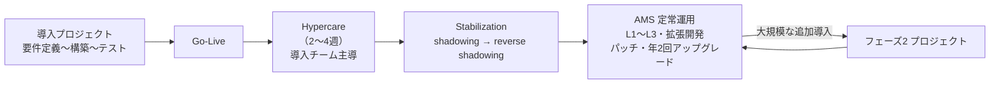
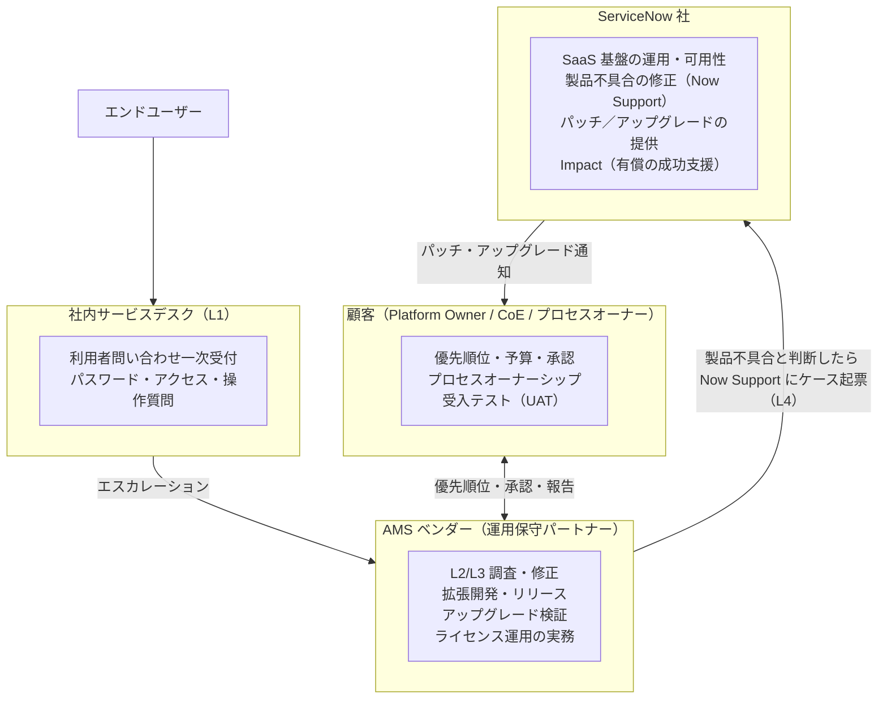
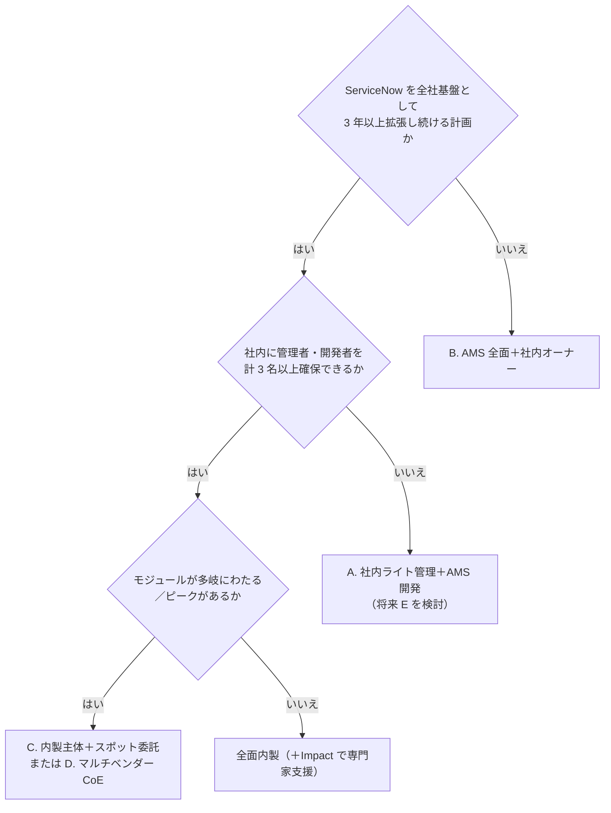

# 導入後の運用保守委託（AMS/マネージドサービス）の設計

## 概要

本ファイルは、ServiceNow の導入プロジェクトが本番稼働（Go-Live）した**後**の運用保守を外部に委託する、または一部を委託する場合の設計方法をまとめる。対象読者は、AMS 契約の提案・調達・評価を担うコンサルタント・PM・Platform Owner（プラットフォームオーナー）である。

ServiceNow は SaaS なので、インフラ・ミドルウェア・製品不具合の修正は ServiceNow 社が担う。一方、**設定・カスタマイズ・連携・データ・ユーザー対応・アップグレード時の検証は顧客の責任**として残る（2 章）。この「顧客側に残る責任」を誰が担うかを決めるのが AMS 設計である。

| 本ファイルで答える問い | 章 |
|---|---|
| AMS・マネージドサービスとは何か。導入プロジェクトとどう違うか | 1 |
| ServiceNow 社のサポートはどこまでで、どこから AMS／顧客の責任か | 2 |
| AMS に何を含めるか（L1〜L4、拡張開発、アップグレード、ライセンス運用） | 3 |
| 導入チームから AMS へどう引き継ぐか（Hypercare、KT、reverse KT） | 4 |
| AMS 自体を ServiceNow 上でどう運用するか | 5 |
| SLA・KPI をどう定義し、どう測るか | 6 |
| 料金モデル（固定・ポイント・チケット・専任チーム）の選び方 | 7 |
| 内製・全面委託・ハイブリッドのどれを選ぶか | 8 |
| 日本市場の AMS 提供事業者にはどんな傾向があるか | 9 |
| RFP・契約書に何を書くか | 10〜11 |

関連ファイル:

- 導入プロジェクトの体制とパートナー選定: [プロジェクト体制とパートナー](05-project-organization.md)
- CoE・ガバナンスボード・運用プロセス: [運用とガバナンス](12-operations-governance.md)、[ガバナンスと CoE の実践](../04_応用編/09-governance-coe-practice.md)
- アップグレードの手順: [アップグレード管理](13-upgrade-management.md)
- ServiceNow 社のサポート（Now Support、ケース優先度、Impact）: [サポートと監視](14-support-monitoring.md)
- ライセンス: [ライセンスモデル](01-licensing-model.md)、[ライセンスコスト最適化](../04_応用編/06-license-cost-optimization.md)
- テストと本番稼働: [テストと本番稼働](11-testing-golive.md)
- 日本市場全般: [日本市場における導入](15-japan-market.md)

> 確度について: ServiceNow 社は AMS の標準モデルや料金を公式に定めていない。本ファイルのうち AMS の体制・料金・KPI 目標値の多くは、パートナーの公開情報（`【第三者情報】`）または実務上の通例（`【経験則】`）に基づく。ServiceNow 社側の責任範囲は公式文書（Customer Support Addendum、Impact ドキュメント）に基づく。

---

## 1. AMS・マネージドサービスの基本

### 1.1 用語

| 用語 | 英語 | 本ファイルでの意味 |
|---|---|---|
| AMS | Application Management Services | 稼働中のアプリケーション（ここでは ServiceNow インスタンス上の設定・アプリ）の運用・保守・小規模改善を継続的に請け負うサービス。日本では「運用保守」「アプリケーション保守」と呼ぶことが多い |
| マネージドサービス | Managed Services | AMS とほぼ同義に使われる。ServiceNow パートナーの文脈では、プラットフォーム管理・監視・アップグレード・拡張開発までを月額で包括的に提供するサービスを指すことが多い【第三者情報】（[Aelum Consulting](https://aelumconsulting.com/blogs/servicenow-managed-service-partner/)） |
| MSP | Managed Service Provider | (1) 一般には、マネージドサービスを提供する事業者。(2) ServiceNow のパートナープログラムでは、ServiceNow を使って**自社のサービスとして**顧客に提供する Service Provider（例：ドメインセパレーションしたインスタンスで複数顧客を運用）を指す。Impact にも MSP 向けパッケージ（Impact Total MSP domain separated 等）があり、ServiceNow Service Provider Partner Program のメンバーに限定される（[Impact Total MSP package description（日本語版 PDF）](https://www.servicenow.com/content/dam/servicenow/ja/other-documents/legal/impact/impact-total-msp-domain-separated-v1-package-description.pdf)）。本ファイルは (1) を主に扱う |
| Hypercare | Hypercare | Go-Live 直後の 2〜4 週間程度、導入チームが手厚く支援する期間（[Community: ServiceNow Handover - AMS Part 2](https://www.servicenow.com/community/onboarding-hub-blog/servicenow-handover-ams-part-2/ba-p/3395109)）【第三者情報】 |
| Platform Owner | Platform Owner | 顧客側で ServiceNow プラットフォーム全体の価値・優先順位・予算に責任を持つ人。AMS を委託しても**委託できない**役割（8.4 参照）【経験則】 |
| CoE / CoEI | Center of Excellence (and Innovation) | プラットフォームの標準・アーキテクチャ・ガバナンスを担う組織。マルチベンダー体制では CoEI が統制し、ベンダーが実行する（[Community: multi-vendor operating model](https://www.servicenow.com/community/developer-blog/defining-roles-and-responsibilities-in-a-multi-vendor-operating/ba-p/3400171)）【第三者情報】 |

### 1.2 導入プロジェクトと AMS の違い

| 観点 | 導入プロジェクト | AMS（運用保守） |
|---|---|---|
| 期間 | 有期（数か月〜1 年程度） | 継続（1〜3 年契約で更新が多い）【経験則】 |
| 成果 | 要件どおりのシステムを稼働させる | 稼働中のサービスを維持し、継続的に改善する |
| 作業の性質 | 計画駆動（WBS） | 需要駆動（チケット・バックログ）＋年 2 回のアップグレード等の定期作業 |
| 主な指標 | 納期・品質・予算 | SLA 遵守率、バックログ、ユーザー満足度、プラットフォーム健全性（6 章） |
| 契約形態（日本） | 請負または準委任 | 準委任（月額固定・時間精算）が主流。改修案件のみ個別に請負とすることもある【経験則】 |
| 体制 | プロジェクト専任チーム | 共有チーム（複数顧客を兼務）または専任チーム。オフショア・ニアショアの活用が多い（9 章） |

### 1.3 ServiceNow 特有の事情

ServiceNow の運用保守は、オンプレミスのパッケージ保守と比べて次の点が異なる。

1. **年 2 回のファミリーアップグレードが必須の定期作業になる。** ServiceNow はファミリーリリースを年 2 回提供し、顧客は非本番から本番の順にアップグレードし、テストする責任を負う（[公式: Upgrade and update](https://www.servicenow.com/docs/r/australia/release-notes/upgrade.html)）。サポート対象外となった古いファミリーは ServiceNow 側でアップグレードがスケジュールされる（詳細は [リリースサイクルとバージョン](../01_入門編/07-release-cycle.md)）。AMS のスコープと料金にアップグレード対応を含めるかが大きな論点になる（3.4）。
2. **インフラ運用（サーバー、DB、バックアップ）は不要。** ServiceNow 社が日次の自動バックアップ等を行う（同上）。AMS はアプリケーション層に集中できる。
3. **ライセンスが利用実態（ロール付与）で消費される。** fulfiller ロールの付与がそのままライセンス消費につながるため、ロール付与の運用がコストに直結する（3.5）。
4. **カスタマイズは ServiceNow 社のサポート対象外。** カスタム コードが原因の問題は ServiceNow のカスタマーサポートが扱わない（2.2）。カスタマイズが多いほど AMS の L3 負荷が上がる。

出典：Hypercare 期間と段階的移管は [Community: ServiceNow Handover - AMS Part 2](https://www.servicenow.com/community/onboarding-hub-blog/servicenow-handover-ams-part-2/ba-p/3395109)【第三者情報】。図の構成は【経験則】。

---

## 2. ServiceNow 社のサポート範囲と責任分界

### 2.1 4 者の責任分界の全体像

ServiceNow の運用には、通常、次の 4 者が関わる。AMS 設計の第一歩は、この 4 者の境界線を契約・RACI で明文化することである。

出典：L1〜L4 の区分は [Community: ServiceNow Handover - AMS](https://www.servicenow.com/community/onboarding-hub-blog/servicenow-handover-ams/ba-p/3395106)【第三者情報】。ServiceNow 社の責任は 2.2 の CSA に基づく。

### 2.2 ServiceNow 標準サポートの範囲（Customer Support Addendum）

ServiceNow 社の標準サポート（Customer Support）の範囲は、契約書の一部である **Customer Support Addendum（CSA）** で定義される。公開されている 2020-04-15 版 CSA（リセラー Carahsoft 掲載の写し）の 1.1 SCOPE は次のとおりである（[CSA](https://static.carahsoft.com/concrete/files/9116/2998/6889/customer-support-addendum-upgrades.pdf)）。

- Customer Support は、Subscription Service が **Product Overview（製品概要）に適合しない不具合（defect causing a nonconformity）を解決する**ために提供される。解決は修正・ワークアラウンド・その他の救済のいずれかで、ServiceNow が合理的と判断するものとなる。
- Customer Support に**含まれないもの**（原文の 4 項目）:

| # | 原文 | 日本語訳 | AMS 設計上の意味 |
|---|---|---|---|
| 1 | implementation, configuration, integration or customization services | 導入・設定・連携・カスタマイズのサービス | 設定変更・連携構築・カスタマイズは AMS（または顧客）の担当 |
| 2 | training or assistance with administrative functions | 管理機能のトレーニングや支援 | 「管理画面の使い方」質問は Now Support の対象外。AMS または社内管理者が担う |
| 3 | resolving immaterial defects or defects due to modifications of the Subscription Service made by any person other than ServiceNow or a person acting at ServiceNow's direction | 軽微な不具合、または ServiceNow（とその指示を受けた者）以外による変更に起因する不具合の解決 | **カスタマイズ起因の不具合は AMS の L3 が担う** |
| 4 | resolving defects on any instance of the Subscription Service not in conformance with Section 3 (Upgrades and Updates) | Section 3（アップグレードとアップデート）に準拠していないインスタンスの不具合の解決 | アップグレード方針に従わずに古いリリースに留まると、サポートを受けられない可能性がある |

- 顧客は、Support Portal 上に **Customer Authorized Contacts**（Primary Business Contact、Secondary Business Contact、Technical Contact、Support Contact、Primary Customer Administrator、Security Contact）を登録し、これらは Subscription Service の管理について訓練を受けている必要がある（CSA 1.4.2）。AMS ベンダーの要員をどこまで Authorized Contact とするかは 2.5 で扱う。
- ServiceNow のドキュメントも、カスタム コードが原因の問題はカスタマーサポートの対象外であり、カスタマイズの保守とトラブルシュートは顧客の責任であると説明している（[公式: Customization vs. configuration](https://www.servicenow.com/docs/r/application-development/app-engine-studio/aes-custom-vs-config.html)）。

> 注意: 上記は 2020 年版 CSA の写しである。最新版の CSA は ServiceNow の legal ページ（upgrade-schedules ページ）に掲載されるが、本調査ではアクセス制限により取得できなかった。なお、同 upgrade-schedules ページには「2026-02-06 以降に ServiceNow から直接またはリセラー経由で Subscription Service を購入した顧客には Ordering Agreement が適用される」旨と、CSA（2025-03-12 発効）が掲載されているとされる（[ServiceNow: upgrade schedules](https://www.servicenow.com/upgrade-schedules.html)。本調査では本文が HTTP 403 で取得できず、検索結果の要約で確認したため、原文は未確認）。日本語版ページでは同日付の文書名が「Direct and Indirect Customer Agreement」となっているとの検索結果もあり、地域によって名称が異なる可能性がある。**AMS 契約書の責任分界は、顧客自身の Order Form と有効版 CSA から転記すること。** 優先度（P1〜P4）と応答目標の詳細は [サポートと監視](14-support-monitoring.md) の 3 章を参照。

### 2.3 アップグレードにおける ServiceNow 社と顧客の分担

公式ドキュメント「Upgrade and update」（Australia 版、2026-03-12 更新）による分担は次のとおり（[公式](https://www.servicenow.com/docs/r/australia/release-notes/upgrade.html)）。

| 項目 | ServiceNow 社 | 顧客（実務は AMS に委託可能） |
|---|---|---|
| リリースノート・テストツール | 提供する | リリースノートとアプリごとのアップグレード・移行タスクを確認する |
| 計画 | Production Readiness Services（アップグレード計画のレビュー）を提供 | カスタマイズと主要業務機能の現状を把握し、準備・実施・テストの時間を確保する |
| 実施順序 | — | 本番から最も遠いインスタンスから順に本番へ向けて上げる |
| テスト | — | 開発: スモークテスト、テスト: ATF（非本番向け）と任意の UAT、本番: UAT のみ |
| バックアップ | オフピーク時に日次自動バックアップ。オンデマンドのバックアップは行わない。任意の時点への復元が可能 | 復元はダウンタイムとデータ損失のリスクがあるため最終手段とする |
| ロールバック | Update（Patch 間）のロールバックは既定 10 日以内（公式 upgrade ページの表記は `glide.rollback.expiration_days`、Rollback context properties ページでは `glide.rollback.expiration_days_upgrade`） | 本番アップグレードの全面ロールバックは一般にサポートされないため、事前検証を徹底する |
| 不具合報告 | 24/7 の Customer Service and Support | 事象・再現手順・関係するカスタマイズを記録してからケースを起票する |

CSA 3 章では、Upgrade は 30 日前、Update は 10 日前までに通知するよう ServiceNow が合理的な努力をすること、ただし可用性・セキュリティ等のため短縮・省略があり得ることが定められている（[CSA](https://static.carahsoft.com/concrete/files/9116/2998/6889/customer-support-addendum-upgrades.pdf)）。AMS 契約では、この通知を受けてから影響調査・テストを開始するまでのリードタイムを SLA に組み込む（6.2）。

### 2.4 ServiceNow Impact と Developer Support（カスタマイズの相談窓口）

標準サポートの対象外であるカスタマイズについて、ServiceNow 社は有償の **ServiceNow Impact** で一部支援を提供している。AMS を設計するときは、顧客が Impact を契約しているか、どのパッケージかを最初に確認する。

Impact のパッケージは **Guided／Advanced／Total**（および Total のエンタイトルメントをすべて含む **Integrated Success**）である。ただし Impact packages ページの応答目標の表に載っているのは Guided と Total だけで、**Advanced の応答目標は同ページでは確認できない**（Advanced は Developer Support の注記にのみ登場する）。パッケージ間の差の詳細は [サポートと監視](14-support-monitoring.md) の 5.2 を参照。

| Impact の要素 | 内容（Australia 版ドキュメント） | AMS との関係 |
|---|---|---|
| P1/P2 応答短縮 | Guided: P1 30 分／P2 120 分、Total: P1 15 分／P2 60 分（Advanced は記載なし、Integrated Success は個別の記載なし） | AMS が Now Support にエスカレーションしたときの応答目標が変わる |
| **Developer Support** | Advanced・Total パッケージ、および Managed Support を購入した Guided 顧客が対象。指名ユーザーは Advanced で最大 5 名、Total で最大 10 名で、Subscription Service の管理について訓練を受けている必要がある | 既存カスタマイズの break-fix と API の質問に使える。**AMS の L3 の後ろ盾**になる |
| Support Account Manager（SAM） | 隔週のオペレーショナルレビュー、月次パフォーマンスレポート、四半期サポートレビュー、ケース・問題・変更管理、アップグレードとパッチ計画（どのパッケージで提供されるかは同ページに記載がなく、契約で確認） | AMS の定例会議に SAM を参加させると、ServiceNow 側の情報（パッチ目標、既知の問題）が入りやすい【経験則】 |
| Platform Architect | 技術アーキテクチャ・技術ガバナンス・迅速なアップグレードの指導 | 設計レビューの相談先。AMS の拡張開発の設計品質を担保する |
| Platform Health（Scan Engine、Instance Observer） | Guided と Total でエンタイトルメントが異なる | AMS の健全性監視（3.6）の道具として使う |

出典：[Impact packages](https://www.servicenow.com/docs/r/australia/impact/impact-packages1.html)、[Impact Squad（Work with experts）](https://www.servicenow.com/docs/r/australia/impact/impact-squad.html)（2026-07-07 更新）、[Impact Developer Support](https://www.servicenow.com/docs/r/australia/impact/developer-support.html)（いずれも Australia 版）。Impact Squad のページは Customer Success Manager、Customer Success Executive、Platform Architect、Support Account Manager の 4 ロールを説明している。

**Developer Support の対象外**（公式）:

- 新規製品の導入（初期導入を含む）
- ServiceNow のファミリーアップグレード後に壊れたカスタマイズ（カスタマイズは後方互換ではなく、最新リリースのコードに対して作るべきとされる。ベースシステムの API 変更については Now Support に問い合わせる）
- テスト（UAT、負荷、回帰、性能）
- 新機能・拡張の設計（要件分析、新規コーディングの質問を含む）
- 連携関連の支援（パースしたデータの業務影響分析、第三者システムの知識、外部コンテンツ取得スクリプト、API 制限で阻まれる連携）

出典：[Impact Developer Support](https://www.servicenow.com/docs/r/australia/impact/developer-support.html)。ライフサイクル別の相談先は、設計レビュー＝Platform Architect、コードレビュー＝Expert Services、壊れたカスタムコードの修正支援＝Developer Support とされている（同ページ）。

> 実務上の要点【経験則】: Developer Support は「AMS の代わり」ではない。アップグレード後に壊れたカスタマイズ、拡張開発の設計、連携の調査は対象外なので、これらは必ず AMS 契約（または社内チーム）でカバーする。Impact の詳細は [サポートと監視](14-support-monitoring.md) の 5 章を参照。

### 2.5 AMS ベンダーの Now Support 利用

AMS ベンダーが顧客に代わって Now Support でケースを起票したり、アップグレード・パッチ通知を受け取ったりするには、Now Support 上のアクセス権が必要である。

- Now Support のユーザーは顧客の **Customer Administrator（`customer_admin`）** が管理する（[サポートと監視](14-support-monitoring.md) の 2.3）。
- ServiceNow Community の回答（2024 年）によれば、パートナーが顧客の Now Support にアクセスするには、(1) パートナーが Partner Portal で当該顧客の **Deployment Registration**（正しい顧客アカウントと作業範囲）を作成し承認を得る、(2) パートナー側が自社の Now Support から**ケースを起票して「NS Partner Officer」ロールと「Switch Company」オプションを依頼する**、という手順が解決策として示されている（KB0869148 への言及あり）。顧客側では Partner ロールのチェックボックスがグレーアウトして付与できなかったという報告がある（[Community: How to add a ServiceNow Partner to NowSupport portal](https://www.servicenow.com/community/servicenow-impact-forum/how-to-add-a-servicenow-partner-to-nowsupport-portal/m-p/2817652)）。`【第三者情報】` 最新の手順は Now Support の KB で確認すること。

| 設計項目 | 推奨【経験則】 |
|---|---|
| ケース起票者 | AMS の L3 リード（NS Partner Officer）と顧客の Technical Contact の双方が起票可能にする |
| ケースの可視性 | 顧客側 Platform Owner が全ケースを閲覧できるようにし、AMS の月次報告に Now Support ケース一覧を含める |
| 通知の受信 | アップグレード・パッチ・セキュリティ通知を AMS のチーム共有アドレスでも受信する |
| Authorized Contacts | Primary Customer Administrator と Security Contact は**顧客社員**とする（ベンダー交代時の引継ぎリスクを避ける） |
| ベンダー交代時 | Deployment Registration の終了と Now Support アクセスの削除を退出（exit）手順に含める |

### 2.6 ServiceNow Store アプリ・第三者製品の責任

ServiceNow Store のパートナー製アプリは、原則としてアプリを作成したテクノロジーパートナーがサポート窓口になる（[サポートと監視](14-support-monitoring.md) の 9.3）。AMS 契約では「Store アプリの不具合切り分けと提供元への問い合わせ代行」を含めるかを明記する。連携先システム（Active Directory、ERP、監視ツール等）の保守者との境界も RACI に入れる（3.3）。

---

## 3. AMS のスコープ設計

### 3.1 サポートレベル（L1〜L4）

ServiceNow Community の AMS 引継ぎ記事では、サポートレベルを次のように区分している（[Community: ServiceNow Handover - AMS](https://www.servicenow.com/community/onboarding-hub-blog/servicenow-handover-ams/ba-p/3395106)）。`【第三者情報】`

| レベル | 担い手（典型） | 対応内容 | 委託先の傾向【経験則】 |
|---|---|---|---|
| **L1** | サービスデスク／ヘルプデスク | パスワードリセット、アクセス申請、操作方法（how-to）の質問。単純な問題はここで完結 | 既存の社内ヘルプデスクまたはヘルプデスク BPO。ServiceNow 専門の AMS には含めないことも多い |
| **L2** | AMS のサポートアナリスト | ワークフロー、カタログアイテム、Business Rule、連携の調査 | AMS の中核 |
| **L3** | シニア開発者、アーキテクト、または導入チーム | 複雑な問題、カスタム開発、コード修正が必要な不具合 | AMS（上位プラン）または導入パートナー |
| **L4** | ServiceNow 社（Now Support） | プラットフォームレベルの不具合 | ServiceNow 社。AMS が起票を代行 |

各レベルについて RACI を明確にし、チーム間でたらい回しにならないエスカレーション経路を定義することが推奨されている（同記事）。

### 3.2 AMS サービスカタログ（スコープ候補一覧）

AMS の契約範囲は、次のサービス項目を「含む／オプション／含まない」で仕分けて決める。国内外のパートナーの公開メニュー（9 章、7 章）を整理し、本ファイルで統合したものである。`【第三者情報】【経験則】`

| # | サービス項目 | 内容 | 典型的な扱い |
|---|---|---|---|
| 1 | 問い合わせ対応（Q&A） | 操作方法・標準機能の質問への回答、調査 | 基本プランに含む |
| 2 | 障害対応（break-fix） | 不具合の調査・切り分け・暫定対処・恒久修正 | 基本プランに含む（コード修正は上位プラン） |
| 3 | Now Support 問い合わせ代行 | 製品不具合の起票・追跡・回避策の適用 | 中位プラン以上 |
| 4 | ユーザー・グループ・ロール管理 | アカウント作成、グループ所属、ロール付与（ライセンス影響の確認を含む） | 基本プランに含むことが多い。自動化（IdP 連携）済みなら例外処理のみ |
| 5 | 軽微な設定変更（ノーコード） | 選択肢値、通知、割り当てルール、SLA 定義、カタログ変数、レポート・ダッシュボード | 中位プラン以上 |
| 6 | 拡張開発（エンハンスメント） | 新しいカタログアイテム、フロー、スクリプト、UI 変更、新モジュールの小規模展開 | 上位プランまたはポイント消化・個別見積り |
| 7 | 定型リリース | 定期的なリリース作業（アップデートセット移送、データ更新） | 中位プラン以上 |
| 8 | パッチ適用 | Patch の適用スケジュール調整、適用後の確認、軽微な修正 | 中位プラン以上 |
| 9 | ファミリーアップグレード | 年 2 回のアップグレードの影響調査、Skipped records 対応、回帰テスト、本番適用 | **オプションまたは別見積りが多い**（3.4） |
| 10 | 新機能紹介・リリースノート要約 | 新リリースの日本語要約、適用可否の提案 | 基本プランに含める国内事業者がある |
| 11 | 健全性監視 | Instance Scan、Scan Engine、性能（Slow queries 等）、スケジュールジョブ・連携エラーの監視 | 中位プラン以上 |
| 12 | 連携監視 | MID Server の状態、連携ジョブのエラー監視と再実行 | 中位プラン以上 |
| 13 | CMDB データ品質管理 | Discovery エラー対応、CMDB Health（完全性・正確性）の改善 | ITOM を導入している場合にオプション |
| 14 | ライセンス運用 | Subscription Management による割り当て状況の確認、棚卸し、更新前レビュー | 中位プラン以上またはオプション（3.5） |
| 15 | セキュリティ運用 | `admin` 保持者の棚卸し、ACL 変更レビュー、Instance Security Center の確認、脆弱性通知への対応 | オプション（顧客のセキュリティ部門と分担） |
| 16 | ナレッジ管理 | 解決策の KB 化、FAQ 更新 | 基本プランに含める |
| 17 | 定例会議・報告 | 月次報告、四半期レビュー、改善提案 | 全プランに含む |
| 18 | ドキュメント維持 | 設計書・運用手順書・構成情報の更新 | 全プランに含める（7.6 の注意参照） |
| 19 | Now Assist / AI Agents 運用 | スキル設定、ガードレール、利用状況・アシスト消費の監視 | オプション（2026 年以降増加）【推定】 |
| 20 | 改善提案・ロードマップ支援 | 利用状況分析、未使用機能の活用提案、技術的負債の削減計画 | 上位プラン |

### 3.3 RACI テンプレート

顧客・AMS・ServiceNow 社・その他ベンダーの責任分担を RACI（Responsible＝実行、Accountable＝最終責任、Consulted＝相談、Informed＝報告）で定義する。以下はハイブリッド型（8.3 のパターン A）を前提としたテンプレートである。`【経験則】`

| 活動 | 顧客 Platform Owner | 顧客 プロセスオーナー | 社内 L1（サービスデスク） | AMS | ServiceNow 社 |
|---|---|---|---|---|---|
| 利用者問い合わせの一次受付 | I | — | **R/A** | C | — |
| L2/L3 調査・修正 | A | C | I | **R** | C |
| 製品不具合のケース起票 | I | — | — | **R** | A（解決） |
| 拡張要望の受付・優先順位付け（Demand） | **A** | R | — | C（見積り） | — |
| 拡張開発の設計・実装 | A | C | — | **R** | — |
| 受入テスト（UAT） | A | **R** | — | C | — |
| 本番リリースの承認（CAB） | **A** | C | I | R（申請） | — |
| パッチ・アップグレードの計画 | A | I | I | **R** | C（通知・Production Readiness） |
| アップグレード後の回帰テスト | A | R（UAT） | — | **R**（ATF・技術テスト） | — |
| ロール付与・ライセンス割り当て | **A** | C | R（定型申請） | R（実作業・確認） | — |
| ライセンス棚卸し・更新前レビュー | **A** | — | — | R | C（Account team） |
| 開発標準・アーキテクチャ標準 | **A** | — | — | R（遵守・提案） | C（Platform Architect、Impact 契約時） |
| SaaS 基盤の可用性・バックアップ | I | — | — | I | **R/A** |
| ドキュメント維持 | A | C | — | **R** | — |
| AMS の KPI 報告 | A | I | — | **R** | — |

- マルチベンダー体制では、CoEI が標準・アーキテクチャ・ガバナンスに最終責任を持ち、ベンダーは CoEI のガイドラインの下で技術作業・単体／機能テスト・ビルドと引継ぎを担い、QA チームが最終承認とデプロイ制御を持つ、という分担が Community 記事で紹介されている（[Community: multi-vendor operating model](https://www.servicenow.com/community/developer-blog/defining-roles-and-responsibilities-in-a-multi-vendor-operating/ba-p/3400171)）。`【第三者情報】`
- 運用移管時の CoE 立ち上げチェックリストの中で「AMS／パートナーとの役割分担（RACI）」を成果物として定義する（[運用とガバナンス](12-operations-governance.md)）。

### 3.4 アップグレード対応のスコープ設計

アップグレード対応は AMS 費用の変動要因として最も大きい。国内事業者の公開メニューでも、アップグレード対応はオプション扱い（三井情報: 全プランでバージョンアップ QA〔影響調査含む〕をオプション）または独立メニュー（日立ソリューションズ: 半年ごとのアップグレードの適用・確認と軽微な修正）になっている（9.2）。`【第三者情報】`

| 作業 | 内容 | AMS 範囲の例【経験則】 |
|---|---|---|
| リリースノート精査 | 対象ファミリーの変更点・廃止機能の抽出、日本語要約 | 基本に含む |
| 影響調査 | Upgrade Preview、カスタマイズ・スキップ予測の確認 | 中位に含む |
| 非本番アップグレード | Now Support でのスケジュール、実施確認 | 中位に含む |
| Skipped records 処理 | スキップされたレコードの Reviewed／Merge／Revert 判断と対処 | 件数上限付きで含む。超過は別見積り |
| 回帰テスト | ATF 実行、手動テスト、UAT 支援 | ATF 整備済みなら含む。未整備なら別見積り |
| 壊れたカスタマイズの修正 | アップグレードで動かなくなったスクリプト等の改修 | **別見積り**（Developer Support の対象外でもある、2.4） |
| 新機能の有効化 | 新プラグイン有効化、新 UI への移行 | 別見積り（改善案件として扱う） |
| 本番アップグレード | 変更凍結、当日の確認、Hypercare | 中位に含む |

- 年 2 回すべて追随するか、年 1 回に抑えるかで工数は大きく変わる。方針は [アップグレード管理](13-upgrade-management.md) の 2.1 を参照し、AMS 契約書に「年あたりのファミリーアップグレード回数」を明記する。
- **アップグレード工数はカスタマイズ量に比例する**ため、契約更新時に Skipped records 件数の実績を見て料金を見直す条項を入れる【経験則】。

### 3.5 ライセンス運用のスコープ設計

ServiceNow のライセンス（サブスクリプション）は、ユーザーへのロール付与やサブスクリプションの割り当てで消費される。AMS がユーザー・ロール管理を担う場合、ライセンス運用も一体で設計する。

**Subscription Management（サブスクリプション管理）** は、購入したサブスクリプションに対する割り当て・使用状況を確認する標準機能である。

| 項目 | 内容 |
|---|---|
| 必要ロール | `usage_admin`、`sn_sub_man.admin`、または `admin` |
| メニュー | Admin または All メニューから Subscription Management を開き、Overview タブ |
| Overview で分かること | Over-allocated（購入数を超えて割り当て）、Unallocated（未割り当て）のサブスクリプション、Global スコープのカスタムテーブルや未マッピングのカスタムアプリ、アカウントレベルの Now Assist 利用状況・Creator・クラウド容量 |
| Status の値 | Compliant、Near capacity（既定しきい値 90%、Settings タブで変更可）、Even、Over-allocated、Account-level only（Creator Plus 製品） |
| 関連テーブル | `sn_sub_man_st_subscription_insights`（Subscription Insights definition）、`ua_custom_table_inventory`（Custom Table Inventory） |
| 割り当て | サブスクリプションの割り当て（Allocate subscriptions）によりユーザーに製品利用権を付与する |

出典：[Product subscriptions overview（Australia 版）](https://www.servicenow.com/docs/r/australia/platform-administration/subscriptions-overview-v2.html)、[Allocate subscriptions](https://www.servicenow.com/docs/r/platform-administration/allocate-subscriptions-v2.html)、[Subscription Management roles](https://www.servicenow.com/docs/r/7LhbZn3yz3Q58qhjZoU9iQ/Pjs~pNjVulfMp4gBcljyXg)。ライセンスの考え方は [ライセンスモデル](01-licensing-model.md) を参照。

AMS のライセンス運用タスク例【経験則】:

| 頻度 | タスク | 成果物 |
|---|---|---|
| 申請ごと | fulfiller ロール付与申請時に、残数とロールの妥当性を確認する（承認者は顧客） | 申請記録 |
| 月次 | Subscription Management の Overview を確認し、Near capacity・Over-allocated を報告 | 月次報告の 1 ページ |
| 月次 | 退職者・長期未ログイン者のロール剥奪候補を抽出（剥奪の判断は顧客） | 候補リスト |
| 四半期 | Global スコープのカスタムテーブル・未マッピングアプリの増加を確認（Custom table の上限に関わる） | 四半期レビュー資料 |
| 年次（更新の 3〜6 か月前） | 利用実績と今後の需要から更新数量の提案 | 更新前レビュー |

- ライセンス最適化の手法そのものは [ライセンスコスト最適化](../04_応用編/06-license-cost-optimization.md) を参照。
- **ライセンス数量の決定と ServiceNow 社との交渉は顧客の責任**であり、AMS は情報提供にとどめる（AMS ベンダーがリセラーを兼ねる場合は利益相反に注意）【経験則】。

### 3.6 健全性監視と予防保守

ServiceNow の AMS では、チケットを待つだけでなく、定期的な健全性確認で問題を先回りして見つける作業をスコープに含める。Atos のマネージドサービス選定ガイドも、週次・月次・随時のタスクでユーザーが気づく前に問題を発見する運用を求めている（[Atos guide](https://atos.net/wp-content/uploads/2025/09/atos-brochure-servicenow-guide-to-managed-service.pdf)）。`【第三者情報】`

| 頻度 | 確認項目【経験則】 | 道具 |
|---|---|---|
| 日次 | 失敗したスケジュールジョブ、連携エラー、メール送受信エラー、MID Server の状態 | System Logs、MID Server ダッシュボード、エラーキュー |
| 週次 | 遅いトランザクション、Slow queries、ノード負荷 | Transaction log、Slow patterns、Instance Observer（Impact） |
| 月次 | Instance Scan の結果、新規の技術的負債、`admin` ロール保持者 | Instance Scan、Scan Engine（Impact） |
| 四半期 | CMDB Health、未使用のカタログアイテム・レポート、ライセンス | CMDB Health dashboard、Subscription Management |

道具の詳細は [サポートと監視](14-support-monitoring.md) の 6〜7 章を参照。

### 3.7 スコープ外として明記すべきもの

次の項目は AMS 契約で「含まない」と明記しないと、後で紛争の原因になる。`【経験則】`

- 新規モジュール・新規製品の導入（例: ITSM 運用中に HRSD を追加）→ 別プロジェクト
- 大規模なデータ移行・一括データ修正
- 業務プロセスの再設計、組織変更に伴う大幅な設定変更
- 顧客側システム（IdP、ERP、ネットワーク）の障害対応
- エンドユーザー向け集合研修（教材作成を含む）
- 監査対応・セキュリティ診断の実施（支援のみ含める場合は範囲を明記）
- 24 時間 365 日の常時対応（必要なら別料金のオーバーレイとする）

---

## 4. 運用移行（導入チーム→AMS）

### 4.1 移行の 3 段階

ServiceNow Community の AMS 引継ぎ記事は、Go-Live 後の段階的な移管を次のように説明している（[Community: ServiceNow Handover - AMS Part 2](https://www.servicenow.com/community/onboarding-hub-blog/servicenow-handover-ams-part-2/ba-p/3395109)）。`【第三者情報】`

| 段階 | 期間の目安 | 主導 | 内容 |
|---|---|---|---|
| **Hypercare** | 約 2〜4 週 | 導入チーム | 優先対応・応答時間短縮による手厚い支援 |
| **Stabilization** | （記載なし。実務では 1〜3 か月程度【経験則】） | 導入チーム→AMS | AMS がインシデント・リクエスト・変更を段階的に引き取る。**shadowing**（AMS が導入チームの対応を見る）→ **reverse shadowing**（AMS が主導し導入チームが見守る） |
| **Ownership handover** | — | AMS | AMS が実チケットを処理し、指導付きで問題を解決し、自立して運用できることを確認したら全面移管 |

```mermaid
gantt
  title 運用移行の例（KT 開始を 0 週、Go-Live を 6 週とする）【経験則】
  dateFormat  X
  axisFormat %s週
  section 導入チーム
  Hypercare           :a1, 6, 10
  移行支援（見守り）    :a2, 10, 18
  section AMS
  KT・環境準備（Go-Live 前） :b0, 0, 6
  Shadowing           :b1, 6, 10
  Reverse shadowing   :b2, 10, 18
  単独運用             :b3, 18, 26
```

### 4.2 引継ぎドキュメント（ドキュメント・プレイブック）

同 Community 記事（Part 1）は、AMS チームの「ガイドブック」として次のドキュメントを必須としている（[Community: ServiceNow Handover - AMS](https://www.servicenow.com/community/onboarding-hub-blog/servicenow-handover-ams/ba-p/3395106)）。`【第三者情報】` 右列は本ファイルでの補足【経験則】。

| ドキュメント | 内容 | 補足 |
|---|---|---|
| システム概要 | 導入したモジュール・プロセスと相互の関係 | 構成図、インスタンス一覧、プラグイン一覧 |
| OOTB／カスタマイズ一覧 | OOTB のまま使っている部分と、カスタマイズ（テーブル、ワークフロー、スクリプト） | Instance Scan の結果、`sys_update_xml` から抽出した変更一覧を添付 |
| 連携仕様 | エンドポイント、データフロー、エラー処理、MID Server（本番・非本番） | 認証情報の保管場所（パスワードそのものは書かない）、連携先の保守窓口 |
| セキュリティ | ロール、グループ、割り当てロジック、セキュリティマトリクス | `admin` 保持者一覧、ACL のカスタマイズ一覧 |
| 既知の問題とワークアラウンド | Go-Live 時点の未解決事項 | 未解決の Now Support ケース番号 |
| プロジェクト文書 | 機能仕様、業務要件、基本設計・詳細設計（HLD/LLD） | 要件と実装のトレーサビリティ |

AMS リードは、これらを引継ぎチェックリストの必須成果物として導入チームに提出させる（同記事）。

### 4.3 ナレッジトランスファー（KT）

- KT は 1 回のデモではなく、**複数回の対話型・ハンズオン型セッション**とし、録画する（同記事）。
- AMS は非本番環境で、インシデント・変更・リクエストの処理、ワークフロー更新、ユーザーとロールの管理、連携の監視を練習する（同記事）。
- スクリプトエラー、スケジュールジョブの失敗、通知の不達のトラブルシュートを扱う（同記事）。
- **reverse KT**（AMS が導入チームに説明し返すことで理解度を示す）を検討する（同記事）。
- KT の完了判定（exit criteria）を数値で決める【経験則】。例: 「Stabilization 期間中に AMS 主導で処理したチケットのうち、導入チームの介入が必要だった割合が 10% 未満」。

### 4.4 Go-Live 前に整えるべき「ServiceNow のための ServiceNow」

ServiceNow 自身のサポートも ServiceNow 上で回せるように、Go-Live 前に次を準備する（[Community: ServiceNow Handover - AMS Part 2](https://www.servicenow.com/community/onboarding-hub-blog/servicenow-handover-ams-part-2/ba-p/3395109)）。`【第三者情報】`

- プラットフォームサポート用のインシデントのカテゴリ・サブカテゴリ
- CSDM に沿った Business service、Service offering、Application service（例: 「ServiceNow プラットフォーム」サービス）
- ServiceNow のサポート問い合わせ用のリクエストポータル（独立またはインシデントカテゴリで実現）
- 全インスタンスにわたる L1〜L3 のサポートグループと、そのロール・アクセス
- よくある依頼（アクセス、パスワードリセット、データ・レポート依頼）を直接適切なチームに回すルーティング
- サポートチームが解決中に利用・追記できるナレッジベース

5 章で、これを AMS の SLA 測定とどう結びつけるかを扱う。

---

## 5. AMS 自体の運用を ServiceNow 上で設計する

AMS のチケットは、原則として**顧客の ServiceNow インスタンス上**で管理する（AMS ベンダーの自社ツールで二重管理しない）。これにより、SLA 実績を顧客自身が検証でき、ベンダー交代時も履歴が残る。`【経験則】`

| 設計要素 | 推奨設定【経験則】 | 参照 |
|---|---|---|
| サービス定義 | Business service「ServiceNow プラットフォーム」、Service offering を「ITSM 運用」「HRSD 運用」等に分割 | [CMDB と CSDM](../02_リファレンス/platform/cmdb-csdm.md) |
| 割り当てグループ | `SN-L1-ServiceDesk`、`SN-L2-AMS`、`SN-L3-AMS`、`SN-Platform-Owner` 等。AMS 要員は AMS グループにのみ所属させる | [ユーザー・グループ・ロール](../02_リファレンス/platform/users-groups-roles.md) |
| SLA 定義 | AMS 契約の SLA を `contract_sla`（SLA Definition）として登録し、`task_sla` で実績を測る。**Underpinning Contract（UC）** として扱う | [SLA とスケジュール](../02_リファレンス/platform/sla-schedules.md) |
| スケジュール | AMS の対応時間（例: 平日 9:00〜18:00、日本の祝日除く）を `cmn_schedule` で定義し、SLA に紐付ける | 同上 |
| 拡張要望 | Demand（SPM）または専用カタログアイテム → 承認後に Story / Enhancement として管理 | [Strategic Portfolio Management](../02_リファレンス/spm/strategic-portfolio-management.md)、[Agile Development](../02_リファレンス/spm/agile-apm-eam.md) |
| 変更 | AMS のリリースは Change Request（Normal／Standard）で管理し、CAB で承認 | [Change Management](../02_リファレンス/itsm/change-management.md) |
| 報告 | Performance Analytics／ダッシュボードで 6 章の KPI を自動集計 | [レポートとアナリティクス](../02_リファレンス/platform/reporting-analytics.md) |
| AMS 要員のライセンス | AMS 要員が fulfiller としてチケットを処理するとライセンスを消費する。要員数を見込んでおく | [ライセンスモデル](01-licensing-model.md) |
| AMS 要員の権限 | 本番の `admin` は最小限（指名された少数）。日常作業は委任管理ロールで行う。`security_admin` の昇格は記録を残す | [アクセス制御](../02_リファレンス/platform/access-control-acl.md)、[セキュリティ強化の実践](../04_応用編/12-security-hardening-practice.md) |

> 注意: AMS 要員のライセンス消費（fulfiller 扱いになるか）は契約形態とロールで決まる。外部委託先の要員の扱いは [ライセンスモデル](01-licensing-model.md) と顧客の Order Form で確認すること。

---

## 6. AMS の SLA と KPI

### 6.1 SLA と KPI の違い

| 区分 | 意味 | 例 |
|---|---|---|
| SLA（Service Level Agreement） | 契約で約束する水準。未達時のサービスクレジット（減額）等の対象になり得る | 優先度別の応答時間・解決時間、SLA 遵守率 |
| KPI（Key Performance Indicator） | 改善のために追跡する指標。契約上の罰則は付けないことが多い | 再オープン率、バックログの滞留、ユーザー満足度、技術的負債 |
| OLA（Operational Level Agreement） | 社内 L1 と AMS、AMS とインフラ担当など、内部の相互約束 | L1→L2 エスカレーション時の必須情報 |

### 6.2 優先度別 SLA のテンプレート

ServiceNow 社の標準サポートの優先度定義（CSA 1.3: P1＝インスタンス利用不能、P2＝重要機能の失敗、P3＝業務を著しく妨げる、P4＝著しくは妨げない）に揃えると、AMS と Now Support のエスカレーションが整合しやすい（[CSA](https://static.carahsoft.com/concrete/files/9116/2998/6889/customer-support-addendum-upgrades.pdf)）。

以下の目標値は**例**である。Community 記事では、重大インシデントの応答 15 分・解決 2 時間、標準のアクセス申請 2 営業日が例示されている（[Community: Handover - AMS Part 2](https://www.servicenow.com/community/onboarding-hub-blog/servicenow-handover-ams-part-2/ba-p/3395109)）`【第三者情報】`。下表はそれと国内の一般的な水準を踏まえたもの`【経験則】`で、実際の値は対応時間帯・料金と一体で決める。

| 優先度 | 定義（AMS 用に業務影響で再定義） | 応答目標 | 回復（暫定対処）目標 | 対応時間帯 |
|---|---|---|---|---|
| P1 | 本番インスタンスまたは主要業務（例: インシデント起票）が全社的に利用できない | 30 分以内 | 4 時間以内（Now Support 起因は除外し、起票までを測る） | 契約による（24/7 は別料金が通例） |
| P2 | 重要機能の失敗（例: 承認フローが止まる、重要連携の停止） | 1 時間以内 | 1 営業日以内 | 営業時間＋必要に応じ延長 |
| P3 | 一部利用者・一部機能の不具合、回避策あり | 4 営業時間以内 | 5 営業日以内 | 営業時間 |
| P4 | 軽微な不具合、問い合わせ | 1 営業日以内 | 10 営業日以内または合意日 | 営業時間 |
| サービス要求 | アクセス付与、レポート作成依頼等の定型作業 | 1 営業日以内 | 2〜5 営業日（種類別） | 営業時間 |
| 拡張開発 | — | 見積り提示まで 5 営業日 | 合意したリリース日 | 営業時間 |

- **ServiceNow 社起因の時間の扱い**: Now Support の調査待ち時間は AMS の SLA から除外（SLA の Pause 条件）するのが一般的である。除外条件を `contract_sla` の Pause condition として実装し、恣意的な停止を防ぐ【経験則】。
- **アップグレード通知からの対応**: 「ServiceNow からの Upgrade 通知（CSA 上は原則 30 日前）受領後 N 営業日以内に影響調査結果を報告」のように、定期作業にもサービスレベルを設定する【経験則】。

### 6.3 KPI 一覧

| 区分 | KPI | 定義・計算式 | 目標例【経験則】 |
|---|---|---|---|
| 応答性 | SLA 遵守率（応答） | 期間内に応答 SLA を満たした件数 ÷ 期間内の対象件数 | 95% 以上 |
| 応答性 | SLA 遵守率（解決） | 期間内に解決 SLA を満たした件数 ÷ 期間内に解決した件数 | 90〜95% 以上 |
| 品質 | 再オープン率 | 解決後に再オープンされた件数 ÷ 解決件数 | 5% 未満 |
| 品質 | 初回割り当て解決率 | 再割り当て回数（Reassignment count）が 0 のまま解決した件数 ÷ 解決件数 | 改善傾向を追う |
| 品質 | リリース起因の障害件数 | AMS のリリース（Change）に起因するインシデント件数 | 0 件／月を目指す |
| 品質 | 変更成功率 | 失敗・切り戻しのなかった Change ÷ 実施 Change | 95% 以上 |
| 滞留 | バックログ件数と経過日数 | 未完了チケット数と、その経過日数の分布（30 日超の件数） | 30 日超の件数が増え続けない |
| 生産性 | 拡張開発のスループット | 期間内にリリースした要望数（またはポイント） | 計画値の 90% 以上 |
| 予測精度 | 見積り精度 | 実績工数 ÷ 見積り工数 | 0.8〜1.2 |
| 満足度 | ユーザー満足度（CSAT） | 解決時アンケートの平均 | 4.0／5 以上 |
| 健全性 | Instance Scan の新規指摘数 | 期間内に新たに検出された High 以上の指摘数 | 新規 0 件、既存は削減 |
| 健全性 | アップグレード時の Skipped records | アップグレードごとのスキップ件数（Reviewed 化までの日数） | 前回比で減少 |
| 自己解決 | ナレッジ活用率 | KB を添付・参照して解決した件数 ÷ 解決件数 | 改善傾向を追う |
| 人員 | 要員の定着 | 主要要員（L3 リード等）の交代回数 | 契約で事前通知を義務化 |

- 「初回割り当て解決率」の考え方は、ServiceNow Benchmarks の「Reassignment Count が 0 のインシデント」を初回割り当てとみなす定義と同じである（Benchmark KPI の考え方は [ビジネスケース・ROI・価値実現](17-business-case-roi-value-realization.md) を参照）。
- Community 記事は、AMS 向けに 2 種類のダッシュボードを推奨している（[Community: Handover - AMS Part 2](https://www.servicenow.com/community/onboarding-hub-blog/servicenow-handover-ams-part-2/ba-p/3395109)）`【第三者情報】`:
  - **AMS オペレーショナルダッシュボード**: オープン中のインシデント・リクエスト、SLA 違反・違反しそうなチケット、滞留チケット、アクセスやワークフロー失敗などのプラットフォーム課題
  - **AMS エグゼクティブダッシュボード**: インシデント解決の傾向、SLA 遵守率、リクエスト充足率、変更成功率。月次ステアリング会議で使う

### 6.4 「スイカ型 SLA」を避ける

SLA 遵守率がすべて緑（外側は緑）なのに利用者の不満が大きい（中身は赤）状態を、俗に「スイカ（watermelon）SLA」と呼ぶ。`【経験則】`

| 原因 | 対策 |
|---|---|
| 応答 SLA だけを測っている（「受け付けました」で SLA 達成） | 解決 SLA と再オープン率をセットで測る |
| チケットを分割・クローズ・再起票して SLA をリセット | 親子関係・再オープンを追跡し、同一事象の通算時間を報告 |
| Pause 条件（顧客回答待ち）が乱用される | Pause の理由と時間を月次報告で開示 |
| 拡張要望が SLA の外にあり、バックログが放置される | バックログの経過日数とスループットを KPI 化（6.3） |
| 技術的負債が増えても SLA には現れない | Instance Scan の新規指摘・Skipped records を KPI 化 |

### 6.5 サービスクレジット（減額）の設計

`【経験則】`

- 減額対象は少数の重要 SLA（P1/P2 の応答・回復、月次の SLA 遵守率）に絞る。
- 上限を月額料金の 5〜15% 程度に置く例が多い（国内では減額条項自体を置かず、改善計画の提出義務とする契約も多い）。
- 減額よりも「連続未達時の改善計画（Service Improvement Plan）の提出」「主要要員の交代請求権」「契約解除権」を重視する。
- ServiceNow 社起因（可用性 SLA 未達など）の事象は AMS の減額対象から除外する。ServiceNow 社の Availability SLA（2020 年版 CSA では本番インスタンス月間 99.8%、未達時は Service Credit）は顧客と ServiceNow 社の間の契約である（[CSA 2](https://static.carahsoft.com/concrete/files/9116/2998/6889/customer-support-addendum-upgrades.pdf)、[サポートと監視](14-support-monitoring.md) の 4 章）。

### 6.6 報告と会議体

| 会議体 | 頻度 | 参加者 | 内容【経験則】 |
|---|---|---|---|
| 運用定例 | 週次〜隔週 | AMS リード、Platform Owner（または運用担当） | 未解決チケット、P1/P2 の振り返り、リリース予定 |
| 月次報告会 | 月次 | AMS 責任者、Platform Owner、プロセスオーナー | SLA/KPI、バックログ、ライセンス状況、健全性、改善提案 |
| ステアリング／QBR | 四半期 | 顧客 IT 部門長、AMS 事業責任者、（Impact 契約時）ServiceNow の CSM／SAM | 価値実現、ロードマップ、契約・体制の見直し |
| アップグレード計画会 | 半期 | AMS、Platform Owner、テスト担当 | 対象ファミリー、スケジュール、変更凍結、テスト範囲 |

Impact の Support Account Manager（SAM）は、隔週のオペレーショナルレビュー・月次パフォーマンスレポート・四半期サポートレビューを行う（どのパッケージで提供されるかは契約で確認）（[Impact Squad](https://www.servicenow.com/docs/r/australia/impact/impact-squad.html)）。AMS の会議体と重複しないよう、四半期レビューは合同で開くとよい【経験則】。会議体全体の設計は [運用とガバナンス](12-operations-governance.md) を参照。

---

## 7. 料金モデル

### 7.1 料金モデルの種類

ServiceNow の AMS では、次の料金モデルが使われる。公開されている料金表はほぼなく、いずれも見積りによる。

| モデル | 仕組み | 公開事例 |
|---|---|---|
| **固定月額（プラン型）** | サービス範囲をプランで定義し、月額固定 | 三井情報の Simple／Basic／Premium（料金非公開）【第三者情報】（9.2） |
| **時間ブロック（リテイナー、時間プール）** | 四半期・年単位で時間枠を購入し、必要に応じて消化 | Aelum「Bouquet of Hours」: Tier 1 Essential 120 時間／四半期（8×5、break-fix、月次報告）、Tier 2 Growth 180 時間、Tier 3 Premium 250 時間以上【第三者情報】 |
| **ポイント／クレジット（チケット単価型）** | チケットや作業種別ごとに消費クレジットを決め、クレジットパックを購入 | Aelum「Credit Pack」: Flex 25／75／150 クレジット【第三者情報】 |
| **専任チーム（Pod／人月）** | 専任要員（管理者、開発者、QA、アーキテクト）を月額で確保 | Aelum「Support Pod」: Compact／Growth／Premium（Premium は専任アーキテクトと 2〜4 名の開発者、任意で 24/7）【第三者情報】 |
| **キャパシティ型（ポイント見積り）** | 月次のキャパシティを確約し、開発は Fibonacci ベースの「Development Points」で見積り、運用はインシデント・要求の量と SLA で定義 | Ondaro Propel（2026-08 発表）。市場で多い「受け身の時間ベースモデル」を置き換えるものと説明【第三者情報】 |
| **T&M（実費精算）** | 実績工数×単価 | スポットの改修・アップグレードに多い【経験則】 |
| **成果連動型** | KPI 達成度で報酬の一部を変動 | 公開事例は少ない。Ondaro は「outcome-based」と称している【第三者情報】 |

出典：[Aelum Consulting: ServiceNow Managed Services](https://aelumconsulting.com/services/servicenow-managed-services/)（2026 年のページ、価格は非掲載）、[Ondaro Propel（2026-08-21）](https://techintelpro.com/news/AI/Enterprise-AI/ondaro-launches-outcome-based-ai-enabled-managed-services-offering-for-servicenow-platform)、[三井情報（クラウド Watch、2024-10）](https://cloud.watch.impress.co.jp/docs/news/1634371.html)。

### 7.2 料金モデルの比較

`【経験則】`

| 観点 | 固定月額 | 時間ブロック | ポイント／チケット | 専任チーム | キャパシティ型 |
|---|---|---|---|---|---|
| 予算の予測しやすさ | ◎ | ○ | ○（パック単位） | ◎ | ◎ |
| 需要変動への追随 | △（範囲外は別見積り） | ○ | ◎ | △ | ○（キャパ調整） |
| 拡張開発との相性 | △ | ○ | ○ | ◎ | ◎ |
| ベンダーの効率化インセンティブ | ◎（効率化分がベンダー利益） | △（時間を使うほど売上） | ○（単価固定なら効率化で利益） | △ | ○ |
| 顧客側の管理負荷 | 小 | 中（消化管理） | 中〜大（ポイント判定の合意） | 小〜中 | 中（優先順位付け） |
| ナレッジ蓄積・属人化防止 | ベンダー依存 | △（要員が変わりやすい） | △ | ◎（固定メンバー） | ○ |
| 向くケース | 安定運用期、小規模 | 需要が読みにくい、中規模 | チケット量が変動する、作業が定型化している | 大規模・複数モジュール・継続改善 | 継続的な改善と運用を一体で回したい |

### 7.3 ポイント制の設計例

ポイント制（作業種別ごとに消費ポイントを決め、月間の購入ポイント内で消化する）は日本の SI 保守でも使われることがある。設計時はポイント表を契約書の別紙にする。以下は例である。`【経験則】`

| 作業種別 | 例 | 消費ポイント（例） |
|---|---|---|
| S: 問い合わせ回答 | 操作方法・仕様の質問 | 1 |
| A: 定型作業 | ロール付与、グループ追加、選択肢追加、通知文言変更 | 2 |
| B: 軽微な設定変更 | カタログ変数追加、割り当てルール変更、レポート作成 | 5 |
| C: 小規模開発 | 新規カタログアイテム（フロー含む）、Business Rule 追加 | 15〜30 |
| D: 中規模開発 | 新規 Workspace 画面、外部連携の追加 | 個別見積り（ポイント換算） |
| 障害調査 | 原因調査（コード修正を除く） | 時間換算（1 時間＝1 ポイント等） |

設計上の注意:

- 未消化ポイントの繰越可否・有効期限（例: 3 か月まで繰越）と、超過時の単価を決める。プリペイドのクレジットや時間枠は、契約期間内に使わないと失効する条件が付くことが多い点に注意する`【経験則】`。
- 障害（AMS 自身のリリースに起因する不具合）の修正はポイントを消費しない、と明記する。
- ポイント判定で揉めないよう、判定権者（AMS が見積り、顧客 Platform Owner が承認）と判定基準を決める。

### 7.4 料金を左右する要因

| 要因 | 影響【経験則】 |
|---|---|
| 対象モジュール数・インスタンス数 | モジュールごとに必要スキルが異なる（ITSM、ITOM、HRSD、CSM、SecOps 等）。三井情報も対象を ITSM／CSM／ITOM／SecOps とし、その他は個別相談としている【第三者情報】 |
| カスタマイズ量・技術的負債 | L3 負荷とアップグレード工数に直結。Instance Scan の結果を見積り前提として提示する |
| 連携数 | 連携ごとの監視・障害対応が増える |
| 対応時間帯 | 8×5（営業時間）か、延長か、24/7 か。24/7 は大幅に高くなる |
| 言語 | 日本語対応の L1/L2、英語のみのグローバル対応 |
| デリバリー拠点 | オンサイト、国内リモート、ニアショア（地方拠点）、オフショア |
| アップグレード方針 | 年 2 回追随か年 1 回か。ATF の整備状況 |
| 利用者数・チケット量 | L1 を含める場合に効く |

### 7.5 価格水準

- ServiceNow の AMS について、国内事業者の公開料金は確認できなかった（三井情報・日立ソリューションズ・NTT データ先端技術のいずれも料金は問い合わせ、9.2）。
- 海外の一例として、Aelum Consulting は FAQ で「多くの組織は、時間・カバー範囲・期待するサービス水準に応じて、月額数千米ドルから 1 万米ドル超を支払う」と説明している（[Aelum Consulting](https://aelumconsulting.com/blogs/servicenow-managed-service-partner/)、2026-04-22 公開、取得日 2026-11-08）。`【第三者情報】【推定】` これは一社の説明であり、日本市場の相場としては使わないこと。
- 見積りの比較は、「同じスコープ定義（3.2 のカタログ）と同じ想定ボリューム（月間チケット数、年間アップグレード回数、拡張要望の想定ポイント）」を RFP で提示したうえで行う【経験則】。

### 7.6 料金モデル選定の落とし穴

`【経験則】`

- **固定月額で「拡張開発込み」とすると、拡張が後回しになる。** ベンダーは固定料金内で工数を抑えたいため、拡張要望が滞留しやすい。拡張は別枠（ポイントまたはキャパシティ）にする。
- **時間ブロックは消化管理が形骸化しやすい。** 月次で消化内訳（チケット別）を報告させる。
- **ドキュメント維持の工数が料金に含まれていない。** 契約更新時やベンダー交代時に設計書が古いことが発覚する。ドキュメント更新をリリースの完了条件にする。
- **退出（exit）費用を見落とす。** 引継ぎ期間の費用負担・期間を契約で決めておく（11 章）。

---

## 8. 内製化との比較とハイブリッド型

### 8.1 3 つの基本形

| 形態 | 概要 | 向くケース【経験則】 |
|---|---|---|
| **全面内製** | 社内の Platform team（管理者、開発者、アーキテクト）で運用・改善 | ServiceNow を全社基盤として大規模・継続的に拡張する。人材を採用・育成できる |
| **全面委託** | Platform Owner 以外をほぼ AMS に委託 | 利用モジュールが少ない、社内 IT 要員が少ない、導入初期 |
| **ハイブリッド** | 社内と AMS で分担 | 大多数の組織。分担パターンは 8.3 |

ServiceNow Community の質問では、Go-Live 直後の顧客が「マネージドサービスの管理者＋社内のプロダクトマネージャー＋開発者」の体制について質問し、採用された回答は「**多くの組織はハイブリッドモデル**で、マネージドサービスチームが拡張・開発・アップグレード・複雑な作業を担い、少なくとも 1 名の社内 ServiceNow 管理者が日常作業・軽微な設定変更・ユーザーアクセスを担い、業務部門とベンダーの橋渡しをする」と述べている。別の回答者は、モデルは組織次第としつつ、完全に社内のチームが最良の結果を出し、ときにはコスト効率もよいと述べている（[Community: ServiceNow Administrator using both an FT and an outsourced](https://www.servicenow.com/community/sysadmin-forum/servicenow-administrator-using-both-an-ft-and-an-outsourced/m-p/3485056)）。`【第三者情報】`

Platform Owners Forum でも、ServiceNow のガイダンスとして「中央のプラットフォームチーム＋業務部門に埋め込まれたアナリスト・管理者・開発者」というハイブリッドが強調されている、との投稿がある（[Community: How are you structuring your ServiceNow teams](https://www.servicenow.com/community/platform-owners-forum/how-are-you-structuring-your-servicenow-teams-insights-wanted/m-p/3278878)）。`【第三者情報】`

### 8.2 内製と委託の比較

`【経験則】`（一部【第三者情報】）

| 観点 | 内製 | 委託（AMS） |
|---|---|---|
| 立ち上がりの速さ | 遅い（採用・育成に時間） | 速い（Aelum Consulting は「通常 1〜2 週でマネージドサービスを開始できる」としている【第三者情報】（[Aelum Consulting](https://aelumconsulting.com/services/servicenow-managed-services/)）。ただし一社の説明であり、2〜4 週とする事業者も多い【経験則】） |
| スキルの幅 | 少人数では全モジュールをカバーしにくい | ベンダーの組織全体のスキルにアクセスできる |
| 業務理解 | 深い | 浅くなりやすい（要員交代でさらに低下） |
| 継続性・属人化 | 退職リスク（少人数だと致命的） | 要員交代リスク。契約で緩和可能 |
| コスト構造 | 固定費（人件費）。小規模では割高、大規模では割安になりやすい | 変動費化が可能。管理コストが別途かかる |
| アップグレード対応 | 毎回社内工数を確保する必要 | 複数顧客の経験を流用できる |
| 改善提案・新機能活用 | 社内の意欲・余力次第 | 契約に入れれば期待できる |
| ガバナンス | 直接統制できる | 契約・KPI を介した間接統制 |
| 人材市場 | ServiceNow 人材は需要が高く採用競争が激しい（Atos など委託側は採用・維持の難しさを委託の理由に挙げる【第三者情報】） | — |

> 留意点: マネージドサービスの比較記事の多くは委託を販売するベンダーが書いており、委託に有利な結論になりやすい。Community の実務者の声はハイブリッドに収束している。`【第三者情報】`

### 8.3 ハイブリッドの分担パターン

`【経験則】`

| パターン | 社内 | AMS | 向くケース |
|---|---|---|---|
| **A. 社内ライト管理＋AMS 開発** | Platform Owner、管理者 1〜2 名（L1.5: 軽微な設定・ユーザー管理・業務窓口） | L2/L3、拡張開発、アップグレード、健全性監視 | 中規模。Community の採用回答で「多くの組織が採る」と紹介されたハイブリッドの形に近い（8.1） |
| **B. AMS 全面＋社内オーナー** | Platform Owner（＋プロセスオーナー） | L1〜L3、開発、アップグレード、報告 | 小規模、IT 部門が小さい |
| **C. 内製主体＋スポット委託** | 管理者・開発者・アーキテクト | アップグレード支援、スキル不足領域（ITOM 等）、ピーク時の増員 | 大規模・内製化が進んだ組織 |
| **D. マルチベンダー CoE** | CoE（Platform Owner、アーキテクト、QA、OCM） | 領域別に複数ベンダー（例: ITSM は A 社、HRSD は B 社） | 大企業。CoE がガイドラインと KPI でベンダーを統制（3.3） |
| **E. 内製化移行型** | 段階的に増員 | 当初は全面、段階的に縮小し、最終的に C へ | 内製化を中期目標に持つ組織。契約に「技術移転」を明記 |

### 8.4 委託してはいけない役割

`【経験則】`

| 役割 | 理由 |
|---|---|
| Platform Owner（優先順位と予算の決定） | ベンダーが優先順位を決めると、ベンダーの都合（工数の取りやすさ）が混入する |
| プロセスオーナー | 業務プロセスの変更判断は業務側の責任 |
| 本番リリースの最終承認 | 変更の受入責任は顧客にある |
| ライセンス数量の決定・ServiceNow 社との契約交渉 | 利益相反を避ける（3.5） |
| Now Support の Primary Customer Administrator・Security Contact | ベンダー交代時の継続性（2.5） |
| 開発標準・アーキテクチャ標準の最終承認 | 技術的負債の蓄積を防ぐ。作成は AMS に委託してもよい |

### 8.5 判断フロー

図は【経験則】に基づく目安である。人数の閾値は組織と利用規模で変わる。

### 8.6 国内事例: 内製化から委託への切り替え（鴻池運輸）

日経 BP の記事によれば、鴻池運輸は ServiceNow で構築した「IT 統合ポータル（GIPS）」（IT 資産管理、社内ヘルプデスクのチケット管理、IT 関連申請のワークフロー、ベンダーとのやり取りを含む PC ライフサイクル管理）の保守・運用を FPT コンサルティングジャパン（FCJ）に委託した。経緯は次のとおりである（[日経 BP: FPT コンサルティングジャパン特集](https://special.nikkeibp.co.jp/atclh/ONB/25/fptconsulting_02/)）。`【第三者情報】`

- 当初は別のシステム開発会社が構築・保守し、その後グループ会社社員による内製化を進めたが、スキルが育たず機能追加が大幅に遅れた。内製化支援の契約期限時点でも内製化は十分に進まず、予算面でも継続が難しくなった。
- 2024 年 9 月頃に FCJ に相談し、2024 年 11 月〜2025 年 3 月に実証を行い、2025 年 4 月から本番環境の保守・運用も委託した。
- FCJ は保守・運用と機能追加を担い、プログラムを整理して設定で実現できる機能は設定で対応するよう助言している。体制はオンサイトと福岡拠点のニアショアで、ブリッジ SE を介して指示する。オフショアは将来検討。
- 同社は「自社にはまだ内製の体制が整っていない」として内製を一度断念し、体制が整った段階で改めて検討するとしている。

この事例から得られる示唆`【経験則】`: (1) 内製化は「人を割り当てる」だけでは進まず、育成計画・実務経験・継続的な人員確保が要る。(2) 委託先の選定では、実証（PoC 的な試行期間）で技術力と成果物を評価してから本契約に進む方法が有効。(3) 委託後も「設定優先・カスタマイズ削減」の方針を委託先に求めることで、将来の内製化やベンダー交代の余地を残せる。

### 8.7 内製化を目指す場合の AMS 契約

パターン E（内製化移行型）を選ぶ場合、AMS 契約に次を含める。`【経験則】`

- 社内要員の OJT 受入れ（ペアプログラミング、レビュー）と、その工数の扱い
- 年次の移管計画（例: 1 年目に L1.5、2 年目に L2 の一部、3 年目に軽微開発を社内へ）
- 移管に応じた料金の段階的な減額
- ドキュメント・開発標準・テスト資産（ATF）の顧客帰属
- 社内要員の認定資格取得の支援（[学習パスと認定資格](../01_入門編/09-learning-path.md)）

---

## 9. 日本市場の AMS 提供事業者の傾向

### 9.1 全体傾向

`【経験則】`（一部【第三者情報】）

- **導入ベンダーがそのまま保守を受託する形が多い。** 日本の ServiceNow 導入は SIer を介した導入が主流であり（[日本市場における導入](15-japan-market.md)）、導入した SIer・パートナーが運用保守まで続けて受託する流れになりやすい。
- **「保守」の範囲が狭く定義されがち。** 国内の公開メニューは、問い合わせ対応・情報提供（リリースノートの日本語化等）を基本とし、設定変更・改修・アップグレードは上位プランやオプションに置く構成が目立つ（9.2）。契約前に範囲を 3.2 のカタログで突き合わせることが重要である。
- **日本語での情報提供が付加価値になっている。** リリースノートの日本語版提供、技術情報レポート、新機能紹介を保守メニューに含める事業者がある。
- **準委任契約が主流。** 月額固定の準委任（履行割合型）や、時間・ポイント上限付きの準委任が多い。改修は別途請負とすることもある。準委任では成果物の完成責任ではなく善管注意義務が基本になるため、品質は SLA/KPI と受入基準で担保する（契約形態の法的な扱いは法務部門に確認すること）。
- **ニアショア・オフショアの活用が進む。** 地方拠点（ニアショア）やベトナム等（オフショア）の要員を、ブリッジ SE を介して使うモデルが見られる（8.6 の FCJ 事例）。
- **外資系コンサルは高単価という認識がある。** 鴻池運輸の事例でも、欧米系コンサルに頼むと高額になるという認識と、リーダーの単価は高いが実働メンバーの単価を抑えた体制を選んだことが語られている（[日経 BP](https://special.nikkeibp.co.jp/atclh/ONB/25/fptconsulting_02/)）。`【第三者情報】`
- **料金は非公開。** 公開情報で国内の AMS 料金表は確認できなかった。

### 9.2 公開されている国内の運用保守メニュー

| 事業者 | 公開されている内容 | 料金 | 出典 |
|---|---|---|---|
| **三井情報** | 2024 年 10 月提供開始。対象は ITSM／CSM／ITOM／SecOps（その他は個別相談）。**Simple**: 操作方法の問い合わせ対応、標準機能の QA、メジャーバージョンアップ時の日本語版リリースノート提供、技術情報レポートと説明会。**Basic**: Simple＋ServiceNow への問い合わせ代行＋ノーコードで可能な設定変更。**Premium**: Basic＋機能改善・機能追加の改修。全プランでバージョンアップに関する QA（影響調査含む）をオプション追加可 | 非公開 | [クラウド Watch（2024-10）](https://cloud.watch.impress.co.jp/docs/news/1634371.html)、[共同通信 PR ワイヤー](https://kyodonewsprwire.jp/release/202410107930) |
| **日立ソリューションズ** | ライフサイクル（相談→ヒアリング→導入検討支援〔ロードマップ、PoV〕→ライセンス提供→導入支援→継続的改善）の最終段階として、継続的改善メニューを稼働状況・体制に応じて選定: **定例会議**（問い合わせ・定期リリース・定期パッチの Q&A）、**お問い合わせ**（受付・調査・回答、軽微な修正）、**定型リリース**（定型的なカスタマイズやデータ更新）、**定期パッチ**（適用・確認、適用後の軽微な修正）、**アップグレード**（半年ごとの適用・確認と軽微な修正）、**新機能紹介**。年 2 回のアップグレードに備えた環境の使い分けや適用順序も提案 | 非公開 | [日立ソリューションズ](https://www.hitachi-solutions.co.jp/servicenow/lifecycle/) |
| **NTT データ先端技術** | 2021-10-08 に「ITサービスマネジメント導入支援サービス」群を提供開始。保守サービス（INTELLILINK IT サービスマネジメント保守サービス）は問い合わせ対応とバージョンアップ等の情報提供が中心。オプションに「バージョンアップ支援サービス」「テスト自動化支援サービス」。なお同時発表の「INTELLILINK 構成情報活用サービス」「INTELLILINK IT資産管理サービス」は、ServiceNow ライセンスがなくても基本利用料＋月額利用料で利用できるとされる（保守サービスの料金は記事に記載なし） | 非公開 | [IT Leaders（2021-10）](https://it.impress.co.jp/articles/-/22168) |
| **NTT データグループ** | 2019 年に NTT データ、NTT データ先端技術、NTT データ SMS の 3 社でコンサルティング・開発支援・維持運用支援を提供すると発表 | 非公開 | [NTT データ ニュースリリース（2019-07）](https://www.nttdata.com/jp/ja/news/release/2019/070502/) |
| **FPT コンサルティングジャパン** | 鴻池運輸の保守・運用と機能追加を受託。オンサイト＋福岡ニアショア、ブリッジ SE 経由 | 非公開 | [日経 BP](https://special.nikkeibp.co.jp/atclh/ONB/25/fptconsulting_02/) |

`【第三者情報】` 上記は公開情報で確認できた範囲であり、国内の ServiceNow パートナーの多くが運用保守サービスを提供している。主要パートナーの一覧と選定観点は [プロジェクト体制とパートナー](05-project-organization.md) と [日本市場における導入](15-japan-market.md) を参照。

### 9.3 国内メニューの典型的な階層

9.2 の公開メニューを整理すると、国内の運用保守は概ね次の 3 階層になっている。`【推定】`

| 階層 | 含まれる作業 | 3.2 のカタログとの対応 |
|---|---|---|
| 情報提供・Q&A 型 | 問い合わせ回答、標準機能 QA、リリースノート日本語化、技術情報 | #1、#10、#17 |
| 運用代行型 | ＋Now Support 問い合わせ代行、ノーコード設定変更、定型リリース、パッチ | ＋#3、#5、#7、#8 |
| 改修込み型 | ＋機能改善・機能追加、アップグレード対応 | ＋#6、#9 |

> 実務上の要点【経験則】: 「保守契約を結んでいるのに設定変更してもらえない」という不満は、情報提供・Q&A 型の契約で運用代行型の作業を期待した場合に起きる。提案・調達時に階層を明示的に合意する。

---

## 10. AMS ベンダー選定と RFP

### 10.1 RFP に記載する前提情報

`【経験則】`

| 項目 | 内容 |
|---|---|
| 環境 | インスタンス数（本番・非本番）、現行ファミリー／パッチ、導入モジュールとエディション、Impact 契約の有無とパッケージ |
| 規模 | fulfiller 数、エンドユーザー数、月間チケット数（モジュール別）、カタログアイテム数 |
| カスタマイズ | Instance Scan の結果、カスタムテーブル数、スクリプト数（Business Rule、Script Include、Client Script）、スコープアプリ数 |
| 連携 | 連携先・方式（REST、IntegrationHub、MID Server）・頻度 |
| 想定需要 | 年間の拡張要望件数（規模別）、アップグレード方針（年 1 回／2 回） |
| 求めるスコープ | 3.2 のカタログで「必須／任意／不要」 |
| 求めるサービスレベル | 6.2 の表（対応時間帯を含む） |
| 体制要件 | 日本語対応、オンサイト頻度、認定資格保有者（Certified System Administrator、Certified Application Developer、Certified Implementation Specialist 等。略称の CSA は本ファイルの Customer Support Addendum と紛らわしいため、RFP では正式名称で書く） |
| 移行 | 現ベンダー／導入チームからの引継ぎ期間と方法 |

### 10.2 評価基準

| 観点 | 評価ポイント | 根拠 |
|---|---|---|
| 専門性 | 対象モジュールの実績、認定資格者数、Partner レベル | [プロジェクト体制とパートナー](05-project-organization.md) |
| 運用プロセス | チケット管理、エスカレーション、品質管理（コードレビュー、ATF）、ナレッジ管理 | Atos は「明確に定義された活動を持つ熟練チーム（CoE）」「定期タスクによる予防」「OOTB を重視したガバナンス支援」を選定観点に挙げる【第三者情報】（[Atos guide](https://atos.net/wp-content/uploads/2025/09/atos-brochure-servicenow-guide-to-managed-service.pdf)） |
| アップグレード | 年 2 回のアップグレード実績、Skipped records 処理の方法、ATF 活用 | 3.4 |
| 透明性 | 顧客インスタンス上でのチケット管理、KPI ダッシュボード、月次報告の例 | 5 章、6 章 |
| 改善提案力 | 健全性レビュー、技術的負債の削減提案、新機能活用提案の実例 | 3.6 |
| 体制の継続性 | 主要要員の固定、交代時の通知・引継ぎルール、複数名体制 | 11 章 |
| 価格 | 同一前提での比較、変動要因の透明性、超過単価 | 7 章 |
| 試行 | 試行期間（数か月）の提供可否 | 8.6 の事例 |

### 10.3 試行（トライアル）の活用

鴻池運輸の事例では、相談から約 2 か月後に 5 か月間の実証を行い、その結果を受けて本番の保守・運用委託に進んでいる（8.6）。AMS の選定では、提案書だけで判断せず、限定スコープ（例: 非本番での拡張開発数件、L2 チケットの一部）で 1〜3 か月の試行を行い、成果物の品質・コミュニケーション・見積り精度を評価する方法が有効である。`【経験則】`

---

## 11. AMS 契約書・SOW に盛り込む条項

`【経験則】`（法的な判断は法務部門に確認すること）

| # | 条項 | 内容 |
|---|---|---|
| 1 | サービス範囲 | 3.2 のカタログを別紙で「含む／オプション／含まない」に分類。スコープ外（3.7）を明記 |
| 2 | 責任分界 | ServiceNow 社・社内 L1・その他ベンダーとの RACI（3.3）。ServiceNow 社起因の事象の扱い |
| 3 | サービスレベル | 優先度定義、応答・回復目標、対応時間帯（日本の祝日・年末年始の扱い）、Pause 条件、測定方法（顧客インスタンスの `task_sla`） |
| 4 | KPI と報告 | KPI 一覧、報告頻度、会議体 |
| 5 | 料金と精算 | 料金モデル、ポイント表、繰越・失効、超過単価、年次の価格改定ルール |
| 6 | アップグレード | 年あたりの回数、含まれる作業、Skipped records の件数上限、超過時の扱い |
| 7 | 体制 | 主要要員の指名、交代時の事前通知（例: 1 か月前）と引継ぎ期間、再委託（オフショア含む）の可否と事前承認 |
| 8 | アクセスとセキュリティ | 本番 `admin` の付与範囲、アクセス元（IP 制限、MFA）、作業ログ、個人情報の取扱い、データの国外持ち出し（オフショア時） |
| 9 | 成果物と知的財産 | 設定・スクリプト・ドキュメント・ATF テストの顧客帰属。ベンダー独自ツール・アクセラレーターの扱い |
| 10 | ドキュメント維持 | 設計書・運用手順書の更新義務と更新タイミング（リリースごと） |
| 11 | 品質 | 開発標準の遵守、コードレビュー、AMS のリリースに起因する不具合の無償修正 |
| 12 | サービスクレジット | 対象 SLA、算定方法、上限、改善計画の提出義務 |
| 13 | 契約期間と見直し | 期間（1〜3 年）、年次のボリューム見直し、モジュール追加時の料金改定 |
| 14 | 退出（Exit）支援 | 契約終了時の引継ぎ期間・費用、ドキュメントとナレッジの引渡し、Now Support アクセス・Deployment Registration の終了、アカウント削除 |
| 15 | Now Support との関係 | ケース起票権限（NS Partner Officer）、ケース情報の共有 |

---

## 12. よくある失敗と対策

`【経験則】`

| 失敗 | 結果 | 対策 |
|---|---|---|
| Hypercare 終了と同時に導入チームが撤収し、AMS は KT 資料だけで引き継いだ | 初月から P2 が滞留、導入チームへの問い合わせが無償で続く | Stabilization 期間（shadowing / reverse shadowing）を導入契約か AMS 契約に含める（4 章） |
| 「保守」の範囲を合意しないまま契約 | 設定変更・アップグレードが範囲外と言われ追加費用 | 3.2 のカタログで範囲を合意、9.3 の階層を確認 |
| AMS が自社チケットツールで管理 | SLA 実績を顧客が検証できず、ベンダー交代時に履歴が失われる | 顧客インスタンス上で管理（5 章） |
| 拡張要望を固定月額に含めた | 拡張が後回しになりバックログが滞留 | 拡張は別枠（ポイント／キャパシティ）（7.6） |
| AMS に優先順位付けを任せた | 工数の取りやすい要望が優先され、業務価値の高い要望が滞る | Platform Owner が Demand board で優先順位を決める（8.4、[運用とガバナンス](12-operations-governance.md)） |
| カスタマイズが増え続けた | アップグレード工数が毎回増え、AMS 費用が上昇 | 開発標準（OOTB 優先）を契約に入れ、Instance Scan・Skipped records を KPI 化（[カスタマイズと技術的負債](../04_応用編/02-customization-technical-debt.md)） |
| AMS 要員に広く `admin` を付与 | 監査指摘、意図しない変更 | 指名制・最小権限・昇格の記録（5 章） |
| ライセンスを意識せずにロール付与 | 更新時に超過が発覚 | ロール付与時の確認と月次の Subscription Management レビュー（3.5） |
| 内製化を宣言したが育成計画がない | 内製化が進まず、委託に戻る（8.6 の事例） | 移管計画と技術移転条項（8.7） |
| Impact の Developer Support・SAM を使っていない | 有償契約の価値を引き出せない | AMS の定例・L3 フローに Impact の窓口を組み込む（2.4） |

---

## 13. Brazil での変更

本ファイルで ServiceNow 公式ドキュメントに依拠している箇所（Impact packages、Impact Squad、Impact Developer Support、Upgrade and update、Product subscriptions overview）は、いずれも Australia 版ドキュメントで内容を確認した（2.3、2.4、3.5）。これらのページについて、Brazil 版との間で AMS 設計に影響する変更は本調査では確認できていない（14 章）。

AMS というサービス形態そのものは ServiceNow のリリースに依存しないため、Brazil で AMS 設計の原則が変わるわけではない。

---

## 14. 公開情報で確認できなかった事項

- 最新版（2025-03-12 発効とされる）の Customer Support Addendum の本文と、Ordering Agreement（2026-02-06 以降）でのサポート範囲の文言（upgrade-schedules ページが HTTP 403 で取得できず、検索結果の要約でのみ存在を確認）。
- 2.3／2.4／3.5 で引用した公式ドキュメントの Australia 版と Brazil 版の差分（初稿は Brazil 版〔2026-09-10 更新〕を出典としていたが、記載内容は Australia 版でも同じであることを確認した。Brazil 版で追加・変更された箇所の有無は未確認）。
- パートナーが顧客の Now Support にアクセスする手順の公式ドキュメント（KB0869148 はログインが必要で未確認。Community の回答に依拠）。
- 外部委託先の要員が顧客インスタンスで作業する場合のライセンス上の扱いの公式な説明。
- 国内 AMS 事業者の料金水準（いずれも非公開）。三井情報の各プランの対応時間帯・SLA。
- ServiceNow 社自身が AMS を提供しているか（Impact の Integrated Success は実装サービスを含むが、継続的な運用保守の受託については公開情報では確認できず）。
- ServiceNow Partner Program における「マネージドサービス」専用の認定・ラベルの現行要件（Service Provider Partner Program の存在は Impact MSP パッケージの記述から確認できるが、要件は未確認）。
- AMS の SLA・KPI の業界標準値（公開された標準はなく、本ファイルの目標値は【経験則】）。

---

## 参照元

**ServiceNow 公式ドキュメント・公式文書**

- Customer Support Addendum（2020-04-15 版、Carahsoft 掲載の写し）: https://static.carahsoft.com/concrete/files/9116/2998/6889/customer-support-addendum-upgrades.pdf
- ServiceNow upgrade schedules（legal 文書一覧。本文は HTTP 403 で未取得）: https://www.servicenow.com/upgrade-schedules.html
- Impact packages（Australia）: https://www.servicenow.com/docs/r/australia/impact/impact-packages1.html
- Impact Squad / Work with experts（Australia、2026-07-07 更新）: https://www.servicenow.com/docs/r/australia/impact/impact-squad.html
- Impact Developer Support（Australia）: https://www.servicenow.com/docs/r/australia/impact/developer-support.html
- Impact Total MSP domain separated package description（日本語版）: https://www.servicenow.com/content/dam/servicenow/ja/other-documents/legal/impact/impact-total-msp-domain-separated-v1-package-description.pdf
- Upgrade and update（Australia、2026-03-12 更新）: https://www.servicenow.com/docs/r/australia/release-notes/upgrade.html
- Product subscriptions overview（Australia）: https://www.servicenow.com/docs/r/australia/platform-administration/subscriptions-overview-v2.html
- Allocate subscriptions: https://www.servicenow.com/docs/r/platform-administration/allocate-subscriptions-v2.html
- Subscription Management roles: https://www.servicenow.com/docs/r/7LhbZn3yz3Q58qhjZoU9iQ/Pjs~pNjVulfMp4gBcljyXg
- Customization vs. configuration with App Engine Studio: https://www.servicenow.com/docs/r/application-development/app-engine-studio/aes-custom-vs-config.html

**ServiceNow Community**

- ServiceNow Handover - AMS（2025-10-01）: https://www.servicenow.com/community/onboarding-hub-blog/servicenow-handover-ams/ba-p/3395106
- ServiceNow Handover - AMS Part 2（2025-10-01）: https://www.servicenow.com/community/onboarding-hub-blog/servicenow-handover-ams-part-2/ba-p/3395109
- Defining Roles and Responsibilities in a Multi-Vendor operating model（2025-10-07）: https://www.servicenow.com/community/developer-blog/defining-roles-and-responsibilities-in-a-multi-vendor-operating/ba-p/3400171
- ServiceNow Administrator using both an FT and an outsourced: https://www.servicenow.com/community/sysadmin-forum/servicenow-administrator-using-both-an-ft-and-an-outsourced/m-p/3485056
- How are you structuring your ServiceNow teams: https://www.servicenow.com/community/platform-owners-forum/how-are-you-structuring-your-servicenow-teams-insights-wanted/m-p/3278878
- How to add a ServiceNow Partner to NowSupport portal（2024）: https://www.servicenow.com/community/servicenow-impact-forum/how-to-add-a-servicenow-partner-to-nowsupport-portal/m-p/2817652

**国内の報道・パートナー（第三者情報）**

- クラウド Watch: 三井情報 ServiceNow 運用保守サービス（2024-10）: https://cloud.watch.impress.co.jp/docs/news/1634371.html
- 共同通信 PR ワイヤー: 三井情報 ニュースリリース: https://kyodonewsprwire.jp/release/202410107930
- 日立ソリューションズ ServiceNow ライフサイクル: https://www.hitachi-solutions.co.jp/servicenow/lifecycle/
- IT Leaders: NTT データ先端技術 ITサービスマネジメント導入支援サービス（2021-10）: https://it.impress.co.jp/articles/-/22168
- NTT データ ニュースリリース（2019-07-05）: https://www.nttdata.com/jp/ja/news/release/2019/070502/
- 日経 BP: 鴻池運輸と FPT コンサルティングジャパン: https://special.nikkeibp.co.jp/atclh/ONB/25/fptconsulting_02/

**海外パートナー（第三者情報）**

- Aelum Consulting: ServiceNow Managed Services（エンゲージメントモデル）: https://aelumconsulting.com/services/servicenow-managed-services/
- Aelum Consulting: What a ServiceNow Managed Services Partner Actually Does（2026-04-22）: https://aelumconsulting.com/blogs/servicenow-managed-service-partner/
- Ondaro Propel（2026-08-21）: https://techintelpro.com/news/AI/Enterprise-AI/ondaro-launches-outcome-based-ai-enabled-managed-services-offering-for-servicenow-platform
- Atos: ServiceNow Success: Your Essential Guide to Managed Service Mastery（2025-09）: https://atos.net/wp-content/uploads/2025/09/atos-brochure-servicenow-guide-to-managed-service.pdf

取得日: すべて 2026-11-08。
