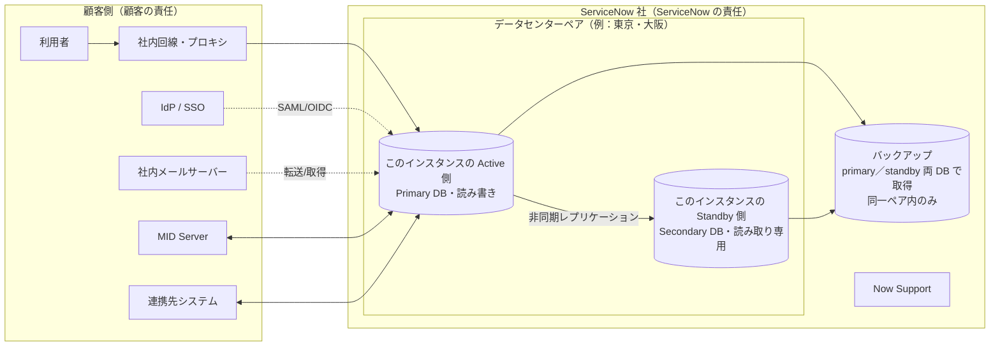
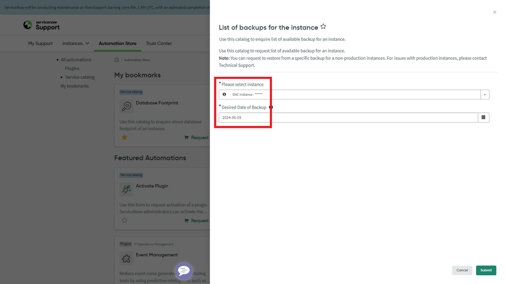
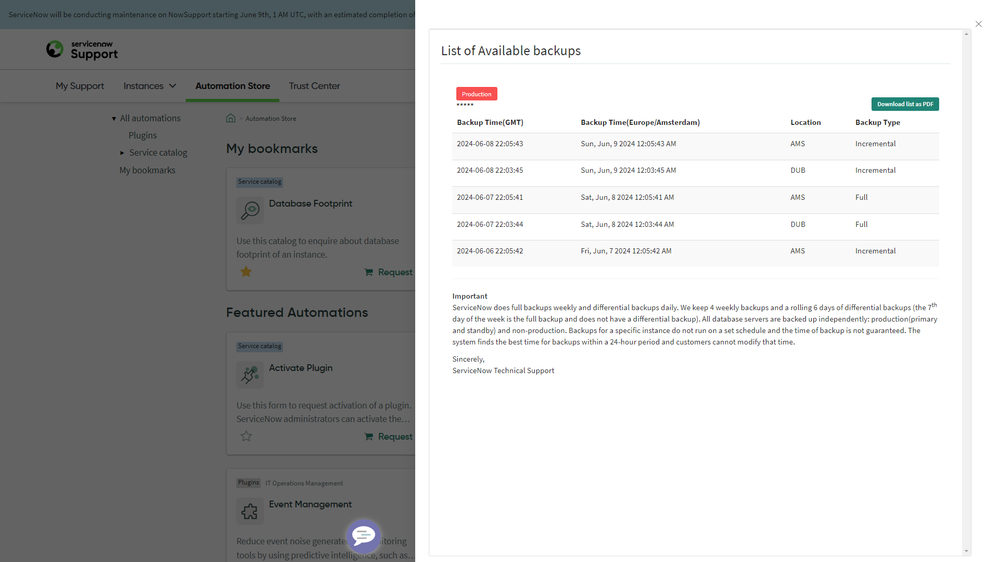
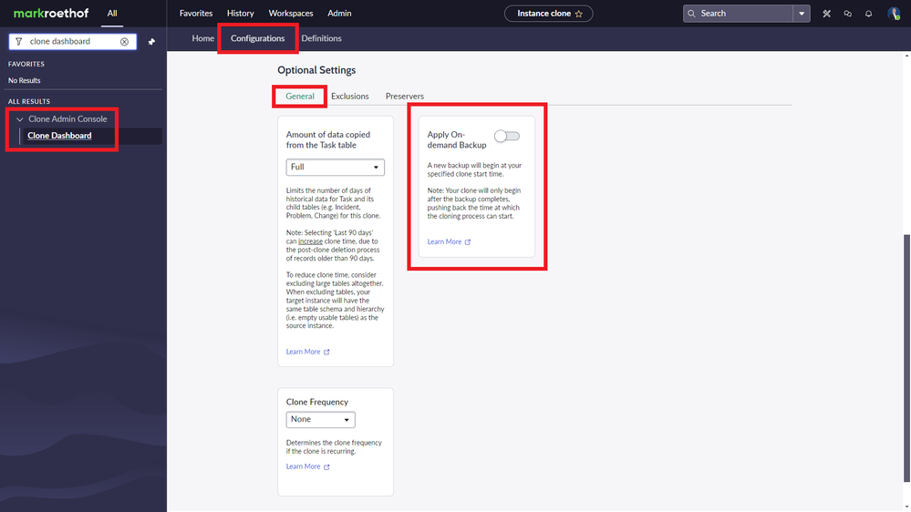

# ServiceNow 停止時の事業継続と災害復旧（DR）計画

## 概要

本ファイルは、ServiceNow を**利用する企業（顧客）の立場**から、ServiceNow のインスタンスが停止・劣化したときに業務を継続し、データを復旧するための **BCP（Business Continuity Plan、事業継続計画）** と **DR（Disaster Recovery、災害復旧）計画** の立て方を、導入・運用の実務で使える粒度でまとめる。

ServiceNow は SaaS であり、データセンターの冗長化やデータベースのレプリケーションは ServiceNow 社が担う。一方、**「ServiceNow が使えない間に業務をどう回すか」「誤更新・誤削除などの論理障害からどう戻すか」「ServiceNow の外にどのデータを持っておくか」「訓練をどうするか」** は顧客側の責任である。BCP/DR を「ServiceNow 社の DR があるから不要」と扱うと、障害時に受付が止まり、連絡手段も失われる。【経験則】

| 本ファイルで答える問い | 該当章 |
|---|---|
| ServiceNow 社は何を保証しているか（RTO/RPO、SLA、データセンターペア、フェイルオーバー） | [2 章](#2-servicenow-社が提供する可用性dr-の仕組み) |
| 顧客は何に責任を持つか | [3 章](#3-責任分界servicenow-社と顧客) |
| どんな障害シナリオを想定し、何を発動基準にするか | [4 章](#4-障害シナリオの分類と対応方針) |
| 停止・劣化時の代替手順（オフライン運用、連絡手段、メール、SSO） | [5 章](#5-停止劣化時の代替業務手順) |
| バックアップの確認と復元依頼の手順 | [6 章](#6-バックアップの確認と復元依頼) |
| ServiceNow の外へデータを退避する方法 | [7 章](#7-外部へのデータ退避エクスポートレプリケーション) |
| DR 訓練の進め方 | [8 章](#8-dr-訓練の進め方) |
| BCP 文書の構成と導入プロジェクトでのチェックリスト | [9 章](#9-bcp-文書の構成テンプレート)、[10 章](#10-導入プロジェクト運用でのチェックリスト) |

> 基準リリースは Australia（2026-05 GA）。Brazil で判明している変更は「Brazil での変更」として併記する。ServiceNow の DR に関する一次資料（ISCP、ホワイトペーパー、Now Support の KB）の多くは契約者向けの CORE や Now Support にあり、公開情報で確認できた範囲のみを記載する。数値・条件は**必ず自社の契約書（Order Form、Customer Support Addendum 等）と CORE の資料で確認**すること。

関連ファイル：インスタンスの物理構成（AHA・データセンター・バックアップ仕様の詳細）は [インスタンスアーキテクチャ](../02_リファレンス/platform/instance-architecture.md)、サポートの優先度・Availability SLA・Maintenance Center は [サポートと監視](14-support-monitoring.md)、運用体制は [運用とガバナンス](12-operations-governance.md)、環境とクローンは [インスタンス戦略と環境](07-instance-strategy.md) と [アップデートセットとクローン](../02_リファレンス/platform/update-sets-cloning.md)、SSO の Account Recovery は [認証とSSO](../02_リファレンス/platform/authentication-sso.md)、エクスポートの仕様は [データインポート/エクスポート](../02_リファレンス/platform/import-export-data.md)、メール受信の仕様は [通知とメール](../02_リファレンス/platform/notifications-email.md)、自社の BCP 全体を ServiceNow で管理する製品は [Integrated Risk Management (GRC)](../02_リファレンス/irm/integrated-risk-management.md) を参照。

---

## 1. 用語と前提

### 1.1 用語

| 用語（英語） | 日本語 | 本ファイルでの意味 |
|---|---|---|
| Business Continuity Plan（BCP） | 事業継続計画 | ServiceNow が使えない間も、インシデント受付・変更承認・サービス要求などの業務を継続するための計画。代替手順・連絡体制・発動基準を含む |
| Disaster Recovery（DR） | 災害復旧 | 障害後にシステムとデータを復旧する計画と手段。ServiceNow のインフラ DR（ServiceNow 社）と、顧客側のデータ・連携・業務の DR に分かれる |
| RTO（Recovery Time Objective） | 目標復旧時間 | 障害発生から業務・システムを再開するまでの目標時間 |
| RPO（Recovery Point Objective） | 目標復旧時点 | 障害時に失ってよいデータの最大時間幅（どの時点まで戻れれば良いか） |
| Advanced High Availability（AHA） | 高度高可用性 | ServiceNow 運用クラウドの本番インスタンスの可用性アーキテクチャ。データセンターペア間で非同期レプリケーションし、Transfer／Failover で切り替える |
| Data center pair | データセンターペア | 同一地域内で地理的に離れた 2 拠点の組。本番データは両方に保持される（日本は東京・大阪） |
| Transfer | トランスファー（計画切替） | インスタンス単位で、ペア内の Primary（Active、読み書き）と Secondary（Standby、読み取り専用）の役割を計画的に入れ替える操作 |
| Failover | フェイルオーバー | 障害時に、インスタンスの Standby 側（読み取り専用の Secondary）を Active に切り替える操作 |
| Failback | フェイルバック | フェイルオーバー後に通常状態へ戻すこと |
| ISCP（Cloud DRP） | 情報システム緊急時計画（クラウド DR 計画） | ServiceNow 社が年 1 回テストする自社クラウドの DR 計画。SOP とテストレポートは CORE で提供される |
| CORE | ― | ServiceNow 社が契約者向けにコンプライアンス文書（監査報告書、ISCP テストレポート等）を提供する場。公開情報では詳細不明 |
| Excused Downtime | 免責ダウンタイム | Availability SLA の算定から除外される停止時間（月 2 時間までの Maintenance Time、顧客側回線障害等） |
| Logical failure | 論理障害 | 誤更新・誤削除・不正なスクリプトや連携による大量更新など、インフラは正常だがデータが壊れる障害。AHA では防げない |
| Fix-forward | 修正前進方式 | 本番を過去のバックアップへ戻すのではなく、修正・回避策を当てて前に進む復旧方針（ServiceNow 社が推奨） |

### 1.2 物理障害と論理障害の区別

BCP/DR 計画で最初に押さえるべき点は、**ServiceNow の DR（AHA）が守るのは主に物理障害であり、論理障害は顧客側の手段で対処する必要がある**ことである。

| 区分 | 例 | 主な対処主体 | 主な手段 |
|---|---|---|---|
| 物理障害（インフラ） | データセンター障害、ハードウェア障害、DB 障害 | ServiceNow 社 | AHA の Failover、Transfer |
| 性能劣化 | 応答遅延、ノード障害、セマフォ枯渇 | ServiceNow 社＋顧客 | サポートケース（P1/P2）、顧客側カスタマイズの是正 |
| 論理障害 | 誤ったスクリプト・連携・インポートによる大量更新／削除 | 顧客（ServiceNow 社が支援） | Deleted Records、Delete Recovery、Rollback Contexts、データ修正スクリプト、最終手段としてバックアップからの復元 |
| 顧客側起因の到達不能 | 社内回線・プロキシ・VPN・IdP（SSO）障害 | 顧客 | 代替回線、Account Recovery（ACR）、ローカルログイン |
| 連携先・MID Server の障害 | 監視ツール、メールサーバー、人事システム、MID Server ホスト | 顧客（連携先ベンダー） | MID Server の冗長化、キューイングと再送 |

ServiceNow 社員のブログは、バックアップは**誤削除や、連携・自動化の誤設定／誤動作によるデータ損失から復旧するためのもの**であり、**クラウドサービスの耐障害性（DR）の手段としては用いない**と明記している。[出典](https://www.servicenow.com/community/platform-privacy-security-blog/data-backup-for-my-servicenow-instances/ba-p/2772922)

---

## 2. ServiceNow 社が提供する可用性・DR の仕組み

本章は顧客の BCP 文書に「前提条件」として記載すべき事項をまとめる。アーキテクチャの詳細は [インスタンスアーキテクチャ 5 章](../02_リファレンス/platform/instance-architecture.md#5-高可用性ahaと災害対策drバックアップ) を参照。

### 2.1 AHA とデータセンターペア

| 項目 | 内容 | 出典 |
|---|---|---|
| ペア構成 | データセンターをペアで運用し、顧客の本番データをペアの両データセンターに同時に保持する | [ServiceNow 社員ブログ（2023-12）](https://www.servicenow.com/community/platform-privacy-security-blog/data-backup-for-my-servicenow-instances/ba-p/2772922) |
| 同期方式 | 非同期の DB レプリケーション | 同上 |
| 稼働方式 | ペアの 2 拠点は**データセンター単位では active-active**（どちらも本番負荷を処理する）。**インスタンス単位では一方が Active（読み書き）、他方が Standby（読み取り専用）**で、どちら側が Active かはインスタンスごとに異なり（固定の Primary 拠点はない）、Transfer／Failover で入れ替わる | 同上、[コミュニティ記事（2018）](https://www.servicenow.com/community/developer-articles/servicenow-datacenters/ta-p/2330303)、[インスタンスアーキテクチャ 4.1](../02_リファレンス/platform/instance-architecture.md#41-データセンターペアの考え方) |
| 冗長化 | 冗長コンポーネントと複数ネットワーク経路で単一障害点を排除 | 同上 |
| 能力 | ペア内の各データセンターは、ペア全体の本番負荷を単独で処理できる能力を持つ | [コミュニティ記事（2018）](https://www.servicenow.com/community/developer-articles/servicenow-datacenters/ta-p/2330303) |
| 日本のペア | 東京・大阪 | [インスタンスアーキテクチャ 4.4](../02_リファレンス/platform/instance-architecture.md#44-日本のデータセンター東京大阪) |
| サブプロダクション | 本番と同等の完全な AHA 構成は含まれない（ServiceNow 社員の回答） | [インスタンスアーキテクチャ 5.5](../02_リファレンス/platform/instance-architecture.md#55-サブプロダクションの可用性) |

※この図は公式資料をもとに本ファイルで整理したもの。Active／Standby はこのインスタンスから見た役割で、同じペアの別インスタンスでは逆になりうる。バックアップを primary／standby の両 DB で取得する点は [6.2](#62-バックアップ一覧の取得手順) の Now Support 画面注記による。【推定】

### 2.2 RTO・RPO・Availability SLA・DR テスト

| 指標 | 値 | 出典・確度 |
|---|---|---|
| RTO | **2 時間** | ServiceNow 社員ブログ（2023-12-26）。「ServiceNow の内部指標」とされる [出典](https://www.servicenow.com/community/platform-privacy-security-blog/data-backup-for-my-servicenow-instances/ba-p/2772922) |
| RPO | **1 時間** | 同上 |
| Availability SLA | 本番インスタンスで暦月あたり **99.8%** | 同上。CSA（2020 年版）の Availability SLA 条項も同値 [出典](https://static.carahsoft.com/concrete/files/9116/2998/6889/customer-support-addendum-upgrades.pdf) |
| SLA 未達時の救済 | Service Credit（サービスクレジット）が唯一の救済手段（exclusive remedy） | CSA（2020 年版） 同上 |
| Excused Downtime | 月 2 時間までの Maintenance Time、ServiceNow の管理外の事由（顧客側インフラ・回線〔専用線・VPN を含む〕障害、不可抗力、DoS 等） | CSA（2020 年版） 同上 |
| DR テスト | ISCP（Cloud DRP）テストを**年 1 回**実施。SOP とテストレポートは **CORE** で提供。結果は RTO/RPO を一貫して大きく上回るとされる | ServiceNow 社員ブログ 同上 |

**BCP 文書での扱い方【経験則】:**

- RTO 2 時間・RPO 1 時間は「ServiceNow 社のインフラ DR の目標」であり、**顧客業務の RTO/RPO ではない**。顧客業務の RTO（例：インシデント受付は 15 分以内に代替手段へ切り替え）は自社で別途定める。
- RPO 1 時間とは、データセンター喪失級の障害で**最大 1 時間程度の更新が失われうる**ことを意味する。失われた可能性のある期間の入力（チケット、承認、連携で受けたイベント）を後から再入力・再送する手順が必要になる（[5.7](#57-復旧後の取り込みと整合性確認)）。
- 99.8%/月は、30 日の月で約 86 分の非 Available 時間に相当する（Excused Downtime を除く）。月 2 時間までの Maintenance Time は算定から除外されるため、**計画メンテナンスを含めた実際の停止時間はこれより長くなりうる**。【推定】
- 最新の Customer Support Addendum（2025 年版とされる）の数値は公開情報では確認できず（[サポートと監視](14-support-monitoring.md) の「確認できなかった事項」も参照）。契約書から転記すること。

### 2.3 Transfer／Failover 時に利用者から見える挙動

| 項目 | 内容 | 出典・確度 |
|---|---|---|
| 計画 Transfer の通知 | ServiceNow 社からシステム管理者宛てに事前通知が届く。2014 年の投稿では、通知に返信して影響を確認するよう ServiceNow 社員が回答 | 【第三者情報】[コミュニティ](https://www.servicenow.com/community/itsm-forum/what-will-end-users-see-during-an-aha-data-center-transfer/m-p/789193) |
| 停止時間 | Support は「最大 15 分」と案内。2018 年の利用者の計測では HTTP 500 が約 2 分続いたのち 200 に復帰 | 【第三者情報】同上 |
| IP アドレス | データセンターを移るとインスタンスのアクセス用 IP と、インスタンスが外向きに使う IP の**両方が変わる**。ペア両側の IP を許可リストに登録しておくよう ServiceNow 社員が助言（2017） | 【第三者情報】[コミュニティ](https://www.servicenow.com/community/itom-forum/do-the-ip-addresses-for-our-instances-change-when-we-move-data/m-p/2824583) |
| IP の確認方法 | Now Support の Service Catalog > Instance Management > **My IP Information**。ペア相手側 IP を出す標準機能はない（2017 時点） | 同上 |
| 連携への影響 | AHA Transfer のたびに、IP 許可リストを持つ外部 SaaS（例：Workday）との連携が HTTP 500 で失敗するという 2024 年の報告がある | 同上 |
| Hermes（Kafka）の挙動 | Transfer 後、インスタンスは新しく Active になったデータセンターの Hermes クラスタを使う。Stream Connect 等の外部 Producer/Consumer は両クラスタの接続先を考慮する | [公式（Zurich）](https://www.servicenow.com/docs/r/zS6yb8e~gR8BPjeviYdV9g/KufA2mI6WfAIsf2ymqoWdg) |

**実務上の要点【経験則】:**

- 社内ファイアウォール・プロキシ・連携先 SaaS の IP 許可リストには、**ペアの両データセンターの IP を登録**する。片側だけだと、Transfer／Failover のたびに連携が止まる。ServiceNow のインスタンス IP とデータセンター所在は Now Support の KB0538621 等で確認できる（[インスタンスアーキテクチャ 3 章](../02_リファレンス/platform/instance-architecture.md)）。
- 計画 Transfer は、顧客の変更管理でも **Change（変更）レコード**として登録し、連携先チームに周知する。コミュニティでは、AHA Transfer が本番障害の原因になった経験から、ServiceNow からの通知メールを契機に Change を自動作成する案が議論されている（2025-01、公式回答なし）。[出典](https://www.servicenow.com/community/architect-forum/change-records-for-servicenow-instance-maintenance-operations/m-p/3151195)【第三者情報】

### 2.4 バックアップ（ServiceNow 社が取得するもの）

| 項目 | 内容 | 出典・確度 |
|---|---|---|
| 目的 | 誤削除、連携・自動化の誤設定／誤動作からのデータ復旧。DR 手段ではない | [ServiceNow 社員ブログ（2023-12）](https://www.servicenow.com/community/platform-privacy-security-blog/data-backup-for-my-servicenow-instances/ba-p/2772922) |
| 頻度 | 週次フル＋日次差分 | 同上 |
| 保持期間 | 最低 14 日。28 日の保持期間をオプション購入可 | 同上 |
| 暗号化 | AES-256 | 同上 |
| 保管場所 | インスタンスをホストする同一データセンターペア内のオンサイトのみ。オフサイト転送なし、第三者事業者の関与なし | 同上 |
| 実施単位 | 本番（primary と standby）と非本番の各 DB サーバーを独立してバックアップ。取得時刻は固定されず、24 時間内の最適な時刻をシステムが選び、顧客は変更できない | Now Support の「List of Available backups」画面の注記（2024-06 のスクリーンショット、[6.2](#62-バックアップ一覧の取得手順)） |

> **保持期間の記述の食い違い:** 2024-06 時点の Now Support 画面の注記と、その画面を紹介したコミュニティ記事は「週次フルを 4 週分、差分を 6 日分ローリングで保持」としており、上記の社員ブログ（最低 14 日、28 日はオプション）と食い違う。[出典](https://www.servicenow.com/community/now-platform-articles/list-of-available-instance-backups/ta-p/2957002) 第三者（Perspectium）は「2023-05 時点でフルバックアップの保持は最大 14 日」と記載している【第三者情報】[出典](https://www.perspectium.com/blog/servicenow-backup-retention-explained/)。**自社インスタンスで実際に何日分のバックアップがあるかは、[6.2](#62-バックアップ一覧の取得手順) の手順で一覧を取得して確認する**こと。

### 2.5 状態の把握手段（ServiceNow 社側の情報源）

| 情報源 | 内容 | 利用条件・確度 |
|---|---|---|
| Now Support（support.servicenow.com） | ケース起票、インスタンスの状態・メンテナンス予定、Automation Store（カタログ）。Maintenance Center（KB0999157）でメンテナンス通知を一元表示 | 契約者。[サポートと監視 2 章](14-support-monitoring.md) |
| ServiceNow からの通知メール | 計画メンテナンス、Transfer、障害の通知が、Now Support に登録された担当者に届く。全利用者に届くわけではない | 【第三者情報】[コミュニティ（2025-12 の投稿）](https://www.servicenow.com/community/virtual-agent-forum/is-there-an-official-servicenow-service-status-page/m-p/3172582) |
| Cloud availability（Impact） | ServiceNow のデータセンターを世界地図上に表示し、緑＝Available、黄＝Service degradation、赤＝Service outage で状態を示す。データセンターを選ぶと詳細を展開。Instance Observer は直近 90 日の可用性サマリーとサービス障害の詳細を提供 | ServiceNow Impact の機能（Brazil 版ドキュメント）[出典](https://www.servicenow.com/docs/r/impact/cloud-availability.html)。対象パッケージ・ロールは公開ページで確認できず |
| 公開ステータスページ | Slack Status のような**誰でも見られる公式ステータスページは、公開情報では確認できず**。2025 年のコミュニティでも「status.servicenow.com のような外部ページがほしい」という要望が出ている | 【第三者情報】[コミュニティ](https://www.servicenow.com/community/virtual-agent-forum/is-there-an-official-servicenow-service-status-page/m-p/3172582) |
| 第三者の監視サービス | StatusGator 等が「ServiceNow の公式ステータスページ」を監視し、データセンター別（Tokyo HND、Osaka KIX を含む 28 拠点）と Developer・Now Support・Store の状態を表示。計画メンテナンスは個別に通知されないため検知できないとされる | 【第三者情報】[StatusGator](https://statusgator.com/services/servicenow)。監視元ページの URL は確認できず |

- インスタンス内の `esc?id=service_status`（Employee Center のサービス状態ページ）は**顧客が自社の業務サービスについて作る障害情報**であり、ServiceNow 自体の状態ではない。ServiceNow が止まれば当然表示できない。[出典](https://www.servicenow.com/community/virtual-agent-forum/is-there-an-official-servicenow-service-status-page/m-p/3172582)

---

## 3. 責任分界（ServiceNow 社と顧客）

### 3.1 責任分界表

ServiceNow が公式に公開している BCP/DR の責任分界表は、公開情報では確認できず。以下は公式情報（[2 章](#2-servicenow-社が提供する可用性dr-の仕組み)）と実務上の論点をもとに整理したもの。【推定】

| 領域 | ServiceNow 社の責任 | 顧客の責任 |
|---|---|---|
| データセンター・ハードウェア・DB | 冗長化、AHA、Transfer／Failover、ISCP テスト | ― |
| 可用性の約束 | Availability SLA（99.8%/月、本番）、Service Credit | 契約条件の把握、SLA 未達時のクレジット請求 |
| バックアップ取得 | 週次フル＋日次差分、14 日以上保持、AES-256、同一ペア内保管 | 保持期間延長（28 日）購入の要否判断、**ServiceNow 外への独自退避**（[7 章](#7-外部へのデータ退避エクスポートレプリケーション)） |
| バックアップからの復元 | 本番：サポートケースで支援（最終手段）。非本番：Automation Store のカタログで実行 | 復元要否・範囲の判断、業務影響の評価、復元後の差分再入力 |
| 論理障害（誤更新・誤削除） | サポートでの技術支援 | 原因特定、Deleted Records／Delete Recovery／Rollback の実施、データ修正、再発防止 |
| ネットワーク到達性 | ServiceNow 側のマルチホーム接続 | 社内回線・プロキシ・VPN・専用線の冗長化、IP 許可リスト（ペア両側） |
| 認証 | プラットフォームの ACR 機能 | IdP の可用性、ACR ユーザー／break-glass 管理者の整備（[5.5](#55-ssoidp障害時のログイン手段)） |
| メール | ServiceNow 提供メールサーバー（標準構成） | 社内メールサーバー・転送設定、代替受付窓口（[5.4](#54-メール受付の退避)） |
| 連携・MID Server | Hermes（Kafka）の Near/Far 切替 | MID Server の冗長化（複数 MID、クラスタ）、連携先の DR、再送設計 |
| カスタマイズ起因の性能劣化 | 調査支援（P1〜P3） | カスタマイズの是正、Instance Scan 等での予防 |
| 業務継続 | 計画メンテナンスの通知 | 通知の受信体制、BCP の策定、代替手順、訓練、連絡網 |
| 監査証跡 | ISCP SOP・テストレポートを CORE で提供 | CORE 資料の取得と社内監査・規制当局への提示、自社 BCP 訓練記録の保管 |

### 3.2 規制対応での扱い【経験則】

- 金融・公共などで外部委託先（クラウド事業者）の BCP 確認を求められる場合、ServiceNow 社については **CORE の ISCP SOP・年次テストレポート、SOC 2 等の監査報告書**を根拠資料として取得し、契約上の Availability SLA を引用する。
- そのうえで、**自社側の代替手順・訓練結果**をセットで示す。ServiceNow 社の資料だけでは「自社業務が継続できること」の説明にならない。
- データの所在（東京・大阪ペア内に本番データとバックアップが保持されること）は、データ主権・個人情報の越境移転の説明に使える（[インスタンスアーキテクチャ 4.4](../02_リファレンス/platform/instance-architecture.md#44-日本のデータセンター東京大阪)）。ただし [7 章](#7-外部へのデータ退避エクスポートレプリケーション) の外部退避先を国外クラウドにすると説明が変わるので注意する。

---

## 4. 障害シナリオの分類と対応方針

### 4.1 シナリオ一覧

BCP では、原因ではなく**「利用者から見て何が起きているか」**でシナリオを分けると、発動判断が速くなる。【経験則】

| # | シナリオ | 典型的な原因 | 想定される停止時間の目安 | 主な対応 |
|---|---|---|---|---|
| S1 | インスタンス全体に接続不可（全利用者） | データセンター障害、DB 障害、ServiceNow 側ネットワーク障害 | Failover 完了まで（ServiceNow の RTO は 2 時間） | P1 起票（電話）、代替受付へ切替、連絡網発動 |
| S2 | インスタンスが極端に遅い／一部機能だけ不可 | ノード障害、セマフォ枯渇、長時間ジョブ、カスタマイズ | 数分〜数時間 | P1/P2 起票、遅延業務の優先順位付け、重いジョブ停止 |
| S3 | 社内からだけ接続不可 | 社内回線・プロキシ・DNS・VPN 障害 | 社内復旧まで | 社内ネットワーク復旧、モバイル回線・別拠点からの接続、SLA は Excused Downtime |
| S4 | ログインできない（画面は開く） | IdP（SSO）障害、証明書期限切れ、MFA 基盤障害 | IdP 復旧まで | ACR ユーザーでの SSO 設定確認、必要に応じローカルログインの一時許可 |
| S5 | メールでの受付・通知が止まる | 社内メールサーバー障害、転送設定、ServiceNow のメール処理遅延、Email Accounts の認証失効 | 数分〜数日 | 代替受付窓口、受信設定の確認、復旧後のバックログ処理 |
| S6 | 連携が止まる | MID Server 停止、連携先障害、IP 許可リスト（Transfer 後） | 個別 | MID 切替、再送、IP 許可リスト修正 |
| S7 | データが壊れた（論理障害） | 誤ったスクリプト・インポート・連携・フローによる大量更新／削除 | 数時間〜数日 | 影響範囲特定、Delete Recovery／Rollback、修正スクリプト、最終手段でバックアップ復元 |
| S8 | 計画メンテナンス・Transfer | パッチ、アップグレード、インフラ更新 | 数分（Transfer）〜通知どおり | 事前周知、Change 登録、時間帯調整 |
| S9 | Now Support 自体が使えない | Now Support のメンテナンス・障害、SSO 障害で Now Support にログイン不可 | 個別 | 電話窓口へ連絡（[5.2](#52-緊急連絡手段)） |
| S10 | 広域災害（ペア両拠点が同時に影響） | 大規模地震等 | 公開情報では想定値なし | 長時間のオフライン運用、外部退避データでの業務継続 |

> S10（ペア両拠点同時被災）の扱い：ServiceNow のバックアップは「同一データセンターペア内のみ」に保管され、オフサイト転送されない（[2.4](#24-バックアップservicenow-社が取得するもの)）。ペア両方を失う事態での ServiceNow 社の復旧手段は公開情報では確認できず。この残余リスクを受容するか、[7 章](#7-外部へのデータ退避エクスポートレプリケーション) の外部退避で手当てするかを経営判断として記録しておく。【推定】

### 4.2 発動基準（例）

以下は BCP 文書に書く発動基準の例である。値は業務要件に応じて調整する。【経験則】

| レベル | 条件の例 | 発動するもの |
|---|---|---|
| 注意（Watch） | 外形監視で 3 回連続失敗、または利用者から遅延の報告が複数 | 運用当番が状況確認、Now Support・Cloud availability を確認 |
| 警戒（Alert） | 全利用者で 15 分以上接続不可、または主要機能が 15 分以上不可 | P1 起票（電話）、関係者への一次連絡、代替受付の準備 |
| BCP 発動（Invoke） | 30 分以上接続不可、または ServiceNow から長時間停止の連絡 | オフライン運用へ切替、メール受付の退避、利用者への周知 |
| DR（データ復旧） | 論理障害で業務データの整合性が失われた | 変更凍結、影響調査、復旧方式の決定（[6.3](#63-復元手段の選び方)） |
| 解除（Stand down） | インスタンス復旧を確認し、主要機能のスモークテストに合格 | 復旧後の取り込み（[5.7](#57-復旧後の取り込みと整合性確認)）、事後レビュー |

### 4.3 体制と役割

| 役割 | 主な責任 | 備考【経験則】 |
|---|---|---|
| BCP 責任者（Incident Commander） | 発動・解除の判断、経営への報告 | ServiceNow のプラットフォームオーナーまたはサービスデスク責任者 |
| ServiceNow 連絡担当 | Now Support へのケース起票・電話、状況の取得 | Now Support アカウントと P1 用電話番号を持つ者を**複数名** |
| 技術担当（Platform admin） | 原因切り分け、論理障害の調査、ACR でのログイン、設定変更 | break-glass 資格情報の保管場所を知る者 |
| サービスデスク責任者 | 代替受付の運用、記録、復旧後の取り込み | 紙／表計算の受付票を管理 |
| 広報・利用者連絡 | 社内周知（ServiceNow 以外の手段で） | 社内ポータル、全社メール、チャット |
| 連携先担当 | MID Server・連携先の確認、再送 | 連携一覧と担当者を事前に整備 |

---

## 5. 停止・劣化時の代替業務手順

### 5.1 検知と状況把握

**外形監視を ServiceNow の外に置く。** ServiceNow 内の監視（Instance Observer 等）は ServiceNow が止まると参照できない場合があるため、自社の監視ツールや外部の合成監視（synthetic monitoring）から本番インスタンスのログイン画面・API を定期的に確認する。【経験則】

| 監視項目 | 方法の例 | 備考 |
|---|---|---|
| ログイン画面の応答 | `https://<instance>.service-now.com/login.do` に HTTP GET し、200 と応答時間を確認 | SSO のリダイレクト先ではなくインスタンス自体を確認する |
| API の応答 | 監視用ユーザーで Table API（例：`/api/now/table/sys_user?sysparm_limit=1`）を呼ぶ | 読み取り専用ロールの監視ユーザーを用意する |
| メール処理 | 監視用アドレスからテストメールを送り、レコード作成までの時間を計測 | メール受信の遅延検知 |
| 連携 | MID Server の状態、ECC Queue の滞留件数 | 詳細は [MID Server](../02_リファレンス/platform/mid-server.md) |
| ServiceNow 社側の情報 | Now Support、Cloud availability（Impact 契約時）、通知メール、第三者ステータス監視 | [2.5](#25-状態の把握手段servicenow-社側の情報源) |

切り分けの順序（例）【経験則】：

1. 社外回線（モバイル回線等）から接続できるか → できれば S3（社内回線）を疑う。
2. `login.do` は開くが SSO で失敗するか → S4（IdP）を疑う。
3. 他の利用者・他拠点でも同じか → 全体障害か一部かを判断。
4. Now Support・通知メール・第三者ステータスで ServiceNow 側の障害情報があるか。
5. 直近のリリース・インポート・スケジュールジョブ・連携変更がないか → S2/S7（自社起因）を疑う。

### 5.2 緊急連絡手段

**ServiceNow 社への連絡:**

| 手段 | 内容 | 出典・確度 |
|---|---|---|
| 電話 | サポートは電話（contact-support ページ記載の番号）またはポータル経由で 24 時間 365 日受付。P1（インスタンスが Available でない）の初回応答目標は 30 分（Impact の Total 等では 15 分） | [サポートと監視 3 章](14-support-monitoring.md) |
| Now Support ポータル | ケース起票。ServiceNow ID でログインする | 同上 |
| Now Support 停止時 | Now Support 自体のメンテナンス時には、緊急の問題はすべて電話で受け付けると案内された例がある（2023-04 の FAQ） | [コミュニティ FAQ](https://www.servicenow.com/community/developer-articles/now-support-scheduled-maintenance-faqs-april-8-2023/ta-p/2516591)【第三者情報】 |
| Impact 契約時 | SAM（Support Account Manager）・CSM にも並行して連絡 | 【経験則】 |

**社内の連絡手段【経験則】:**

- ServiceNow の通知（メール、Teams/Slack 連携、On-Call Scheduling の呼び出し）は **ServiceNow が止まると使えない**。BCP 用の連絡網は ServiceNow の外に置く。
- **On-Call Scheduling（オンコール当番表）**、エスカレーション先、主要グループのメンバー、連携先ベンダーの窓口は、定期的に ServiceNow からエクスポートして共有ストレージや紙に保管する（[7.4](#74-最小退避セット何を外に持つか)）。
- 連絡網には、Now Support の P1 電話番号、自社の契約番号（Account 情報）、インスタンス名、Now Support に登録済みの担当者名を記載する。日本の電話番号は公開情報では確認できず（[サポートと監視](14-support-monitoring.md)）、契約時に取得して転記する。
- 利用者への周知は、ServiceNow のポータル（Employee Center の Service Status、Announcement）に頼らず、全社メール・社内ポータル・チャットのテンプレートを事前に用意する。

### 5.3 オフライン運用（代替受付）

ServiceNow が使えない間の受付・記録の方法を事前に決めておく。【経験則】

| 業務 | 代替手段の例 | 事前準備 |
|---|---|---|
| インシデント受付 | 電話受付＋共有の表計算（Excel／Google スプレッドシート等）の受付台帳。重大障害は電話会議＋議事録 | 台帳テンプレート（列は復旧後のインポートに合わせる）、仮番号の採番規則（例：`BCP-YYYYMMDD-001`） |
| サービス要求 | 緊急のものだけ受け付け、それ以外は復旧後の申請を案内 | 「緊急」の基準、承認者リスト |
| 変更管理 | 緊急変更（Emergency change）のみ、紙／メールで承認し記録。復旧後に事後登録 | 承認者・CAB 緊急メンバー一覧（ServiceNow 外に保管） |
| ナレッジ参照 | 重要な手順書（障害対応 Runbook、パスワードリセット手順等）を定期エクスポートしたものを参照 | エクスポートの自動化（[7 章](#7-外部へのデータ退避エクスポートレプリケーション)） |
| CMDB 参照 | 重要サービスと担当者・依存関係の一覧を定期エクスポート | 重要サービス一覧の定義 |
| SLA 管理 | 受付時刻・解決時刻を台帳に記録し、復旧後に手動調整 | SLA 停止期間の扱いルール |
| 現場作業（FSM 等） | モバイルアプリのオフラインモード（後述）または紙の作業票 | オフラインモードの設定・事前キャッシュ |

**受付台帳の最小項目（例）:** 仮番号、受付日時、受付者、申告者（氏名・連絡先）、カテゴリ、影響サービス、緊急度・影響度、内容、対応状況、担当グループ、解決日時、解決内容。列名は `incident` テーブルのフィールド（`caller_id`、`short_description`、`category`、`impact`、`urgency`、`assignment_group` 等）に対応させておくと、復旧後に Import Set で取り込みやすい。【経験則】

**モバイルアプリのオフラインモード:** ServiceNow のモバイルアプリには Offline mode（オフラインモード）があり、利用者は Settings > Offline で Offline Mode をオンにしてオフラインキャッシュをダウンロードし、オフライン中の操作は Outbox に記録され、オンラインに戻ると Sync all で同期される。他者の変更と競合した変更は同期されず Outbox に残る。管理者はオフラインで使える操作とキャッシュの有効期限を設定する。作業スケジュールに基づく自動キャッシュ（Scheduled caching）と Wi-Fi only オプションもある。[出典](https://www.servicenow.com/docs/r/mobile/offline-end-user.html)（Brazil 版、2026-09-10 更新）

- オフラインモードは本来、現場の通信断に備える機能である。インスタンス停止中も**事前にキャッシュ済みのレコード**は参照・更新でき、復旧後に同期できると考えられるが、インスタンス停止を前提とした公式の説明は確認できず。【推定】
- 対象アプリ（Now Mobile、Mobile Agent 等）ごとの対応範囲はモバイルの設定に依存する。詳細は [モバイル](../02_リファレンス/platform/mobile.md) を参照。

### 5.4 メール受付の退避

メールでの受付（`<instance>@service-now.com` やカスタムドメインのアドレス）を使っている場合、ServiceNow 停止時にメールがどうなるかを把握し、退避方法を決める。

**ServiceNow のメール構成（2 種類）:**

| 構成 | 受信の仕組み | 停止時の挙動 |
|---|---|---|
| Standard configuration（標準構成） | ServiceNow 提供のメールサーバーが受信し、インスタンスが取り込む。アドレスは `<instance>@service-now.com` | コミュニティの回答では、メールは ServiceNow 管理のメールサーバーに届き、インスタンスは既定で 2 分ごとに取得して取得後にサーバーから削除する。インスタンス停止中は取得されず、復旧後に取り込まれる「可能性が高い」とされ、通常はバウンスしないとされる【第三者情報】[出典](https://www.servicenow.com/community/sysadmin-forum/servicenow-outage-what-happens-to-our-email-backlog/m-p/2727035) |
| Alternate configuration（代替構成） | 顧客の POP3／IMAP／Microsoft Graph のメールボックスを、`sys_email_account`（Email Accounts）の設定でインスタンスが取得する | 顧客側メールボックスにメールが残るため、停止中も顧客側で閲覧できる。復旧後にインスタンスが未読分を取得する（取得条件は設定に依存）【推定】 |

構成の詳細は [通知とメール](../02_リファレンス/platform/notifications-email.md) を参照。上記の標準構成の挙動はコミュニティ投稿（ServiceNow 社員であるかは不明）によるもので、ServiceNow の公式説明は公開情報では確認できず。**BCP の前提にする場合は Now Support に確認する**こと。

**退避パターン【経験則】:**

| パターン | 方法 | 長所 | 注意点 |
|---|---|---|---|
| A. 社内アドレス経由の転送を切り替える | 利用者には社内アドレス（例：`servicedesk@example.co.jp`）を案内し、社内メールサーバーで `<instance>@service-now.com` へ転送。停止時は転送先を共有メールボックスへ切替 | 停止中もサービスデスクが受信メールを読める | 復旧後、共有メールボックスに溜まった分を ServiceNow に再投入する手順が必要（転送し直すと二重起票の恐れ） |
| B. 転送と同時に控えを残す | 常時、社内の共有メールボックスにも控えを配信（BCC／ジャーナル） | 切替作業なしで停止中の受信分を参照できる | 平常時は控えを読まない運用にする。保存期間・個人情報の扱いを決める |
| C. 代替構成（顧客メールボックスを取得） | Microsoft Graph／IMAP でインスタンスが顧客メールボックスを取得 | メールが顧客側に残る | 認証情報（OAuth トークン等）の失効も停止原因になる。取得済みメールの扱い（既読化・移動）を確認 |

**復旧後のバックログ処理:**

- 復旧直後は、停止中のメールが一度に取り込まれ、Inbound email action が大量に実行される。重複起票や自動返信の大量送信に注意する。【経験則】
- 停止中に代替受付で台帳起票した案件と、復旧後にメールから自動起票された案件が**二重化**しうる。台帳の仮番号と自動起票レコードを突き合わせる。【経験則】
- メールの送信は `glide.email.smtp.active`（Email sending enabled、既定 `true`）、受信は `glide.email.read.active`（Email receiving enabled、既定 `true`）で有効／無効を切り替えられる（All > System Properties > Email Properties）。[出典（Outbound email configuration）](https://www.servicenow.com/docs/r/UrSRFFKWBbfQBgoRlt~ltw/bv0fJhcFJU0KUWWDeL7slw)、[出典（Inbound email configuration）](https://www.servicenow.com/docs/r/UrSRFFKWBbfQBgoRlt~ltw/mr3~FBJbBs91HBS6zyeFpQ)、[通知とメール 7.1](../02_リファレンス/platform/notifications-email.md)
- 復旧直後の大量通知を避けるためにこれらを一時的に無効にする場合は、無効化の承認者と、**必ず有効に戻す手順**を BCP に書いておく。【経験則】

### 5.5 SSO（IdP）障害時のログイン手段

IdP（Microsoft Entra ID、Okta 等）が停止すると、ServiceNow 自体が正常でも利用者はログインできない（シナリオ S4）。

| 手段 | 内容 | 出典・確度 |
|---|---|---|
| Account Recovery（ACR） | Multi-Provider SSO（`com.snc.integration.sso.multi.installer`）に同梱。`glide.sso.acr.enabled` で有効化（新規インスタンスでは既定で有効）。ACR ユーザーはローカルパスワードと MFA を登録した管理者で、SSO を有効化するには少なくとも 1 名の登録が必要 | [公式](https://www.servicenow.com/docs/r/platform-security/authentication/sso-acct-recovery.html)、[認証とSSO 6 章](../02_リファレンス/platform/authentication-sso.md) |
| ACR ユーザーでのログイン | ACR ユーザーが `login.do` でログインすると、SSO 構成・証明書・IdP 設定のみ変更できる制限付きの「SSO Recovery User」セッションになる | ServiceNow 社員ブログ（2026-03-25）[出典](https://www.servicenow.com/community/platform-privacy-security-blog/understanding-adaptive-authentication-policy-contexts-a-guide-to/ba-p/3510045)、[認証とSSO 6.3](../02_リファレンス/platform/authentication-sso.md) |
| ローカルログインの許可 | ACR 有効時、登録済み ACR ユーザー以外の `login.do` はブロックされる。ローカルログインを許す場合は認証ポリシー（`Non Local Login Users` ポリシー）に例外条件を追加する | 同上 |
| ポータル単位のローカルログイン | Australia で導入された Portal-specific authentication により、ポータルごとに「Enable local login」と IdP を選べる（`glide.authenticate.multisso.enabled` が true であること） | ServiceNow 社員ブログ（2026-04-16）[出典](https://www.servicenow.com/community/platform-privacy-security-blog/portal-specific-authentication-is-here-australia-release/ba-p/3525534) |

**BCP での設計例【経験則】:**

- ACR ユーザーを**複数名**（単一障害点を避ける）登録し、MFA デバイスと資格情報の保管場所（金庫・パスワード管理ツール）を BCP 文書に記載する。
- IdP の長時間障害に備え、「業務継続のためにローカルログインを一時的に許可する」場合の承認者・対象者・手順（例：サービスデスク要員のみローカルパスワードを発行）と、**解除手順**を事前に決めておく。一時的な例外はセキュリティリスクを伴うため、ログを残し事後レビューする。
- クローンは本番の設定（SSO やログイン機能を含む）をサブプロダクションへ持ち込むため、クローン後にサブプロダクションへログインできなくなることがある（ServiceNow 社員のコミュニティ回答、2022-05-08）。[出典](https://www.servicenow.com/community/it-service-management-forum/after-cloning-facing-login-issues/m-p/561861)【第三者情報】 DR 訓練でサブプロダクションを使う場合は、ローカル管理者アカウントでログインできることを事前に確認する。【経験則】

### 5.6 連携・MID Server の継続

- MID Server は顧客環境で動くため、**MID Server ホストの冗長化（複数 MID、MID Server Cluster）は顧客の責任**である。詳細は [MID Server](../02_リファレンス/platform/mid-server.md)。
- インスタンス停止中に連携先（監視ツール、人事システム等）から送られるイベント・データは失われうる。連携先側のリトライ・キューイング（再送間隔と最大保持期間）を確認し、ServiceNow の RTO（2 時間）を超える保持ができるか確認する。【経験則】
- Stream Connect／Hermes を使う連携は、Transfer 時に接続先クラスタが変わる。Consumer 側でメッセージ順序を維持するのは Consumer アプリケーションの責任とされる（[インスタンスアーキテクチャ 5.3](../02_リファレンス/platform/instance-architecture.md#53-aha-と-hermeskafkaクラスタ)）。
- 連携の設計論点は [連携設計](09-integration-design.md) を参照。

### 5.7 復旧後の取り込みと整合性確認

| 手順 | 内容【経験則】 |
|---|---|
| 1. スモークテスト | ログイン、主要フォームの表示、レコード作成、メール送受信、主要連携の疎通を確認。ATF（[Automated Test Framework](../02_リファレンス/platform/automated-test-framework.md)）のスモークテストスイートを用意しておくと速い |
| 2. 失われた更新の特定 | Failover を伴う障害では RPO（1 時間）相当の更新が失われうる。障害直前の時間帯に作成・更新されたはずのレコードを、利用者・連携先のログと突き合わせる |
| 3. 台帳の取り込み | 代替受付の台帳を Import Set（Transform Map）で取り込む。仮番号は相関 ID（例：`correlation_id`）や作業メモに残す。インポートの仕様は [データインポート/エクスポート](../02_リファレンス/platform/import-export-data.md) |
| 4. 重複の排除 | 台帳起票とメール・連携からの自動起票の重複を確認し、片方を重複としてクローズ |
| 5. SLA の調整 | 停止期間を SLA 計測から除外するか、手動で調整するかを規程に沿って処理（[SLAとスケジュール](../02_リファレンス/platform/sla-schedules.md)） |
| 6. 通知の抑止と再開 | 一斉取り込みで大量の通知が出ないよう、取り込み中は通知を抑止し、完了後に戻す |
| 7. 事後レビュー | タイムライン、判断、うまくいかなかった点を記録し BCP を改訂（Problem レコード化） |

---

## 6. バックアップの確認と復元依頼

### 6.1 復元についての ServiceNow の基本方針（fix-forward）

ServiceNow は、本番インスタンスで重大な問題が起きた場合、**バックアップからの復元ではなく fix-forward（修正・回避策を当てて前進する）**方針をとる。ServiceNow 社員の記事（2025-12-23）は理由として次を挙げている。[出典](https://www.servicenow.com/community/upgrades-and-patching-articles/a-fix-forward-strategy-for-catastrophic-issues-with-production/ta-p/3455602)

| 理由 | 内容 |
|---|---|
| 停止時間 | 復元中はインスタンス全体がオフラインになり、新しいデータベースのプロビジョニングに DB サイズに応じて数時間かかる |
| データ損失 | バックアップは稼働中のデータより数時間古い場合があり、その後に作成されたレコード・設定変更・連携の状態は恒久的に失われる。復元点はスケジュールされたバックアップの時点になる |
| 影響範囲 | インスタンスの全利用者に影響し、外部システムとの照合（reconciliation）が必要になる場合がある |

同記事は、問題が起きたら Now Support にケースを起票すること、パッチ・回避策・新しいコードで修正すること、**フル復元は作り直せるインスタンス（開発・テスト・デモ）に限る**こと、インシデントが起きる前に自社のバックアップ・リカバリモデルを理解しておくことを推奨している。関連 KB として KB0960058（Now Support でのケース作成）、KB0538835（zBoot による非本番インスタンスのリセット）、KB2732421（Data recovery FAQs）が挙げられている（KB 本文はログインが必要で、本調査では内容を確認できず）。

### 6.2 バックアップ一覧の取得手順

Now Support の **Automation Store** にあるカタログアイテム **List of backups for the instance** で、利用可能なバックアップの一覧を取得できる。[出典](https://www.servicenow.com/community/now-platform-articles/list-of-available-instance-backups/ta-p/2957002)【第三者情報】

1. Now Support（support.servicenow.com）にログインし、上部メニューの **Automation Store** を開く。
2. カタログアイテム **List of backups for the instance** を開く。
3. **Please select instance**（対象インスタンス）と **Desired Date of Backup**（希望する日付）を入力して **Submit** する。この操作は一覧の要求であり、バックアップの取得や復元は始まらない。
4. 結果として、指定日に最も近いバックアップと、それより前の 4 件が表示される。

- このカタログを利用できるのは、Now Support（HI）上で `customer_admin` または `partner_admin` ロールを持つユーザーのみとされる（ServiceNow 社員のコミュニティ記事、2020-03-30）。[出典](https://www.servicenow.com/community/in-other-news/now-support-hi-service-catalog-item-list-of-available-backups-of/ba-p/2268417)【第三者情報】

**キャプション:** Now Support の Automation Store にある「List of backups for the instance」カタログアイテムの入力画面。

**画面の説明:** 画面上部に Now Support のメニュー（My Support、Instances、Automation Store、Trust Center）があり、Automation Store を開いた状態。右側のパネルにカタログアイテム「List of backups for the instance」が表示され、「Use this catalog to request list of available backup for an instance.」という説明と、「Note: You can request to restore from a specific backup for a non-production instances. For issues with production instances, please contact Technical Support.」（非本番は特定のバックアップからの復元を依頼できるが、本番の問題はテクニカルサポートに連絡すること）という注記がある。入力項目は必須の「Please select instance」（インスタンス選択）と「Desired Date of Backup」（希望日、例 2024-06-09）の 2 つで、右下に Cancel／Submit ボタンがある。

**出典:** [ServiceNow Community「List of available Instance backups」（Mark Roethof、2024-06-09）](https://www.servicenow.com/community/now-platform-articles/list-of-available-instance-backups/ta-p/2957002)　取得日：2026-11-08

**キャプション:** 「List of Available backups」の結果表示（本番インスタンスの例）。

**画面の説明:** 赤い「Production」ラベルの下に、Backup Time(GMT)、Backup Time（現地時間）、Location、Backup Type の 4 列の表がある。例では 2024-06-06〜06-08 の 5 件が並び、Location は AMS と DUB（アムステルダムとダブリン＝同一ペアの 2 拠点）、Backup Type は Full と Incremental が混在する。右上に「Download list as PDF」ボタン。下部の「Important」欄には、週次フル・日次差分を取得すること、週次バックアップ 4 回分と 6 日分の差分をローリングで保持すること（7 日目はフルバックアップの日で差分はない）、本番（primary と standby）と非本番の全 DB サーバーを独立してバックアップすること、特定インスタンスのバックアップは固定スケジュールでなく時刻は保証されないこと、24 時間内の最適な時刻をシステムが選び顧客は変更できないこと、が記載されている。

**出典:** 同上　取得日：2026-11-08

**読み取れる実務上のポイント【推定】:**

- 本番インスタンスのバックアップは**ペアの両データセンター（primary と standby）でそれぞれ取得**されている（例の AMS／DUB）。
- 保持期間の表記（4 週分）は [2.4](#24-バックアップservicenow-社が取得するもの) の社員ブログ（最低 14 日）と食い違うため、**自社インスタンスでこの一覧を取得し、最も古いバックアップの日付を BCP 文書に記録**しておく。

### 6.3 復元手段の選び方

論理障害（シナリオ S7）では、影響範囲に応じて最小の手段から検討する。【経験則】（各手段の仕様は公式ドキュメントに基づく）

| 影響範囲 | 第一選択 | 仕様・制約 | 出典 |
|---|---|---|---|
| 少数レコードの誤更新 | 監査履歴（History／`sys_audit`）から手作業で戻す | 監査対象テーブル・フィールドに限る | ― |
| レコードの誤削除（監査対象テーブル） | **Deleted Records**（System Definition > Deleted Records） | 監査対象テーブルのみ。カスケード削除を含めた復元は削除から **7 日以内** | [公式](https://www.servicenow.com/docs/r/yokohama/platform-administration/table-administration-and-data-management/rollback-delete-recovery.html) |
| 削除と関連変更の一括復元 | **Delete Recovery**（Rollback & Recovery > Delete Recovery） | 任意の削除レコードと関連する変更を復元。7 日以内 | 同上 |
| バックグラウンドスクリプトによる更新 | **Script Execution History**（Rollback & Recovery > Script Execution History） | Scripts - Background で「Record for Rollback?」を選んで実行した場合のみ。7 日分保持 | 同上 |
| パッチアップグレード・プラグイン有効化 | **Rollback Contexts**（Rollback & Recovery > Rollback Contexts） | 既定の保持はアップグレード 10 日（`glide.rollback.expiration_days_upgrade`）、Application Manager でのプラグイン有効化 15 日（`glide.rollback.expiration_days_plugin`）、Store からのアプリ導入 15 日（`glide.rollback.expiration_days_app_install`）。テーブル／列の削除・型変更等を伴う場合はコンテキストが作られない | 同上、[Rollback context properties](https://www.servicenow.com/docs/r/washingtondc/platform-administration/table-administration-and-data-management/rollback-context-properties.html) |
| 大量・広範な破損（本番） | Now Support にケース起票し、修正スクリプト等で fix-forward | 本番のバックアップ復元は最終手段 | [6.1](#61-復元についての-servicenow-の基本方針fix-forward) |
| 過去時点のデータが一部だけ必要 | 【経験則】非本番インスタンスを該当日のバックアップへ復元（またはクローン）し、必要なレコードを XML／Export で取り出して本番へ取り込む | 非本番の復元は Automation Store で実行可能 | [6.4](#64-復元依頼の手順) |
| 非本番の作り直し | Instance Restore（カタログ）または zBoot（KB0538835） | 本番には使えない | [6.4](#64-復元依頼の手順) |

**Rollback & Recovery の仕様（公式ドキュメントより）:**

| 項目 | 内容 |
|---|---|
| 必要なプラグイン | Restore Deleted Records（`com.snc.undelete`）と Delete Recovery。Delete Recovery のプラグイン ID は同じページ内で `com.glide.delete_recovery` と `com.glide.deleterecovery` の 2 通りの表記があり、どちらが正しいかは確認できず |
| ロールバックコンテキストが作られる契機 | `GlideRecord.delete()`／`deleteMultiple()` による削除、ファミリー内のパッチアップグレード、ロールバック対応プラグインの有効化、「Record for Rollback?」付きのバックグラウンドスクリプト |
| 保持 | `sys_rollback_context` の期限切れレコードは日次の「Clean Expired Rollback Contexts」ジョブが削除。保持日数はコンテキストの種類ごとに `glide.rollback.expiration_days_*` プロパティで決まる。多く（`_upgrade`、`_delete`、`_scripts_bg`、`_batch_app_install` 等）は既定 10 日で、`_plugin`（プラグイン有効化）と `_app_install`（Store アプリ導入）は既定 15 日。削除関連は `glide.rollback.expiration_days_delete` で延長可。スタックしたコンテキストは `glide.rollback.stuck_expiration_days`（既定 30 日）が加算される（削除の既定では 10＋30＝計 40 日） |
| 7 日超の場合 | 監査された削除のあるテーブルのデータレコードと参照のみ復元可能 |
| DB の対応 | MySQL／MariaDB はロールバックと削除復元の両方、Oracle はロールバックのみ、SQL Server はどちらも非対応 |
| 注意 | ロールバックはデータを削除し、調査に必要な証跡を消す可能性がある。実施前にサポートへ相談することが推奨される。コンテキスト作成後の別の DB 操作で変更されたレコードには影響しない。複数ノードにまたがるロールバックは非対応 |

出典：[Roll back and delete recovery（Yokohama）](https://www.servicenow.com/docs/r/yokohama/platform-administration/table-administration-and-data-management/rollback-delete-recovery.html)、[Rollback context properties（Washington DC）](https://www.servicenow.com/docs/r/washingtondc/platform-administration/table-administration-and-data-management/rollback-context-properties.html)。Australia 版で同等であることは公開ページの版差分としては確認できなかったが、仕様変更の告知は見当たらない。【推定】

> **7 日の壁【経験則】:** Deleted Records／Delete Recovery は 7 日、ロールバックコンテキストは既定 10 日（プラグイン有効化・Store アプリ導入は 15 日）、バックアップは 14 日（または表記上 4 週）で、いずれも短い。論理障害の**発見が遅れると、ServiceNow 内の手段では戻せなくなる**。月次の締め処理や監査で初めて気づくような破損に備えるには、[7 章](#7-外部へのデータ退避エクスポートレプリケーション) の外部退避が必要になる。

### 6.4 復元依頼の手順

| 対象 | 手順 | 出典・確度 |
|---|---|---|
| 非本番（サブプロダクション、デモ） | Now Support > Automation Store（または Service Catalog > Instance Management）の **Instance Restore** カタログアイテムで、対象インスタンスと復元するバックアップを選んで依頼。非本番の復元に約 6 時間を見込んだという投稿がある | 【第三者情報】[コミュニティ](https://www.servicenow.com/community/now-platform-articles/list-of-available-instance-backups/ta-p/2957002)、[コミュニティ](https://www.servicenow.com/community/servicenow-ai-platform-forum/how-to-take-backup-and-restore-of-an-servicenow-production/m-p/1064105) |
| 本番 | Instance Restore のターゲットに本番は指定できない。**Now Support にケースを起票**して依頼する。ServiceNow は本番の復元を避け、最終手段とすることを推奨 | 同上、[6.1](#61-復元についての-servicenow-の基本方針fix-forward) |
| 非本番のリセット | zBoot（ベースシステムへの初期化）を Service Catalog から依頼（KB0538835） | [fix-forward 記事](https://www.servicenow.com/community/upgrades-and-patching-articles/a-fix-forward-strategy-for-catastrophic-issues-with-production/ta-p/3455602) |

**本番の復元をサポートに依頼する際にケースへ書く項目（例）【経験則】:**

| 項目 | 記載内容 |
|---|---|
| インスタンス名 | `<instance>.service-now.com` |
| 事象 | 何がいつ壊れたか（テーブル、件数、時刻範囲、原因と考えられる操作） |
| 業務影響 | 影響を受ける業務・利用者数。優先度判断の根拠 |
| 試した手段 | Deleted Records、Delete Recovery、Rollback の可否と結果 |
| 希望する復元方式 | インスタンス全体の復元か、特定テーブル／レコードのみの抽出支援か |
| 許容できる損失 | 復元点以降に失われるデータの扱い（再入力の可否） |
| 許容できる停止時間 | 復元中の全面停止を許容できる時間帯 |
| 連絡先 | 24 時間連絡可能な担当者（複数） |

### 6.5 クローン前の On-demand Backup

クローン（System Clone）は既定でソースインスタンスの最新の利用可能なバックアップを使う。Washington DC の Clone Dashboard（Clone Admin Console）では、Configurations > Optional Settings > General の **Apply On-demand Backup** をオンにすると、クローン開始時刻に新しいバックアップを取得してからクローンする（バックアップ完了まで開始が遅れる）。[出典](https://www.servicenow.com/community/now-platform-articles/list-of-available-instance-backups/ta-p/2957002)【第三者情報】

DR の観点では、**大規模なデータ移行・一括更新・アップグレードの前に、本番を非本番へ On-demand Backup 付きでクローンしておく**と、作業直前の状態を非本番に確保でき、論理障害時のデータ取り出し元として使える。【経験則】

**キャプション:** Clone Admin Console > Clone Dashboard の Configurations タブにある Optional Settings（General）。

**画面の説明:** 左のナビゲーションで「clone dashboard」を検索し、Clone Admin Console > Clone Dashboard を開いた状態。上部タブは Home／Configurations／Definitions で、Configurations が選択されている。Optional Settings には General／Exclusions／Preservers のタブがあり、General に「Amount of data copied from the Task table」（Task テーブルから複製するデータ量、例 Full。「Last 90 days」を選ぶと削除処理でかえって時間が延びる旨の注記）、「Clone Frequency」（クローン頻度、例 None）、「Apply On-demand Backup」のトグルがある。トグルの説明には「A new backup will begin at your specified clone start time.」「Your clone will only begin after the backup completes, pushing back the time at which the cloning process can start.」とある。

**出典:** [ServiceNow Community「List of available Instance backups」（Mark Roethof、2024-06-09）](https://www.servicenow.com/community/now-platform-articles/list-of-available-instance-backups/ta-p/2957002)　取得日：2026-11-08

クローンの詳細は [アップデートセットとクローン](../02_リファレンス/platform/update-sets-cloning.md) を参照。

---

## 7. 外部へのデータ退避（エクスポート・レプリケーション）

### 7.1 外部退避が必要になる理由

ServiceNow 標準のバックアップは、(1) 同一データセンターペア内にのみ保管される、(2) 保持期間が短い（最低 14 日）、(3) 顧客が取得時刻や対象を選べない、(4) 本番の復元は全体復元で最終手段、という性質を持つ（[2.4](#24-バックアップservicenow-社が取得するもの)、[6.1](#61-復元についての-servicenow-の基本方針fix-forward)）。そのため次の目的には顧客側の外部退避が必要になる。【推定】

| 目的 | 例 |
|---|---|
| 停止中の業務継続 | 当番表、連絡先、Runbook、重要サービス一覧を停止中に参照 |
| 長期保持・監査 | 14 日を超える過去時点のデータを保持（規制、法的保全） |
| 遅れて発見された論理障害 | 1 か月前の状態から特定データを取り出す |
| 広域災害（S10） | ペア両拠点が影響を受ける事態での残余リスク対策 |
| 分析・データ連携 | DWH への複製（副次的に退避にもなる） |

### 7.2 退避手段の比較

| 手段 | 概要 | 長所 | 制約・注意 | 出典 |
|---|---|---|---|---|
| リストからのエクスポート | リストの列見出しの右クリック > Export から Excel、CSV、XML、JSON、PDF 等で出力 | 手軽。少量の参照データ向き | 件数上限（`glide.ui.export.limit`、形式別プロパティ。未設定時の既定は 10,000 件）。手作業 | [公式（Australia）](https://www.servicenow.com/docs/r/australia/platform-administration/table-administration-and-data-management/c_ExportLimits.html)、[データインポート/エクスポート 13 章](../02_リファレンス/platform/import-export-data.md) |
| Export Sets（エクスポートセット） | Export Definition（対象フィールド・条件）と Export Target（MID Server とファイルパス）で、MID Server 上のファイルへ出力。All > System Export Sets > Administration > Scheduled Exports で定期実行。Delta export（新規・更新分のみ）に対応 | 社内ネットワーク内に定期的にファイルを置ける。ServiceNow 停止中も参照可能 | `export_set_admin` が必要。添付ファイルは含まれない。定義が `sys_updated_on`／`sys_created_on` で絞り込んでいると Delta を有効にして保存できない。MID Server Cluster では非対応とするコミュニティ記事あり | [公式（Yokohama）](https://www.servicenow.com/docs/r/yokohama/integrate-applications/system-export-sets/t_ScheduleAnExport.html)、[コミュニティ](https://www.servicenow.com/community/in-other-news/export-sets-the-forgotten-ones/ba-p/3445606)、[データインポート/エクスポート 14 章](../02_リファレンス/platform/import-export-data.md) |
| REST（Table API 等）での定期取得 | 外部のジョブが Table API・Attachment API でデータを取得して保存 | 柔軟（差分取得、添付、任意の保存先） | API の負荷・レート制限、取得用ユーザーの権限管理、開発・保守コスト | [Web Services / REST API](../02_リファレンス/platform/web-services-api.md) |
| Instance Data Replication（IDR） | Producer インスタンスの更新を 1 つ以上の Consumer インスタンスへ複製。Continuous（ほぼリアルタイム）、Scheduled、Bidirectional、Discrete の各方式 | ServiceNow インスタンス間で、ほぼリアルタイムに複製できる | 別サブスクリプション（プラグイン `com.glide.idr`、ServiceNow 担当者が有効化）。ServiceNow のデータセンター内のみで、オンプレミスのインスタンスとは使えない。`sys_metadata` 系（ビジネスルール等）、`sc_catalog`、`wf_workflow` など**メタデータは複製されない**。1 レコード最大 10 MB、Continuous は約 100 万件／日、シーディングは 7 日以内、クローン用途ではない。Edge Encryption・Field Encryption・Password (2-Way Encrypted) フィールドは複製不可。アーカイブは同期されない | [公式（Zurich）](https://www.servicenow.com/docs/r/zS6yb8e~gR8BPjeviYdV9g/PLjsbkIFzkzJ30Rr2wVgqw)、[サブスクリプション依頼](https://www.servicenow.com/docs/r/7WDM0xyEt0NzyWpxNsL_LQ/LjiB_m3rmfCEZsiDM4BAdw) |
| 第三者のバックアップ／レプリケーション製品 | 例：Perspectium（DataSync、Snapshot）。外部 DB への複製、任意スケジュールのバックアップ、14 日超の保持、セルフサービスの復元をうたう | 長期保持、レコード単位の復元、外部 DB での参照 | 製品費用、ServiceNow 側へのアプリ導入、データの国外保管の有無、復元時の業務ロジック（ビジネスルール）の扱いを要確認 | 【第三者情報】[Perspectium](https://www.perspectium.com/blog/servicenow-backup-retention-explained/) |

> **IDR は DR 製品ではない:** IDR の公式ドキュメントが挙げる用途は、組織間・会社間のデータ同期、データローカライゼーション、ワークフローの自動化であり、DR やバックアップを目的とする記載はない（「転送中のデータはクラッシュ時に復元可能」との記述のみ）。メタデータ（アプリ・設定）は複製されないため、IDR の Consumer インスタンスを「待機系の本番」として切り替えて使う構成は想定されていない。【推定】
>
> **Workflow Data Fabric との関係:** IDR と Workflow Data Fabric（Zero Copy 等）の関係は公開情報では確認できず。[Workflow Data Fabric](../02_リファレンス/platform/workflow-data-fabric.md) を参照。

### 7.3 退避先の選び方【経験則】

| 観点 | 検討事項 |
|---|---|
| 所在 | 日本のデータセンターペアを選んだ理由（データ主権・個人情報）と矛盾しない保管場所か |
| アクセス | ServiceNow と IdP が両方止まっても参照できるか（認証を ServiceNow・同じ IdP に依存しない） |
| 暗号化と権限 | 退避データにも ServiceNow 上と同等のアクセス制御・暗号化を適用しているか。ACL（[アクセス制御](../02_リファレンス/platform/access-control-acl.md)）で守られていたデータがファイルでは誰でも読める、という事態を避ける |
| 鮮度 | 何時間前のデータなら業務に使えるか（業務の RPO） |
| 保持 | 何世代を何日保持するか、削除ルール |
| 完全性 | 退避ジョブの失敗を検知できるか（件数チェック、監視） |

### 7.4 最小退避セット（何を外に持つか）

すべてを外に出す必要はない。**停止中の業務継続に必要なもの**と、**失うと復元できないもの**に絞る。【経験則】

| 区分 | 対象（テーブル例） | 頻度の例 | 用途 |
|---|---|---|---|
| 連絡体制 | On-Call スケジュール、グループとメンバー（`sys_user_group`、`sys_user_grmember`）、エスカレーション先 | 日次 | 停止中の呼び出し |
| 手順書 | 障害対応・BCP 関連のナレッジ記事（`kb_knowledge` の該当カテゴリ） | 日次〜週次 | 停止中の参照 |
| サービスと依存関係 | 重要なビジネスサービス／アプリケーションサービスと担当、主要 CI（`cmdb_ci_service` 等） | 週次 | 影響判断 |
| 未完了案件 | オープン中のインシデント、変更、要求（`incident`、`change_request`、`sc_req_item` の未完了分） | 1〜数時間ごと | 停止中の対応継続、復旧後の突き合わせ |
| 承認待ち | 承認（`sysapproval_approver` の未処理分） | 1〜数時間ごと | 緊急承認の代替 |
| 長期保持対象 | 規制で保持が必要な記録（監査・法務・人事等） | 日次〜週次（差分） | 長期保持・法的保全 |

---

## 8. DR 訓練の進め方

### 8.1 訓練の種類

| 種類 | 内容 | 頻度の目安【経験則】 | ServiceNow での実施方法 |
|---|---|---|---|
| 机上訓練（Tabletop exercise） | シナリオ（[4.1](#41-シナリオ一覧)）を読み上げ、関係者が判断・連絡を口頭で確認 | 年 1〜2 回 | 本番に影響なし |
| 連絡網訓練 | 連絡網どおりに連絡がつくか、Now Support の電話番号・ログインが有効か確認 | 半年に 1 回 | 本番に影響なし |
| 手順の部分訓練 | メール転送の切替、台帳での代替受付、ACR ユーザーでのログイン、退避データの参照 | 年 1 回 | **サブプロダクション**または本番の業務時間外に限定して実施 |
| 復元訓練 | Deleted Records／Delete Recovery での復元、非本番へのバックアップ復元とデータ取り出し、台帳の Import Set 取り込み | 年 1 回 | サブプロダクション |
| 実イベントの活用 | ServiceNow の計画メンテナンス・AHA Transfer の時間帯に、監視・連絡・周知が機能したかを確認 | 発生時 | 通知を契機に実施 |

- **顧客が自社インスタンスの AHA Failover を任意に試験として依頼できるかは、公開情報では確認できず**。ServiceNow 社のインフラ DR の有効性は、CORE で提供される年次 ISCP テストレポートで確認する。[出典](https://www.servicenow.com/community/platform-privacy-security-blog/data-backup-for-my-servicenow-instances/ba-p/2772922)
- 本番インスタンスを意図的に停止させる訓練は、顧客側ではできない。代わりに「ServiceNow が使えない前提」で、利用者・サービスデスクが ServiceNow を使わずに業務を回す訓練を行う。【経験則】
- コミュニティには、ServiceNow のインフラ DR や AHA Transfer とは別に、顧客側で「サービスの段階的な停止と再開（graceful shutdown and startup）」「代替ログオン方法」「トランザクションを失わないこと」を目標とする DR 計画を作るべきだとする投稿がある（2025-08）。[出典](https://www.servicenow.com/community/enterprise-architecture-forum/servicenow-disaster-recovery-plan-and-dr-test-plan-template/m-p/3358748)【第三者情報】

### 8.2 訓練の進め方（手順）

1. **目的と範囲の決定:** 対象シナリオ（例：S1 全面停止 3 時間、S4 IdP 停止、S7 誤削除）と、確認したい項目（発動判断の時間、連絡到達率、代替受付の処理件数、復旧後の取り込み時間）を決める。
2. **前提資料の準備:** BCP 文書、連絡網、退避データ、台帳テンプレート、ACR 資格情報の保管場所、Now Support の連絡先。
3. **シナリオと注入（inject）の作成:** 時系列で状況を提示する（例：09:00 利用者から「画面が開かない」→ 09:10 外形監視アラート → 09:20 ServiceNow から障害通知 → 10:30 復旧）。
4. **実施:** 机上訓練は 1〜2 時間。部分訓練はサブプロダクションで実操作。
5. **計測と記録:** 判断・連絡・切替にかかった時間、詰まった点、BCP 文書と実際の差。
6. **事後レビュー:** 改善項目を Problem または改善タスクとして登録し、BCP を改訂。
7. **報告:** 経営・監査向けに、ServiceNow 社の ISCP テストレポート（CORE）と自社訓練の結果をまとめて報告。

### 8.3 見落とされがちな論点

ServiceNow 社員の GRC ブログ（2020-02）は、DR 計画で見落とされがちな点として次の 5 つを挙げている。[出典](https://www.servicenow.com/community/grc-blog/often-overlooked-disaster-recovery-concerns/ba-p/2276126)

| 論点 | 内容 | ServiceNow 利用時の具体化【経験則】 |
|---|---|---|
| エスカレーション基準 | 検知と復旧の問題をエスカレーションする明確な手順と、主要メンバーへの通知を発動する測定可能な基準 | [4.2](#42-発動基準例) の発動基準 |
| データのバックアップ | DR 中に入力したデータもバックアップされるようにし、DR 環境の RPO を業務部門に伝える | 代替受付台帳の保管とバックアップ、ServiceNow の RPO 1 時間の周知 |
| 特別な権限 | 復旧に必要な特別なアクセス権と、主要メンバー不在時に資格情報を入手する方法を文書化 | ACR ユーザー、break-glass 管理者、Now Support の `customer_admin` の複数名化 |
| 行動・事象のログ | 復旧中の行動と判断を記録し、事後レビューと計画改善に使う | BCP 発動中のタイムライン記録（ServiceNow 外） |
| フェイルバック手順 | フェイルオーバー後に通常運用へ戻す手順を文書化しテストする。手順の逆再生では不十分なことがある | 台帳の取り込み、メール転送の戻し、一時的なローカルログイン許可の解除、通知の再開 |

---

## 9. BCP 文書の構成テンプレート

ServiceNow の BCP/DR 計画書の目次例を示す。【経験則】

| 章 | 内容 | 主な参照先 |
|---|---|---|
| 1. 目的と適用範囲 | 対象インスタンス、対象業務（ITSM、HR、CSM 等）、対象外 | ― |
| 2. 前提条件 | ServiceNow 社の AHA、RTO/RPO、Availability SLA、バックアップ仕様（契約書・CORE から転記） | [2 章](#2-servicenow-社が提供する可用性dr-の仕組み) |
| 3. 責任分界 | ServiceNow 社／自社／パートナー（AMS）の責任 | [3 章](#3-責任分界servicenow-社と顧客)、[運用保守委託](18-managed-services-ams.md) |
| 4. 業務影響分析（BIA） | 業務ごとの許容停止時間・許容データ損失（業務の RTO/RPO） | ― |
| 5. シナリオと発動基準 | S1〜S10、発動レベル | [4 章](#4-障害シナリオの分類と対応方針) |
| 6. 体制と連絡網 | 役割、連絡先、Now Support 連絡手順 | [4.3](#43-体制と役割)、[5.2](#52-緊急連絡手段) |
| 7. 代替手順 | オフライン受付、メール退避、SSO 障害時、連携 | [5 章](#5-停止劣化時の代替業務手順) |
| 8. データ復旧手順 | 復元手段の選択、復元依頼 | [6 章](#6-バックアップの確認と復元依頼) |
| 9. データ退避 | 退避対象、頻度、保管先、確認方法 | [7 章](#7-外部へのデータ退避エクスポートレプリケーション) |
| 10. 復旧と事後処理 | スモークテスト、取り込み、SLA 調整、事後レビュー | [5.7](#57-復旧後の取り込みと整合性確認) |
| 11. 訓練と維持管理 | 訓練計画、改訂履歴、レビュー頻度 | [8 章](#8-dr-訓練の進め方) |
| 付録 | 連絡先一覧、台帳テンプレート、周知文テンプレート、IP 一覧（ペア両側） | ― |

**BCP 文書の保管場所:** BCP 文書そのものを ServiceNow 上（ナレッジ記事や Business Continuity Management アプリ）だけに置くと、ServiceNow 停止時に読めない。**ServiceNow 外にも最新版を保管**する。【経験則】

**Business Continuity Management（BCM）アプリとの関係:** ServiceNow には、自社全体の事業継続管理を行う **Business Continuity Management** アプリ（IRM／GRC の製品群）があり、Business impact analysis（BIA、業務影響分析）、Business continuity planning（BCP の策定）、Exercise management（訓練管理）、Crisis management（危機管理）の枠組みを提供する。[出典](https://www.servicenow.com/docs/r/governance-risk-compliance/exploring-bcm.html) BCM で「ServiceNow 自体の停止」を 1 つのシナリオとして管理することはできるが、発動時には ServiceNow が使えない可能性があるため、計画のオフライン版を併せて持つ必要がある。【推定】製品の詳細は [Integrated Risk Management (GRC)](../02_リファレンス/irm/integrated-risk-management.md) を参照。

---

## 10. 導入プロジェクト・運用でのチェックリスト

| # | 項目 | 時期 | 担当【経験則】 |
|---|---|---|---|
| 1 | 契約書（Order Form、CSA）から Availability SLA、Excused Downtime、バックアップ保持期間を転記 | 契約時 | PM |
| 2 | CORE から ISCP SOP・年次テストレポート・監査報告書を取得し、社内監査部門と共有 | 契約後・毎年 | セキュリティ担当 |
| 3 | データセンターペア（東京・大阪等）を確認し、ペア両側の IP を社内 FW・プロキシ・連携先の許可リストに登録 | 構築時 | インフラ担当 |
| 4 | Now Support のアカウント（`customer_admin` 等）を複数名に付与し、P1 用の電話番号を連絡網に転記 | Go-Live 前 | 運用リーダー |
| 5 | ServiceNow からのメンテナンス・Transfer 通知の受信者を決め、Change 登録の運用を定義 | Go-Live 前 | 運用リーダー |
| 6 | 外形監視（ログイン画面、API、メール処理）を ServiceNow 外に設定 | Go-Live 前 | 運用担当 |
| 7 | ACR ユーザーを複数名登録し、MFA と資格情報の保管方法を定義 | SSO 有効化時 | 認証担当 |
| 8 | メール受付の構成（標準／代替）と停止時の退避パターンを決定 | 設計時 | メール担当 |
| 9 | 代替受付台帳のテンプレートと、復旧後の Import Set（Transform Map）を用意 | Go-Live 前 | サービスデスク |
| 10 | 最小退避セットの定期エクスポートを実装し、失敗を監視 | Go-Live 前 | プラットフォーム担当 |
| 11 | MID Server の冗長化と連携先の再送設計を確認 | 設計時 | 連携担当 |
| 12 | 自社インスタンスのバックアップ一覧を取得し、最古の日付を記録 | Go-Live 後、半年ごと | プラットフォーム担当 |
| 13 | Deleted Records／Delete Recovery のプラグインと、重要テーブルの監査設定を確認 | 構築時 | プラットフォーム担当 |
| 14 | 大量データ更新・アップグレード前に On-demand Backup 付きクローンを取得する手順を標準化 | 運用開始時 | 開発リーダー |
| 15 | 机上訓練・部分訓練を実施し BCP を改訂 | Go-Live 後 3〜6 か月、以降年 1 回 | BCP 責任者 |
| 16 | BCP 文書を ServiceNow 外にも保管 | 常時 | BCP 責任者 |

---

## Brazil での変更

> **Brazil での変更:** 本ファイルの範囲（AHA、バックアップ、復元、Rollback & Recovery、Export Sets、IDR、モバイルのオフラインモード）について、Brazil で BCP/DR に関わる仕様変更は公開情報では確認できず。Brazil 版ドキュメントで確認したのは、モバイルのオフラインモード（2026-09-10 更新）と Impact の Cloud availability（2026-09-10 更新）で、いずれも本ファイル記載の内容である。

---

## 確認できなかった事項

- ServiceNow 社が公開する BCP/DR の責任分界表（公式の shared responsibility matrix）。
- AHA ホワイトペーパーの原典。「計画メンテナンスの前に、影響を受けるインスタンスを ServiceNow が相手側データセンターへ事前に Transfer できる」「Failover では Active 側にアクセスできない可能性があるため一部手順が省略される」という記述が検索結果に引用されているが、公式の原典 URL を確認できなかったため本文には採用していない。
- 最新版 Customer Support Addendum（2025 年版とされる）における Availability SLA・Excused Downtime の数値。
- RTO 2 時間・RPO 1 時間が契約上の保証値か内部目標か（社員ブログでは「内部指標」）。
- バックアップ保持期間の正（最低 14 日／28 日オプション と、画面注記の「週次 4 回分＋差分 6 日」の食い違い）。
- データセンターペアの両拠点が同時に失われた場合の ServiceNow 社の復旧手段と目標値。
- 顧客が自社インスタンスの AHA Failover／Transfer を試験として依頼できるか。
- 誰でも参照できる公式ステータスページの有無と URL。Cloud availability の利用条件（Impact パッケージ・ロール）。
- 標準構成のメールサーバーで、インスタンス停止中に受信メールが何日保持されるか（公式説明）。
- KB2732421（Data recovery FAQs）、KB0547654、KB0791676 の本文（ログインが必要で取得できず）。
- Delete Recovery プラグインの正式 ID（`com.glide.delete_recovery` と `com.glide.deleterecovery` の表記揺れ）。
- IDR と Workflow Data Fabric の関係。
- 日本のサポート電話番号。

---

## 参照元

**ServiceNow 公式ドキュメント**

- Roll back and delete recovery（Yokohama）：https://www.servicenow.com/docs/r/yokohama/platform-administration/table-administration-and-data-management/rollback-delete-recovery.html
- Rollback context properties（Washington DC）：https://www.servicenow.com/docs/r/washingtondc/platform-administration/table-administration-and-data-management/rollback-context-properties.html
- Exploring Instance Data Replication（Zurich）：https://www.servicenow.com/docs/r/zS6yb8e~gR8BPjeviYdV9g/PLjsbkIFzkzJ30Rr2wVgqw
- Request an Instance Data Replication subscription：https://www.servicenow.com/docs/r/7WDM0xyEt0NzyWpxNsL_LQ/LjiB_m3rmfCEZsiDM4BAdw
- Advanced High Availability transfer with Hermes（Zurich）：https://www.servicenow.com/docs/r/zS6yb8e~gR8BPjeviYdV9g/KufA2mI6WfAIsf2ymqoWdg
- Schedule an export（Yokohama）：https://www.servicenow.com/docs/r/yokohama/integrate-applications/system-export-sets/t_ScheduleAnExport.html
- Export limits（Australia）：https://www.servicenow.com/docs/r/australia/platform-administration/table-administration-and-data-management/c_ExportLimits.html
- Offline mode for mobile（Brazil）：https://www.servicenow.com/docs/r/mobile/offline-end-user.html
- Cloud availability（Impact、Brazil）：https://www.servicenow.com/docs/r/impact/cloud-availability.html
- SSO Account Recovery：https://www.servicenow.com/docs/r/platform-security/authentication/sso-acct-recovery.html
- Exploring Business Continuity Management：https://www.servicenow.com/docs/r/governance-risk-compliance/exploring-bcm.html
- Outbound email configuration（Australia）：https://www.servicenow.com/docs/r/UrSRFFKWBbfQBgoRlt~ltw/bv0fJhcFJU0KUWWDeL7slw
- Inbound email configuration（Australia）：https://www.servicenow.com/docs/r/UrSRFFKWBbfQBgoRlt~ltw/mr3~FBJbBs91HBS6zyeFpQ

**ServiceNow 契約文書（第三者サイトに掲載された写し）**

- Customer Support Addendum（2020 年版、Carahsoft 掲載）：https://static.carahsoft.com/concrete/files/9116/2998/6889/customer-support-addendum-upgrades.pdf

**ServiceNow Community（ServiceNow 社員の記事・回答を含む）**

- Data backup for my ServiceNow instances（ServiceNow 社員、2023-12-26）：https://www.servicenow.com/community/platform-privacy-security-blog/data-backup-for-my-servicenow-instances/ba-p/2772922
- A fix-forward strategy for catastrophic issues with production（ServiceNow 社員、2025-12-23）：https://www.servicenow.com/community/upgrades-and-patching-articles/a-fix-forward-strategy-for-catastrophic-issues-with-production/ta-p/3455602
- Often overlooked disaster recovery concerns（ServiceNow 社員、2020-02-04）：https://www.servicenow.com/community/grc-blog/often-overlooked-disaster-recovery-concerns/ba-p/2276126
- Portal-specific authentication is here: Australia release（ServiceNow 社員、2026-04-16）：https://www.servicenow.com/community/platform-privacy-security-blog/portal-specific-authentication-is-here-australia-release/ba-p/3525534
- Understanding Adaptive Authentication Policy Contexts（ServiceNow 社員、2026-03-25）：https://www.servicenow.com/community/platform-privacy-security-blog/understanding-adaptive-authentication-policy-contexts-a-guide-to/ba-p/3510045
- After cloning facing login issues（ServiceNow 社員の回答、2022-05-08）：https://www.servicenow.com/community/it-service-management-forum/after-cloning-facing-login-issues/m-p/561861
- Now Support (HI) Service Catalog item: List of available backups（ServiceNow 社員、2020-03-30）：https://www.servicenow.com/community/in-other-news/now-support-hi-service-catalog-item-list-of-available-backups-of/ba-p/2268417
- ServiceNow Datacenters（2018）：https://www.servicenow.com/community/developer-articles/servicenow-datacenters/ta-p/2330303
- List of available Instance backups（2024-06-09）：https://www.servicenow.com/community/now-platform-articles/list-of-available-instance-backups/ta-p/2957002
- How to take Backup and Restore of an ServiceNow Production instance?：https://www.servicenow.com/community/servicenow-ai-platform-forum/how-to-take-backup-and-restore-of-an-servicenow-production/m-p/1064105
- What will end users see during an AHA data center transfer?：https://www.servicenow.com/community/itsm-forum/what-will-end-users-see-during-an-aha-data-center-transfer/m-p/789193
- Do the IP addresses for our instances change when we move data centers?：https://www.servicenow.com/community/itom-forum/do-the-ip-addresses-for-our-instances-change-when-we-move-data/m-p/2824583
- Change records for ServiceNow Instance Maintenance Operations（2025-01）：https://www.servicenow.com/community/architect-forum/change-records-for-servicenow-instance-maintenance-operations/m-p/3151195
- ServiceNow outage – what happens to our email backlog?（2023-11）：https://www.servicenow.com/community/sysadmin-forum/servicenow-outage-what-happens-to-our-email-backlog/m-p/2727035
- Is there an official ServiceNow service status page?（2025）：https://www.servicenow.com/community/virtual-agent-forum/is-there-an-official-servicenow-service-status-page/m-p/3172582
- ServiceNow Disaster Recovery Plan and DR Test Plan Template - Large Enterprise（2025-08）：https://www.servicenow.com/community/enterprise-architecture-forum/servicenow-disaster-recovery-plan-and-dr-test-plan-template/m-p/3358748
- Now Support Scheduled Maintenance FAQs（2023-04）：https://www.servicenow.com/community/developer-articles/now-support-scheduled-maintenance-faqs-april-8-2023/ta-p/2516591
- Export Sets: the forgotten ones：https://www.servicenow.com/community/in-other-news/export-sets-the-forgotten-ones/ba-p/3445606

**第三者情報**

- Perspectium：ServiceNow backup retention explained：https://www.perspectium.com/blog/servicenow-backup-retention-explained/
- StatusGator：ServiceNow status：https://statusgator.com/services/servicenow

**本ナレッジ内の関連ファイル**

- [インスタンスアーキテクチャ](../02_リファレンス/platform/instance-architecture.md)
- [サポートと監視](14-support-monitoring.md)
- [認証とSSO](../02_リファレンス/platform/authentication-sso.md)
- [通知とメール](../02_リファレンス/platform/notifications-email.md)
- [データインポート/エクスポート](../02_リファレンス/platform/import-export-data.md)
- [アップデートセットとクローン](../02_リファレンス/platform/update-sets-cloning.md)
- [MID Server](../02_リファレンス/platform/mid-server.md)
- [Integrated Risk Management (GRC)](../02_リファレンス/irm/integrated-risk-management.md)
