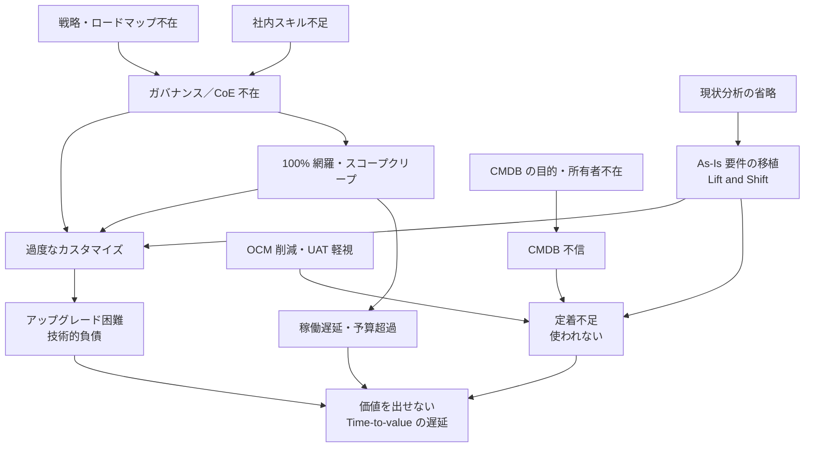

# 導入失敗パターンと対策（Implementation Failure Patterns）

## 概要

本ファイルは、ServiceNow の導入プロジェクトで繰り返し起きる **失敗パターン** を、「症状（何が起きるか）・原因（なぜ起きるか）・対策（どう防ぐか）」の形で整理した応用編である。対象読者は、導入を企画・推進するコンサルタント、PM、Platform Owner である。

ServiceNow の失敗の多くは、製品の不具合ではなく **プロジェクトの進め方と組織の問題** から生じる。ServiceNow 社員による Community 記事は、導入で価値を損なう「バリュートラップ（Value traps）」として、①Lift and Shift、②現状の無視、③100% の網羅を目指す、④OCM（Organizational Change Management、組織変革管理）時間の削減、の 4 つを挙げている。【第三者情報】 [出典](https://www.servicenow.com/community/in-other-news/avoiding-value-traps-in-servicenow-implementation/ba-p/2927420)

本ファイルで扱う失敗パターンの一覧は次のとおり。

| # | 失敗パターン | 一言でいうと | 主な発生フェーズ | 詳細を扱う関連ファイル |
|---|---|---|---|---|
| 1 | 過度なカスタマイズ／OOTB からの逸脱 | 標準を曲げて作り込み、アップグレードできなくなる | 設計・構築・運用 | [カスタマイズと技術的負債](02-customization-technical-debt.md)、[アップグレードの教訓](04-upgrade-lessons.md) |
| 2 | As-Is 要件の移植（Lift and Shift） | 旧ツールの画面と手順をそのまま再現する | 要件定義 | [要件定義・設計](../03_導入編/06-requirements-design.md) |
| 3 | 現状分析の省略 | 「捨てる仕組みだから」と現行業務を調べない | 要件定義 | [要件定義・設計](../03_導入編/06-requirements-design.md) |
| 4 | 100% 網羅とスコープクリープ | すべてを初回リリースに入れようとして終わらない | 計画・要件定義・構築 | [導入方法論](../03_導入編/04-implementation-methodology.md) |
| 5 | 履歴データの全件移行 | 旧システムのデータを全部持ち込む | 移行設計 | [データ移行](../03_導入編/08-data-migration.md) |
| 6 | CMDB の失敗 | 目的と所有者がないまま CI を取り込み、信用されなくなる | 計画・運用 | [CMDB 成功要因](05-cmdb-success-factors.md) |
| 7 | ガバナンス／CoE の不在 | 誰も「No」と言えず、要望がそのまま作られる | 運用（稼働後） | [ガバナンスとCoEの実践](09-governance-coe-practice.md) |
| 8 | 定着不足と OCM の削減 | 稼働したが使われない、旧チャネルが残る | 全フェーズ | [定着化とチェンジマネジメント](13-adoption-change-management.md) |
| 9 | 社内スキル不足・パートナー丸投げ | 稼働後に自社で何も変えられない | 体制・運用 | [プロジェクト体制](../03_導入編/05-project-organization.md) |
| 10 | UAT の軽視 | 稼働直前に業務に合わないことが分かる | テスト | [テストと本番稼働](../03_導入編/11-testing-golive.md) |
| 11 | 戦略・ロードマップの不在 | ツール導入が目的化し、成果を説明できない | 企画 | [コンサルティング・プレイブック](14-consulting-playbook.md) |
| 12 | 過剰標準化（逆方向の失敗） | 標準に固執し、業務がスプレッドシートやメールに逃げる | 設計・運用 | [カスタマイズと技術的負債](02-customization-technical-debt.md) |

本ファイルで扱わないその他の失敗パターンは次のとおり。詳細は各関連ファイルを参照。【経験則】

| 失敗パターン | 一言でいうと | 関連ファイル |
|---|---|---|
| 連携の失敗 | 連携方式・エラー処理・データ所有の設計が甘く、データ不整合や障害の連鎖が起きる | [連携の落とし穴](08-integration-pitfalls.md)、[連携設計](../03_導入編/09-integration-design.md) |
| ライセンスの過剰購入・シェルフウェア | 使わないロール・モジュール・AI 枠（Assist）を買い、費用だけが残る | [ライセンスコスト最適化](06-license-cost-optimization.md) |
| インスタンス戦略・Update Set 管理の不備 | 本番での直接変更、Update Set の取りこぼし・衝突、環境間の差異が起きる | [インスタンス戦略](../03_導入編/07-instance-strategy.md)（本番での直接変更は本ファイル 8.1 節でも扱う） |
| AI（Now Assist）導入の前提データの品質不足 | ナレッジや CMDB の品質が低いまま AI を有効化し、回答品質が上がらない。公式ドキュメントも Now Assist の回答品質はナレッジの品質と構成に左右されるとしている（[出典](https://www.servicenow.com/docs/r/XRgEFx7nPN6ciT_BBIvnbg/Ij4VOnq78uF2Hf1Sc_Jy3A)） | [AI 導入の教訓](10-ai-adoption-lessons.md)、[CMDB 成功要因](05-cmdb-success-factors.md) |
| エグゼクティブスポンサー／プロセスオーナーの不在 | 部門間の対立を裁定できず、意思決定が止まる（本ファイル 8.1 節で症状として扱う） | [プロジェクト体制](../03_導入編/05-project-organization.md)、[ガバナンスとCoEの実践](09-governance-coe-practice.md) |

本ファイルの役割分担：CMDB、ガバナンス／CoE、定着化については、それぞれ専用の応用編ファイル（05、09、13）が詳細を扱う。本ファイルは **プロジェクト全体を俯瞰した失敗の見取り図** と、各パターンの要点・初動対策に絞り、詳細は関連ファイルへリンクする。

本ファイルの記述の多くは、ServiceNow 公式ドキュメントではなく ServiceNow Community（ServiceNow 社員の記事を含む）に依拠する。ServiceNow 公式ドキュメントは製品仕様と構成・カスタマイズの原則は定めているが、プロジェクトの失敗事例は扱わないためである。公式以外に依拠する記述には `【第三者情報】`、実務上の一般的知見には `【経験則】` を付す。

---

## 1. 失敗パターンの全体像

### 1.1 失敗パターンはつながっている

ServiceNow の導入失敗パターンは独立して起きるのではなく、連鎖する。たとえば「As-Is 要件の移植」は「過度なカスタマイズ」を生み、「ガバナンスの不在」はそれを稼働後も増やし続け、最終的に「アップグレードできない」「使われない」という結果になる。【経験則】

上の図は、各失敗パターンの因果関係を【経験則】として整理したものである。左側（戦略・現状分析・スキル）の上流の欠落が、右側の技術的負債や定着不足として表面化する。

### 1.2 公式・Community が挙げる失敗要因の対応表

ServiceNow Community で失敗要因を扱う主な記事が挙げる項目と、本ファイルの節との対応を示す。

| 記事 | 挙げられている失敗要因 | 本ファイルの節 |
|---|---|---|
| SGUPTA1（ServiceNow 社員）「Avoiding Value Traps in ServiceNow Implementation」（2024-05-13） | Lift and Shift／現状の無視／100% の網羅／OCM 時間の削減 | 3、4、5、9 |
| Jamie L Douglas「5 Common Pitfalls in ServiceNow Implementations」（2025-03-25） | OCM の過小評価／弱いガバナンスによる技術的負債と需要の無秩序／社内専門性の欠如／UAT の過小評価／戦略的ビジョンの欠如 | 8、9、10、11、12 |
| Akshata Jamdar「Most common challenges faced during ServiceNow implementation」（2020-08-21） | 開発中の追加要望／過度なカスタマイズ／複雑すぎるワークフロー／古いプロセスの放置／専門性の欠如／汎用的なトレーニング | 2、4、5、9、10（複雑すぎるワークフローは 9.2） |

【第三者情報】 出典：[Value traps](https://www.servicenow.com/community/in-other-news/avoiding-value-traps-in-servicenow-implementation/ba-p/2927420) / [5 Common Pitfalls](https://www.servicenow.com/community/in-other-news/5-common-pitfalls-in-servicenow-implementations-and-how-to-avoid/ba-p/3217075) / [Most common challenges](https://www.servicenow.com/community/now-platform-articles/most-common-challenges-faced-during-servicenow-implementation/ta-p/2324518)

> 注：「ServiceNow 導入の X% が失敗する」といった失敗率の数字は、パートナーブログ等で引用されることがあるが、一次資料は公開情報では確認できず。本ナレッジでは失敗率の数字は扱わない。CMDB の失敗率に関する同様の注記は [CMDB 成功要因](05-cmdb-success-factors.md) の 1.1 節を参照。

---

## 2. 失敗パターン①：過度なカスタマイズ／OOTB からの逸脱

### 2.1 症状

過度なカスタマイズ（Over-customization）に陥った ServiceNow インスタンスでは、次の症状が出る。【経験則】

- ファミリーリリースのアップグレードのたびに大量の Skipped records（スキップされたレコード）が発生し、アップグレードに数か月かかる、またはアップグレードを見送り続ける。
- 新機能（Now Assist、新しい Workspace など）を有効化しても、カスタマイズした画面・フローと合わずに使えない。
- ServiceNow サポートに問い合わせても「カスタマイズ起因」として対応範囲外になる。
- 作った担当者（多くはパートナー）が去ると、誰も仕組みを説明できない。

### 2.2 原因

ServiceNow 公式ドキュメント「Configure, customize, or build apps」（Australia 版、2026-03-12 更新）は、カスタマイズのコストを次のように明記している。[出典](https://www.servicenow.com/docs/r/australia/application-development/configure-customize-or-build-new-apps.html)

- カスタマイズは、カスタマーサービス（サポート）とコストに影響する。保持されたカスタマイズは、サポート担当者が意図された動作を知らないためにサポートを難しくする。
- 新バージョンへのアップグレードでは、カスタマイズの再適用または復元（revert）が必要になる。カスタマイズしたレコードはアップグレード時にスキップされ、保持・復元・マージを判断しなければならない。
- カスタマイズは技術的負債（Technical debt）を生みうる。
- コードを追加した場合、ベースラインのコードを変更していなくても、そのコードは顧客が所有する（"If you add code, you own it"）。

同じく公式ドキュメント「Customization vs configuration」（Australia 版、2026-03-12 更新）は、カスタマイズが Customer Updates テーブルに `sys_update_xml` レコードを作り、アップグレード時に Skipped となること、追加したコードは顧客が所有し ServiceNow サポートはそれをデバッグしないことを述べている。[出典](https://www.servicenow.com/docs/r/q4dSP2Icgr1SFv5wanVXvQ/kCcBCRbyrsoiazHjMq7tWw)

過度なカスタマイズが起きる根本原因は、多くの場合 **技術ではなく意思決定の仕組み** にある。【経験則】

| 根本原因 | 説明 |
|---|---|
| As-Is 要件の移植 | 旧ツールの画面・項目・手順を再現しようとして標準を曲げる（3 章） |
| 判断基準がない | 「業務部門が要望したから」で作る。価値とコストを比べる仕組みがない（8 章） |
| 標準機能を知らない | 標準で実現できることを知らずに作り込む（10 章） |
| 構築者の動機 | 作り込むほど工数（売上）が増える契約形態【経験則】 |

### 2.3 対策

| 対策 | 内容 | 出典・確度 |
|---|---|---|
| 変更の優先順位を守る | パーソナライズ → 構成（configuration）→ カスタマイズの順に、影響が小さい手段から検討する。カスタマイズはアプリ本来の目的を拡張する場合に限り、目的に合わない要件は Creator Studio や ServiceNow Studio など App Engine で新規アプリとして作る | [出典](https://www.servicenow.com/docs/r/australia/application-development/configure-customize-or-build-new-apps.html) |
| 価値とコストを比べる | 「カスタマイズは価値を加えるのか、複雑さとコストを加えるのか」を問い、需要管理者が 1〜5 のスコアカードで価値を評価し、複雑さ・コストと比較する（Business-Smart Customization の考え方） | 【第三者情報】ServiceNow 社員記事 [出典](https://www.servicenow.com/community/in-other-news/get-to-business-smart-customization/ba-p/2273020) |
| 正当化を文書化する | 変更ごとにビジネス上の正当化を記録し、ATF（Automated Test Framework）テストを書き、アップグレードのたびにカスタマイズを検証する | [出典](https://www.servicenow.com/docs/r/q4dSP2Icgr1SFv5wanVXvQ/kCcBCRbyrsoiazHjMq7tWw) |
| 新規開発はスコープアプリを既定にする | 既存フィールドを変えずに追加する、オブジェクトのコピーを避ける、一意な名前を付ける | [出典](https://www.servicenow.com/docs/r/q4dSP2Icgr1SFv5wanVXvQ/kCcBCRbyrsoiazHjMq7tWw) |
| カスタマイズ件数を KPI にする | カスタマイズ件数、Instance Scan の指摘件数、アップグレード所要日数を Platform Owner の KPI に入れる | 【経験則】（詳細は [ガバナンスとCoEの実践](09-governance-coe-practice.md)） |
| 契約で歯止めをかける | パートナー成果物の受入条件に、開発ガイドライン準拠・Instance Scan の重大指摘ゼロを入れる | 【経験則】 |

カスタマイズの判断基準と技術的負債の測定・返済の詳細は [カスタマイズと技術的負債](02-customization-technical-debt.md)、アップグレード時の Skipped records の処置は [アップグレードの教訓](04-upgrade-lessons.md) を参照。

---

## 3. 失敗パターン②：As-Is 要件の移植（Lift and Shift）

### 3.1 症状

As-Is 要件の移植（Lift and Shift、Like for like、現行踏襲）に陥った導入では、次の症状が出る。【経験則】

- 要件定義書が旧ツールの画面キャプチャと項目一覧で構成されている。
- 「旧システムと同じ項目・同じ状態値・同じ帳票」を前提にフォームや状態（State）を作り替える。
- 稼働後、「ServiceNow にしたのに何も良くならなかった」と言われる。

### 3.2 原因

ServiceNow 社員 SGUPTA1 の記事は、Lift and Shift を最初のバリュートラップとして挙げ、次のように説明している。【第三者情報】 [出典](https://www.servicenow.com/community/in-other-news/avoiding-value-traps-in-servicenow-implementation/ba-p/2927420)

- Lift and Shift（Like for like）は、現状（current state）を将来の状態（future state）にそのまま再現するアプローチで、BMC Remedy などのレガシーツールの置き換えや、Agent Workspace から Service Operations Workspace への移行でよく使われる。
- プロセス再設計とチェンジマネジメントの労力が少なく済むため、プロジェクトチームに好まれる。
- しかし旧プロセスは Now Assist や生成 AI などの新しい機能を使えず、古いアーキテクチャを前提に設計されていることが多い。
- 既存ツールの大量のカスタマイズが、技術的負債として移行先に持ち込まれる。

### 3.3 対策

SGUPTA1 の続編記事は、Lift and Shift への対策として次の 3 点を挙げている。【第三者情報】 [出典](https://www.servicenow.com/community/in-other-news/strategies-to-mitigate-value-traps-in-servicenow-implementation/ba-p/2927741)

| 対策 | 内容 |
|---|---|
| 標準機能を採用する | 旧プロセスと同じ成果を ServiceNow の標準機能で実現できる場合は標準機能を使う。ITIL など業界フレームワークのベストプラクティスにも沿う |
| OCM の工数を見込む | 標準機能に合わせると利用者は新しい画面と手順を学ぶ必要があり、チェンジマネジメントが要る。ただしその費用は、設計・開発・テストの工数削減で相殺され、全体では節約になる |
| 段階的に移行する | 重要なプロセスから優先して段階的に移行し、リスクと問題の影響範囲を抑える |

実務上の追加対策：【経験則】

- 要件定義を「旧システムの機能一覧」ではなく「業務上の成果（何をいつまでに、誰が判断するか）」で書く。
- 標準機能のデモを先に見せ、標準との差分（Fit & Gap）だけを要件として議論する。差分ごとに「業務を標準に合わせる」「構成で吸収する」「カスタマイズする」のいずれかを、2 章の判断基準で決める。
- 旧ツールの独自項目は、まず「誰がその項目を使って何を判断しているか」を確認する。答えられない項目は移行しない。

要件定義の進め方は [要件定義・設計](../03_導入編/06-requirements-design.md) を参照。

---

## 4. 失敗パターン③：現状分析の省略

### 4.1 症状と原因

現状分析の省略は、Lift and Shift と逆方向の失敗である。「旧システムは捨てるのだから、現状を調べても意味がない」として現行業務の調査を省くと、次の問題が起きる。

SGUPTA1 の記事は、現状を無視することで、①重要なステークホルダーを見落とす、②現状の痛み（pain points）・非効率・ボトルネックを理解できない、③性能・最適化の機会を見逃す、④利用者が「過去から何が変わったか」を理解できないため OCM の効果が下がる、と指摘している。【第三者情報】 [出典](https://www.servicenow.com/community/in-other-news/avoiding-value-traps-in-servicenow-implementation/ba-p/2927420)

Akshata Jamdar の記事も、気付かれていない古いプロセスが連携とデータ品質を乱すことを課題に挙げている。【第三者情報】 [出典](https://www.servicenow.com/community/now-platform-articles/most-common-challenges-faced-during-servicenow-implementation/ta-p/2324518)

### 4.2 対策

SGUPTA1 の続編記事は、現状分析について次の対策を挙げている。【第三者情報】 [出典](https://www.servicenow.com/community/in-other-news/strategies-to-mitigate-value-traps-in-servicenow-implementation/ba-p/2927741)

| 対策 | 内容 |
|---|---|
| プロセスマッピング（Process mapping） | フローチャート、スイムレーン図、プロセスマップで現状の流れを表し、活動の順序、相互作用、役割と責任、ボトルネックを可視化する |
| プロセスシャドーイング（Process shadowing） | 将来プロセスを設計する人が、実際の利用者の作業を観察する。文書と実態の差、摩擦点を発見し、必要なチェンジマネジメントの量を見積もる |
| 初期分析をタイムボックス化する | マッピングは数か月かかりうるため、対象プロセスを選び、分析の深さを限定して早期に始める |

> 現状分析の目的は「現状を再現すること」ではなく、「何を捨て、何を残し、何を変えるかを決めること」である。3 章（Lift and Shift）と 4 章（現状の無視）は両極端の失敗であり、現状を **理解したうえで標準に寄せる** のが中間解である。【経験則】

---

## 5. 失敗パターン④：100% 網羅とスコープクリープ

### 5.1 症状

100% 網羅（すべてのワークフロー、すべてのカタログアイテム、すべての資産種別を初回で作る）を目指す導入、または開発中に追加要望を受け入れ続ける導入では、次の症状が出る。【経験則】

- 要件定義が終わらない（分析麻痺、Analysis paralysis）。
- 稼働日が延期を繰り返し、予算を超過する。
- ほとんど使われないカタログアイテムや分岐が大量に作られ、保守コストだけが残る。

### 5.2 原因

SGUPTA1 の記事は、価値はパレートの法則に従うことが多く、約 20% のユースケースが価値の大部分を生むと述べる。スコープが曖昧なプロジェクトほど、まれにしか使われない機能や未定義の領域まで設計しようとし、時間を浪費して分析麻痺に陥る。【第三者情報】 [出典](https://www.servicenow.com/community/in-other-news/avoiding-value-traps-in-servicenow-implementation/ba-p/2927420)

Akshata Jamdar の記事は、開発中に各部門が新機能を要望し続けることで、アプリが複雑になり、本来の目的を見失うことを挙げている。【第三者情報】 [出典](https://www.servicenow.com/community/now-platform-articles/most-common-challenges-faced-during-servicenow-implementation/ta-p/2324518)

### 5.3 対策

| 対策 | 内容 | 出典・確度 |
|---|---|---|
| ROI を 3 要素で評価する | 取引量（Transaction volume）、取引あたりの増分価値、運用化に必要な投資の 3 要素で候補を評価する。最も予測しやすいのは取引量なので、過去データから重み付けの式でスコア化する | 【第三者情報】 [出典](https://www.servicenow.com/community/in-other-news/strategies-to-mitigate-value-traps-in-servicenow-implementation/ba-p/2927741) |
| スコープの上限を先に決める | 例として「ビジネスサービス 10 件」「カタログアイテム 50 件」「Discovery 対象の資産種別 5 種」のように上限を設ける。最初の上限は恣意的でもよく、評価結果で調整する | 【第三者情報】 同上 |
| 追加要望は Intake に回す | 開発中の追加要望はプロジェクトに直接入れず、デマンド受付（Intake）で評価し、次リリース以降のバックログにする | 【経験則】（Intake の運営は [ガバナンスとCoEの実践](09-governance-coe-practice.md) 3 章） |
| MVP とウェーブ展開 | 初回リリースは最小限の実用範囲（MVP）とし、稼働後の利用データを見て次のウェーブを決める | 【経験則】（方法論は [導入方法論](../03_導入編/04-implementation-methodology.md)） |

---

## 6. 失敗パターン⑤：履歴データの全件移行

### 6.1 症状と原因

旧システムの履歴データ（クローズ済みインシデント、添付ファイル、メールログ、全履歴）をすべて ServiceNow に移行しようとすると、移行設計とテストの工数が膨らみ、移行リハーサルが何度も失敗し、稼働後もストレージとパフォーマンスに影響が残る。【経験則】

ServiceNow Community の Gaurav Bajaj の記事（2025-08-23、Onboarding Hub ブログ）は、ServiceNow は「行動のシステム（system of action）」であり、サービスを支えるのに必要なデータだけを持つべきだとする。履歴トランザクションはストレージを消費し、性能を下げ、高コストな項目マッピングを必要とする。同記事は、移行を単純な Lift and Shift として扱うべきではないと述べている。【第三者情報】 [出典](https://www.servicenow.com/community/onboarding-hub-blog/designing-smarter-data-migration-for-servicenow/ba-p/3360053)

### 6.2 対策

同記事が挙げる対策は次のとおり。【第三者情報】 [出典](https://www.servicenow.com/community/onboarding-hub-blog/designing-smarter-data-migration-for-servicenow/ba-p/3360053)

| 対策 | 内容 |
|---|---|
| 移行しないことを検討する | 利用者が実際に旧データを参照しているのか、「念のため」なのかを確認し、規制上の保存期間を確認する |
| 低コストのストレージに退避する | 履歴データは安価なデータベースやフラットファイルに出力し、暗号化・保存ポリシー・ロールベースのアクセスで保護し、必要時に参照する |
| 移行するなら範囲を絞る | 主要なチケット項目だけを移行する。ストレージを最も消費する添付・メールログ・チケット履歴は移行しない |
| アクティブなチケットは移行しない | 移行期間を設け、旧ツールでクローズさせる |
| 旧データ用の項目を新設しない | 旧システム独自のデータは、新しいフィールドを作らず、コメントや作業メモに名前と値の組で格納する |

移行方式と手順の詳細は [データ移行](../03_導入編/08-data-migration.md) を参照。

---

## 7. 失敗パターン⑥：CMDB の失敗

### 7.1 症状と原因

CMDB（Configuration Management Database、構成管理データベース）の失敗は、ServiceNow 導入で最もよく語られる失敗の一つである。CMDB が失敗する主因は、多くの場合技術ではなく組織にあり、①所有者（Ownership）が不明確、②データガバナンスが弱い、③ビジネス目標（ユースケース）と整合していない、④期待値が非現実的（初回から全 CI の網羅や完全な精度を求める）、の 4 点に集約できる。【経験則】

このうち①②については、Joe Dames の Community 記事（2026-03-10）が「根本原因が技術であることはまれで、多くはガバナンスにある」「所有者が定義されていないと、サービスモデルは時間とともに劣化する」と述べている。【第三者情報】 [出典](https://www.servicenow.com/community/developer-blog/cmdb-amp-csdm-governance-on-the-servicenow-platform/ba-p/3505330)

③については、ServiceNow 社員 sremerson の Community 記事（2019-03-26）が、組織の戦略的取り組みに直結する特定のユースケースに絞って始め、測定可能な事業目標にデータを合わせ、データ取り込みを設定する前に計画を持つべきだとしている。【第三者情報】 [出典](https://www.servicenow.com/community/servicenow-ai-platform-blog/the-path-to-a-quality-cmdb-starts-with/ba-p/2282786)

④を直接扱う出典は公開情報では確認できず、【経験則】に基づく。

| 症状 | 典型的な原因 |
|---|---|
| CI が大量にあるが、インシデントや変更で選ばれない／間違っている | 目的を決めずに「取れるものを全部」取り込んだ |
| 導入直後はきれいだったが数か月で陳腐化 | CI の所有者がおらず、更新・リタイアを誰も回さない |
| アプリやサービスが独自モデルで登録され、影響分析が組めない | CSDM（Common Service Data Model）を無視した |
| 品質が良いのか悪いのか誰も分からない | CMDB Health のジョブを有効化していない |

関連する公式の事実：

- CMDB Health のジョブは既定で無効であり、有効化するまでヘルスデータは収集されない。[出典](https://www.servicenow.com/docs/r/australia/servicenow-platform/configuration-management-database-cmdb/overview-cmdb-health.html)
- ServiceNow は CSDM を Foundation、Crawl、Walk、Run、Fly の 5 ステージで段階的に実装することを推奨している。[出典](https://www.servicenow.com/docs/r/australia/servicenow-platform/common-service-data-model-csdm/csdm-implementation-stages.html)

### 7.2 対策（要点）

| 対策 | 要点 |
|---|---|
| 目的から始める | 「インシデントの影響分析」「変更の影響範囲」など、CMDB を使うユースケースを先に決め、必要なクラスだけを取り込む |
| CSDM に準拠する | 独自テーブル・独自モデルを作らず、ベースシステムのテーブルと関係を使う |
| 所有者を決める | すべての CI に責任グループ（`managed_by_group` など）を割り当てる |
| 品質を測り続ける | CMDB Health を有効化し、KPI を定義し、Attestation・Certification・リタイアを運用に組み込む |
| 段階導入する | CSDM のステージに沿って範囲を広げる |

CMDB の成功要因と具体的な設定は [CMDB 成功要因](05-cmdb-success-factors.md)、仕様は [CMDB と CSDM](../02_リファレンス/platform/cmdb-csdm.md) を参照。

---

## 8. 失敗パターン⑦：ガバナンス／CoE の不在

### 8.1 症状

ガバナンス（Governance）や CoE（Center of Excellence）がないまま稼働後の運用に入ると、次の症状が出る。【経験則】

- 業務部門の要望がそのまま開発され、カスタマイズが増え続ける（2 章の再発）。
- 本番環境で直接変更が行われ、誰が何を変えたか分からない。
- 優先順位を決める場がなく、声の大きい部門の要望が先に通る。
- プラットフォーム全体に責任を持つ人がいないため、アップグレードと新機能の採用が後回しになる。
- エグゼクティブスポンサーやプロセスオーナー（Process owner）が不在で、部門間で対立する要望を裁定できず、プロセス設計の決定が先送りされる。

### 8.2 原因

Jamie L Douglas の記事は、弱いガバナンスが技術的負債と管理できない需要（unmanageable demand）を生むと指摘している。【第三者情報】 [出典](https://www.servicenow.com/community/in-other-news/5-common-pitfalls-in-servicenow-implementations-and-how-to-avoid/ba-p/3217075)

ServiceNow の Impact の Technical Governance アクセラレーターの公式ドキュメントは、Technical Governance を「ServiceNow プラットフォームの安定性を統治・管理する方法を定義する枠組み」とし、必須ロールとして Platform Owner（プラットフォーム全体の説明責任を持ち、システム管理者を統括し、事業戦略と ServiceNow のロードマップに合わせる）を挙げている。同ドキュメントは、顧客の技術ガバナンスのプロセスやポリシーを策定・運営する責任は ServiceNow にはないと明記している。つまりガバナンスは **顧客自身が作る** ものである。[出典](https://www.servicenow.com/docs/bundle/yokohama-impact/page/product/impact/reference/technical-governance.html)

### 8.3 対策（要点）

| 対策 | 内容 | 出典・確度 |
|---|---|---|
| 3 層のガバナンスを置く | 戦略（strategic）・需要（demand）・技術（technical）の 3 層でガバナンスの役割を設ける | 【第三者情報】 [出典](https://www.servicenow.com/community/in-other-news/5-common-pitfalls-in-servicenow-implementations-and-how-to-avoid/ba-p/3217075) |
| 構造化された受付 | 改善要望は構造化されたフォームとプロセスで評価・優先順位付けする。エンタープライズアーキテクトを定期的に関与させる | 【第三者情報】 同上 |
| Platform Owner を任命する | プラットフォーム全体の説明責任と決裁権を持つ Platform Owner を、導入プロジェクト開始時点で任命する | [出典](https://www.servicenow.com/docs/bundle/yokohama-impact/page/product/impact/reference/technical-governance.html)（任命時期は【経験則】） |
| ゴールデンルールを定める | Configure → Integrate → Customize、OOTB First、API-First、Keep Data Clean、Design for Automation などの原則を明文化する | 【第三者情報】 Joe Dames 記事 [出典](https://www.servicenow.com/community/developer-blog/servicenow-defining-governance-policies/ba-p/3505314) |
| 規模に合わせる | ガバナンスは変更の影響に比例させる。局所的な変更は通常のデリバリーレビュー、共有されるプラットフォームの振る舞いはアーキテクチャレビュー、セキュリティ・プライバシー等は専門レビューに回す | 【第三者情報】 [出典](https://www.servicenow.com/community/in-other-news/configure-or-customize-you-re-asking-the-wrong-question/ba-p/3586284) |

> **よくある誤り：** ガバナンスを「稼働後に作るもの」と考え、導入プロジェクト中はパートナーと業務部門の合意だけで設計を決めてしまう。稼働時点で既にカスタマイズが積み上がっており、ガバナンスを作っても負債の返済から始めることになる。【経験則】

Platform Owner の役割、ARB の運営、Intake、命名規約、Instance Scan による自動ガードレールの詳細は [ガバナンスとCoEの実践](09-governance-coe-practice.md)、運用体制は [運用とガバナンス](../03_導入編/12-operations-governance.md) を参照。

---

## 9. 失敗パターン⑧：定着不足と OCM の削減

### 9.1 症状

定着不足（Low adoption）に陥った導入では、システムは予定どおり稼働しても、次の症状が出る。【経験則】

- 電話・メール・チャットでの依頼が減らず、ポータルの利用率が上がらない。
- 担当者が ServiceNow の外（スプレッドシート、メール）で作業し、後からチケットを起票する。
- 経営層に効果を説明できず、次の投資（追加製品、追加ライセンス）が承認されない。

### 9.2 原因

SGUPTA1 の記事は、コスト圧力の下で OCM が削られたり、プロジェクト後半に限定されたりすることをバリュートラップとして挙げている。「影響の小さいユースケースなら OCM は少なくてよい」という前提に立っても、隠れた複雑さや依存関係が予期せず表面化し、影響力と関心の高いステークホルダーには移行期間中もコミュニケーションと支援が必要になる、としている。【第三者情報】 [出典](https://www.servicenow.com/community/in-other-news/avoiding-value-traps-in-servicenow-implementation/ba-p/2927420)

Jamie L Douglas の記事も、OCM の過小評価を第一の落とし穴として挙げている。【第三者情報】 [出典](https://www.servicenow.com/community/in-other-news/5-common-pitfalls-in-servicenow-implementations-and-how-to-avoid/ba-p/3217075)

Akshata Jamdar の記事は、汎用的な標準トレーニングでは組織固有の使い方を反映できないこと、および複雑すぎるワークフローが利用者の学習と定着を妨げ、ステップ間でデータが失われる原因になることを課題に挙げている。【第三者情報】 [出典](https://www.servicenow.com/community/now-platform-articles/most-common-challenges-faced-during-servicenow-implementation/ta-p/2324518)

### 9.3 対策（要点）

| 対策 | 内容 | 出典・確度 |
|---|---|---|
| OCM を早期に定義し予算化する | OCM を初期段階で定義してリソースを割り当て、パートナー主導のワークショップを含めて予算を確保する。プラットフォーム管理チーム向けの OCM 支援も含める | 【第三者情報】 [出典](https://www.servicenow.com/community/in-other-news/5-common-pitfalls-in-servicenow-implementations-and-how-to-avoid/ba-p/3217075) |
| 将来業務の手順を標準化する | タスクごとに手順書と RACI（Responsible、Accountable、Consulted、Informed）を用意する | 【第三者情報】 [出典](https://www.servicenow.com/community/in-other-news/strategies-to-mitigate-value-traps-in-servicenow-implementation/ba-p/2927741) |
| 稼働直後の支援チャネル | 稼働直後に業務利用者と導入チームをつなぐライブコールやチームチャネルを開く。利用者は早く答えを得られ、導入チームは移行状況と主要課題を把握できる | 【第三者情報】 同上 |
| 役割別のトレーニング | 汎用研修ではなく、自社の業務に合わせた役割別・タスク型の研修を作る | 【第三者情報】 [出典](https://www.servicenow.com/community/now-platform-articles/most-common-challenges-faced-during-servicenow-implementation/ta-p/2324518) |
| 旧チャネルを閉じる計画 | ポータルへの移行と旧チャネル（電話・メール）の閉鎖日を稼働前に決める | 【経験則】 |
| 効果測定の仕込み | 稼働前にベースライン（旧チャネルの件数、処理時間）を取得し、稼働後の KPI と比較できるようにする | 【経験則】 |

ServiceNow は Impact の一部として OCM 支援メニュー（Impact Accelerator「OCM: Preparing for Change」、Australia 版）を提供している。このアクセラレーターは Impact Guided+（Strategic Value アドオン）、Advanced、Total の各パッケージで提供され、OCM: Managing Change、OCM: Reinforcing & Sustaining Change と続く 3 部構成の 1 本目である。[出典](https://www.servicenow.com/docs/r/OLEAh14mAEPe8fUlW2F9wQ/laq40ut6M73wEY9po7aXkA)

OCM の体制、チャンピオンネットワーク、Guided Tours などの製品内学習支援、シフトレフト、KPI の詳細は [定着化とチェンジマネジメント](13-adoption-change-management.md) を参照。

---

## 10. 失敗パターン⑨：社内スキル不足・パートナー丸投げ

### 10.1 症状と原因

導入をパートナーに全面委託し、社内に ServiceNow を理解する人材を育てないと、稼働後に次の問題が起きる。【経験則】

- 小さな変更（項目追加、通知の文面変更）でもパートナーに発注が必要になり、コストと時間がかかる。
- パートナーの提案の妥当性（標準で実現できるのにカスタマイズを提案していないか）を判断できない。
- 契約終了とともにノウハウが失われる。

Jamie L Douglas の記事は社内の ServiceNow 専門性の欠如を、Akshata Jamdar の記事は ServiceNow の幅広い機能を知らないまま実装すると実装の質が下がり、依存するアプリにも影響することを挙げている。【第三者情報】 [出典](https://www.servicenow.com/community/in-other-news/5-common-pitfalls-in-servicenow-implementations-and-how-to-avoid/ba-p/3217075) / [出典](https://www.servicenow.com/community/now-platform-articles/most-common-challenges-faced-during-servicenow-implementation/ta-p/2324518)

### 10.2 対策

| 対策 | 内容 | 出典・確度 |
|---|---|---|
| 構造化された研修 | ServiceNow の無償オンデマンド教材を使って社内研修を計画する | 【第三者情報】 [出典](https://www.servicenow.com/community/in-other-news/5-common-pitfalls-in-servicenow-implementations-and-how-to-avoid/ba-p/3217075) |
| スキル評価 | Impact チームに社内スキルの評価と学習計画の作成を依頼する | 【第三者情報】 同上 |
| 段階的な権限移譲 | 定型作業はガバナンスモデルの中で社内管理者に任せ、複雑な判断は技術ガバナンスの場に上げる | 【第三者情報】 同上 |
| ペア作業 | 構築期間中から社内メンバーをパートナーの開発者と組ませ、設計レビューに参加させる | 【経験則】 |
| 成果物の引き継ぎ条件 | 設計書・ATF テスト・運用手順の納品を契約の受入条件にする | 【経験則】 |

体制設計は [プロジェクト体制](../03_導入編/05-project-organization.md) を参照。

---

## 11. 失敗パターン⑩：UAT の軽視

### 11.1 症状と原因

UAT（User Acceptance Testing、ユーザー受入テスト）を稼働直前の短期間に押し込むと、業務に合わない点が稼働直前に発覚し、手戻りまたは不完全なまま稼働することになる。【経験則】

Jamie L Douglas の記事は、UAT の過小評価を落とし穴の一つに挙げている。【第三者情報】 [出典](https://www.servicenow.com/community/in-other-news/5-common-pitfalls-in-servicenow-implementations-and-how-to-avoid/ba-p/3217075)

### 11.2 対策

| 対策 | 内容 | 出典・確度 |
|---|---|---|
| Guided UAT | スプリントのショーケース（成果披露）の後に、対話的・段階的なテストセッションを行う | 【第三者情報】 [出典](https://www.servicenow.com/community/in-other-news/5-common-pitfalls-in-servicenow-implementations-and-how-to-avoid/ba-p/3217075) |
| テストと研修を組み合わせる | テストセッションをハンズオン研修と組み合わせ、利用者がその場で質問できるようにする | 【第三者情報】 同上 |
| 頻繁なコミュニケーション | 協調的なコミュニケーションを頻繁に行い、問題を早く発見・修正する | 【第三者情報】 同上 |
| 回帰テストの自動化 | UAT で確認した主要シナリオを ATF に落とし、以後のアップグレードとリリースで再利用する | 【経験則】（ATF は [Automated Test Framework](../02_リファレンス/platform/automated-test-framework.md)） |

テスト計画と本番稼働の判断基準は [テストと本番稼働](../03_導入編/11-testing-golive.md) を参照。

---

## 12. 失敗パターン⑪：戦略・ロードマップの不在

### 12.1 症状と原因

ServiceNow の導入そのものが目的になり、「何の成果を出すために導入するのか」が定義されていないと、稼働後に効果を説明できず、次の投資判断ができない。また優先順位の拠り所がないため、ガバナンスも機能しない。【経験則】

Jamie L Douglas の記事は、戦略的ビジョンと方向性の欠如を落とし穴の一つに挙げている。【第三者情報】 [出典](https://www.servicenow.com/community/in-other-news/5-common-pitfalls-in-servicenow-implementations-and-how-to-avoid/ba-p/3217075)

### 12.2 対策

同記事が挙げる対策は次のとおり。【第三者情報】 [出典](https://www.servicenow.com/community/in-other-news/5-common-pitfalls-in-servicenow-implementations-and-how-to-avoid/ba-p/3217075)

- 事業目標を支える実践的なロードマップを作る。
- ロードマップを経営層のステークホルダーと定期的に見直す。
- 戦略に結び付いた成功基準を定義し、進捗を測る。
- ロードマップをガバナンスと優先順位付けの判断の主たる拠り所にする。

コンサルタントとしての企画・提案の進め方は [コンサルティング・プレイブック](14-consulting-playbook.md) を参照。

---

## 13. 失敗パターン⑫：過剰標準化（逆方向の失敗）

### 13.1 症状と原因

「OOTB（標準）以外は一切認めない」という方針を機械的に適用すると、逆方向の失敗が起きる。ServiceNow 社員 Jochen Geist の Community 記事（2026-08-12）は、プラットフォームが実際の業務ニーズを支えられないと、業務はスプレッドシート、メール、周辺ツールに移り、インスタンスはきれいなままでもプロセスは断片化して統制できなくなる、と指摘している。【第三者情報】 [出典](https://www.servicenow.com/community/in-other-news/configure-or-customize-you-re-asking-the-wrong-question/ba-p/3586284)

### 13.2 対策

同記事は、「構成かカスタマイズか」という実装手段の議論ではなく、成果と結果に注目すべきだとし、次の考え方を示している。【第三者情報】 [出典](https://www.servicenow.com/community/in-other-news/configure-or-customize-you-re-asking-the-wrong-question/ba-p/3586284)

| 考え方 | 内容 |
|---|---|
| 4 つの問い | ①ニーズは正当か、②設計は最小限の一貫した解か、③何があれば受け入れられないか、④結果を誰が所有するか |
| 標準を起点に、盲目的にはしない | OOTB は ServiceNow が保守するため出発点にするが、標準が自動的に正しいわけではない |
| ラベルではなく結果で判断する | 構成・カスタマイズ・コードという実装種別はリスクを正しく表さない。影響範囲、依存関係、元に戻せるか、所有者の有無のほうが重要 |
| 所有権を先に決める | 定義、データ品質、承認、予算、廃止を誰が所有するかを、変更前に決める |
| 4 つの結論 | 進める（Proceed）／条件付きで進める／再設計（Redesign）／却下（Reject）。再設計が最も価値のある結論になることが多い |

> 2 章（過度なカスタマイズ）と本章（過剰標準化）は両極端の失敗である。目標は「カスタマイズ 0 件」ではなく、「価値がコストを上回るカスタマイズだけが、所有者付きで存在する」状態である。【経験則】

---

## 14. フェーズ別チェックリスト

導入の各フェーズで、上記の失敗パターンを防ぐための確認項目をまとめる。各項目は本ファイルの各章の対策から抽出したもので、【経験則】に基づく整理である。

### 14.1 企画・計画

- [ ] 導入で達成する事業上の成果と成功基準が定義され、経営層と合意されている（12 章）
- [ ] Platform Owner が任命され、決裁権が明文化されている（8 章）
- [ ] 初回リリースのスコープに上限（件数）が設けられている（5 章）
- [ ] OCM のワークストリームと予算が計画に含まれている（9 章）
- [ ] 社内メンバーの育成計画とパートナーとの役割分担が決まっている（10 章）

### 14.2 要件定義・設計

- [ ] 現状業務の分析（プロセスマッピング・シャドーイング）がタイムボックス内で実施されている（4 章）
- [ ] 要件が「旧システムの機能」ではなく「業務上の成果」で書かれている（3 章）
- [ ] 標準機能との Fit & Gap が行われ、Gap ごとに対応方針（業務を合わせる／構成／カスタマイズ）が決まっている（2、3 章）
- [ ] カスタマイズごとにビジネス上の正当化と所有者が記録されている（2、13 章）
- [ ] CMDB のユースケース、対象クラス、CI の所有者が決まっている（7 章）
- [ ] 履歴データの移行範囲が最小化されている（6 章）

### 14.3 構築・テスト

- [ ] 開発中の追加要望が Intake 経由でバックログに回されている（5 章）
- [ ] Guided UAT が計画され、テストと研修が組み合わされている（11 章）
- [ ] 主要シナリオが ATF で自動化されている（2、11 章）

### 14.4 稼働・稼働後

- [ ] 稼働直後の支援チャネルが用意されている（9 章）
- [ ] 旧チャネルの閉鎖日が決まっている（9 章）
- [ ] 稼働前のベースラインと稼働後の KPI を比較できる（9 章）
- [ ] ガバナンス（ARB、Intake）が稼働後の運用に移管されている（8 章）
- [ ] カスタマイズ件数・Instance Scan 指摘件数・アップグレード所要日数が定期的に報告されている（2 章）

---

## 15. Brazil での変更

> **Brazil での変更:** 本ファイルが扱う失敗パターンの考え方に直接影響する仕様変更は、公開情報では確認できず。2 章で引用した公式ドキュメント「Configure, customize, or build apps」（Australia 版）の、パーソナライズ → 構成 → カスタマイズ → 新規アプリの順に検討するという原則について、Brazil 版で変更されたという情報も公開情報では確認できず（Brazil 版を指す固定 URL は本ナレッジ作成時点で確認できなかった）。

アップグレードとリリースごとの変更点は [アップグレードの教訓](04-upgrade-lessons.md) と [アップグレード管理](../03_導入編/13-upgrade-management.md) を参照。

---

## 16. 公開情報では確認できなかった事項

- ServiceNow 導入プロジェクト全体の失敗率（「X% が失敗する」）の一次資料。
- ServiceNow 公式の「導入失敗パターン」をまとめたドキュメント（公式ドキュメントは構成・カスタマイズの原則やガバナンスの枠組みを示すが、失敗事例集は公開されていない）。
- Mark Tonsetic の記事「Get to "business-smart" customization」がリンクしている関連資料（Avoid customization pitfalls so you can innovate and meet demand at scale）の内容、および記事中で画像として示されている 1〜5 のスコアリング枠組みと複雑さ・コスト比較表の詳細。公開テキストで確認できるのは、需要管理者が 1〜5 のスコアで価値を評価し、複雑さ・コストと比較するという考え方までである。

---

## 関連ファイル

- [カスタマイズと技術的負債](02-customization-technical-debt.md)
- [アップグレードの教訓](04-upgrade-lessons.md)
- [CMDB 成功要因](05-cmdb-success-factors.md)
- [ライセンスコスト最適化](06-license-cost-optimization.md)
- [連携の落とし穴](08-integration-pitfalls.md)
- [ガバナンスとCoEの実践](09-governance-coe-practice.md)
- [AI 導入の教訓](10-ai-adoption-lessons.md)
- [ITSM プロセス設計のコツ](11-itsm-process-design-tips.md)
- [定着化とチェンジマネジメント](13-adoption-change-management.md)
- [コンサルティング・プレイブック](14-consulting-playbook.md)
- [導入方法論](../03_導入編/04-implementation-methodology.md)
- [プロジェクト体制](../03_導入編/05-project-organization.md)
- [要件定義・設計](../03_導入編/06-requirements-design.md)
- [データ移行](../03_導入編/08-data-migration.md)
- [テストと本番稼働](../03_導入編/11-testing-golive.md)
- [運用とガバナンス](../03_導入編/12-operations-governance.md)
- [アップグレード管理](../03_導入編/13-upgrade-management.md)

---

## 参照元

### ServiceNow 公式ドキュメント

- Configure, customize, or build apps（Australia 版、2026-03-12 更新）: https://www.servicenow.com/docs/r/australia/application-development/configure-customize-or-build-new-apps.html
- Customization vs configuration（Australia 版、2026-03-12 更新）: https://www.servicenow.com/docs/r/q4dSP2Icgr1SFv5wanVXvQ/kCcBCRbyrsoiazHjMq7tWw
- Technical Governance（Impact アクセラレーター）: https://www.servicenow.com/docs/bundle/yokohama-impact/page/product/impact/reference/technical-governance.html
- CSDM implementation stages（Australia）: https://www.servicenow.com/docs/r/australia/servicenow-platform/common-service-data-model-csdm/csdm-implementation-stages.html
- CMDB Health overview（Australia）: https://www.servicenow.com/docs/r/australia/servicenow-platform/configuration-management-database-cmdb/overview-cmdb-health.html
- Knowledge Base readiness for Now Assist（Australia）: https://www.servicenow.com/docs/r/XRgEFx7nPN6ciT_BBIvnbg/Ij4VOnq78uF2Hf1Sc_Jy3A
- OCM: Preparing for Change（Impact Accelerator、Australia 版、英語）: https://www.servicenow.com/docs/r/OLEAh14mAEPe8fUlW2F9wQ/laq40ut6M73wEY9po7aXkA

### ServiceNow Community（ServiceNow 社員の記事）【第三者情報】

- SGUPTA1, Avoiding Value Traps in ServiceNow Implementation（2024-05-13）: https://www.servicenow.com/community/in-other-news/avoiding-value-traps-in-servicenow-implementation/ba-p/2927420
- SGUPTA1, Strategies to mitigate value traps in ServiceNow implementation（2024-05-13）: https://www.servicenow.com/community/in-other-news/strategies-to-mitigate-value-traps-in-servicenow-implementation/ba-p/2927741
- Mark Tonsetic, Get to "business-smart" customization（2018-10-15）: https://www.servicenow.com/community/in-other-news/get-to-business-smart-customization/ba-p/2273020
- sremerson, The path to a quality CMDB starts with...（2019-03-26）: https://www.servicenow.com/community/servicenow-ai-platform-blog/the-path-to-a-quality-cmdb-starts-with/ba-p/2282786
- Jochen Geist, Configure or customize? You're asking the wrong question（2026-08-12）: https://www.servicenow.com/community/in-other-news/configure-or-customize-you-re-asking-the-wrong-question/ba-p/3586284

### ServiceNow Community（ユーザー・パートナーの投稿）【第三者情報】

- Jamie L Douglas, 5 Common Pitfalls in ServiceNow Implementations (And How to Avoid Them)（2025-03-25）: https://www.servicenow.com/community/in-other-news/5-common-pitfalls-in-servicenow-implementations-and-how-to-avoid/ba-p/3217075
- Akshata Jamdar, Most common challenges faced during ServiceNow implementation（2020-08-21）: https://www.servicenow.com/community/now-platform-articles/most-common-challenges-faced-during-servicenow-implementation/ta-p/2324518
- Gaurav Bajaj, Designing Smarter Data Migration for ServiceNow（2025-08-23）: https://www.servicenow.com/community/onboarding-hub-blog/designing-smarter-data-migration-for-servicenow/ba-p/3360053
- Joe Dames, CMDB & CSDM Governance on the ServiceNow Platform（2026-03-10）: https://www.servicenow.com/community/developer-blog/cmdb-amp-csdm-governance-on-the-servicenow-platform/ba-p/3505330
- Joe Dames, ServiceNow Defining Governance Policies（2026-03-10）: https://www.servicenow.com/community/developer-blog/servicenow-defining-governance-policies/ba-p/3505314
