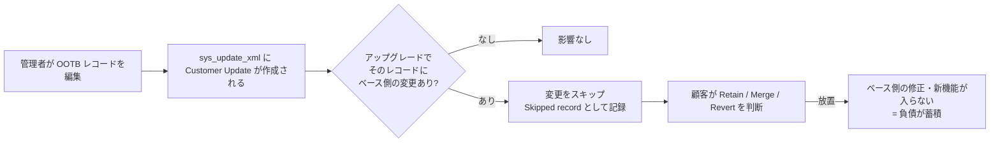
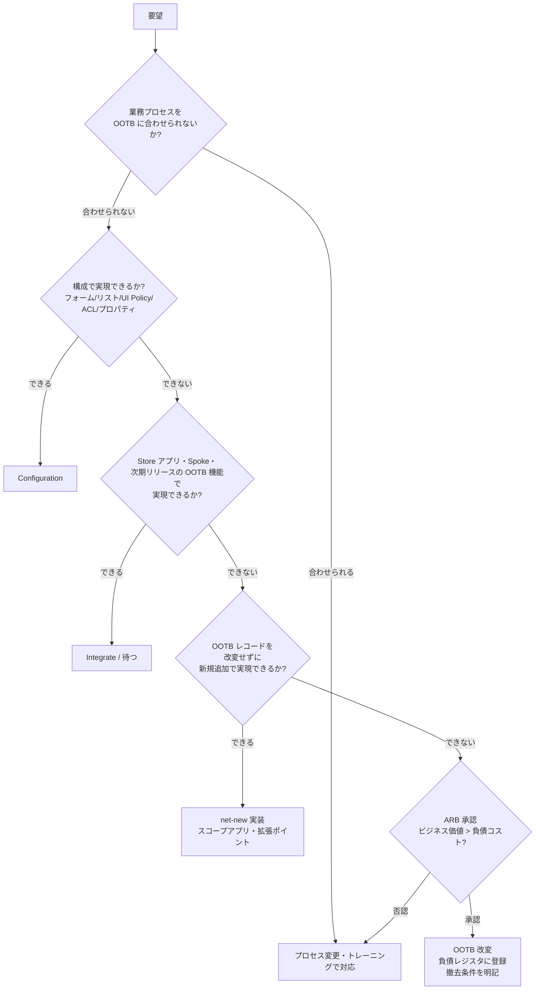

# カスタマイズと技術的負債（Customization and Technical Debt）

## 概要

本ファイルは、ServiceNow インスタンスの **Customization（カスタマイズ）** がどのように **Technical debt（技術的負債）** になり、アップグレード・保守・新機能の採用を妨げるのか、そしてそれをどう測り、減らし、OOTB（Out-of-the-box、標準機能）へ戻すのかを、導入・運用経験者向けにまとめた応用編である。

| 観点 | 本ファイルで答える問い | 章 |
|---|---|---|
| 定義 | Configuration と Customization は公式にどう区別されるか。技術的負債とは何か | 1 章 |
| 仕組み | なぜカスタマイズがアップグレード時の Skipped records になるのか | 2 章 |
| 判断 | どの要望をカスタマイズしてよいか。判断基準と手順 | 3 章 |
| 可視化 | Instance Scan と Impact Platform Health（Scan Engine）で負債をどう検出するか | 4 章 |
| 測定 | カスタマイズのスコアカード（KPI）をどう作るか | 5 章 |
| 削減 | Skipped records をどう減らすか | 6 章 |
| 回帰 | 長年のカスタマイズから OOTB に戻すにはどう進めるか | 7 章 |
| 失敗 | 典型的なアンチパターン | 8 章 |

前提となる公式の立場は次の 3 点である。

- ServiceNow 公式は「できる限り構成（Configure）してからカスタマイズし、カスタマイズはアプリケーション本来の目的に沿う場合に限る」よう推奨している。[出典](https://www.servicenow.com/docs/r/application-development/app-engine-studio/aes-custom-vs-config.html)
- 公式は「コードを追加したら、ベースラインを変えていなくてもそのコードはあなたが所有する」と明言している。カスタムコードが原因の問題は ServiceNow のサポート範囲外となる。[出典](https://www.servicenow.com/docs/r/application-development/app-engine-studio/aes-custom-vs-config.html)
- アップグレード処理は、顧客がカスタマイズしたベースシステムのオブジェクトへの変更を自動的にスキップする。カスタマイズは守られるが、そのオブジェクトには ServiceNow 側の修正・新機能も入らない。[出典](https://www.servicenow.com/docs/r/UrSRFFKWBbfQBgoRlt~ltw/62QiF9EWBhogBZIgvjkfcQ)

関連ファイル:

- アップグレード時の Skipped records の操作手順: [アップグレード管理](../03_導入編/13-upgrade-management.md)
- アップグレードの失敗事例と Skipped records の判断基準: [アップグレードの教訓](04-upgrade-lessons.md)
- ARB（アーキテクチャレビュー委員会）とデマンド受付: [ガバナンスと CoE の実践](09-governance-coe-practice.md)
- スクリプト品質: [スクリプティングのベストプラクティス](07-scripting-best-practices.md)
- Update Set と Customer Update の仕様: [アップデートセットとクローン](../02_リファレンス/platform/update-sets-cloning.md)
- 要件定義段階の Fit-to-standard: [要件定義と設計](../03_導入編/06-requirements-design.md)

---

## 1. Configuration と Customization の定義

### 1.1 公式定義

ServiceNow 公式ドキュメント（App Engine Studio 配下の「Configuration vs. customization」）は、両者を次のように定義している。[出典](https://www.servicenow.com/docs/r/application-development/app-engine-studio/aes-custom-vs-config.html)

| 用語 | 公式定義（原文） | 日本語訳 |
|---|---|---|
| Configuration（構成） | "Configuration is the process of using ServiceNow built-in tools and features to modify an application's behavior without changing flows or the code in the baseline installation on a ServiceNow instance." | ServiceNow の組み込みツール・機能を使い、ServiceNow インスタンスのベースラインのフローやコードを変えずに、アプリケーションの動作を変えること |
| Customization（カスタマイズ） | "Customization is any change to the flows or the code in the baseline installation on a ServiceNow instance." | ServiceNow インスタンスのベースラインのフローやコードに加えるあらゆる変更 |

公式が挙げる例は次のとおり。[出典](https://www.servicenow.com/docs/r/application-development/app-engine-studio/aes-custom-vs-config.html)

| 区分 | 公式の例 |
|---|---|
| Configuration | Forms（テーブル・項目・データ型・既定値・項目の依存関係）、UI 要素（レイアウト、Related list（関連リスト）、ボタン、項目名）、Service Catalog（カタログアイテムを申請するポータル）、ACL（フォーム・データへのアクセス制限）、System property（システムプロパティ）の値 |
| Customization | Scripting（ベースラインのコードを変える Client Script、サーバーサイドスクリプト、Business Rule）、カスタムテーブル、Integration（API・Web サービス）、Widget とポータル、Workflow Studio でワークフローを作成・変更する |

公式記述の要点（本文から整理）は次のとおり。公式ページに Configuration と Customization を項目別に比べる表はなく、2 つの節の文章と箇条書きで説明されている。[出典](https://www.servicenow.com/docs/r/application-development/app-engine-studio/aes-custom-vs-config.html)

| 観点 | 公式の記述 |
|---|---|
| 優先順位 | "Configure as much as you can before customizing"、"Wherever possible, use configuration instead of customization"（できる限り、カスタマイズより構成を使う） |
| アップグレード影響 | "When you update to a new version of the ServiceNow platform, the platform marks all customizations and skips the customized records"。スキップされたレコードは管理者が手作業で Retain / Revert / Merge を処理する |
| 所有とサポート | "If you add code, you own it, even if it does not alter the baseline installation"、"Customer Service and Support does not support problems caused by custom code"（コードを追加すればベースラインを変えなくても自社の所有物になり、カスタムコード起因の問題はサポート対象外） |
| ツールと区分 | "Whether a tool customizes or configures an application depends on how you use it"（Business Rule や Client Script などのツールは、使い方次第で構成にもカスタマイズにもなる） |

> 注意: 公式の例示には揺れがある。定義文は「ベースラインのフローやコードへの変更」をカスタマイズとしているが、例示の欄には「カスタムテーブル」「Integration」「Workflow Studio のワークフロー」など、ベースラインを変えない **新規追加物（net-new）** も含まれている。実務では次節のように 3 区分で扱うと議論が整理しやすい。【経験則】

### 1.2 実務での 3 区分

ServiceNow Community の Chris Pearson「The dreaded C word: Customization」（2025-02-03）は、「カスタマイズ」を **OOTB のコード部品を改変すること** に限定し、次のように区分している（「アップグレード影響」列の ③ は表の下の公式根拠による）。【第三者情報】[出典](https://www.servicenow.com/community/developer-blog/the-dreaded-c-word-customization/ba-p/3167092)

| 区分 | 例 | アップグレード影響 | 技術的負債としての扱い |
|---|---|---|---|
| ① 真のカスタマイズ（OOTB コードの改変） | OOTB の Business Rule・Script Include・UI Action・Widget のスクリプトを書き換える | すべて Skipped record になる | 負債（最優先で管理） |
| ② 低影響の変更 | OOTB 項目のラベル変更、UI Policy の既定ロジック調整、フォーム・リストのレイアウト変更 | Skipped record は出るが「一般に安全で、アップグレード時に無視してよい」 | 軽微 |
| ③ 新規追加（net-new） | スコープアプリ、独自ユーティリティ、個別連携、新規テーブル、独自の Business Rule | Skipped record にはならない（下記の公式根拠を参照） | 負債に含める（保守コストを生む） |

上表の「アップグレード影響」列のうち ③ の扱いは同記事ではなく公式に基づく。公式の Skipped records の説明では、スキップされるのは Customer Updates に現行バージョンがある **ベースシステムのオブジェクト** への変更であり、ベースに存在しない新規レコードはアップグレードで更新される対象にならない。[出典](https://www.servicenow.com/docs/r/UrSRFFKWBbfQBgoRlt~ltw/62QiF9EWBhogBZIgvjkfcQ)

同記事は「保守コストをカスタマイズ件数だけで評価せず、③を含む技術的負債全体で見るべきで、その管理手段はプラットフォームガバナンスである」と述べている。【第三者情報】[出典](https://www.servicenow.com/community/developer-blog/the-dreaded-c-word-customization/ba-p/3167092)

### 1.3 技術的負債の定義

ServiceNow 社員による Community 記事「Technical Debt Management」（2025-05-16）は、技術的負債を次のように定義している。【第三者情報】[出典](https://servicenow.com/community/developer-articles/technical-debt-management/ta-p/3265989)

> "A technical debt is any state in a software module that has a negative impact on its maintainability and requires future work but does not prevent production use."
> （保守性に悪影響を与え、将来の作業を必要とするが、本番利用を妨げない、ソフトウェアモジュールのあらゆる状態）

同記事は、この定義が「カスタマイズが多い／OOTB から外れている」という批判より **限定的で、価値判断を含まない** ものだとしている。挙げられている例は次のとおり。【第三者情報】[出典](https://servicenow.com/community/developer-articles/technical-debt-management/ta-p/3265989)

| 種類 | 例 |
|---|---|
| 古い部品 | 古い・廃止予定のライブラリやコンポーネント、廃止された機能の利用 |
| 不要コード | 重複コード、到達不能なデッドコード |
| 命名 | 誤解を招くテーブル名・項目名、一貫しない API 命名 |
| 規約違反 | コーディングガイドライン違反 |
| ドキュメント・テスト | ドキュメント不足、テストカバレッジ不足 |
| 未完成 | 作りかけの機能、完成したが利用者に公開していない機能 |

> 用語の衝突に注意: ServiceNow の Application Portfolio Management（APM）の TRM（Technology Risk Management）では、製品の承認状況やライフサイクル日付に基づいて「Technical debt」レコードが作られる。これは本ファイルで扱うインスタンス内のカスタマイズ負債とは別概念である（同記事のコメント欄での指摘）。【第三者情報】[出典](https://servicenow.com/community/developer-articles/technical-debt-management/ta-p/3265989) APM 側は [Agile・APM・EAM](../02_リファレンス/spm/agile-apm-eam.md) を参照。

本ファイルでは、技術的負債を次の 4 種類に分けて扱う。【経験則】

| 種類 | 内容 | 主な検出手段 |
|---|---|---|
| アップグレード負債 | OOTB レコードの改変（Skipped records の原因） | Upgrade Preview、Skipped records、Customer Updates（`sys_update_xml`） |
| コード品質負債 | ベストプラクティス違反、廃止 API、ハードコード、DOM 操作 | Instance Scan、Scan Engine |
| 機能重複負債 | 後から OOTB に入った機能を独自実装のまま使い続けている | リリースノートとの突合、ARB の定期レビュー |
| 未使用負債 | 使われていないテーブル・項目・フロー・カタログアイテム・ロール | 利用状況の分析、Instance Scan |

---

## 2. カスタマイズが負債になる仕組み

### 2.1 Customer Updates と「カスタマイズ済み」の判定

ServiceNow は、構成変更を **Customer Update（カスタマーアップデート）** として `sys_update_xml` テーブルに記録する。変更履歴は `sys_update_version` に残る。どのテーブルの変更を追跡するかは、辞書属性 `update_synch` で決まる。公式は「`update_synch` 属性を辞書レコードに追加しないこと」と警告している。[出典](https://www.servicenow.com/docs/r/australia/application-development/system-update-sets/customizations-tracked-update-sets.html)

アップグレード処理は、`sys_update_xml` に現行バージョンがあるオブジェクト、つまり **顧客がカスタマイズしたベースシステムのレコード** への変更をスキップし、Skipped records list に記録する。[出典](https://www.servicenow.com/docs/r/UrSRFFKWBbfQBgoRlt~ltw/62QiF9EWBhogBZIgvjkfcQ)

このため、**項目ラベルの変更のような小さな構成変更でも、OOTB レコードに対するものなら Skipped records の対象になりうる**。ラベルなどの軽微な変更は「一般に安全で無視してよい」とする見解もある。【第三者情報】[出典](https://www.servicenow.com/community/developer-blog/the-dreaded-c-word-customization/ba-p/3167092)

### 2.2 Skipped records の処理と負債化

公式は Skipped records の処置として次の 5 つを定めている。[出典](https://www.servicenow.com/docs/r/platform-administration/upgrade-center/uc-process-skipped-records.html)

| 処置 | 操作 | Resolution Status（解決状態） | 負債への影響 |
|---|---|---|---|
| Retain（保持） | カスタマイズをそのまま残す | Reviewed and Retained | 負債は残る。ベース側の改善は入らない |
| Merge（マージ） | Resolve Conflicts でバージョンを比較し、必要な項目を取り込む | Reviewed and Merged | 負債は残るが、ベース側の改善を取り込める |
| Revert（元に戻す） | **Revert to Base System** でアップグレード後のベースラインに合わせる。Customer Update レコードが作られる。**Reapply Changes** で取り消せる | Reviewed and Reverted | 負債が解消する |
| Review only | オブジェクトを変えずに確認済みにする | Reviewed | 負債は残る |
| Defer（保留） | Not Reviewed のまま | Not Reviewed | 負債が残り、次回以降も積み上がる |

公式は、Upgrade details レコードは他インスタンスへ移行されないので、コメントや判断を残したい場合はエクスポートするよう注意している。[出典](https://www.servicenow.com/docs/r/platform-administration/upgrade-center/uc-process-skipped-records.html)

**負債化のメカニズム**: Retain や Not Reviewed を繰り返すと、そのレコードはファミリーごとにベース版との差が開く。数ファミリー後には Merge の難度が上がり、Revert も業務影響が大きくなって、事実上戻せなくなる。【経験則】

### 2.3 カスタマイズが生むコスト

| コスト | 内容 | 根拠 |
|---|---|---|
| アップグレード工数 | Skipped records のレビュー・処置・テスト | [公式](https://www.servicenow.com/docs/r/platform-administration/upgrade-center/uc-process-skipped-records.html) |
| 新機能を取り込めない | スキップされたレコードには ServiceNow 側の修正・新機能が入らない | [公式](https://www.servicenow.com/docs/r/UrSRFFKWBbfQBgoRlt~ltw/62QiF9EWBhogBZIgvjkfcQ) |
| サポート範囲外 | カスタムコード起因の問題は ServiceNow のサポート範囲外 | [公式](https://www.servicenow.com/docs/r/application-development/app-engine-studio/aes-custom-vs-config.html) |
| 保守要員 | カスタムコードを理解する担当者が必要。パートナー交代や異動で知識が失われる | 【経験則】 |
| テスト範囲 | カスタマイズ箇所は ATF（Automated Test Framework）の回帰テスト対象にする必要がある | 【経験則】 |
| AI 機能の適用阻害 | Now Assist などの新機能は OOTB のデータモデル・フォーム・プロセスを前提とすることが多く、独自実装の領域には適用しにくい | 【経験則】 |
| 性能 | 非効率なカスタムスクリプトがフォーム表示やリスト表示を遅くする | [性能チューニング](03-performance-tuning.md) 参照 |

一方、公式の定義どおり **Configuration はベースラインのフローやコードを変えない** ため、負債は相対的に小さい。ただし公式も「コードを追加したらそれはあなたの所有物」としており、Configuration でもスクリプトを伴う場合は保守責任が生じる。[出典](https://www.servicenow.com/docs/r/application-development/app-engine-studio/aes-custom-vs-config.html)

---

## 3. カスタマイズの判断基準

### 3.1 Configure → Integrate → Customize

ServiceNow 実務では、要望の実現手段を **Configure（構成）→ Integrate（連携・既存 Spoke や Store アプリの活用）→ Customize（カスタマイズ）** の順で検討する原則が広く使われている。詳細は [ガバナンスと CoE の実践 5.1 節](09-governance-coe-practice.md) を参照。公式も「カスタマイズの前にできる限り構成する」ことを推奨している。[出典](https://www.servicenow.com/docs/r/application-development/app-engine-studio/aes-custom-vs-config.html)

### 3.2 カスタマイズしてよい条件

ServiceNow Community の Architect forum のスレッド（2025-06）では、カスタマイズを許容する条件として次が挙げられている。【第三者情報】[出典](https://www.servicenow.com/community/architect-forum/are-we-over-customizing-servicenow-when-should-we-stick-to-ootb/m-p/3280131)

- OOTB では業務上不可欠な要件を満たせない
- 規制・コンプライアンス上の要件がある
- ユーザー体験の改善効果が大きい
- 外部システム連携に個別の解決策が必要

Pearson「Technical Review Boards for Mid-size Companies」（2025-02-10）は、カスタマイズは「よく設計され、重要なビジネス目的に資し、過度な負担なく社内でサポートできる」なら許容しうるとし、ボードは「その技術的負債がビジネス成果に見合うか」を判断するとしている。【第三者情報】[出典](https://www.servicenow.com/community/developer-blog/technical-review-boards-for-mid-size-companies/ba-p/3173617)

### 3.3 判断フロー

このフローは複数の Community 記事とガバナンスの実務から整理したものである。【経験則】 Q1 の構成手段に Flow を含めていないのは、公式の例示で「Workflow Studio でワークフローを作成・変更する」がカスタマイズ側に置かれているためである（1.1 節）。[出典](https://www.servicenow.com/docs/r/application-development/app-engine-studio/aes-custom-vs-config.html) OOTB アクションだけで新規にフローを作る場合は、Q3 の net-new として扱う。【経験則】

### 3.4 実装パターン別のリスク

| 実装方法 | 例 | Skipped record | 負債リスク | 備考 |
|---|---|---|---|---|
| プロパティ・選択肢・レイアウトの構成 | `sys_properties` の値変更、フォームレイアウト | OOTB レコードなら発生しうる | 低 | Skipped Record Rules で定型処理しやすい |
| 新規レコードの追加 | 独自の Business Rule、UI Policy、Client Script を追加 | 発生しない | 中（net-new の保守） | OOTB を変えずに振る舞いを足す |
| OOTB Script Include の拡張 | OOTB クラスを継承した独自 Script Include を作る | 発生しない | 中 | Community 記事は `IncidentUtils` を継承する `CustomIncidentUtils` の例を挙げる【第三者情報】[出典](https://www.servicenow.com/community/developer-blog/reducing-skipped-records-in-servicenow-upgrades/ba-p/3102307) |
| OOTB レコードを複製して元を無効化 | OOTB Business Rule をコピーして改変し、元を Active=false にする | 元レコードの Active 変更が Skipped になりうる | 中〜高 | ベース側の修正が複製に入らない。「コピーすれば安全」ではない【経験則】 |
| OOTB スクリプトの直接改変 | OOTB Business Rule・Script Include・UI Action の本文を書き換える | 発生する | 高 | 最も避けるべきパターン |
| OOTB Widget の改変・複製 | Service Portal の OOTB Widget を Clone して改変 | 複製は Skipped にならないがベース修正も入らない | 高 | [アップグレードの教訓](04-upgrade-lessons.md) 参照 |
| OOTB コアテーブルへの列追加 | `task` や `incident` に `u_` 項目を追加 | 列追加自体は通常 Skipped を生まない | 中 | 子テーブル全体への影響に注意。ARB 付議の対象にする組織が多い【経験則】 |
| DOM 操作・非公開 API | Client Script で `document`・`jQuery` を直接操作 | — | 高 | UI 変更で壊れる。[スクリプティングのベストプラクティス](07-scripting-best-practices.md) 参照 |

---

## 4. 技術的負債の可視化ツール

### 4.1 ツールの全体像

| ツール | 提供形態 | 主な用途 | 本ファイルの節 |
|---|---|---|---|
| Customer Updates（`sys_update_xml`） | プラットフォーム標準 | OOTB レコードの改変を列挙する | 4.2 |
| Upgrade Preview / Review predicted skipped records | プラットフォーム標準（Upgrade Center / Upgrade Console） | 次回アップグレードでの Skipped を予測する | 4.3 |
| Instance Scan（インスタンススキャン） | プラットフォーム標準 | チェック（ルール）でベストプラクティス違反を検出する | 4.4 |
| Impact Platform Health（Scan Engine） | Impact Store App（Impact 契約が必要） | 定義に基づくスキャン、リアルタイム防止、技術的負債の算出、AI による修正提案 | 4.5 |
| HealthScan | Impact のサービス | 数千インスタンスの分析に基づくベストプラクティス診断 | 4.6 |

### 4.2 Customer Updates で改変を棚卸しする

`sys_update_xml` は「カスタマイズされたオブジェクトごとに 1 レコード」を持ち、Update Set の Customer Updates 関連リストから右クリック → **Compare to Current** で現行バージョンと比較できる。[出典](https://www.servicenow.com/docs/r/australia/application-development/system-update-sets/view-customer-update-records.html)

棚卸しの実務では、`sys_update_xml` をアプリケーション・テーブル（レコード種別）・更新者・更新日で集計し、「OOTB レコードの改変」と「新規追加」を分けて件数を把握するのが出発点になる。【経験則】

### 4.3 Upgrade Preview で予測する

**Upgrade Preview**（アップグレードプレビュー）は、実アップグレード前に目標バージョンへのアップグレードが現在の構成にどう影響するかを予測表示する。[出典](https://www.servicenow.com/docs/r/fBdxWC~8p08POQuUubVDig/UzrPMuClbnXi6KazXAtMDw) Upgrade Console の Guided upgrade には「Review predicted skipped records」ステップがあり、予測 Disposition（Insert、Update、Reverted、Skip、Skip (Manual Merge)、Skip (Apply Once)）を確認して Skipped record rules を作成できる。[出典](https://www.servicenow.com/docs/r/UrSRFFKWBbfQBgoRlt~ltw/pIeVzBlBTf6o70VhCu37Tw)

予測 Skipped 件数は **アップグレード負債の先行指標** として、スコアカード（5 章）に使える。【経験則】手順の詳細は [アップグレード管理 6.1 節・7.4 節](../03_導入編/13-upgrade-management.md) を参照。

### 4.4 Instance Scan

**Instance Scan** は、インスタンスの健全性をチェックするプラットフォーム標準のツールである。Australia の公式ドキュメントによる構成要素は次のとおり。[出典](https://www.servicenow.com/docs/r/UrSRFFKWBbfQBgoRlt~ltw/8S4QcFvEX3qC749Q8ZqTGg)

| 構成要素 | 説明 |
|---|---|
| Checks（チェック） | テーブル・レコード・メタデータに対して実行し、セキュリティ、アップグレード、管理性、ユーザー体験、性能の問題を検出するルール |
| Check suites（チェックスイート） | 複数のチェックを束ねて 1 単位で実行する |
| Results（結果） | スキャンの状態と種類を報告する |
| Findings（検出事項） | チェックのルールに違反したレコードへの参照 |
| Dashboard | フルスキャン結果を管理・分析するインスタンス全体のビュー |
| Quota rule | 実行時間のしきい値。長時間のスキャンを防ぐ |

公式は「Instance Scan はドメイン分離（Domain Separation）を完全にはサポートしない」と注記している。[出典](https://www.servicenow.com/docs/r/UrSRFFKWBbfQBgoRlt~ltw/8S4QcFvEX3qC749Q8ZqTGg)

**チェックのクラス**（Yokohama 公式）: [出典](https://www.servicenow.com/docs/r/GypxAX2jEErwkCxugICKdg/2w9zmYFGc~F3kiDsCtojRw)

| クラス | 用途 |
|---|---|
| Table check | 対象テーブルとチェック内容が決まっている場合 |
| Column type check | 特定の列タイプ（例: スクリプト型項目）を持つ全レコードに同じルールを適用する |
| Script only check | メタデータ・構成の確認や、独自に書く複雑なチェック |
| Linter check | スクリプトの抽象構文木（AST）を生成してコードの問題を見つける |

Community 記事によると、Table / Column type / Script only check はコメントアウトされたコードにも反応して誤検知するが、Linter check はコメントを自動的に無視する。【第三者情報】[出典](https://www.servicenow.com/community/developer-articles/ignore-commented-code-in-instance-scan-checks/ta-p/3464758)

**スキャンの種類**（Australia 公式「Execute scans」、2026-03-12 更新）: [出典](https://www.servicenow.com/docs/r/australia/platform-administration/instance-scan/hs-execute-scans.html)

| 種類 | 内容 |
|---|---|
| Full scan | インスタンス全体ですべての有効なチェックを実行する（Execute Full Scan） |
| Point scan | 1 レコード・1 Update Set・1 アプリケーションに対して該当するチェックを実行する（Run Point Scan） |
| Test scan | 1 チェックが正しく動くかを確認する（Check フォームの Test Check） |
| Suite scan | 選んだチェックスイートを特定の対象に実行する（Execute Suite Scan） |
| Reactive scan | 実行トラッカー（execution tracker）が失敗したときに自動で走るスキャンを設定する |

同ページには、複数スキャンを同時に走らせる **Parallel scans**、現在のスキャン終了後に自動で開始するキューイング、実行中スキャンのキャンセルも Australia の機能として記載されている。[出典](https://www.servicenow.com/docs/r/australia/platform-administration/instance-scan/hs-execute-scans.html)

**ロール**（Australia 公式）: [出典](https://www.servicenow.com/docs/r/UrSRFFKWBbfQBgoRlt~ltw/8S4QcFvEX3qC749Q8ZqTGg)

| ロール | 権限 |
|---|---|
| `scan_user` | スキャンの実行、チェックの参照・実行、Findings と Results の参照 |
| `scan_check_writer` | `scan_user` を含み、チェックの作成ができる |

**負債管理での使い方**【経験則】:

- Point scan を Update Set 単位で実行し、移送前の品質ゲートにする（[ガバナンスと CoE の実践 6.4 節](09-governance-coe-practice.md)）。
- Suite scan を週次などで定期的に実行し、Findings 件数の推移をスコアカードに取り込む。
- 自社の開発規約（例: OOTB Script Include の直接改変禁止、ハードコードされた `sys_id` の禁止）を独自チェックとして実装する。

### 4.5 Impact Platform Health（Scan Engine）

**Impact Platform Health** は、ServiceNow Impact（有償の成功支援サービス）の Store App で提供される技術的負債管理の機能群で、その診断エンジンが **Scan Engine** である。

| 機能 | 内容 | 出典 |
|---|---|---|
| 定義に基づくスキャン | 有効な定義（Definitions）に照らしてインスタンスを検査し、結果を Scan Findings テーブルに保存する。初回はベースラインとなるフルスキャン、以降はデルタスキャン | [公式（Zurich）](https://www.servicenow.com/docs/r/zurich/impact/impact-scan-engine-overview.html) |
| リアルタイム防止（Real-time prevention） | コーディング時に違反を検出し、問題を解消するまでレコードの保存を止める。夜間スキャンで既存の違反を検出する | [公式（Zurich）](https://www.servicenow.com/docs/r/zurich/impact/impact-scan-engine-overview.html) |
| 技術的負債の算出 | スキャン結果、進捗のパーセンタイル、コード修正の残り時間見積もりから技術的負債と解消時間を算出する | [公式（Zurich）](https://www.servicenow.com/docs/r/zurich/impact/impact-scan-engine-overview.html) |
| 分析ダッシュボード | 未解決・解決済みの Findings をペルソナ別（経営層〜開発者）に表示する | [公式（Zurich）](https://www.servicenow.com/docs/r/zurich/impact/impact-scan-engine-overview.html) |
| Impact Health Agent | Impact Platform Health に組み込まれた AI ネイティブのツール群で、技術的負債を特定・優先順位付け・解消する（Impact 7.0.0） | [公式（Australia の Impact リリースノート）](https://www.servicenow.com/docs/r/IDeOjpA1hzonPLWG~inEpg/GW7JJwEaZd7lxmmaAEs6gw) |
| Code Fix | ベストプラクティス違反に対して AI が生成したコード修正を提示し、開発者がレビューして適用する（Impact 7.0.0） | [公式（Australia の Impact リリースノート）](https://www.servicenow.com/docs/r/IDeOjpA1hzonPLWG~inEpg/GW7JJwEaZd7lxmmaAEs6gw) |
| Update Set の検証 | Full Scan または Suite Scan で Update Set をすべての有効な定義、または選んだスイートに照らして検証する（Impact 9.0.0、2026-08） | [公式（Australia の Impact リリースノート）](https://www.servicenow.com/docs/r/IDeOjpA1hzonPLWG~inEpg/GW7JJwEaZd7lxmmaAEs6gw) |

**定義のカテゴリ**: Security、Performance、Manageability、Upgradeability、User Experience の 5 つ。Brazil 版の公式は、これらを最終集計でのみ重み付け（Security 約 40%、Performance 約 22%、Manageability 約 19%、Upgradeability 約 9%、User Experience 約 9%）し、0〜100 の **Instance Health Score** にまとめると説明している。[出典](https://www.servicenow.com/docs/r/impact/scan-engine-definitions.html) / [出典](https://www.servicenow.com/docs/r/impact/scan-engine-overview.html)

Upgradeability の定義は「新機能・改善・セキュリティパッチ・互換性調整をどれだけ容易に適用できるか」を評価するもので、例として Update Set のレコード数を最大 500 件に抑える定義（`sn_SE10007`）や、廃止された RESTMessage V1 API の利用を検出して RESTMessageV2 への置き換えを勧める定義（`sn_SE10583`）がある。[出典](https://www.servicenow.com/docs/r/OLEAh14mAEPe8fUlW2F9wQ/dpwqm1~KqvZSlLpLSpCSog)

ベースシステムの定義を変えるには **Override Definition** を選ぶ。上書きした定義はカスタム定義として扱われ、Guided 契約の「有効なカスタム定義 10 件」の上限に数えられる。定義の変更は Scan Engine の管理者のみ、参照は Scan Engine のユーザーロールを持つ利用者ができる。[出典](https://www.servicenow.com/docs/r/OLEAh14mAEPe8fUlW2F9wQ/5h0Pnlxs473H3Q9fjH_6zQ) ロール名（`sn_se.scan_engine_admin` 等）は [システム管理](../02_リファレンス/platform/system-administration.md) を参照。[出典](https://www.servicenow.com/docs/r/m4LmCVvkm6_8u3nlIuep5Q/3dFaC~ggBbjdsBTsWbgY6Q)

**提供形態と契約**:

- ServiceNow 社員の Community 記事（2025-12-11、2026-08 更新）は、Platform Health の機能は「Impact Store App 専用」で、カスタム定義は Guided で有効 10 件、Total で無制限としている。【第三者情報】[出典](https://www.servicenow.com/community/servicenow-impact-articles/the-new-impact-platform-health-see-what-s-inside-and-how-to-get/ta-p/3447206)
- Community のお知らせによると、ServiceNow は Bravium Labs のアプリケーションを買収し（同社は 2017 年に Best Practice Engine をリリース）、2025 年 12 月以降すべての Impact パッケージに含めるとし、既存の Impact 顧客全員が利用できるとしている。【第三者情報】[出典](https://www.servicenow.com/community/servicenow-impact-blog/servicenow-has-acquired-bravium-labs-applications/ba-p/3247902)
- Australia の Impact リリースノートは、旧 Impact Health プラグイン（`com.sn_impact_health`）を将来のリリースで廃止予定とし、その機能は Scan Engine アプリケーションで利用するよう案内している。[出典](https://www.servicenow.com/docs/r/IDeOjpA1hzonPLWG~inEpg/GW7JJwEaZd7lxmmaAEs6gw)
- Impact を契約していない場合、Platform Health は使えない。その場合は Instance Scan（プラットフォーム標準）で同等の運用を組む。【経験則】

> 注意: Impact Store App はファミリーリリースとは別に月次程度でバージョンが上がる（Australia 対応版で 7.0.0〜9.0.0、Brazil 対応版で 11.0.0〜12.0.0）。機能の有無はファミリー名ではなく、インストール済みの Impact App のバージョンで確認すること。[出典](https://www.servicenow.com/docs/r/IDeOjpA1hzonPLWG~inEpg/GW7JJwEaZd7lxmmaAEs6gw) / [出典](https://www.servicenow.com/docs/r/release-notes/impact-rn.html)

> **Brazil での変更:** Brazil 版の Impact リリースノート（2026-09-10 更新）では、Scan Engine API によるオンデマンドスキャン（CI/CD パイプラインの承認ゲートに使える）、Update Set スキャンでの例外承認ワークフローの改善、Impact Proactive Code Check / Health Diagnostics の UI・ナビゲーション・バックグラウンドジョブの削除が告知されている。Health Diagnostics のテーブルやナビゲーションに依存したカスタマイズがないか確認するよう求めている。[出典](https://www.servicenow.com/docs/r/release-notes/impact-rn.html) また 2026-08 に「ServiceNow Otto」が新しい AI 体験のブランド名になり、Brazil 版の Scan Engine 概要では AI による修正提案が ServiceNow Otto 経由と説明されている（契約上の権利は変わらない）。[出典](https://www.servicenow.com/docs/r/IDeOjpA1hzonPLWG~inEpg/GW7JJwEaZd7lxmmaAEs6gw) / [出典](https://www.servicenow.com/docs/r/impact/scan-engine-overview.html)

### 4.6 HealthScan

**HealthScan** は Impact が提供する診断で、「数千のインスタンスを分析して集めたベストプラクティス定義」に照らしてインスタンスを検査し、Security、Upgradability、Performance、Manageability、Usability の 5 カテゴリで結果を示す。Tech KPIs で技術的なリーディングプラクティスへの適合度と改善提案を示す。[出典](https://www.servicenow.com/docs/r/impact/healthscan.html)

> 注意: Community では、HealthScan の結果に顧客が触っていない OOTB レコードに関する指摘が含まれることや、指摘を機械的に是正すると業務機能に影響しうることが報告されている。指摘は業務影響を確認してから是正する。【第三者情報】【経験則】

---

## 5. カスタマイズのスコアカード（KPI）

### 5.1 公式機能の有無

ServiceNow に「Customization scorecard」という名称の公式機能は、**公開情報では確認できず**。最も近い公式指標は Impact Platform Health の **Instance Health Score**（0〜100、カテゴリ重み付け）と Scan Engine の技術的負債の算出である（4.5 節）。Impact を契約していない組織や、経営層向けに独自の観点を加えたい組織は、以下の要領で自社のスコアカードを作る。【経験則】

### 5.2 スコアカードの指標例

| 区分 | 指標 | 算出方法（例） | データ源 | 確度 |
|---|---|---|---|---|
| アップグレード負債 | OOTB 改変レコード数 | `sys_update_xml` のうちベースシステムのレコードに対する更新の件数（アプリケーション別） | Customer Updates | 【経験則】 |
| アップグレード負債 | 予測 Skipped 件数 | 次期ファミリーの Upgrade Preview / Review predicted skipped records の件数（優先度別） | Upgrade Preview | [公式](https://www.servicenow.com/docs/r/fBdxWC~8p08POQuUubVDig/UzrPMuClbnXi6KazXAtMDw) を基に集計【経験則】 |
| アップグレード負債 | 前回アップグレードの Retain 率 | Reviewed and Retained ÷ Skipped 全件 | Upgrade History | 【経験則】 |
| アップグレード負債 | 未レビュー Skipped 件数 | Resolution Status = Not Reviewed の件数 | Upgrade History | 【経験則】 |
| コード品質 | Findings 件数（カテゴリ・優先度別） | Instance Scan の Suite scan / Scan Engine の結果 | Instance Scan / Scan Engine | 【経験則】 |
| コード品質 | Instance Health Score | Scan Engine の値 | Impact | [公式](https://www.servicenow.com/docs/r/impact/scan-engine-overview.html) |
| 新規追加 | カスタムテーブル数・カスタムアプリ数 | `u_` / `x_` で始まるテーブル数、スコープアプリ数 | System Dictionary | 【経験則】 |
| 未使用 | 未使用資産数 | 一定期間レコード作成がないカスタムテーブル、実行されていないフロー、申請のないカタログアイテム | 各テーブル | 【経験則】 |
| 統制 | ARB 承認なしの OOTB 改変件数 | 承認記録（技術的負債レジスタ）と `sys_update_xml` の突合 | 負債レジスタ | 【経験則】 |
| 結果 | アップグレード所要日数 | 非本番開始から本番完了までの日数 | 計画実績 | 【経験則】 |
| 結果 | テスト自動化率 | カスタマイズ箇所のうち ATF テストがあるものの割合 | ATF | 【経験則】 |

ガバナンス面では、技術ガバナンスの有効性を「アップグレード時のカスタマイズ競合の減少」などで測り、技術的負債レジスタを維持して定期的にレビューすべきとする Community 記事がある。【第三者情報】[出典](https://www.servicenow.com/community/developer-blog/technical-architecture-governance-on-the-servicenow-platform/ba-p/3505328)

### 5.3 スコアカード運用のポイント【経験則】

- **絶対値より推移を見る**。インスタンスの規模や導入製品数で件数は大きく変わるため、他社比較より前回比で評価する。
- **OOTB 改変と net-new を分けて表示する**。両者を合算すると「新規アプリを作ったら負債が増えた」と誤解され、正当な拡張が萎縮する。
- **アップグレードの前後で必ず更新する**。予測 Skipped 件数（前）と Retain 率・未レビュー件数（後）がそろうと、カスタマイズの「利息」が見える。
- **カスタマイズ要望の評価にも使う**。新規要望は「ビジネス価値」と「負債コスト（複雑性・アップグレード影響・保守要員）」の 2 軸で評価し、ARB の判断材料にする（[ガバナンスと CoE の実践](09-governance-coe-practice.md)）。

---

## 6. Skipped records の削減

### 6.1 削減策の全体像

| 区分 | 削減策 | 効果 | 根拠 |
|---|---|---|---|
| 作らない | OOTB レコードを直接改変せず、新規レコード・拡張で実現する | Skipped の発生源を断つ | 【第三者情報】[Community](https://www.servicenow.com/community/developer-blog/reducing-skipped-records-in-servicenow-upgrades/ba-p/3102307) |
| 作らない | 新規アプリや大きな機能変更はスコープアプリで作り、グローバルスコープから分離する | OOTB との衝突を減らす | 【第三者情報】[Community](https://www.servicenow.com/community/developer-blog/reducing-skipped-records-in-servicenow-upgrades/ba-p/3102307) |
| 戻す | アップグレード時に Revert to Base System を選ぶ | 該当レコードの負債が解消する | [公式](https://www.servicenow.com/docs/r/platform-administration/upgrade-center/uc-process-skipped-records.html) |
| 戻す | 平時に Upgrade History から過去の Skipped を Revert する | アップグレードを待たずに解消できる | [公式](https://www.servicenow.com/docs/r/7LhbZn3yz3Q58qhjZoU9iQ/P0N4Bu0rOIhcUPrjyvboSw) |
| 戻す | Customer Update の **Replace on upgrade** をオンにし、次回アップグレードでベース版に置き換える | 一時的な回避策を計画的に撤去できる | [公式](https://www.servicenow.com/docs/r/australia/application-development/system-update-sets/t_OverwriteCustomizsDuringUpgrades.html) |
| 捨てる | 不要になったカスタマイズ（古い Business Rule 等）を定期的に廃止する | 対象件数が減る | 【第三者情報】[Community](https://www.servicenow.com/community/developer-blog/reducing-skipped-records-in-servicenow-upgrades/ba-p/3102307) |
| 自動化 | 定型的な Skipped を Skipped Record Rules で自動処理する | レビュー工数が減る（件数は減らない） | [公式](https://www.servicenow.com/docs/r/UrSRFFKWBbfQBgoRlt~ltw/d0NgOMHeEPl_83wzDWbpfw) |
| 記録 | カスタマイズごとに目的・業務上の根拠・影響項目・依存関係・作成者を一元管理する | Retain / Revert の判断が速くなる | 【第三者情報】[Community](https://www.servicenow.com/community/developer-blog/reducing-skipped-records-in-servicenow-upgrades/ba-p/3102307) |

### 6.2 平時に Revert する手順

公式（Zurich）の「Revert a customization」の手順は次のとおり。[出典](https://www.servicenow.com/docs/r/7LhbZn3yz3Q58qhjZoU9iQ/P0N4Bu0rOIhcUPrjyvboSw)

1. **All > Upgrade Center > Upgrade History** を開く。
2. 対象のソフトウェアバージョンを選ぶ。
3. Upgrade Details 関連リストを **Disposition is Skipped** で絞り込む（任意で **Changed is True** を追加し、前回アップグレード以降に変更されたものだけにする）。
4. 対象の更新レコードを開く。**File differences** 項目でカスタマイズとベース版を比較できる。
5. **Revert to base system** を選ぶ。Disposition が Skipped から Reverted に変わる。
6. 必要なら **Reapply Changes** でカスタマイズを戻す。

> 注意: Revert は対象インスタンスでの操作である。Skipped Record Rules の Revert アクションは Update Set に記録されないため、他インスタンスで手作業で繰り返す必要があるとする社員ブログがある。【第三者情報】[出典](https://www.servicenow.com/community/servicenow-ai-platform-blog/stop-reviewing-every-skipped-record-manually-how-automated-skip/ba-p/3525135) 開発 → テスト → 本番で同じ状態にするには、どの経路で移送されるかを事前に確認する。【経験則】

### 6.3 Revert の優先順位【経験則】

| 優先 | 対象 | 理由 |
|---|---|---|
| 1 | 一時的な回避策（Known Error の暫定対処、パッチ待ちの修正） | 本来の修正がベース側に入っている可能性が高い |
| 2 | 業務上の理由が説明できないカスタマイズ（作成者不明、要件記録なし） | 利用者影響を確認して Revert しても問題ないことが多い |
| 3 | 後続リリースで OOTB 機能が追いついた領域 | 独自実装を OOTB に置き換えると新機能も使える |
| 4 | ラベル・レイアウト等の軽微な変更 | Skipped Record Rules で Retain を自動化する方が安い場合もある |
| 5 | 業務上の明確な根拠があるカスタマイズ | Merge で維持し、負債レジスタに記録する |

Skipped records のレビューを優先度（P1〜P5）で振り分ける考え方と、Skipped Record Rules の注意点（OOTB ルールが新機能まで Retain してしまう事例など）は [アップグレードの教訓](04-upgrade-lessons.md) を参照。

---

## 7. OOTB への回帰（Back to OOTB）

### 7.1 回帰の判断

長年カスタマイズを重ねたインスタンスや業務領域を OOTB に戻すかどうかは、次の観点で判断する。【経験則】

| 観点 | 回帰を検討すべきサイン |
|---|---|
| アップグレード | 毎回の Skipped が多く、アップグレードがファミリーをまたいで遅れている |
| 新機能 | Now Assist、Workspace、新しいプロセス機能が独自実装の領域で使えない |
| 保守 | カスタムコードを理解する担当者がいない／パートナー依存になっている |
| 業務 | 当初のカスタマイズ理由（組織構造、規制、旧システム連携）がもう存在しない |
| 性能・品質 | Instance Scan / Scan Engine の Findings が多く、性能問題の原因になっている |

ServiceNow Community のスレッドでは、「組織が大量カスタマイズに気づいたときには、どこから手を付けるか分からなくなっている」ことが最大の課題として挙げられ、データ移行の複雑さ、利用者の抵抗、レポート・ダッシュボード・KPI への影響も指摘されている。【第三者情報】[出典](https://www.servicenow.com/community/architect-forum/are-we-over-customizing-servicenow-when-should-we-stick-to-ootb/m-p/3280131)

### 7.2 回帰の 3 つのアプローチ

ServiceNow Community の「Untangling Years of Customizations: How Do We Get Back to OOB?」（2025-12）では、Eureka 以来カスタマイズを重ねた Change Management を OOTB に戻したいという相談に対し、次のアプローチが示された。【第三者情報】[出典](https://www.servicenow.com/community/itsm-forum/untangling-years-of-customizations-how-do-we-get-back-to-oob/m-p/3452699)

| アプローチ | 内容 | 向くケース | 出典での提案者 |
|---|---|---|---|
| A. 新規インスタンスで再構築 | 最新版の新インスタンスで現在の OOTB のプロセス・フォームを確認し、必要な構成だけ現行から作り直す。初日からガバナンス・OOTB 採用・開発標準を適用できる | インスタンス全体が負債を抱えている | Mega Patron、ServiceNow 社員 |
| B. 業務領域単位の再導入 | クリーンアップではなく再導入（re-implementation）として扱う。現状評価 → 戦略合意 → プロセス再設計 → 組織変革 → 移行計画の順に進める | 特定アプリ（例: Change Management）だけを戻したい | Tera Sage |
| C. 段階的な Revert | Upgrade History・`sys_update_xml` から改変を棚卸しし、6 章の優先順位で少しずつ Revert する | 改変が限定的で、業務プロセスは OOTB に近い | 【経験則】 |

相談者は「対象が Change Management アプリだけなので新規インスタンスは不可能」と返答しており、**範囲が限定的なら B または C** が現実的である。【第三者情報】[出典](https://www.servicenow.com/community/itsm-forum/untangling-years-of-customizations-how-do-we-get-back-to-oob/m-p/3452699)

> 補足: 新規インスタンスを勧める理由として、同スレッドでは「アップグレードを重ねたインスタンスでは、現行の OOTB のプロセスやフォームが見えないことがある」点が挙げられている。【第三者情報】[出典](https://www.servicenow.com/community/itsm-forum/untangling-years-of-customizations-how-do-we-get-back-to-oob/m-p/3452699) 新規インスタンスの調達には契約上の確認が必要なため、ライセンス面は [インスタンス戦略](../03_導入編/07-instance-strategy.md) を参照。

### 7.3 業務領域単位の再導入（アプローチ B）の進め方

同スレッドで示された手順を、本ナレッジの関連ファイルと対応付けて整理する。【第三者情報】[出典](https://www.servicenow.com/community/itsm-forum/untangling-years-of-customizations-how-do-we-get-back-to-oob/m-p/3452699)

| ステップ | 内容 | 関連ファイル |
|---|---|---|
| 1. 現状評価 | Instance Scan と Upgrade Center で Skipped changes を洗い出し、カスタム項目・Business Rule を業務上の必要性で監査する | 本ファイル 4 章 |
| 2. 戦略合意 | 成功指標と価値ドライバーを定義し、「OOTB first」への経営層の合意を得る | [ガバナンスと CoE の実践](09-governance-coe-practice.md) |
| 3. プロセス再設計 | Now Create の Starter Stories 等を新しいベースラインとし、ワークショップで要件を OOTB のライフサイクルに合わせる | [要件定義と設計](../03_導入編/06-requirements-design.md) |
| 4. 組織変革管理 | 利用者に新プロセスを準備させ、カスタマイズよりトレーニングを優先する | [定着化と組織変革](13-adoption-change-management.md) |
| 5. 移行計画 | Dev / Test / Prod での作業を追跡し、本番クローンのサンドボックスで試作する | [データ移行](../03_導入編/08-data-migration.md)、[テストと本番稼働](../03_導入編/11-testing-golive.md) |

### 7.4 回帰時の実務上の注意【経験則】

- **データの扱いを先に決める**。カスタム項目に入っている履歴データを OOTB 項目へ移すのか、参照用に残すのか、捨てるのかで工数が大きく変わる。
- **レポート・ダッシュボード・連携の依存を洗い出す**。カスタム項目を消すと、レポート、Performance Analytics の指標、外部連携の項目マッピングが壊れる。
- **一度に全部戻さない**。業務領域単位、またはファミリーアップグレード単位で区切り、各段階で ATF の回帰テストを回す。
- **戻した後に再発させない**。ARB と Instance Scan のゲートを先に整備しないと、数年で同じ状態に戻る。
- **「OOTB first」は「何も変えない」ではない**。変える場合はコストを理解したうえで意図的に変える（[ガバナンスと CoE の実践 5.1 節](09-governance-coe-practice.md)）。

---

## 8. 典型的なアンチパターン

| アンチパターン | 症状 | 原因 | 対策 |
|---|---|---|---|
| 旧システムの再現 | 旧ツールの画面・項目・状態をそのまま再現し、OOTB 改変が大量に発生 | 要件定義で As-Is を要件化した | Fit-to-standard で OOTB デモから始め、ギャップだけを要件にする（[要件定義と設計](../03_導入編/06-requirements-design.md)）【経験則】 |
| 「とりあえず Retain」 | アップグレードのたびに Skipped を全件 Retain し、ベース側の修正が入らない | レビュー工数が足りない／判断基準がない | 6.3 節の優先順位、Skipped Record Rules による定型処理【経験則】 |
| コピーすれば安全という誤解 | OOTB レコードを複製して改変し、元を無効化。ベース側の修正が複製に入らず不具合が残る | Skipped にならないことだけを見ていた | 複製も負債として登録し、アップグレード時にベース版との差分を確認する【経験則】 |
| 作成者不明のカスタマイズ | 誰が何のために作ったか分からず、Revert も Merge も判断できない | ドキュメント・負債レジスタがない | カスタマイズごとに目的・根拠・依存・作成者を記録する【第三者情報】[Community](https://www.servicenow.com/community/developer-blog/reducing-skipped-records-in-servicenow-upgrades/ba-p/3102307) |
| パートナー成果物の無審査受入 | パートナーが OOTB を直接改変して納品し、受入後に負債が発覚 | 契約・SOW に品質基準がない | 契約に ARB 付議と Instance Scan 準拠を明記する（[ガバナンスと CoE の実践](09-governance-coe-practice.md)）【経験則】 |
| OOTB が追いついても戻さない | 次期リリースで同等機能が OOTB に入ったのに、独自実装を使い続ける | リリースノートとカスタマイズ一覧を突合していない | アップグレード計画時に「OOTB 置換候補」をリストアップする【経験則】 |
| 指摘の機械的な是正 | Instance Scan / HealthScan の指摘を全件是正し、業務機能が止まる | 指摘の業務影響を確認していない | 是正前に影響範囲を確認し、例外（Exception）として管理する【経験則】 |
| 件数だけの KPI | カスタマイズ件数の削減だけを目標にし、必要な拡張まで止まる | OOTB 改変と net-new を区別していない | 5.3 節のとおり区分して表示する【経験則】 |

---

## 9. よくある質問

| 質問 | 回答 |
|---|---|
| 新しいテーブルや独自の Business Rule を追加するのはカスタマイズか | 公式の例示では、カスタムテーブルや Business Rule はカスタマイズの例に含まれる。[出典](https://www.servicenow.com/docs/r/application-development/app-engine-studio/aes-custom-vs-config.html) ただし公式の Skipped records の説明では、スキップされるのは Customer Updates に現行バージョンがあるベースシステムのオブジェクトへの変更であり、OOTB レコードを変えない新規追加は Skipped records を生まない。[出典](https://www.servicenow.com/docs/r/UrSRFFKWBbfQBgoRlt~ltw/62QiF9EWBhogBZIgvjkfcQ) net-new を技術的負債に含める見方もあり【第三者情報】[出典](https://www.servicenow.com/community/developer-blog/the-dreaded-c-word-customization/ba-p/3167092)、アップグレード負債ではなく保守負債として扱うのが実務的である【経験則】 |
| 項目ラベルの変更でも Skipped になるか | OOTB レコードへの変更であれば Skipped records の対象になりうる。一般に安全で無視してよいとする見解もある【第三者情報】[出典](https://www.servicenow.com/community/developer-blog/the-dreaded-c-word-customization/ba-p/3167092) |
| Skipped records を放置するとどうなるか | 該当オブジェクトに ServiceNow 側の修正・新機能が入らない。[出典](https://www.servicenow.com/docs/r/UrSRFFKWBbfQBgoRlt~ltw/62QiF9EWBhogBZIgvjkfcQ) Not Reviewed のものは Skipped Changes to Review に残り続ける。[出典](https://www.servicenow.com/docs/r/platform-administration/upgrade-center/uc-process-skipped-records.html) |
| アップグレードを待たずに OOTB に戻せるか | Upgrade History の Skipped レコードから Revert to base system を選べる。[出典](https://www.servicenow.com/docs/r/7LhbZn3yz3Q58qhjZoU9iQ/P0N4Bu0rOIhcUPrjyvboSw) 次回アップグレードで置き換える場合は Replace on upgrade を使う。[出典](https://www.servicenow.com/docs/r/australia/application-development/system-update-sets/t_OverwriteCustomizsDuringUpgrades.html) |
| Impact を契約していなくても負債を可視化できるか | できる。Instance Scan はプラットフォーム標準で、`scan_user` / `scan_check_writer` ロールで利用できる。[出典](https://www.servicenow.com/docs/r/UrSRFFKWBbfQBgoRlt~ltw/8S4QcFvEX3qC749Q8ZqTGg) Platform Health（Scan Engine）は Impact Store App 専用の機能である【第三者情報】[出典](https://www.servicenow.com/community/servicenow-impact-articles/the-new-impact-platform-health-see-what-s-inside-and-how-to-get/ta-p/3447206)。Instance Health Score は Scan Engine の指標である。[出典](https://www.servicenow.com/docs/r/impact/scan-engine-overview.html) / [出典](https://www.servicenow.com/docs/r/impact/scan-engine-definitions.html) AI による修正提案は Code Fix（Impact 7.0.0）として提供される。[出典](https://www.servicenow.com/docs/r/IDeOjpA1hzonPLWG~inEpg/GW7JJwEaZd7lxmmaAEs6gw) |
| 「Customization scorecard」という公式機能はあるか | 公開情報では確認できず。Impact の Instance Health Score が最も近い。独自スコアカードの作り方は 5 章を参照 |

---

## 10. 確認できなかった事項

- 「Customization scorecard」という名称の ServiceNow 公式機能・公式テンプレートの有無。
- Instance Scan に OOTB で同梱されるチェックスイートの正式な一覧（Australia 版）。
- Scan Engine の技術的負債（時間換算）の具体的な算出式。
- Impact の各パッケージ（Guided / Advanced / Total）で利用できる Platform Health 機能の公式な対応表（Community 記事の記述のみ確認）。
- Scan Engine のロール一覧（Australia 版の公式ページ本文では確認できず。[システム管理](../02_リファレンス/platform/system-administration.md) の記載を参照）。

---

## 参照元

公式ドキュメント:

- Configuration vs. customization: https://www.servicenow.com/docs/r/application-development/app-engine-studio/aes-custom-vs-config.html
- Customizations tracked by update sets（Australia）: https://www.servicenow.com/docs/r/australia/application-development/system-update-sets/customizations-tracked-update-sets.html
- Overwrite customizations during upgrades（Replace on upgrade、Australia）: https://www.servicenow.com/docs/r/australia/application-development/system-update-sets/t_OverwriteCustomizsDuringUpgrades.html
- View customer update records（Australia）: https://www.servicenow.com/docs/r/australia/application-development/system-update-sets/view-customer-update-records.html
- Skipped records（アップグレード時のスキップ）: https://www.servicenow.com/docs/r/UrSRFFKWBbfQBgoRlt~ltw/62QiF9EWBhogBZIgvjkfcQ
- Process skipped records: https://www.servicenow.com/docs/r/platform-administration/upgrade-center/uc-process-skipped-records.html
- Revert a customization（Zurich）: https://www.servicenow.com/docs/r/7LhbZn3yz3Q58qhjZoU9iQ/P0N4Bu0rOIhcUPrjyvboSw
- Upgrade Preview module（Australia）: https://www.servicenow.com/docs/r/fBdxWC~8p08POQuUubVDig/UzrPMuClbnXi6KazXAtMDw
- Guided upgrade（Review predicted skipped records）: https://www.servicenow.com/docs/r/UrSRFFKWBbfQBgoRlt~ltw/pIeVzBlBTf6o70VhCu37Tw
- Skipped Record Rules: https://www.servicenow.com/docs/r/UrSRFFKWBbfQBgoRlt~ltw/d0NgOMHeEPl_83wzDWbpfw
- Exploring Instance Scan（Australia）: https://www.servicenow.com/docs/r/UrSRFFKWBbfQBgoRlt~ltw/8S4QcFvEX3qC749Q8ZqTGg
- Scan checks（Yokohama）: https://www.servicenow.com/docs/r/GypxAX2jEErwkCxugICKdg/2w9zmYFGc~F3kiDsCtojRw
- Execute scans（Australia、2026-03-12 更新）: https://www.servicenow.com/docs/r/australia/platform-administration/instance-scan/hs-execute-scans.html
- Scan Engine for the Impact Store Application（Zurich）: https://www.servicenow.com/docs/r/zurich/impact/impact-scan-engine-overview.html
- Scan Engine overview（Brazil）: https://www.servicenow.com/docs/r/impact/scan-engine-overview.html
- Scan Engine definitions（Brazil）: https://www.servicenow.com/docs/r/impact/scan-engine-definitions.html
- Scan Engine definitions: Upgradeability（Australia）: https://www.servicenow.com/docs/r/OLEAh14mAEPe8fUlW2F9wQ/dpwqm1~KqvZSlLpLSpCSog
- Customize Scan Engine definitions（Australia）: https://www.servicenow.com/docs/r/OLEAh14mAEPe8fUlW2F9wQ/5h0Pnlxs473H3Q9fjH_6zQ
- Impact release notes（Australia、Impact 7.0.0〜9.0.0）: https://www.servicenow.com/docs/r/IDeOjpA1hzonPLWG~inEpg/GW7JJwEaZd7lxmmaAEs6gw
- Impact release notes（Brazil、Impact 11.0.0〜12.0.0）: https://www.servicenow.com/docs/r/release-notes/impact-rn.html
- HealthScan: https://www.servicenow.com/docs/r/impact/healthscan.html
- Platform Health / Scan Engine のロール（システム管理から参照）: https://www.servicenow.com/docs/r/m4LmCVvkm6_8u3nlIuep5Q/3dFaC~ggBbjdsBTsWbgY6Q

ServiceNow Community（社員・コミュニティ寄稿。本文では【第三者情報】として扱った）:

- The new Impact Platform Health: see what's inside and how to get it（社員、2025-12-11）: https://www.servicenow.com/community/servicenow-impact-articles/the-new-impact-platform-health-see-what-s-inside-and-how-to-get/ta-p/3447206
- ServiceNow has acquired Bravium Labs applications: https://www.servicenow.com/community/servicenow-impact-blog/servicenow-has-acquired-bravium-labs-applications/ba-p/3247902
- Technical Debt Management（社員、2025-05-16）: https://servicenow.com/community/developer-articles/technical-debt-management/ta-p/3265989
- The dreaded C word: Customization（Chris Pearson、2025-02-03）: https://www.servicenow.com/community/developer-blog/the-dreaded-c-word-customization/ba-p/3167092
- Reducing Skipped Records in ServiceNow Upgrades（2024-11-12）: https://www.servicenow.com/community/developer-blog/reducing-skipped-records-in-servicenow-upgrades/ba-p/3102307
- Untangling Years of Customizations: How Do We Get Back to OOB?（2025-12）: https://www.servicenow.com/community/itsm-forum/untangling-years-of-customizations-how-do-we-get-back-to-oob/m-p/3452699
- Are We Over-Customizing ServiceNow? When Should We Stick to OOTB?（2025-06）: https://www.servicenow.com/community/architect-forum/are-we-over-customizing-servicenow-when-should-we-stick-to-ootb/m-p/3280131
- Stop reviewing every skipped record manually（社員ブログ）: https://www.servicenow.com/community/servicenow-ai-platform-blog/stop-reviewing-every-skipped-record-manually-how-automated-skip/ba-p/3525135
- Technical Review Boards for Mid-size Companies（Chris Pearson、2025-02-10）: https://www.servicenow.com/community/developer-blog/technical-review-boards-for-mid-size-companies/ba-p/3173617
- Technical Architecture Governance on the ServiceNow Platform: https://www.servicenow.com/community/developer-blog/technical-architecture-governance-on-the-servicenow-platform/ba-p/3505328
- Ignore commented code in Instance Scan checks: https://www.servicenow.com/community/developer-articles/ignore-commented-code-in-instance-scan-checks/ta-p/3464758

画像について: 本ファイルには画像を掲載していない。Instance Scan・Scan Engine・Upgrade History の画面は、上記の公式ページと本文の文章による説明で代替した。Upgrade Center・Upgrade Console の画面説明は [アップグレード管理](../03_導入編/13-upgrade-management.md) と [アップグレードの教訓](04-upgrade-lessons.md) を参照。
