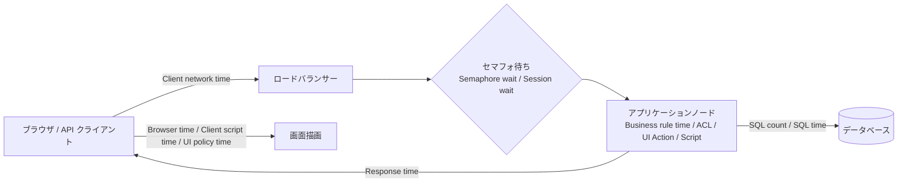
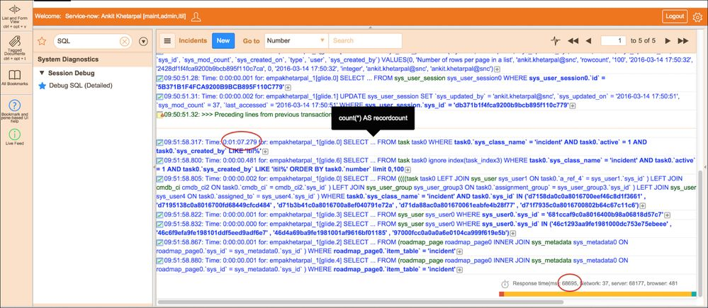
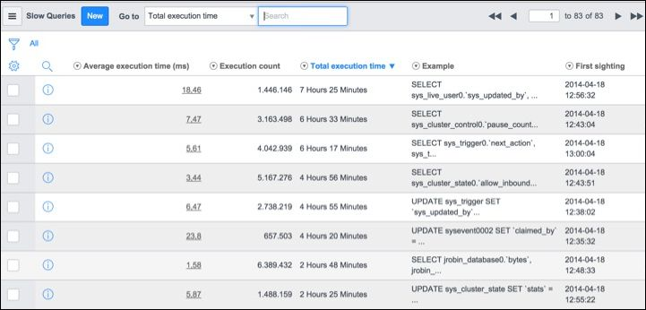
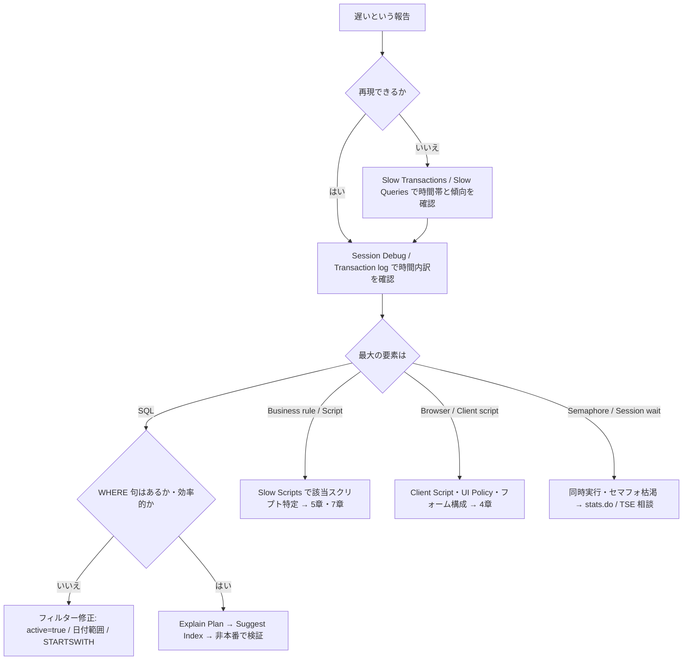
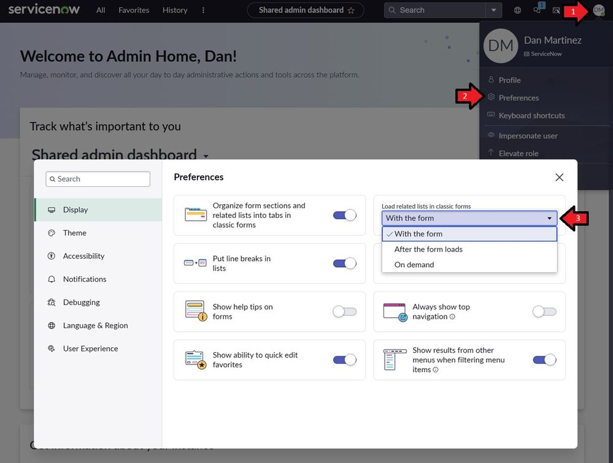
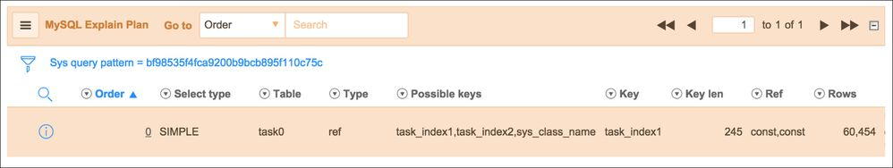

# パフォーマンスチューニング（Performance Tuning）

## 概要

ServiceNow は SaaS であり、サーバー・DB・ネットワークの基盤は ServiceNow 社が運用する。それでも「インシデントのリストが遅い」「フォームを開くのに 10 秒かかる」「夜間バッチが終わらない」という性能問題の大半は、**顧客側の構成（フィルター、リスト設定、スクリプト、データ量、インデックス）**に起因する。ServiceNow Technical Support の Performance チーム（GTSPerformance）が公開している記事群は、性能エスカレーションの典型原因として「非効率なクエリ」「大きすぎるページサイズ」「関連リスト」「不適切な Before/Query Business Rule」「大量レコードのループ処理」を繰り返し挙げている（[Efficient queries top practices](https://servicenow.com/community/developer-articles/performance-best-practice-for-efficient-queries-top-10-practices/ta-p/2306409)、[Server-side coding](https://www.servicenow.com/community/developer-articles/performance-best-practices-for-server-side-coding-in-servicenow/ta-p/2324426)）。

本ファイルは、性能問題に対応するコンサルタント・アーキテクト・開発者向けに、次の順で知見をまとめる。

| 章 | 扱う内容 | 主な仕組み・名称 |
|---|---|---|
| 1 | 性能問題の全体像と切り分けの考え方 | トランザクション時間の内訳、セマフォ、スケジューラワーカー |
| 2 | Slow transaction の分析手順 | Transaction log（`syslog_transaction`）、Session Debug、Node Log File Browser、Stats Tools（Slow Queries／Slow Scripts／Slow Transactions） |
| 3 | 遅いリストの改善 | `rowcount`、`glide.ui.per_page`、演算子、`active=true`、Go to 検索、OR 条件、ソート、列数 |
| 4 | 遅いフォームの改善 | 関連リストの遅延ロード（`glide.ui.related_list_timing`）、フィールド数、Client Script、Display Business Rule |
| 5 | Business Rule の最適化 | Condition、`current.update()` 禁止、Async、Query Business Rule、キャッシュ |
| 6 | インデックス | Slow Queries、Explain Plan、Index Suggestion Engine（ISE）、複合インデックスの列順 |
| 7 | GlideRecord の最適化 | `setLimit`、`GlideAggregate`、`getValue`、`addExtraField`、`get(name, value)`、null 値の罠、OFFSET |
| 8 | Workspace（Next Experience）の性能 | Data Resource の評価モード、リスト件数表示のプロパティ |
| 9 | 大量データへの対応 | Table rotation、System Archive、Table Cleaner（`sys_auto_flush`）、Delete job、インポート分割、Concurrent Imports、RaptorDB |
| 10 | 長時間処理とクォータ | Transaction Quota Rules（UI 298 秒、REST 60 秒）、非同期化 |
| 11 | チェックリスト | 設計・レビュー・運用時の確認項目 |

関連ファイル：監視ツール（Instance Observer、`stats.do`、Client Transaction Timings）と監視運用の設計は [サポートと監視](../03_導入編/14-support-monitoring.md)、スクリプトの書き方全般は [スクリプトのベストプラクティスとアンチパターン](07-scripting-best-practices.md)、カスタマイズの負債化は [カスタマイズと技術的負債](02-customization-technical-debt.md)、インスタンスの物理構成（ノード・DB）は [インスタンスアーキテクチャ](../02_リファレンス/platform/instance-architecture.md)、Business Rule と GlideRecord の API 仕様は [サーバーサイドスクリプト](../02_リファレンス/platform/scripting-server-side.md)、Client Script／UI Policy は [クライアントサイドスクリプト](../02_リファレンス/platform/scripting-client-side.md)、リスト・フォームの画面仕様は [リストとフォーム](../02_リファレンス/platform/lists-forms.md)、インポートの仕様は [データインポート/エクスポート](../02_リファレンス/platform/import-export-data.md)、データ移行計画は [データ移行](../03_導入編/08-data-migration.md)、連携の性能問題は [連携の落とし穴](08-integration-pitfalls.md) を参照。

> **情報の位置づけ：** 本ファイルの多くの知見は ServiceNow Community 上の **ServiceNow 社員（Technical Support Performance チーム等）による記事**に基づく。ServiceNow 社員による公開記事だが製品ドキュメントではないため、本ファイルでは `【第三者情報】` ではなく「GTSPerformance 記事」「ServiceNow 社員記事」と明記し、公式ドキュメント（servicenow.com/docs）由来の記述と区別する。社員以外のコミュニティ投稿に基づく記述には `【第三者情報】` を付ける。記事の公開年が古いもの（2014〜2017 年）は UI が現行と異なる可能性がある。

---

## 1. 性能問題の全体像と切り分けの考え方

### 1.1 「遅い」の発生箇所

ServiceNow のトランザクション（ユーザーのリスト表示・フォーム表示・保存、REST 呼び出し、スケジュールジョブ）の所要時間は、大きく次の要素に分解できる。Transaction log（`syslog_transaction`）の列としてこれらの時間が記録される（[Transaction logs（Brazil）](https://www.servicenow.com/docs/r/platform-security/r_TransactionLogs.html)、[How to troubleshoot a slow transaction](https://www.servicenow.com/community/now-platform-articles/how-to-troubleshoot-a-slow-transaction/ta-p/2322007)）。



| 発生箇所 | 典型的な原因 | 確認する指標 | 主な対策の章 |
|---|---|---|---|
| データベース | フィルター条件が非効率（CONTAINS、OR、ドットウォーク）、インデックス不足、大量行の取得 | SQL time、SQL count、Slow Queries | 3、6、7 |
| サーバースクリプト | Business Rule・Script Include の重い処理、ループ内クエリ、`getRowCount()` | Business rule time、Slow Scripts | 5、7 |
| セッション・セマフォ待ち | 同一ユーザーの同時トランザクション、セマフォ枯渇 | Session wait time、Semaphore wait time、`stats.do` | 1.2、10 |
| ブラウザ | Client Script・UI Policy の過多、`getReference` の同期呼び出し、フィールド過多 | Browser time、Client script time、UI policy time | 4 |
| データ量 | アクティブなタスクの比率が高い、ログ系テーブルの肥大化 | 表の件数、Slow Queries の対象テーブル | 9 |

GTSPerformance 記事は、時間内訳のうち**最も大きい要素から着手する**ことを推奨している。ACL 時間が大きければ ACL、UI Action 時間が大きければ UI Action、SQL 時間が大きければ DB クエリを調べる（[How to troubleshoot a slow transaction](https://www.servicenow.com/community/now-platform-articles/how-to-troubleshoot-a-slow-transaction/ta-p/2322007)）。

### 1.2 1 つの遅い処理が全員に波及する仕組み

ServiceNow のアプリケーションノードは、同期トランザクション（ユーザー操作）を処理するスレッドプール（**Default セマフォ**）と、バックグラウンドジョブを処理する**スケジューラワーカー**を持つ。ServiceNow 社員の記事では次のように説明されている（[Performance considerations when using ASYNC Business Rules](https://www.servicenow.com/community/in-other-news/performance-considerations-when-using-async-business-rules/ba-p/2274036)、2016 年時点の記述）。

| 資源 | 既定値（記事時点） | 枯渇したときの症状 |
|---|---|---|
| Default セマフォ | ノードあたり 16 | 新しいユーザートランザクションがキューに積まれ、全ユーザーの応答が遅くなる |
| スケジューラワーカー | ノードあたり 8 | Async Business Rule、SLA 更新、イベント処理、メール送信（SMTP Sender）、Discovery 等のジョブが遅延する |

- 長時間実行される Async Business Rule は、実行中ずっとワーカーを 1 つ占有する。大量に投入されると全ワーカーが埋まり、SLA やメール送信など無関係なジョブまで遅延する（同上）。
- GTSPerformance 記事は「少量の作業を一度に大量に発生させない（Avoid spawning too much work too quickly）」ことを強調し、パイプの容量・1 件の大きさ・同時投入数を意識するよう説明している。例として、共有ページ（`sc_cart` 等）に広すぎる Record Watcher を設定すると、100 ユーザー × 100 回のリフレッシュ＝1 万トランザクションの「トランザクションストーム」が起きうるとしている（[Server-side coding](https://www.servicenow.com/community/developer-articles/performance-best-practices-for-server-side-coding-in-servicenow/ta-p/2324426)）。
- 同記事は、ヘッダー・フッター等の毎回表示される部品のクエリは **10 ms 未満**で実行されるべきで、そうでなければオンデマンド（ホバー時など）でロードするよう推奨している（同上）。
- 同一ユーザーは同時に 1 トランザクションしか実行できない（セッション同期）ため、重いホームページの自動リフレッシュはそのユーザーの次の操作を待たせる（[Efficient queries top practices](https://servicenow.com/community/developer-articles/performance-best-practice-for-efficient-queries-top-10-practices/ta-p/2306409)）。

セマフォ・スケジューラの監視指標（Semaphore Default Qdepth、Scheduler Queue Length 等）と閾値の目安は [サポートと監視 7.5](../03_導入編/14-support-monitoring.md) を参照。

### 1.3 対策の優先順位

公式ドキュメント「Resolving slow queries」（Australia）は、遅いクエリの原因と対策を次の 3 つに整理し、**インデックス追加はクエリ設計とデータ量の見直しの後に行う**位置づけにしている（[Resolving slow queries（Australia）](https://www.servicenow.com/docs/r/UrSRFFKWBbfQBgoRlt~ltw/B~HI2mXDY182PrrOR~jYnA)）。

| 原因 | 公式の対策 |
|---|---|
| 非効率なクエリ設計（Inefficient query design） | クエリ構造を修正し、必要なデータだけを取得し、クエリレベルのページングを入れる。Slow query log で改善対象を特定する |
| データ量が多い（High data volume） | Transaction quota、Application quota、運用上のトグルが帯域利用を最適化するよう設定されているか確認する |
| 適切なインデックスがない（Lack of proper indexing） | Index Suggestion Engine（ISE）で、選択した遅いクエリのインデックス候補を生成する |

実務上の優先順位は次のとおり【経験則】。

1. **使い方の修正**（ページサイズ、フィルター条件、関連リストの遅延ロード）：コストが最も低く、即効性がある。
2. **スクリプトの修正**（Business Rule の条件、ループ内クエリの排除、集計 API の利用）。
3. **データ量の削減**（アーカイブ、Table Cleaner、ローテーション）。
4. **インデックスの追加**（ISE の提案を非本番で検証）。
5. **ServiceNow 社への相談**（セマフォ設定、インデックスヒント、DB 側の調査）。セマフォ設定は変更前に TSE に相談するよう案内されている（[サポートと監視 7.2](../03_導入編/14-support-monitoring.md) 参照）。

---

## 2. Slow transaction の分析手順

### 2.1 使うツールの一覧

| ツール | メニュー／場所 | 対象テーブル | 用途 | 出典 |
|---|---|---|---|---|
| Transaction log | All > System Logs > Transactions（All user） | `syslog_transaction` | 個々のトランザクションの Response time、Business rule time、SQL count 等を確認 | [Transaction logs（Brazil）](https://www.servicenow.com/docs/r/platform-security/r_TransactionLogs.html) |
| Session Debug | All > System Diagnostics > Session Debug（Enable All） | — | 自分のセッションで実行される SQL・Business Rule・ACL 等をデバッグ出力し、`EXCESSIVE` 表示で遅い処理を特定 | [How to troubleshoot a slow transaction](https://www.servicenow.com/community/now-platform-articles/how-to-troubleshoot-a-slow-transaction/ta-p/2322007) |
| Debug SQL (Detailed) | System Diagnostics > Session Debug > Debug SQL (Detailed) | — | 画面下部に実行 SQL と所要時間を出力 | [Improve performance: database indexes and slow queries](https://www.servicenow.com/community/developer-blog/improve-performance-database-indexes-and-slow-queries/ba-p/2289671) |
| Node Log File Browser | Filter Navigator > Node Log File Browser | — | Session ID とトランザクション番号でノードのログを検索 | [How to troubleshoot a slow transaction](https://www.servicenow.com/community/now-platform-articles/how-to-troubleshoot-a-slow-transaction/ta-p/2322007) |
| Node Log File Download | Filter Navigator > Node Log File Download | — | `localhost` ログをダウンロードして grep 等で解析 | 同上 |
| Slow Queries | All > System Diagnostics > Stats > Slow Queries | `sys_query_pattern` | 類似クエリを集約した合計・平均時間、Explain Plan、Suggest Index | [Stats Tools（Australia）](https://www.servicenow.com/docs/r/UrSRFFKWBbfQBgoRlt~ltw/vbsKTCRej6eErVcbzfTwUA) |
| Slow Scripts | All > System Diagnostics > Stats > Slow Scripts | `sys_script_pattern` | `GlideScopedEvaluator` で評価されたスクリプトのパターン別時間 | 同上 |
| Slow Transactions | All > System Diagnostics > Stats > Slow Transactions | `sys_transaction_pattern` | URL・トランザクション種別・処理系ごとのパターン別時間 | 同上 |
| Active Transactions | User Administration > Active Transactions | — | 実行中トランザクションの確認と強制終了 | [Default quota rules（Brazil）](https://www.servicenow.com/docs/r/platform-administration/platform-performance/c_DefaultQuotaRules.html) |
| `stats.do` | `https://<instance>.service-now.com/stats.do` | — | 接続中ノードのメモリ、セマフォ、スケジューラキュー | [サポートと監視 7.2](../03_導入編/14-support-monitoring.md) |

### 2.2 Transaction log の主要フィールド

Transaction log（All > System Logs > Transactions）は、公式ドキュメントでは次のフィールドが定義されている（[Transaction logs（Brazil）](https://www.servicenow.com/docs/r/platform-security/r_TransactionLogs.html)）。

| フィールド | 意味 |
|---|---|
| Created | 操作の発生日時（インスタンスのホストのタイムゾーン） |
| Type | トランザクションの種類 |
| Created by | 操作したユーザー |
| Origin application | トランザクションが開始したアプリケーションスコープ（グローバルは Global） |
| Response time | アプリケーション要求の往復応答時間（ミリ秒） |
| Network time | 要求後の応答のネットワーク遅延（ミリ秒） |
| Output length | インスタンスが送出した出力サイズ（バイト） |
| SQL count | 実行された SQL コマンド数 |
| Business rule count | 実行された Business Rule 数 |
| Business rule time | Business Rule の実行に要した時間（ミリ秒） |
| URL | アクセスされたアプリケーション／モジュール |
| System ID | 要求を処理したノードの識別子 |
| IP address、GZipped、Protocol、HTTP Response Code | クライアント IP、圧縮有無、HTTP プロトコル、HTTP ステータス |

- バックグラウンド・スケジューラのトランザクションは**実行時間が 1,000 ms を超えた場合のみ**記録される（同上）。
- ServiceNow 社員の記事では、UI トランザクションは**応答時間 100 ms 超**のものだけがログに出るとされる（[How to troubleshoot a slow transaction](https://www.servicenow.com/community/now-platform-articles/how-to-troubleshoot-a-slow-transaction/ta-p/2322007)）。
- 同記事は、リストの列を個人設定して **Business rule time、Client network time、Semaphore wait time、Session wait time、Session ID、Transaction Number、Total page load time、Transaction processing time、UI policy time** を表示することを推奨している。公式ドキュメントのフィールド表にない SQL time、ACL time 等の列も、リストの列として存在する（記事のスクリーンショットで SQL time 列を確認）。インスタンスの列ピッカーで確認すること。

### 2.3 手順 A：Session Debug（推奨）

ServiceNow 社員の記事が推奨する手順（[How to troubleshoot a slow transaction](https://www.servicenow.com/community/now-platform-articles/how-to-troubleshoot-a-slow-transaction/ta-p/2322007)、2021-10）。

1. **All > System Diagnostics > Session Debug** を開き、**Enable All** を選択する。デバッグウィンドウが開く。
2. 遅い操作を再現する（ユーザー固有の現象であれば、権限を持つ担当者がそのユーザーに Impersonate して再現する【経験則】）。
3. セッションログで **`EXCESSIVE`** を検索し、時間のかかった処理を特定する。ログはダウンロード・クリア・フィルターできる。
4. 高コストのクエリは、デバッグ出力の **Query** 見出しのリンクから Slow Queries モジュールのレコードを開ける。
5. インデックスが必要であれば Index Suggestion Engine（KB0782916、本ファイル 6 章）に進む。



*図：Debug SQL (Detailed) を有効にした状態でインシデントリストを表示したときの SQL 出力（2016 年頃の UI）*
左のナビゲーターで「SQL」と入力し、System Diagnostics > Session Debug > **Debug SQL (Detailed)** を選択した状態。リスト（Incidents）の下に、実行された SQL が時刻・所要時間付きで並ぶ。赤丸で示された 1 行目は `Time: 0:01:07.279`（約 67 秒）の `SELECT ... FROM task task0 WHERE task0.sys_class_name = 'incident' AND task0.active = 1 AND task0.sys_created_by LIKE '%itil%'` で、件数取得（`count(*) AS recordcount`）に時間を要している。画面右下には `Response time(ms): 68695, Network: 37, server: 68177, browser: 481` と表示され、応答時間のほぼすべてがサーバー（SQL）で消費されていることが分かる。`LIKE '%itil%'`（CONTAINS 検索）がインデックスを使えない典型例である。出典：https://www.servicenow.com/community/developer-blog/improve-performance-database-indexes-and-slow-queries/ba-p/2289671 （取得日：2026-11-04）

### 2.4 手順 B：Transaction log と Node Log File Browser

同記事の Option 1A（[How to troubleshoot a slow transaction](https://www.servicenow.com/community/now-platform-articles/how-to-troubleshoot-a-slow-transaction/ta-p/2322007)）。

1. 遅い操作を再現する。**ログはノードごとに保存される**ため、再現とログ確認は同じノード上で行う。
2. **System Logs > Transactions (All user)** を開き、列を個人設定する（2.2 の推奨列）。
3. `Created by` で対象ユーザーに絞り、`Created` 降順でソートする。
4. 遅いトランザクションの **Session ID** と **Transaction Number** をコピーする。
5. **Node Log File Browser** で開始・終了時刻、Session ID を入力し、Max rows を 10000、Message にトランザクション番号を入れて Submit する。
6. 出力の `txid` を Message に入れ直して再検索する。
7. **`EXCESSIVE`** の行で、時間を消費したプラットフォーム部品を確認する。

記事の実例では、`mytable_list.do` が WHERE 句のない SQL に約 13.6 秒を費やしていた。フィルターを追加しても十分に改善しなかったため、フィルター列にインデックスを追加したところ、SQL 時間は約 73 ms に下がり、ログ閾値を下回って記録されなくなった（同上）。

### 2.5 手順 C：Stats Tools（Slow patterns）で全体傾向を見る

個別の苦情ではなく、インスタンス全体で「どのクエリ・スクリプト・トランザクションが合計で最も時間を使っているか」を見るには **Stats Tools** を使う（[Stats Tools（Australia）](https://www.servicenow.com/docs/r/UrSRFFKWBbfQBgoRlt~ltw/vbsKTCRej6eErVcbzfTwUA)）。

| 項目 | 内容 |
|---|---|
| モジュール | System Diagnostics > Stats > **Slow Queries**／**Slow Scripts**／**Slow Transactions** |
| テーブル | `sys_query_pattern`、`sys_script_pattern`、`sys_transaction_pattern`。トランザクションの指標は `syslog_transaction` のサーバー時間を使う |
| 集約単位 | 一意のパターンごとに、全期間の実行を集約。合計時間・平均時間・実行回数 |
| トランザクションの指標 | 総サーバー処理時間（**Semaphore wait と Session wait を除く**） |
| 記録対象 | Queries＝`GlideDBI` が実行したプリペアドステートメント、Scripts＝`GlideScopedEvaluator` で評価されたスクリプト、Transactions＝サーバー側と関連するクライアント側のトランザクション |
| 永続化 | 活動は即時キャッシュされ後で永続化される。**サーバーキャッシュのフラッシュで未永続化分は消える** |
| プラグイン | Stats Tools は既定で有効。`com.snc.jrobin` に依存。有効化・アップグレードには `admin` ロールが必要 |
| フィルター | アプリケーションスコープで絞り込み可能 |

Slow Queries の公式手順（[Use a slow query log（Zurich）](https://www.servicenow.com/docs/r/7LhbZn3yz3Q58qhjZoU9iQ/lpSyLgNuuPFdecMZDgEu~g)）：

1. **All > System Diagnostics > Stats > Slow Queries** を開く。
2. クエリレコードを開いて詳細を確認する。
3. **Explain Plan** を選択すると、DB がどのようにデータを取得するかを示すクエリプランが **MySQL Explain Plan** 関連リストに表示される。
4. **Index Suggestion**（Australia の手順では **Suggest Index**）でインデックス候補を生成する（6 章）。

- Slow query log は、**類似クエリの合計実行時間が 5 秒を超えたもの**を報告する。「類似」とは、同じテーブルから選択し、WHERE 句で同じフィールドを（値は違っても）条件にしているクエリを指す。例：`sys_user` を異なる `name` 値で検索するクエリは 1 つのパターンに集約される（同上）。
- ServiceNow 社員の記事は、**まず合計実行時間（Total execution time）でソート**し、頻繁に実行されて影響の大きいクエリから着手し、その後に平均時間の大きいものを見るよう勧めている（[What index should it be? - OR - Slow Queries explained](https://www.servicenow.com/community/developer-blog/what-index-should-it-be-or-slow-queries-explained/ba-p/2269311)）。平均 75 ms の速いクエリでも、4 万回実行されて合計 50 分になっていた例が示されている。



*図：System Diagnostics > Stats > Slow Queries のリスト（Total execution time 降順、2014〜2015 年頃の UI）*
リストの列は左から Average execution time (ms)、Execution count、Total execution time（降順ソート）、Example（SQL の先頭）、First sighting。上位には平均 18.46 ms・実行回数 1,446,146 回・合計 7 時間 25 分の `SELECT sys_live_user0...`、平均 5.61 ms・4,042,939 回・合計 6 時間 17 分の `SELECT sys_trigger0.next_action...` などが並ぶ。**1 回あたりは数 ms でも実行回数が膨大なクエリが合計時間の上位を占める**ことが読み取れる。出典：https://www.servicenow.com/community/developer-blog/what-index-should-it-be-or-slow-queries-explained/ba-p/2269311 （取得日：2026-11-04）

- Slow Queries レコードには、Total execution time、Execution count、Average execution time、Example（SQL 例）、Example URL、First sighting、Source（呼び出し元）とスタックトレースが記録され、スタックトレースからスクリプト（例：Script Include）まで遡れる（[What index should it be?](https://www.servicenow.com/community/developer-blog/what-index-should-it-be-or-slow-queries-explained/ba-p/2269311)）。

> 注意：Application Insights は Zurich からサポート対象外となり、代替は Impact の Instance Observer である（[サポートと監視 7.3〜7.4](../03_導入編/14-support-monitoring.md)）。

### 2.6 分析結果の判断フロー



判断フローの根拠：[How to troubleshoot a slow transaction](https://www.servicenow.com/community/now-platform-articles/how-to-troubleshoot-a-slow-transaction/ta-p/2322007)（SQL が支配的な場合は「WHERE 句があるか」「結果件数を `active=1` や日付範囲で制限しているか」「インデックスやインデックスヒントが効くか」「最近クローンした非本番で先に試したか」を確認する）。

---

## 3. 遅いリストの改善

### 3.1 ページサイズ（rowcount）を絞る

リスト性能に最も効く設定は「1 ページに何行表示するか」である。

| 項目 | 内容 | 出典 |
|---|---|---|
| ユーザー設定 | `rowcount` ユーザープリファレンス（`sys_user_preference`）。リスト、関連リスト、埋め込みリストに適用される | [Improve performance by displaying "just enough" data](https://www.servicenow.com/community/in-other-news/improve-performance-by-displaying-quot-just-enough-quot-data/ba-p/2268746) |
| 推奨値 | **20 行以下**（ServiceNow Technical Support の推奨） | [Efficient queries top practices](https://servicenow.com/community/developer-articles/performance-best-practice-for-efficient-queries-top-10-practices/ta-p/2306409) |
| 選択肢の制限 | `glide.ui.per_page` プロパティで、リストのページサイズ選択肢を制限する | 同上 |
| 既定行数 | `glide.ui.record_count`（System Properties > System の下部） | [Just enough data](https://www.servicenow.com/community/in-other-news/improve-performance-by-displaying-quot-just-enough-quot-data/ba-p/2268746) |
| 一括リセット | ServiceNow Technical Support が全ユーザーのプリファレンスを 20 行に一括リセットできる | 同上 |
| Group by | グループ化表示では、**各グループごとに rowcount 件**まで表示されるため、コストが倍増する | [Efficient queries top practices](https://servicenow.com/community/developer-articles/performance-best-practice-for-efficient-queries-top-10-practices/ta-p/2306409) |

- ServiceNow 社員の記事は、1 レコードあたり 100 ms かかる場合、100 行のリストは約 10 秒、10 行なら約 1 秒と試算している（[Just enough data](https://www.servicenow.com/community/in-other-news/improve-performance-by-displaying-quot-just-enough-quot-data/ba-p/2268746)）。
- 監査方法：`sys_user_preference` を `name=rowcount` で絞り込み、値ごとのユーザー数を集計する。記事では 50 行以上を「多い」と扱っている（同上）。
- コミュニティでは、`rowcount` の既定値自体は変更せず、`glide.ui.per_page` で選択肢を絞り、100 を超える選択肢は推奨しないとする回答がある【第三者情報】（[Healthscan Scorecard - Max page list size](https://www.servicenow.com/community/developer-forum/healthscan-scorecard-performance-max-page-list-size-best/m-p/2033469)）。
- 大量データを定期的に見る必要があるなら、ユーザーに Show の値を上げさせるのではなく、レポートやエクスポート（CSV、Excel、PDF）を用意する（[Just enough data](https://www.servicenow.com/community/in-other-news/improve-performance-by-displaying-quot-just-enough-quot-data/ba-p/2268746)）。

### 3.2 フィルター条件：効率のよい演算子と絞り込み

GTSPerformance 記事「Performance Best Practice for Efficient Queries」（2017-06 初版、2025-11 更新）の要点（[Efficient queries top practices](https://servicenow.com/community/developer-articles/performance-best-practice-for-efficient-queries-top-10-practices/ta-p/2306409)）。

| # | 推奨 | 理由・詳細 |
|---|---|---|
| 1 | **is（=）や starts with を使い、contains／ends with を避ける** | B-Tree インデックスは値の先頭からしか効率的に探索できない。`LIKE '%xxx%'` は全表スキャンになりやすい |
| 2 | **`active=true` を条件に加える** | 例：`short_descriptionLIKEemail^active=true`。タスク系テーブルではアクティブなレコードを**全体の約 10% 未満**に保つことが推奨される |
| 3 | **インデックスのある日付列で期間を区切る（タイムボックス）** | 例：`sys_created_on` が直近 7 日。結果セットを先に小さくする |
| 4 | **`sysparm_fixed_query=active=true`** | URL パラメーターでパンくずに残らない固定条件を付与する |
| 5 | **ドットウォーク条件を避ける** | `parent.sys_id` のようなドットウォークは暗黙の JOIN を生む。`addQuery('parent', parentID)` のように参照値で直接比較する |
| 6 | **「über OR」と NQ（New Query）条件を分割する** | `a=1^b=2^NQc=3^ORd=4` は DB に 2 つのクエリを実行させ、両側でインデックスを使えないことが多い。ホームページ上で別々のレポートに分割する。記事の例では 35 秒のレポートを 3 つに分けて合計約 2 秒になった |
| 7 | **リストの列を減らす** | 不要な列は列設定（歯車アイコン）から外す |
| 8 | **ジャーナル列（Work notes、Additional comments）をリストに出さない** | ジャーナルは子テーブルに格納されており、1 行ごとに追加クエリが発生する |
| 9 | **ソート列に注意する** | WHERE 条件を絞り込むインデックスと一致する列（例：`sys_created_on`）でソートする。インデックスのない列でのソートはオプティマイザーに遅い実行計画を選ばせることがある |
| 10 | **データの偏りを考慮する** | 1 つの CI に 10 万件のタスクが `task_to_ci` で紐づいている、など偏ったデータでは同じフィルターでも値によって速度が大きく変わる。`IS NULL`／`NOT NULL` 条件にも注意 |

### 3.3 Go to 検索（リスト上部の検索ボックス）

- リスト上部の「Go to」検索の既定演算子は **以上（`>=`）** である（[Efficient queries top practices](https://servicenow.com/community/developer-articles/performance-best-practice-for-efficient-queries-top-10-practices/ta-p/2306409)）。
- 前方一致にするには `glide.ui.goto_use_starts_with` を `true` にする（Kingston 以降）。フィールド単位では `sys_dictionary` レコードに `goto_use_starts_with=true` 属性を付ける。
- 前方一致検索はワイルドカード `SAP%` で行う。`goto_use_contains`（部分一致）は効率が悪いため避ける（同上）。

### 3.4 ホームページ・ダッシュボード

| 推奨 | 詳細 | 出典 |
|---|---|---|
| 自動リフレッシュを避ける | 同一ユーザーは同時に 1 トランザクションのみ。重いホームページの自動更新は利用者の操作を妨げる | [Efficient queries top practices](https://servicenow.com/community/developer-articles/performance-best-practice-for-efficient-queries-top-10-practices/ta-p/2306409) |
| 3〜4 秒以上かかるレポートを置かない | スケジュールメール配信に切り替える | 同上 |
| 既定のホームページを軽くする | KB0712404 を参照 | 同上 |
| Homepage Widgets のクォータ | 既定のクォータルール「Homepage Widgets」は **30 秒**で打ち切る | [Default quota rules（Brazil）](https://www.servicenow.com/docs/r/platform-administration/platform-performance/c_DefaultQuotaRules.html) |
| 大量集計は事前集計を使う | 大規模・高頻度の集計は Performance Analytics 等の事前集計データを使う | [Server-side coding](https://www.servicenow.com/community/developer-articles/performance-best-practices-for-server-side-coding-in-servicenow/ta-p/2324426) |

### 3.5 Database View

Database View（複数テーブルを結合した仮想テーブル）は、ビュー定義そのものに絞り込み条件を入れる。例：Metric Incident のビューを 1 つの Metric Definition に限定する（[Efficient queries top practices](https://servicenow.com/community/developer-articles/performance-best-practice-for-efficient-queries-top-10-practices/ta-p/2306409)）。

---

## 4. 遅いフォームの改善

### 4.1 関連リストの遅延ロード

GTSPerformance 記事は、**関連リストがフォーム表示の遅延の 75〜90% を占めることが多い**と述べている（[Efficient queries top practices](https://servicenow.com/community/developer-articles/performance-best-practice-for-efficient-queries-top-10-practices/ta-p/2306409)）。Classic UI（Core UI）のフォームでは、関連リストのロードタイミングを設定できる。

| 設定値（`glide.ui.related_list_timing`） | 画面上の選択肢 | 動作 | 出典 |
|---|---|---|---|
| `default` | With the form | フォームと同時にロード（既定）。最も遅い部品をフォームが待つ | [Configure when a related list loads（Brazil）](https://www.servicenow.com/docs/r/platform-user-interface/t_ConfigureWhenARelatedListLoads.html) |
| `deferred` | After the form loads | フォームを先に表示し、その後自動でロード | [Old but Gold #5](https://www.servicenow.com/community/in-other-news/old-but-gold-5-speeding-up-classic-form-loading/ba-p/3381913)【第三者情報】、[Efficient queries top practices](https://servicenow.com/community/developer-articles/performance-best-practice-for-efficient-queries-top-10-practices/ta-p/2306409) |
| `ondemand` | On demand | ボタンを押したときだけロード | [Configure when a related list loads（Brazil）](https://www.servicenow.com/docs/r/platform-user-interface/t_ConfigureWhenARelatedListLoads.html) |



*図：Preferences > Display の「Load related lists in classic forms」（Next Experience の Admin Home 上で表示）*
右上のユーザーアバター（①）から **Preferences**（②）を開くと Preferences ダイアログが表示される。左メニューで Display を選ぶと、右側に「Organize form sections and related lists into tabs in classic forms」「Put line breaks in lists」「Show help tips on forms」等のトグルと並んで、**Load related lists in classic forms** のドロップダウン（③）がある。選択肢は **With the form**（既定・チェック済み）、**After the form loads**、**On demand** の 3 つ。出典：https://www.servicenow.com/community/in-other-news/old-but-gold-5-speeding-up-classic-form-loading/ba-p/3381913 （取得日：2026-11-04）

- **全ユーザー既定の変更：** GTSPerformance 記事は、**User 欄を空にしたシステム全体のユーザープリファレンス** `glide.ui.related_list_timing` を `deferred`（または `ondemand`）で作成することを推奨している（[Efficient queries top practices](https://servicenow.com/community/developer-articles/performance-best-practice-for-efficient-queries-top-10-practices/ta-p/2306409)）。コミュニティ記事では、システムプロパティ `glide.ui.defer_related_lists` を `true` にすると全ユーザーが「After the form loads」と同等になるとされる【第三者情報】（[Old but Gold #5](https://www.servicenow.com/community/in-other-news/old-but-gold-5-speeding-up-classic-form-loading/ba-p/3381913)）。
- この設定は **Classic（Core UI）フォームのみ**が対象で、UI Builder ベースの Workspace には適用されない（同上）【第三者情報】。
- ユーザーは個人設定で上書きできるため、強制にはならない（コミュニティ報告）【第三者情報】。
- 実務上の選択：`deferred` が「表示が速く、関連リストも自動で出る」バランスのよい値とされる。`ondemand` は関連リストを頻繁に使う担当者には不便になる（同上）。

### 4.2 フォームの構成

| 推奨 | 詳細 | 出典 |
|---|---|---|
| フィールド数を最小限にする | フォームのフィールドが多いほどロードが遅くなる。常に必要なフィールドを最上部のセクションに置き、他はセクションに分ける | 公式ドキュメントの記述として検索結果で確認（[Primary interfaces](https://www.servicenow.com/docs/r/SmYvGPN0OygSQs53fsexIQ/Bf6_jqcZUcnyv0sBBis1Lw)）。個別ページの全文は未確認 |
| 関連リスト・埋め込みリストを必要最小限にする | 関連リスト・埋め込みリストはその行をすべて DB から読み込むため、プラットフォーム全体の負荷になる。rowcount はこれらにも適用される | [Just enough data](https://www.servicenow.com/community/in-other-news/improve-performance-by-displaying-quot-just-enough-quot-data/ba-p/2268746) |
| 参照フィールドの多用に注意 | 参照のプレビュー（i アイコン）はフォーム描画前に関連を組み立てて実現している | 同上 |

### 4.3 Client Script と UI Policy

ServiceNow 社員の記事「Six ways to improve the performance of client scripts」（2017-06）の 6 項目（[Six ways](https://www.servicenow.com/community/developer-blog/six-ways-to-improve-the-performance-of-client-scripts/ba-p/2288154)）。

| # | 推奨 | 詳細 |
|---|---|---|
| 1 | スクリプトより UI Policy を使う | UI Policy は効率よく実行され、実行順序も制御できる。UI Policy 内でもスクリプトより標準アクションを優先する |
| 2 | サーバー呼び出しを減らす | `g_form.getReference()` やクライアント側 GlideRecord ではなく、Display Business Rule＋`g_scratchpad` または GlideAjax で**必要なフィールドだけ**取得する |
| 3 | グローバル Client Script を避ける | グローバル（Table = Global）のスクリプトはホームやカタログを含む全ページでロードされる。対象テーブルを指定する（`task` 指定は子テーブルにも効く） |
| 4 | onChange で `isLoading` を確認する | フォームロード時は不要なことが多いので `if (isLoading) return;` で抜ける |
| 5 | `newValue` を確認する | 値が空なら残りを実行しない |
| 6 | サーバー呼び出しは最後に置く | クライアント側のチェックを先に行い、不要なサーバー呼び出しを避ける |

**Display Business Rule と `g_scratchpad` の注意：** Display Business Rule はフォームが表示されるたびに実行されるため、毎回は不要なデータを積むとロードが遅くなる（[Business rules and script includes（Brazil）](https://www.servicenow.com/docs/r/application-development/business-rules-and-script-includes.html)）。コミュニティでは「`g_scratchpad` が常に最善ではない。フォーム表示時に必ず必要な小さなデータは `g_scratchpad`、操作に応じて必要なデータは非同期 GlideAjax」という使い分けが語られている【第三者情報】（[g_scratchpad vs GlideAjax](https://www.servicenow.com/community/developer-forum/g-scratchpad-vs-glideajax-is-there-really-a-winner/td-p/1665244)）。

Client Script の仕様詳細は [クライアントサイドスクリプト](../02_リファレンス/platform/scripting-client-side.md) を参照。

---

## 5. Business Rule の最適化

### 5.1 公式ベストプラクティス

公式ドキュメント「Business rules and script includes」が挙げる性能関連の推奨（[Brazil 版](https://www.servicenow.com/docs/r/application-development/business-rules-and-script-includes.html)、[Zurich 版](https://www.servicenow.com/docs/r/zurich/application-development/building-applications/business-rules-and-script-includes.html)）。Australia 版も同趣旨と考えられるが、本調査では Australia 版ページの全文は未取得。

| 推奨 | 内容 |
|---|---|
| **常に Condition を設定する** | Business Rule は必要なときだけ実行されるべきで、条件なしで実行すべき場面はまれ。条件はデバッグにも役立つ |
| **`current.update()` を使わない** | 追加の DB 操作が発生し、通知の重複や再帰ループの原因になる |
| **小さく、目的を限定する** | 1 つのルールに多くを詰め込まない。ベースシステムの Business Rule を変更しない |
| **再利用ロジックは Script Include に** | グローバル Business Rule ではなく Script Include を使う。UI Action と Scripted REST API の両方から同じ処理を呼ぶ場合も Script Include にまとめる |
| **Async を活用する** | ユーザーが結果を即時に必要としない長時間処理・一括更新は Async Business Rule にする。DB 操作完了後に別プロセスとして実行される |
| **クエリで処理件数を限定する** | Business Rule 内で処理するレコードはクエリで絞る |
| **Client-callable Business Rule を避ける** | Client Script を遅くする |
| **スクリプトは必要なときだけ** | 条件ビルダーや Set field values で済むならスクリプトを書かない |

### 5.2 When（実行タイミング）の選び方と性能

| When | 実行タイミング | 用途 | 性能上の注意 |
|---|---|---|---|
| before | DB 操作の前（同期） | `current` の値の設定・検証、中断 | 保存トランザクションの時間に直接加算される |
| after | DB 操作の後（同期） | 他レコードの更新、イベント生成 | ユーザーは完了まで待つ。重い処理は async へ |
| async | DB コミット後、スケジュールジョブとしてバックグラウンド | 通知以外の重い後処理、外部連携、集計 | スケジューラワーカーを消費。大量発生で他ジョブを遅延させる |
| display | フォーム表示時 | `g_scratchpad` へのデータ受け渡し | フォーム表示のたびに実行される |
| query（Before Query） | クエリ実行前 | 行レベルのデータ制限 | **そのテーブルへのすべてのクエリ**に付加される |

出典：[Business rules and script includes（Zurich）](https://www.servicenow.com/docs/r/zurich/application-development/building-applications/business-rules-and-script-includes.html)、[Performance considerations when using ASYNC Business Rules](https://www.servicenow.com/community/in-other-news/performance-considerations-when-using-async-business-rules/ba-p/2274036)。

### 5.3 Async Business Rule の落とし穴

ServiceNow 社員の記事（2016-01、Geneva 期の記述）による Async Business Rule の挙動（[Performance considerations when using ASYNC Business Rules](https://www.servicenow.com/community/in-other-news/performance-considerations-when-using-async-business-rules/ba-p/2274036)）。

- 保存後、`sys_trigger` テーブルにスケジュールジョブが挿入され、ユーザーには即座に制御が戻る。ジョブ名は **`ASYNC: <Business Rule 名>`** で、ジョブのコンテキストが Business Rule の sys_id を参照するため発生源を特定しやすい。
- 完了したジョブは `sys_trigger` から削除されるため、**調査の証跡は素早く取る**必要がある。
- 記事のシナリオ 1：`gs.sleep()` を含む Async Business Rule がノードの 8 ワーカーすべてを占有し、キューが増え続けた。
- 記事のシナリオ 2：`gr.next` の括弧漏れという構文誤りで、ジョブが無期限にハングし、burst worker が 12 まで増えた。完全な解消にはノード再起動が必要だった。
- 対処：問題の Business Rule を無効化し、All Active Transactions でトランザクションを Kill（ServiceNow サポートと協力）し、`sys_trigger` から該当ジョブを削除する。ノード再起動は最後の手段でサポートが行う。
- 予防：非本番で Async Business Rule の想定応答時間を確認し、構文を検証する。
- GTSPerformance は、テスト以外で `gs.sleep()` を使わないこと（ワーカースレッドをブロックする）、遅延実行には `gs.eventQueueScheduled()` を使うことを推奨している（[Server-side coding](https://www.servicenow.com/community/developer-articles/performance-best-practices-for-server-side-coding-in-servicenow/ta-p/2324426) のコメント欄、2024-02）。

### 5.4 Query Business Rule

Before Query Business Rule は、そのテーブルへの**すべてのクエリ**（リスト、参照検索、レポート、スクリプトの GlideRecord）で実行される。

- ServiceNow 社員の記事は、毎年、不適切に書かれた before／query Business Rule による性能エスカレーションが複数発生していると述べている【第三者情報：コミュニティ検索結果の要約に基づく】（[ServiceNow Community: Business Rule 関連記事](https://www.servicenow.com/community/developer-articles/business-rule/ta-p/2329993)）。
- GTSPerformance の事例では、個々の Query Business Rule は 100 ms 未満で速かったが、**数千回の実行の合計**が主要なコストになっていた。同じエンコードクエリを毎回再計算していたことが原因で、「関数 × テーブル × ユーザー」の組み合わせごとに一度計算してキャッシュすることで解消した（[Caching data to improve performance](https://www.servicenow.com/community/servicenow-ai-platform-articles/caching-data-to-improve-performance/ta-p/2308096)）。
- 実務上の指針【経験則】：
  - Query Business Rule の中で GlideRecord クエリを実行しない（ユーザーのグループ一覧等はセッション内でキャッシュする）。
  - 生成する条件はインデックスの効く列（参照列の `=`、`IN`）にする。CONTAINS や OR の連鎖を付加しない。
  - 行レベルの制限はまず ACL やドメインセパレーションで実現できないか検討する（[アクセス制御（ACL）](../02_リファレンス/platform/access-control-acl.md)、[ドメインセパレーション](../02_リファレンス/platform/domain-separation.md)）。

### 5.5 Script Include のサイズ

GTSPerformance のコメントによると、Script Include は「少数の大きなもの」の方が望ましいが、**64KB を超えるコードはキャッシュされずインタプリタ実行になる**（[Server-side coding](https://www.servicenow.com/community/developer-articles/performance-best-practices-for-server-side-coding-in-servicenow/ta-p/2324426) のコメント欄、2020-09）。

---

## 6. インデックス

### 6.1 インデックスが効く条件・効かない条件

ServiceNow 社員の記事（[What index should it be?](https://www.servicenow.com/community/developer-blog/what-index-should-it-be-or-slow-queries-explained/ba-p/2269311)、[Improve performance: database indexes and slow queries](https://www.servicenow.com/community/developer-blog/improve-performance-database-indexes-and-slow-queries/ba-p/2289671)）の要点。

| 状況 | インデックスの効果 | 対策 |
|---|---|---|
| `=`、starts with、範囲条件（インデックス列） | 効く | — |
| contains（`LIKE '%xxx%'`） | 先頭ワイルドカードのため効かず全表スキャン | starts with に変える、検索要件を見直す |
| 異なる列の OR | 1 つのインデックスで両条件を満たせない | クエリを分割して結果を統合する |
| 1 列で GROUP BY、別列で ORDER BY | インデックスを使えないことが多い | クエリを書き換える |
| 選択性が低い列（例：99% がクローズ済みの `state`） | 効きにくい | 選択性の高い列と組み合わせる |
| 長いテキスト列（TEXT、MEDIUM TEXT、LONG TEXT） | 先頭の数文字しかインデックス化されない | 短い検索文字列でのみ有効 |

**カーディナリティと選択性：** 選択性＝カーディナリティ（異なる値の数）÷ 総行数 × 100%。DB はインデックスが結果を十分に絞り込まないと判断すると、インデックスを使わず全表スキャンを選ぶ（同上）。例：3 万ユーザー、名前の種類約 1,000、部署 15 で「Finance の Jim」を探す場合、名前の方が絞り込みが強いので先頭に置くべきである。

### 6.2 複合インデックスの列順

ServiceNow 社員の記事は、約 15 万行の `task` テーブルで 3 通りの列順を比較した（[Improve performance: database indexes and slow queries](https://www.servicenow.com/community/developer-blog/improve-performance-database-indexes-and-slow-queries/ba-p/2289671)、2016-03）。

| 列順 | 実行時間 |
|---|---|
| (`sys_class_name`, `active`, `sys_created_by`) | 約 29 秒 |
| (`active`, `sys_class_name`, `sys_created_by`) | 約 30 秒 |
| (`sys_created_by`, `sys_class_name`, `active`) | 約 0.12 ms |

- 教訓：**カーディナリティの高い列を先頭に置く**。特に範囲比較（`sys_created_on` 等）を含む場合に重要。`active` をクエリとインデックスに含めるのは経験則として有効（同上）。
- 最適な順序は行数とデータ分布に依存するため、実データで検証する。

### 6.3 Explain Plan の読み方

Slow Queries レコードの **Explain Plan** を実行すると、**MySQL Explain Plan** 関連リストに実行計画が表示される（[Use a slow query log（Zurich）](https://www.servicenow.com/docs/r/7LhbZn3yz3Q58qhjZoU9iQ/lpSyLgNuuPFdecMZDgEu~g)）。



*図：Slow Queries レコードの MySQL Explain Plan 関連リスト（2016 年頃の UI）*
関連リストのヘッダーは「MySQL Explain Plan」で、フィルターに `Sys query pattern = bf98535f...` が設定されている。列は Order、Select type、Table、Type、Possible keys、Key、Key len、Ref、Rows。1 行目は Order 0、Select type `SIMPLE`、Table `task0`、Type `ref`、Possible keys `task_index1,task_index2,sys_class_name`、Key `task_index1`、Key len 245、Ref `const,const`、Rows 60,454。オプティマイザーが候補 3 つの中から `task_index1` を選び、約 6 万行を走査する見積もりであることを示す。出典：https://www.servicenow.com/community/developer-blog/improve-performance-database-indexes-and-slow-queries/ba-p/2289671 （取得日：2026-11-04）

| Explain Plan の列 | 見方 |
|---|---|
| Type（アクセス型） | 効率のよい順に `const` → `eq_ref` → `ref` → `index_merge` → `range` → `index` → `ALL`。**`ALL` は全表スキャン** |
| Possible keys／Key | 候補インデックスと実際に選ばれたインデックス。Key が空ならインデックス未使用 |
| Rows | 走査見積もり行数。インデックス追加後に大きく減れば効果がある |
| Extra | `Using where`、`Using index`、`Using filesort`、`Using temporary`、`Using join buffer` など。`filesort`／`temporary` はソート・グループ化のコストを示す |

出典：[What index should it be?](https://www.servicenow.com/community/developer-blog/what-index-should-it-be-or-slow-queries-explained/ba-p/2269311)。同記事の例では、`sys_dictionary` の `choice_table IS NOT NULL` 条件が Type `ALL`（25,629 行）だったが、`choice_table` にインデックスを追加すると Type `ref`、Key `choice_table`、Rows 5,427 に改善した。

### 6.4 Index Suggestion Engine（ISE）

**Index Suggestion Engine（ISE）** は、遅いクエリを分析し、実行時間を改善できる場合にインデックスを提案する公式機能である（[Index suggestions for slow queries（Australia、仏語版）](https://www.servicenow.com/docs/r/MMV5lKjf1f12mwR_Y135Lw/qjXfvzKcEZwKC1MIL9bNjg)、[同（Xanadu）](https://www.servicenow.com/docs/r/SbrhqYG7UKQCk7uYwvgVBA/ZYWNMZEuPF0KmWyQY52huQ)）。

| 項目 | 内容 |
|---|---|
| プラグイン | Index Suggestion Engine（`com.glide.index_suggestion`）。新規・アップグレードしたインスタンスで既定で有効 |
| テーブル | Index Suggestions（`sys_index_suggestion`） |
| 対応 DB | **MySQL のみ**（Australia 版でも同記述）。RaptorDB での対応は公開情報では確認できず |
| 提案アルゴリズム | 重み付けした列ランキング（weighted column ranking） |
| 列統計 | 日次ジョブが、遅いクエリに含まれるテーブルの列統計（カーディナリティ、null／非 null 件数）を収集する |
| 評価期間 | インデックス作成後 **14 日間**、1 時間ごとにクエリ実行時間の改善・悪化を評価する |

**生成手順（Australia）**（[Generate an index suggestion for a slow query（Australia）](https://www.servicenow.com/docs/r/UrSRFFKWBbfQBgoRlt~ltw/YVUaVOByZDLgszbI9JNr8A)）：

1. **All > System Diagnostics > Stats > Slow Queries** を開く。
2. 対象のクエリレコードを開く。
3. **Suggest Index** を選択する。
4. 列統計がない場合は **Collect Column Stats** ジョブのスケジュールを促すメッセージが出る。既定時刻で実行するか即時収集してから、再度 Suggest Index を選択する。
5. 成功すると Index Suggestion レコードの State が **Suggested** になる。ここから非本番へのエクスポート、または Ignore を選べる。

**公式の推奨プロセス**（[Resolving slow queries（Australia）](https://www.servicenow.com/docs/r/UrSRFFKWBbfQBgoRlt~ltw/B~HI2mXDY182PrrOR~jYnA)）：

1. Slow query log で、インデックス改善が見込める遅いクエリを探す。
2. ISE でインデックス候補を生成する。
3. 候補をレビューし、進めるか判断する。
4. 本番から**非本番インスタンスにエクスポート**して作成・評価・テストする。
5. 効果に満足したらインデックスを作成、または作成をスケジュールする。
6. インデックスの性能をテストする（非本番では作成直後に実施）。
7. 不要になったインデックスは即時またはスケジュールで削除する。ISE は未使用・性能劣化のインデックスの削除を提案することがある。

**State（状態値）**（[Index suggestions for slow queries（Xanadu）](https://www.servicenow.com/docs/r/SbrhqYG7UKQCk7uYwvgVBA/ZYWNMZEuPF0KmWyQY52huQ)、Australia 版も同構成）：

| 段階 | State |
|---|---|
| レビュー待ち（Index suggestions to review） | Suggested、Drop Suggested（Unused）、Drop Suggested（Performance Degradation） |
| 処理中（Index in progress） | Creation Scheduled、Creation in Progress、Creation Failed、Evaluating Effectiveness、Drop Suggested（Unused）、Drop Suggested（Performance Degradation）、Drop Scheduled、Drop in Progress、Drop Failed |
| 完了（Index done） | Created、Ignored、Dropped、Accepted、Superseded |

- Ignore を選ぶと State が Ignored になり、その提案は無効となりインデックス作成に使えなくなる。
- Drop Suggested（Unused）は、DB がそのインデックスを遅いクエリに使っていないことを示す。

### 6.5 インデックス追加の注意点

| 注意点 | 内容 | 出典 |
|---|---|---|
| 上限 | MySQL InnoDB は 1 テーブルあたり最大 64 インデックス。全列にインデックスを張るのは逆効果 | [Improve performance: database indexes and slow queries](https://www.servicenow.com/community/developer-blog/improve-performance-database-indexes-and-slow-queries/ba-p/2289671) |
| 書き込み性能 | インデックスはディスクとメモリを使い、INSERT／UPDATE を遅くする | 同上 |
| オプティマイザーの誤選択 | インデックスが多すぎると、誤ったインデックスを選ぶ・インデックスを使わない原因になる | 同上、[What index should it be?](https://www.servicenow.com/community/developer-blog/what-index-should-it-be-or-slow-queries-explained/ba-p/2269311) |
| 非本番での検証 | 本番適用前にサブプロダクション（最近クローンしたもの）で検証する | [Resolving slow queries（Australia）](https://www.servicenow.com/docs/r/UrSRFFKWBbfQBgoRlt~ltw/B~HI2mXDY182PrrOR~jYnA)、[How to troubleshoot a slow transaction](https://www.servicenow.com/community/now-platform-articles/how-to-troubleshoot-a-slow-transaction/ta-p/2322007) |
| 大規模テーブル | `cmdb_ci` のカスタム列にインデックスを作成した際、クエリが約 5 秒停止したというコミュニティ報告がある【第三者情報】 | [Indexing CMDB Tables](https://www.servicenow.com/community/developer-forum/indexing-cmdb-tables/m-p/2095258) |
| インデックス化できない列 | Tables and Columns モジュールに出ない参照フィールドはインデックス作成モジュールから作れず、サポートへの相談が必要とされる（2016 年時点） | [Improve performance: database indexes and slow queries](https://www.servicenow.com/community/developer-blog/improve-performance-database-indexes-and-slow-queries/ba-p/2289671) |
| インデックスヒント | インデックスを追加しても DB が使わない場合、ServiceNow 社がインデックスヒントで使用を強制する対応がある | [How to troubleshoot a slow transaction](https://www.servicenow.com/community/now-platform-articles/how-to-troubleshoot-a-slow-transaction/ta-p/2322007) |

- 手動でのインデックス作成は、テーブル定義（System Definition > Tables）の **Database Indexes** 関連リストから行う方法がコミュニティで説明されている【第三者情報】。現行リリースでは ISE 経由の作成とスケジュールが公式手順として整備されているため、まず ISE を使うことを推奨する【経験則】。
- インデックスの作成・削除はアップデートセットで移送できるか、移送時に大規模テーブルでロックが起きないかは、公開情報では確認できず。本番適用時期は ServiceNow サポートに相談するのが安全である【経験則】。

---

## 7. GlideRecord の最適化

GlideRecord はサーバーサイドでレコードを操作する基本 API である。GTSPerformance 記事「Performance Best Practices for Server-side Coding in ServiceNow」（2020-06 初版、2026-02 更新）の 11 項目を中心に整理する（[Server-side coding](https://www.servicenow.com/community/developer-articles/performance-best-practices-for-server-side-coding-in-servicenow/ta-p/2324426)）。API 仕様は [サーバーサイドスクリプト](../02_リファレンス/platform/scripting-server-side.md)、コーディング規約全般は [スクリプトのベストプラクティスとアンチパターン](07-scripting-best-practices.md) を参照。

### 7.1 null／undefined 値でテーブル全件を取得する事故

GTSPerformance は、これを**影響の大きいスクリプト障害の最も一般的な原因**としている（同上）。

| パターン | 結果 |
|---|---|
| `addQuery(field, value)` の `value` が undefined | NULL チェック（`field IS NULL`）として扱われる |
| `addQuery(field, value)` の `field` が undefined／存在しない列名 | 条件が無視され、**テーブル全件**を返しうる |

対策：

- クエリ前に値を検証する（`if (table)`、`JSUtil.notNil()`、`GlideElement.nil()`、`gs.nil()`）。
- システムプロパティ `glide.invalid_query.returns_no_rows` を `true` にすると、不正な列名の条件で 0 件を返す（`1=0` を付加）。
- **GlideQuery** API（Paris で導入）はエラーチェックを備え、オーバーヘッドは 1 桁ミリ秒とされる（同上）。公式ドキュメントでは、GlideQuery は GlideRecord を標準の JavaScript オブジェクトに変換するためクエリ実行に時間がかかる場合があり、GlideQuery プラグイン（`com.sn_glidequery`）を必要とすると説明されている（[GlideQuery（Xanadu）](https://docs.servicenow.com/bundle/xanadu-api-reference/page/app-store/dev_portal/API_reference/GlideQuery/concept/GlideQueryGlobalAPI.html)）。

### 7.2 返却件数を限定する

| 推奨 | 理由 | 出典 |
|---|---|---|
| 大量件数のループでは `setLimit()` を付ける（例：`setLimit(100)`） | 不要な行のストリーミングを防ぐ | [Server-side coding](https://www.servicenow.com/community/developer-articles/performance-best-practices-for-server-side-coding-in-servicenow/ta-p/2324426) |
| 存在確認は `setLimit(1)` ＋ `query()` ＋ `hasNext()`／`next()` | 全件取得してから `next()` を試すのは無駄 | 同上 |
| `get(field, value)` は 2 段階のクエリ | 一意性が保証されないなら `setLimit(1)` 付きの `query()` を使う | 同上 |
| `get(value)`（引数 1 つ）を避け `get(name, value)` を使う | 1 引数形式は sys_id 検索、name 検索、表示フィールド検索と複数回のクエリを実行しうる | 同上 |

> 注意：同記事コメント欄（2025-09）では、`get("sys_id", null)` は NullPointerException を投げ、`get(null)` は false を返すという指摘がある。2 引数形式でも引数の検証が必要である。

### 7.3 件数の取得：`getRowCount()` ではなく `GlideAggregate`

- `getRowCount()` は条件に合う**全行をストリーミング**して数える。件数だけが必要なら `GlideAggregate` の `COUNT` を使う。レコードをループ処理する必要がある場合に限り `getRowCount()` を使う（[Server-side coding](https://www.servicenow.com/community/developer-articles/performance-best-practices-for-server-side-coding-in-servicenow/ta-p/2324426)）。
- `GlideAggregate` は既定でグループ化とソートを行う。MAX／MIN だけなら `setGroup(false)`、順序が不要なら `setOrder(false)` を指定する（同上）。
- 大規模・高頻度の集計は、Performance Analytics 等の事前集計データを使う（同上）。

```javascript
// 悪い例：全行を読み込んで数える
var gr = new GlideRecord('incident');
gr.addQuery('active', true);
gr.query();
var count = gr.getRowCount();

// 良い例：DB 側で COUNT
var ga = new GlideAggregate('incident');
ga.addQuery('active', true);
ga.addAggregate('COUNT');
ga.setGroup(false);
ga.query();
var count = ga.next() ? parseInt(ga.getAggregate('COUNT'), 10) : 0;
```

### 7.4 ドットウォークとメモリ

| 推奨 | 詳細 | 出典 |
|---|---|---|
| 不要なドットウォークを避ける | 2 階層目以降のドットウォークは追加クエリを発生させる。参照の sys_id だけなら `getValue('assignment_group')` で取れる | [Server-side coding](https://www.servicenow.com/community/developer-articles/performance-best-practices-for-server-side-coding-in-servicenow/ta-p/2324426) |
| `addExtraField()` で事前取得する | Washington DC で追加。ドットウォーク先のフィールド（sys_id 以外）を同じクエリで取得する。例：`gr.addExtraField('parent.name'); gr.query();` | 同上、[Speed up GlideRecord queries with addExtraField](https://www.servicenow.com/community/servicenow-ai-platform-articles/speed-up-gliderecord-queries-with-addextrafield/ta-p/3377549)【第三者情報】 |
| GlideElement を配列に溜めない | `arr.push(gr.caller_id)` は数十 KB の Java の GlideElement オブジェクトを保持する。`gr.getValue('caller_id')` で文字列（sys_id 32 文字で約 64 バイト）を保持する | [Server-side coding](https://www.servicenow.com/community/developer-articles/performance-best-practices-for-server-side-coding-in-servicenow/ta-p/2324426) |
| 大きな配列・オブジェクトを解放する | JVM ヒープは 2GB。使用率 20〜80% は正常、GC が 80% 超で危険。16 万件の sys_id 配列で 10MB 弱。不要になったら `null` を代入する。`stats.do` の Free percentage で確認 | 同上 |

- `addExtraField()` の効果について、コミュニティ記事では `cmdb_ci_service`（1.3 万件）のループでドットウォークした場合に約 5 秒かかった処理が 73% 短縮されたと報告されている。単純化した 1 例であり、効果は環境により異なる【第三者情報】（[Speed up GlideRecord queries with addExtraField](https://www.servicenow.com/community/servicenow-ai-platform-articles/speed-up-gliderecord-queries-with-addextrafield/ta-p/3377549)）。

### 7.5 ループ・再帰・ネストしたクエリ

- 100 回 × 3 重ループは 100 万回の反復になる。再帰には深さカウンター、配列サイズ上限、訪問済みリストのいずれかで上限を設け、可能なら上限付きの `while` ループに置き換える（[Server-side coding](https://www.servicenow.com/community/developer-articles/performance-best-practices-for-server-side-coding-in-servicenow/ta-p/2324426)）。
- ループ内で GlideRecord クエリを発行する（N+1 クエリ）のではなく、sys_id を配列に集めて `IN` 条件で 1 回のクエリにまとめる【経験則】。
- 変数名は `gr`、`ga`、`i` ではなく意味のある名前（`parentCI`、`resolvedIncidents`）にする。共通名は共有クロージャ経由で他のスクリプトに上書きされる危険がある（同上）。

### 7.6 ページング：OFFSET を避ける

- `chooseWindow()` や REST の `sysparm_offset` が使う OFFSET は、オフセットが大きくなるほど線形に遅くなる。代わりに「前ページの最後の値より大きい」条件と LIMIT を使う（キーセットページング）。GTSPerformance の例では、OFFSET 方式の約 18.6 秒に対し、`number >= 'TASK0227508' ... LIMIT 2` は 0.002 秒だった（[Efficient queries top practices](https://servicenow.com/community/developer-articles/performance-best-practice-for-efficient-queries-top-10-practices/ta-p/2306409)）。
- `chooseWindow()` の後に `setLimit()` を呼ぶと、`setLimit()` が `chooseWindow()` を上書きする【第三者情報】（[Optimizing pagination in GlideRecord](https://www.servicenow.com/community/developer-blog/optimizing-pagination-in-gliderecord-with-choosewindow-and/ba-p/3269136)）。

```javascript
// キーセットページングの例（sys_created_on ＋ sys_id で安定した順序を作る）
var lastCreated = null, lastId = null;
while (true) {
  var gr = new GlideRecord('u_big_table');
  if (lastCreated) {
    gr.addEncodedQuery('sys_created_on>' + lastCreated +
      '^NQsys_created_on=' + lastCreated + '^sys_id>' + lastId);
  }
  gr.orderBy('sys_created_on');
  gr.orderBy('sys_id');
  gr.setLimit(1000);
  gr.query();
  var n = 0;
  while (gr.next()) {
    n++;
    lastCreated = gr.getValue('sys_created_on');
    lastId = gr.getUniqueValue();
    // 処理
  }
  if (n < 1000) break;
}
```

> 上記コード例は考え方を示すための【経験則】によるサンプルであり、NQ 条件は 3.2 のとおり DB 側で 2 クエリになる。対象テーブルとインデックス（`sys_created_on`）に合わせて検証すること。

### 7.7 非同期化

- トランザクションが結果を必要としない処理は非同期にする。Business Rule は依存関係に応じて before／after／async を選ぶ（[Server-side coding](https://www.servicenow.com/community/developer-articles/performance-best-practices-for-server-side-coding-in-servicenow/ta-p/2324426)）。
- `RESTMessageV2.executeAsync()` は `ecc_queue` にキューイングする。`waitForResponse()` を組み合わせると同期になる。非同期応答は `ecc_queue`（queue = input、state = ready）の Business Rule で処理する（同上）。

---

## 8. Workspace（Next Experience）の性能

Workspace や UI Builder のページは Classic UI と仕組みが異なり、4 章の関連リスト設定は効かない。

| 推奨 | 詳細 | 出典 |
|---|---|---|
| Data Resource の評価モードを選ぶ | 既定は「eager」（ページロード時に実行）。入力の検証が必要なら「explicit」にし、ボディコンポーネントの Page ready イベントで Client Script から必要なデータが揃ってからバインド変数を設定する | [Performance Best Practice for Next Experience](https://www.servicenow.com/community/developer-articles/performance-best-practice-for-next-experience/ta-p/3350236)（GTSPerformance、2025-08） |
| バインド変数を検証する | 未設定の変数で `fieldName=<value>` が `fieldName=null` になり、null に該当するレコードが多いと非常に遅くなる。100 万行以上のテーブルでは特に重要 | 同上 |
| バインド変数の頻繁な更新を避ける | 「Only when invoked」でもバインド変数が変わるたびに Data Resource が実行される | 同上 |
| Lookup 系 Data Resource は GlideRecord と同じ | 「Look up a single record」「Look up multiple records」（`sys_ux_data_broker`）は内部で GlideRecord を実行するため、7 章の原則が当てはまる | 同上 |
| リストのフィルターを絞る | Workspace リストで最も普遍的に効く対策は、取得レコードを減らすフィルターの見直し | [Workspace lists in UI Builder FAQ](https://www.servicenow.com/community/next-experience-articles/workspace-lists-in-ui-builder-your-faq-guide-to-common/ta-p/3509480)（ServiceNow 社員、2026-03） |
| 件数表示を後回し・省略 | `glide.ui.fetch.list.record.count.asynchronously`（リストデータを先に表示し件数を後で取得）、`glide.ui.list.seismic.omit.count`（件数バッジを表示しない。カンマ区切りでテーブル限定可）。いずれも全 Seismic リストに影響するためテストが必要 | 同上 |
| 概数表示 | List Controller の Record Count Limit で「100+」のような概数表示にする | 同上 |
| GraphQL タイムアウト | `glide.ui.list.batching.exclusion.list` に指定したテーブルをバッチ処理から除外し、ListLayout の GraphQL タイムアウトを回避。GraphQL は 30 秒でタイムアウトする | 同上 |

Workspace の構成要素は [Workspace と UI Builder](../02_リファレンス/platform/workspaces-ui-builder.md)、Next Experience の全体像は [Next Experience UI](../02_リファレンス/platform/next-experience-ui.md) を参照。

---

## 9. 大量データへの対応

### 9.1 データ量を抑える手段の比較

| 手段 | 対象 | 仕組み | 主な制約 | 出典 |
|---|---|---|---|---|
| Table rotation | ログ系など**順次書き込み・挿入のみ**のテーブル | `sys_created_on` で複数の物理テーブルに分割し、最後のテーブルの次は最初のテーブルを上書き | `sys_import` 系、`task` 拡張テーブルには使えない。ローテーション対象テーブルへはドットウォークできない | [Table rotation（Brazil）](https://www.servicenow.com/docs/r/platform-administration/c_TableRotation.html) |
| Table extension | 長期保持が必要なログ系 | 日付で分割するが上書きしない | — | 同上 |
| System Archive | クローズ済みタスク等の非アクティブレコード | アーカイブルールに合致したレコードを `ar_` 接頭辞のテーブル（例：`ar_incident`）に移動。Destroy rule で一定期間後に削除 | **プライマリストレージは減らない**。同一インスタンス内の移動 | [System Archive（Australia）](https://www.servicenow.com/docs/r/UrSRFFKWBbfQBgoRlt~ltw/XGBitdVNdjRuBmAjtXEH1w) |
| Live Archive（RaptorDB Professional） | 非アクティブレコードと添付ファイル | オブジェクトストレージへ移動し、SQL クライアントから引き続き照会可能 | RaptorDB Professional（有償）が必要 | [RaptorDB](https://www.servicenow.com/docs/r/servicenow-platform/raptordb.html) |
| Table Cleaner | 古い・不要なレコード | `sys_auto_flush` のルールに従いスケジュールジョブで削除 | Business Rule・ワークフロー・フローは起動しない。ローテーション対象テーブルは非対応 | [Deleting older or unwanted records（Australia）](https://www.servicenow.com/docs/r/UrSRFFKWBbfQBgoRlt~ltw/aXBkq7youOkFPAnd2FaQ8w) |
| Delete job（Data Management） | 条件で選んだレコードの安全な削除 | プレビュー、スケジュール、ロールバック可能。最大 3 階層のカスケード削除 | 大量削除は Table Cleaner を使うよう案内されている | [Preview affected records for deletion](https://www.servicenow.com/docs/r/platform-administration/preview-affected-records-for-deletion.html) |

### 9.2 Table rotation

- ローテーションの利点：古いデータを（DROP／TRUNCATE で）現行データに影響なく削除でき、テーブルを適切なサイズに保ち、クエリの日付が分かっていれば作業セットが小さくなる（[Table rotation（Brazil）](https://www.servicenow.com/docs/r/platform-administration/c_TableRotation.html)）。
- **最大の落とし穴：** ローテーション日付（`sys_created_on`）で絞らないクエリは、全サブテーブルの UNION クエリになり、サブテーブルが多いと非常に遅い。`sys_updated_on` で絞る、または日付条件なしのクエリも全テーブル対象になる。**クエリには必ず作成日の範囲を入れる**（同上）。
- GTSPerformance 記事によると、論理テーブル `syslog` は 8 ローテーション × 7 日で構成され、DB 上はベーステーブル＋8 シャードを持つ。物理テーブルの情報は `sys_table_rotation_schedule` に保持される。スキーマ変更は Table Rotation レコードの「Synchronize shards」を実行しないとシャードに反映されない（[Demystifying table rotation, extension and table cleaner](https://www.servicenow.com/community/now-platform-articles/demystifying-table-rotation-extension-and-table-cleaner/ta-p/2323658)）。
- ログテーブルの肥大化を防ぐには、まず**過剰なログ出力（`gs.log`／`gs.info` の多用、デバッグログの出しっぱなし）を止める**ことが先決である【経験則】。

### 9.3 Table Cleaner（`sys_auto_flush`）

公式ドキュメント（[Deleting older or unwanted records（Australia）](https://www.servicenow.com/docs/r/UrSRFFKWBbfQBgoRlt~ltw/aXBkq7youOkFPAnd2FaQ8w)）による仕様。

| 項目 | 内容 |
|---|---|
| ルールの格納先 | Auto Flush（`sys_auto_flush`）。`sys_auto_flush.list` で一覧表示 |
| 実行 | Table cleaner スケジュールジョブが既定で **1 時間ごと** に実行 |
| タイムアウト | ルールのクエリが **30 秒**を超えるとジョブ全体が停止し、そのルールは既定で **2 日間**スキップされる（待機期間はシステムプロパティで変更可） |
| 1 テーブルあたりの上限時間 | **最大 20 分**。クエリが遅いとその時間内に少数しか削除できない |
| 性能の鍵 | ルールの照合フィールド・条件の主要部分に**インデックスを張る**。大規模テーブルのインデックスなしカスタム列は深刻な性能低下を招く |
| 副作用 | Table cleaner は `DBDelete.setWorkflow()` を呼ばないため、Business Rule・ワークフロー・フローは起動しない |
| 非対応 | Table rotation を構成したテーブル。拡張テーブル・シャードテーブルは Xanadu Patch 5 から対応 |
| 除外 | テーブルの辞書レコードに Disable Table Cleaner 属性を付けるとクリーンアップ対象外 |
| 確認画面 | Data Management Policies リストで、アーカイブ・クリーナールールを持つテーブルごとのポリシーを確認 |

### 9.4 Delete job と大量削除

- Delete job はスクリプトを使わずにレコードを安全に削除する仕組みで、**Preview Cascade** 関連リンクで削除対象件数と、参照している他テーブルの件数（概算）を事前に確認できる。実行時は**最大 3 階層**のカスケードレコードが削除され、`sys_attachment`／`sys_attachment_docs` はプレビューに出なくても削除される（[Preview affected records for deletion](https://www.servicenow.com/docs/r/platform-administration/preview-affected-records-for-deletion.html)）。
- ジョブ実行後に削除レコードを戻すにはロールバックを使う。**選択したレコードではなく大量のレコードを削除する場合は Table Cleaner を使う**よう案内されている（[Deleting records safely（Yokohama）](https://www.servicenow.com/docs/bundle/yokohama-platform-administration/page/administer/managing-data/concept/deleting-records-safely.html)）。
- `sys_audit` のような巨大テーブルの削除は、保持ポリシーを見直し、サブプロダクションで検証してから、必要に応じて Now Support 経由でバックエンドでの対応を相談する、というのがコミュニティでの回答である【第三者情報】（[Best practices for purging/archiving 800M records from the sys_audit table](https://www.servicenow.com/community/developer-forum/best-practices-for-purging-archiving-800m-records-from-the-sys/m-p/3579432)）。
- スクリプトで大量更新・削除を行う場合【経験則】：
  - 業務時間外に、`setLimit()` で区切ったバッチ単位で実行する（7.6 参照）。
  - 監査・通知・Business Rule が不要であれば `setWorkflow(false)`、`autoSysFields(false)` の要否を検討する（副作用を理解したうえで。API 仕様は [サーバーサイドスクリプト](../02_リファレンス/platform/scripting-server-side.md)）。
  - Fix Script のクォータは既定 4 時間（10 章）。

### 9.5 インポートの性能

公式ドキュメント（[Manage data（Zurich）](https://www.servicenow.com/docs/r/zurich/application-development/manage-data.html)）の推奨。

| 推奨 | 内容 |
|---|---|
| バッチサイズ | **10 万行**を基準とし、それより大きいものは 10 万行単位に分割する。「10 万行 × 10 セットの方が 100 万行 × 1 セットより早く終わる」 |
| Concurrent Imports | さらに大きい件数では Concurrent Imports を検討する |
| スケジュール | 大きなインポートは重ならないようずらす |
| Business Rule | 可能なら Transform Map の **Run business rules** を外し、集計等は onComplete スクリプトで 1 回だけ実行する |
| インデックス | **Coalesce に使う列にはインデックスを張る** |
| 標準機能を使う | カスタムスクリプトより Coalesce 等の標準機能を使う |
| クエリ | インポートセット内で GlideRecord クエリを避ける |
| 履歴データ | アプリに必要な履歴データだけをインポートし、残りはデータレイク等に保管する |

**Concurrent Imports**（[Concurrent imports](https://www.servicenow.com/docs/r/u~ldaY8ZPxJiUgZ1Inf6mw/gTHKMNpw8kIcgcG0U39aMA)）：

- 受信データを複数の Import Set に分割して同時に Transform する。順序が重要でなく、時間のかかるスクリプトを含む大量データで有効。
- 順序が重要な場合はパーティションに分割し、各パーティション内で順序を保って処理する。
- 処理と監視のオーバーヘッドが増えるため、大量データの場合にのみ使う。
- 実行ごとに Concurrent Import Set レコードが作成される。
- `glide.scheduled_import.max.concurrent.import_sets` が 1 回の Concurrent Import の Import Set 数の上限を制御する（既定値は検索結果の抜粋上 10 とされるが、本調査では確定できず）。

データ移行計画全体は [データ移行](../03_導入編/08-data-migration.md)、インポートの仕様は [データインポート/エクスポート](../02_リファレンス/platform/import-export-data.md) を参照。

### 9.6 RaptorDB

- **RaptorDB Standard** は今後のプライマリ DB の既定（target state default）とされ、トランザクション性能に重点を置く。**RaptorDB Professional** は HTAP（トランザクションと分析を同じエンジン・同じデータで処理）で、カラムストアインデックス、クエリ並列化、リソース割り当てを備え、Live Archive と Live Connect（ODBC／JDBC による読み取り専用 SQL アクセス、ACL 適用）を提供する有償の DB である（[RaptorDB（Australia）](https://www.servicenow.com/docs/r/servicenow-platform/raptordb.html)）。
- Australia での RaptorDB Pro の新機能として Live Connect、Live Archive（例：12 か月経過したクローズ済みインシデントをコスト最適化ストレージへ移動し、同じ SQL で照会可能）、Intraday Analytics（Data Snapshots）が紹介されている（[RaptorDB Pro - What's new in Australia](https://www.servicenow.com/community/workflow-data-fabric-blog/raptordb-pro-what-s-new-in-australia/ba-p/3525741)、ServiceNow 社員、2026-04）。
- 報道では、初期事例として全体のトランザクション時間 53% 改善、レポート・分析・リスト表示 27 倍高速化といったベンダー発表の数値が紹介されているが、独立した検証ではない【第三者情報】（[ITdigest](https://itdigest.com/cloud-computing-mobility/analytics/servicenow-unveils-data-enhancements-for-ultra-scale/)）。
- **実務上の注意：** ISE は公式に MySQL のみ対応と記載されている（6.4）。RaptorDB 移行後のインデックス管理・Explain Plan の扱いは公開情報では確認できず、移行時に ServiceNow 社へ確認が必要である。DB を高速化しても、非効率なクエリ・スクリプト・ページサイズの問題は残る【経験則】。

> **Brazil での変更:** Zurich→Brazil の Performance Analytics 統合リリースノートでは、新しい Data Snapshots 機能の利用には Zurich 以降 RaptorDB Professional が必須と記載されている（[Brazil-Zurich Performance Analytics release notes](https://www.servicenow.com/docs/r/delta-zurich-brazil/brazil-zurich-performanceanalytics-release-notes.html)）。Slow Queries、ISE、Transaction log、Table rotation、Business Rule のベストプラクティスについて、Brazil 版ドキュメント（Transaction logs、Default quota rules、Table rotation、Business rules and script includes は Brazil 版を参照済み）で Australia からの仕様変更は確認できなかった。

---

## 10. 長時間処理とクォータ

### 10.1 既定の Transaction Quota Rules

**Transaction Quota Rules** は、一定時間を超えたトランザクションを自動的にキャンセルする仕組みである（[Default quota rules（Brazil）](https://www.servicenow.com/docs/r/platform-administration/platform-performance/c_DefaultQuotaRules.html)）。

| ルール名 | 上限時間 | 対象・備考 |
|---|---|---|
| UI Transactions | **5 分のサーバー切断の 2 秒前**（298 秒） | UI トランザクション。キャンセル画面を返す。Background Scripts は対象外 |
| REST Table API request timeout | 60 秒 | 受信 REST（Table API） |
| REST Import Set API request timeout | 60 秒 | 受信 REST（Import Set API） |
| REST Aggregate API request timeout | 60 秒 | 受信 REST（Aggregate API） |
| REST Attachment API request timeout | 60 秒 | 受信 REST（Attachment API） |
| Reference Completer | 5 秒 | 参照フィールドの入力補完 |
| Homepage Widgets | 30 秒 | すべてのホームページウィジェット |
| Fix Script Processor | 4 時間 | Fix Script |
| UA Count Persistor Quota | 1 時間 | UA count persistor スケジュールジョブ |
| PA Diagnostics All | 30 分 | Diagnostics アプリ外から起動された Diagnostics トランザクション |
| Presence | （記載なし） | システム多忙時に Presence 要求を早期キャンセル |
| AMB Transactions | （記載なし） | メッセージ送受信トランザクション |

- クォータ設定の前に **User Administration > Active Transactions** で通常のトランザクションを確認し、必要なら長時間トランザクションを終了する（同上）。
- 上限の引き上げは推奨されず、長時間処理は非同期処理（スケジュールジョブ、Async Business Rule、フロー）に移すべきである。詳細と運用上の注意は [サポートと監視 7.9](../03_導入編/14-support-monitoring.md) を参照。

### 10.2 「処理が 5 分で切れる」「API が 60 秒でタイムアウトする」への対処【経験則】

| 症状 | 原因の候補 | 対策 |
|---|---|---|
| UI 操作が約 5 分でキャンセル画面 | UI Transactions クォータ（298 秒） | 処理を Async Business Rule／イベント＋Script Action／スケジュールジョブに移す。進捗をレコードで表示する |
| 受信 REST が 60 秒でエラー | REST API のクォータ | クライアント側で `sysparm_limit` を小さくしてキーセットページング（7.6）。`sysparm_display_value`、`sysparm_fields` で返却量を絞る。大量連携はインポートセット＋スケジュールに |
| 参照フィールドの補完が出ない | Reference Completer（5 秒） | 参照修飾子（Reference qualifier）の条件を見直す。CONTAINS 検索をやめ starts with にする。対象テーブルに `active=true` 条件を入れる |
| ホームページのウィジェットが空 | Homepage Widgets（30 秒） | レポートを分割（3.2 の über OR）、事前集計、スケジュールメールへの切り替え |

連携の性能問題（API_INT セマフォ、ページング、バルク処理）は [連携の落とし穴](08-integration-pitfalls.md) と [連携設計](../03_導入編/09-integration-design.md) を参照。

---

## 11. チェックリスト

### 11.1 設計・開発レビュー時

| # | 確認項目 | 根拠 |
|---|---|---|
| 1 | Business Rule に Condition が設定されているか。`current.update()` を使っていないか | 5.1 |
| 2 | 重い後処理が after ではなく async になっているか。async 内に `gs.sleep()` や無限ループの可能性がないか | 5.2、5.3 |
| 3 | Query Business Rule 内で GlideRecord を実行していないか。結果をキャッシュしているか | 5.4 |
| 4 | GlideRecord の `addQuery` に渡す値・列名を検証しているか | 7.1 |
| 5 | 件数取得に `getRowCount()` を使っていないか（`GlideAggregate` を使う） | 7.3 |
| 6 | ループ内でクエリ・ドットウォークを繰り返していないか（`IN` 条件、`addExtraField`、`getValue`） | 7.4、7.5 |
| 7 | 大量処理に `setLimit` とキーセットページングを使っているか | 7.2、7.6 |
| 8 | Client Script がグローバルでないか。onChange に `isLoading` チェックがあるか。`getReference` を同期で使っていないか | 4.3 |
| 9 | フォームのフィールド・関連リスト・埋め込みリストが必要最小限か | 4.2 |
| 10 | Workspace の Data Resource のバインド変数を検証しているか | 8 |
| 11 | Coalesce 列・Table Cleaner の条件列・頻出フィルター列にインデックスがあるか | 6、9.3、9.5 |
| 12 | 移行・インポートが 10 万行単位に分割され、Run business rules を必要最小限にしているか | 9.5 |

### 11.2 運用時（月次）【経験則】

| # | 確認項目 | ツール |
|---|---|---|
| 1 | Slow Queries を Total execution time 降順で確認し、上位 10 件の発生源を特定 | System Diagnostics > Stats > Slow Queries |
| 2 | Slow Scripts／Slow Transactions の上位を確認 | 同上 |
| 3 | Index Suggestion の状態（Suggested のまま放置されていないか、Drop Suggested はないか） | `sys_index_suggestion` |
| 4 | `rowcount` プリファレンスが 50 以上のユーザー数 | `sys_user_preference`（`name=rowcount`） |
| 5 | アクティブなタスクの比率（全体の約 10% 未満が目安） | `task` のレポート |
| 6 | 大規模テーブルの件数推移とアーカイブ・クリーナールールの実行状況 | Data Management Policies、`sys_auto_flush` |
| 7 | スケジューラキュー、セマフォの状況 | `stats.do`、Instance Observer（[サポートと監視](../03_導入編/14-support-monitoring.md)） |
| 8 | アップグレード後に Slow patterns が悪化していないか | Slow Transactions の期間比較（[アップグレードの教訓](04-upgrade-lessons.md)） |

### 11.3 よくある失敗パターン【経験則】

| 失敗 | 何が起きるか | 回避策 |
|---|---|---|
| 「全件見たい」要望に応えて rowcount を 100 以上に | 一部ユーザーの操作で DB 負荷が増え、全体が遅くなる | `glide.ui.per_page` で選択肢を制限し、レポート・エクスポートを提供 |
| リストの既定フィルターが「Short description contains ...」 | 全表スキャン | starts with、カテゴリ等の選択肢フィールドで絞る |
| 「念のため」のインデックス追加 | 書き込み性能の低下、オプティマイザーの誤選択 | ISE で提案を作り、14 日間の評価結果で判断 |
| Async Business Rule の乱用 | スケジューラワーカー枯渇で SLA・メール・イベントが遅延 | 発生頻度と所要時間を見積もり、必要ならイベント＋Script Action やバッチに集約 |
| デバッグログの出しっぱなし | `syslog` 肥大化と挿入時の CPU 負荷 | 本番ではログ出力をプロパティで制御し、リリース前に除去 |
| 移行時に全履歴を一括投入 | インポートが終わらない、本番稼働後も重い | 必要な履歴のみ投入、10 万行単位、Concurrent Imports、アーカイブ方針の事前決定 |
| 性能テストを本番相当データ量なしで実施 | 本番稼働後に初めて遅さが顕在化 | クローン直後のインスタンスで性能テスト（[テストと本番稼働](../03_導入編/11-testing-golive.md)） |

---

## 参照元

### ServiceNow 公式ドキュメント

- Resolving slow queries（Australia）：https://www.servicenow.com/docs/r/UrSRFFKWBbfQBgoRlt~ltw/B~HI2mXDY182PrrOR~jYnA
- Generate an index suggestion for a slow query（Australia）：https://www.servicenow.com/docs/r/UrSRFFKWBbfQBgoRlt~ltw/YVUaVOByZDLgszbI9JNr8A
- Index suggestions for slow queries（Australia、仏語版）：https://www.servicenow.com/docs/r/MMV5lKjf1f12mwR_Y135Lw/qjXfvzKcEZwKC1MIL9bNjg
- Index suggestions for slow queries（Xanadu）：https://www.servicenow.com/docs/r/SbrhqYG7UKQCk7uYwvgVBA/ZYWNMZEuPF0KmWyQY52huQ
- Use a slow query log（Zurich）：https://www.servicenow.com/docs/r/7LhbZn3yz3Q58qhjZoU9iQ/lpSyLgNuuPFdecMZDgEu~g
- Stats Tools（Australia）：https://www.servicenow.com/docs/r/UrSRFFKWBbfQBgoRlt~ltw/vbsKTCRej6eErVcbzfTwUA
- Transaction logs（Brazil）：https://www.servicenow.com/docs/r/platform-security/r_TransactionLogs.html
- Default quota rules（Brazil）：https://www.servicenow.com/docs/r/platform-administration/platform-performance/c_DefaultQuotaRules.html
- Business rules and script includes（Brazil）：https://www.servicenow.com/docs/r/application-development/business-rules-and-script-includes.html
- Business rules and script includes（Zurich）：https://www.servicenow.com/docs/r/zurich/application-development/building-applications/business-rules-and-script-includes.html
- Configure when a related list loads（Brazil）：https://www.servicenow.com/docs/r/platform-user-interface/t_ConfigureWhenARelatedListLoads.html
- Primary interfaces：https://www.servicenow.com/docs/r/SmYvGPN0OygSQs53fsexIQ/Bf6_jqcZUcnyv0sBBis1Lw
- Table rotation（Brazil）：https://www.servicenow.com/docs/r/platform-administration/c_TableRotation.html
- System Archive（Australia）：https://www.servicenow.com/docs/r/UrSRFFKWBbfQBgoRlt~ltw/XGBitdVNdjRuBmAjtXEH1w
- Deleting older or unwanted records（Australia）：https://www.servicenow.com/docs/r/UrSRFFKWBbfQBgoRlt~ltw/aXBkq7youOkFPAnd2FaQ8w
- Preview affected records for deletion：https://www.servicenow.com/docs/r/platform-administration/preview-affected-records-for-deletion.html
- Deleting records safely（Yokohama）：https://www.servicenow.com/docs/bundle/yokohama-platform-administration/page/administer/managing-data/concept/deleting-records-safely.html
- Manage data（Zurich）：https://www.servicenow.com/docs/r/zurich/application-development/manage-data.html
- Concurrent imports：https://www.servicenow.com/docs/r/u~ldaY8ZPxJiUgZ1Inf6mw/gTHKMNpw8kIcgcG0U39aMA
- GlideQuery（Xanadu）：https://docs.servicenow.com/bundle/xanadu-api-reference/page/app-store/dev_portal/API_reference/GlideQuery/concept/GlideQueryGlobalAPI.html
- RaptorDB：https://www.servicenow.com/docs/r/servicenow-platform/raptordb.html
- Brazil-Zurich Performance Analytics release notes：https://www.servicenow.com/docs/r/delta-zurich-brazil/brazil-zurich-performanceanalytics-release-notes.html

### ServiceNow Community（ServiceNow 社員・Technical Support Performance チームの記事）

- Performance Best Practice for Efficient Queries - Top 10 Practices（GTSPerformance）：https://servicenow.com/community/developer-articles/performance-best-practice-for-efficient-queries-top-10-practices/ta-p/2306409
- Performance Best Practices for Server-side Coding in ServiceNow（GTSPerformance）：https://www.servicenow.com/community/developer-articles/performance-best-practices-for-server-side-coding-in-servicenow/ta-p/2324426
- Performance Best Practice for Next Experience（GTSPerformance）：https://www.servicenow.com/community/developer-articles/performance-best-practice-for-next-experience/ta-p/3350236
- Caching data to improve performance（GTSPerformance）：https://www.servicenow.com/community/servicenow-ai-platform-articles/caching-data-to-improve-performance/ta-p/2308096
- Demystifying table rotation, extension and table cleaner（GTSPerformance）：https://www.servicenow.com/community/now-platform-articles/demystifying-table-rotation-extension-and-table-cleaner/ta-p/2323658
- Improve performance: database indexes and slow queries：https://www.servicenow.com/community/developer-blog/improve-performance-database-indexes-and-slow-queries/ba-p/2289671
- What index should it be? - OR - Slow Queries explained：https://www.servicenow.com/community/developer-blog/what-index-should-it-be-or-slow-queries-explained/ba-p/2269311
- How to troubleshoot a slow transaction：https://www.servicenow.com/community/now-platform-articles/how-to-troubleshoot-a-slow-transaction/ta-p/2322007
- Performance considerations when using ASYNC Business Rules：https://www.servicenow.com/community/in-other-news/performance-considerations-when-using-async-business-rules/ba-p/2274036
- Improve performance by displaying "just enough" data：https://www.servicenow.com/community/in-other-news/improve-performance-by-displaying-quot-just-enough-quot-data/ba-p/2268746
- Six ways to improve the performance of client scripts：https://www.servicenow.com/community/developer-blog/six-ways-to-improve-the-performance-of-client-scripts/ba-p/2288154
- Workspace lists in UI Builder: your FAQ guide：https://www.servicenow.com/community/next-experience-articles/workspace-lists-in-ui-builder-your-faq-guide-to-common/ta-p/3509480
- RaptorDB Pro - What's new in Australia：https://www.servicenow.com/community/workflow-data-fabric-blog/raptordb-pro-what-s-new-in-australia/ba-p/3525741

### ServiceNow Community（社員以外の投稿・フォーラム）【第三者情報】

- Old but Gold #5 - Speeding up classic form loading：https://www.servicenow.com/community/in-other-news/old-but-gold-5-speeding-up-classic-form-loading/ba-p/3381913
- Speed up GlideRecord queries with addExtraField：https://www.servicenow.com/community/servicenow-ai-platform-articles/speed-up-gliderecord-queries-with-addextrafield/ta-p/3377549
- Optimizing pagination in GlideRecord with chooseWindow：https://www.servicenow.com/community/developer-blog/optimizing-pagination-in-gliderecord-with-choosewindow-and/ba-p/3269136
- Healthscan Scorecard - Max page list size best practice：https://www.servicenow.com/community/developer-forum/healthscan-scorecard-performance-max-page-list-size-best/m-p/2033469
- g_scratchpad vs GlideAjax：https://www.servicenow.com/community/developer-forum/g-scratchpad-vs-glideajax-is-there-really-a-winner/td-p/1665244
- Business Rule（コミュニティ記事）：https://www.servicenow.com/community/developer-articles/business-rule/ta-p/2329993
- Indexing CMDB Tables：https://www.servicenow.com/community/developer-forum/indexing-cmdb-tables/m-p/2095258
- Best practices for purging/archiving 800M records from the sys_audit table：https://www.servicenow.com/community/developer-forum/best-practices-for-purging-archiving-800m-records-from-the-sys/m-p/3579432

### その他

- ITdigest（RaptorDB 発表記事）：https://itdigest.com/cloud-computing-mobility/analytics/servicenow-unveils-data-enhancements-for-ultra-scale/
