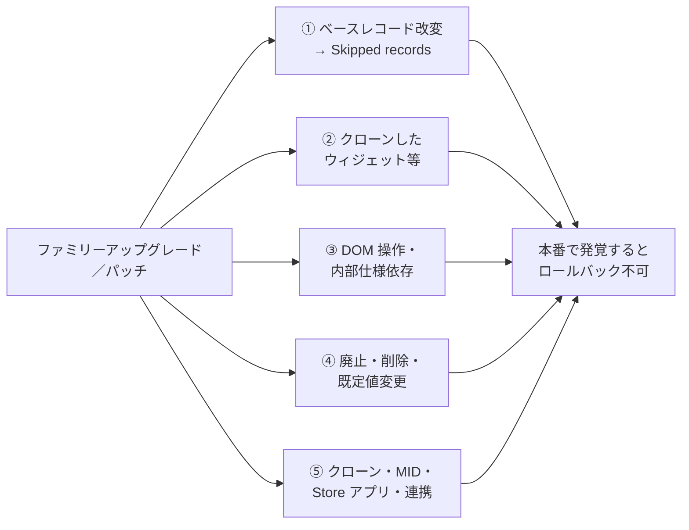
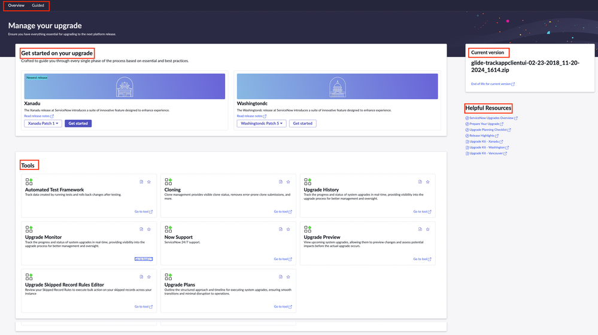
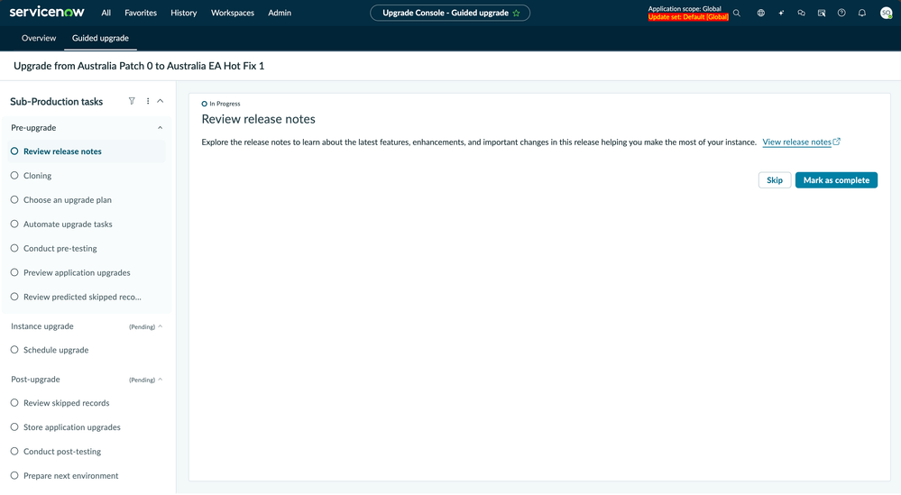
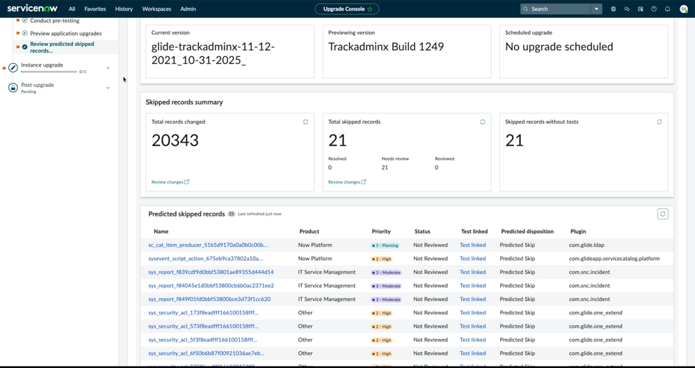
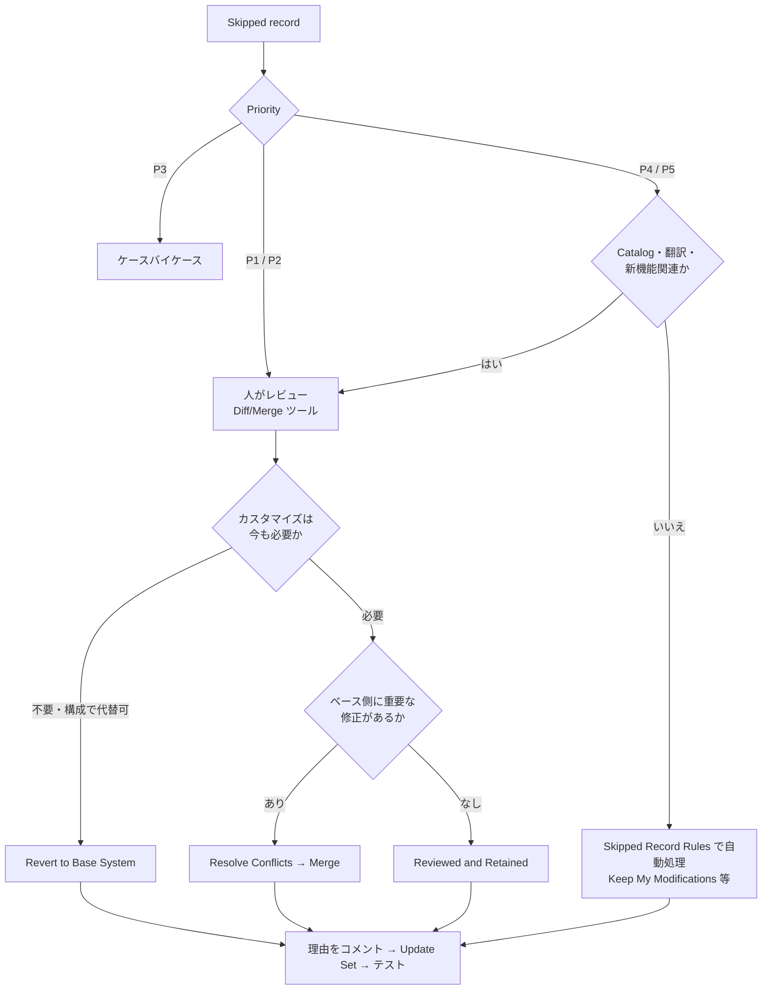

# アップグレードの教訓（Upgrade Lessons Learned）

## 概要

本ファイルは、ServiceNow インスタンスのファミリーアップグレード（例: Zurich → Australia）とパッチ適用（Patch / Hotfix）で **実際に起きる問題とその教訓** をまとめた応用編である。手順・ツール・公式 7 フェーズ／51 ステップのチェックリストなど「やり方」は [アップグレード管理](../03_導入編/13-upgrade-management.md) にまとめてあり、本ファイルはその前提知識の上で次の 4 点に絞る。

| 観点 | 本ファイルで答える問い |
|---|---|
| 問題事例 | アップグレード後に何が壊れるのか。症状・原因・対策は何か |
| 事前対策 | 平時・計画時・直前に何をしておけば問題を避けられるか |
| テスト戦略 | 限られた工数で、何を・どこで・どの順にテストすべきか |
| スキップ判断 | Skipped records（スキップされたレコード）をどう Retain / Merge / Revert するか。ファミリー（リリース）を飛ばしてよいか |

前提となる事実（公式）:

- ServiceNow は **汎用的なロールバック手段を提供しない**。ロールバックできるのは同一ファミリー内の Update（Patch → Patch、Patch → Hotfix）だけで、既定期限は 10 日（`glide.rollback.expiration_days`）。本番のバックアップからの復元は、ダウンタイムとデータ損失を伴う最終手段とされる。[出典](https://www.servicenow.com/docs/r/release-notes/upgrade.html)
- 公式は、本番から最も遠いインスタンスから順に（Development → Test → Production）アップグレードし、Development ではスモークテスト、Test では ATF と Quick start tests と UAT、Production では UAT のみを行うよう推奨している。[出典](https://www.servicenow.com/docs/r/release-notes/upgrade.html)
- 最新ファミリーへ直接アップグレードできるが、その場合は現行版から目標版までの **間のすべてのバージョンのリリースノート** を確認する必要がある。[出典](https://www.servicenow.com/docs/r/release-notes/upgrade.html)

つまり、ファミリーアップグレードは **「戻せない前提」** で、問題を非本番で出し切ることが唯一の安全策になる。本ファイルの教訓はすべてこの前提から導かれる。

関連ファイル: [アップグレード管理](../03_導入編/13-upgrade-management.md) / [リリースサイクルとバージョン](../01_入門編/07-release-cycle.md) / [カスタマイズと技術的負債](02-customization-technical-debt.md) / [Automated Test Framework (ATF)](../02_リファレンス/platform/automated-test-framework.md) / [アップデートセットとクローン](../02_リファレンス/platform/update-sets-cloning.md) / [テストと本番稼働](../03_導入編/11-testing-golive.md)

---

## 1. アップグレードで問題が起きるメカニズム

### 1.1 問題の発生源は 5 つ

アップグレードの問題は、ほぼ次の 5 つの発生源に分類できる。【経験則】（各発生源の根拠は 2 章の事例で個別に示す）

| 発生源 | 何が起きるか | 典型的な症状 |
|---|---|---|
| ① ベースレコードのカスタマイズ | ServiceNow 側の修正がカスタマイズ済みレコードに適用されない（Skipped） | 機能がおかしい・新機能が出ない・既知バグが直らない |
| ② クローン／コピーしたベース機能 | クローン元は更新されるがコピーは古いまま | ポータルの一部だけ動かない・見た目が崩れる |
| ③ 非公開・内部仕様への依存 | DOM 操作、内部 API・内部項目への依存が新版で破綻 | フォームのスクリプトエラー、項目が隠れない |
| ④ 廃止・削除・既定値の変更 | 機能が非推奨・削除・既定 OFF になる | ボタンやタブが消える、参照していた項目がない |
| ⑤ 周辺要素（環境・運用） | クローン、MID Server、Store アプリ、連携先、スケジュールジョブ | 連携停止、Discovery 停止、開発中の成果物の消失 |

### 1.2 Skipped records が生まれる仕組み（要点）

アップグレード処理は、Customer Updates（`sys_update_xml`）に現行バージョンがあるオブジェクト、つまり **顧客がカスタマイズしたベースシステムのレコード** への変更をスキップし、Skipped records list に記録する。顧客のカスタマイズは上書きされない代わりに、ServiceNow がそのレコードに加えた修正・新機能も反映されない。[出典](https://www.servicenow.com/docs/r/UrSRFFKWBbfQBgoRlt~ltw/62QiF9EWBhogBZIgvjkfcQ)

- Skipped records はファイル種別で優先度付けされる。Priority 1 = UI pages・UI macros 等、2 = Business Rules・Security ACLs 等、3 = Reports 等、4 = Form Sections・Choice Sets 等、5 = その他。[出典](https://www.servicenow.com/docs/r/UrSRFFKWBbfQBgoRlt~ltw/zQqGJnQ~SmZnHToAkJ~H_Q)
- 社員ブログによれば、件数の大半は P4・P5（新項目の追加、UI Policy の更新、カタログのリフレッシュ等のメタデータ変更）が占める。【第三者情報】[出典](https://www.servicenow.com/community/servicenow-ai-platform-blog/stop-reviewing-every-skipped-record-manually-how-automated-skip/ba-p/3525135)
- 「自分は触っていないのに OOTB（Out-of-the-box）レコードが Skipped になる」という問い合わせは多い。コミュニティでは、多くはパッチやホットフィックスで更新されたレコードだったと報告されている。【第三者情報】[出典](https://www.servicenow.com/community/upgrades-and-patching-forum/why-do-we-see-ootb-records-shown-as-skipped-records-post-upgrade/m-p/2881826)

Skipped records の操作手順（Retain / Merge / Revert、Skipped Record VTB、Skipped Record Rules）は [アップグレード管理 7 章](../03_導入編/13-upgrade-management.md) を参照。判断基準は本ファイル 5 章で扱う。

### 1.3 アップグレードの悩みの順位（ServiceNow 社員ブログの投票結果）

ServiceNow 社員ブログ（2026-04-14）は、Platform Academy セッションの参加者投票で、アップグレードの障害を次の順で報告している。【第三者情報】[出典](https://www.servicenow.com/community/servicenow-ai-platform-blog/stop-dreading-upgrades-how-the-guided-upgrade-console-changes/ba-p/3525124)

| 順位 | 障害 |
|---|---|
| 1 | カスタマイズや連携を壊すことへの不安 |
| 2 | 失敗のトリアージと Skipped records 解消の手作業 |
| 3 | アップグレード後に変更を検証するテストカバレッジの不足 |

- 同記事は、アップグレードプロジェクトがリリースサイクルごとにチームの **2〜6 週間分のキャパシティ** を消費すると推定している（調査結果ではなく記事の見積り）。【第三者情報】
- 別の社員ブログ（2026-07-02）は、課題として「前回のアップグレードの成果が何も引き継がれない（毎回ゼロから計画する）」「Skipped records・廃止機能・競合がアップグレード窓が開いてから判明する」「管理者・開発者・QA・業務オーナーの調整が難しい」を挙げている。【第三者情報】[出典](https://www.servicenow.com/community/servicenow-ai-platform-blog/upgrades-don-t-have-to-start-from-scratch-every-time/ba-p/3567920)

> 教訓: アップグレードが重い組織の問題は「アップグレード作業」そのものより、**平時のカスタマイズ管理とテスト資産の不足** にある。2〜6 週間を毎回払い続けるか、平時に ATF と棚卸しへ投資するかの選択になる。【経験則】

---

## 2. 問題事例カタログ（症状 → 原因 → 対策）

各事例は「症状 / 原因 / 対策 / 出典」で記載する。出典が公式でないものには確度ラベルを付ける。

### 2.1 カスタマイズ起因の事例

#### 事例 A: Skipped records を放置して基本機能が壊れる（特に Service Catalog）

| 項目 | 内容 |
|---|---|
| 症状 | テストでは問題がなかったのに、アップグレード後しばらくして基本機能が「突然おかしくなる／完全に止まる」。Service Catalog のショッピングカート変数、Order Guide の不具合など |
| 原因 | ベース側でリファクタリング・書き換えられたオブジェクトに対し、カスタマイズした Script Include、UI Script、UI Macro が古いまま残り、新しい周辺コードと噛み合わない |
| 対策 | Upgrade Monitor／Upgrade History の Skipped を必ずレビューする。Plugin 項目でフィルタして Service Catalog 関連を洗い出す。壊れたスクリプトを新しい OOTB 版へ Revert すると（カスタム挙動は一時的に失われても）カタログが復旧することがある |
| 出典 | 【第三者情報】[Community ブログ（2017-11-12）](https://www.servicenow.com/community/itsm-blog/don-t-skip-a-review-of-skipped-updates-after-a-version-upgrade/ba-p/2266363)（KB0639132 を参照としている。KB はログイン必須で本調査では未確認） |

> 教訓: Service Catalog はアップグレードの影響を最も受けやすいモジュールの一つとされる。【第三者情報】[出典](https://www.servicenow.com/community/itsm-blog/don-t-skip-a-review-of-skipped-updates-after-a-version-upgrade/ba-p/2266363) カタログ領域の Skipped は P4・P5 であっても一括 Retain せず中身を確認する。【経験則】

#### 事例 B: クローンした Service Portal ウィジェットだけ修正が入らない

| 項目 | 内容 |
|---|---|
| 症状 | アップグレード後、ポータルの特定ページだけが正しく動かない／表示が崩れる |
| 原因 | クローン（Clone）したウィジェットは別ウィジェットとして扱われ、ベースウィジェットが受け取った更新コードを受け取らない。また、ベースウィジェットを直接改変した「customized widget」はシステムアップグレードでサポートされない |
| 対策 | ① 改変したベースウィジェットは、後のアップグレードでの問題を防ぐために元のウィジェットへ戻すことを検討する ② クローンしたウィジェットは **アップグレード後に再クローンし、カスタマイズを再適用** する ③ ポータルページの Widget Context Menu → **Show Widget Customizations** でカスタマイズレベルを確認する |
| 出典 | [公式: Widget diagnostics（Xanadu）](https://www.servicenow.com/docs/r/B5UZKOeMGcpyrvR2CNl5Dw/xhB42t1Lah7A6BHQc3YaGQ) |

- カスタマイズが必要な場合は、改変ウィジェットとパッチ後の OOTB ウィジェットを比較し、最新 OOTB コードを自社ウィジェットへマージするよう ServiceNow のアーキテクトが回答している。【第三者情報】[出典](https://www.servicenow.com/community/servicenow-ai-platform-forum/how-to-handle-customized-widgets-after-patch/m-p/3231051)
- Workspace（UI Builder のページ）でも、リリースごとにページを作り直す負担がコミュニティで指摘されているが、公式の解決策は確認できなかった（公開情報では確認できず）。【第三者情報】[出典](https://www.servicenow.com/community/service-operations-workspace/how-are-we-supposed-to-work-with-configuration-in-service/m-p/3281835)

> 教訓: 「クローンすればベースを汚さないので安全」は半分だけ正しい。Skipped には出ないが **修正も永久に入らない**。クローンは台帳に記録し、毎アップグレードで差分を見る対象に含める。【経験則】

#### 事例 C: DOM 操作・非公開 API に依存したクライアントスクリプトが壊れる

| 項目 | 内容 |
|---|---|
| 症状 | フォームのロード時・保存時のスクリプトエラー、項目が隠れない／表示されない、変数の制御が効かない |
| 原因 | 直接の DOM 操作や非サポートの UI ハックは、リリース間で変わる内部挙動に依存しているため壊れやすい |
| 対策 | `g_form` 等の公開 API に置き換える。UI Policy で実現できるものは Client Script より UI Policy を優先する。Instance Scan で DOM 操作を検出する |
| 出典 | 【第三者情報】[Community（2025-12-19）](https://www.servicenow.com/community/itsm-forum/what-makes-a-servicenow-customization-upgrade-safe-vs-upgrade/m-p/3453622) |

- Instance Scan（インスタンススキャン）の Scan Engine 定義には DOM 操作を検出するチェック（`sn_SE10049`、カテゴリ Manageability）があり、本番で予期しない結果を招くリスクとして「Suggest」レベルで扱われている。[出典](https://www.servicenow.com/docs/r/OLEAh14mAEPe8fUlW2F9wQ/iBfvYANFj8_twiTOCdfxIw)
- 一方で、OOTB の Employee Center「My Approvals」ウィジェットが DOM 操作として検出されたという報告もあり、検出結果は誤検知も含めて人が判断する必要がある。【第三者情報】[出典](https://www.servicenow.com/community/service-management-forum/oob-employee-center-quot-my-approvals-quot-widget-flagged-for/td-p/3579980)

コミュニティでは、アップグレード前に次のスクリプトパターンを検索するよう勧められている（対象テーブル: `sys_script`、`sys_script_include`、`sys_ui_script`、`sys_script_client`、`sys_ui_action`）。【第三者情報】[出典](https://www.servicenow.com/community/developer-forum/pre-upgrade-analysis-identifying-deprecated-apis-and-feature/m-p/3515758)

| パターン | リスク |
|---|---|
| クライアント側の `GlideRecord` | 同期通信・性能劣化。GlideAjax へ置換 |
| コールバックなしの `g_form.getReference()` | 同期呼び出し |
| 同期 GlideAjax（`getXMLWait`） | 同期呼び出し。非同期 `getXML` 等へ |
| Business Rule 内の `current.update()` | 再帰・二重更新 |
| ハードコードされた `sys_id` | インスタンス・リリース間でずれる |

> 注意: 上記コミュニティ投稿には一部メソッドの置換方法に関する不正確な記述も含まれていたため、本表では一般に合意されているパターンのみを採用した。スクリプト規約の詳細は [スクリプトのベストプラクティスとアンチパターン](07-scripting-best-practices.md) を参照。

#### 事例 D: OOB の Skipped Record Rules が新機能を「Retain」で隠してしまう

| 項目 | 内容 |
|---|---|
| 症状 | アップグレード後、本来追加されるはずの新項目・新機能がフォームやカタログに出てこない |
| 原因 | Xanadu 以降、OOB の Skipped Record Rules（10 個のうち 9 個が既定で有効）がアップグレード・パッチ・ホットフィックス後に自動実行され、「Reviewed and Retained」としてしまうルールが、レビューすべきベース側の変更を自動処理してしまう。例として Xanadu の Service Catalog の新項目が挙げられている |
| 対策 | 有効化前に OOB ルールのターゲット条件とアクションを 1 つずつ確認し、一度にすべて有効化しない。サブ本番で挙動を確認してから使う |
| 出典 | 【第三者情報】[社員ブログ（2026-04-14）](https://www.servicenow.com/community/servicenow-ai-platform-blog/stop-reviewing-every-skipped-record-manually-how-automated-skip/ba-p/3525135) / [社員ブログ（2026-07-02）](https://www.servicenow.com/community/servicenow-ai-platform-blog/upgrades-don-t-have-to-start-from-scratch-every-time/ba-p/3567920) |

同ブログが挙げる Skipped Record Rules の注意点: 【第三者情報】[出典](https://www.servicenow.com/community/servicenow-ai-platform-blog/stop-reviewing-every-skipped-record-manually-how-automated-skip/ba-p/3525135)

- ルールは `sys_upgrade_skipped_record_rule` に格納され、実行履歴は `sys_skipped_record_rule_history` に記録される。
- アクションは **Keep My Modifications / Revert and Keep Inactive / Assign to User / Apply Tags** の 4 種。
- **Revert アクションは Update Set に記録されない** ため、他インスタンスでは手作業で繰り返す必要がある。
- 自動マージは存在しない。本当のマージが必要なレコードは人手で処理する。
- Resolution Status の変更は情報目的のみで、自動処理を起動しない。
- 判断を後続インスタンスへ運ぶには、解消前にアクティブな Update Set を選択しておく（Business Rule「Add To Update Set On Resolution Change」で記録される）。

#### 事例 E: 翻訳（日本語ラベル）のカスタマイズがスキップされる／消える

| 項目 | 内容 |
|---|---|
| 症状 | 日本語化した項目ラベルにベース側の新しい翻訳・修正が入らない。あるいは逆に翻訳が失われる |
| 原因 | `sys_documentation`（項目ラベル）は構成データであり、`sys_update_xml` に対応する更新があるとカスタマイズとみなされアップグレードで無視（Skipped）される。手作業のインポートでは `sys_update_xml` が作られないことがある |
| 対策 | 翻訳の変更は Update Set で移送する。日本語ラベルのカスタマイズは Skipped の P4・P5 に紛れやすいので、翻訳対象テーブルで別途フィルタしてレビューする【経験則】 |
| 出典 | 【第三者情報】[Community（ServiceNow Globalization 担当者の回答を含む）](https://www.servicenow.com/community/servicenow-ai-platform-forum/are-translated-sys-documentation-records-overwritten-when/m-p/1111994) |

- 公式パッチノートでは、Yokohama で日本語有効時に `sys_translated` レコードが存在するとダッシュボード名の更新が無言で失敗する問題、`par_dashboard_tab` の `sys_translated` レコードが上書きされ翻訳が失われる問題が修正対象として記載されている（Zurich Patch 7 Hotfix 3）。[出典](https://www.servicenow.com/docs/r/u1slaAtcFiiXFQcd9RcR_A/JvZUEG2a~DfUqI0L6g5i1g)
- 日本語化の仕組みは [ローカライゼーション（日本語化）](../02_リファレンス/platform/localization.md) を参照。

> 教訓: 日本の導入では、**日本語 UI の確認（ラベル・メッセージ・通知文面）を回帰テスト項目に明示的に入れる**。英語 UI のテストだけでは翻訳の欠落・上書きを検出できない。【経験則】

### 2.2 廃止・削除・既定値変更の事例

#### 事例 F: 廃止・削除された機能に依存していた

公式リリースノートは、機能の状態を KB0867184（Deprecation Process）に基づき次の 5 区分で示している。[出典](https://www.servicenow.com/docs/r/IDeOjpA1hzonPLWG~inEpg/5QYkeuLOoyi~AOLtmUpRPA)

| 状態 | 意味 | アップグレード時の扱い【経験則】 |
|---|---|---|
| Being prepared for future deprecation | 非表示になり、新規インスタンスで有効化されない／インストール不可になるが、サポートは継続 | 新規利用を止め、移行計画を立てる |
| Deprecated | 機能拡張・不具合修正が行われず、将来サポートされなくなる | 次の 1〜2 リリース内に置換を完了する |
| Removed | 機能・コンポーネントが利用不可 | 依存があればアップグレード前に必ず置換 |
| Turned off by default | 既定で無効 | 新規有効化時の挙動差に注意 |
| Marked for eventual deprecation | 動作はするが代替が推奨される | 新規開発では使わない |

Australia で影響の大きい例（抜粋）: [出典](https://www.servicenow.com/docs/r/IDeOjpA1hzonPLWG~inEpg/5QYkeuLOoyi~AOLtmUpRPA)

| 区分 | 対象 | 内容 |
|---|---|---|
| Deprecated | Legacy UIs（**UI11 と UI15**） | Australia から非推奨。Next Experience の使用を推奨。一部機能は個別判断でレガシー経路で描画される場合がある |
| Deprecated | Legacy Application Manager | Australia Patch 1 から非推奨。ブックマークは新しい Application Manager にリダイレクト |
| Removed | Multisource Report Builder（CMDB） | CMDB 360 を使用 |
| Removed | Clone Admin Console の静的 FAQ とレガシーのクローン要求 | レガシーのクローン要求は 30 秒後にリダイレクト |
| Removed | `sn_dpr_workspace.auto_create_product_enhancement_for_primary_epic`（Digital Product Release） | `sn_dpr_workspace.enhancement_work_item_types` を使用 |
| Being prepared for future deprecation | Operational Technology Discovery、Guided Setup（Adoption Services）等 | Australia から |

- 公式の「Removed features」ページは、ボタンやタブの削除が業務を妨げうること、削除された項目・機能に依存するカスタマイズの確認が必要なことを注意している（同ページは AI 生成要約である旨の注記あり）。[出典](https://www.servicenow.com/docs/r/release-notes/rn-summary-removed-features.html)
- AI 機能では、Now LLM Service の旧モデルは公開済みの AI skill・AI agent では引き続き使えるが、新規開発・構成では使えなくなる（KB3066214）。[出典](https://www.servicenow.com/docs/r/IDeOjpA1hzonPLWG~inEpg/5QYkeuLOoyi~AOLtmUpRPA) AI 導入の注意点は [Now Assist / AI Agents 導入の知見](10-ai-adoption-lessons.md) を参照。

> 教訓: 廃止情報は「Deprecated になったリリース」でなく「Removed になるリリース」で問題化する。**Deprecated 一覧を毎リリース台帳に転記し、自社の依存有無を記録** しておかないと、ファミリーを飛ばしたときに Removed を見落とす。【経験則】

### 2.3 環境・運用起因の事例

#### 事例 G: クローンで開発中の成果物や接続設定が消える

| 項目 | 内容 |
|---|---|
| 症状 | アップグレード前に本番を開発へクローンしたら、未完了の Update Set、MID Server の定義、連携の認証情報、インスタンス固有のシステムプロパティが消えた／本番値になった |
| 原因 | クローンは対象インスタンスのデータを上書きする。保持対象（Data Preservers）・除外対象（Exclude Tables）の設定が不十分 |
| 対策 | 進行中の Update Set はクローン前にエクスポートし、クローン後に再インポートする（公式）。ユーザー、REST API 資格情報テーブル、システムプロパティ等を Data Preserver に設定する。MID Server・ユーザー等の重要テーブルを外部にも退避し、クローン後に MID Server 設定を確認する |
| 出典 | [公式: Start a clone](https://www.servicenow.com/docs/bundle/washingtondc-platform-administration/page/administer/managing-data/task/t_StartAClone.html) / 【第三者情報】[Community 記事（2022-06-25）](https://www.servicenow.com/community/developer-articles/servicenow-version-upgrade-methodology-best-practices-tips/ta-p/2300241) |

- 公式は、除外設定を外して除外テーブルのデータも複製する **Full Clone** を、アップグレードやデプロイのテストに推奨している（ServiceNow OOTB の除外テーブルは引き続き除外される）。レガシーのクローンエンジンでは一部レコード（task 拡張テーブル、リレーション、階層）の Data Preserver がサポートされない。[出典](https://www.servicenow.com/docs/bundle/washingtondc-platform-administration/page/administer/managing-data/task/t_StartAClone.html)
- 上記 Community 記事は、MID Server の定義が「保持設定をしていても上書きされることがある」と報告している。【第三者情報】[出典](https://www.servicenow.com/community/developer-articles/servicenow-version-upgrade-methodology-best-practices-tips/ta-p/2300241)
- クローンの仕様は [アップデートセットとクローン](../02_リファレンス/platform/update-sets-cloning.md) を参照。

#### 事例 H: MID Server が自動アップグレードせず、Discovery や連携が止まる

| 項目 | 内容 |
|---|---|
| 症状 | インスタンスのアップグレード後、MID Server が Down／起動停止を繰り返す。Discovery、Orchestration、MID 経由の連携が止まる |
| 原因（公式仕様） | インスタンスがアップグレードされ MID Server とバージョンが一致しなくなると、インスタンスは MID Server にアップグレードを指示し、MID Server も毎時バージョン不一致をチェックする。`mid.version.override`（全 MID Server を特定版に固定し自動アップグレードを無効化）や `config.xml` の `mid.pinned.version`（MID ごとの固定。インスタンスアップグレードで変更されない）を使っていると追随しない。Windows では Windows Application Experience サービスが有効でないと自動アップグレードできない |
| 原因（事例） | MID ホストからインストールサーバーへ到達できずダウンロード失敗、Windows サービスアカウントの権限不足、Linux で `mid.shconf_override` の不備によりサービスが FAILED 表示 |
| 対策 | 公式は、MID Server とインスタンスのバージョン不一致は障害を招きうるとして、override や pinning の使用を推奨していない。アップグレード前に固定設定の有無、プロキシ／FW の到達性、サービスアカウント権限を確認し、アップグレード後に MID Server レコードの版を確認する |
| 出典 | [公式: MID Server upgrades（Australia）](https://www.servicenow.com/docs/r/ZUQIWHvhWUsSoHqqH5PGGw/FHThP3zPMJs8jJC1nxVqog) / [公式](https://www.servicenow.com/docs/r/zS6yb8e~gR8BPjeviYdV9g/nxW_NEM7LH06ANoSftTVeg) / [公式](https://www.servicenow.com/docs/r/Ir~NPf1dr8MGFXQE6QlBoQ/0fmzqDHt0iEzymIrRBjJUA) / 【第三者情報】[Community](https://www.servicenow.com/community/upgrades-and-patching-forum/mid-server-fails-after-patch-update-systemctl-shows-failed-but/m-p/3319649) / [Community](https://www.servicenow.com/community/itom-forum/mid-server-will-not-start-after-instance-upgrade/m-p/1005423) |

- `mid.version.override` がアップグレード時にクリアされるかどうかは、公式ページ間で記述が一致していない。自社の版のドキュメントで確認すること。[出典](https://www.servicenow.com/docs/r/zS6yb8e~gR8BPjeviYdV9g/nxW_NEM7LH06ANoSftTVeg)
- MID Server の仕様は [MID Server](../02_リファレンス/platform/mid-server.md) を参照。

#### 事例 I: 予約したのにアップグレードが始まらない

| 項目 | 内容 |
|---|---|
| 症状 | Now Support で予約した時刻を過ぎてもアップグレードが開始されない |
| 原因 | スケジュールジョブ **Check distribution for possible upgrade**（`sys_trigger`、Paris で「Upgrade」から改名）の設定不備や、実行タイミングとの関係 |
| 対策 | Trigger type が **Interval**、System ID が **None** であることを確認する。アップグレード／パッチの開始時刻は、このジョブが走る 10〜15 分前に設定する。**Check database for possible upgrade** も確認する |
| 出典 | [公式: Phase 3](https://www.servicenow.com/docs/r/release-notes/upgrades-phase-3.html) / 【第三者情報】[Community（KB0535198 を参照）](https://www.servicenow.com/community/upgrades-and-patching-forum/what-to-do-if-an-upgrade-did-not-start/m-p/322308) |

#### 事例 J: Store アプリ・プラグインの版が環境間でずれ、比較テストが成立しない

| 項目 | 内容 |
|---|---|
| 症状 | Test では再現した不具合が本番で再現しない（またはその逆）。テスト結果が環境間で比較できない |
| 原因 | ServiceNow 管理のアプリ・プラグインは Auto-upgrade でインスタンス本体とは別に更新され、対象環境（非本番／本番）はアプリ側の事業部門が決める |
| 対策 | テスト記録にプラットフォームの版だけでなく主要 Store アプリの版も残す。Phase 5 では開発でインストールした任意プラグインを他の非本番にも入れる |
| 出典 | [公式: Auto-upgrade](https://www.servicenow.com/docs/r/platform-administration/application-manager/um-auto-upgrade.html) / [公式チェックリスト（ステップ 33）](https://www.servicenow.com/docs/r/release-notes/upgrades-planning-checklist.html) |

- 社員ブログでは、Guided Upgrade Console に対する要望としてストアアプリの段階的アップグレードが挙げられており、現時点では未対応とされる。【第三者情報】[出典](https://www.servicenow.com/community/servicenow-ai-platform-blog/stop-dreading-upgrades-how-the-guided-upgrade-console-changes/ba-p/3525124)
- Auto-upgrade の詳細は [アップグレード管理 10.3](../03_導入編/13-upgrade-management.md) を参照。

### 2.4 性能劣化の事例

#### 事例 K: アップグレード後にポータルや ITSM が極端に遅くなる

| 項目 | 内容 |
|---|---|
| 症状 | 2025-06 の Yokohama アップグレード後、Service Portal と ITSM の起票が極端に遅くなった（複数ユーザーが報告） |
| 原因 | スレッド内で確定はしていない。参照された KB2595527（ログイン必須）によればスクリプトエンジンのテーブルキャッシュに関係するとされ、`glide.cache.size.ScriptEnginesTables` プロパティ（値 1000）を作成する回避策が紹介された。Australia へのアップグレード後は削除してもよいとされる |
| 対策 | プラグインの修復、Instance Health Scan、サポートケースの起票。回避策プロパティは KB で自社の版に該当するか確認してから適用する |
| 出典 | 【第三者情報】[Community（2025-09〜12）](https://www.servicenow.com/community/upgrades-and-patching-forum/after-yokohama-upgrade-experiencng-slowness-service-portal-and/m-p/3375959) |

> 教訓: 性能問題は「アップグレード前の数字」がないと議論にならない。公式チェックリストもステップ 44・45 でアップグレード前の性能プロファイルと Performance ホームページでの記録を求めている。[出典](https://www.servicenow.com/docs/r/release-notes/upgrades-planning-checklist.html) 「アップグレード後に掃除する」と後回しにしたデータ肥大がアップグレード後の性能問題として顕在化する、という指摘もある。【第三者情報】[出典](https://www.echelonai.com/blog/surviving-servicenow-upgrades-5-surprises-that-catch-teams-off-guard) 性能対策は [パフォーマンスチューニング](03-performance-tuning.md) を参照。

### 2.5 連携起因の事例

| 項目 | 内容 |
|---|---|
| 症状 | アップグレード前は問題なかった連携が、アップグレード後に原因不明で失敗する |
| 原因 | 連携先テスト環境が用意できず連携テストを省略した、MID Server の不一致、廃止された項目や API への依存、Spoke／Store アプリの版の変化など【経験則】 |
| 対策 | 公式チェックリストは、連携テストに必要な他システムの確認（ステップ 11）、連携テストに使えるインスタンスの制約確認（ステップ 12）、連携テスト用インスタンスを含む実装計画（ステップ 16）を求めている。第三者は、連携の更新をアップグレードと同時に一斉実施せず段階的に行い、ロールバック手順を文書化することを勧めている |
| 出典 | [公式チェックリスト](https://www.servicenow.com/docs/r/release-notes/upgrades-planning-checklist.html) / 【第三者情報】[Echelon AI](https://www.echelonai.com/blog/surviving-servicenow-upgrades-5-surprises-that-catch-teams-off-guard) |

連携設計上の注意は [連携の落とし穴](08-integration-pitfalls.md) を参照。

### 2.6 プロジェクト運営起因の事例

| 事例 | 原因 | 教訓・対策 | 出典 |
|---|---|---|---|
| 開発とアップグレードの衝突 | アップグレード中も DEV で開発を続け、変更が競合した | 健全性・回帰テストが通り課題が解消するまで DEV の開発を凍結する（または公式の 3 方式から選ぶ） | 【第三者情報】[Community 記事](https://www.servicenow.com/community/developer-articles/servicenow-version-upgrade-methodology-best-practices-tips/ta-p/2300241) / [公式チェックリスト ステップ 10](https://www.servicenow.com/docs/r/release-notes/upgrades-planning-checklist.html) |
| 古い Update Set の再投入 | アップグレード後に旧版で作った Update Set を投入し、廃止 API を再混入させた | アップグレード前の古い Update Set は移送前に再レビューする | 【第三者情報】[Community](https://www.servicenow.com/community/developer-forum/pre-upgrade-analysis-identifying-deprecated-apis-and-feature/m-p/3515758) |
| 修正の Update Set 漏れ | Skipped の処置や修正が Update Set に入っておらず、本番で再現できない | テスト前に全修正が Update Set に入っていることを確認する。Skipped の処置前に専用 Update Set をカレントにする | 【第三者情報】[Community 記事](https://www.servicenow.com/community/developer-articles/servicenow-version-upgrade-methodology-best-practices-tips/ta-p/2300241) / [公式 Phase 4](https://www.servicenow.com/docs/r/australia/release-notes/upgrades-phase-4.html) |
| 環境間で sys_id が合わない | 下位環境で解消した Skipped が、本番と sys_id が一致しないレコードを含む | 下位環境を本番クローンから作り直してからアップグレードする【経験則】。社員ブログでも「明快な答えはまだない」とされる | 【第三者情報】[社員ブログ](https://www.servicenow.com/community/servicenow-ai-platform-blog/upgrades-don-t-have-to-start-from-scratch-every-time/ba-p/3567920) |
| 時間が足りない | 業務部門のテスト時間が確保されていない | 公式は「準備・実施・テストに時間を割く必要がある」ことを IT と業務ユーザーに事前に期待値として伝えるよう求めている | [公式](https://www.servicenow.com/docs/r/release-notes/upgrade.html) |
| 早く終わった＝失敗と誤解 | Brazil でアップグレード時間が大幅短縮された | 公式は「完了が速いことから失敗と判断しないこと」と明記。テストは従来どおり行う | [公式](https://www.servicenow.com/docs/r/release-notes/upgrade.html) |

---

## 3. 事前対策

### 3.1 平時: アップグレードしやすいインスタンスを保つ

アップグレードの成否の大半は、アップグレード計画を始める前に決まっている。【経験則】平時の対策は次のとおり。

| 対策 | 具体策 | 出典 |
|---|---|---|
| ベースレコードを直接改変しない | 既定のフォームレイアウトを変えるのではなく別ビュー（例: Custom Incident ビュー）を作る。OOB Script Include は改変せず、拡張した新しい Script Include を作る（例: `IncidentUtils` の拡張版）。既存の UI Policy を変えず新規 UI Policy を追加する。大きな新機能はスコープアプリで作る | 【第三者情報】[Community ブログ（2024-11-12）](https://www.servicenow.com/community/developer-blog/reducing-skipped-records-in-servicenow-upgrades/ba-p/3102307) |
| 「拡張」か「上書き」かで判断する | アップグレード安全＝プラットフォームを拡張するもの（UI Policy、Workflow Studio／Flow Designer、条件が明確で最小限スクリプトの Business Rule、スコープ付き Script Include、OOTB の拡張ポイント）。アップグレード敵対的＝上書きするもの（OOTB スクリプトの直接改変、フォームロード／保存の大幅な Client Script 改変、ハードコード sys_id、OOTB ロジックの複製、DOM 操作、Update Set 追跡なしの変更） | 【第三者情報】[Community（2025-12-19）](https://www.servicenow.com/community/itsm-forum/what-makes-a-servicenow-customization-upgrade-safe-vs-upgrade/m-p/3453622) |
| カスタマイズ台帳 | 各カスタマイズの業務上の理由、影響項目、依存関係、作成者を記録し、まだ必要かを定期評価する | 【第三者情報】[Community ブログ](https://www.servicenow.com/community/developer-blog/reducing-skipped-records-in-servicenow-upgrades/ba-p/3102307) / [社員ブログ（2025-11-06）](https://www.servicenow.com/community/developer-blog/best-practices-to-manage-skipped-updates-effectively-during/ba-p/3421456) |
| 不要カスタマイズの退役 | 使われなくなった Business Rule 等を定期的に削除・無効化する | 【第三者情報】[Community ブログ](https://www.servicenow.com/community/developer-blog/reducing-skipped-records-in-servicenow-upgrades/ba-p/3102307) |
| 変更前のベースラインを保存 | Business Rule 変更前のベースライン版を Git 等に保存し、後で新しい OOB 版と比較できるようにする | 同上 |
| Instance Scan の定期実行 | Best Practice、Upgrade Readiness、Performance の各スイートで、廃止 API・DOM 操作・性能リスクを検出する（スイート名はコミュニティ投稿による。自社インスタンスで確認すること） | 【第三者情報】[Community](https://www.servicenow.com/community/developer-forum/pre-upgrade-analysis-identifying-deprecated-apis-and-feature/m-p/3515758) |
| Skipped 件数の推移監視 | リリースごとの Skipped 件数を追い、増加傾向なら「ベース側が活発に変えている領域にカスタマイズが積み上がっている」シグナルとして構成への置換を検討する | 【第三者情報】[社員ブログ](https://www.servicenow.com/community/servicenow-ai-platform-blog/stop-reviewing-every-skipped-record-manually-how-automated-skip/ba-p/3525135) |
| ATF を継続整備 | 改修のたびに ATF を追加し、次回以降のアップグレードで再利用する | 【第三者情報】[社員ブログ（2025-01-27）](https://www.servicenow.com/community/servicenow-ai-platform-blog/now-platform-upgrade-bytes/ba-p/3160436) |
| 毎回のパッチを溜めない | Skipped はアップグレード・パッチの都度、チームが動いているうちにレビューする | 【第三者情報】[社員ブログ（2025-11-06）](https://www.servicenow.com/community/developer-blog/best-practices-to-manage-skipped-updates-effectively-during/ba-p/3421456) |

- 公式は、カスタマイズの価値とリスクのバランスに関する Customer Success のガイド「Balance value and risk with platform customizations」と、プレイブック「Upgrade quickly and maintain platform health」、アップグレード価値計算ツール（Upgrade value calculator）を案内している（プレイブック本文は本調査ではアクセス不可で未確認）。[出典](https://www.servicenow.com/docs/r/release-notes/upgrade-tools.html)
- 一方、コード＝高リスク、構成＝低リスクと機械的に扱うガバナンスへの異論として、可逆性や製品間依存でリスクを評価すべきという ServiceNow Community の論考もある。【第三者情報】[出典](https://www.servicenow.com/community/in-other-news/configure-or-customize-you-re-asking-the-wrong-question/bc-p/3610358)
- 技術的負債の管理は [カスタマイズと技術的負債](02-customization-technical-debt.md)、ガバナンス体制は [ガバナンスとCoEの実践](09-governance-coe-practice.md) を参照。

### 3.2 計画時: 「何が変わるか」を先に知る

| 対策 | 具体策 | 出典 |
|---|---|---|
| 間のすべてのリリースノートを読む | 現行版から目標版までの全バージョンのリリースノートと、製品ごとのアップグレード前後タスクを確認する。ファミリーを飛ばす場合も同様 | [公式](https://www.servicenow.com/docs/r/release-notes/upgrade.html) |
| 廃止情報を台帳化 | 目標版の Deprecation 情報・Removed 一覧を自社の利用状況と突き合わせる | [公式](https://www.servicenow.com/docs/r/IDeOjpA1hzonPLWG~inEpg/5QYkeuLOoyi~AOLtmUpRPA) |
| Known Error portal を確認 | 選択したパッチ版の既知の問題を Known Error portal で確認する | [公式](https://www.servicenow.com/docs/r/release-notes/upgrade-tools.html) |
| 新機能の有効化方針を決める | 検証すべき新機能・注目の変更を特定し（ステップ 4）、有効化・無効化する新機能を計画する（ステップ 5） | [公式チェックリスト](https://www.servicenow.com/docs/r/release-notes/upgrades-planning-checklist.html) |
| ブラウザ要件を確認 | ブラウザの前提条件を社内標準と比較する（ステップ 6） | 同上 |
| 変更凍結期間を確認 | クローン・アップグレードに影響する変更凍結期間を確認（ステップ 9、17） | 同上 |
| 業務プロセス単位でオーナーを置く | プラットフォームを業務プロセスに分割し、各プロセスに業務オーナーを割り当て、テストシナリオを書いてもらう | 【第三者情報】[Community 記事](https://www.servicenow.com/community/developer-articles/servicenow-version-upgrade-methodology-best-practices-tips/ta-p/2300241) |
| 構成レビューを検討 | 任意の ServiceNow Configuration Review（ステップ 19）、Production Readiness Services の利用を検討する | [公式チェックリスト](https://www.servicenow.com/docs/r/release-notes/upgrades-planning-checklist.html) / [公式](https://www.servicenow.com/docs/r/release-notes/upgrade.html) |
| 前回の計画を再利用 | 前サイクル完了時に Upgrade Plan をエクスポートし、次サイクルの出発点としてインポートする | 【第三者情報】[社員ブログ](https://www.servicenow.com/community/servicenow-ai-platform-blog/upgrades-don-t-have-to-start-from-scratch-every-time/ba-p/3567920) |
| バッファを取る | カスタマイズの多い領域で想定外の挙動が出ることを見込み、スケジュールに余裕を持たせる。低トラフィックの時間帯に予定する | 【第三者情報】[Community 記事](https://www.servicenow.com/community/developer-articles/servicenow-version-upgrade-methodology-best-practices-tips/ta-p/2300241) |

計画時に使うツールは、Upgrade Console（Yokohama では Upgrade Management と呼ばれた）の Overview タブに集約されている。

**キャプション:** Upgrade Management（現 Upgrade Console）の Overview タブ「Manage your upgrade」（Yokohama 期のブログ掲載画面）

**画面の説明:** 上部に Overview と Guided のタブ。「Get started on your upgrade」セクションに、アップグレード候補のファミリー（例では Xanadu と Washington DC）のカード、パッチ版の選択プルダウン、Read release notes リンク、Get started ボタンが並ぶ。右上「Current version」に現行ビルド名と End of life for current version へのリンク。右側「Helpful Resources」に ServiceNow Upgrades Overview、Prepare Your Upgrade、Upgrade Planning Checklist、Release Highlights、各ファミリーの Upgrade Kit へのリンク。下段「Tools」に Automated Test Framework、Cloning、Upgrade History、Upgrade Monitor、Now Support、Upgrade Preview、Upgrade Skipped Record Rules Editor、Upgrade Plans の各カードと Go to tool リンクがある。計画時には、ここから **候補ファミリーのリリースノート、現行版の EOL、Skipped Record Rules Editor** を確認するのが近道である。【経験則】

出典: ServiceNow Community ブログ「Yokohama: Simplifying ServiceNow upgrades with the Upgrade Management」https://www.servicenow.com/community/admin-experience-blogs/yokohama-simplifying-servicenow-upgrades-with-the-upgrade/ba-p/3178602 （取得日: 2026-11-04）

### 3.3 直前: アップグレード前に問題を「予測」する

従来は Skipped records がアップグレード実行後にしか分からず、判断が遅れることが問題だった。【第三者情報】[出典](https://www.servicenow.com/community/servicenow-ai-platform-blog/upgrades-don-t-have-to-start-from-scratch-every-time/ba-p/3567920) 現在は Upgrade Console の Guided upgrade で、アップグレード前にスキップを予測して担当者を割り当てられる。

**キャプション:** Upgrade Console（Guided upgrade タブ）のサブ本番タスク一覧（「Upgrade from Australia Patch 0 to Australia EA Hot Fix 1」の例）

**画面の説明:** 画面上部に「Upgrade Console - Guided upgrade」、その下に Overview と Guided upgrade のタブがある。左ペイン「Sub-Production tasks」は 3 段階に分かれる。**Pre-upgrade** は Review release notes、Cloning、Choose an upgrade plan、Automate upgrade tasks、Conduct pre-testing、Preview application upgrades、Review predicted skipped records。**Instance upgrade** は Schedule upgrade。**Post-upgrade** は Review skipped records、Store application upgrades、Conduct post-testing、Prepare next environment。右ペインには選択中のステップ（ここでは Review release notes、状態 In Progress）が表示され、「View release notes」リンク、**Skip** ボタン、**Mark as complete** ボタンがある。各ステップは Skip できるが、スキップした結果のリスクは利用者が負う点に注意する。【経験則】

出典: ServiceNow Community 社員ブログ「Stop Dreading Upgrades: How the Guided Upgrade Console Changes Everything」（2026-04-14）https://www.servicenow.com/community/servicenow-ai-platform-blog/stop-dreading-upgrades-how-the-guided-upgrade-console-changes/ba-p/3525124 （取得日: 2026-11-04）

**キャプション:** Guided upgrade の「Review predicted skipped records」ステップ（予測された Skipped records の一覧）

**画面の説明:** 上段に Current version（現行ビルド名）、Previewing version（プレビュー対象のビルド）、Scheduled upgrade（予約状況、例では No upgrade scheduled）の 3 カード。中段「Skipped records summary」に Total records changed（例: 20343）、Total skipped records（例: 21、内訳 Resolved / Needs review / Reviewed）、Skipped records without tests（テストが紐づいていない予測スキップ件数、例: 21）の 3 カード。下段「Predicted skipped records」一覧の列は Name（例: `sc_cat_item_producer_…`、`sysevent_script_action_…`、`sys_report_…`、`sys_security_acl_…`）、Product（Now Platform、IT Service Management、Other）、Priority（5 - Planning、2 - High、3 - Moderate 等）、Status（Not Reviewed）、**Test linked**、Predicted disposition（Predicted Skip）、Plugin（例: `com.glide.ldap`、`com.snc.incident`、`com.glide.one_extend`）。**「Skipped records without tests」カードは、予測スキップのうちテストで裏付けられていないものを示す** ため、テスト戦略（4 章）とスキップ判断（5 章）を結び付ける指標として使える。

出典: 同上 https://www.servicenow.com/community/servicenow-ai-platform-blog/stop-dreading-upgrades-how-the-guided-upgrade-console-changes/ba-p/3525124 （取得日: 2026-11-04）

直前に確認すべき項目:

| 確認項目 | 内容 | 出典 |
|---|---|---|
| 予測スキップのレビューと担当割当 | Review predicted skipped records で予測 Disposition を確認し、Skipped record rules を作成、担当を事前に割り当てる | [公式（Guided upgrade）](https://www.servicenow.com/docs/r/UrSRFFKWBbfQBgoRlt~ltw/pIeVzBlBTf6o70VhCu37Tw) / 【第三者情報】[社員ブログ](https://www.servicenow.com/community/servicenow-ai-platform-blog/stop-dreading-upgrades-how-the-guided-upgrade-console-changes/ba-p/3525124) |
| 既存 Skipped Record Rules の見直し | Upgrade Center の Skip Record Rules Editor でルールを見直す。ルールは無効化・削除するまで残り続ける | 【第三者情報】[社員ブログ](https://www.servicenow.com/community/servicenow-ai-platform-blog/upgrades-don-t-have-to-start-from-scratch-every-time/ba-p/3567920) |
| ドライアセスメント | チームの工数を全サイクルに投入する前に、サブ本番でドライアセスメントを行い、ルールが自社カスタマイズにどう作用するか確認する | 同上 |
| Update Set の準備 | Skipped 処置用の Update Set をカレントにしておく | [公式 Phase 4](https://www.servicenow.com/docs/r/australia/release-notes/upgrades-phase-4.html) |
| スケジュールジョブ | Check distribution / Check database for possible upgrade の `sys_trigger` 設定（事例 I） | [公式 Phase 3](https://www.servicenow.com/docs/r/release-notes/upgrades-phase-3.html) |
| MID Server | 固定設定（`mid.pinned.version`、`mid.version.override`）の有無、到達性、権限（事例 H） | [公式](https://www.servicenow.com/docs/r/ZUQIWHvhWUsSoHqqH5PGGw/FHThP3zPMJs8jJC1nxVqog) |
| 性能ベースライン | 本番の性能プロファイルを取り、Performance ホームページで記録する（ステップ 44・45） | [公式チェックリスト](https://www.servicenow.com/docs/r/release-notes/upgrades-planning-checklist.html) |
| 周知 | 停止の可能性と新機能をステークホルダー・エンドユーザーに通知する（ステップ 43） | 同上 |

---

## 4. テスト戦略

### 4.1 原則: 「カスタマイズと業務の重要度」でテスト範囲を決める

| 原則 | 内容 | 出典 |
|---|---|---|
| 非本番で問題を出し切る | 本番から遠い順に Development → Test → Production。ATF は非本番専用、本番は UAT のみ | [公式](https://www.servicenow.com/docs/r/release-notes/upgrade.html) |
| カスタマイズを優先 | プラットフォームのアップグレード問題の多くはカスタマイズに起因するため、回帰テストはカスタマイズ領域を優先する | 【第三者情報】[Copado](https://copado.com/resources/blog/servicenow-regression-testing-tips-and-tricks-crt) |
| 未改変の OOTB は ATF の対象外 | ATF は負荷・性能テスト用ではなく、改変していない OOTB 機能のテスト用でもない | 【第三者情報】[Community](https://www.servicenow.com/community/in-other-news/automated-test-framework-atf-test-strategy-considerations-for/ba-p/2277513) |
| 「全部」ではなく「正しいもの」をテスト | エッジケースに迷い込まず、重要業務を確実にカバーする | 【第三者情報】[Community ブログ](https://www.servicenow.com/community/developer-blog/servicenow-automated-test-framework-atf-tips-and-tricks/ba-p/3517173) |
| Skipped を処置してから回帰テスト | 健全性・回帰テストはすべての Skipped records を処置した後に始める | 【第三者情報】[Community 記事](https://www.servicenow.com/community/developer-articles/servicenow-version-upgrade-methodology-best-practices-tips/ta-p/2300241) |
| 本番相当の環境を 1 つ持つ | プラグイン・連携を含め本番と同一のサブ本番を少なくとも 1 つ保つ | 同上 |
| ハッピーパスだけにしない | 本番の実シナリオ（例外系を含む）でテストする | 【第三者情報】[Community](https://www.servicenow.com/community/itsm-forum/what-makes-a-servicenow-customization-upgrade-safe-vs-upgrade/m-p/3453622) |

### 4.2 インスタンス別のテスト配置

| インスタンス | 目的 | テスト | 判定 |
|---|---|---|---|
| Development | 早期発見と Skipped 処置 | アップグレード前後のスモークテスト、Skipped 処置した領域の個別確認、Instance Scan | Skipped の P1〜P2 が全件処置済み【経験則】 |
| Test（または Pre-prod） | 本番同等で回帰確認 | ATF 回帰スイート、Quick start tests（自社向けにコピー・調整したもの）、連携テスト、性能監視、UAT | 重大欠陥ゼロ、ATF 合格または既知差異として承認【経験則】 |
| Production | 稼働確認 | UAT のみ（キーステークホルダー）。ATF は実行しない | Day 1 サポートで問題を受け付け |

[出典](https://www.servicenow.com/docs/r/release-notes/upgrade.html) / [公式チェックリスト](https://www.servicenow.com/docs/r/release-notes/upgrades-planning-checklist.html)

### 4.3 リスクベースのテスト優先度マトリクス

テスト対象を「カスタマイズの有無」×「業務影響」で 4 象限に分けると、限られた工数の配分を説明しやすい。【経験則】

| | 業務影響 大（インシデント起票、承認、カタログ申請、SLA、通知、主要連携） | 業務影響 小 |
|---|---|---|
| **カスタマイズあり（Skipped・クローン・スクリプト）** | 最優先: ATF で自動化＋業務オーナーの手動確認 | ATF（サーバーサイド中心）で確認 |
| **OOTB のまま** | スモークテスト＋UAT（リリースノートで変更がある箇所は重点） | テストしない（リリースノート確認のみ） |

### 4.4 ATF をアップグレードで機能させるコツ

| コツ | 内容 | 出典 |
|---|---|---|
| テスト用ユーザーを毎回作る | 既存ユーザーや他インスタンスから持ち込んだユーザーに依存しない | 【第三者情報】[Community ブログ](https://www.servicenow.com/community/developer-blog/servicenow-automated-test-framework-atf-tips-and-tricks/ba-p/3517173) |
| サーバーサイドを主体に | ATF はアップグレードを前提にした設計でサーバーサイドのロジックに強い。UI テストは主要画面に絞る | 【第三者情報】[Community](https://www.servicenow.com/community/app-engine-forum/atf-strategy-for-upgrade-regression-testing/m-p/3489504) |
| 偽の失敗を疑う | ブラウザのスロットリングによる CPU 不足が ATF 失敗の原因になることがある。クライアントテストランナーのブラウザを前面・専用にする | 【第三者情報】[Community ブログ](https://www.servicenow.com/community/developer-blog/best-practices-for-using-atf/ba-p/2274667) |
| 予測スキップにテストを紐付ける | Guided upgrade の「Skipped records without tests」を減らすように、予測スキップのレコードにテストを紐づける（Test linked 列） | 【第三者情報】[社員ブログの画面](https://www.servicenow.com/community/servicenow-ai-platform-blog/stop-dreading-upgrades-how-the-guided-upgrade-console-changes/ba-p/3525124) |
| 失敗時はまず Skipped を見る | 同じ領域で Retain した Skipped record（ベース修正を取り込んでいない）を最初に疑う | 【経験則】 |
| AI による生成・診断 | Guided upgrade の pre-testing で ATF Test Generator によりテストを生成し、失敗は ATF troubleshooting agent で原因分析する（AI 診断は Creator Pro Plus プランが必要と社員ブログに記載） | [公式](https://www.servicenow.com/docs/r/UrSRFFKWBbfQBgoRlt~ltw/pIeVzBlBTf6o70VhCu37Tw) / 【第三者情報】[社員ブログ](https://www.servicenow.com/community/servicenow-ai-platform-blog/stop-dreading-upgrades-how-the-guided-upgrade-console-changes/ba-p/3525124) |

ATF の仕様は [Automated Test Framework (ATF)](../02_リファレンス/platform/automated-test-framework.md)、導入期のテスト計画は [テストと本番稼働](../03_導入編/11-testing-golive.md) を参照。

### 4.5 本番カットオーバーの教訓

| 教訓 | 内容 | 出典 |
|---|---|---|
| Go/No-Go 判定 | 非本番の欠陥が修正・検証され Update Set に入っていることのサインオフ（ステップ 37）、本番アップグレード実施計画のウォークスルーとサインオフ（ステップ 40・41）、変更要求の承認（ステップ 42） | [公式チェックリスト](https://www.servicenow.com/docs/r/release-notes/upgrades-planning-checklist.html) |
| 戻せない前提の判定基準 | ATF 合格率、未処置 Skipped 件数、重大欠陥数などの基準を事前に決め、判定会議で承認してから本番を予約する | 【経験則】（ファミリーアップグレードに汎用ロールバックがないことが根拠: [公式](https://www.servicenow.com/docs/r/release-notes/upgrade.html)） |
| ライブブリッジ | 本番アップグレード中は誰でも課題をリアルタイムに上げられる Live Bridge（常時接続の会議）を開く | 【第三者情報】[Community 記事](https://www.servicenow.com/community/developer-articles/servicenow-version-upgrade-methodology-best-practices-tips/ta-p/2300241) |
| Day 1 サポート | アップグレード後検証のコアチームと Day 1 サポート体制を確定する（ステップ 38・39） | [公式チェックリスト](https://www.servicenow.com/docs/r/release-notes/upgrades-planning-checklist.html) |
| 不具合の報告 | アップグレード後の問題は、発生条件、再現手順、関連カスタマイズを記録して Customer Service and Support にインシデントを起票する | [公式](https://www.servicenow.com/docs/r/release-notes/upgrade.html) |
| 振り返り | アップグレード後に振り返りを行い、判断記録と Upgrade Plan を次回に引き継ぐ | 【第三者情報】[社員ブログ](https://www.servicenow.com/community/servicenow-ai-platform-blog/upgrades-don-t-have-to-start-from-scratch-every-time/ba-p/3567920) |

---

## 5. スキップ判断

「スキップ」には 2 つの意味がある。本章では両方を扱う。

| 意味 | 判断の対象 |
|---|---|
| 5.1〜5.3 Skipped records | アップグレードでスキップされたカスタマイズ済みレコードを Retain / Merge / Revert のどれで処置するか |
| 5.4〜5.6 リリースのスキップ | ファミリーリリースを飛ばしてよいか、パッチを見送ってよいか |

### 5.1 Skipped records の処置判断の基本

公式の処置は Retain（Reviewed and Retained）、Merge（Resolve Conflicts → Reviewed and Merged）、Revert（Revert to Base System → Reviewed and Reverted）、Reviewed（変更なし）、Defer（Not Reviewed）である。[出典](https://www.servicenow.com/docs/r/UrSRFFKWBbfQBgoRlt~ltw/62QiF9EWBhogBZIgvjkfcQ) 操作手順は [アップグレード管理 7.3](../03_導入編/13-upgrade-management.md) を参照。

判断の観点（社員ブログ・コミュニティの共通項）:

1. **まだ必要か**: カスタマイズ台帳で業務上の理由を確認する。不要なら Revert。[出典](https://www.servicenow.com/community/developer-blog/best-practices-to-manage-skipped-updates-effectively-during/ba-p/3421456)【第三者情報】
2. **構成で置換できるか**: 標準機能・構成で代替できるなら Revert して構成で再実装する。同上
3. **ベース側の変更は重要か**: 重大なバグ修正・セキュリティ修正を含むものを最優先に処理する。同上
4. **件数が多すぎないか**: 件数が非常に多い場合は、1 件ずつ調整するのではなくリファクタリングや「ベースラインに戻す」アプローチを検討する。同上
5. **判断理由を残す**: 各レコードに Retain／Merge／Revert の理由をコメントで残す（監査と次回参照のため）。同上

### 5.2 種別・優先度ごとの判断目安

| Priority／種別 | 推奨される既定の判断 | 根拠 |
|---|---|---|
| P1（UI page、UI macro 等） | 必ず人がレビュー。差分を見て Merge が基本、不要なら Revert | P1・P2 は人のレビューへ回す【第三者情報】[社員ブログ](https://www.servicenow.com/community/servicenow-ai-platform-blog/stop-reviewing-every-skipped-record-manually-how-automated-skip/ba-p/3525135) |
| P2（Business Rule、ACL、Script Include、Client Script 等のスクリプト系） | スクリプトは必ずレビューし、必要に応じて Merge。軽微な競合は Resolve Conflict → Save Merge | 【第三者情報】[Community 記事](https://www.servicenow.com/community/developer-articles/servicenow-version-upgrade-methodology-best-practices-tips/ta-p/2300241) |
| P2 のうちセキュリティ系（ACL 等） | 妥当なカスタマイズがない限り Revert が基本、という第三者の指針がある。ただしアクセス制御を緩める変更は採用前に影響を確認 | 【第三者情報】（Web 検索結果の要約によるベンダーガイド。原典は未特定のため参考扱い）／ACL は [アクセス制御（ACL）](../02_リファレンス/platform/access-control-acl.md) 参照 |
| P3（Reports 等） | ケースバイケース | 【第三者情報】[社員ブログ](https://www.servicenow.com/community/servicenow-ai-platform-blog/stop-reviewing-every-skipped-record-manually-how-automated-skip/ba-p/3525135) |
| P4・P5（Form Sections、Choice Sets、リスト列、新項目追加等） | Skipped Record Rules で自動化してよい。ただし Service Catalog・翻訳・新機能に関わるものはルールで一括 Retain しない | 同上（P4・P5 は自動化）、事例 A・D・E |
| クローンしたウィジェット等（Skipped に出ない） | アップグレード後に再クローンしてカスタマイズを再適用 | [公式: Widget diagnostics](https://www.servicenow.com/docs/r/B5UZKOeMGcpyrvR2CNl5Dw/xhB42t1Lah7A6BHQc3YaGQ) |

### 5.3 Skipped records 判断の落とし穴

| 落とし穴 | 内容 | 出典 |
|---|---|---|
| 「全部 Retain」 | Retain はカスタマイズを守るが、ベースのバグ修正・新機能を永久に取り込まない。リリースを重ねるほど差分が開き、次回の Merge が難しくなる | [公式（Skipped records の定義）](https://www.servicenow.com/docs/r/UrSRFFKWBbfQBgoRlt~ltw/62QiF9EWBhogBZIgvjkfcQ) / 【経験則】 |
| Revert アクションの移送漏れ | Skipped Record Rules の Revert アクションは Update Set に記録されないため、他インスタンスで手作業で繰り返す必要がある | 【第三者情報】[社員ブログ](https://www.servicenow.com/community/servicenow-ai-platform-blog/stop-reviewing-every-skipped-record-manually-how-automated-skip/ba-p/3525135) |
| 後続インスタンスで再レビュー | Skipped の処理は最初の非本番でのみ行い、Update Set で後続へ移送する。後続で繰り返すと判断がぶれる | [公式](https://www.servicenow.com/docs/r/UrSRFFKWBbfQBgoRlt~ltw/2hrcoH0LcWlkS0bgP~9MhQ) |
| 判断記録が残らない | アップグレード詳細レコード（コメント・解消状況）はインスタンス間で移送されない。必要ならエクスポートする | [公式](https://www.servicenow.com/docs/r/platform-administration/upgrade-center/uc-process-skipped-records.html) |
| 削除レコードの扱い | ベンダー側で削除されたレコードは意図的な削除であることが多く、適用（削除を受け入れる）が推奨されるというベンダーの指針がある | 【第三者情報】[HappySignals](https://support.happysignals.com/handling-skipped-records-during-happysignals-application-updates) |
| 未処置のまま放置 | すべての Skipped record に処置を決め、未解決を残さないよう勧めるベンダーガイドがある | 【第三者情報】[NetBox Labs](https://netboxlabs.com/docs/console/netbox-integrations/servicenow/snow-upgrading) |

### 5.4 ファミリーリリースを飛ばしてよいか

**公式の立場:** 最新のファミリーへ直接アップグレードできる。ただし、現行版から目標版までの間のすべてのバージョンのリリースノートを確認する。[出典](https://www.servicenow.com/docs/r/release-notes/upgrade.html)

**コミュニティの立場（一部）:** PDI を Xanadu から Zurich へ直接上げた投稿者に対し、Yokohama で止まるべきだった、中間ファミリーの変更を見落とすリスクがあるので 1 ファミリーずつ上げるよう回答されている。【第三者情報】[出典](https://www.servicenow.com/community/servicenow-ide-sdk-and-fluent/building-upgrade-safe-solutions-in-servicenow-lessons-from-a/m-p/3500095)

> 解釈: 公式は「飛ばしてよい（直接アップグレード可）」、コミュニティの一部は「1 つずつ」を勧めており一致しない。本番では技術的に飛ばせるが、**飛ばしたファミリー分の変更（廃止・削除・Skipped）が一度に来る** ことを工数に織り込むのが現実的な解である。中間ファミリーで止まるとアップグレード回数（＝テスト回数）が増えるため、多くの組織は飛ばしたうえで飛ばした分の確認を厚くする。【推定】

サポート期限との関係（詳細は [リリースサイクルとバージョン](../01_入門編/07-release-cycle.md)）:

- EOL に達したファミリーには Patch / Hotfix が提供されない。顧客が自らアップグレードしない場合、ServiceNow がサポート対象ファミリーへのアップグレードをスケジュールする（EOL Program）。[出典](https://www.servicenow.com/community/upgrades-and-patching-blogs/what-does-quot-unsupported-quot-really-mean/ba-p/2283644)
- 2026 Q4 の Patch target は Australia・Zurich・Yokohama に設定されている。[出典](https://www.servicenow.com/docs/r/australia/release-notes/available-versions.html)
- 年 1 回のアップグレード（1 ファミリー飛ばし）で N-1 を維持する方針は一般的である。【経験則】第三者は少なくとも年 1 回のアップグレードを推奨している。【第三者情報】[出典](https://npifinancial.com/?p=1907)

判断表:

| 判断要素 | 毎リリース追随（飛ばさない） | 1 ファミリー飛ばし（年 1 回） | 2 ファミリー以上遅れる |
|---|---|---|---|
| サポート | 常に N | N-1 を維持 | EOL Program で ServiceNow 主導のアップグレードを迫られる可能性 |
| 1 回あたりの差分 | 小さい | 中（2 ファミリー分のリリースノート・廃止を確認） | 大（Removed の見落としリスク大） |
| 年間のテスト回数 | 2 回 | 1 回 | 不定期 |
| 新機能（Now Assist / AI Agents 等） | 早く使える | 半年〜1 年遅れ | 大きく遅れる |
| 向く組織 | カスタマイズ少、ATF 整備済み | 繁忙期・凍結期間が多い、テスト工数が限られる | 推奨しない |

[出典](https://www.servicenow.com/docs/r/release-notes/upgrade.html) / 【経験則】

> 教訓: 「遅らせるほど楽」ではない。遅らせるほど 1 回の差分が大きくなり、最終的に EOL 期限という外部要因で日程を決められる。**自社の都合でアップグレード時期を選べるうちに上げる** ことが、最もコントロールしやすい。【経験則】社員ブログも「定期的にアップグレードしないことは機会損失につながる」と述べている。【第三者情報】[出典](https://www.servicenow.com/community/servicenow-ai-platform-blog/now-platform-upgrade-bytes/ba-p/3160436)

### 5.5 パッチ・ホットフィックスを見送ってよいか

| 対象 | 見送りの可否と判断 | 出典 |
|---|---|---|
| 定期パッチ（Patching Program） | ServiceNow が四半期ごとに Patch target を定め、親 Change Request（Parent CHG）で連絡・追跡する。日程が業務と衝突する場合は親 CHG 上で相談する。延期可能な期間・回数の正式ルールは公開情報では確認できず（KB0995477 等を参照） | [Community（社員記事）](https://www.servicenow.com/community/onboarding-hub-articles/getting-started-with-servicenow-patching-and-eol-programs/ta-p/3114925) |
| セキュリティパッチ | 脅威の緩和が必要な場合は四半期の 2・3 か月目にも実施されうる。見送りの前提で計画しない。最小限の回帰テストで迅速に当てられる体制（ATF のスモークスイート）を用意する【経験則】 | [Community（社員記事）](https://www.servicenow.com/community/upgrades-and-patching-articles/latest-patching-targets/ta-p/2485121) |
| Hotfix | 特定問題の修正で、以前の修正を含むとは限らない。自社に影響する既知の問題がある場合に選択的に適用する【経験則】 | [公式](https://www.servicenow.com/docs/r/release-notes/upgrade.html) |
| パッチでの Skipped | パッチでも Skipped は発生する。溜めずにその都度処理する | 【第三者情報】[Community](https://www.servicenow.com/community/upgrades-and-patching-articles/exploring-upgrade-center-skipped-record-rules/ta-p/2864060) |

- パッチ（Update）はロールバックが可能（既定 10 日、`glide.rollback.expiration_days`、Customer Service and Support へ依頼）。ファミリーアップグレードより判断の失敗コストは低い。[出典](https://www.servicenow.com/docs/r/release-notes/upgrade.html)

### 5.6 Guided upgrade のステップを「Skip」してよいか

Upgrade Console の Guided upgrade では各ステップに **Skip** ボタンがある（3.3 節の画像）。【第三者情報】[出典](https://www.servicenow.com/community/servicenow-ai-platform-blog/stop-dreading-upgrades-how-the-guided-upgrade-console-changes/ba-p/3525124) スキップしてよいかの目安は次のとおり。【経験則】

| ステップ | Skip の可否の目安 |
|---|---|
| Review release notes | Skip しない（公式が全リリースノート確認を求めている） |
| Cloning | 直前に本番クローン済みなら Skip 可。そうでなければ Skip しない |
| Choose an upgrade plan | 初回で再利用する計画がない場合のみ「新規作成」で進める |
| Conduct pre-testing / Conduct post-testing | Skip しない（ベースライン比較ができなくなる） |
| Review predicted skipped records / Review skipped records | Skip しない |
| Store application upgrades | アプリ側の互換性が確認済みでも、版を記録したうえで進める |

---

## 6. 知見のまとめ: アップグレードの教訓 15 か条

| # | 教訓 | 根拠 |
|---|---|---|
| 1 | ファミリーアップグレードは戻せない。問題は非本番で出し切る | [公式](https://www.servicenow.com/docs/r/release-notes/upgrade.html) |
| 2 | アップグレードは独立したプロジェクトとして、資源・期間・マイルストーン・リスク評価を持たせる | 【第三者情報】[Community 記事](https://www.servicenow.com/community/developer-articles/servicenow-version-upgrade-methodology-best-practices-tips/ta-p/2300241) |
| 3 | 現行版から目標版までの全リリースノートと廃止情報を読む | [公式](https://www.servicenow.com/docs/r/release-notes/upgrade.html) / [公式](https://www.servicenow.com/docs/r/IDeOjpA1hzonPLWG~inEpg/5QYkeuLOoyi~AOLtmUpRPA) |
| 4 | ベースを「上書き」せず「拡張」する。クローンも負債として台帳管理する | 【第三者情報】[Community](https://www.servicenow.com/community/itsm-forum/what-makes-a-servicenow-customization-upgrade-safe-vs-upgrade/m-p/3453622) / [公式](https://www.servicenow.com/docs/r/B5UZKOeMGcpyrvR2CNl5Dw/xhB42t1Lah7A6BHQc3YaGQ) |
| 5 | Skipped はアップグレード前に予測し、担当を決めておく | 【第三者情報】[社員ブログ](https://www.servicenow.com/community/servicenow-ai-platform-blog/stop-dreading-upgrades-how-the-guided-upgrade-console-changes/ba-p/3525124) |
| 6 | Skipped の処置前に Update Set をカレントにする | [公式](https://www.servicenow.com/docs/r/australia/release-notes/upgrades-phase-4.html) |
| 7 | P1・P2 は人、P4・P5 はルール。ただし Catalog・翻訳・新機能はルールに任せない | 【第三者情報】[社員ブログ](https://www.servicenow.com/community/servicenow-ai-platform-blog/stop-reviewing-every-skipped-record-manually-how-automated-skip/ba-p/3525135) |
| 8 | OOB の Skipped Record Rules は有効化前に 1 つずつ確認する | 同上 |
| 9 | 判断理由を必ずコメントに残す。詳細レコードは移送されない | 【第三者情報】[社員ブログ](https://www.servicenow.com/community/developer-blog/best-practices-to-manage-skipped-updates-effectively-during/ba-p/3421456) / [公式](https://www.servicenow.com/docs/r/platform-administration/upgrade-center/uc-process-skipped-records.html) |
| 10 | クローン前に進行中の Update Set をエクスポートし、Data Preserver を確認する | [公式](https://www.servicenow.com/docs/bundle/washingtondc-platform-administration/page/administer/managing-data/task/t_StartAClone.html) |
| 11 | MID Server の固定設定と到達性を事前に確認する | [公式](https://www.servicenow.com/docs/r/ZUQIWHvhWUsSoHqqH5PGGw/FHThP3zPMJs8jJC1nxVqog) |
| 12 | 性能ベースラインを取ってから上げる | [公式チェックリスト](https://www.servicenow.com/docs/r/release-notes/upgrades-planning-checklist.html) |
| 13 | テストはカスタマイズ×業務重要度で絞り、ATF は非本番だけで回す | [公式](https://www.servicenow.com/docs/r/release-notes/upgrade.html) / 【第三者情報】[Copado](https://copado.com/resources/blog/servicenow-regression-testing-tips-and-tricks-crt) |
| 14 | 日本語 UI（ラベル・メッセージ・通知）を回帰テストに含める | 【経験則】、事例 E |
| 15 | 前回の Upgrade Plan と判断記録を次回へ引き継ぐ。振り返りを行う | 【第三者情報】[社員ブログ](https://www.servicenow.com/community/servicenow-ai-platform-blog/upgrades-don-t-have-to-start-from-scratch-every-time/ba-p/3567920) |

---

## 7. Brazil での変更

> **Brazil での変更:** 公式「ServiceNow upgrades」ページ（Brazil 版、2026-09-10 更新）は、Update・Upgrade ともに完了時間が大幅に短縮されるとし、「完了が大幅に速いことから、アップグレードが成功しなかったと判断しないこと」と明記している。テスト計画は従来どおり維持する。[出典](https://www.servicenow.com/docs/r/release-notes/upgrade.html)

> **Brazil での変更:** 公式「Upgrade tools and resources」（Brazil 版、2026-09-10 更新）は、ツールとして ATF、Upgrade Center（Upgrade Preview、Upgrade Monitor、Upgrade VTB、Upgrade History）、Now Support upgrade assist（スケジューリング作業を自動化サービスに任せる）、Known Error portal、サンプルのアップグレードプロジェクト計画（PDF・Excel・MPP）を挙げている。[出典](https://www.servicenow.com/docs/r/release-notes/upgrade-tools.html)

> **Brazil での変更:** Brazil 版の Upgrade planning checklist は Australia と同じ 7 フェーズ／51 ステップ構成である。[出典](https://www.servicenow.com/docs/r/release-notes/upgrades-planning-checklist.html)

- Guided Upgrade Console のエージェント機能（バージョン 3.x）は Australia 向けに 2026-04-01 に Early Availability、Knowledge26 で GA と社員ブログに記載されている。【第三者情報】[出典](https://www.servicenow.com/community/servicenow-ai-platform-blog/upgrades-don-t-have-to-start-from-scratch-every-time/ba-p/3567920)
- 同ブログは、Known Error が Upgrade Console 上に自動表示されない点をロードマップ上の課題（時期未定）としている。【第三者情報】同上
- Brazil GA 後は Brazil = N、Australia = N-1 となる。Zurich 以前の顧客は、Brazil へ直接上げる場合に Australia の廃止・削除情報も確認が必要になる（5.4 節）。【推定】

---

## 8. よくある質問

| 質問 | 回答 |
|---|---|
| アップグレード後に問題が出たら戻せるか | ファミリーアップグレードは汎用的なロールバック手段がない。パッチ間の Update は既定 10 日以内ならサポート経由でロールバック可能 [出典](https://www.servicenow.com/docs/r/release-notes/upgrade.html) |
| Skipped records は全件人が見る必要があるか | 公式は全件のレビューと処置を求めているが、実務では P4・P5 を Skipped Record Rules で自動化し、P1・P2 を人がレビューする運用が勧められている【第三者情報】[出典](https://www.servicenow.com/community/servicenow-ai-platform-blog/stop-reviewing-every-skipped-record-manually-how-automated-skip/ba-p/3525135) |
| Skipped Record Rules でどれくらい自動化できるか | 社員ブログでは、あるパッチで 136 件中 132 件（約 97%）が自動処理され、手動レビューは 4 件だった例が紹介されている（1 事例であり一般化はできない）【第三者情報】[出典](https://www.servicenow.com/community/servicenow-ai-platform-blog/stop-reviewing-every-skipped-record-manually-how-automated-skip/ba-p/3525135) |
| Guided Upgrade Console でどれくらい短縮できるか | 社員ブログでは、従来ほぼ 1 四半期かかっていた金融サービス企業のアップグレード期間がほぼ半減した例が紹介されている【第三者情報】[出典](https://www.servicenow.com/community/servicenow-ai-platform-blog/upgrades-don-t-have-to-start-from-scratch-every-time/ba-p/3567920) |
| クローンしたウィジェットは Skipped に出るか | 出ない（別ウィジェット扱い）。アップグレード後に再クローンしてカスタマイズを再適用する [出典](https://www.servicenow.com/docs/r/B5UZKOeMGcpyrvR2CNl5Dw/xhB42t1Lah7A6BHQc3YaGQ) |
| ファミリーを飛ばしてよいか | 公式は最新ファミリーへの直接アップグレードを認めている。間の全リリースノート確認が条件。コミュニティには 1 ファミリーずつを勧める声もある（5.4 節） |
| 本番で ATF を実行してよいか | 公式は非本番のみとし、本番は UAT のみとしている [出典](https://www.servicenow.com/docs/r/release-notes/upgrade.html) |
| アップグレード中にユーザーは業務を続けられるか | 一般にユーザーは作業を継続でき、停止があってもカスタマイズされた特定コンポーネントに限られることが多い、という報告がある【第三者情報】[出典](https://www.servicenow.com/community/developer-articles/servicenow-version-upgrade-methodology-best-practices-tips/ta-p/2300241)。公式の可用性の説明は [アップグレード管理 1.4](../03_導入編/13-upgrade-management.md) を参照 |
| UI15 を使い続けてよいか | Australia で UI11・UI15 は Deprecated（機能拡張・不具合修正なし）。Next Experience への移行を計画する [出典](https://www.servicenow.com/docs/r/IDeOjpA1hzonPLWG~inEpg/5QYkeuLOoyi~AOLtmUpRPA) |

---

## 9. 確認できなかった事項

- Customer Success Center のプレイブック「Upgrade quickly and maintain platform health」「Balance value and risk with platform customizations」の本文（アクセス時に HTTP 403。公開情報では確認できず）。
- Now Support KB（KB0867184、KB0535198、KB0639132、KB2595527、KB0995477、KB3066214）の本文（ログイン必須のため未確認）。
- 定期パッチの延期可能な期間・回数の正式ルール（公開情報では確認できず）。
- Skip (Manual Merge) と Skip (Apply Once) の予測 Disposition の厳密な違い（公開情報では確認できず。[アップグレード管理 7.4](../03_導入編/13-upgrade-management.md) 参照）。
- Instance Scan の「Upgrade Readiness」スイートが OOTB で提供されるか（コミュニティ投稿での記載のみ。公式ドキュメントでは確認できず）。

---

## 参照元

### ServiceNow 公式ドキュメント

- ServiceNow upgrades（Brazil 版）: https://www.servicenow.com/docs/r/release-notes/upgrade.html
- Upgrade planning checklist（Brazil 版）: https://www.servicenow.com/docs/r/release-notes/upgrades-planning-checklist.html
- Upgrade tools and resources（Brazil 版）: https://www.servicenow.com/docs/r/release-notes/upgrade-tools.html
- Phase 3 - Verify your upgrade configurations: https://www.servicenow.com/docs/r/release-notes/upgrades-phase-3.html
- Phase 4（Australia）: https://www.servicenow.com/docs/r/australia/release-notes/upgrades-phase-4.html
- Available patches and hotfixes（Australia）: https://www.servicenow.com/docs/r/australia/release-notes/available-versions.html
- Deprecation information for all Australia features and products: https://www.servicenow.com/docs/r/IDeOjpA1hzonPLWG~inEpg/5QYkeuLOoyi~AOLtmUpRPA
- Removed features and products in Australia: https://www.servicenow.com/docs/r/release-notes/rn-summary-removed-features.html
- Process skipped records（Skipped records の処置）: https://www.servicenow.com/docs/r/UrSRFFKWBbfQBgoRlt~ltw/62QiF9EWBhogBZIgvjkfcQ
- Skipped records の優先度: https://www.servicenow.com/docs/r/UrSRFFKWBbfQBgoRlt~ltw/zQqGJnQ~SmZnHToAkJ~H_Q
- 後続インスタンスへの移送: https://www.servicenow.com/docs/r/UrSRFFKWBbfQBgoRlt~ltw/2hrcoH0LcWlkS0bgP~9MhQ
- Upgrade Center skipped records: https://www.servicenow.com/docs/r/platform-administration/upgrade-center/uc-process-skipped-records.html
- Guided upgrade（Pre-upgrade）: https://www.servicenow.com/docs/r/UrSRFFKWBbfQBgoRlt~ltw/pIeVzBlBTf6o70VhCu37Tw
- Widget diagnostics（Xanadu）: https://www.servicenow.com/docs/r/B5UZKOeMGcpyrvR2CNl5Dw/xhB42t1Lah7A6BHQc3YaGQ
- Scan Engine definitions: Manageability: https://www.servicenow.com/docs/r/OLEAh14mAEPe8fUlW2F9wQ/iBfvYANFj8_twiTOCdfxIw
- MID Server upgrades（Australia）: https://www.servicenow.com/docs/r/ZUQIWHvhWUsSoHqqH5PGGw/FHThP3zPMJs8jJC1nxVqog
- MID Server upgrades（バージョン固定）: https://www.servicenow.com/docs/r/zS6yb8e~gR8BPjeviYdV9g/nxW_NEM7LH06ANoSftTVeg
- MID Server upgrades（注意事項）: https://www.servicenow.com/docs/r/Ir~NPf1dr8MGFXQE6QlBoQ/0fmzqDHt0iEzymIrRBjJUA
- Start a clone（Washington DC）: https://www.servicenow.com/docs/bundle/washingtondc-platform-administration/page/administer/managing-data/task/t_StartAClone.html
- Auto-upgrade: https://www.servicenow.com/docs/r/platform-administration/application-manager/um-auto-upgrade.html
- Zurich Patch 7 Hotfix 3（日本語翻訳関連の修正）: https://www.servicenow.com/docs/r/u1slaAtcFiiXFQcd9RcR_A/JvZUEG2a~DfUqI0L6g5i1g

### ServiceNow Community（社員ブログ・公式記事）

- Stop Dreading Upgrades: How the Guided Upgrade Console Changes Everything（2026-04-14）: https://www.servicenow.com/community/servicenow-ai-platform-blog/stop-dreading-upgrades-how-the-guided-upgrade-console-changes/ba-p/3525124
- Stop Reviewing Every Skipped Record Manually（2026-04-14）: https://www.servicenow.com/community/servicenow-ai-platform-blog/stop-reviewing-every-skipped-record-manually-how-automated-skip/ba-p/3525135
- Upgrades Don't Have to Start From Scratch Every Time（2026-07-02）: https://www.servicenow.com/community/servicenow-ai-platform-blog/upgrades-don-t-have-to-start-from-scratch-every-time/ba-p/3567920
- Best practices to manage skipped updates effectively（2025-11-06）: https://www.servicenow.com/community/developer-blog/best-practices-to-manage-skipped-updates-effectively-during/ba-p/3421456
- Now Platform Upgrade Bytes（2025-01-27）: https://www.servicenow.com/community/servicenow-ai-platform-blog/now-platform-upgrade-bytes/ba-p/3160436
- Yokohama: Simplifying ServiceNow upgrades with the Upgrade Management: https://www.servicenow.com/community/admin-experience-blogs/yokohama-simplifying-servicenow-upgrades-with-the-upgrade/ba-p/3178602
- Getting Started with ServiceNow Patching and EOL Programs: https://www.servicenow.com/community/onboarding-hub-articles/getting-started-with-servicenow-patching-and-eol-programs/ta-p/3114925
- Latest patching targets: https://www.servicenow.com/community/upgrades-and-patching-articles/latest-patching-targets/ta-p/2485121
- What does "unsupported" really mean: https://www.servicenow.com/community/upgrades-and-patching-blogs/what-does-quot-unsupported-quot-really-mean/ba-p/2283644
- Exploring Upgrade Center Skipped Record Rules: https://www.servicenow.com/community/upgrades-and-patching-articles/exploring-upgrade-center-skipped-record-rules/ta-p/2864060

### ServiceNow Community（ユーザー投稿・フォーラム）【第三者情報】

- ServiceNow Version Upgrade – Methodology, Best Practices & Tips（2022-06-25）: https://www.servicenow.com/community/developer-articles/servicenow-version-upgrade-methodology-best-practices-tips/ta-p/2300241
- Reducing Skipped Records in ServiceNow Upgrades（2024-11-12）: https://www.servicenow.com/community/developer-blog/reducing-skipped-records-in-servicenow-upgrades/ba-p/3102307
- Don't skip a review of skipped updates after a version upgrade（2017-11-12）: https://www.servicenow.com/community/itsm-blog/don-t-skip-a-review-of-skipped-updates-after-a-version-upgrade/ba-p/2266363
- What makes a ServiceNow customization upgrade-safe vs upgrade-hostile?（2025-12-19）: https://www.servicenow.com/community/itsm-forum/what-makes-a-servicenow-customization-upgrade-safe-vs-upgrade/m-p/3453622
- Pre-Upgrade Analysis: Identifying Deprecated APIs and Feature Usage（2026-03-27）: https://www.servicenow.com/community/developer-forum/pre-upgrade-analysis-identifying-deprecated-apis-and-feature/m-p/3515758
- Building Upgrade-Safe Solutions in ServiceNow – Lessons from a Personal Project（2026-02）: https://www.servicenow.com/community/servicenow-ide-sdk-and-fluent/building-upgrade-safe-solutions-in-servicenow-lessons-from-a/m-p/3500095
- After Yokohama upgrade experiencing slowness（2025-09〜12）: https://www.servicenow.com/community/upgrades-and-patching-forum/after-yokohama-upgrade-experiencng-slowness-service-portal-and/m-p/3375959
- Why do we see OOTB records shown as Skipped Records post upgrade?: https://www.servicenow.com/community/upgrades-and-patching-forum/why-do-we-see-ootb-records-shown-as-skipped-records-post-upgrade/m-p/2881826
- How to handle customized widgets after patch: https://www.servicenow.com/community/servicenow-ai-platform-forum/how-to-handle-customized-widgets-after-patch/m-p/3231051
- How are we supposed to work with configuration in Service Operation Workspace?: https://www.servicenow.com/community/service-operations-workspace/how-are-we-supposed-to-work-with-configuration-in-service/m-p/3281835
- OOB Employee Center "My Approvals" Widget Flagged for DOM Manipulation: https://www.servicenow.com/community/service-management-forum/oob-employee-center-quot-my-approvals-quot-widget-flagged-for/td-p/3579980
- Are translated sys_documentation records overwritten when upgrading?: https://www.servicenow.com/community/servicenow-ai-platform-forum/are-translated-sys-documentation-records-overwritten-when/m-p/1111994
- MID Server fails after patch update (systemctl shows failed): https://www.servicenow.com/community/upgrades-and-patching-forum/mid-server-fails-after-patch-update-systemctl-shows-failed-but/m-p/3319649
- MID Server will not start after instance upgrade: https://www.servicenow.com/community/itom-forum/mid-server-will-not-start-after-instance-upgrade/m-p/1005423
- What to do if an upgrade did not start: https://www.servicenow.com/community/upgrades-and-patching-forum/what-to-do-if-an-upgrade-did-not-start/m-p/322308
- ATF strategy for upgrade regression testing: https://www.servicenow.com/community/app-engine-forum/atf-strategy-for-upgrade-regression-testing/m-p/3489504
- ServiceNow ATF tips and tricks: https://www.servicenow.com/community/developer-blog/servicenow-automated-test-framework-atf-tips-and-tricks/ba-p/3517173
- Best practices for using ATF: https://www.servicenow.com/community/developer-blog/best-practices-for-using-atf/ba-p/2274667
- ATF test strategy considerations: https://www.servicenow.com/community/in-other-news/automated-test-framework-atf-test-strategy-considerations-for/ba-p/2277513
- Configure or customize? You're asking the wrong question: https://www.servicenow.com/community/in-other-news/configure-or-customize-you-re-asking-the-wrong-question/bc-p/3610358

### 第三者情報【第三者情報】

- Echelon AI, Surviving ServiceNow Upgrades: 5 Surprises That Catch Teams Off Guard: https://www.echelonai.com/blog/surviving-servicenow-upgrades-5-surprises-that-catch-teams-off-guard
- Copado, ServiceNow regression testing tips and tricks: https://copado.com/resources/blog/servicenow-regression-testing-tips-and-tricks-crt
- NPI Financial（アップグレード頻度の推奨）: https://npifinancial.com/?p=1907
- HappySignals, Handling skipped records during application updates: https://support.happysignals.com/handling-skipped-records-during-happysignals-application-updates
- NetBox Labs, ServiceNow upgrading: https://netboxlabs.com/docs/console/netbox-integrations/servicenow/snow-upgrading

### 画像

- guided-upgrade-steps.png、predicted-skipped-records.png: ServiceNow Community 社員ブログ（2026-04-14）より取得（取得日 2026-11-04）。著作権は ServiceNow, Inc. 等の権利者に帰属。
- upgrade-console-overview.png: ServiceNow Community ブログ「Yokohama: Simplifying ServiceNow upgrades with the Upgrade Management」より取得（取得日 2026-11-04）。著作権は ServiceNow, Inc. 等の権利者に帰属。
