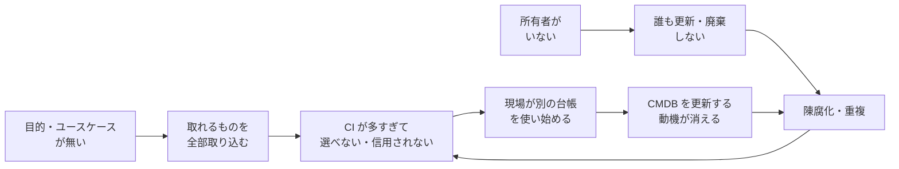
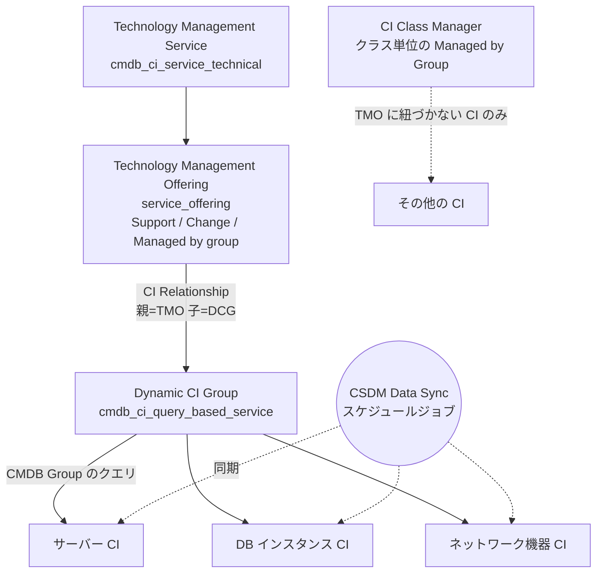
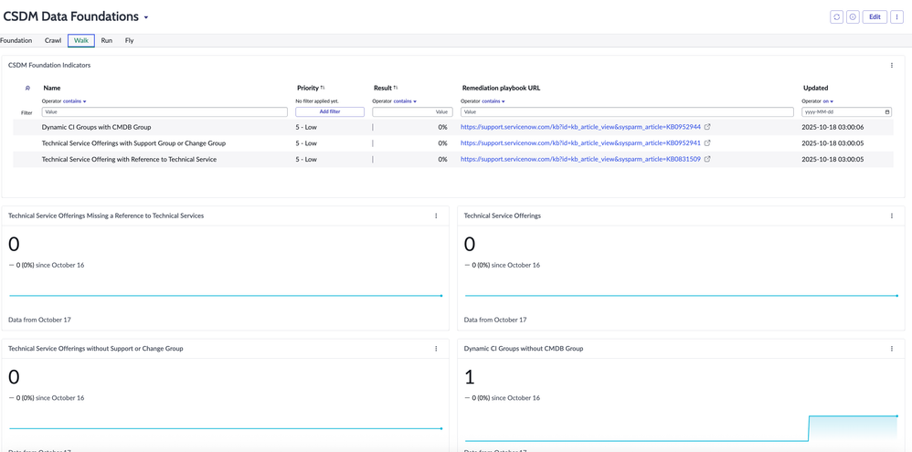
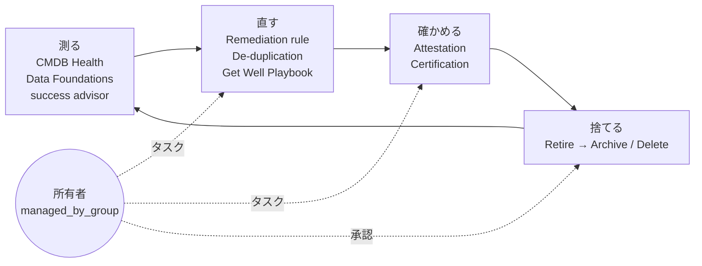
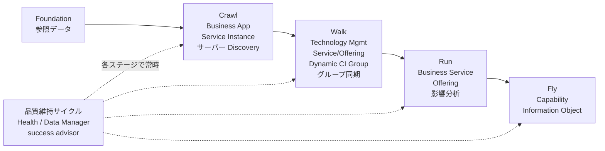

# CMDB成功の要因（CMDB Success Factors）

## 概要

本ファイルは、ServiceNow の CMDB（Configuration Management Database、構成管理データベース）を **「信頼され、実際に使われる」状態** にするための成功要因を、導入・運用経験から得られた知見として整理した応用編である。CMDB のテーブル構造、IRE、CSDM のドメインとテーブルといった **仕様** は [CMDB と CSDM](../02_リファレンス/platform/cmdb-csdm.md) にまとめてあり、本ファイルはその前提の上で「何をすれば成功し、何を怠ると失敗するか」に絞る。

本ファイルが扱う成功要因は次の 6 つである。

| # | 成功要因 | 一言でいうと | 主な ServiceNow の仕組み |
|---|---|---|---|
| 1 | 目的とユースケースの明確化 | 「何に使うか」を決めてから入れる | （計画。Now Create の CMDB and CSDM Data Foundations Success Pack） |
| 2 | CSDM 準拠 | ベースシステムのテーブルと関係を使う | CSDM、CSDM Data Foundations Dashboard、Get Well Playbook |
| 3 | データ所有者の明確化 | すべての CI に責任グループがある | `managed_by_group`、`support_group`、Technology Management Service Offering + Dynamic CI Group + CSDM Data Sync |
| 4 | Discovery 範囲の設計 | 必要なクラスを、正しいネットワーク範囲から、正しい優先順位で | Principal Class、IP 設定（CIDR・除外）、MID Server、`discovery_source`、IRE、Service Graph Connectors |
| 5 | 品質の継続的維持 | 測る・直す・確かめる・捨てる を回す | CMDB Health、CMDB Data Manager（Attestation / Certification / Retire / Archive / Delete）、De-duplication、CMDB success advisor、ServiceNow Otto の CMDB ガバナンスエージェント |
| 6 | 段階導入 | Foundation → Crawl → Walk → Run → Fly | CSDM の実装ステージ、ITOM Discovery Guided Setup の Learn/Crawl/Walk/Run |

前提となる事実:

- ServiceNow は CSDM を一度に全部実装するのではなく、**Foundation、Crawl、Walk、Run、Fly の 5 ステージで段階的に実装する** ことを推奨している。各ステージは前のステージの上に積み上がる。[出典](https://www.servicenow.com/docs/r/australia/servicenow-platform/common-service-data-model-csdm/csdm-implementation-stages.html)
- CMDB Health のジョブは **既定で無効** で、有効化するまでヘルスデータは収集されない。つまり「入れただけ」の CMDB は品質が測られてすらいない。[出典](https://www.servicenow.com/docs/r/australia/servicenow-platform/configuration-management-database-cmdb/overview-cmdb-health.html)
- Principal Class フィルターはベースシステムでは **空** であり、重点クラスを決めるのは顧客側の仕事である。[出典](https://www.servicenow.com/docs/r/q4dSP2Icgr1SFv5wanVXvQ/ENE4G2KZHXZ4qUyd2nyztg)
- ServiceNow 社員による Community 記事は、CMDB 計画の最初で最も重要なステップは目標設定だとし、「データを取り込むソリューションを構成する前に計画を持つことが不可欠」と述べている。[出典](https://www.servicenow.com/community/servicenow-ai-platform-blog/the-path-to-a-quality-cmdb-starts-with/ba-p/2282786)

関連ファイル: [CMDB と CSDM](../02_リファレンス/platform/cmdb-csdm.md) / [Discovery](../02_リファレンス/itom/discovery.md) / [Service Mapping](../02_リファレンス/itom/service-mapping.md) / [Service Graph Connectors](../02_リファレンス/itom/service-graph-connectors.md) / [MID Server](../02_リファレンス/platform/mid-server.md) / [Hardware Asset Management](../02_リファレンス/itam/hardware-asset-management.md) / [導入失敗パターンと対策](01-implementation-failure-patterns.md) / [ガバナンスとCoEの実践](09-governance-coe-practice.md) / [カスタマイズと技術的負債](02-customization-technical-debt.md)

---

## 1. CMDB はなぜ失敗するのか

### 1.1 「CMDB の 7〜8 割は失敗する」という言説の扱い

「CMDB プロジェクトの 70〜80% は失敗する（または期待した価値を出せない）」という数字は、Gartner の調査として多くのベンダーブログや Community 投稿で引用されている。ただし **Gartner の一次資料は公開情報では確認できず**、引用元ごとに年や数字（70〜80%、75%、成功率 20% 未満など）が揺れている。本ナレッジでは数字そのものではなく、引用元が一致して挙げる **失敗の原因** に注目する。【第三者情報】 [出典](https://www.servicenow.com/community/itom-forum/why-80-cmdb-implementations-fail/m-p/3489277)

ServiceNow Community の ITOM フォーラムの投稿「Why 80%+ CMDB Implementations Fail」（2026-02）は、CMDB が失敗する主因を **技術ではなく組織** にあるとし、次の 4 点を挙げている。【第三者情報】 [出典](https://www.servicenow.com/community/itom-forum/why-80-cmdb-implementations-fail/m-p/3489277)

1. 所有者（Ownership）が不明確で、誰もデータに責任を持たない
2. データガバナンスが弱い
3. ビジネス目標と整合していない
4. 期待値が非現実的

同投稿は、CMDB を「データベース」ではなく **継続的なオペレーティングモデル** として扱い、プロセス規律、明確な責任、継続的なデータ品質維持を成功要因としている。

### 1.2 失敗パターンと対応する成功要因

| 失敗パターン（症状） | 典型的な原因 | 対応する成功要因（本ファイルの節） |
|---|---|---|
| CI は大量にあるが、インシデントや変更で CI が選ばれない／選ばれても間違っている | 用途を決めずに「取れるものを全部」取り込んだ。Principal Class が未設定でルックアップに不要なクラスが大量に出る | 2（目的）、5（Discovery 範囲） |
| アプリケーションやサービスが独自テーブルや `cmdb_ci_appl` に入っていて、影響分析やレポートが組めない | CSDM を無視した独自モデル | 3（CSDM 準拠） |
| 導入直後はきれいだったが数か月で陳腐化 | CI の所有者がおらず、ライフサイクル（廃棄・リタイア）を誰も回さない | 4（所有者）、6（品質維持） |
| サーバーが二重登録される、属性が日によって変わる | 複数のデータソースが識別・調整ルールなしで書き込んでいる。`discovery_source` が空 | 5（Discovery 範囲と IRE） |
| Discovery が遅い、失敗が多い、ラボ機器の CI が溢れる | MID Server の配置、IP 範囲、除外の設計不足 | 5（Discovery 範囲） |
| 「CMDB 全部をきれいにする」プロジェクトが終わらない | 範囲と順序を決めず一括で実施 | 7（段階導入） |
| 品質が良いのか悪いのか誰も分からない | CMDB Health ジョブ未有効化、KPI 未定義 | 6（品質維持） |

ServiceNow Community の ITOM ブログ（2025-10）の筆者は「CI のライフサイクルを誰も所有していないと、きれいな CMDB が数か月で劣化するのを見てきた」と述べている。【第三者情報】 [出典](https://www.servicenow.com/community/itom-blog/cmdb-health-the-foundation-of-every-great-servicenow/ba-p/3401209)

上の図は【経験則】として語られる「CMDB 不信の悪循環」を表したもので、ユースケース不在と所有者不在が、陳腐化と現場の別台帳化を通じて自己強化していく構造を示す。

---

## 2. 成功要因①：目的とユースケースから始める

### 2.1 ServiceNow が示す計画手順

ServiceNow 社員による Community 記事「The path to a quality CMDB starts with…」は、CMDB 計画を次の順序で進めるよう推奨している。[出典](https://www.servicenow.com/community/servicenow-ai-platform-blog/the-path-to-a-quality-cmdb-starts-with/ba-p/2282786)

| 手順 | 内容 |
|---|---|
| 1. Set your direction（方向を決める） | CMDB が支えるべき目標を最初に定義する |
| 2. Focus your use cases（ユースケースを絞る） | 組織の戦略的取り組みに直結する **少数の重要なユースケース** に絞り、時間をかけて追加していく。例として Change Impact Analysis（変更影響分析）、Software License Compliance、Cloud-First Strategy、Information Risk、Reducing Service Outages（サービス停止の削減）が挙げられている |
| 3. Define specific goals（具体的な目標を定義） | To / In such a way that / So that / And can be measured by の 4 要素で目標を書く（下図） |
| 4. You've Defined Your Goals, Now What?（目標を定義したら次は） | 記事にリンクされたプレイブック（品質の高い CMDB に向けた残りの手順）に沿って進める |
| （参考）Increase Your Knowledge at Knowledge | 年次イベント Knowledge（記事当時は Knowledge 19）の顧客事例セッションで、他社の CMDB の実践から学ぶ |
| 5. Remember, Always Plan Before Doing!（投入方法を計画してから構成する） | Discovery、Service Mapping、サードパーティ連携、手動更新のどれで投入するかを、構成前に計画する |

*図1：CMDB の目標を書くための 4 要素テンプレート*

画面説明：白地のテキスト画像。下線付きの見出し「To」の下に「<do what>（文化的に受け入れられる言葉で表現した、何をするか）」、「In such a way that」の下に「<how it must be done>（制約、前提、必須条件）」、「So that」の下に「<why it must be done>（戦略的な目標と目的）」、「And can be measured by」の下に「<how will we know if we are doing it right>（定量的に。定性的ではなく）」と箇条書きされ、最後に「Here is an example:」と続く（例の本文は元記事の次の画像にある）。

出典：[The path to a quality CMDB starts with…（ServiceNow Community, ServiceNow AI Platform blog, 2019-03-26）](https://www.servicenow.com/community/servicenow-ai-platform-blog/the-path-to-a-quality-cmdb-starts-with/ba-p/2282786)（取得日：2026-11-04）

目標記述の例（上記テンプレートに沿った本ナレッジ作成者による作例）【経験則】:

| 要素 | 記述例 |
|---|---|
| To | 本番サーバーとそれを使うアプリケーションサービスの関係を CMDB で維持する |
| In such a way that | 本番サーバーは Discovery で日次更新し、手動入力は Service Instance の作成時のみとする |
| So that | 変更要求（`change_request`）の影響分析で、影響を受けるサービスとオファリングを自動で特定できる |
| And can be measured by | 変更要求の CI 入力率、影響サービスが特定された変更の割合、変更起因インシデント件数 |

### 2.2 Community の「始め方」ガイド

ServiceNow Community の CMDB 記事「CMDB Welcome Guide」（2022-09 公開、2025-02 更新。著者が ServiceNow 社員かはページ上で確認できず）は、CMDB の始め方を次のように示している。【第三者情報】 [出典](https://www.servicenow.com/community/cmdb-articles/configuration-management-database-cmdb-welcome-guide/ta-p/2301750)

1. 基礎を学ぶ（CMDB Workspace、Service Graph Connectors、Discovery・IntegrationHub ETL などのデータ取得ツール）
2. **ビジネス成果（business outcomes）を定義する**（サービスの自動化、ハードウェア・ソフトウェア・クラウドコストの削減、セキュリティ強化など）。ステークホルダーとエグゼクティブスポンサーを揃える
3. 実装経路を選ぶ（パートナー／Expert Services／自社実装）
4. 組織変更に備える（エンドユーザーとサービスデスクエージェントへの周知・教育）
5. 本番稼働前に最新リリースへアップグレードする

同ガイドは CMDB Process Guide の方針として「可能な限りすぐに使える（out-of-the-box）ServiceNow 機能を使う」ことを挙げ、Now Create 上の **CMDB and CSDM Data Foundations Success Pack** を成功ブループリントとして紹介している。【第三者情報】 [出典](https://www.servicenow.com/community/cmdb-articles/configuration-management-database-cmdb-welcome-guide/ta-p/2301750)

### 2.3 実務上のポイント

- **「消費されないデータは入れない」**：どのプロセス（Incident、Change、Event、SAM 等）がどの属性を読むかを先に決め、それ以外の属性は初期スコープから外す。【経験則】
- **ユースケースごとに必要なクラスと関係を逆算する**：変更影響分析なら「サーバー＋アプリケーションサービス＋両者の関係」、ライセンス管理なら「サーバー＋ソフトウェアインストール＋ハードウェアモデル」のように、ユースケースから CI クラスと関係を逆算する。【経験則】
- **測定指標は業務 KPI と結びつける**：CMDB Health のスコアだけでなく、「インシデントの CI 入力率」「変更の影響分析実施率」など、消費側プロセスの指標で効果を示す。【経験則】
- ServiceNow Community の開発者ブログ（筆者は Tera Expert。ServiceNow 社員かはページ上で確認できず）は、Walk ステージの到達基準の一例として「インシデントの 70% 超が（インフラ CI だけでなく）アプリケーションサービスに紐づいていること」を挙げている。【第三者情報】 [出典](https://www.servicenow.com/community/developer-blog/achieving-csdm-maturity-moving-from-crawl-to-fly/ba-p/3506920)

---

## 3. 成功要因②：CSDM 準拠

### 3.1 なぜ CSDM 準拠が成功要因なのか

CSDM（Common Service Data Model、共通サービスデータモデル）は、ServiceNow 製品（ITSM、ITOM、SPM、ITAM、SecOps 等）が前提とするテーブルと関係の標準である。ServiceNow の製品機能・ダッシュボード・AI エージェントはベースシステムのテーブル（例：`cmdb_ci_business_app`、`cmdb_ci_service_auto`、`service_offering`）を読むように作られているため、独自テーブルでサービスを表現すると、これらの機能がそのままでは働かない。仕様の詳細は [CMDB と CSDM](../02_リファレンス/platform/cmdb-csdm.md) を参照。

ServiceNow の CSDM Data Foundations ダッシュボードには、ベースシステムのテーブルを使っているかを測る指標（Run タブの「Base System Service Tables」「Services Using Base System CMDB Tables」、件数カード「Services Using Custom CMDB Tables」「Custom Service Tables」）が含まれており、ServiceNow 自身が「ベースシステムのテーブルを使うこと」を健全性の基準にしていることが分かる。【第三者情報】 [出典](https://www.servicenow.com/community/common-service-data-model-blog/csdm-run/ba-p/3408768)

### 3.2 CSDM 準拠の原則（実務で押さえるべき 5 点）

ServiceNow Community の CSDM フォーラム投稿「Beyond the Diagrams: 5 CSDM Principles You Need to Know」（2026-01）は、次の 5 原則を挙げている。【第三者情報】 [出典](https://www.servicenow.com/community/common-service-data-model-forum/beyond-the-diagrams-5-csdm-principles-you-need-to-know/m-p/3459088)

| # | 原則 | 内容 | 違反したときの症状 |
|---|---|---|---|
| 1 | Business Application と Discovered Application を分ける | `cmdb_ci_appl` はホスト上で動くソフトウェアの技術的インスタンス（Discovery が作る）、`cmdb_ci_business_app` は概念的なアプリケーションポートフォリオ | アプリケーションの二重計上、APM レポートとサービスモデルの破綻 |
| 2 | CMDB には非運用 CI も含まれる | Business Capability、Business Application、SDLC Component などは計画・ガバナンス用で、Incident / Problem / Change では選択しない | 運用プロセスで選ぶべきでない CI がルックアップに出る |
| 3 | ライフサイクルを標準化する | 散在するステータス項目ではなく Life Cycle Stage / Life Cycle Stage Status の 2 項目に寄せる | クラスごとに状態値が異なり横断レポートが組めない |
| 4 | 参照データ（Foundation）が土台 | Company、Business Unit、Location、User、Group、Contract などを最初に整える | Owner・Support group・Location が埋まらず CMDB Health の完全性が上がらない |
| 5 | 技術よりガバナンス | データの真実性と妥当性を管理するガバナンスとプロセスが無ければ価値は小さい | 導入後にガバナンスへのコミットメントが失われ劣化する |

### 3.3 よくある CSDM 違反と Get Well Playbook

ServiceNow サポートは、CSDM / CMDB の典型的な問題ごとに分析・修正・データガバナンスの手順をまとめた **Get Well Playbook**（KB 記事）を公開しており、CSDM Data Foundations ダッシュボードの各指標から修復プレイブックの URL としてリンクされる。主要なものを用途別に整理する（KB 番号は Community のまとめ記事による。KB 本文の閲覧には Now Support へのログインが必要）。【第三者情報】 [出典](https://www.servicenow.com/community/cmdb-articles/list-of-all-quot-get-well-playbooks-quot-csdm-amp-cmdb/ta-p/2301917)

| 区分 | よくある違反 | Get Well Playbook |
|---|---|---|
| クラス設計 | 独自 CMDB クラスの命名が標準に沿っていない | KB1116975 Adhere to standard naming for custom CMDB Classes |
| クラス設計 | 属性を誤った階層に追加している、独自属性の乱用 | KB0832206 CMDB attributes on the right level / KB0832208 Use of custom attributes in the CMDB |
| サービス | Business Service が OOTB の CMDB テーブルを使っていない | KB0831512 Make sure that Business Services use OOTB CMDB Tables |
| アプリケーション | 独自の Business Application テーブル | KB0868431 Find and reclassify custom Business Application Tables |
| ライフサイクル | CI のライフサイクルに独自のステータス値を多用 | KB0952946 Percentage of Custom Status Values for CI Lifecycle Stages |
| 関係 | ベースシステムの関係タイプを改変、独自関係タイプの作成 | KB0829857 / KB0829858 |
| 関係 | Business Application と Application Service の関係が無い | KB0831505 / KB0831506 / KB0831503 |
| 関係 | Business Service Offering と Application Service の関係が無い | KB0831510 / KB0831511 |
| 所有者 | Technical Service Offering に Support Group / Change Group が無い | KB0952941 |
| 所有者 | Service Owner が未設定 | KB0869040 Identify and remediate missing Service Owner Data |
| 所有者 | Dynamic CI Group に CMDB Group が無い | KB0952944 |
| 参照データ | Business Unit に Company が無い、Location の親が無い、Location の重複 | KB0864259 / KB0864260 / KB0832200 |
| 消費側 | CI 参照が空のインシデント・変更 | KB0864671 / KB0868259 / KB1116972 / KB1116973 |
| データソース | `discovery_source` が空の CI | KB0829078 Manage CIs with empty (unpopulated) discovery source values |
| データソース | サードパーティの検出ソースの統合方法 | KB0854301 Guide for integrating third party Discovery Sources correctly |
| 品質 | 重複 CI、陳腐化 CI、孤立した関係 | KB0829103 / KB0829106 / KB0829101 |

### 3.4 CSDM 準拠を守るための設計ルール（実務）

- **新しい CI クラスを作る前に、既存クラス（CSDM 5 のテーブル対応表）で表現できないかを必ず確認する**。独自クラスは IRE の識別ルール、CMDB Health、Data Manager、Service Graph Connector の取り込み先との整合を自分で維持する必要がある。【経験則】
- **サービスは `cmdb_ci_service`（Business Service）、`cmdb_ci_service_technical`（Technology Management Service）、`cmdb_ci_service_auto`（Service Instance）を使い分ける**。「とりあえず全部 Business Service に入れる」は CSDM 違反の典型である。テーブル定義は [CMDB と CSDM](../02_リファレンス/platform/cmdb-csdm.md) を参照。【経験則】
- **Application Service（Service Instance）は 1 つの Business Application に紐づける**。1 つの Business Application が環境ごとに複数の Service Instance を持つのはよいが、複数の Business Application が 1 つの Service Instance を共有するモデルは避けるべきだという意見が Community で示されている。【第三者情報】 [出典](https://www.servicenow.com/community/common-service-data-model-forum/multiple-business-applications-per-application-service/m-p/3531765)
- **ライフサイクルは Life Cycle Stage / Life Cycle Stage Status を正とし、Operational status との不整合を定期的に検出する**。CSDM Data Foundations ダッシュボードの Crawl タブには「CIs with Mismatched Operational Status and Life Cycle Stage」という件数カードがある（[CMDB と CSDM](../02_リファレンス/platform/cmdb-csdm.md) 7.3 節の図 4 参照）。
- **CSDM の版を揃える**：CSDM 5（2025-05 ホワイトペーパー公開）では CSDM 4 からドメイン構成と名称が変わっている。設計書・研修資料が CSDM 4 のままだと用語がずれる。違いは [CMDB と CSDM](../02_リファレンス/platform/cmdb-csdm.md) の 5 章を参照。【経験則】

> **Brazil での変更:** CSDM のデータモデル自体（ドメイン・テーブル）について Brazil での変更は公開情報では確認できず。CMDB 側では Service Instance を `itil` なしで管理できる `app_service_owner` ロールが新設され（プラグイン CMDB app roles `com.snc.cmdb.app.roles`）、Service Instance のオーナーにレコード保守を委譲しやすくなった。[出典](https://www.servicenow.com/docs/r/release-notes/cmdb-rn.html)

---

## 4. 成功要因③：データ所有者を明確にする

### 4.1 所有者を表すフィールド

CI の所有者・責任グループを表すフィールドは `cmdb_ci` に複数あり、用途を決めずに使うと「誰が責任者か」が曖昧になる。一般的な使い分けは次のとおり（ServiceNow 公式に網羅的な定義表は公開情報では確認できず、Community で広く共有されている整理と公式の同期対象フィールドを組み合わせたもの）。

| フィールド（ラベル） | 列名 | 参照先 | 一般的な意味 | 主な消費プロセス |
|---|---|---|---|---|
| Owned by（所有者） | `owned_by` | `sys_user` | CI のビジネス上の所有者（個人） | 承認、Attestation のエスカレーション先 |
| Managed by（管理者） | `managed_by` | `sys_user` | CI の運用上の管理者（個人） | — |
| Managed by Group（管理グループ） | `managed_by_group` | `sys_user_group` | CI クラス／CI のデータを完全かつ正確に保つ責任グループ | CMDB Data Manager のタスク割り当てと承認、CMDB Health・success advisor の所有者指標 |
| Support group（サポートグループ） | `support_group` | `sys_user_group` | CI に影響するインシデントを扱うグループ | Incident の割り当て |
| Change group（変更グループ） | `assignment_group` | `sys_user_group` | CI への変更を実施するグループ | Change の割り当て |
| Approval group（承認グループ） | `change_control` | `sys_user_group` | CI への変更を承認するグループ | Change の承認 |
| Assigned to（割り当て先） | `assigned_to` | `sys_user` | エンドユーザー端末の使用者 | HAM、エンドユーザーのインシデント |

出典：フィールドの意味は [CMDB - CI Ownership Best Practices（ServiceNow Community, 2024-07）](https://www.servicenow.com/community/cmdb-forum/cmdb-ci-ownership-best-practices/td-p/3005444)【第三者情報】、Managed by Group の定義（「CI クラスを管理し、完全かつ正確に保つグループ」）と Support group / Change group / Managed by Group が同期対象であることは [Synchronizing group assignment attributes（Australia）](https://www.servicenow.com/docs/r/ZUQIWHvhWUsSoHqqH5PGGw/jAoDav7dQALQmKoPMdLrjA)。`cmdb_ci` の `assignment_group` のラベルが「Change Group」、`change_control` のラベルが「Approval Group」であることは Community の報告による【第三者情報】（[出典](https://www.servicenow.com/community/cmdb-forum/why-did-cmdb-ci-assignment-group-field-got-relabeled-to-change/m-p/251851)）。インスタンスの Dictionary で確認すること。

### 4.2 なぜ `managed_by_group` が要になるのか

`managed_by_group` は、ServiceNow の品質維持機能が **所有者として既定で参照するフィールド** である。

| 機能 | `managed_by_group` の使われ方 | 出典 |
|---|---|---|
| CMDB Data Manager | 対象 CI の Managed By Group の値ごとに個別のタスクが作られる。承認が必要なポリシーではこのグループのメンバーが承認する。空の場合やタスクが却下された場合は管理者に回る | [Working with CMDB Data Manager（Australia）](https://www.servicenow.com/docs/r/australia/servicenow-platform/configuration-management-database-cmdb/cmdb-data-management.html) |
| Data Manager のポリシー作成 | 承認が必要なタスクでは、対象 CI に Managed By Group が設定されていることが前提 | [Create a CMDB Data Manager policy](https://www.servicenow.com/docs/r/q4dSP2Icgr1SFv5wanVXvQ/62u9ThyS52sKtt6pDr0jMQ) |
| CMDB success advisor（Data Foundations） | 「CIs missing managed by group」（Principal Class の CI のうち Managed by group が空の件数、日次）を KPI カードとして表示 | [Monitoring CMDB data quality … CMDB success advisor for Data Foundations](https://www.servicenow.com/docs/r/q4dSP2Icgr1SFv5wanVXvQ/0LfgpANAVJFFuKuyyr1l_g) |
| ServiceNow Otto の CMDB Data Ownership Manager AI Agent | Managed by Group（既定の評価フィールド）が設定され、有効でメンバーのいるグループを指しているかを評価し、所有データの品質を Poor / Average / Healthy に分類（しきい値は設定可） | [Getting advice from ServiceNow Otto on CMDB governance（Australia）](https://www.servicenow.com/docs/r/q4dSP2Icgr1SFv5wanVXvQ/nkA5kfeWIxlqopzVkJfcoA) |

つまり、`managed_by_group` が空の CI は、ライフサイクル管理・Attestation・品質評価のすべてで「宛先不明」になる。**所有者の設定は品質維持の自動化の前提条件** である。

### 4.3 所有者を「手で入れない」仕組み：TMO による同期

数千〜数万の CI に手作業で所有者を入れるのは持続しない。CSDM の Walk ステージは、**Technology Management Service Offering（TMO、技術管理サービスオファリング）** で CI を管理し、TMO のサポートグループ（support group）と技術承認グループ（technical approval group）を子オブジェクトに同期する方針を示している。[出典](https://www.servicenow.com/docs/r/australia/servicenow-platform/common-service-data-model-csdm/csdm-implement-walk-stage.html) 具体的な手順（Dynamic CI Group と CSDM Data Sync を使い、Support group・Change group・Managed by group を CI に同期する）は、次の「Synchronize user groups for a technology management offering」に書かれている。[出典](https://www.servicenow.com/docs/r/q4dSP2Icgr1SFv5wanVXvQ/nGVIMx3ESidUWb2Uo~WjQQ)

**手順（Australia の「Synchronize user groups for a technology management offering」）：** 必要ロールは `itil` と `itil_admin`。[出典](https://www.servicenow.com/docs/r/q4dSP2Icgr1SFv5wanVXvQ/nGVIMx3ESidUWb2Uo~WjQQ)

1. All > Configuration > CMDB Groups で CMDB グループを作成する
2. All > Configuration > Dynamic CI Groups で、その CMDB グループに紐づく Dynamic CI Group を作成する（メンバーは CMDB Query Builder の保存クエリ、エンコードクエリ、手動指定で定義）
3. All > CSDM > Technical Service Offering で TMO を作成する
4. CI Relationships テーブルで、親 = TMO、子 = Dynamic CI Group の関係を作成する
5. TMO を開き、**Support group**、**Change group**、**Managed by group** に値を入れて保存する（データ同期が有効になった旨のメッセージが出る）
6. 値が Dynamic CI Group と、そのグループに属するすべての CI に同期される

**同期の仕様：**

| 項目 | 内容 | 出典 |
|---|---|---|
| 同期ジョブ | スケジュールジョブ **CSDM Data Sync**。新しく追加された CI はこのジョブが完了するまで同期されない。即時に同期したい場合はジョブで Execute を選ぶ | [出典](https://www.servicenow.com/docs/r/q4dSP2Icgr1SFv5wanVXvQ/nGVIMx3ESidUWb2Uo~WjQQ) |
| 優先順位 | TMO に設定した値は、CI Class Manager で同じ属性を設定した値より **優先** される | [出典](https://www.servicenow.com/docs/r/q4dSP2Icgr1SFv5wanVXvQ/nGVIMx3ESidUWb2Uo~WjQQ) |
| CI Class Manager | CI Class Manager でクラス単位に Managed by Group を設定すると、そのクラスのすべての CI に値が入る。ただし TMO に紐づかない CI にのみ適用される | [出典](https://www.servicenow.com/docs/r/ZUQIWHvhWUsSoHqqH5PGGw/jAoDav7dQALQmKoPMdLrjA) |
| Managed by group の意味 | CI クラスを管理するグループであり、個々の CI を修理するグループとは異なる場合がある | [出典](https://www.servicenow.com/docs/r/q4dSP2Icgr1SFv5wanVXvQ/nGVIMx3ESidUWb2Uo~WjQQ) |

上の図は、TMO に設定した 3 つのグループ属性が Dynamic CI Group を経由して CI に同期され、TMO に紐づかない CI には CI Class Manager のクラス単位設定が適用されるという優先関係を示す。

**実務上の注意：**

- 公式手順は関係タイプ名を明記していない。Community では、同期のために `Managed by::Manages` 関係が必要とする回答と、現在の CSDM ガイダンスでは `Contains::Contained by` を使うとする ServiceNow 社員の回答があり、情報が割れている。KB0952941 と自インスタンスの挙動で確認すること。【第三者情報】 [出典](https://www.servicenow.com/community/common-service-data-model-forum/support-group-population-with-csdm/m-p/3572982)
- 1 つの CI が複数の Dynamic CI Group に属すると、どのグループの値が勝つかが不明確になる。Dynamic CI Group のクエリは **排他的になるよう設計する**。【経験則】
- 同期は CSDM Data Sync 実行時に Dynamic CI Group のクエリに一致した CI にのみ働く。属性（例：環境、ロケーション、OS）が未入力の CI はどのグループにも入らず、所有者も付かない。**所有者付与の前提として、クエリに使う属性を Discovery で確実に埋める**。【経験則】

ServiceNow Community の CSDM ブログ（Walk 編、2025-10）は、Walk ステージの焦点を「手作業のレコード保守から、統制された自動化とサービスへの関連付けへ移ること」とし、TMO を環境（本番／非本番）、地域、価格・パッケージ、可用性・SLA、サポート・変更統制の違いでバリエーションとして作るよう勧めている。【第三者情報】 [出典](https://www.servicenow.com/community/common-service-data-model-blog/csdm-walk/ba-p/3408772)

*図2：CSDM Data Foundations ダッシュボード（Walk タブ）*

画面説明：タイトル「CSDM Data Foundations」の下に Foundation / Crawl / Walk / Run / Fly のタブがあり、Walk タブが選択されている。上段の「CSDM Foundation Indicators」表は列が Name、Priority、Result、Remediation playbook URL、Updated で、「Dynamic CI Groups with CMDB Group」（5 - Low、0%、KB0952944）、「Technical Service Offerings with Support Group or Change Group」（5 - Low、0%、KB0952941）、「Technical Service Offering with Reference to Technical Service」（5 - Low、0%、KB0831509）の 3 指標と、各指標の修復プレイブック（Now Support の KB 記事）へのリンク、更新日時（2025-10-18）が並ぶ。下段には「Technical Service Offerings Missing a Reference to Technical Services」（0）、「Technical Service Offerings」（0）、「Technical Service Offerings without Support or Change Group」（0）、「Dynamic CI Groups without CMDB Group」（1）の件数カードとトレンドグラフが表示される。所有者同期の前提（TMO にグループがあるか、Dynamic CI Group に CMDB Group があるか）をこのタブで点検できる。

出典：[CSDM Walk（ServiceNow Community, Common Service Data Model blog, 2025-10-20）](https://www.servicenow.com/community/common-service-data-model-blog/csdm-walk/ba-p/3408772)（取得日：2026-11-04）

### 4.4 所有者の体制（役割分担）

ServiceNow Community の開発者ブログ「CMDB & CSDM Governance on the ServiceNow Platform」（2026-03）は、次の役割と、ガバナンスボードの設置を推奨している。【第三者情報】 [出典](https://www.servicenow.com/community/developer-blog/cmdb-amp-csdm-governance-on-the-servicenow-platform/ba-p/3505330)

| 役割 | 責任 |
|---|---|
| Service Owner（サービスオーナー） | ビジネスサービスのデータに説明責任を持つ。サービス定義の維持、関係の検証、アーキテクチャ変更の承認 |
| Application Owner（アプリケーションオーナー） | アプリケーションのレコードを正確に保つ |
| Infrastructure Owner（インフラオーナー） | インフラ CI を維持する |
| Data Steward（データスチュワード） | データ品質プロセスを監督する |
| ガバナンスボード | プラットフォームアーキテクト、エンタープライズアーキテクト、インフラ運用、アプリケーションオーナー、サービス管理リーダーで構成。データ標準の定義、サービスモデルの承認、ヘルス指標のレビュー、所有権の紛争解決、CSDM 採用の指導 |

ServiceNow 社員による Community 記事「5 steps to proactively monitor CMDB health」は、ステップ 1 として **ガバナンス委員会を作り、RACI チャート・定義済みプロセス・CMDB Health データの定期報告を含む構成管理計画を文書化・維持する** ことを挙げ、エグゼクティブスポンサーの存在が役立つとしている。[出典](https://www.servicenow.com/community/cmdb-articles/5-steps-to-proactively-monitor-cmdb-health/ta-p/2470074)

RACI の例（本ナレッジ作成者による整理）【経験則】:

| 活動 | CMDB プロセスオーナー | クラス別データスチュワード | Managed by Group | Discovery / 連携管理者 | プラットフォームオーナー |
|---|---|---|---|---|---|
| CSDM 準拠のモデル・クラス設計 | A | C | I | C | R |
| Principal Class と Health ルールの定義 | A | R | C | C | I |
| Discovery 範囲・スケジュールの管理 | I | C | I | R/A | C |
| 識別・調整ルール（データソース優先順位） | A | C | I | R | C |
| Attestation / Certification タスクの処理 | I | A | R | I | I |
| 重複・陳腐化 CI の修復 | I | A | R | R | I |
| 月次・四半期の品質レビュー | R/A | R | C | C | I |

R＝実行、A＝説明責任、C＝相談、I＝報告。

### 4.5 所有者設計の実務ポイント

- **CI 単位ではなくサービス／クラス単位で所有者を決める**。Community の回答では「多くの組織は CI レベルで所有者を設定せず、所有者は通常サービス側にある」とされる。CI には TMO 経由でグループを同期し、個人の所有者はサービス（Service Owner）に置くのが維持しやすい。【第三者情報】 [出典](https://www.servicenow.com/community/cmdb-forum/cmdb-ci-ownership-best-practices/td-p/3005444)
- **「Discovery で投入する前に所有者を決める」**：Community の Discovery 落とし穴記事は「誰かが CMDB のデータに責任を負わなければならない」とし、Discovery で投入する前に各 CI クラスへ所有者を割り当てるよう勧めている。【第三者情報】 [出典](https://www.servicenow.com/community/itom-articles/servicenow-discovery-common-pitfalls-and-how-to-avoid-them-part/ta-p/2321707)
- **グループの鮮度も管理する**：Otto の CMDB Data Ownership Manager は、非アクティブなユーザー、非アクティブなグループ、**メンバーのいない空グループ** を問題として検出する。組織変更時にグループを廃止したら、TMO の値も更新する運用を決めておく。[出典](https://www.servicenow.com/docs/r/q4dSP2Icgr1SFv5wanVXvQ/nkA5kfeWIxlqopzVkJfcoA)
- **CMDB Workspace の Data Owner ビュー** は、オーナー向けにフィルターされた CI ビューを提供する（ビュー構成は CMDB Workspace のバージョンによって異なる。[CMDB と CSDM](../02_リファレンス/platform/cmdb-csdm.md) 4.2 節参照）。所有者に「自分の CI を見る場所」を与えることが、所有者を実際に動かすための前提になる。【経験則】

---

## 5. 成功要因④：Discovery 範囲を設計する

Discovery の機能・プローブ・パターンなどの仕様は [Discovery](../02_リファレンス/itom/discovery.md)、MID Server は [MID Server](../02_リファレンス/platform/mid-server.md) を参照。本節は「何を、どこから、どの順で検出するか」という範囲設計の知見に絞る。

### 5.1 範囲設計の考え方

ServiceNow Community の「ServiceNow Discovery - Common Pitfalls and How to Avoid Them」は、落とし穴 1 として **明確な範囲を定めてから展開すること** を挙げ、「シンプルかつ小さく始める」ことを勧めている。範囲には、CI を検出するビジネス上の理由と、それが支えるモジュール（ITSM、APM、SAM など）を含めるべきだとしている。【第三者情報】 [出典](https://www.servicenow.com/community/itom-articles/servicenow-discovery-common-pitfalls-and-how-to-avoid-them-part/ta-p/2321707)

範囲を決める 3 つの軸【経験則】:

| 軸 | 決めること | ServiceNow 上の手段 |
|---|---|---|
| クラス（何を） | ユースケースが必要とする CI クラス。運用プロセスで選ばれるクラスを優先 | Principal Class（`cmdb_class_info`）、Discovery パターン／プローブの有効化 |
| ネットワーク（どこから） | 対象サブネット、除外すべきラボ・テスト網、DMZ | IP Network（CIDR）、Range Set、除外範囲、Global Excludes List |
| ソース（何で） | Discovery で取るか、Service Graph Connector／クラウド API／手動で取るか。属性ごとの正のソース | `discovery_source`、IRE の識別ルールと Reconciliation rules、CMDB 360 |

### 5.2 Principal Class で「重点クラス」を宣言する

**Principal Class（主要クラス）** は、基礎的なデータ品質とガバナンスにとって最も重要な CMDB クラスを指定する仕組みで、追跡・ヘルス・認定・ライフサイクル管理・クラスのリスト表示で優先される。[出典](https://www.servicenow.com/docs/r/q4dSP2Icgr1SFv5wanVXvQ/ENE4G2KZHXZ4qUyd2nyztg)

| 項目 | 内容 |
|---|---|
| 設定場所 | CMDB Class Information [`cmdb_class_info`] テーブル。CI Class Manager でクラスの Basic Info から Principal Class を選択／解除できる |
| 必要ロール | `sn_cmdb_admin` または `itil_admin`、および `personalize_dictionary` |
| 継承 | Principal Class の設定はそのクラスにのみ適用され、子クラスには継承されない |
| 既定値 | ベースシステムでは Principal Class フィルターは空 |
| タスクへの影響 | プロパティ `com.snc.task.principal_class_filter`（タスクタイプのカンマ区切り）に含まれるタスクの `cmdb_ci` ルックアップで、Principal Class の CI だけを表示する。既定の対象は `incident`、`incident_task`、`problem`、`problem_task`、`change_request`、`change_task` |
| 選び方（公式） | 安定していて理解されており、業務運用に直接影響するクラスを選ぶ。中核インフラを優先し、インフラ・アプリケーション・セキュリティの各チームと相談し、定期的に見直す。詳細は KB2707240「Guidance on designating principal classes in the CMDB」 |
| 他機能との関係 | CMDB success advisor の Data Foundations は Principal Class を対象に KPI と推奨を出す。Data Foundations のスコープを設定すると、選択したクラスが自動的に Principal Class になる。CMDB 360 の Discovery sources カードでも Principal Class フィルターを使える |

出典：[Principal Class（Australia）](https://www.servicenow.com/docs/r/q4dSP2Icgr1SFv5wanVXvQ/ENE4G2KZHXZ4qUyd2nyztg)、[Update the list of classes in the Principal Class filter（Australia）](https://www.servicenow.com/docs/r/q4dSP2Icgr1SFv5wanVXvQ/bVel8DzuRlAjTCWNHuwR9Q)

> ページの要約部分ではプロパティ名が `com.snc.task.principalclassfilter` と表記されている箇所もある。インスタンスの System Properties で正確な名前を確認すること。

**実務ポイント：** Principal Class を決めることは、そのまま「Discovery で最初に確実に取るべきクラス」と「インシデント・変更で選ばせるクラス」を決めることになる。Discovery の範囲設計と Principal Class の選定は **同じ会議で決める** とよい。【経験則】

### 5.3 ネットワーク範囲の設計（公式仕様）

Discovery の IP 設定の公式仕様と推奨は次のとおり（Australia 版）。[出典](https://www.servicenow.com/docs/r/australia/it-operations-management/discovery/discovery-ip-address-configuration.html)

| 項目 | 仕様・推奨 |
|---|---|
| IP の指定方法 | IP address list（個別 IP／ホスト名）、IP address range（任意範囲）、IP network（CIDR 表記） |
| 推奨 | **IP network（CIDR）を推奨**。CIDR ではネットワークアドレスとブロードキャストアドレスが自動で除外され、より正確。IP address range はネットワーク・ブロードキャストアドレスも含めて全アドレスをスキャンする |
| 範囲の大きさ | スケジュールは最大 /16（約 65,536 IP）までに制限し、それより大きい範囲は分割する |
| IPv6 | IP address range と IP network では IPv6 は非対応 |
| IP が分からない場合 | まず Network Discovery を実行し、結果を Range Set に変換してから他のデバイスの検出に使う |
| 除外 | Discovery Range Set から特定の IP 範囲を除外できる。Global Excludes List でスケジュール横断の除外ができる（Horizontal Discovery のみ） |
| 属性の自動設定 | Discovery generic attributes で IP 範囲に応じて CI の項目（例：Location）を自動設定できる |

Community の落とし穴記事が挙げる範囲設計の注意点【第三者情報】 [出典](https://www.servicenow.com/community/itom-articles/servicenow-discovery-common-pitfalls-and-how-to-avoid-them-part/ta-p/2321707):

- **ラボ・テスト網をスケジュールから外す**。テストベッドの機器は頻繁に構築・撤去されるため、含める場合は稼働中・廃止済み機器の扱いを定義する。Range Set を使っている場合は IP 除外範囲を設定する。
- **IP Networks テーブルを使うなら、各サブネットをロケーションに紐づける**。Discovery スケジュールもロケーションに紐づける。
- **MID Server を対象ネットワークの近くに置く**。地理と DMZ／非 DMZ で検出をグループ化し、グローバル企業では地域ごとにローカル MID Server を置く。
- **資格情報を対象クラスすべてに用意する**。ネットワーク機器は ACL に MID Server の登録が必要な場合がある。
- **仮想環境の二重登録に注意**。サーバーの Discovery と vCenter の Discovery で同名の CI が 2 つできることがあり、Incident・Problem・Change の CI ルックアップフィルターを見直して実サーバー CI に紐づける。

ServiceNow Community の NowSupport ブログは、Discovery スケジュールを **検出対象 IP 範囲の地理的ロケーション単位で編成** し、既知のロケーションの IP 群を **Range Set** にまとめて複数スケジュールから再利用することを勧めている。【第三者情報】 [出典](https://www.servicenow.com/community/itom-blog/best-practices-for-setting-up-discovery-schedules/ba-p/2270853)

### 5.4 データソースの統制（IRE と `discovery_source`）

Discovery の範囲設計は、**他のデータソースとの棲み分け** とセットで考える必要がある。IRE（Identification and Reconciliation Engine）の仕様は [CMDB と CSDM](../02_リファレンス/platform/cmdb-csdm.md) の 3 章を参照。

- **すべての連携に `discovery_source` を設定する**。Community の落とし穴記事は「すべてのデータ連携に対応する `discovery_source` の値があることを確認し、CI Class Manager で Reconciliation rules を構成する」ことを求めている。調整ルールと優先順位を決めることで「何を誰が更新すべきか」が定まる。【第三者情報】 [出典](https://www.servicenow.com/community/itom-articles/servicenow-discovery-common-pitfalls-and-how-to-avoid-them-part/ta-p/2321707)
- `discovery_source` が空の CI は Get Well Playbook KB0829078 の対象であり、IRE でデータの整合性を維持するには有効な `discovery_source` が必要とされる。【第三者情報】 [出典](https://www.servicenow.com/community/cmdb-articles/list-of-all-quot-get-well-playbooks-quot-csdm-amp-cmdb/ta-p/2301917)
- **Discovery で取れないもの・取りにくいものは Service Graph Connectors を使う**（クラウド、EDR、MDM、仮想化管理、監視ツール等）。独自のインポートセット＋スクリプトで CI を直接書き込むと IRE を迂回し重複の原因になる。仕様は [Service Graph Connectors](../02_リファレンス/itom/service-graph-connectors.md)、インポートの注意は [データインポート/エクスポート](../02_リファレンス/platform/import-export-data.md) を参照。【経験則】
- **重複は発生源を断つ**。CMDB Workspace の De-duplication ダッシュボードの Insights には、重複 CI を生成している上位 5 つの Discovery source が表示される。重複タスクを処理するだけでなく、上位ソースの識別ルールや連携設定を直す。[出典](https://www.servicenow.com/docs/r/4AA65edJ2a~o5pASflQppQ/2zidN_TGxaN0wzI3yCqhNg)

### 5.5 Discovery の段階的な立ち上げ（ITOM Discovery Guided Setup）

Australia の **ITOM Discovery Guided Setup**（All > ITOM Guided Setup > ITOM Discovery Guided Setup）は、Discovery の立ち上げを次の 4 フェーズに分けて案内する。設定名を入力すると進捗を保存・再開できる。[出典](https://www.servicenow.com/docs/r/xIukoQY2A2qGfsWn8TUt1A/bm1l7lKuchKAYgnmGH4GaQ)

| フェーズ | 内容 |
|---|---|
| Learn | Discovery の原則・手法・前提条件を理解する |
| Crawl | 必要なプラグインのインストール、資格情報の構成、スケジュール作成の準備 |
| Walk | 複数種類のスケジュール設定、資格情報の追加、MID Server のインストールと検証により Discovery を構成・有効化 |
| Run | Discovery Admin Space と Content 360（Discovery パターン等のコンテンツ管理。5.1 の CMDB 360 とは別物）で監視し、継続的に最適化 |

範囲の段階的拡大の例（本ナレッジ作成者による整理）【経験則】:

| 段階 | 対象 | 完了の目安 |
|---|---|---|
| 1 | 本番データセンターの Windows / Linux サーバー（Principal Class の中核） | Discovery が日次で成功し、本番サーバーの重複・陳腐化が CMDB Health で許容範囲 |
| 2 | サーバー上のアプリケーション（`cmdb_ci_appl`）、DB インスタンス、Web サーバー | Business Application → Service Instance → Application → Host の関係チェーンが主要アプリで成立 |
| 3 | ネットワーク機器、ストレージ、仮想化基盤（vCenter 等） | ホスト関係と依存関係ビューで障害影響が追える |
| 4 | クラウド（Cloud Discovery / Service Graph Connectors）、エンドユーザー端末（SCCM / Intune 等の SGC） | 属性ごとの正のソースが Reconciliation rules で定義されている |
| 5 | Service Mapping（トップダウン）、Kubernetes 等 | 重要サービスの Service Instance がマップで維持される |

---

## 6. 成功要因⑤：品質を継続的に維持する

### 6.1 品質維持のサイクル

CMDB の品質維持は「**測る（Health）→ 直す（Remediation / De-dup）→ 確かめる（Attestation / Certification）→ 捨てる（Retire / Archive / Delete）**」のサイクルを、所有者（`managed_by_group`）に向けて自動で回すことである。ServiceNow 社員による Community 記事「5 steps to proactively monitor CMDB health」はこれを 5 ステップで示している。[出典](https://www.servicenow.com/community/cmdb-articles/5-steps-to-proactively-monitor-cmdb-health/ta-p/2470074)

| ステップ | 内容 |
|---|---|
| 1. ガバナンス委員会 | 構成管理計画（RACI、プロセス、CMDB Health の定期報告）を文書化し、定例会議を持つ |
| 2. CMDB / CSDM Data Foundations ダッシュボード | ストアから導入（35 以上のヘルススキャン定義）。`asset`、`itil_admin`、`admin` のいずれかのロールが必要。日次ジョブ **CMDB Get Well Metric Collection** と **CMDB Data Foundations PA Metric Collection** が動いていることを確認。Best Practice、Customizations、Data Management Practices、ITSM Practices の 4 タブを確認し、低スコアは Analysis / Fix / Data Governance のプレイを持つプレイブックで修復 |
| 3. CMDB Health Dashboard | 記事は「4 KPI（Completeness、Correctness、Compliance、Relationship Health）」と表現しているが、公式の CMDB Health KPIs and metrics（Australia）では KPI は Completeness、Correctness、Compliance の 3 つで、Relationships（重複・孤立・陳腐化した関係のメトリクス。設定不可）は KPI とは別の区分である（[出典](https://www.servicenow.com/docs/r/australia/servicenow-platform/configuration-management-database-cmdb/r_CMDBHealthMetrics.html)）。ヘルスメトリクスのジョブを有効化し、CI Class Manager で Health inclusion rules（既定では無し）と完全性・コンプライアンス・孤立／陳腐化ルールを作る |
| 4. Data Manager ポリシー | CI のリタイアなどライフサイクルイベントのポリシーを作る。ポリシーはサブフローでタスクを作る（承認あり／なし） |
| 5. Data Certification | 何を・どの頻度で・どの指示で認定するかを決め、タスクを割り当てて完了まで追跡する |

### 6.2 測る：CMDB Health の設定ポイント

CMDB Health の KPI・メトリクスの定義は [CMDB と CSDM](../02_リファレンス/platform/cmdb-csdm.md) 4.1 節を参照。成功のために押さえるべき点:

| ポイント | 内容 | 出典 |
|---|---|---|
| ジョブは既定で無効 | 有効化するまでヘルスデータは収集されない。導入時のタスクに必ず入れる | [Overview of CMDB Health](https://www.servicenow.com/docs/r/australia/servicenow-platform/configuration-management-database-cmdb/overview-cmdb-health.html) |
| 推奨フィールドは既定で未定義 | Completeness の Recommended メトリクスは、CI Class Manager の Health で推奨フィールドを定義しないと意味を持たない。識別ルールの基準属性を推奨フィールドに入れるスケジュールジョブ「Add Identifier Fields In Recommended Rules」がある | [CMDB Health KPIs and metrics](https://www.servicenow.com/docs/r/australia/servicenow-platform/configuration-management-database-cmdb/r_CMDBHealthMetrics.html) |
| Staleness の既定は 60 日 | `cmdb_ci` の基本の Staleness ルールは 60 日。日次 Discovery 対象のクラスはクラス固有ルールでより短く設定するのが一般的（Community 記事の例ではサーバーを 15 日） | [CMDB Health KPIs and metrics](https://www.servicenow.com/docs/r/australia/servicenow-platform/configuration-management-database-cmdb/r_CMDBHealthMetrics.html)、[5 steps…](https://www.servicenow.com/community/cmdb-articles/5-steps-to-proactively-monitor-cmdb-health/ta-p/2470074) |
| Compliance は監査の有効化が前提 | Audit メトリクスは監査を有効化しないと計算されない | [CMDB Health KPIs and metrics](https://www.servicenow.com/docs/r/australia/servicenow-platform/configuration-management-database-cmdb/r_CMDBHealthMetrics.html) |
| 修復の自動化 | 失敗したヘルステストから作られたタスクに Remediation rule を紐づけ、自動または手動で実行できる | [Overview of CMDB Health](https://www.servicenow.com/docs/r/australia/servicenow-platform/configuration-management-database-cmdb/overview-cmdb-health.html) |
| Health Preferences | Configuration > Health Preferences で失敗しきい値と修復タスクの作成を設定できる | [Overview of CMDB Health](https://www.servicenow.com/docs/r/australia/servicenow-platform/configuration-management-database-cmdb/overview-cmdb-health.html) |

**KPI の目標値** について、ServiceNow 公式の推奨しきい値（例：「Completeness 90% 以上」）は公開情報では確認できず。目標値はユースケースごとに、Principal Class に絞って設定するのが実務的である。【経験則】

### 6.3 測る：CMDB success advisor（Australia 期間中に提供）

**CMDB success advisor** は、CMDB データの正確性と完全性を、Data Foundations、Hardware Asset Management（HAM）、Software Asset Management（SAM）という **ビジネス成果** に紐づけて追跡するスコープアプリである。[出典](https://www.servicenow.com/docs/r/q4dSP2Icgr1SFv5wanVXvQ/JiIaj~GJkYefIfMAJw7x1A)

| 項目 | 内容 | 出典 |
|---|---|---|
| アプリケーション ID | `sn_cmdb_advisor`（System Applications からインストール） | [Install CMDB success advisor](https://www.servicenow.com/docs/r/q4dSP2Icgr1SFv5wanVXvQ/xHHhvLJjCq25leje10bBkA) |
| 前提 | Next Experience のアプリ。CMDB Workspace（`sn_cmdb_ws`）と SGC Central（`sn_sgc_central`）のインストールが必要。HAM 用モジュールに Hardware Asset Management（`sn_hamp`）が必要かどうかは公開情報では確認できず（Store の掲載ページで依存関係を確認すること） | [Access CMDB success advisor（Australia）](https://www.servicenow.com/docs/r/q4dSP2Icgr1SFv5wanVXvQ/p2o6XUQI1ixGDVc4Q2cHog) |
| インストール | 必要ロール `admin`。All > System Applications > All Available Applications > All で `sn_cmdb_advisor` を検索してインストールする。未導入の依存アプリ・プラグインも同時にインストールされ、それぞれ有効なエンタイトルメントが必要 | [Install CMDB success advisor](https://www.servicenow.com/docs/r/q4dSP2Icgr1SFv5wanVXvQ/xHHhvLJjCq25leje10bBkA) |
| 閲覧場所 | `sn_cmdb_admin` は CMDB Workspace（Home の Product highlights、または Management の Optimize）や Service Graph Workspace の Governance からフルアクセスで利用する。`sn_cmdb_user` / `sn_cmdb_editor` は Service Graph Workspace の Insights ビューから Dashboard タブだけを読み取り専用で閲覧する。SAM 向けは Software Asset Workspace からも開ける | [Access CMDB success advisor（Australia）](https://www.servicenow.com/docs/r/q4dSP2Icgr1SFv5wanVXvQ/p2o6XUQI1ixGDVc4Q2cHog)、[Exploring CMDB success advisor](https://www.servicenow.com/docs/r/q4dSP2Icgr1SFv5wanVXvQ/JiIaj~GJkYefIfMAJw7x1A) |
| Data Foundations の対象 | インシデント・変更・問題に重要な Principal Class。インシデント・問題・変更の活動から推奨され、データが無い場合は CMDB での使用度で順位付けされる | [Exploring CMDB success advisor](https://www.servicenow.com/docs/r/q4dSP2Icgr1SFv5wanVXvQ/JiIaj~GJkYefIfMAJw7x1A) |
| Data Foundations の指標 | CIs missing name / managed by group / location（日次）、Stale CIs（7・14・30・60・90 日で切替）、Duplicate CIs、CIs by principal class、CIs by data integration source、Data quality insights（AI による上位 5 課題の要約。分類はデータ整合性、CI 属性、調整とガバナンス、Data Manager ポリシー） | [Monitoring CMDB data quality … Data Foundations（Australia）](https://www.servicenow.com/docs/r/q4dSP2Icgr1SFv5wanVXvQ/0LfgpANAVJFFuKuyyr1l_g) |
| 修復 | ダッシュボードのチャートに修復アクションパネルが付き、陳腐化・重複 CI、シリアル番号欠落、資産と CI の不一致などの修正を提案。KPI カードの「Ask Otto」でエージェントとの会話を開始できる | [Exploring CMDB success advisor](https://www.servicenow.com/docs/r/q4dSP2Icgr1SFv5wanVXvQ/JiIaj~GJkYefIfMAJw7x1A) |
| 構成分析 | Data Manager の所有者ポリシー、Reconciliation rules、同期ルール、資産作成ルール、ステータスマッピングのギャップ分析。Discovery パターンや Service Graph Connectors を含む連携ソースの属性単位のカバレッジ分析 | [Exploring CMDB success advisor](https://www.servicenow.com/docs/r/q4dSP2Icgr1SFv5wanVXvQ/JiIaj~GJkYefIfMAJw7x1A) |
| ロール | `sn_cmdb_admin`（構成・修復、Principal Class と連携の管理）、`sn_cmdb_user` / `sn_cmdb_editor`（Dashboard タブの参照のみ）、`sam_admin`（SAM の代替管理者）、`cmdb_inst_admin`（SGC Central の接続管理）、`pd_user` / `pd_admin`（パターンの参照／変更） | [Exploring CMDB success advisor](https://www.servicenow.com/docs/r/q4dSP2Icgr1SFv5wanVXvQ/JiIaj~GJkYefIfMAJw7x1A) |

CMDB のリリースノートでは、CMDB success advisor は 2026-06 にストアアプリとして提供され、2026-09 に Service Graph Workspace の Governance ビューへ ServiceNow Otto for CMDB による Data Foundations / HAM / SAM の上位データ品質問題のサマリーが追加された。[出典](https://www.servicenow.com/docs/r/australia/release-notes/cmdb-rn.html)

> **Brazil での変更:** CMDB Workspace と Service Graph Workspace が統合され、Service Graph Workspace は非推奨（deprecated）になり、その機能は CMDB Workspace に引き継がれる。success advisor の導線（Service Graph Workspace の Insights ビューや Governance）がどう変わるかは公開情報では確認できず。CMDB Workspace 側の導線に寄ると考えられるため、手順書のメニューパスを見直すこと【推定】。[出典](https://www.servicenow.com/docs/r/release-notes/cmdb-rn.html)

**成功要因としての意味：** success advisor は「Principal Class を決め、所有者（managed by group）を埋め、データソースのカバレッジを把握する」という本ファイルの成功要因 3〜5 を、そのまま KPI として可視化する。導入初期から入れておくと、改善の優先順位付けとステークホルダーへの報告に使える。【経験則】

### 6.4 確かめる：Attestation と Certification

**Attestation（証明）** は、CMDB の CI が実在し正確であることを定期的に確認させ、陳腐化した CI を取り除く仕組みである。[出典](https://www.servicenow.com/docs/r/q4dSP2Icgr1SFv5wanVXvQ/5frqJY24lwmPr3hcMa8YQA)

| 項目 | 内容 |
|---|---|
| 作成場所 | CMDB Workspace の CMDB Data Manager で Attestation ポリシーを作成し、対象 CI と頻度を指定 |
| タスク | CI を知っている／管理しているユーザー、または割り当てグループに送られる。CMDB Workspace の Tasks ビューで処理 |
| 結果 | 担当者は CI の存在を証明（attest）するか却下（reject）する。却下された CI は不要ならリタイア・アーカイブ・削除する |
| Smart detection（自動証明） | Discovery または Service Graph Connectors が前提。検出ウィンドウ内（既定 30 日）に検出され、除外ソース由来でない CI を自動証明の候補にでき、レビュー担当者が自動証明を選べる |
| 関連プロパティ | `sn_cmdb_ws.attestation.smart_detection.disabled`（既定 `false`＝有効）、`sn_cmdb_ws.attestation.smart_detection.discovery_window`（既定 30 日）、`sn_cmdb_ws.attestation.smart_detection.discovery_source.exclusion`（既定 "Manual Entry"） |

**Certification（認定）** は、特定の属性が必要な値を持っているかを担当者に確認させる仕組みで、非 CMDB テーブルもサポートする。[出典](https://www.servicenow.com/docs/r/australia/servicenow-platform/configuration-management-database-cmdb/cmdb-data-management.html)

**ポリシー作成時の主な設定**（CMDB Workspace > Governance > Data Manager > Policies > Create new policy、必要ロール `sn_cmdb_admin`）[出典](https://www.servicenow.com/docs/r/q4dSP2Icgr1SFv5wanVXvQ/62u9ThyS52sKtt6pDr0jMQ):

| ステップ | 設定項目 |
|---|---|
| General | Name、Description、Policy type、Work notes |
| Data Filter | Table（クラス）、Filter conditions、Related List Condition。Apply filters で対象（Included / Excluded）の影響分析を確認 |
| Assignment | Assignment type（User Field / User Group Field / Specific User / Specific User Group）、Task assignment。Certification / Attestation では「割り当て項目が空の場合」の動作も設定 |
| Options | Days to complete、Subflow、Needs review（承認）、Retention time（Archive）、表示項目と認定項目、Allow field updates、Allow empty field values、Instructions |
| Schedule | 繰り返し or On demand、開始時刻、曜日・日付、間隔、Run policy scheduled job as |
| Review | Publish policy、または Save & Exit で下書き保存 |

公開後の動作: 日次のスケジュールジョブがポリシーを実行し、1 タスクあたり最大 10,000 CI（超える分は追加タスク）。承認が必要なタスクは Managed By Group に通知される。承認されないまま古くなったタスクは既定 90 日でキャンセル扱いでクローズされ、日数はプロパティ `cmdb.data.manager.stale.task.life.in.days` で変更できる。[出典](https://www.servicenow.com/docs/r/q4dSP2Icgr1SFv5wanVXvQ/62u9ThyS52sKtt6pDr0jMQ)

**実務ポイント【経験則】:**

- **Discovery で自動維持されている CI に人手の Attestation をかけない**。Smart detection を有効にし、人手の確認は Discovery で取れない CI（論理 CI、手動登録 CI、Service Instance、Business Application）に集中させる。
- **1 タスクの件数を絞る**。Managed by Group 単位で数千件のタスクが届くと処理されず、90 日でキャンセルされるだけになる。フィルターで Principal Class・本番環境などに絞り、頻度を分ける。
- **Certification はユースケースが読む属性だけに限定する**（例：変更承認に使う `change_control`、影響分析に使う環境・重要度）。

### 6.5 捨てる：リタイアとアーカイブ

陳腐化した CI を残し続けることは、重複・誤選択・ライセンス誤計上の原因になる。CMDB Data Manager の Retire / Archive / Delete ポリシーは、対象クラスに **Retirement definition（リタイア定義）** があることが前提で、公式は「非本番でテスト → リタイア定義 → Retire ポリシー → リタイア済み CI を対象に Delete / Archive ポリシー → 本番へ」の順序を推奨している。ポリシーの仕様は [CMDB と CSDM](../02_リファレンス/platform/cmdb-csdm.md) 4.3 節を参照。[出典](https://www.servicenow.com/docs/r/australia/servicenow-platform/configuration-management-database-cmdb/cmdb-data-management.html)

- Asset Management が有効な場合、CI をリタイアする前に関連資産の `install_status` が Retired であるべきとされる。HAM と CMDB のライフサイクルを別々に回さず、資産側の廃棄プロセスと CI のリタイアを連動させる。[出典](https://www.servicenow.com/docs/r/q4dSP2Icgr1SFv5wanVXvQ/62u9ThyS52sKtt6pDr0jMQ)
- 削除（Delete）は元に戻せない。まず Retire、次に Archive（保持期間中は復元可能）を基本にし、Delete は監査・保持要件を確認したクラスに限る。【経験則】

> **Brazil での変更:** Data Manager のポリシー実行結果が `cmdb_data_management_policy_execution` テーブルに記録され、未処理 CI やアクセス問題が Work Notes / Activities に表示される（Inaccessible Records Indicator）。Certification タスクはリセットで認定をやり直せるようになった。[出典](https://www.servicenow.com/docs/r/release-notes/cmdb-rn.html)

### 6.6 AI による品質ガバナンス支援（Australia）

Australia では、ServiceNow Otto（旧 Now Assist）の agentic workflow「Provide advice on CMDB governance」が、直近 90 日に更新された CI を評価して CMDB ガバナンスの助言を行う。5 つの AI エージェントで構成される。[出典](https://www.servicenow.com/docs/r/q4dSP2Icgr1SFv5wanVXvQ/nkA5kfeWIxlqopzVkJfcoA)

> **名称について:** Australia のパッチ途中から、ドキュメント上の「Now Assist」は「ServiceNow Otto」に改称されている（公式リリースノートは Zurich Patch 12 以降と明記 [出典](https://www.servicenow.com/docs/r/delta-zurich-brazil/brazil-zurich-servicenowotto-release-notes.html)。Australia では Patch 5 相当と推定【推定】）。本節の参照ページの現行タイトルも「Getting advice from ServiceNow Otto on CMDB governance」である。実機の表示はパッチレベルで異なる。詳細は [Now Assist と AI Agents](../02_リファレンス/platform/now-assist-ai-agents.md) 1.2 節を参照。

| AI エージェント | 役割 | 対応する成功要因 |
|---|---|---|
| CMDB Principal Class Manager | Principal Class にできるかの判定、候補の提案、設定／解除 | ④ Discovery 範囲（重点クラス） |
| CMDB Life Cycle Manager | Principal Class 等にライフサイクルポリシーが存在するかを確認 | ⑤ 捨てる |
| CMDB Data Certification and Attestation Manager | クラスの Certification / Attestation ポリシーの取得・作成 | ⑤ 確かめる |
| CMDB Health Metrics Manager | Health ジョブ、メトリクスの状態、スコアを表示。未設定ならセットアップ手順へのリンク | ⑤ 測る |
| CMDB Data Ownership Manager | Managed by Group 等の所有データの品質を Poor / Average / Healthy で評価 | ③ 所有者 |

Now Assist / AI Agents の全般は [Now Assist と AI Agents](../02_リファレンス/platform/now-assist-ai-agents.md)、導入の知見は [Now Assist / AI Agents 導入の知見](10-ai-adoption-lessons.md) を参照。

> **Brazil での変更:** Brazil の CMDB リリースノートでも Now Assist / Moveworks の体験が ServiceNow Otto に統一され、重複 CI の修復機能は Duplicate CI Remediator となった。[出典](https://www.servicenow.com/docs/r/release-notes/cmdb-rn.html)

**注意：** AI エージェントは「ポリシーがあるか」「所有者が埋まっているか」を点検・提案するが、**所有者を誰にするか、どのクラスを重点にするかという組織の意思決定は代替しない**。【経験則】

### 6.7 運用の頻度（例）

ServiceNow Community の ITOM ブログは、データのドリフトを早期に捉えるために **四半期ごとの監査** を挙げている。【第三者情報】 [出典](https://www.servicenow.com/community/itom-blog/cmdb-health-the-foundation-of-every-great-servicenow/ba-p/3401209) 以下はそれを含む運用頻度の例である【経験則】:

| 頻度 | 活動 | 主な画面・機能 |
|---|---|---|
| 日次 | Discovery／SGC の実行結果確認、エラーの多い範囲の確認 | Discovery の Status、SGC Central |
| 日次（自動） | CMDB Health ジョブ、Data Foundations のメトリクス収集、CSDM Data Sync、Data Manager ポリシー実行 | スケジュールジョブ |
| 週次 | 重複 CI と De-duplication タスクの処理、`discovery_source` 空 CI の確認 | CMDB Workspace の De-duplication ダッシュボード |
| 月次 | Principal Class の KPI（欠落属性・陳腐化・重複）をガバナンス会議で報告、未処理の Attestation / Certification タスクの督促 | CMDB success advisor、CMDB Health Dashboard、Tasks ビュー |
| 四半期 | Attestation の実施、Principal Class・Health ルール・TMO と Dynamic CI Group の見直し、組織変更に伴うグループの棚卸し | CMDB Data Manager、CI Class Manager |
| リリースごと | アップグレード後の CMDB 動作確認（Australia で CMDB の Quick start tests が追加） | ATF（[アップグレードの教訓](04-upgrade-lessons.md) 参照） |

---

## 7. 成功要因⑥：段階導入

### 7.1 CSDM の 5 ステージと「やらないこと」

CSDM の実装ステージ（Foundation → Crawl → Walk → Run → Fly）の目的と対象テーブルは [CMDB と CSDM](../02_リファレンス/platform/cmdb-csdm.md) の 7 章にまとめてある。ステージの考え方は「各ステージは前のステージの上に積み上がる」である。[出典](https://www.servicenow.com/docs/r/australia/servicenow-platform/common-service-data-model-csdm/csdm-implementation-stages.html) また Foundation domain のページは「Before you can use ServiceNow products, you must populate foundational data.」（ServiceNow 製品を使う **前に** 基盤データ（参照データ）を投入する必要がある）と明記している。[出典](https://www.servicenow.com/docs/r/q4dSP2Icgr1SFv5wanVXvQ/caU4_szDOkdJaTAdt~sbrQ)

段階導入で成功するコツは、各ステージで **「やること」と同じくらい「まだやらないこと」を決める** ことである。【経験則】

| ステージ | やること（主な対象） | まだやらないこと | 完了の目安（例） |
|---|---|---|---|
| Foundation | Company、Business Unit、Department、Location、User、Group、CMDB Group、Product Model、Contract の整備 | CI の大量投入 | Location 階層・グループが整い、重複 Location が無い（KB0832200）【経験則】 |
| Crawl | Business Application、Service Instance、Discovery によるサーバーとアプリケーション、Principal Class の決定、CMDB Health の有効化 | Technical Service / Business Service の全面整備、全クラスの Discovery | 主要 Business Application と Service Instance の `Consumes::Consumed By` 関係が成立 |
| Walk | Technology Management Service / Offering、Dynamic CI Group、TMO からのグループ同期、ネットワーク機器 | Business Service Offering のサブスクライバー整備 | TMO に Support / Change group が入り（KB0952941）、Dynamic CI Group に CMDB Group がある（KB0952944） |
| Run | Business Service、Business Service Offering、Service Instance との関係、Service Owner Workspace | Business Capability、Information Object | 影響を受けるビジネスサービスとオファリングが CI から特定できる |
| Fly | Business Capability、Information Object、カタログアイテムと Service Offering の連携 | — | ケイパビリティ単位でアプリ投資を評価できる |

出典：ステージと対象は [Implementing the CSDM framework in stages（Australia）](https://www.servicenow.com/docs/r/australia/servicenow-platform/common-service-data-model-csdm/csdm-implementation-stages.html) と [CMDB と CSDM](../02_リファレンス/platform/cmdb-csdm.md) 7 章。「やらないこと」と完了の目安は【経験則】。

### 7.2 ステージごとに「責任を持つ人」を広げる

ServiceNow Community の開発者ブログ「CSDM Is Not a Project You Finish. It's a Direction You Commit To.」（2026-03）は、ステージが進むごとに **説明責任を持つ人の輪を広げる** ことが成熟の鍵だとして、次のように整理している。【第三者情報】 [出典](https://www.servicenow.com/community/developer-blog/achieving-csdm-maturity-moving-from-crawl-to-fly/ba-p/3506920)

| ステージ | 説明責任を持つ人 | 完了基準（筆者の提示） |
|---|---|---|
| Crawl | Discovery 管理者 | Discovery が継続的に動き、チームが別の台帳を確認せずにインシデント対応で CMDB のインフラデータを使えるほど信頼している |
| Walk | アプリケーションサービスオーナー（名前のある個人） | インシデントの 70% 超がアプリケーションサービスに紐づき、サービスオーナーが（名前が載っているだけでなく）実際に関係を維持している |
| Run | 部門横断のガバナンス | 変更影響評価が手作業の調査なしで下流の依存を示し、アラート相関がノイズを減らしている |
| Fly | 組織全体 | 運用チームが AI の推奨を信頼し、予測モデルがインシデント前にリスクを示す |

同記事は全ステージに共通する 3 つのコミットメントとして、①所有者の説明責任の拡大、②担当者の交代に耐えるガバナンス（文書化・認定・監査）、③環境の成長に追いつく自動化、を挙げ、「Crawl は失敗ではなく、唯一の正直な出発点だ」と述べている。

### 7.3 段階導入を回すための仕組み

- **ステージの進捗を CSDM Data Foundations ダッシュボードで測る**。Foundation / Crawl / Walk / Run / Fly の各タブに指標と修復プレイブックへのリンクがある（図 2）。アクセスはクラシック UI の All > Configuration > CSDM Data Foundations Dashboard（仕様は [CMDB と CSDM](../02_リファレンス/platform/cmdb-csdm.md) 7.3 節）。
- **ステージの区切りでリリースを合わせる**。Welcome Guide は本番稼働前に最新リリースへのアップグレードを推奨している。CMDB Workspace や success advisor はストアアプリとして頻繁に更新されるため、ステージの開始時に最新版を適用するとよい。[出典](https://www.servicenow.com/community/cmdb-articles/configuration-management-database-cmdb-welcome-guide/ta-p/2301750)
- **プロジェクトではなく運用として予算化する**。CMDB は「完了するプロジェクト」ではなく継続的なオペレーティングモデルであるという点は、本ファイルで引用した複数の Community 記事に共通している。導入プロジェクトの終了後も、データスチュワードと Discovery 管理者の工数を運用予算に確保する。【経験則】

---

## 8. 成功のためのチェックリスト

各項目の右列は本ファイルの該当節。チェック項目の構成は本ナレッジ作成者による整理【経験則】で、個々の仕様の出典は各節を参照。

### 8.1 計画時

| # | チェック項目 | 節 |
|---|---|---|
| 1 | CMDB が支える 2〜3 のユースケースと、To / In such a way that / So that / measured by 形式の目標がある | 2 |
| 2 | 各ユースケースが必要とする CI クラス・属性・関係を逆算した一覧がある | 2.3 |
| 3 | エグゼクティブスポンサーとガバナンス委員会（RACI を含む構成管理計画）がある | 4.4 |
| 4 | CSDM 5 を前提にしたモデル設計で、独自クラス・独自サービステーブルを作らない方針が合意されている | 3 |
| 5 | Principal Class の候補が決まっている（KB2707240 参照） | 5.2 |
| 6 | データソースごとの正のソース（属性単位）と `discovery_source` の値が決まっている | 5.4 |

### 8.2 構築時

| # | チェック項目 | 節 |
|---|---|---|
| 7 | Foundation の参照データ（Company、Location 階層、Group、User、Product Model）が整っている | 7.1 |
| 8 | Discovery の範囲は CIDR で /16 以下に分割、ラボ網は除外、MID Server は対象網の近く | 5.3 |
| 9 | CMDB Health のジョブを有効化し、Principal Class の推奨フィールドと Staleness ルールを設定した | 6.2 |
| 10 | TMO + Dynamic CI Group + CSDM Data Sync で Support / Change / Managed by group を同期している | 4.3 |
| 11 | Principal Class を設定し、タスクの CI ルックアップが絞られている | 5.2 |
| 12 | CSDM / CMDB Data Foundations ダッシュボード、CMDB success advisor を導入した | 6.1, 6.3 |

### 8.3 運用時

| # | チェック項目 | 節 |
|---|---|---|
| 13 | Principal Class の CI で `managed_by_group` の欠落がほぼ無い | 4.2 |
| 14 | 重複 CI の上位ソースを特定し、発生源（識別ルール・連携）を修正している | 5.4 |
| 15 | Attestation / Certification は Discovery 管理外の CI に絞り、タスクが期限内に処理されている | 6.4 |
| 16 | Retire → Archive / Delete のポリシーがあり、HAM の廃棄と連動している | 6.5 |
| 17 | 月次で KPI を報告し、四半期で Principal Class・ルール・グループを見直している | 6.7 |
| 18 | 消費側の指標（インシデント・変更の CI 入力率、サービス紐づけ率）が改善している | 2.3, 7.2 |

---

## 9. 関連ファイル

| ファイル | 関係 |
|---|---|
| [CMDB と CSDM](../02_リファレンス/platform/cmdb-csdm.md) | CMDB・IRE・CMDB Health・Data Manager・CSDM のテーブルとステージの仕様 |
| [Discovery](../02_リファレンス/itom/discovery.md) | Discovery の仕組み、スケジュール、パターン |
| [Service Mapping](../02_リファレンス/itom/service-mapping.md) | Service Instance のトップダウン検出 |
| [Service Graph Connectors](../02_リファレンス/itom/service-graph-connectors.md) | Discovery 以外の正のソースからの取り込み |
| [MID Server](../02_リファレンス/platform/mid-server.md) | MID Server の配置とサイジング |
| [ITOM 概要とパッケージ](../02_リファレンス/itom/itom-overview.md) | Discovery / Service Mapping のライセンス範囲 |
| [Hardware Asset Management](../02_リファレンス/itam/hardware-asset-management.md) / [Software Asset Management](../02_リファレンス/itam/software-asset-management.md) | 資産と CI のライフサイクル連動、success advisor の HAM / SAM |
| [Change Management](../02_リファレンス/itsm/change-management.md) / [Incident Management](../02_リファレンス/itsm/incident-management.md) | CMDB の主たる消費プロセス |
| [Now Assist と AI Agents](../02_リファレンス/platform/now-assist-ai-agents.md) | CMDB ガバナンスの AI エージェント |
| [データ移行](../03_導入編/08-data-migration.md) | 既存 CMDB・台帳からの移行 |
| [導入失敗パターンと対策](01-implementation-failure-patterns.md) | プロジェクト全体の失敗パターン |
| [カスタマイズと技術的負債](02-customization-technical-debt.md) | 独自 CI クラス・独自属性の負債 |
| [アップグレードの教訓](04-upgrade-lessons.md) | CMDB の Quick start tests、アップグレード時の注意 |
| [連携の落とし穴](08-integration-pitfalls.md) | IRE を迂回する連携の問題 |
| [ガバナンスとCoEの実践](09-governance-coe-practice.md) | CMDB ガバナンスを含むプラットフォームガバナンス |
| [Now Assist / AI Agents 導入の知見](10-ai-adoption-lessons.md) | AI 活用の前提としての CMDB 品質 |

---

## 参照元

**ServiceNow 公式ドキュメント（CSDM）**

- Implementing the CSDM framework in stages（Australia）: https://www.servicenow.com/docs/r/australia/servicenow-platform/common-service-data-model-csdm/csdm-implementation-stages.html
- CSDM implementation stage — Walk（Australia）: https://www.servicenow.com/docs/r/australia/servicenow-platform/common-service-data-model-csdm/csdm-implement-walk-stage.html
- Foundation domain in the CSDM model（Australia）: https://www.servicenow.com/docs/r/q4dSP2Icgr1SFv5wanVXvQ/caU4_szDOkdJaTAdt~sbrQ
- Synchronize user groups for a technology management offering（Australia）: https://www.servicenow.com/docs/r/q4dSP2Icgr1SFv5wanVXvQ/nGVIMx3ESidUWb2Uo~WjQQ
- Synchronizing group assignment attributes（Australia）: https://www.servicenow.com/docs/r/ZUQIWHvhWUsSoHqqH5PGGw/jAoDav7dQALQmKoPMdLrjA

**ServiceNow 公式ドキュメント（CMDB）**

- Principal Class（Australia）: https://www.servicenow.com/docs/r/q4dSP2Icgr1SFv5wanVXvQ/ENE4G2KZHXZ4qUyd2nyztg
- Update the list of classes in the Principal Class filter（Australia）: https://www.servicenow.com/docs/r/q4dSP2Icgr1SFv5wanVXvQ/bVel8DzuRlAjTCWNHuwR9Q
- Getting advice from ServiceNow Otto on CMDB governance（Australia）: https://www.servicenow.com/docs/r/q4dSP2Icgr1SFv5wanVXvQ/nkA5kfeWIxlqopzVkJfcoA
- CIs attestation（Australia）: https://www.servicenow.com/docs/r/q4dSP2Icgr1SFv5wanVXvQ/5frqJY24lwmPr3hcMa8YQA
- Create a CMDB Data Manager policy（Australia）: https://www.servicenow.com/docs/r/q4dSP2Icgr1SFv5wanVXvQ/62u9ThyS52sKtt6pDr0jMQ
- Working with CMDB Data Manager（Australia）: https://www.servicenow.com/docs/r/australia/servicenow-platform/configuration-management-database-cmdb/cmdb-data-management.html
- Overview of CMDB Health（Australia）: https://www.servicenow.com/docs/r/australia/servicenow-platform/configuration-management-database-cmdb/overview-cmdb-health.html
- CMDB Health KPIs and metrics（Australia）: https://www.servicenow.com/docs/r/australia/servicenow-platform/configuration-management-database-cmdb/r_CMDBHealthMetrics.html
- CI de-duplication experience in CMDB Workspace: https://www.servicenow.com/docs/r/4AA65edJ2a~o5pASflQppQ/2zidN_TGxaN0wzI3yCqhNg
- Exploring CMDB success advisor（Australia）: https://www.servicenow.com/docs/r/q4dSP2Icgr1SFv5wanVXvQ/JiIaj~GJkYefIfMAJw7x1A
- Install CMDB success advisor（Australia）: https://www.servicenow.com/docs/r/q4dSP2Icgr1SFv5wanVXvQ/xHHhvLJjCq25leje10bBkA
- Access CMDB success advisor（Australia）: https://www.servicenow.com/docs/r/q4dSP2Icgr1SFv5wanVXvQ/p2o6XUQI1ixGDVc4Q2cHog
- Monitoring CMDB data quality using dashboard metrics in CMDB success advisor for Data Foundations（Australia）: https://www.servicenow.com/docs/r/q4dSP2Icgr1SFv5wanVXvQ/0LfgpANAVJFFuKuyyr1l_g
- CMDB release notes（Australia）: https://www.servicenow.com/docs/r/australia/release-notes/cmdb-rn.html
- CMDB release notes（Brazil）: https://www.servicenow.com/docs/r/release-notes/cmdb-rn.html
- ServiceNow Otto release notes（Zurich→Brazil delta、Now Assist から ServiceNow Otto への改称）: https://www.servicenow.com/docs/r/delta-zurich-brazil/brazil-zurich-servicenowotto-release-notes.html

**ServiceNow 公式ドキュメント（Discovery）**

- Discovery IP address configuration（Australia）: https://www.servicenow.com/docs/r/australia/it-operations-management/discovery/discovery-ip-address-configuration.html
- Discovery Guided Setup（Australia）: https://www.servicenow.com/docs/r/xIukoQY2A2qGfsWn8TUt1A/bm1l7lKuchKAYgnmGH4GaQ

**ServiceNow Community（ServiceNow 社員による記事）**

- The path to a quality CMDB starts with…（2019-03-26）: https://www.servicenow.com/community/servicenow-ai-platform-blog/the-path-to-a-quality-cmdb-starts-with/ba-p/2282786
- 5 steps to proactively monitor CMDB health（2023-02-06、2025-02-18 更新）: https://www.servicenow.com/community/cmdb-articles/5-steps-to-proactively-monitor-cmdb-health/ta-p/2470074

**ServiceNow Community（その他・第三者情報）**

- Configuration Management Database (CMDB) Welcome Guide（2022-09-22、2025-02-18 更新）: https://www.servicenow.com/community/cmdb-articles/configuration-management-database-cmdb-welcome-guide/ta-p/2301750
- List of all "Get Well Playbooks" (CSDM & CMDB): https://www.servicenow.com/community/cmdb-articles/list-of-all-quot-get-well-playbooks-quot-csdm-amp-cmdb/ta-p/2301917
- ServiceNow Discovery - Common Pitfalls and How to Avoid Them (Part 3 of 3): https://www.servicenow.com/community/itom-articles/servicenow-discovery-common-pitfalls-and-how-to-avoid-them-part/ta-p/2321707
- Best practices for setting up Discovery schedules: https://www.servicenow.com/community/itom-blog/best-practices-for-setting-up-discovery-schedules/ba-p/2270853
- CSDM Walk（CSDM blog）: https://www.servicenow.com/community/common-service-data-model-blog/csdm-walk/ba-p/3408772
- CSDM Run（CSDM blog）: https://www.servicenow.com/community/common-service-data-model-blog/csdm-run/ba-p/3408768
- CSDM Is Not a Project You Finish. It's a Direction You Commit To.: https://www.servicenow.com/community/developer-blog/achieving-csdm-maturity-moving-from-crawl-to-fly/ba-p/3506920
- CMDB & CSDM Governance on the ServiceNow Platform: https://www.servicenow.com/community/developer-blog/cmdb-amp-csdm-governance-on-the-servicenow-platform/ba-p/3505330
- CMDB Health: The Foundation of Every Great ServiceNow Implementation: https://www.servicenow.com/community/itom-blog/cmdb-health-the-foundation-of-every-great-servicenow/ba-p/3401209
- Why 80%+ CMDB Implementations Fail: https://www.servicenow.com/community/itom-forum/why-80-cmdb-implementations-fail/m-p/3489277
- CMDB - CI Ownership Best Practices: https://www.servicenow.com/community/cmdb-forum/cmdb-ci-ownership-best-practices/td-p/3005444
- Why did CMDB CI Assignment Group field got relabeled to Change Group: https://www.servicenow.com/community/cmdb-forum/why-did-cmdb-ci-assignment-group-field-got-relabeled-to-change/m-p/251851
- Support group population with CSDM: https://www.servicenow.com/community/common-service-data-model-forum/support-group-population-with-csdm/m-p/3572982
- Beyond the Diagrams: 5 CSDM Principles You Need to Know: https://www.servicenow.com/community/common-service-data-model-forum/beyond-the-diagrams-5-csdm-principles-you-need-to-know/m-p/3459088
- Multiple Business Applications per Application Service: https://www.servicenow.com/community/common-service-data-model-forum/multiple-business-applications-per-application-service/m-p/3531765

**画像（取得日 2026-11-04、著作権は ServiceNow, Inc. および各投稿者に帰属）**

- `assets/images/05-cmdb-success-factors/cmdb-goal-statement-template.png`：https://www.servicenow.com/community/servicenow-ai-platform-blog/the-path-to-a-quality-cmdb-starts-with/ba-p/2282786
- `assets/images/05-cmdb-success-factors/csdm-walk-dashboard.png`：https://www.servicenow.com/community/common-service-data-model-blog/csdm-walk/ba-p/3408772
