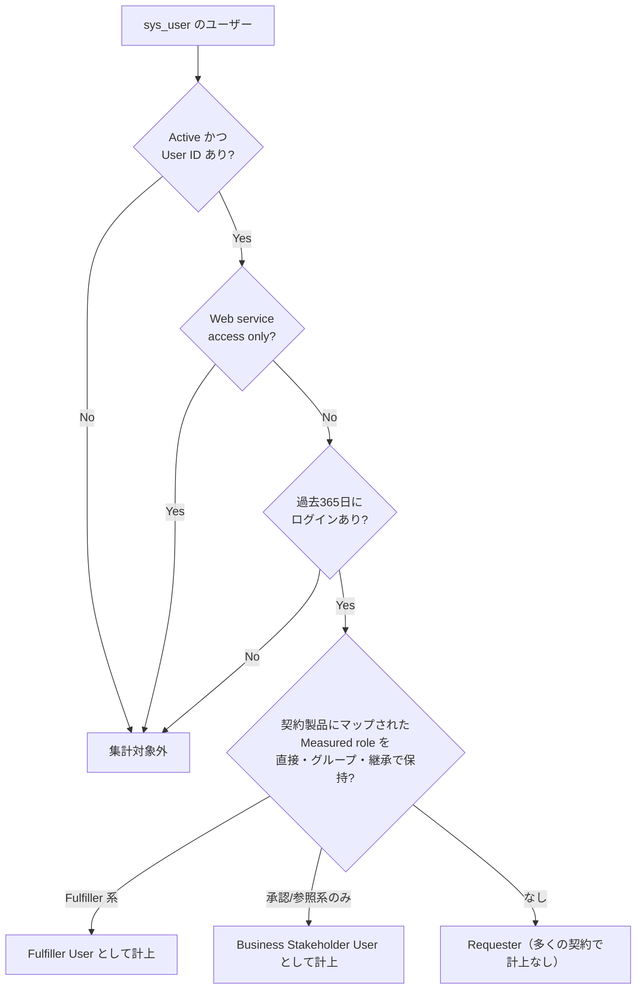
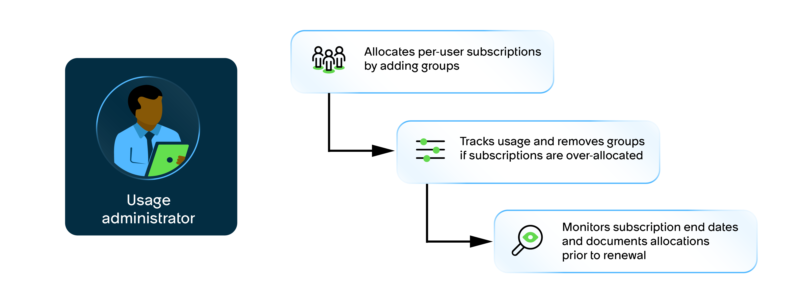
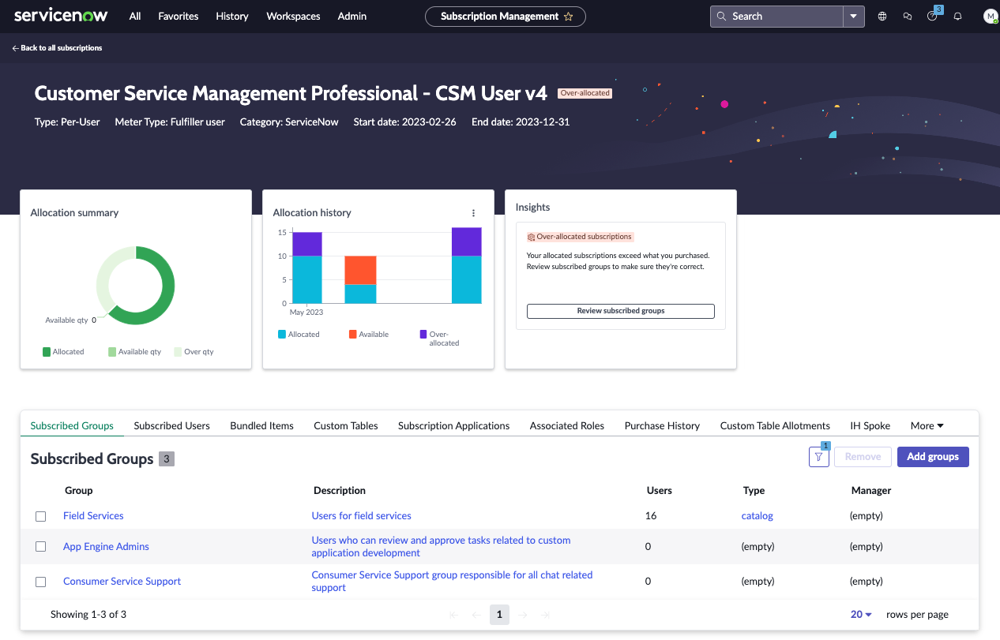
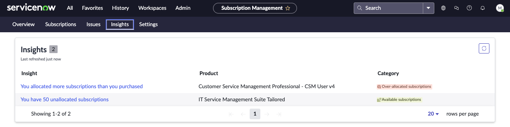
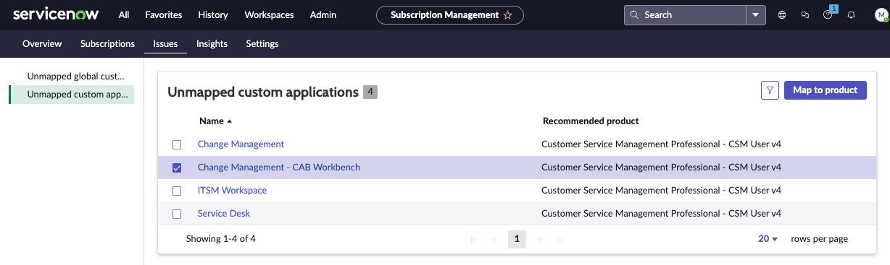
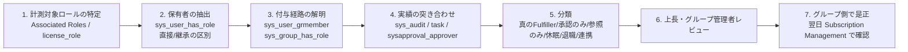

# ライセンスコスト最適化（License Cost Optimization）

## 概要

本ファイルは、ServiceNow のサブスクリプション費用を **「払っているのに使っていない」状態から引き戻す** ための応用編である。ライセンス体系そのもの（Fulfiller / Business Stakeholder / Requester の区分、Foundation / Advanced / Prime のティア、価格の相場）は導入編・リファレンスで扱い、本ファイルは次の 5 つの実務テーマに絞る。

| テーマ | 本ファイルで答える問い |
|---|---|
| ロール付与の棚卸し | 誰がどの経路（直接付与・グループ・ロール継承）で課金対象ロールを持っているか。どう洗い出すか |
| Fulfiller 削減 | 「Fulfiller として課金されているが Fulfiller の仕事をしていない人」をどう見つけ、どう降格・回収するか |
| 契約交渉 | 更新前に何を準備し、どの条項を交渉すべきか |
| 更新時の注意 | 更新（Renewal）時にインスタンス側で何が起きるか。割り当てやカスタムテーブルのマッピングはどうなるか |
| シェルフウェア回避 | 未使用シート・未使用モジュール・使い切れない AI 枠（Assist）をどう防ぐか |

前提となる事実（公式）:

- インスタンス上でサブスクリプションの割り当て・利用状況・コンプライアンスを確認する公式機能は **Subscription Management**（プラグイン `com.glide.subscription_management`）であり、閲覧・編集には `usage_admin`、`sn_sub_man.admin`、`admin` のいずれかのロールが必要である。[出典](https://www.servicenow.com/docs/r/australia/platform-administration/subscriptions-overview-v2.html) [出典](https://www.servicenow.com/docs/r/australia/platform-administration/installed-with-subscription-management.html)
- Per-User（ユーザー単位）サブスクリプションは **ロールで計測・監査** される。サブスクリプションを必要とするロールを **Measured roles（計測対象ロール）** と呼ぶ。[出典](https://www.servicenow.com/docs/r/australia/platform-administration/managing-user-subscriptions-v2.html)
- 割り当て数の集計対象は **active user（アクティブユーザー）のみ** で、過去 365 日にログインしていないユーザー、`Web service access only` のユーザー、User ID が空のユーザーは除外される。[出典](https://www.servicenow.com/docs/r/australia/platform-administration/subscription-details-v2.html)
- 価格は公式に公開されていない。本ファイルに出てくる金額・削減率は、すべて第三者（ライセンスアドバイザリー企業等）の公開情報であり、`【第三者情報】` または `【推定】` を付ける。

つまり、コスト最適化の主戦場は **「誰に Measured role が付いているか」の管理** と、**契約条項（数量の上下動・単価・定義）の管理** の 2 つである。

関連ファイル: [ユーザー・ロール・ライセンスの基本](../01_入門編/08-users-roles-licensing-basics.md) / [ライセンスモデル](../03_導入編/01-licensing-model.md) / [価格情報](../03_導入編/02-pricing.md) / [エディション比較](../03_導入編/03-edition-comparison.md) / [プラットフォームのパッケージ構成](../02_リファレンス/platform/platform-licensing-packaging.md) / [ユーザー・グループ・ロール](../02_リファレンス/platform/users-groups-roles.md) / [運用とガバナンス](../03_導入編/12-operations-governance.md) / [ガバナンスとCoEの実践](09-governance-coe-practice.md) / [Now Assist / AI Agents 導入の知見](10-ai-adoption-lessons.md)

---

## 1. コスト構造の理解：何が「課金対象」として数えられるか

### 1.1 サブスクリプションの種類（Subscription types）

Subscription Management は、購入したサブスクリプションを次の 5 種類に分類する。最適化の打ち手は種類ごとに異なる。[出典](https://www.servicenow.com/docs/r/australia/platform-administration/types-subscription-v2.html) [出典](https://www.servicenow.com/docs/r/australia/platform-administration/subscriptions-overview-v2.html)

| Type（種類） | 計測対象（Meter） | 割り当て方式 | 最適化の主な打ち手 |
|---|---|---|---|
| **Per-User**（ユーザー単位） | Rights-based users（Fulfiller User、Business Stakeholder User）と Application users（製品に何らかのアクセスを持つユーザー。Creator User を含む） | ロールに基づく自動割り当て（手動割り当て経験のある顧客は手動も可。後述） | Measured role の棚卸し、Fulfiller → Business Stakeholder / Requester への降格、休眠・退職者の回収 |
| **Capacity**（容量） | デバイス、Subscription Unit、トランザクション、作成レコード数、管理対象リソース（デバイス、ソフトウェア、ノード等） | インスタンスで自動計算 | 計測定義（Capacity Definition）の確認、不要 CI・ノードの整理、ピークの抑制 |
| **Unrestricted User**（無制限ユーザー） | インスタンス全体の active user 数（`sys_user` に User ID があり Active = true のユーザー） | インスタンスで自動 | 不要アカウントの無効化（全社員型製品で効く） |
| **Unlimited**（無制限） | 計測上限なし | インスタンスで自動 | 対象外（数量交渉時の比較材料） |
| **Display Only**（表示のみ） | 計測しない | 割り当て不可 | 対象外 |

### 1.2 Meter type（計測タイプ）と Measured roles

製品サブスクリプションの詳細ページの **Meter Type** フィールドは、そのサブスクリプションが何で計測されるかを示す。公式ドキュメントは次の対応を示している。[出典](https://www.servicenow.com/docs/r/australia/platform-administration/subscription-details-v2.html)

| Meter type | 対象 |
|---|---|
| Fulfiller User | fulfiller-type access（Fulfiller 相当のアクセス）を持つユーザー |
| Business Stakeholder User | Fulfiller より少ないアクセス権を持つユーザー |
| Creator User | `now.assist.creator` ロールを持つユーザー |
| Capacity | カスタムテーブル等のプラットフォームオブジェクトの作成・保持 |

公式ドキュメントは Measured roles を「サブスクリプションを必要とするロール。アプリケーションへのアクセスを与え、アクセスレベルで分類される」と定義し、**可能な限りロールは個人ではなくグループに付与する** ことを推奨している。[出典](https://www.servicenow.com/docs/r/australia/platform-administration/managing-user-subscriptions-v2.html)

ServiceNow 社員（SAM 分野のコミュニティ寄稿者）が公開ドキュメントと KB を整理した寄稿は、ユーザー単位製品の計測ロジックを次のように要約している【第三者情報】（ServiceNow 社員の個人的整理であり公式文書ではないと本人が明記）。[出典](https://www.servicenow.com/community/servicenow-ai-platform-articles/about-servicenow-licensing-guide/ta-p/3512215)

| 計測区分 | 計測ロジック（寄稿の要約） | 対象製品の例 |
|---|---|---|
| Fulfiller（FF） | 過去 365 日にログインし、Web Service Access Only でなく、契約製品にマップされた Fulfiller ロールを持つ active user | ITSM、CSM/TSM、FSM、App Engine、GRC |
| Fulfiller + Requester | 上記を Requester ロールにも拡張 | SPM/APM、Legal Service Delivery |
| Business Stakeholder（BSH） | Approver ロールを持ち Fulfiller ロールを持たないユーザー。ロール割り当てテーブルと承認アクティビティのテーブルにまたがって計測。Fulfiller ロールを得ると BSH 計測から外れる | ITSM 等 |
| Unrestricted User | ロールに関係なく全 active user | HRSD、Employee Center Pro 等 |



*図：Per-User サブスクリプションでユーザーが計上されるまでの判定（公式ドキュメントの active user 定義と、コミュニティ寄稿の計測ロジック要約を合成した概念図。Requester の扱いは契約により異なる）*

> **実務上の要点:** 公式の active user 定義により、**365 日ログインしていないユーザーは割り当て集計から外れる**。逆に言えば、**年に 1 回でもログインすれば、仕事をしていなくても Fulfiller として数えられる**。「ログイン有無」ではなく「Fulfiller の仕事をしているか」で棚卸しする必要があるのはこのためである（第 3 章）。[出典](https://www.servicenow.com/docs/r/australia/platform-administration/subscription-details-v2.html)

### 1.3 ロールの「中身」に注意：business_stakeholder と approver_user

`business_stakeholder` ロールは Business Stakeholder プラグイン（`com.snc.business_stakeholder`）で追加され、`sn_incident_read`、`sn_problem_read`、`sn_change_read`、`sn_request_read`、`approver_user` を含む。公式ドキュメントは、`sn_request_read` は将来の変更が予定されているため `business_stakeholder` を持たないユーザーに付与しないよう注意している。[出典](https://www.servicenow.com/docs/r/yokohama/it-service-management/incident-management/req-itsm-roles-inci-mgmt.html)

コミュニティでは次の点が繰り返し議論されている。いずれも契約で扱いが異なりうるため、最終的にはアカウント担当に確認する。

- `approver_user` ロールだけのユーザーが課金対象になるかについて、同一スレッド内でも「数えられない」「Approver として数えられる」と回答が割れている。【第三者情報】[出典](https://www.servicenow.com/community/itsm-forum/licensing-for-approvers-and-fulfillers/m-p/465553)
- 「Fulfiller は購読している製品の範囲内で承認できるが、製品外の承認には追加の承認エンタイトルメントが必要」とする回答もある。【第三者情報】[出典](https://www.servicenow.com/community/itsm-forum/licensing-for-approvers-and-fulfillers/m-p/465553)
- `sn_incident_read` 等の読み取りロールは `business_stakeholder` の構成ロールであり、Requester に単独で付けると Business Stakeholder 相当として計上されうる。付与前にアカウントチームに確認する。【経験則】
- **Business Stakeholder にもコストがかかる**。Fulfiller からの降格先として有効だが、無料ではない。【第三者情報】[出典](https://www.servicenow.com/community/developer-forum/best-practice-for-downgrading-inactive-users/m-p/3584559)

### 1.4 連携アカウント（Web service access only）

公式ドキュメントは、`Web service access only` のユーザーを active user の集計から除外すると明記している。[出典](https://www.servicenow.com/docs/r/australia/platform-administration/subscription-details-v2.html)

コミュニティの承認済み回答も「UI でログインするユーザーのみが計測される。Web service only の連携アカウントに `itil` ロールを付けても Fulfiller ライセンスは消費しない」としている。ただし同回答は「契約によって異なりうる」と注記しており、「連携アカウントがインシデントや RITM を作成・クローズする場合はどうか」という追加質問には回答がない。【第三者情報】[出典](https://www.servicenow.com/community/itsm-forum/do-service-accounts-consume-fullfiller-licenses/m-p/3253569)

ボット・API・連携アカウント（unattended users）の扱いが発注書（Order Form）で定義されていないと、更新時の使用量確認で論点になりうる。ライセンスアドバイザリー企業も、ユーザー区分の定義を発注書に固定するよう勧めている。【第三者情報】[出典](https://redresscompliance.com/servicenow-renewal-negotiation-guide)

> **教訓:** 連携アカウントは必ず `Web service access only` を設定し、UI ログインできない状態にする。さらに発注書で「unattended / integration user」の扱いを明文化しておく。セキュリティ上も同じ設定が推奨される（[セキュリティ強化の実践](12-security-hardening-practice.md)）。

---

## 2. 計測の確認場所：Subscription Management の使いどころ

### 2.1 画面構成とメニュー

Subscription Management は **Admin > Subscription Management**、または **All > Subscription Management > Subscription Management** から開く。上部タブは Overview、Subscriptions、Issues、Insights、Settings で構成される（Australia 版ドキュメントのスクリーンショットによる）。[出典](https://www.servicenow.com/docs/r/australia/platform-administration/subscriptions-overview-v2.html)

| タブ / 画面 | 用途 | コスト最適化での使い方 |
|---|---|---|
| Overview | 割り当て・利用・コンプライアンスの全体像。Status 列で状態を表示 | 過剰割り当て・余剰の一覧把握 |
| Subscriptions | 製品サブスクリプションの一覧と詳細 | Meter type、契約期間、Subscribed groups / users の確認 |
| Issues | Unmapped global custom tables / Unmapped custom applications | カスタムテーブルの未マッピング（容量超過の芽）を潰す |
| Insights | Over-allocated subscriptions / Available subscriptions | 過剰割り当てとシェルフウェア候補の検出 |
| Settings | Near capacity の閾値（既定 90%） | 早期警報の閾値を下げる |
| Instance entitlements / Account entitlements | インスタンス単位・アカウント単位の権利 | Cloud capacity、Now Assist 使用量、Now Assist creators はアカウント単位で表示 |

**Status 列の値**（公式）:[出典](https://www.servicenow.com/docs/r/australia/platform-administration/subscriptions-overview-v2.html) [出典](https://www.servicenow.com/docs/r/australia/platform-administration/configure-subscription-allocation-status-v2.html)

| Status | 意味 |
|---|---|
| Compliant | 割り当て数 < 購入数 |
| Near capacity | 割り当て数がインスタンスの閾値（既定 90%。Settings > Allocation Status で変更）を超えた |
| Even | 割り当て数 = 購入数 |
| Over-allocated | 割り当て数 > 購入数 |
| Account-level only | 割り当て状態を計算しない（Creator Plus 製品のみ） |

> **Australia 時点の注意:** User-based（ユーザー単位）サブスクリプションの割り当て詳細とステータスは、割り当てが不完全な場合の不正確な表示を避けるため **Overview から非表示** になっており、公式ドキュメントは完全な情報はアカウントエグゼクティブに問い合わせるよう案内している。Subscription Management v2 のバージョン 6.0.0（2025-12）と 6.1.1（2026-03）でこの変更が入った。[出典](https://www.servicenow.com/docs/r/australia/platform-administration/subscriptions-overview-v2.html) [出典](https://www.servicenow.com/docs/r/C17ZqvSaMwUVpMBg8Nc5sg/gGe~DtO2m5qQaldjvrK7fQ)
> つまり **「Subscription Management の画面だけでユーザー単位の消費を完全に把握する」ことは Australia 時点では難しく**、第 3 章のような自前の棚卸しクエリとアカウントチームからの使用量レポートの突き合わせが必要になる。

### 2.2 自動割り当てと手動割り当て

Australia 版の公式ドキュメントは次のように記載している。[出典](https://www.servicenow.com/docs/r/australia/platform-administration/managing-user-subscriptions-v2.html) [出典](https://www.servicenow.com/docs/r/australia/platform-administration/remove-group-from-subscription-v2.html)

- ユーザー単位サブスクリプションを **一度も手動で割り当てたことがない顧客** では、手動割り当てのワークフローは利用できず、**ユーザーとグループのロールに基づいて自動割り当て** される。
- 過去に手動割り当てを行った顧客は、引き続き手動で割り当てできる（グループを製品サブスクリプションに追加する方式）。
- 自動割り当ての顧客が過剰消費を解消するには、**その製品へのアクセスを与えるロールを持つユーザー数を減らす** 必要がある（グループへのユーザー追加・ロール管理で対応）。
- 手動割り当ての顧客は、Subscribed Groups タブからグループを外せる。ただし **Subscribed users は日次のスケジュールジョブで更新されるため、反映に最大 1 日かかる**。グループに Measured role が残っている場合は、別のサブスクリプションに追加するか、グループから Measured role を外す必要がある。



*図：Usage administrator（`usage_admin`）による Per-User サブスクリプション管理の流れ（公式ドキュメントのインフォグラフィック）*
左に「Usage administrator」の人物アイコン、右に 3 つのボックスが矢印で階段状につながる。1 つ目「Allocates per-user subscriptions by adding groups（グループを追加して Per-User サブスクリプションを割り当てる）」、2 つ目「Tracks usage and removes groups if subscriptions are over-allocated（利用状況を追跡し、過剰割り当てならグループを外す）」、3 つ目「Monitors subscription end dates and documents allocations prior to renewal（サブスクリプション終了日を監視し、更新前に割り当てを記録する）」。手動割り当て方式の顧客向けの流れであり、**更新前に割り当てを記録すること** が運用サイクルに組み込まれている点が重要である。出典：https://www.servicenow.com/docs/r/australia/platform-administration/managing-user-subscriptions-v2.html （取得日：2026-11-04）

### 2.3 製品サブスクリプションの詳細ページ



*図：Subscription Management の製品サブスクリプション詳細ページ（Over-allocated の例。公式ドキュメントのスクリーンショット）*
ヘッダーに製品名「Customer Service Management Professional - CSM User v4」と赤い「Over-allocated」バッジ、その下に Type: Per-User、Meter Type: Fulfiller user、Category: ServiceNow、Start date / End date が表示される。中段に 3 枚のカード：**Allocation summary**（ドーナツグラフ。凡例は Allocated / Available qty / Over qty。Available qty は 0）、**Allocation history**（月別の積み上げ棒グラフ。Allocated / Available / Over-allocated）、**Insights**（「Over-allocated subscriptions：Your allocated subscriptions exceed what you purchased. Review subscribed groups to make sure they're correct.」と **Review subscribed groups** ボタン）。下段のタブは Subscribed Groups、Subscribed Users、Bundled Items、Custom Tables、Subscription Applications、Associated Roles、Purchase History、Custom Table Allotments、IH Spoke、More。Subscribed Groups タブには Group / Description / Users / Type / Manager の列と、**Remove**・**Add groups** ボタンがある。出典：https://www.servicenow.com/docs/r/australia/platform-administration/subscription-details-v2.html （取得日：2026-11-04）

詳細ページで最適化に使う項目（公式）:[出典](https://www.servicenow.com/docs/r/australia/platform-administration/subscription-details-v2.html)

| 項目 | 使い方 |
|---|---|
| Meter Type | Fulfiller User か Business Stakeholder User かを確認し、降格先の製品があるかを把握する |
| Subscribed groups タブの Users / Active users 列 | グループ全体の人数と、集計対象となる active user 数の差を見る |
| Subscribed users タブ | 割り当て済みの active user 一覧（棚卸しの母集団） |
| Associated Roles タブ | その製品で計測されるロール（Measured roles）を確認 |
| Bundled Items タブ | 製品に付随するカスタムテーブル・ポータル訪問・トランザクションの権利と消費 |
| Purchase History タブ | 各サブスクリプションの開始日・終了日（更新計画に使う） |
| Subscription applications タブ | 製品に含まれるアプリと Installation status（**買っているのに入れていない** アプリの発見） |

### 2.4 Insights と Issues



*図：Insights タブ（公式ドキュメントのスクリーンショット）*
上部タブで Insights が選択され、「Insights 2」と件数が表示される。列は Insight / Product / Category。1 行目「You allocated more subscriptions than you purchased」（製品：Customer Service Management Professional - CSM User v4、Category：赤色の **Over-allocated subscriptions**）、2 行目「You have 50 unallocated subscriptions」（製品：IT Service Management Suite Tailored、Category：緑色の **Available subscriptions**）。**Available subscriptions はそのままシェルフウェア候補** である。出典：https://www.servicenow.com/docs/r/australia/platform-administration/discovering-insights-subscription-management-v2.html （取得日：2026-11-04）

Insights タブ（Admin > Subscription Management > Insights）は、過剰割り当てに対して「グループをサブスクリプションから外す」「グループからロールを外す」「グループからユーザーを外す」「追加購入する」の 4 つの対処を示す。Available subscriptions に対しては、ロールに基づいて推奨されるグループを追加して割り当てるよう促す。[出典](https://www.servicenow.com/docs/r/australia/platform-administration/discovering-insights-subscription-management-v2.html)



*図：Issues タブの Unmapped custom applications（公式ドキュメントのスクリーンショット）*
左ペインに「Unmapped global custom tables」「Unmapped custom applications」の 2 項目があり、後者が選択されている。右側は「Unmapped custom applications 4」のリストで、列は Name と Recommended product。Change Management、Change Management - CAB Workbench、ITSM Workspace、Service Desk の各アプリに推奨製品「Customer Service Management Professional - CSM User v4」が表示され、右上の **Map to product** ボタンでマッピングする。出典：https://www.servicenow.com/docs/r/australia/platform-administration/addressing-issues-subscription-management-v2.html （取得日：2026-11-04）

Issues タブは、どのサブスクリプションにもマップされていないカスタムテーブル（global スコープ）とカスタムアプリ（スコープアプリ内のカスタムテーブル）を示す。推奨サブスクリプションはテーブル作成の翌日に表示される。推奨基準に当てはまらず、App Engine サブスクリプションもない場合は推奨が出ず、**Issues には表示されないが Overview のレポートでは未マッピングとして数えられる**。[出典](https://www.servicenow.com/docs/r/australia/platform-administration/addressing-issues-subscription-management-v2.html)

### 2.5 その他の確認手段

| 手段 | 内容 | 出典・確度 |
|---|---|---|
| `license_details` テーブル（Subscriptions） | `license_details.list` で開く。Name、Category、Type、Start date / End date、Capacity Definition、Display only、**Product Code**（発注書上の SKU）を持つ。関連リンク View User Subscription History でユーザー割り当て履歴を表示 | 公式 [出典](https://www.servicenow.com/docs/r/australia/platform-administration/subscription-form-v2.html) |
| Subscription Management のリモートテーブル | `sn_sub_man_st_subscribed_groups`（Subscribed Groups）、`sn_sub_man_st_subscription_insights`（Insights）、`sn_sub_man_st_subscription_license_detail_metric`（割り当てメトリクスと履歴）、`sn_sub_man_st_unallocated_group_recommendation`（未割り当てグループの推奨） | 公式 [出典](https://www.servicenow.com/docs/r/australia/platform-administration/installed-with-subscription-management.html) |
| 既定レポート | Insights（`sn_sub_man_st_subscription_insights`）、Unmapped global custom tables / Unmapped custom applications（`ua_custom_table_inventory`） | 公式 [出典](https://www.servicenow.com/docs/r/australia/platform-administration/subscriptions-overview-v2.html) |
| Capacity Definition | 容量サブスクリプションの計算方法（Table query の場合 Table Name / Query / Aggregation Type / Aggregation Column、Scripted definition の場合 Script）。**Execute** で即時実行でき、手動実行はシステムが監視する実行回数に数えられない。詳細は KB0727967 | 公式 [出典](https://www.servicenow.com/docs/r/australia/platform-administration/view-how-totals-calculated-capacity-subscriptions-v2.html) |
| Usage Overview ダッシュボード | Self-Service > Dashboards > Usage Overview / ServiceNow Store Usage Overview。アプリ利用はアプリを開いた時点で、テーブル件数は 1 日 1 回収集。`admin` または `usage_admin` で閲覧 | 公式 [出典](https://www.servicenow.com/docs/r/australia/platform-administration/platform-performance/usage-analytics-module-subscription.html) |
| `usageanalytics_count` テーブル | 計測結果（Definition ID ごとの件数）を直接確認。`usageanalytics_count_cfg`、`ua_stats_defn` で定義を確認 | 【第三者情報】[出典](https://www.servicenow.com/community/servicenow-ai-platform-articles/about-servicenow-licensing-guide/ta-p/3512215) |
| `license_role` 系テーブル | `license_role_list.do` でライセンスを消費するロールと role type / License Type を確認。関連テーブル `license_role_discovered`、`license_role_type` など | 【第三者情報】[出典](https://www.servicenow.com/community/developer-blog/tip-to-identify-the-licensed-roles/bc-p/3128788) |
| 複数インスタンスの集約 | 既定では本番インスタンス間のデータ共有は制限される。共有元インスタンスで All > Multi-Instance Management > Trust Configuration を開き、主本番インスタンスの Grant access を true にする。非本番のデータは本番からのみ閲覧可能 | 公式 [出典](https://www.servicenow.com/docs/r/australia/platform-administration/share-subscription-data.html) |

---

## 3. ロール付与の棚卸し（Role Assignment Review）

### 3.1 なぜ「ログイン日」だけでは不十分か

- 公式の active user 定義は「365 日以内にログインしたか」であり、**365 日以内に 1 回でもログインすれば計上される**。[出典](https://www.servicenow.com/docs/r/australia/platform-administration/subscription-details-v2.html)
- コミュニティでは、`last_login` は「毎日見るだけのユーザー」も active にしてしまうため、Fulfiller 対象テーブルへの **書き込み実績** で判定する方式が紹介されている。【第三者情報】[出典](https://www.servicenow.com/community/itsm-forum/are-you-paying-for-itil-licenses-nobody-uses/m-p/3556615)
- ロールは **直接付与・グループ経由・ロール継承（contains roles）** の 3 経路で付く。直接付与を外しても、グループ経由で `itil` や `sn_change_write` が残っていれば Fulfiller として計上され続ける。【第三者情報】[出典](https://www.servicenow.com/community/developer-forum/best-practice-for-downgrading-inactive-users/m-p/3584559)

### 3.2 棚卸しの手順



| ステップ | 具体的な作業 | 根拠 |
|---|---|---|
| 1. 計測対象ロールの特定 | 製品サブスクリプション詳細の **Associated Roles** タブ、または `license_role` 系テーブルで、契約製品にマップされた Measured roles を一覧化する。カスタムロールが書き込み系ロールを contains している場合も対象 | 公式（Associated Roles タブ）、【第三者情報】`license_role` |
| 2. 保有者の抽出 | `sys_user_has_role` を Measured roles で絞り込み、`user.active=true`、`user.web_service_access_only=false` 等の条件で抽出する。`inherited` で直接付与か継承かを区別する | 【第三者情報】[出典](https://www.servicenow.com/community/itsm-forum/fulfiller-user-cleanup/m-p/3370946) |
| 3. 付与経路の解明 | 継承の場合は `sys_user_grmember`（グループメンバー）とグループのロールから、どのグループが Fulfiller ロールを与えているかを特定する | 【経験則】 |
| 4. 実績の突き合わせ | Fulfiller 対象テーブル（例：`incident`、`sc_task`、`change_request`、`change_task`、`problem`、`kb_knowledge`）での更新実績を `sys_audit` の `user` / `tablename` / `sys_created_on` で集計する。承認実績は `sysapproval_approver` で別に集計する | 【第三者情報】[出典](https://www.servicenow.com/community/itsm-forum/are-you-paying-for-itil-licenses-nobody-uses/m-p/3556615) |
| 5. 分類 | 次節 3.3 の区分に分類する | 【経験則】 |
| 6. レビュー | ユーザーの上長とグループオーナーに確認を回す。ログイン非活動だけを理由に本番アクセスを自動剥奪しない | 【第三者情報】[出典](https://www.servicenow.com/community/developer-forum/best-practice-for-downgrading-inactive-users/m-p/3584559) |
| 7. 是正 | `sys_user_has_role` の継承レコードを直接削除せず、**付与元（グループのメンバーシップ・グループのロール）で外す**。Subscription Management の反映は日次ジョブ（最大 1 日） | 【第三者情報】、公式（日次ジョブ）[出典](https://www.servicenow.com/docs/r/australia/platform-administration/remove-group-from-subscription-v2.html) |

**抽出クエリの例**（コミュニティで紹介された `sys_user_has_role` のエンコードクエリ。`{fulfiller roles}` は自社の Measured roles に置き換える）【第三者情報】[出典](https://www.servicenow.com/community/itsm-forum/fulfiller-user-cleanup/m-p/3370946)

```text
user.active=true^user.last_login_timeRELATIVEGT@dayofweek@ago@365^user.internal_integration_user=false^role.nameIN{fulfiller roles}
```

### 3.3 実績判定の注意点

コミュニティで公開された「ITIL 非活動監査」の設計は、次の点で参考になる。【第三者情報】[出典](https://www.servicenow.com/community/itsm-forum/are-you-paying-for-itil-licenses-nobody-uses/m-p/3556615)

| 論点 | 設計上の判断 |
|---|---|
| 判定データ | `sys_updated_by` は最後の更新者しか残らないため使わず、`sys_audit` を使う |
| 対象テーブル | `incident`、`sc_task`、`change_request`、`change_task`、`problem`、`kb_knowledge` を Fulfiller 作業として数える。`sc_req_item`、`sysapproval_approver`、`task` は除外（Requester や承認者でも更新しうるため） |
| 期間 | 90 日間の更新実績なしを非活動とする。Last Login は参考表示のみで判定に使わない |
| 付与経路 | Direct / Group / Role-Inherited の 3 区分で表示 |
| 例外 | 期限必須の例外テーブルを用意し、1 ユーザー 1 件の有効な例外のみ許可。期限切れで再び監査対象に戻す |
| 前提 | 対象テーブルの監査（Audit）が有効であること |

> **教訓:** `sys_audit` は大量データになりやすく、全件スキャンは性能に影響しうる。テーブルごとに 1 回ずつ走査して集合演算する、夜間に実行するなどの配慮が必要である（[パフォーマンスチューニング](03-performance-tuning.md)）。【経験則】

その他の判定上の注意:

- **製品の境界**：CSM のユーザーは `itil` を持っていても ITSM のライセンスには数えられない、という回答がある。製品ごとの Measured roles と突き合わせる。【第三者情報】[出典](https://www.servicenow.com/community/itsm-forum/fulfiller-user-cleanup/m-p/3370946)
- **ポリシーの確認**：30〜90 日ログインしないが、業務規程上アクセスを維持すべきユーザー（監査対応、季節業務、BCP 要員）がいる。技術的な削除は簡単でも、プロセス面での合意が先である。【第三者情報】[出典](https://www.servicenow.com/community/developer-forum/itil-license-over-allocation-cleanup/m-p/3512685)
- **Subscription Management の値との差異**：スクリプトで数えたロール保有者数と Subscription Management ダッシュボードの値が大きく食い違う、という報告がある（未解決）。自前集計は必ずアカウントチームの使用量レポートと突き合わせる。【第三者情報】[出典](https://www.servicenow.com/community/servicenow-ai-platform-articles/about-servicenow-licensing-guide/ta-p/3512215)

---

## 4. Fulfiller 削減の実践

### 4.1 削減候補の分類と打ち手

| 区分 | 典型例 | 打ち手 | 確度 |
|---|---|---|---|
| 承認のみのユーザー | 部門長・予算承認者に `itil` が付いている | Business Stakeholder（`business_stakeholder`）へ降格。Fulfiller 系グループから外す | 公式（ロール構成）、【第三者情報】（ライセンス扱い） |
| 参照のみのユーザー | レポート閲覧、チケットの状況確認だけ | Business Stakeholder、または Requester のまま閲覧できる設計（ポータル、ダッシュボード共有）へ | 【経験則】 |
| 休眠ユーザー | 90 日以上 Fulfiller 作業なし | 上長確認のうえ Fulfiller 系グループから外す。必要時に再付与する申請カタログを用意 | 【第三者情報】[出典](https://www.servicenow.com/community/itsm-forum/are-you-paying-for-itil-licenses-nobody-uses/m-p/3556615) |
| 退職・異動者 | 退職済みだが `sys_user` が Active、または異動後もグループに残留 | HR / IdP 連携で Active = false とグループ脱退を自動化 | 【経験則】 |
| 連携・ボット | API 用アカウントに `itil` | `Web service access only` を設定。発注書で unattended user を定義 | 公式（集計除外）、【第三者情報】[出典](https://redresscompliance.com/servicenow-renewal-negotiation-guide) |
| 管理者・開発者 | 本番に常時 `admin` を持つ開発者 | 本番は必要時のみ昇格（Elevated role の活用）、開発者は非本番で作業 | 【経験則】（admin の計上・重複排除の扱いはコミュニティでも未解決 [出典](https://www.servicenow.com/community/servicenow-ai-platform-articles/about-servicenow-licensing-guide/ta-p/3512215)） |
| 契約外製品のロール | ITSM しか契約していないのに他製品のロールが付いている | ロールを外す。もしくは契約範囲を見直す | 【経験則】 |

### 4.2 ロール設計で「増やさない」

公式ドキュメントは Measured roles を個人ではなくグループに付与するよう推奨しており、グループマネージャー（group manager）にメンバーシップとロール付与の責任を持たせることも推奨している。[出典](https://www.servicenow.com/docs/r/australia/platform-administration/managing-user-subscriptions-v2.html)

実務上の設計原則【経験則】【第三者情報】:

1. **ロールは必ずグループ経由で付与する**（直接付与を禁止し、定期レポートで直接付与を検出する）。[出典](https://www.servicenow.com/community/developer-articles/confused-by-servicenow-licensing/ta-p/3383194)
2. **Fulfiller ロールを持つグループを「業務グループ」と分ける**。メール配信用・通知用のグループに `itil` を持たせない（グループに入っただけで課金される事故を防ぐ）。
3. **カスタムロールは contains roles を確認する**。Measured role（例：`itil`、`sn_change_write`）を含むカスタムロールは、保有者を Fulfiller として計上させる。継承された Measured role が実効アクセスを決めるという指摘がある。【第三者情報】[出典](https://www.servicenow.com/community/developer-forum/best-practice-for-downgrading-inactive-users/m-p/3584559)
4. **Requester で済む業務は Requester で回す**。承認はメール承認やポータル承認、状況確認は Employee Center のマイリクエストで行い、Fulfiller 画面を開かなくてよい設計にする（[Service Portal と Employee Center](../02_リファレンス/platform/portals-employee-center.md)）。
5. **ACL で「参照だけ」を広げる前にライセンス影響を確認する**。読み取りロールの付与でも Business Stakeholder として計上されうる（1.3 参照）。

### 4.3 回収（Reclaim）の自動化

ServiceNow の SAM（SaaS License Management）には、他社 SaaS / SSO のユーザーサブスクリプションを非活動に基づいて回収する公式機能がある。Removal candidate は Ready → Awaiting User → Awaiting Approval → Awaiting Revocation → Closed Complete / Closed Skipped / Closed Canceled（ユーザー活動を検出）と遷移し、Notify User を有効にするとユーザー本人と上長の承認を挟める。[出典](https://www.servicenow.com/docs/r/yokohama/it-asset-management/saas-license-management/reclaiming-user-subscriptions-saas.html)

ただし、**ServiceNow 自身の Fulfiller ライセンスをこの機能で回収する公式手順は確認できなかった**。ServiceNow の Fulfiller 回収は、第 3 章の棚卸しを Flow（[Workflow Studio / Flow Designer](../02_リファレンス/platform/flow-designer-workflow-studio.md)）やスケジュールジョブで定期実行し、SAM の状態遷移を参考に「通知 → 本人・上長確認 → グループ脱退」を組むのが現実的である。【経験則】

コミュニティで提案される自動化の型【第三者情報】:

| 型 | 内容 | 注意 |
|---|---|---|
| 最終ログインによる降格 | X 日ログインなしで `itil` 系グループから外し、Business Stakeholder グループへ移す、または何も付けない | 「Business Stakeholder にもコストがかかる」点に注意。[出典](https://www.servicenow.com/community/developer-forum/best-practice-for-downgrading-inactive-users/m-p/3584559) |
| 月次のガバナンスフロー | 上長・グループオーナーにレビューを送り、不要な Fulfiller メンバーシップを外す | ログイン非活動だけでの自動剥奪は避ける。[出典](https://www.servicenow.com/community/developer-forum/best-practice-for-downgrading-inactive-users/m-p/3584559) |
| ユーザーの無効化 | 長期非ログインのユーザーを Active = false にする | 「Active = true のままだとライセンス上非活動扱いにならない」との指摘。一方、「無効化しただけではロールが残り計上され続けた」との報告もある。**無効化とグループ脱退をセットにする**。[出典](https://www.servicenow.com/community/developer-forum/best-practice-for-downgrading-inactive-users/m-p/3584559) |
| HR / IdP 連携 | Workday、SAP、Azure AD 等と連携し、退職時に自動で権限を外す。非活動アラートを 45〜90 日で設定 | ベンダーブログの推奨。[出典](https://www.cloudnuro.ai/blog/servicenow-cost-optimization) |

### 4.4 削減効果の目安（第三者情報）

以下はすべてライセンスアドバイザリー企業・ベンダーの自社案件ベースの数値であり、独立検証されていない。社内の説明に使う場合は「第三者の主張」として扱う。

| 主張 | 出典 |
|---|---|
| 有償の Fulfiller シートのうち 15〜30% は有効な作業がなかった | 【第三者情報】Redress Compliance（取得日 2026-11-04）[出典](https://redresscompliance.com/servicenow-renewal-negotiation-guide) |
| 多くの ServiceNow 環境は 20〜35% のシェルフウェアを抱え、その割合は更新をまたいでも安定している | 【第三者情報】[出典](https://redresscompliance.com/servicenow-license-rightsizing-playbook) |
| 1,200 Fulfiller のうち 14% が 90 日ログインなし、回収で年 27 万ドル削減（物流企業の例） | 【第三者情報】CloudNuro（取得日 2026-11-04）[出典](https://www.cloudnuro.ai/blog/servicenow-cost-optimization) |
| 全ユーザーに占める Fulfiller 比率は 35% 未満が目安 | 【第三者情報】[出典](https://www.cloudnuro.ai/blog/servicenow-cost-optimization) |
| Fulfiller 1 名を Requester / Approver に移すと年 456〜2,400 ドルの削減（Fulfiller 単価を月 38〜200 ドルと置いた場合） | 【推定】Redress Compliance の推定単価に基づく（取得日 2026-11-04）[出典](https://redresscompliance.com/servicenow-renewal-negotiation-guide)。価格の詳細は [価格情報](../03_導入編/02-pricing.md) |

---

## 5. シェルフウェア回避（Avoiding Shelfware）

### 5.1 シェルフウェアの類型

| 類型 | 発生原因 | 検出方法 | 予防策 |
|---|---|---|---|
| 未使用シート | 将来の展開を見込んで一括購入、退職・異動の放置 | Insights の Available subscriptions、第 3 章の棚卸し | 段階購入（ramp）、四半期ごとの棚卸し |
| 未導入アプリ | 上位ティアに含まれるが展開していないアプリ | 製品詳細の Subscription applications タブの Installation status | 導入ロードマップと購入ティアの整合 |
| 使わない上位ティア | 1 機能のために全員を上位ティアで購入 | 上位ティア固有機能の利用状況の確認 | ティアの混在（blended）を交渉、機能単位のアドオン検討 |
| 容量の過剰購入 | Subscription Unit・ノード・トランザクションを見込みで購入 | Capacity Definition の Execute、`usageanalytics_count` | 実測ピークに基づく購入 |
| 使い切れない AI 枠 | Now Assist の Assist を年間プールで購入 | Now Assist usage ダッシュボード | 段階展開、未使用分の扱いを契約で確認 |
| カスタムテーブル枠 | App Engine 等のテーブル枠を確保しすぎ、または逆に未マッピングで超過 | Issues タブ、`ua_custom_table_inventory` | テーブル作成ガバナンス |

### 5.2 Now Assist の Assist 枠（年間プール）

- Australia 版ドキュメントでは、Now Assist の使用量は **Admin > Subscription Management > Subscriptions > Now Assist usage** で確認する。スキルごとの総 Assist 数は「Number of actions × Assist ratio」で計算され、デモインスタンスでの使用は総数から除外される。スキルレベルのデータは夜間に更新される。Instances リストに表示されるのは Washington DC Patch 2 以上のインスタンスのみ。[出典](https://www.servicenow.com/docs/r/australia/platform-administration/monitoring-now-assist-usage.html)
- Subscription Management v2 のバージョン履歴によれば、6.0.2（2026-01）で Now Assist の消費計算は過去 365 日のローリング方式から **契約記念日（contract anniversary）でリセットされる burn-down 方式** に変わり、6.1.1（2026-03）で「固定の年間プールが記念日にリセットされ、**未使用の Assist は繰り越されない**」と明記された。6.4.5（2026-08）でも記念日リセットが再確認されている。[出典](https://www.servicenow.com/docs/r/C17ZqvSaMwUVpMBg8Nc5sg/gGe~DtO2m5qQaldjvrK7fQ)

> **教訓:** Assist は **使い残しが翌年に繰り越されない**。初年度から全社展開分の Assist を買うと、展開の遅れがそのままシェルフウェアになる。アドバイザリー企業は、初年度は対象ライセンスユーザーの 50〜60% 程度への展開を想定し、50〜150 名程度の Fulfiller でパイロットを 90 日以内に検証してから見積もりを受けるよう勧めている。【第三者情報】[出典](https://redresscompliance.com/servicenow-renewal-negotiation-guide)
> 2026-04 以降の新ティア（Foundation / Advanced / Prime）では、各ティアに Assist の割当が含まれ、上位ティアほど割当が大きいとされる。【第三者情報】[出典](https://www.servicenow.com/community/itsm-articles/itsm-licensing-in-april-2026-foundation-advanced-and-prime-in/ta-p/3544380) Assist 運用の詳細は [Now Assist / AI Agents 導入の知見](10-ai-adoption-lessons.md) と [Now Assist と AI Agents](../02_リファレンス/platform/now-assist-ai-agents.md) を参照。

### 5.3 容量（Capacity）サブスクリプションのピーク管理

- 容量サブスクリプションの使用量は Table query または Scripted definition で計算され、Capacity Definition レコードで中身を確認できる。コンプライアンスを外れたら割り当てリソースを減らすか、容量を追加購入する。[出典](https://www.servicenow.com/docs/r/australia/platform-administration/monitoring-capacity-subscriptions.html)
- 同一の Capacity Definition で計測される複数のサブスクリプション（例：複数の Integration Hub サブスクリプション）は 1 つのプールに統合され、どの使用も共通プールから差し引かれる。[出典](https://www.servicenow.com/docs/r/australia/platform-administration/subscription-details-v2.html)
- コミュニティ寄稿は「課金対象は直近の計測期間の **ピーク値** であり平均ではない」「1 回の大規模な Discovery 実行による 1 日のスパイクが期間のピークを決めうる」と注意している。【第三者情報】[出典](https://www.servicenow.com/community/servicenow-ai-platform-articles/about-servicenow-licensing-guide/ta-p/3512215)

> **教訓:** ITOM の Discovery や Service Graph Connector で一時的に検証用 CI を大量投入すると、ピークが跳ね上がる。検証は非本番で行い、本番投入前に Capacity Definition の **Execute** で件数を試算する（手動実行は監視対象の実行回数に数えられない）。[出典](https://www.servicenow.com/docs/r/australia/platform-administration/view-how-totals-calculated-capacity-subscriptions-v2.html) ITOM の計量単位は [ITOM 概要とパッケージ](../02_リファレンス/itom/itom-overview.md) を参照。

### 5.4 カスタムテーブルのマッピング

カスタムテーブルとカスタムアプリは製品サブスクリプションにマップする必要がある。未マッピングは Issues タブと既定レポート（`ua_custom_table_inventory`）で検出される。スコープアプリはアプリ単位でマップすれば個別テーブルのマップは不要。[出典](https://www.servicenow.com/docs/r/australia/platform-administration/addressing-issues-subscription-management-v2.html) [出典](https://www.servicenow.com/docs/r/australia/platform-administration/subscriptions-overview-v2.html)

> **教訓:** 開発者が気軽に作ったカスタムテーブルは、更新時に「テーブル枠の不足」として追加費用になりうる。テーブル作成をデザインレビューの対象にし、既存テーブルの拡張や OOTB テーブルの利用で済まないかを先に検討する（[カスタマイズと技術的負債](02-customization-technical-debt.md)、[ガバナンスとCoEの実践](09-governance-coe-practice.md)）。【経験則】

---

## 6. 契約交渉（Contract Negotiation）

> 本章の内容は、ServiceNow の公式資料ではなく、ライセンスアドバイザリー企業・コミュニティの公開情報に基づく。アドバイザリー企業は交渉支援サービスを販売しており、数値は自社案件ベースで独立検証されていない。すべて `【第三者情報】` として扱い、最終的な契約条件は自社の発注書（Order Form）と ServiceNow アカウントチームで確認する。

### 6.1 交渉準備のタイムライン

| 時期 | 準備事項 | 出典 |
|---|---|---|
| 満了の 12 か月前 | Fulfiller シートを実績と照合（第 3 章）、購入パックと実際の採用状況を対応づけ、代替案のコストを試算 | 【第三者情報】[出典](https://redresscompliance.com/servicenow-renewal-negotiation-guide) |
| 6 か月前 | 品目ごとのベンチマーク、上限・スワップ・コターム条件を含む対案を作成、撤退ライン（walk-away）を合意 | 同上 |
| 90 日前 | ベンダーの見積もりより先に対案を提示 | 同上 |
| 1 か月前 | 発注書が合意内容どおりかを確認 | 同上 |

- 「見積もりが出る前に適正化（rightsizing）を終える。後から削った品目は駆け引きに見える」という助言もある。【第三者情報】[出典](https://redresscompliance.com/servicenow-license-rightsizing-playbook)
- 同社は、契約消費率が権利の 65% 未満の品目を適正化候補、35% 未満を強い削減候補とする閾値を示している。【第三者情報】[出典](https://redresscompliance.com/servicenow-license-rightsizing-playbook)
- ServiceNow の会計年度は 12 月 31 日に終わり、四半期末の数週間はディールデスクが追加割引を出しやすいとされる。【第三者情報】[出典](https://redresscompliance.com/servicenow-renewal-negotiation-guide)

### 6.2 交渉レバー（条項）一覧

| 条項 | 内容 | 交渉の考え方 | 出典 |
|---|---|---|---|
| Uplift cap（値上げ上限） | 更新時の単価上昇率の上限 | 年 0〜5% の上限と更新数量の価格据え置きを書面で。上限なしの契約は年 7〜12% の上昇を受け入れていたとの主張。アドオンや true-up シートにも上限を適用。サイドレターやメールでの約束は次回更新に持ち越されない | 【第三者情報】[出典](https://redresscompliance.com/servicenow-renewal-negotiation-guide) |
| True-up 単価 | 期中の追加シートの単価 | 発注書で期中追加の単価を固定する | 同上 |
| True-down / 削減権 | 更新時に数量を減らす権利 | 活動実績（第 3 章の棚卸し結果）を根拠に削減権を交渉する | 【第三者情報】[出典](https://redresscompliance.com/servicenow-renewal-negotiation-guide) |
| 容量・クレジットの繰越 | 未使用の容量・クレジットの扱い | 前年のクレジット使用が 60% 未満ならパックが大きすぎる。繰越（roll-forward）と失効の条項を読む前に未使用残高が繰り越されると思い込まない | 【第三者情報】[出典](https://redresscompliance.com/servicenow-license-rightsizing-playbook) |
| Swap rights（交換権） | 未使用サブスクリプションを同価値の別製品へ振り替える権利 | 確約した支出を使うものへ回せる。ティア一律購入を拒否し、ティア混在＋交換権で対案 | 【第三者情報】[出典](https://redresscompliance.com/servicenow-renewal-negotiation-guide) |
| Co-term（満了日の統一） | 期中追加分を本体の満了日に揃える | 当初割引率で、残存月数分のみの価格にする | 同上 |
| ユーザー区分の定義 | Fulfiller / Requester / Approver / unattended user の定義 | 承認のみのユーザーが Fulfiller に数えられないよう定義と版を発注書に固定 | 【第三者情報】[出典](https://redresscompliance.com/servicenow-renewal-negotiation-guide) |
| AI（Now Assist）の明細化 | ティア本体、AI 上乗せ分、Assist 割当を分けて記載 | Assist 割当の大きさ、超過単価、監査権、年度末の未使用分の扱い、期中のティア変更可否を書面で | 【第三者情報】[出典](https://redresscompliance.com/servicenow-renewal-negotiation-guide) |

アドバイザリー企業の分析では、「価格保護・交換権・単位定義は、見出しの割引率 5 ポイントよりも 3 年間で大きな価値を持つ」とされ、例として 1,000 Fulfiller・定価月 100 ドルの仮定で、割引 40%・上限なし 9% 値上げ（3 年計 2,360,232 ドル）と、割引 35%・上限 3%（同 2,410,902 ドル）、さらに棚卸し後 800 シートにした場合（同 1,928,722 ドル）を比較している。**最も効くのは割引率ではなく、数量の適正化** である。【推定】（仮定に基づく試算。取得日 2026-11-04）[出典](https://redresscompliance.com/servicenow-renewal-negotiation-guide)

### 6.3 ティア再編（2026-04）に伴う注意

2026-04 に旧ティア（Standard / Pro / Pro Plus / Enterprise / Enterprise Plus）が Foundation / Advanced / Prime に置き換えられたとされる（詳細は [プラットフォームのパッケージ構成](../02_リファレンス/platform/platform-licensing-packaging.md)）。コスト最適化の観点で、次の点が指摘されている。

- ITSM Foundation には正式な Problem / Change が含まれない。Problem・Change・Major Incident・Walk-up が不要なら Foundation、旧 Professional 相当の利用なら Advanced が比較の出発点とされる。【第三者情報】[出典](https://www.servicenow.com/community/itsm-articles/itsm-licensing-in-april-2026-foundation-advanced-and-prime-in/ta-p/3544380)
- DevOps Change Velocity は ITSM Prime のみに移されたとのコメントがある。Advanced で使っていた顧客は更新時に Prime が必要になりうる。【第三者情報】[出典](https://www.servicenow.com/community/itsm-articles/itsm-licensing-in-april-2026-foundation-advanced-and-prime-in/ta-p/3544380)
- 「プラグインが有効化されていても、それだけで利用権があるとは限らない」（Knowledge Management Advanced の例）。インスタンス上で動くことと契約上の権利は別である。【第三者情報】[出典](https://www.servicenow.com/community/itsm-articles/itsm-licensing-in-april-2026-foundation-advanced-and-prime-in/ta-p/3544380)
- 新ティアでは AI が全ティアに組み込まれており、AI なしの版は選べないとする見解がある。【第三者情報】[出典](https://redresscompliance.com/servicenow-renewal-negotiation-guide)

> **教訓:** ティア移行は「同等品への置き換え」ではない。旧ティアで使っている機能（特に Problem / Change、DevOps、Performance Analytics）を棚卸しし、新ティアのどこに入るかを機能単位で確認してから数量・ティアを決める。【経験則】

---

## 7. 更新時の注意（Renewal）

### 7.1 インスタンス側で起きること（公式）

| 事象 | 内容 | 対応 | 出典 |
|---|---|---|---|
| 新しい SKU の追加 | Per-User サブスクリプションの更新時、新しい製品 SKU がアカウントに追加されることがあり、Subscription Management では **新しい製品サブスクリプション** として扱われる | — | [出典](https://www.servicenow.com/docs/r/australia/platform-administration/maintain-allocations-renewal.html) |
| 割り当ての引き継ぎ（手動割り当て顧客） | 過去に手動割り当てをしていた場合、更新されたサブスクリプションにグループを **再割り当て** する必要がある | 更新日前に詳細ページで終了日を監視し、現在のグループ割り当てを記録。更新日後に同じグループを追加 | 同上 |
| 割り当ての引き継ぎ（自動割り当て顧客） | ユーザーとグループのロールに基づき自動割り当てされ、更新後の作業は不要 | — | 同上 |
| カスタムテーブル・アプリのマッピング | 新 SKU は新しい製品サブスクリプションとして扱われるため、カスタムアプリ・カスタムテーブルを **再マッピング** する必要がある | 更新日前にマッピング一覧を記録し、更新日後に再マップ | [出典](https://www.servicenow.com/docs/r/australia/platform-administration/maintain-mappings-renewal.html) |
| 反映の遅延 | Subscribed users は日次ジョブで更新される | 更新直後の数字で判断しない | [出典](https://www.servicenow.com/docs/r/australia/platform-administration/allocate-subscriptions-v2.html) |
| 旧 SKU 名の表示 | 2026-04 以降も既存契約の満了まで旧 SKU のエンタイトルメントが有効で、旧 SKU 名が表示される | 新旧 SKU の対応表を作る | [プラットフォームのパッケージ構成](../02_リファレンス/platform/platform-licensing-packaging.md) |

> **教訓:** 更新後に Subscription Management が急に「Over-allocated」や「Unmapped」を大量に示すことがある。多くは **新 SKU への再割り当て・再マッピング漏れ** であり、実際の使用増ではない。更新前の割り当てとマッピングのスナップショット（グループ一覧、カスタムアプリ一覧、`license_details` の Product Code）を残しておくのが最も安上がりな対策である。手動割り当てのタブが見えない場合は KB2974856 が案内されている。[出典](https://www.servicenow.com/docs/r/australia/platform-administration/remove-group-from-subscription-v2.html)【経験則】

### 7.2 更新前チェックリスト

| # | チェック項目 | 担当 | 根拠 |
|---|---|---|---|
| 1 | `license_details` の全サブスクリプションの Product Code・Start / End date を発注書と照合 | 管理者・調達 | 公式 [出典](https://www.servicenow.com/docs/r/australia/platform-administration/subscription-form-v2.html) |
| 2 | Insights の Over-allocated / Available を確認し、原因を説明できる状態にする | 管理者 | 公式 |
| 3 | 第 3 章の棚卸しを実施し、降格・回収を **見積もり前に** 完了 | 管理者・各部門 | 【第三者情報】[出典](https://redresscompliance.com/servicenow-license-rightsizing-playbook) |
| 4 | 容量サブスクリプションの Capacity Definition と直近のピークを確認 | 管理者 | 公式・【第三者情報】[出典](https://www.servicenow.com/community/servicenow-ai-platform-articles/about-servicenow-licensing-guide/ta-p/3512215) |
| 5 | Now Assist usage で Assist の消費ペースを確認し、記念日までの残量を試算 | AI 推進・管理者 | 公式 |
| 6 | Issues タブで未マッピングのカスタムテーブル・アプリをゼロにする | 開発・管理者 | 公式 |
| 7 | Subscription applications タブで未導入アプリを洗い出し、次期に使うかを判断 | CoE | 公式 |
| 8 | 全本番インスタンスのデータを主本番に共有（Trust Configuration） | 管理者 | 公式 [出典](https://www.servicenow.com/docs/r/australia/platform-administration/share-subscription-data.html) |
| 9 | 割り当て（グループ）とマッピングのスナップショットを保存 | 管理者 | 公式 |
| 10 | 交渉レバー（6.2）のうち現行契約にない条項を洗い出す | 調達 | 【第三者情報】[出典](https://redresscompliance.com/servicenow-renewal-negotiation-guide) |
| 11 | アカウントチームから正式な使用量レポートを取得し、自前集計と突き合わせ | 調達・管理者 | 公式（ユーザー単位の詳細はアカウントエグゼクティブに問い合わせ） |

---

## 8. 継続的な最適化の運用（Governance）

コスト最適化は更新前の一回限りの作業ではなく、平時の運用に組み込んで初めて効果が続く。【経験則】

| 頻度 | 作業 | 主担当 |
|---|---|---|
| 日次 | 退職・異動の HR / IdP 連携によるアカウント無効化とグループ脱退 | 自動（IdP / Flow） |
| 月次 | Insights 確認、直接付与ロールの検出、Fulfiller 系グループの新規メンバー確認 | `usage_admin` |
| 四半期 | 第 3 章の棚卸し（実績ベース）、上長・グループオーナーのレビュー、Now Assist の消費ペース確認 | `usage_admin`・グループマネージャー |
| 年次（更新 12 か月前〜） | 第 6・7 章の更新準備 | 調達・CoE・`usage_admin` |

- **部門別のコスト配賦（chargeback）**：ライセンス種別とモジュール利用で部門に費用を配賦し、部門長に消費の当事者意識を持たせる手法がベンダーブログで推奨されている。【第三者情報】[出典](https://www.cloudnuro.ai/blog/servicenow-cost-optimization)
- **役割分担**：公式の `usage_admin` ロールは Subscription Management の管理、サブスクリプションの割り当て、カスタムテーブル・アプリのマッピングを担う。ユーザーやグループの作成は `admin` / `user_admin` の領分であり、**ライセンス管理者とユーザー管理者の連携** が必要になる。[出典](https://www.servicenow.com/docs/r/australia/platform-administration/subscription-management-roles-v2.html) [出典](https://www.servicenow.com/docs/r/australia/platform-administration/subscription-user-sets-v2.html)
- **ロール付与申請のカタログ化**：Fulfiller ロールの付与を Service Catalog の申請にし、承認時に「ライセンス費用が発生する」ことを明示する。期限付き付与にすると回収漏れを防げる。【経験則】

CoE としての体制づくりは [ガバナンスとCoEの実践](09-governance-coe-practice.md) を参照。

---

## 9. アンチパターン集

| アンチパターン | 何が起きるか | 対策 | 確度 |
|---|---|---|---|
| ロールを個人に直接付与 | 誰が何で課金されているか追えない。異動時に残る | グループ経由に統一（公式推奨） | 公式 |
| 通知用グループに `itil` を持たせる | メーリングリスト感覚の追加で Fulfiller が増える | 業務グループと通知グループを分離 | 【経験則】 |
| `sys_user_has_role` の継承レコードを直接削除 | 付与元のグループが残り、再び付く・不整合 | 付与元で外す | 【第三者情報】[出典](https://www.servicenow.com/community/developer-forum/best-practice-for-downgrading-inactive-users/m-p/3584559) |
| ユーザーを Active = false にしただけ | ロールが残り計上され続けたとの報告 | 無効化とグループ脱退をセットに | 【第三者情報】[出典](https://www.servicenow.com/community/developer-forum/best-practice-for-downgrading-inactive-users/m-p/3584559) |
| 最終ログインだけで判定 | 閲覧だけのユーザーが「活動中」扱い | 書き込み実績（`sys_audit`）で判定 | 【第三者情報】[出典](https://www.servicenow.com/community/itsm-forum/are-you-paying-for-itil-licenses-nobody-uses/m-p/3556615) |
| ログイン非活動で本番権限を自動剥奪 | 季節業務・BCP 要員が業務を止める | 上長レビューと例外テーブル | 【第三者情報】[出典](https://www.servicenow.com/community/developer-forum/best-practice-for-downgrading-inactive-users/m-p/3584559) |
| 連携アカウントに UI ログインを許す | Fulfiller 計上、セキュリティリスク | `Web service access only` | 公式 |
| AI の Assist を全社分一括購入 | 未使用分は繰り越されない | 段階展開、パイロット | 公式（繰越なし）・【第三者情報】 |
| 本番で検証用 CI を大量投入 | 容量のピークが跳ね上がる | 非本番で検証、Execute で試算 | 【第三者情報】 |
| 更新前に割り当てを記録しない | 新 SKU で過剰割り当て・未マッピングが大量発生 | スナップショットの保存 | 公式 |
| 見積もり受領後に削減を持ち出す | 交渉上の駆け引きと見なされる | 見積もり前に適正化を完了 | 【第三者情報】 |
| 割引率だけを交渉 | 値上げ上限・削減権がなく 2 年目以降に逆転 | 条項（上限・交換権・定義）を優先 | 【第三者情報】 |

---

## 10. Brazil での変更

> **Brazil での変更:** Brazil 版の Subscription Management ドキュメント（2026-09-10 更新）も、Australia と同じく「一度も手動割り当てをしていない顧客はユーザーとグループのロールに基づいて自動割り当て」「Active users は 365 日ログインなし・Web service access only・User ID が空を除外」と記載しており、本ファイルの計測ロジックに関わる変更は確認できなかった。[出典](https://www.servicenow.com/docs/r/platform-administration/subscription-details-v2.html)

> **Brazil での変更:** Subscription Management は ServiceNow Store 経由で更新されるアプリ（Subscription Management v2）であり、ファミリーとは独立にバージョンが上がる。6.4.5（2026-08）で Now Assist 使用量の契約記念日リセットと年度分の割当付与、6.5.0（2026-09）で Cloud Capacity Dashboard の共有環境間ストレージプール表示（Total Purchased Pool Capacity、Used Pool Capacity）、6.6.0（2026-10）でバックエンドのみの更新が行われた。[出典](https://www.servicenow.com/docs/r/C17ZqvSaMwUVpMBg8Nc5sg/gGe~DtO2m5qQaldjvrK7fQ)

---

## 11. 公開情報では確認できなかった事項

- Fulfiller / Business Stakeholder / Requester の **契約上の正式定義**（ServiceNow の公開法務文書としては確認できず。定義は発注書・契約書で確認する）。
- `approver_user` 単独保有者がライセンスを消費するか（コミュニティで見解が割れている）。
- `sys_user` の Active = false のユーザーが Per-User 計上から外れるか（公式は「365 日ログインなし」等の除外条件のみ明記。無効化後も計上されたとの報告あり）。
- `admin` ロール保有者の計上方法と、他の Per-User ライセンスとの重複排除の扱い。
- Web service access only のアカウントがレコードを作成・更新する場合の契約上の扱い。
- ServiceNow 自身の Fulfiller ライセンスを SAM の回収機能で回収する公式手順。
- KB0727967（Values for Subscription-Based Products）、KB2974856 の本文（Now Support へのログインが必要）。
- True-up / true-down / 交換権 / 値上げ上限に関する ServiceNow 公式の標準条項（公開情報なし。本ファイルの記述はすべて第三者情報）。
- 新ティア移行時に既存の確約（commitment）がどう引き継がれるか（実務家の間でも見解が割れているとされる）。

---

## 参照元

**ServiceNow 公式ドキュメント（Australia）**

- Product subscriptions overview: https://www.servicenow.com/docs/r/australia/platform-administration/subscriptions-overview-v2.html
- Viewing product subscription details: https://www.servicenow.com/docs/r/australia/platform-administration/subscription-details-v2.html
- Types of subscriptions: https://www.servicenow.com/docs/r/australia/platform-administration/types-subscription-v2.html
- Managing per-user subscriptions: https://www.servicenow.com/docs/r/australia/platform-administration/managing-user-subscriptions-v2.html
- Allocate subscriptions: https://www.servicenow.com/docs/r/australia/platform-administration/allocate-subscriptions-v2.html
- Remove a group from a product subscription: https://www.servicenow.com/docs/r/australia/platform-administration/remove-group-from-subscription-v2.html
- Discovering insights: https://www.servicenow.com/docs/r/australia/platform-administration/discovering-insights-subscription-management-v2.html
- Addressing issues: https://www.servicenow.com/docs/r/australia/platform-administration/addressing-issues-subscription-management-v2.html
- Configure subscription allocation status: https://www.servicenow.com/docs/r/australia/platform-administration/configure-subscription-allocation-status-v2.html
- Components installed with Subscription Management: https://www.servicenow.com/docs/r/australia/platform-administration/installed-with-subscription-management.html
- Subscription Management roles: https://www.servicenow.com/docs/r/australia/platform-administration/subscription-management-roles-v2.html
- Subscription form: https://www.servicenow.com/docs/r/australia/platform-administration/subscription-form-v2.html
- User sets and groups: https://www.servicenow.com/docs/r/australia/platform-administration/subscription-user-sets-v2.html
- Maintain per-user subscription allocations at renewal: https://www.servicenow.com/docs/r/australia/platform-administration/maintain-allocations-renewal.html
- Maintain custom table and application mappings at renewal: https://www.servicenow.com/docs/r/australia/platform-administration/maintain-mappings-renewal.html
- Monitoring capacity subscriptions: https://www.servicenow.com/docs/r/australia/platform-administration/monitoring-capacity-subscriptions.html
- Monitor capacity subscription calculations: https://www.servicenow.com/docs/r/australia/platform-administration/view-how-totals-calculated-capacity-subscriptions-v2.html
- Share subscription data from another instance: https://www.servicenow.com/docs/r/australia/platform-administration/share-subscription-data.html
- Now Assist usage: https://www.servicenow.com/docs/r/australia/platform-administration/monitoring-now-assist-usage.html
- Monitoring instance usage: https://www.servicenow.com/docs/r/australia/platform-administration/platform-performance/usage-analytics-module-subscription.html
- Subscription Management v2 release notes（Store バージョン履歴）: https://www.servicenow.com/docs/r/C17ZqvSaMwUVpMBg8Nc5sg/gGe~DtO2m5qQaldjvrK7fQ

**ServiceNow 公式ドキュメント（その他リリース）**

- Viewing product subscription details（Brazil）: https://www.servicenow.com/docs/r/platform-administration/subscription-details-v2.html
- Request ITSM Roles — Incident Management（Yokohama）: https://www.servicenow.com/docs/r/yokohama/it-service-management/incident-management/req-itsm-roles-inci-mgmt.html
- Reclaiming user subscriptions（SaaS License Management, Yokohama）: https://www.servicenow.com/docs/r/yokohama/it-asset-management/saas-license-management/reclaiming-user-subscriptions-saas.html

**ServiceNow Community**

- About ServiceNow Licensing Guide（2026-03-21）: https://www.servicenow.com/community/servicenow-ai-platform-articles/about-servicenow-licensing-guide/ta-p/3512215
- Tip! To identify the licensed Roles（2024-12-14）: https://www.servicenow.com/community/developer-blog/tip-to-identify-the-licensed-roles/bc-p/3128788
- Are You Paying for ITIL Licenses Nobody Uses?（2026-06-09）: https://www.servicenow.com/community/itsm-forum/are-you-paying-for-itil-licenses-nobody-uses/m-p/3556615
- Fulfiller user cleanup（2025-09-04）: https://www.servicenow.com/community/itsm-forum/fulfiller-user-cleanup/m-p/3370946
- Best Practice for Downgrading Inactive Users（2026-08-06）: https://www.servicenow.com/community/developer-forum/best-practice-for-downgrading-inactive-users/m-p/3584559
- ITIL license over allocation cleanup（2026-03-23）: https://www.servicenow.com/community/developer-forum/itil-license-over-allocation-cleanup/m-p/3512685
- Do service accounts consume fulfiller licenses?（2025-05-02）: https://www.servicenow.com/community/itsm-forum/do-service-accounts-consume-fullfiller-licenses/m-p/3253569
- Licensing for Approvers and Fulfillers: https://www.servicenow.com/community/itsm-forum/licensing-for-approvers-and-fulfillers/m-p/465553
- Confused by ServiceNow licensing（2025-09-17）: https://www.servicenow.com/community/developer-articles/confused-by-servicenow-licensing/ta-p/3383194
- ITSM Licensing in April 2026: Foundation, Advanced and Prime in Plain Language（2026-05-28）: https://www.servicenow.com/community/itsm-articles/itsm-licensing-in-april-2026-foundation-advanced-and-prime-in/ta-p/3544380

**第三者（ライセンスアドバイザリー・ベンダー）**

- Redress Compliance, ServiceNow negotiation playbook 2026（2026-10-15 更新、取得日 2026-11-04）: https://redresscompliance.com/servicenow-renewal-negotiation-guide
- Redress Compliance, ServiceNow rightsizing playbook（2026-08-17 更新、取得日 2026-11-04）: https://redresscompliance.com/servicenow-license-rightsizing-playbook
- CloudNuro, ServiceNow License Optimization（2025-11-10 更新、取得日 2026-11-04）: https://www.cloudnuro.ai/blog/servicenow-cost-optimization
