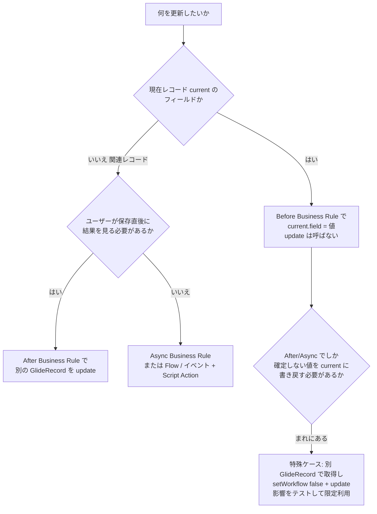
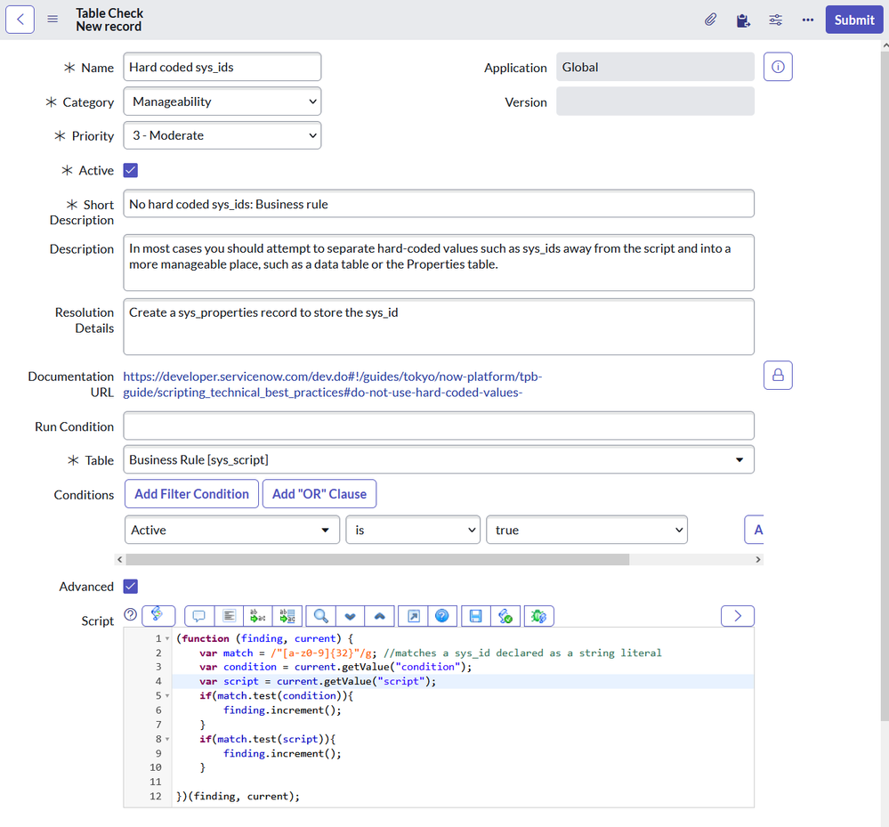
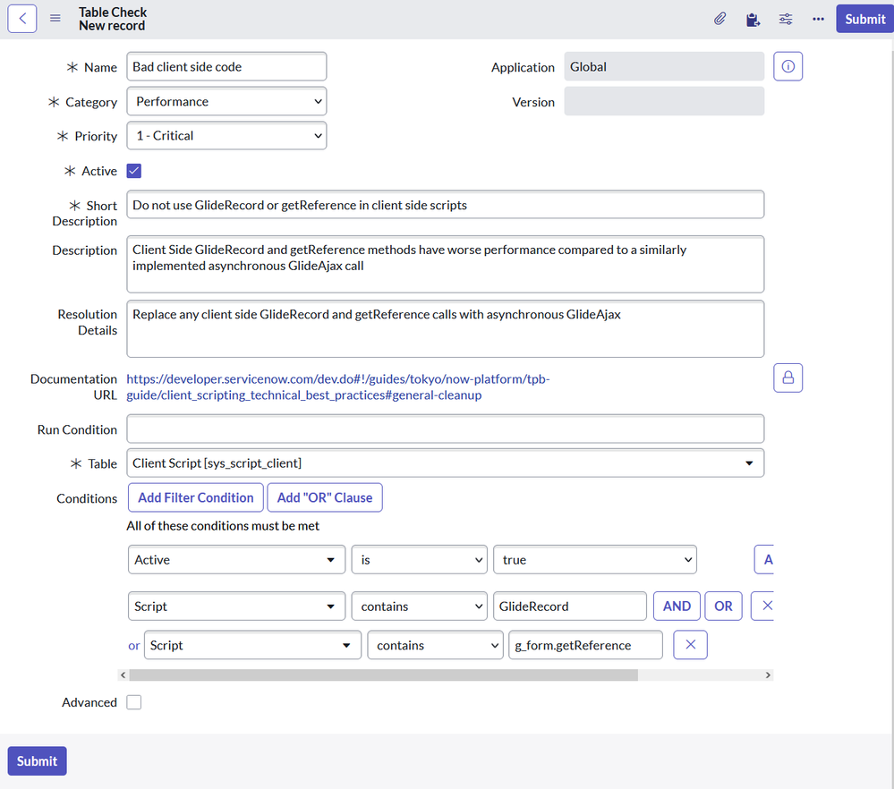
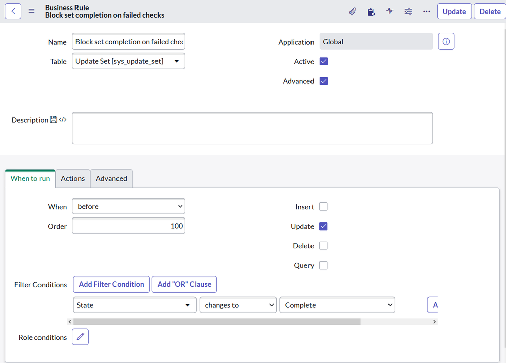

# スクリプトのベストプラクティスとアンチパターン（Scripting Best Practices and Anti-patterns）

## 概要

ServiceNow は「ローコード」を標榜するが、実際の導入では Business Rule（ビジネスルール）、Script Include（スクリプトインクルード）、Client Script（クライアントスクリプト）、UI Action、Scheduled Job、Transform Map Script、Scripted REST API などに大量の JavaScript が書かれる。スクリプトはプラットフォームの拡張性の源泉である一方、書き方を誤ると **無限再帰・重複通知・画面フリーズ・環境移送後の不具合・ログ肥大・アップグレード阻害** を引き起こし、技術的負債の中心になる。

ServiceNow 公式ドキュメントは、Business Rule と Client Script について明示的なベストプラクティスを掲載しており（[Business rules and script includes（Australia）](https://www.servicenow.com/docs/r/zUlSbxoxKPAWFDGUdAoSCw/BCXxSgbljeOS3kSEyDX2eg)、[Client script best practices（Brazil）](https://www.servicenow.com/docs/r/api-reference/scripts/client-script-best-practices.html)）、ServiceNow 社員（Technical Support Performance チーム＝GTSPerformance、Developer Advocate 等）が Community で補足知見を公開している。本ファイルはそれらを、コンサルタント・アーキテクト・開発リードが **設計レビュー／コードレビューでそのまま使える形** に整理する。

| 章 | テーマ | 主なキーワード |
|---|---|---|
| 1 | 全体像：アンチパターン早見表 | 症状 → 原因 → 代替 |
| 2 | `current.update()` の禁止と Business Rule の使い分け | Before / After / Async / Display、`setWorkflow(false)`、再帰 |
| 3 | 同期処理（クライアント側 GlideRecord、`getXMLWait`） | GlideAjax、`g_scratchpad`、`getReference`、UI Policy |
| 4 | サーバー側 GlideRecord の危険な書き方 | 無効クエリで全件、`deleteMultiple`、`getValue`、`GlideQuery`、`GlideRecordSecure` |
| 5 | ハードコード | sys_id、System Property、Decision Table、定数 Script Include |
| 6 | ログ | `gs.log` / `gs.info` / `gs.debug`、`syslog` / `syslog_app_scope`、verbosity プロパティ |
| 7 | スコープ設計 | Private / Global scope、命名、Runtime Access Tracking、`sys_scope_privilege`、Script Include の公開範囲 |
| 8 | コーディング規約・JavaScript モード | ES12、関数で囲む、命名、`eval` |
| 9 | コードレビューの観点と自動化 | チェックリスト、Instance Scan（Scan Check、Linter Check、`scan_finding`）、Update Set 完了ゲート |
| 10 | Brazil での変更点 | ServiceNow Studio、Build Agent |

関連ファイル：API 仕様そのもの（GlideRecord、GlideSystem、Business Rule の項目）は [サーバーサイドスクリプト](../02_リファレンス/platform/scripting-server-side.md)、Client Script／UI Policy／GlideForm の仕様は [クライアントサイドスクリプト](../02_リファレンス/platform/scripting-client-side.md)、性能起因のアンチパターン（クエリ・インデックス・クォータ）の詳細は [パフォーマンスチューニング](03-performance-tuning.md)、カスタマイズ全体の負債管理は [カスタマイズと技術的負債](02-customization-technical-debt.md)、スコープドアプリ開発・Studio の仕様は [アプリケーション開発](../02_リファレンス/platform/app-development.md)、ACL は [アクセス制御（ACL）](../02_リファレンス/platform/access-control-acl.md)、移送は [アップデートセットとクローン](../02_リファレンス/platform/update-sets-cloning.md)、自動テストは [Automated Test Framework (ATF)](../02_リファレンス/platform/automated-test-framework.md)、開発標準を運用する組織（CoE、Design Authority）は [ガバナンスとCoEの実践](09-governance-coe-practice.md) を参照。

> **情報の位置づけ：** 本ファイルでは、servicenow.com/docs の記述を「公式」、ServiceNow 社員（Employee バッジ付き）の Community 記事を「ServiceNow 社員記事」と明記し、それ以外の Community 投稿・MVP 記事に基づく記述には `【第三者情報】`、実務上一般に語られる知見には `【経験則】` を付ける。developer.servicenow.com の「Technical Best Practices（TPB）ガイド」は本調査時点で Web 取得ツールから本文を参照できなかった（ブラウザ非対応画面が返る）ため、内容は公式ドキュメントと Community 記事経由で確認できた範囲に限定している。

---

## 1. 全体像：アンチパターン早見表

ServiceNow のスクリプト不具合の多くは、少数の典型パターンに集約される。以下は本ファイルで扱うアンチパターンと、その症状・代替手段の早見表である。各行の根拠は後続の章に記載する。

| # | アンチパターン | 典型的な症状 | 推奨される代替 | 根拠の種類 | 章 |
|---|---|---|---|---|---|
| A1 | Business Rule 内で `current.update()` を呼ぶ | 再帰ループ、重複通知、性能劣化、監査履歴の汚染 | Before BR でフィールドを設定（保存は自動）。関連レコードは After／Async BR で更新 | 公式 | 2 |
| A2 | 再帰回避のため安易に `setWorkflow(false)` を多用する | 監査（Audit）・通知・他の BR・ワークフローが動かない | 本当に必要な限定ケースのみ。影響をテスト | 公式 | 2.4 |
| A3 | 条件（Condition）なしの Business Rule | すべての Insert/Update で無駄に実行 | Condition／Filter Conditions を必ず設定 | 公式 | 2.5 |
| A4 | クライアント側で `GlideRecord` や `g_form.getReference()`（コールバックなし）を使う | フォームのフリーズ、全フィールド取得による無駄な通信、ACL 回避の懸念 | 非同期 GlideAjax、Display BR + `g_scratchpad` | 公式＋第三者 | 3 |
| A5 | `GlideAjax.getXMLWait()`（同期呼び出し） | 応答待ちの間 UI がフリーズ | `getXML()` / `getXMLAnswer()`（非同期） | 公式 | 3.2 |
| A6 | 参照フィールドに `g_form.setValue(field, sys_id)` だけを渡す | 表示値取得のため同期サーバー呼び出しが発生 | 第3引数に表示値を渡す | 公式 | 3.4 |
| A7 | Global Client Script / Global Business Rule | 全ページで読み込まれる／全トランザクションで評価される | テーブルを限定、Script Include に移す | 公式 | 3.5, 2.6 |
| A8 | 未検証の変数を `addQuery()` に渡し、その結果を更新・削除 | 無効条件が無視され **全件更新・全件削除** | 値の事前検証、`glide.invalid_query.returns_no_rows=true`、`GlideQuery` | 公式＋社員記事 | 4.1 |
| A9 | `getRowCount()` で件数を数える／ループ内でクエリを発行 | 大量データで遅延 | `GlideAggregate`、`setLimit` | 社員記事 | 4.3 |
| A10 | sys_id・グループ名・メールアドレス等のハードコード | 環境移送後に存在しないレコードを参照して失敗 | System Property、Decision Table、Assignment Rule、定数 Script Include | 社員記事＋第三者 | 5 |
| A11 | `gs.log()`・デバッグ出力の残置 | ログ肥大、スコープドアプリでエラー、重要ログが埋もれる | `gs.info/warn/error/debug` とアプリごとの verbosity プロパティ | 第三者 | 6 |
| A12 | すべてをグローバルスコープで作る | 影響範囲が不明、アンインストール不可、委任開発不可 | Private scope を既定とし、例外的にグローバル | 公式 | 7 |
| A13 | Script Include を無条件に「All application scopes」「Glide AJAX enabled」で公開 | 想定外の呼び出し・ゲストからのアクセス | Accessible from を絞る、ACL を付与、`isPublic()` を既定の false のまま | 公式 | 7.4 |
| A14 | DOM 操作（`document.getElementById`、jQuery 等） | ブラウザ／UI 更新で破損 | GlideForm（`g_form`）API | 公式 | 3.5 |
| A15 | `eval()` の使用 | インジェクション、デバッグ困難 | 設計を見直す | 第三者 | 8 |

---

## 2. `current.update()` の禁止と Business Rule の使い分け

### 2.1 公式の立場：`current.update()` は「決して必要ではない」

ServiceNow 公式ドキュメントは、Business Rule 内で `current.update()` を呼ばないよう明記している。Australia 版の「Business rules and script includes」は、`current.update()` が追加のデータベース操作を発生させ、**重複通知や再帰ループ**を引き起こしうると説明している（[Business rules and script includes（Australia）](https://www.servicenow.com/docs/r/zUlSbxoxKPAWFDGUdAoSCw/BCXxSgbljeOS3kSEyDX2eg)）。

Brazil 版の Business Rule ページ（Prevent recursive business rules の節）はさらに踏み込み、次の内容を記載している（[Business rules（Brazil）](https://www.servicenow.com/docs/r/build-workflows/business-rules-classic/c_BusinessRules.html)）。

- 同じテーブルに対する `current.update()` は、そのテーブルの Insert/Update 用 Business Rule を再度起動するため、Business Rule が自分自身を繰り返し呼ぶ可能性がある。
- システムは検出した再帰を停止し、System Log に記録する（＝プラットフォームが止めてくれるが、それ自体が性能劣化とエラーログを生む）。
- 現在レコードの変更は **Before** ルールで行い、**After** ルールは**関連レコード**の更新に使う。
- `update()` と `setWorkflow(false)` の組み合わせは、通常の Before/After の指針では要件を満たせない**特殊な状況でのみ**推奨される。
- `current.update()` は「システム性能の問題を引き起こし、決して必要ではない（never necessary）」。

### 2.2 なぜ不要なのか：Before ルールの変更は自動保存される

Before Business Rule はデータベース操作の**前**に同期実行され、`current` に設定したフィールド値はそのままデータベースへの書き込みに含まれる。したがって Before ルールでは `current.update()` を呼ぶ必要がない（[Business rules（Brazil）](https://www.servicenow.com/docs/r/build-workflows/business-rules-classic/c_BusinessRules.html)）。After ルールで `current` を変更して `current.update()` を呼ぶと、同じレコードに対して 2 回目の Update が走り、その Update で再び Before/After ルール・通知・監査・Flow のトリガーが評価される。

ServiceNow Community の議論でも、ServiceNow サポートから「After Business Rule での `current.update()` は再帰呼び出しにつながるため推奨しない」との回答を得たという報告がある。またイベント経由の Script Action で `current.update()` を呼んでも同じく Business Rule が再起動する点が指摘されている `【第三者情報】`（[Community: How do I avoid using current.update()…](https://www.servicenow.com/community/csm-forum/how-do-i-avoid-using-current-update-in-a-business-rule-script-by/td-p/411078/page/3)）。

### 2.3 タイミング別の正しい使い分け

公式ドキュメントは Business Rule の実行タイミングと用途を次のように整理している（[Business rules and script includes（Australia）](https://www.servicenow.com/docs/r/zUlSbxoxKPAWFDGUdAoSCw/BCXxSgbljeOS3kSEyDX2eg)、[Business rules（Brazil）](https://www.servicenow.com/docs/r/build-workflows/business-rules-classic/c_BusinessRules.html)）。

| When（実行タイミング） | 実行タイミングの詳細 | 適した用途 | `current.update()` |
|---|---|---|---|
| `before` | DB 操作の前に同期実行 | 現在レコードのフィールド値の設定・検証、`setAbortAction(true)` による保存中止 | 不要（変更は自動保存） |
| `after` | DB 操作の後に同期実行 | イベント発行、通知、関連レコードの順序立った更新 | 使わない（関連レコードは別の GlideRecord で更新） |
| `async` | DB 操作の完了後、別プロセス（スケジューラ）で実行 | 長時間処理、大量レコード更新、外部連携など、ユーザーが結果をすぐに必要としない処理 | 使わない |
| `display` | フォーム表示のたびに実行 | サーバーのデータを `g_scratchpad` 経由でクライアントへ渡す | 該当なし |

補足（公式）：

- Async Business Rule は前回値（previous）にアクセスできないため、スクリプト内では `changes()`、`changesTo()`、`changesFrom()` が機能しない。ただし Condition Builder（条件ビルダー）側ではこれらの条件をサポートする（[Business rules（Brazil）](https://www.servicenow.com/docs/r/build-workflows/business-rules-classic/c_BusinessRules.html)）。
- 「After の代わりに Async を使う」ことで、ユーザーへの応答が早く返る。ただし関連オブジェクトの更新は遅れて反映される。Community のベストプラクティス集でも「ユーザーに即時表示する必要がない更新は After ではなく Async にする」とされる `【第三者情報】`（[ServiceNow Development Best Practices](https://www.servicenow.com/community/developer-articles/servicenow-development-best-practices/ta-p/2312003)）。Async BR の性能面の注意（スケジューラワーカーの枯渇等）は [パフォーマンスチューニング](03-performance-tuning.md) を参照。



### 2.4 `setWorkflow(false)` は「逃げ道」ではない

`GlideRecord.setWorkflow(Boolean enable)` は「Business Rule、スクリプトエンジン、監査（audit）の実行を有効化／無効化する」メソッドである。公式 API リファレンス（Brazil、Scoped GlideRecord）は次の注意を付している（[GlideRecord - Scoped（Brazil）](https://www.servicenow.com/docs/r/api-reference/server-api-reference/c_GlideRecordScopedAPI.html)）。

- Business Rule・スクリプトエンジン・監査の無効化は**重大な影響**を及ぼしうるため、本番展開前に十分テストすること。
- `setWorkflow()` は、後続の `deleteMultiple()` 等によるカスケード削除では無視される。
- **クロススコープのアプリケーションからは設定できない**（他スコープのテーブルの GlideRecord に対して `setWorkflow(false)` は効かない）。

`setWorkflow(false)` は「再帰を止めるスイッチ」として Community で頻繁に紹介されるが、実際には **監査履歴（`sys_audit`）、ジャーナル、通知エンジン、ワークフローエンジン** など多くの付随処理を止めるため、2025 年の Community スレッドでもその影響の大きさが指摘されている `【第三者情報】`。また Community では「`setWorkflow(false)` でも Business Rule が完全には止まらない例外がある（例：`sys_class_name` の変更＝レコードの再分類）」という報告もある `【第三者情報】`（[Community: updateMultiple & setWorkflow](https://www.servicenow.com/community/itsm-forum/updatemultiple-setworkflow/m-p/742753)）。

`【経験則】` レビューでは `setWorkflow(false)` を見つけたら次の3点を必ず確認する。

1. その更新で**監査証跡**が残らなくてよいか（内部統制・J-SOX 対象テーブルでは通常不可）。
2. その更新で起動すべき**通知・SLA 計算・Flow** が止まって問題ないか。
3. `autoSysFields(false)`（`sys_updated_on`／`sys_updated_by` 等の自動更新を止める）と組み合わせていないか。組み合わせると「誰がいつ変えたか」がレコードからも監査からも追えなくなる。

### 2.5 Business Rule の公式ベストプラクティス（Condition・小さく・ベースを触らない）

公式ドキュメントの Business Rule ベストプラクティスの要点は次のとおり（[Business rules and script includes（Australia）](https://www.servicenow.com/docs/r/zUlSbxoxKPAWFDGUdAoSCw/BCXxSgbljeOS3kSEyDX2eg)）。

| 公式ベストプラクティス | 内容 | レビュー時の見方 |
|---|---|---|
| Condition を必ず付ける | Business Rule は条件なしで実行すべきケースはまれ。条件はデバッグも容易にする | `Condition` / `Filter Conditions` が空の BR を一覧で抽出 |
| 1 ルール 1 目的 | 小さく、特定の目的に絞る | 1 本の BR で複数の業務ロジックを分岐していないか |
| ベースシステムの BR を変更しない | OOTB の BR を直接編集しない | `sys_update_xml` に OOTB BR の変更が含まれていないか（アップグレード時に Skipped になる） |
| スクリプトは必要なときだけ | 宣言的設定（Condition、Actions タブでの値設定）で済むならスクリプトにしない | Advanced をオンにしただけの単純な値設定 |
| クエリで処理対象を絞る | 処理するレコードをクエリで限定 | ループ内でフィルタしていないか |
| 再帰的な DB 操作を避ける | `current.update()` を呼ばない | 2.1 参照 |
| Client callable な Business Rule を避ける | クライアントスクリプトの性能を損なう | GlideAjax + Script Include に置き換える |

### 2.6 Global Business Rule ではなく Script Include

公式ドキュメントは、再利用するロジックを Global Business Rule（テーブル = Global の BR）ではなく Script Include に置くよう推奨している。Script Include は**呼ばれたときにだけ読み込まれる**ためである。また、UI Action や Scripted REST API から Business Rule を呼ぶのではなく、共通コードを Script Include に移し、Business Rule・UI Action・ワークフロースクリプト・Scripted REST API の各所から呼ぶ構成を推奨している（[Business rules and script includes（Australia）](https://www.servicenow.com/docs/r/zUlSbxoxKPAWFDGUdAoSCw/BCXxSgbljeOS3kSEyDX2eg)、[Script includes（Brazil）](https://www.servicenow.com/docs/r/api-reference/scripts/c_ScriptIncludes.html)）。

```javascript
// アンチパターン: After Business Rule（incident）
(function executeRule(current, previous) {
    current.u_last_touched_by = gs.getUserID();
    current.update();                // 2回目の Update → BR・通知・監査が再評価される
})(current, previous);

// 推奨: Before Business Rule（incident, Update, Condition: 状態などで限定）
(function executeRule(current, previous) {
    current.u_last_touched_by = gs.getUserID();   // 保存は自動で行われる
})(current, previous);

// 推奨: 関連レコードの更新は After / Async で別 GlideRecord を使う
(function executeRule(current, previous) {
    var problem = new GlideRecord('problem');
    if (problem.get('sys_id', current.getValue('problem_id'))) {   // 2引数の get
        problem.work_notes = 'Related incident ' + current.getValue('number') + ' was resolved.';
        problem.update();
    }
})(current, previous);
```

---

## 3. 同期処理のアンチパターン（クライアント側）

### 3.1 なぜ同期呼び出しが問題か

ブラウザ上の Client Script がサーバーへ同期的に問い合わせると、応答が返るまでフォーム（UI スレッド）が固まる。ネットワーク遅延やサーバー負荷が高いときに顕在化し、「フォームがときどき固まる」という再現しにくい性能苦情の原因になる。公式の Client script best practices は「**常に非同期（`getXML`）呼び出しを使うよう努め、同期（`getXMLWait`）を避ける**」と明記している（[Client script best practices（Brazil）](https://www.servicenow.com/docs/r/api-reference/scripts/client-script-best-practices.html)）。

### 3.2 公式が「推奨しない」クライアント API

公式の Client script best practices（Brazil）が挙げるクライアント側のアンチパターンと代替は次のとおり（[Client script best practices（Brazil）](https://www.servicenow.com/docs/r/api-reference/scripts/client-script-best-practices.html)）。

| アンチパターン | 公式の説明 | 代替 |
|---|---|---|
| `GlideAjax.getXMLWait()` | 同期呼び出し | `getXML(callback)`、`getXMLAnswer(callback)` |
| クライアント側 `GlideRecord` | 性能への影響から「もはや推奨されない」。1 フィールドしか必要ない場合でも全フィールドを取得する | 非同期 GlideAjax で必要なデータだけを取得 |
| `g_form.getReference()` | 同上（全フィールド取得、性能影響） | 非同期 GlideAjax、または `g_scratchpad` |
| 参照フィールドへの `g_form.setValue('assigned_to', id)`（表示値なし） | 表示値取得のため**同期**サーバー呼び出しが発生 | `g_form.setValue('assigned_to', id, name)` と第3引数に表示値 |
| Global Client Script（テーブル制限なし） | 全ページで読み込まれ、ブラウザ負荷になる | Task や Configuration Item などの基底テーブルに移す |
| DOM 操作 | ブラウザ更新時に保守性の問題を起こす | GlideForm API |
| フィールドの必須・読取専用・表示切替をスクリプトで行う | UI Policy ならスクリプト不要・Order で順序管理可能（UI Policy は Client Script の後に実行） | UI Policy |
| onChange でロード時にも処理する | 不要なロード時処理 | `if (isLoading) return;` |

Community では、クライアント側 GlideRecord について「サーバー側 GlideRecord は ACL を適用するがクライアント側では回避されうる」「データベース構造とデータをエンドユーザーに露出する」というセキュリティ上の懸念も挙げられている。一方で「コールバック付きのクライアント GlideRecord はブラウザをブロックしない」「OOTB スクリプトにも使用例がある」という反論もある `【第三者情報】`（[Community: Is it okay to use GlideRecord at client side](https://www.servicenow.com/community/servicenow-ai-platform-forum/is-it-okay-to-use-gliderecord-at-client-side/td-p/3129761)）。いずれにせよ公式は推奨しておらず、また**スコープドアプリのクライアントスクリプトでは `GlideRecord` が利用できない**（"GlideRecord is not a constructor" エラーになる）と報告されている `【第三者情報】`。

`getXMLWait()` は Service Portal ではサポートされないという Community 上の指摘がある `【第三者情報】`。Service Portal／Employee Center・Workspace 上で動くスクリプトでは、いずれにしても非同期 API で書くべきである（UI 種別ごとの Client Script の挙動は [クライアントサイドスクリプト](../02_リファレンス/platform/scripting-client-side.md) を参照）。

### 3.3 推奨パターン1：フォーム表示時に必要なデータは Display BR + `g_scratchpad`

公式ドキュメントは `g_scratchpad` を「サーバーからクライアントへ情報を送る非常に効率的な手段」としている。Display Business Rule で `g_scratchpad` に値を詰めると、フォームの読み込みと同じ応答でクライアントに届くため、追加のサーバー往復が発生しない。制約は **フォーム読み込み時にしか値を渡せない** ことで、ロード後に変化するデータには非同期 GlideAjax を使う（[Client script best practices（Brazil）](https://www.servicenow.com/docs/r/api-reference/scripts/client-script-best-practices.html)）。

```javascript
// Display Business Rule（incident）
(function executeRule(current, previous) {
    g_scratchpad.callerIsVip = current.caller_id.vip == true;   // 必要最小限の値だけ
})(current, previous);

// onLoad Client Script
function onLoad() {
    if (g_scratchpad.callerIsVip) {
        g_form.showFieldMsg('caller_id', getMessage('VIP caller'), 'info');
    }
}
```

### 3.4 推奨パターン2：ロード後の問い合わせは非同期 GlideAjax

```javascript
// Script Include（Glide AJAX enabled = true、ACL でロールを限定）
var CallerInfoAjax = Class.create();
CallerInfoAjax.prototype = Object.extendsObject(global.AbstractAjaxProcessor, {
    getDepartment: function () {
        var userId = this.getParameter('sysparm_user');
        if (!userId) return '';
        var user = new GlideRecordSecure('sys_user');       // ACL を評価
        if (user.get('sys_id', userId)) {
            return user.getValue('department');
        }
        return '';
    },
    type: 'CallerInfoAjax'
});

// onChange Client Script（caller_id）
function onChange(control, oldValue, newValue, isLoading) {
    if (isLoading || newValue === '' || newValue === oldValue) return;
    var ga = new GlideAjax('CallerInfoAjax');
    ga.addParam('sysparm_name', 'getDepartment');
    ga.addParam('sysparm_user', newValue);
    ga.getXMLAnswer(function (answer) {                     // 非同期
        if (answer) g_form.setValue('u_department', answer);
    });
}
```

公式の Script Include ドキュメントは、Glide AJAX enabled の Script Include には（公開を意図しない限り）Access Control を付けること、データベースを照会する場合は `GlideRecord` より `GlideRecordSecure` を使うことを推奨している（[Script includes（Brazil）](https://www.servicenow.com/docs/r/api-reference/scripts/c_ScriptIncludes.html)）。詳細は 7.4 節。

### 3.5 onSubmit の検証で同期呼び出しが「必要に見える」場合

`【経験則】` onSubmit で「サーバーに問い合わせて結果次第で保存を止めたい」ときに `getXMLWait()` に戻ってしまうのが最も多い失敗である。代替は次のいずれか。

| 方法 | 概要 |
|---|---|
| サーバー側で検証する | Before Business Rule で検証し、NG なら `current.setAbortAction(true)` と `gs.addErrorMessage()`。公式も「重要な入力は Business Rule で二重チェックする」考え方と整合する |
| onChange で事前に問い合わせる | 入力時点で非同期 GlideAjax を投げ、結果を `g_form` の非表示フィールドやクライアント変数に保持し、onSubmit では保持値だけを見る |
| `g_scratchpad` で事前に渡す | フォーム表示時点で判定できるなら Display BR で渡す |

---

## 4. サーバー側 GlideRecord の危険な書き方

本章は「正しく動いているように見えて、条件次第でデータを壊す・極端に遅くなる」書き方に絞る。クエリ性能・インデックスの観点は [パフォーマンスチューニング](03-performance-tuning.md) の GlideRecord 章を参照。

### 4.1 無効なクエリ条件は「無視されて全件対象」になる

GlideRecord のクエリに存在しないフィールド名や未定義の値を渡すと、**無効な部分の条件が捨てられ、残りの有効な条件だけで実行される**。その結果、テーブルの全レコードが返る可能性がある。公式 GlideRecord API リファレンスは、こうした不正なクエリ結果に対して `insert()`、`update()`、`deleteRecord()`、`deleteMultiple()` を使うと**データ損失**につながりうると警告している（[GlideRecord - Global（Zurich）](https://www.servicenow.com/docs/r/zurich/api-reference/server-api-reference/c_GlideRecordAPI.html)）。

システムプロパティ `glide.invalid_query.returns_no_rows` を `true` に設定すると、無効なクエリは 0 件を返すようになる。既定値は `false`。ただし公式は、WHERE 演算子と組み合わせた無効なクエリ項目など、`true` でもレコードが返るケースがあるとしている（[GlideRecord - Global（Zurich）](https://www.servicenow.com/docs/r/zurich/api-reference/server-api-reference/c_GlideRecordAPI.html)）。ServiceNow 社員記事（2017 年）はこのプロパティの設定を推奨しており、コメント欄ではスクリプトだけでなく Business Rule の Condition Builder を含むインスタンス全体のクエリに影響する点が補足されている（[ServiceNow 社員記事: Protect custom scripts from unwanted behavior](https://www.servicenow.com/community/developer-blog/protect-custom-scripts-from-unwanted-behavior-using-this-system/bc-p/2291472)）。GTSPerformance の記事も同プロパティの `true` 設定と、クエリに使う前の値検証（`JSUtil.notNil()`、`GlideElement.nil()`、`gs.nil()`）を推奨している（[GTSPerformance: Server-side coding](https://www.servicenow.com/community/developer-articles/performance-best-practices-for-server-side-coding-in-servicenow/ta-p/2324426)）。

```javascript
// アンチパターン: groupId が undefined だと条件が捨てられ、全件削除になりうる
var task = new GlideRecord('u_temp_task');
task.addQuery('assignment_group', groupId);
task.deleteMultiple();

// 推奨: 値を検証し、件数を確認してから操作する
if (gs.nil(groupId)) {
    gs.error('[TempTaskCleanup] groupId is empty; aborting delete.');
} else {
    var task = new GlideRecord('u_temp_task');
    task.addQuery('assignment_group', groupId);
    task.query();
    // 期待件数の範囲チェックを入れてから deleteMultiple などを実行する
}
```

`【経験則】` `glide.invalid_query.returns_no_rows` を既存インスタンスで後から `true` にすると、これまで「偶然動いていた」（無効条件が捨てられて期待どおりの件数になっていた）スクリプトやレポートの結果が変わりうる。サブ本番で影響調査してから有効化する。

### 4.2 `GlideQuery`：タイポを例外にする

`GlideQuery` は、サーバースクリプトから CRUD を行うための GlideRecord の代替 API（Script Include として提供）である。公式は、クエリエラーの診断を助け、定型コードを減らし、一般的な性能上の落とし穴を避けられるとする一方、GlideRecord オブジェクトを標準 JavaScript オブジェクトに変換するため**実行に時間がかかる場合がある**と注意している（[GlideQuery - Scoped, Global](https://www.servicenow.com/docs/r/api-reference/server-api-reference/GlideQueryGlobalAPI.html)）。

ServiceNow Developer Advocate の記事（2026-04-16）は、`active` を `activated` と誤記した場合に GlideRecord は無効条件を黙って無視して**全件を返す**（`deleteMultiple` なら致命的）一方、GlideQuery は不明なフィールド名を示す例外を投げるデモを紹介している。また GlideQuery はプレーンな JavaScript 値を返すため、GlideElement と文字列を `===` で比較して失敗する問題も起きないとしている（[Developer Advocate: Learn efficient scripting with GlideQuery](https://www.servicenow.com/community/developer-advocate-blog/learn-efficient-scripting-with-glidequery/ba-p/3526569)）。

| 観点 | GlideRecord | GlideQuery |
|---|---|---|
| 無効フィールド名 | 条件が捨てられて実行（全件の可能性） | 例外 |
| 戻り値 | GlideElement（文字列化が必要） | プレーンな JS 値 |
| 速度 | 基準 | 変換コストの分遅い場合あり（公式） |
| 推奨用途 | 大量処理・性能重視 | データ破壊リスクのある更新・削除、可読性重視の処理 |

### 4.3 性能に効く書き方（要点のみ）

GTSPerformance（ServiceNow Technical Support Performance チーム）記事の主な推奨は次のとおり（[GTSPerformance: Server-side coding](https://www.servicenow.com/community/developer-articles/performance-best-practices-for-server-side-coding-in-servicenow/ta-p/2324426)、最終更新 2026-02-02）。

| 推奨 | アンチパターン |
|---|---|
| 存在確認は `setLimit(1)` → `query()` → `if (gr.next())` | 全件ループで存在確認 |
| 件数は `GlideAggregate` の COUNT | `getRowCount()` で件数取得 |
| `get('sys_id', value)` の 2 引数形式 | 1 引数 `get(value)`（表示名フィールドへのフォールバック検索が走る） |
| 参照の sys_id は `gr.getValue('ref_field')` | `gr.ref_field.sys_id.toString()`（行ごとに追加クエリ） |
| 配列には `getValue()` の文字列を格納 | GlideElement（`gr.caller_id`）をそのまま配列に push |
| 将来の処理は `gs.eventQueueScheduled()` | `gs.sleep()` で待機（テスト以外で使用しない） |
| `gr`、`ga`、`i` など汎用名を避ける | 共有スコープで変数名が衝突 |
| 再帰関数に深さカウンタ・上限 | 無制限の再帰／ページングループ |
| 大きな配列は不要になったら `null` | JVM ヒープの圧迫（16 万件の sys_id で約 10MB の目安） |

公式の Scoped GlideRecord リファレンス（Brazil）も、`deleteMultiple()` には `setLimit()` が効かないこと、通貨フィールドを持つテーブルで `deleteMultiple()` を使わないこと、大きなテーブルで `updateMultiple()` を `chooseWindow()`／`setLimit()` と併用しないことを明記している（[GlideRecord - Scoped（Brazil）](https://www.servicenow.com/docs/r/api-reference/server-api-reference/c_GlideRecordScopedAPI.html)）。

---

## 5. ハードコードのアンチパターン

### 5.1 何が問題か

スクリプトに sys_id、グループ名、ユーザー ID、メールアドレス、URL、閾値などを直接書くと、次の問題が起きる。

- **環境間移送で壊れる**：開発インスタンスで手作業作成したグループ等の sys_id は本番に存在しない。ServiceNow Developer Advocate の記事（2026-01-21）は、sys_id をハードコードした割り当てロジックが別環境へ移送後に失敗する例を挙げている（[Developer Advocate: Clean assignment logic – stop hardcoding sys_ids](https://www.servicenow.com/community/developer-advocate-blog/clean-assignment-logic-in-servicenow-stop-hardcoding-sys-ids/ba-p/3472096)）。
- **変更にコード修正・移送が必要になる**：管理者が設定値として変えられない。
- **意図が読めない**：「マジックナンバー」になる `【第三者情報】`（[Scripting best practices: avoid using hardcoded values in scripts](https://www.servicenow.com/community/developer-articles/scripting-best-practices-avoid-using-hardcoded-values-in-scripts/ta-p/2466714)）。

developer.servicenow.com の Technical Best Practices ガイドにも「Do not use hard-coded values」という節が存在することは、後述のスクリーンショット（Scan Check の Documentation URL が `.../tpb-guide/scripting_technical_best_practices#do-not-use-hard-coded-values-` を指している）から確認できる。

### 5.2 代替手段の使い分け

| 代替手段 | 適するケース | 注意点 | 出典 |
|---|---|---|---|
| System Property（`sys_properties`、`gs.getProperty('x_acme_app.default_group')`） | 環境ごとに値が異なる設定、管理者が変更する値 | プロパティ名・説明を明確に。sys_id よりも自然キー（グループ名・User ID）を格納できるなら優先 | [Developer Advocate](https://www.servicenow.com/community/developer-advocate-blog/clean-assignment-logic-in-servicenow-stop-hardcoding-sys-ids/ba-p/3472096)、[Martin Ivanov 記事](https://www.servicenow.com/community/developer-articles/scripting-best-practices-avoid-using-hardcoded-values-in-scripts/ta-p/2466714) `【第三者情報】` |
| Decision Table（デシジョンテーブル） | 複雑で頻繁に変わる割り当て・判定ロジック | 視覚的・スケーラブル・保守しやすい | [Developer Advocate](https://www.servicenow.com/community/developer-advocate-blog/clean-assignment-logic-in-servicenow-stop-hardcoding-sys-ids/ba-p/3472096) |
| Assignment Rule（割り当てルール） | 条件ベースの単純な割り当て | スクリプト自体が不要になる | 同上 |
| 定数を持つ Script Include | テーブル内の選択肢値・状態値など、環境で変わらない値に名前を付ける | OOTB の `IncidentStateSNC` のようなパターン。値の変更時に 1 か所の修正で済む | [Martin Ivanov 記事](https://www.servicenow.com/community/developer-articles/scripting-best-practices-avoid-using-hardcoded-values-in-scripts/ta-p/2466714) `【第三者情報】` |
| 設定レコードを Update Set／シードデータに含める | どうしても sys_id 参照が必要なレコード（グループ等） | 全インスタンスで同じ sys_id になるようにする | [Developer Advocate](https://www.servicenow.com/community/developer-advocate-blog/clean-assignment-logic-in-servicenow-stop-hardcoding-sys-ids/ba-p/3472096) |
| 自然キーで検索 | グループ名・User ID など安定した属性がある | 名前変更に弱い。名前の運用ルールとセット | [Community](https://www.servicenow.com/community/developer-forum/what-are-the-issues-with-sys-id-being-hardcoded/m-p/2887535) `【第三者情報】` |

Developer Advocate 記事は、定期的な Instance Scan でハードコード参照を本番昇格前に検出することも推奨している（9 章）。

### 5.3 反対意見と現実的な線引き

Community では「ServiceNow 自身の OOTB コードにも sys_id のハードコードは多い」「変更されるべきでない OOTB 構成要素の sys_id をプロパティ化すると、管理者が誤って変更する余地を作る」という反論がある。また「テーブル名・フィールド名、意味のある選択肢値まで定数化するのは可読性を下げる」というコメントもある `【第三者情報】`（[Community: What are the issues with sys_id being hardcoded?](https://www.servicenow.com/community/developer-forum/what-are-the-issues-with-sys-id-being-hardcoded/m-p/2887535)、[Martin Ivanov 記事のコメント](https://www.servicenow.com/community/developer-articles/scripting-best-practices-avoid-using-hardcoded-values-in-scripts/ta-p/2466714)）。

`【経験則】` 実務上の線引き：

| 値の種類 | 推奨 |
|---|---|
| 顧客が作成したレコードの sys_id（グループ、ユーザー、カタログアイテム、スケジュール） | ハードコード禁止。プロパティまたは Decision Table |
| 環境で異なる値（URL、エンドポイント、メールアドレス、閾値） | プロパティ（連携のエンドポイントは Connection & Credential Alias 等。詳細は [連携の落とし穴](08-integration-pitfalls.md)） |
| OOTB で全インスタンス共通の sys_id（例：システム既定のレコード） | 許容。ただしコメントで何のレコードかを明記 |
| テーブル名・フィールド名・選択肢値 | 直接記述で可。状態値など意味が分かりにくいものは定数化 |

---

## 6. ログのベストプラクティス

### 6.1 ロギング API とスコープの対応

ServiceNow のサーバー側ロギング API は、スコープによって使えるものが異なる。以下は Community の解説記事（Tera Patron、2025-06 最終更新）および Community スレッドで確認できた内容である `【第三者情報】`（[Just another Log Helper](https://www.servicenow.com/community/developer-articles/just-another-log-helper/ta-p/2315453)、[Community: How to add logging for a scoped application?](https://www.servicenow.com/community/developer-forum/how-to-add-logging-for-a-scoped-application/td-p/1897357)）。

| API | グローバルスコープ | スコープドアプリ | 書き込み先 |
|---|---|---|---|
| `gs.log(msg, source)` | 可 | **不可（エラー）** | `syslog`、Session Log |
| `gs.print()` | 可 | 不可 | — |
| `gs.info()` / `gs.warn()` / `gs.error()` | 可 | 可 | `syslog`、Session Log。スコープドでは verbosity 設定に応じて `syslog_app_scope` にも |
| `gs.debug()` | 可（`syslog` には書かれない） | 可（verbosity が `debug` のときのみ `syslog_app_scope` に記録） | Session Log は常に |

テーブル：

- `syslog`（System Log）：グローバル・スコープドの両方の出力と、捕捉されなかった例外のスタックトレースを保持する。
- `syslog_app_scope`（Application Logs）：スコープドアプリからの出力のみを、より詳細に保持する。ナビゲーターでは System Logs > Application Logs から参照できると報告されている。

### 6.2 スコープドアプリのログレベル制御プロパティ

スコープドアプリには、ログの詳細度と出力先を制御する 2 つのシステムプロパティがある `【第三者情報】`（[Community: How to add logging for a scoped application?](https://www.servicenow.com/community/developer-forum/how-to-add-logging-for-a-scoped-application/td-p/1897357)。Community 記事は KB0714743 を参照している）。

| プロパティ | 値 | 既定値（Community での引用） |
|---|---|---|
| `<scope_name>.logging.verbosity` | `error` / `warn` / `info` / `debug` / `trace` | `info` |
| `<scope_name>.logging.destination` | `db`（データベース）/ ファイルシステム | `db` |

verbosity を `debug` にすると `debug`・`info`・`warn`・`error` のすべてが出力される。プロパティの変更がキャッシュの都合ですぐ反映されない場合があるとの報告もある `【第三者情報】`。

### 6.3 ログのアンチパターンと推奨

| アンチパターン | 問題 | 推奨 | 出典 |
|---|---|---|---|
| `gs.log()` をスコープドアプリやスコープ移行予定のコードで使う | スコープドでは動かない | `gs.info/warn/error` | [Log Helper](https://www.servicenow.com/community/developer-articles/just-another-log-helper/ta-p/2315453) `【第三者情報】` |
| デバッグ用 `gs.log()`／`alert()` を残したまま移送 | 本番ログの肥大、エンドユーザーにアラート表示 | 開発中の出力は `gs.debug()` とし、プロパティで ON/OFF | [Development Best Practices](https://www.servicenow.com/community/developer-articles/servicenow-development-best-practices/ta-p/2312003) `【第三者情報】` |
| ループ内で毎回ログ出力 | `syslog` の行数が爆発し、ログ検索自体が遅くなる | ループ外で件数・サマリーを 1 行出力 | `【経験則】` |
| 「何が」「どこで」が分からないメッセージ（`'here'`、`'error'`） | 調査不能 | 接頭辞（Script Include 名・メソッド名）＋対象レコード番号＋値 | `【経験則】` |
| 個人情報・資格情報・トークンをログに出す | 情報漏えい（`syslog` は管理者等が閲覧可能） | ID のみ出力、マスキング | `【経験則】`（[セキュリティ強化の実践](12-security-hardening-practice.md) 参照） |
| 本番で debug レベルを有効にしたまま | ログ容量浪費 | Update Set 完了前・テスト完了後にサーバー側デバッグを無効化 | [Development Best Practices](https://www.servicenow.com/community/developer-articles/servicenow-development-best-practices/ta-p/2312003) `【第三者情報】` |

グローバルスコープのコードでも debug ログを切り替えたい場合、`debug.MyUtil` のような独自プロパティで出力可否を制御するパターンが Community で紹介されている `【第三者情報】`（[Development Best Practices](https://www.servicenow.com/community/developer-articles/servicenow-development-best-practices/ta-p/2312003)）。

```javascript
// 推奨例（スコープドアプリ x_acme_hr）
var LOG_PREFIX = '[x_acme_hr.CaseRouter] ';
gs.debug(LOG_PREFIX + 'Routing case {0} with category {1}', caseNumber, category); // verbosity=debug のときのみ記録
if (!targetGroup) {
    gs.warn(LOG_PREFIX + 'No routing rule matched for case ' + caseNumber);
}
```

クライアント側のデバッグには `jslog()` とブラウザコンソールを使い、`alert()` を残さない `【第三者情報】`（[Development Best Practices](https://www.servicenow.com/community/developer-articles/servicenow-development-best-practices/ta-p/2312003)）。Session Log（System Diagnostics > Session Debug > Debug Log）、Script Tracer、Script Debugger を使った調査手順は [サーバーサイドスクリプト](../02_リファレンス/platform/scripting-server-side.md) を参照。

---

## 7. スコープ設計

### 7.1 公式の原則：Private scope が既定、Global は例外

公式ドキュメント「Plan before you build」は、アプリケーションは既定で **Private scope（プライベートスコープ）** となり、同一スコープ内のアーティファクトだけがアクセスできること、Private scope はソース管理連携と委任開発（Delegated development）をサポートし、**Global scope は委任開発をサポートしない**ことを説明している（[Plan before you build（Xanadu）](https://www.servicenow.com/docs/r/a3E8xg0zsiQLBPKbKO15Mg/7IOu6vhY96xl__WOafBx~w)）。

同ページは、カスタム業務アプリは Private scope で作り、Global scope を選ぶのは次の場合に限るとしている。

| Global scope が正当化されるケース（公式） |
|---|
| アプリがグローバルのデータを削除する必要がある |
| 複数の既定テーブルのアプリケーションアクセス設定を変更する必要がある |
| Global scope でしか使えない API を使う必要がある |

Global にしかない API を Private scope から使う手段として、Global scope に作成した **Passthrough script include（パススルー Script Include）** があるが、公式はこれを完全な代替とは位置づけていない（[Plan before you build（Xanadu）](https://www.servicenow.com/docs/r/a3E8xg0zsiQLBPKbKO15Mg/7IOu6vhY96xl__WOafBx~w)）。

ServiceNow 社員のブログ（2017 年）も「スコープ内で作業することをルールとし、グローバルでの作業を例外とせよ」と述べ、利点として、スコープのサンドボックスとクォータ、アップグレードの容易さ、インストール／アンインストールの容易さ、Update Set に依存しない、セキュリティとプログラミングモデルの強化、変更の可視性、委任開発、Studio と Git との互換性を挙げている（[ServiceNow 社員記事: Application development best practice #1 – work in a scope](https://www.servicenow.com/community/servicenow-ai-platform-blog/application-development-best-practice-1-work-in-a-scope/ba-p/2288784)）。

### 7.2 スコープ名の命名

公式は、スコープ名を `x_[会社コード]_[アプリ名]` 形式・**最大 18 文字**とする例を示している（例：「Legal Request」→ `x_acme_legal_reque`）。アプリのすべてのファイルがスコープを継承するため慎重に選ぶこと、アプリ名は後で変更できることも記載されている（[Plan before you build（Xanadu）](https://www.servicenow.com/docs/r/a3E8xg0zsiQLBPKbKO15Mg/7IOu6vhY96xl__WOafBx~w)）。

また同ページは、PoC は別のサンドボックスや Personal Developer Instance（PDI）で作り、スコープの名前空間が異なる場合は組織の開発インスタンスで**作り直す**（インポートしない）こと、本番アプリは組織の開発インスタンスで作りテスト・展開プロセスに乗せることを推奨している。

### 7.3 Runtime Access Tracking とクロススコープ権限

スコープドアプリが他のアプリのリソース（テーブル、Script Include、Script Object）にアクセスすると、アプリケーションレコードの **Runtime Access Tracking（ランタイムアクセストラッキング）** 設定に応じて扱いが決まる（[Runtime access tracking（Brazil）](https://www.servicenow.com/docs/r/application-development/c_RuntimeAccessTracking.html)）。

| 設定値 | 開発中 | インストール後 |
|---|---|---|
| `None` | 追跡も認可もしない | テーブルレベルのアクセス設定が許せばアクセス可 |
| `Tracking` | アクセス要求ごとに Cross-Scope Privilege レコードを作成 | 新規要求の追跡を停止。レコードは **Allowed** となり、テーブルレベル設定が許せば実行 |
| `Enforcing` | Tracking と同様にレコード作成 | レコードは **Requested** となり、管理者が Allowed に変更するまで**ブロック** |

Cross-Scope Privilege は `sys_scope_privilege` テーブルに保存される。主なフィールドは Source Scope、Target Scope、Target Name、Target Type（table／script include／script object）、Operation（テーブルは read／write／create／delete、Script Include と Script Object は execute API のみ）、Status（requested／allowed／denied）である。アプリ公開後は有効な Cross-Scope Privilege レコードがあるランタイム要求だけが実行される。テーブル権限はテーブルオブジェクト（`sys_db_object`）の許可を超えられない（[Cross-scope privilege record（Australia）](https://www.servicenow.com/docs/r/zUlSbxoxKPAWFDGUdAoSCw/Gh5CGmZWei9jdTT17tZ7JA)）。

公式は、開発者がテスト中に**すべてのスクリプトロジックを実行して**必要な Cross-Scope Privilege レコードを生成させるよう求めている。`【経験則】` これは「テストで通らなかった分岐が本番で初めてクロススコープアクセスし、Enforcing 環境でブロックされる」事故の原因になるため、ATF でブランチを網羅するテストを持つことがスコープ設計の一部になる。

### 7.4 Script Include の公開範囲

Script Include の公開範囲に関わる主な項目は次のとおり（[Script includes（Brazil）](https://www.servicenow.com/docs/r/api-reference/scripts/c_ScriptIncludes.html)）。

| 項目 | 内容 | 推奨 |
|---|---|---|
| Accessible from | `All application scopes` または `This application scope only` | 他スコープから呼ぶ必要がなければ `This application scope only` |
| Glide AJAX enabled（旧称 Client callable） | クライアントスクリプト、リスト／レポートフィルタ、参照修飾子、URL 経由の呼び出しを許可。選択時にロール選択ダイアログが出て、ロールベースの ACL を自動作成できる（`glide.script.ccsi.enable_acl_create_ux=false` で無効化） | 公開を意図しない限り ACL を付ける |
| Privacy（`isPublic()`） | 公開ページのゲストからのアクセス可否。システム全体の `glide.script.ccsi.ispublic`（既定 false）を個別に上書き | 既定の非公開を維持 |
| Sandbox enabled | クエリ条件などスクリプトサンドボックスから実行されるスクリプトで利用可能にする | 必要な場合のみ |
| Protection policy | None／Read-only／Protected（Protected はスクリプト内容を顧客から隠し、メモリ上で暗号化） | ストア配布アプリで検討 |

公式の Zurich 版「Script sandbox environment」ページでは、Washington DC 以前から Zurich へアップグレードすると、Client callable の Script Include が Sandbox enabled としてもマークされる旨が記載されている（[Script sandbox environment（Zurich）](https://www.servicenow.com/docs/r/zurich/api-reference/scripts/script-sandbox-environment.html)）。Community では Xanadu 以降、Glide AJAX enabled の Script Include がサンドボックス内からアクセスできなくなったとの指摘もある `【第三者情報】`（[Community: Sandbox enabled on script include](https://www.servicenow.com/community/developer-forum/sandbox-enabled-on-script-include/td-p/3134547/page/2)）。`【経験則】` アップグレード後に参照修飾子（Advanced reference qualifier）から呼んでいる Script Include が動かなくなった場合、このフラグを確認する。

### 7.5 スコープ設計のアンチパターン

| アンチパターン | 問題 | 推奨 |
|---|---|---|
| 1 顧客 1 巨大スコープ（全カスタマイズを 1 アプリに） | 依存関係が見えず、部分リリース不可 | 業務ドメイン単位でスコープを分ける。共通部品は共通スコープに |
| 細かすぎるスコープ分割 | クロススコープ権限・依存関係の管理が爆発 | 「独立してリリース・所有するか」で境界を決める |
| OOTB テーブル（`incident` 等）の拡張をスコープドアプリで行い、Global の BR と混在 | どのスコープのロジックが効いているか追えない | OOTB テーブルへのカスタマイズの置き場所ルールを明文化（CoE で管理） |
| Runtime Access Tracking を `None` のまま | どのアプリが何にアクセスしているか不明 | 少なくとも `Tracking`、配布アプリは `Enforcing` を検討 |
| Passthrough script include を多用 | Global への依存が隠れる | Global 依存は設計書に明記し最小化 |

上表は `【経験則】`。スコープとガバナンス（Delegated development、App Engine Management Center）の運用は [ガバナンスとCoEの実践](09-governance-coe-practice.md) と [アプリケーション開発](../02_リファレンス/platform/app-development.md) を参照。

---

## 8. コーディング規約と JavaScript モード

### 8.1 JavaScript モード

ServiceNow のサーバースクリプトには 3 つの JavaScript モードがある（[JavaScript modes（Zurich）](https://www.servicenow.com/docs/r/zurich/api-reference/scripts/c_JS_modes.html)）。

| モード | 既定となる対象 | 特徴 |
|---|---|---|
| ECMAScript 2021（ES12） | 新規スコープドアプリ。新規スクリプトはアプリのモードにかかわらず既定で ES12 がオン | アロー関数、クラス、分割代入、オプショナルチェーン等。アプリ単位ではグローバルアプリ非対応だが、グローバルの個別スクリプトでは有効化可能 |
| ES5 Standards | 新規グローバルアプリ（スコープドでも選択可） | strict mode、ネイティブ JSON、lodash.js / moment.js 等のライブラリ |
| Compatibility | ES5 Standards 以前に書かれたスクリプト | 旧 `JSON().encode()/decode()`。サードパーティライブラリ非対応 |

公式は、モードの切り替えで既存スクリプトの挙動が変わりうるため、切り替え前後で十分にテストするよう警告している。`【経験則】` 既存の Global スクリプトを ES12 に書き換える際は、`var` のホイスティングや GlideElement の型（`===` 比較）に起因する差異が出やすい。

### 8.2 一般的なコーディング規約

以下は Community のベストプラクティス集（2019 年、Kilo Patron）にまとめられた規約で、多くの組織の開発標準のベースになっている `【第三者情報】`（[ServiceNow Development Best Practices](https://www.servicenow.com/community/developer-articles/servicenow-development-best-practices/ta-p/2312003)）。

| 規約 | 理由 |
|---|---|
| サーバー・クライアントのコードを関数で囲む（IIFE 等） | 囲まないと変数が他のサーバースクリプトから見えて衝突する |
| 説明的な変数名・関数名 | `gr` 等の汎用名は衝突と可読性低下（GTSPerformance も同旨） |
| 関数は値を返す。結果を変数に格納し再呼び出ししない | 無駄な処理を避ける |
| 変数の存在を確認してから使う | null／undefined による無効クエリ（4.1） |
| 単一コンテキストで動くスクリプト（Transform Map 等）は即時実行関数 | スコープ汚染防止 |
| 複雑な `addQuery()`／`addOrCondition()` の連鎖より `addEncodedQuery()` | 可読性 |
| `eval()` を避ける | インジェクション、行番号が出ずデバッグ困難 |
| 参照の sys_id は `current.getValue('caller_id')` | `current.caller_id.sys_id` のドットウォークは追加クエリ |
| コメント、空白、単純な if/else | 経験の浅い開発者も読める |

---

## 9. コードレビューの観点と自動化

### 9.1 レビューチェックリスト

以下は本ファイルの各章の根拠をもとに、Update Set／アプリのリリース前レビューで使えるチェックリストとして整理したものである（チェックリストとしての構成は `【経験則】`、各項目の根拠は該当章の出典）。

**Business Rule**

| # | 観点 | NG の例 | 章 |
|---|---|---|---|
| BR-1 | `current.update()` を呼んでいない | After BR 内の `current.update()` | 2.1 |
| BR-2 | タイミングが適切（現在レコード＝Before、関連＝After、重い処理＝Async） | 関連レコード更新を Before で実施 | 2.3 |
| BR-3 | Condition が設定されている | Condition 空の Advanced BR | 2.5 |
| BR-4 | `setWorkflow(false)`／`autoSysFields(false)` の使用理由と影響（監査・通知）が説明されている | 理由不明の `setWorkflow(false)` | 2.4 |
| BR-5 | OOTB の BR を直接変更していない | OOTB BR の Script 変更 | 2.5 |
| BR-6 | 共通ロジックは Script Include にある／Global BR を新設していない | Global テーブルの BR | 2.6 |
| BR-7 | Async BR で `changes()` 系をスクリプト内で使っていない | Async BR の `current.state.changes()` | 2.3 |

**Client Script / UI**

| # | 観点 | NG の例 | 章 |
|---|---|---|---|
| CS-1 | `getXMLWait()` を使っていない | onSubmit の同期 GlideAjax | 3.2 |
| CS-2 | クライアント側 `GlideRecord`／`getReference()` を使っていない | onChange 内の `new GlideRecord()` | 3.2 |
| CS-3 | 参照フィールドの `setValue` に表示値を渡している | `g_form.setValue('assigned_to', id)` | 3.2 |
| CS-4 | 表示・必須・読取専用の制御は UI Policy で行っている | Client Script で `setMandatory` のみ | 3.2 |
| CS-5 | onChange で `isLoading` と値の変化をチェック | ロード時にも GlideAjax を発行 | 3.2 |
| CS-6 | DOM 操作をしていない | `document.getElementById`、`$j(...)` | 3.2 |
| CS-7 | Global Client Script を新設していない | Table = Global | 3.2 |

**GlideRecord / データ操作**

| # | 観点 | NG の例 | 章 |
|---|---|---|---|
| GR-1 | クエリ値を事前検証してから更新・削除している | 未検証変数での `deleteMultiple()` | 4.1 |
| GR-2 | 件数は `GlideAggregate`、存在確認は `setLimit(1)` | `getRowCount()` | 4.3 |
| GR-3 | `get()` は 2 引数形式 | `gr.get(id)` | 4.3 |
| GR-4 | ユーザー起点のデータ取得（GlideAjax・Scripted REST）は `GlideRecordSecure` | `GlideRecord` で ACL を素通り | 3.4, 7.4 |
| GR-5 | ループ内でクエリ・ドットウォークを繰り返していない | ループ内の `gr.ref.field.name` | 4.3 |

**ハードコード・ログ・スコープ**

| # | 観点 | NG の例 | 章 |
|---|---|---|---|
| HC-1 | 顧客作成レコードの sys_id がハードコードされていない | `'8a5055c9c61122780043563ef53438e3'` の直書き | 5 |
| HC-2 | 環境依存値（URL、メール、閾値）がプロパティ化されている | エンドポイント URL 直書き | 5 |
| LG-1 | `gs.log()`、`gs.print()`、`alert()` が残っていない | デバッグ出力の残置 | 6 |
| LG-2 | ログに接頭辞と対象レコードが含まれ、機微情報がない | `gs.info('error')` | 6 |
| SC-1 | スコープの選択理由（Global の場合は公式の例外条件のどれか）が説明できる | 理由なしの Global | 7.1 |
| SC-2 | Script Include の Accessible from・Glide AJAX enabled・ACL が最小権限 | 全スコープ公開＋ACL なし | 7.4 |
| SC-3 | クロススコープアクセスがテストで網羅され `sys_scope_privilege` が揃っている | 本番で Requested のままブロック | 7.3 |

### 9.2 Instance Scan による自動レビュー

**Instance Scan** は、既存の構成をスキャンしてヘルス上の問題やベストプラクティス上の改善機会を見つけ、将来の構成問題を予防するためのプラットフォーム機能である。DevOps、リリース管理、アップグレード前後の確認に使え、フルスキャンをスケジュール実行してダッシュボードで結果を分析できる（[Instance Scan（公式）](https://www.servicenow.com/docs/r/7LhbZn3yz3Q58qhjZoU9iQ/JyNTsKAk4QuTc4qk9xZM9g)）。チェックはスキャン範囲内の各レコードに対して実行され、違反ごとに Finding（検出結果）が `scan_finding`（Scan Findings）テーブルに作成される（[Findings API](https://www.servicenow.com/docs/r/api-reference/server-api-reference/FindingsAPI.html)）。

Scan Check（スキャンチェック）には 4 種類がある（[Mark Roethof: Creating your own Instance Scan Scan Checks](https://www.servicenow.com/community/developer-blog/creating-your-own-instance-scan-scan-checks/ba-p/2278735) `【第三者情報】`、[Findings API](https://www.servicenow.com/docs/r/api-reference/server-api-reference/FindingsAPI.html)）。

| チェック種別 | 対象 | 典型的な用途 |
|---|---|---|
| Table Check | 1 つのテーブル（Condition Builder とスクリプトの一方または両方） | 「Condition が空の BR」「Script に `GlideRecord` を含む Client Script」 |
| Column Type Check | 指定した列型（Script、XML、HTML）を持つ全テーブルのレコード | 全スクリプト列を横断して `gs.log(` や `getXMLWait(` を検出 |
| Script Only Check | テーブル・列型の制約なし（OOTB アーティファクトも対象にできる） | プロパティ設定値の検査（例：本番で `sn_atf.runner.enabled` が有効でないか） |
| Linter Check（Quebec で追加） | スクリプトの抽象構文木（AST）を解析 | 文字列検索では誤検知が多いパターン（コメント内の記述など）の検出。Findings API でノード（行番号等）を Finding に渡せる |

カテゴリは Upgradability、Performance、Security、Manageability、User Experience に分類される。Community 記事は、独自の開発標準（BR 命名規則、Description 必須、変数名 `gr` 禁止、クライアント側 GlideRecord／getReference 禁止、BR 内の sys_id ハードコード禁止）を Scan Check として実装し、Suite（スイート）にまとめる例を紹介している `【第三者情報】`（[Enforcing best practices and development standards for your instance](https://www.servicenow.com/community/developer-articles/enforcing-best-practices-and-development-standards-for-your/ta-p/2349946)）。



**キャプション：** Instance Scan の Table Check 新規作成フォーム（Business Rule 内の sys_id ハードコード検出）。

**画面の説明：** フォーム見出しは「Table Check / New record」。Name に「Hard coded sys_ids」、Category に「Manageability」、Priority に「3 - Moderate」、Active にチェック、Short Description に「No hard coded sys_ids: Business rule」が入力されている。Description には「sys_id のようなハードコード値は、データテーブルや Properties テーブルなどより管理しやすい場所に分離すべき」という趣旨の英文、Resolution Details には「sys_id を格納する sys_properties レコードを作成する」とある。Documentation URL は developer.servicenow.com の Technical Best Practices ガイド（`tpb-guide/scripting_technical_best_practices#do-not-use-hard-coded-values-`）を指す。Table は「Business Rule [sys_script]」、Conditions は「Active is true」。Advanced にチェックが入り、Script 欄には `(function (finding, current) { ... })(finding, current);` の形で、32 桁の英数字文字列リテラルにマッチする正規表現 `/"[a-z0-9]{32}"/g` を `condition` 列と `script` 列に適用し、マッチすれば `finding.increment()` を呼ぶコードが書かれている。

**出典：** [Enforcing best practices and development standards for your instance（ServiceNow Community、Luke Van Epen、2022-10-12）](https://www.servicenow.com/community/developer-articles/enforcing-best-practices-and-development-standards-for-your/ta-p/2349946)（取得日：2026-11-04）



**キャプション：** Instance Scan の Table Check 新規作成フォーム（クライアントスクリプト内の GlideRecord／getReference 検出）。

**画面の説明：** Name「Bad client side code」、Category「Performance」、Priority「1 - Critical」、Short Description「Do not use GlideRecord or getReference in client side scripts」。Description には「クライアント側の GlideRecord と getReference は、同等の非同期 GlideAjax 呼び出しより性能が悪い」、Resolution Details には「クライアント側の GlideRecord と getReference 呼び出しを非同期 GlideAjax に置き換える」とある。Documentation URL は `tpb-guide/client_scripting_technical_best_practices#general-cleanup`。Table は「Client Script [sys_script_client]」。Conditions は「Active is true」かつ「Script contains GlideRecord」または「Script contains g_form.getReference」。Advanced は未チェック（スクリプト不要の条件ビルダーのみのチェック）。

**出典：** [Enforcing best practices and development standards for your instance（ServiceNow Community、Luke Van Epen、2022-10-12）](https://www.servicenow.com/community/developer-articles/enforcing-best-practices-and-development-standards-for-your/ta-p/2349946)（取得日：2026-11-04）

### 9.3 Update Set の完了ゲートとしてのスキャン

同じ Community 記事は、Update Set（`sys_update_set`）の State が Complete に変わる際に、直近のスキャン結果に Priority 1・2 の Finding が残っていれば完了をブロックする Before Business Rule を紹介している。Update Set フォームの Related Links にある「Scan Update Set」UI アクションでスキャンを実行し、その結果をゲートに使う構成である `【第三者情報】`（[Enforcing best practices and development standards for your instance](https://www.servicenow.com/community/developer-articles/enforcing-best-practices-and-development-standards-for-your/ta-p/2349946)）。Scan Task レコードで Finding を管理者に割り当てて是正を分担することもできる。



**キャプション：** Update Set の完了をスキャン結果でブロックする Business Rule「Block set completion on failed checks」。

**画面の説明：** Business Rule フォーム。Name「Block set completion on failed checks」、Table「Update Set [sys_update_set]」、Application「Global」、Active と Advanced にチェック。When to run タブで When「before」、Order「100」、Update のみチェック（Insert・Delete・Query は未チェック）。Filter Conditions は「State changes to Complete」。スクリプト本体（Advanced タブ）はこの画像には写っていない。

**出典：** [Enforcing best practices and development standards for your instance（ServiceNow Community、Luke Van Epen、2022-10-12）](https://www.servicenow.com/community/developer-articles/enforcing-best-practices-and-development-standards-for-your/ta-p/2349946)（取得日：2026-11-04）

`【経験則】` この「BR で Update Set 完了を止める」方式は Global スコープのカスタマイズであり、それ自体が技術的負債になりうる。採用する場合は CoE の管理下に置き、パイプライン（Studio の Deployment／App Engine Management Center 等）で同等のゲートが組めないかをまず検討する。

### 9.4 人によるレビューと AI 支援の役割分担

| 観点 | 自動（Instance Scan） | 人（レビュアー） |
|---|---|---|
| 禁止 API・パターン（`current.update()`、`getXMLWait`、`gs.log`、sys_id 直書き） | 得意 | — |
| BR のタイミング選択の妥当性、`setWorkflow(false)` の業務的影響 | 不得意 | 必須 |
| スコープ境界・公開範囲の設計妥当性 | 一部（ACL なし Script Include の検出など） | 必須 |
| OOTB 機能で代替できないか（「そもそもスクリプトが要るか」） | 不可 | 必須 |
| テストの網羅（ATF、クロススコープ権限の生成） | 不可 | 必須 |

上表は `【経験則】`。Now Assist for Code（Yokohama 時点で、コンテキストに応じた自動補完、コードの説明・要約、プロンプトによるインライン編集をサポート）はコードの説明・リファクタリング支援に使えるが（[Now Assist for Creator release notes（Xanadu→Yokohama）](https://www.servicenow.com/docs/r/yokohama/delta-xanadu-yokohama/yokohama-xanadu-nowassistforcreator-release-notes.html)）、本ファイルのアンチパターンを AI が生成コードで回避する保証はない。`【経験則】` AI 生成コードにも同じチェックリストと Instance Scan を適用する。Now Assist の導入知見は [Now Assist / AI Agents 導入の知見](10-ai-adoption-lessons.md) を参照。

---

## 10. Brazil での変更点

> **Brazil での変更:** ServiceNow Studio の Zurich→Brazil 統合リリースノートでは、Update Set とソース管理の変更が Studio の Changes タブに並んで表示され併用できること、Update Set・パイプライン・Application Repository による展開パッケージングを Studio 内で完結できること、Build Agent のスペックモード（要件から実装計画を生成）などが挙げられている。スクリプトの書き方・コードレビュー機能そのもの（Business Rule、Client Script、Instance Scan の仕様）に関する Brazil 固有の変更は、本調査では公開情報で確認できず。なお同リリースノートの冒頭要約は OpenAI ベースの機能で生成されたものであり、正確性は保証されないと明記されている（[ServiceNow Studio release notes（Zurich→Brazil）](https://www.servicenow.com/docs/r/delta-zurich-brazil/brazil-zurich-servicenowstudio-release-notes.html)）。

`【経験則】` Build Agent など AI による実装が増えるほど、レビュー対象のコード量は増える。9 章のチェックリストを Instance Scan のスイートとして機械化しておくことが、AI 活用時代の品質ゲートとして重要になる。

---

## 11. まとめ：最低限守るべき 10 か条

1. Business Rule で `current.update()` を呼ばない。現在レコードは Before、関連レコードは After／Async。
2. `setWorkflow(false)` は監査・通知・ワークフローを止める「最後の手段」。使用理由をコメントとレビューで説明する。
3. Business Rule には必ず Condition を付け、1 ルール 1 目的にし、OOTB の BR は変更しない。
4. クライアントからは非同期 GlideAjax（`getXMLAnswer`）か `g_scratchpad`。`getXMLWait`、クライアント側 `GlideRecord`、`getReference` は使わない。
5. 表示・必須・読取専用は UI Policy。DOM 操作はしない。
6. 更新・削除の前にクエリ値を検証する。`glide.invalid_query.returns_no_rows` の有効化や `GlideQuery` の採用を検討する。
7. 顧客作成レコードの sys_id や環境依存値をハードコードしない。System Property・Decision Table・Assignment Rule を使う。
8. `gs.log` を使わず `gs.info/warn/error/debug`。debug はプロパティで制御し、本番で出しっぱなしにしない。
9. Private scope を既定とし、Global は公式の例外条件に限る。Script Include の公開範囲と ACL は最小権限。
10. 上記を Instance Scan のチェックとして自動化し、人のレビューは設計判断に集中させる。

---

## 参照元

**ServiceNow 公式ドキュメント**

- [Business rules and script includes（Australia）](https://www.servicenow.com/docs/r/zUlSbxoxKPAWFDGUdAoSCw/BCXxSgbljeOS3kSEyDX2eg)
- [Business rules（Brazil、Prevent recursive business rules を含む）](https://www.servicenow.com/docs/r/build-workflows/business-rules-classic/c_BusinessRules.html)
- [Client script best practices（Brazil）](https://www.servicenow.com/docs/r/api-reference/scripts/client-script-best-practices.html)
- [GlideRecord - Scoped（Brazil）](https://www.servicenow.com/docs/r/api-reference/server-api-reference/c_GlideRecordScopedAPI.html)
- [GlideRecord - Global（Zurich）](https://www.servicenow.com/docs/r/zurich/api-reference/server-api-reference/c_GlideRecordAPI.html)
- [GlideQuery - Scoped, Global](https://www.servicenow.com/docs/r/api-reference/server-api-reference/GlideQueryGlobalAPI.html)
- [Script includes（Brazil）](https://www.servicenow.com/docs/r/api-reference/scripts/c_ScriptIncludes.html)
- [Script sandbox environment（Zurich）](https://www.servicenow.com/docs/r/zurich/api-reference/scripts/script-sandbox-environment.html)
- [Runtime access tracking（Brazil）](https://www.servicenow.com/docs/r/application-development/c_RuntimeAccessTracking.html)
- [Cross-scope privilege record（Australia）](https://www.servicenow.com/docs/r/zUlSbxoxKPAWFDGUdAoSCw/Gh5CGmZWei9jdTT17tZ7JA)
- [Plan before you build（Xanadu）](https://www.servicenow.com/docs/r/a3E8xg0zsiQLBPKbKO15Mg/7IOu6vhY96xl__WOafBx~w)
- [JavaScript modes（Zurich）](https://www.servicenow.com/docs/r/zurich/api-reference/scripts/c_JS_modes.html)
- [Instance Scan](https://www.servicenow.com/docs/r/7LhbZn3yz3Q58qhjZoU9iQ/JyNTsKAk4QuTc4qk9xZM9g)
- [Findings - Scoped, Global](https://www.servicenow.com/docs/r/api-reference/server-api-reference/FindingsAPI.html)
- [ServiceNow Studio release notes（Zurich→Brazil）](https://www.servicenow.com/docs/r/delta-zurich-brazil/brazil-zurich-servicenowstudio-release-notes.html)
- [Now Assist for Creator release notes（Xanadu→Yokohama）](https://www.servicenow.com/docs/r/yokohama/delta-xanadu-yokohama/yokohama-xanadu-nowassistforcreator-release-notes.html)

**ServiceNow 社員による Community 記事**

- [Performance Best Practices for Server-side Coding in ServiceNow（GTSPerformance）](https://www.servicenow.com/community/developer-articles/performance-best-practices-for-server-side-coding-in-servicenow/ta-p/2324426)
- [Protect custom scripts from unwanted behavior using this system property（2017）](https://www.servicenow.com/community/developer-blog/protect-custom-scripts-from-unwanted-behavior-using-this-system/bc-p/2291472)
- [Clean assignment logic in ServiceNow: stop hardcoding sys_ids（Developer Advocate、2026-01-21）](https://www.servicenow.com/community/developer-advocate-blog/clean-assignment-logic-in-servicenow-stop-hardcoding-sys-ids/ba-p/3472096)
- [Learn efficient scripting with GlideQuery（Developer Advocate、2026-04-16）](https://www.servicenow.com/community/developer-advocate-blog/learn-efficient-scripting-with-glidequery/ba-p/3526569)
- [Application development best practice #1: work in a scope（2017）](https://www.servicenow.com/community/servicenow-ai-platform-blog/application-development-best-practice-1-work-in-a-scope/ba-p/2288784)

**Community（第三者）**

- [ServiceNow Development Best Practices（2019）](https://www.servicenow.com/community/developer-articles/servicenow-development-best-practices/ta-p/2312003)
- [Scripting best practices: avoid using hardcoded values in scripts（2023）](https://www.servicenow.com/community/developer-articles/scripting-best-practices-avoid-using-hardcoded-values-in-scripts/ta-p/2466714)
- [What are the issues with sys_id being hardcoded?](https://www.servicenow.com/community/developer-forum/what-are-the-issues-with-sys-id-being-hardcoded/m-p/2887535)
- [Just another Log Helper（2021、2025 更新）](https://www.servicenow.com/community/developer-articles/just-another-log-helper/ta-p/2315453)
- [How to add logging for a scoped application?](https://www.servicenow.com/community/developer-forum/how-to-add-logging-for-a-scoped-application/td-p/1897357)
- [Creating your own Instance Scan Scan Checks（2021）](https://www.servicenow.com/community/developer-blog/creating-your-own-instance-scan-scan-checks/ba-p/2278735)
- [Enforcing best practices and development standards for your instance（2022）](https://www.servicenow.com/community/developer-articles/enforcing-best-practices-and-development-standards-for-your/ta-p/2349946)
- [How do I avoid using current.update() in a business rule script…](https://www.servicenow.com/community/csm-forum/how-do-i-avoid-using-current-update-in-a-business-rule-script-by/td-p/411078/page/3)
- [Is it okay to use GlideRecord at client side](https://www.servicenow.com/community/servicenow-ai-platform-forum/is-it-okay-to-use-gliderecord-at-client-side/td-p/3129761)
- [updateMultiple & setWorkflow](https://www.servicenow.com/community/itsm-forum/updatemultiple-setworkflow/m-p/742753)
- [Sandbox enabled on script include](https://www.servicenow.com/community/developer-forum/sandbox-enabled-on-script-include/td-p/3134547/page/2)
