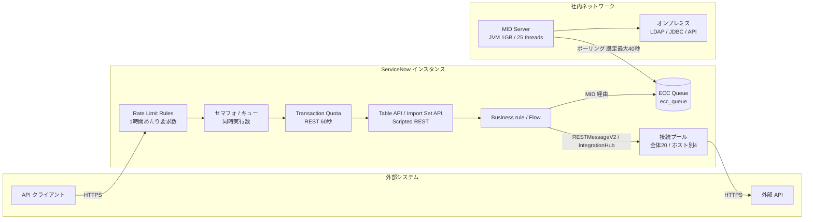
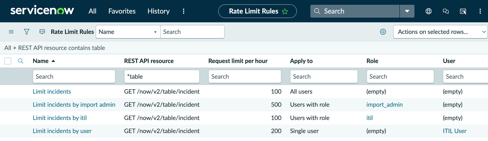
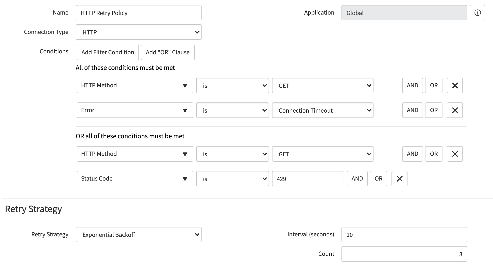
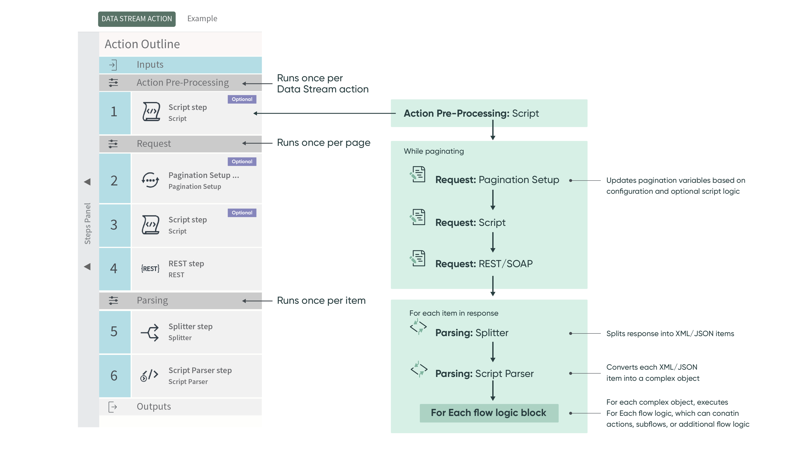

# 連携の落とし穴（Integration Pitfalls）

## 概要

本ファイルは、ServiceNow と外部システムの連携（Integration）で **「テストでは動いたが本番で壊れる」** 典型的な落とし穴と、その回避策をまとめた応用編である。連携方式の選び方（IntegrationHub かスクリプトか、MID Server の要否、代表的な連携パターン）は [連携設計](../03_導入編/09-integration-design.md) で扱い、本ファイルは次の 6 つの観点に絞って「どこで、なぜ壊れるか」を掘り下げる。

| 観点 | 本ファイルで答える問い |
|---|---|
| API 制限 | ServiceNow 側・相手側にどんな流量／時間／同時実行の上限があり、どこで 429 やタイムアウトになるか |
| エラーハンドリング | 失敗をどう検知・再試行・見える化するか。再試行そのものが障害を起こすのはどんなときか |
| 冪等性（Idempotency） | 再送・二重起動・並列処理で重複レコードや上書き事故が起きないようにするには |
| MID Server 運用 | ECC Queue、クラスター、サイジング、自動アップグレード、クローン後に何が起きるか |
| 認証情報管理 | 連携ユーザー、資格情報、OAuth トークン、クローン時の接続先・資格情報の扱い |
| 大量データ連携 | ページング、応答サイズ、Data Stream、Import Set の並列化とクリーンアップ |

前提となる事実（公式）:

- インバウンド REST API の流量は **Rate Limit Rules**（`sys_rate_limit_rules`）で **1 時間あたりの要求数** として制限でき、超過時は **HTTP 429 Too Many Requests** が返る。[出典](https://www.servicenow.com/docs/r/australia/api-reference/rest-api-explorer/inbound-REST-API-rate-limiting.html)
- 既定の Transaction Quota Rules により、インバウンドの **REST Table API／Aggregate API／Import Set API／Attachment API の要求は 60 秒で打ち切られる**。[出典](https://www.servicenow.com/docs/r/7LhbZn3yz3Q58qhjZoU9iQ/CUZB65GxR9nNLWM8zBS8UA)
- アウトバウンド HTTP(S) 接続はインスタンス全体で既定 **20 本**、同一ホストあたり既定 **4 本** に制限される（`glide.http.connection_mgr.max_connections` / `..._per_host`）。[出典](https://www.servicenow.com/docs/r/api-reference/web-services/r_HTTPConnectionManagementProps.html)
- MID Server はインスタンスとの間で **ECC Queue**（`ecc_queue`）を介して仕事を受け渡し、既定では最大 40 秒間隔でポーリングする。[出典](https://www.servicenow.com/docs/r/australia/servicenow-platform/mid-server/ecc-queue-mid-server.html)

本ファイルの知見はすべて出典 URL 付きで記載する。公式ドキュメント以外に依拠する記述には `【第三者情報】`（ServiceNow Community の社員記事・フォーラム投稿を含む）、`【経験則】`、`【推定】` を付ける。

関連ファイル: [連携設計](../03_導入編/09-integration-design.md) / [Web Services / REST API](../02_リファレンス/platform/web-services-api.md) / [IntegrationHub](../02_リファレンス/platform/integrationhub.md) / [MID Server](../02_リファレンス/platform/mid-server.md) / [データインポート/エクスポート](../02_リファレンス/platform/import-export-data.md) / [認証とSSO](../02_リファレンス/platform/authentication-sso.md) / [アップデートセットとクローン](../02_リファレンス/platform/update-sets-cloning.md) / [データ移行](../03_導入編/08-data-migration.md) / [パフォーマンスチューニング](03-performance-tuning.md) / [スクリプトのベストプラクティスとアンチパターン](07-scripting-best-practices.md) / [セキュリティ強化の実践](12-security-hardening-practice.md)

---

## 1. 落とし穴の全体像

### 1.1 連携のどこで壊れるか

ServiceNow の連携障害は、ほぼ次の図のどこかの「詰まり」か「ずれ」で発生する。インバウンド（外部 → ServiceNow）とアウトバウンド（ServiceNow → 外部）、および MID Server 経由の経路で、それぞれ制限と失敗の型が異なる。

### 1.2 落とし穴トップ 15（早見表）

| # | 落とし穴 | 典型的な症状 | 対策の要点 | 本文 |
|---|---|---|---|---|
| 1 | 全連携で 1 つの連携ユーザーを共有 | 1 つの連携の暴走で他の連携も 429 | 連携ごとにユーザーを分け、ユーザー単位でレート制限 | §2.3 |
| 2 | 大量取得を 1 リクエストで実施 | 60 秒で打ち切り（Transaction Quota） | ページング、差分取得、Import Set／Data Stream | §2.4, §8 |
| 3 | Business rule 内で同期 REST 呼び出し | 画面が固まる、スレッド枯渇 | 非同期化（async BR／Flow／`executeAsync`） | §3.3 |
| 4 | `executeAsync()` 直後に `waitForResponse()` | 非同期のつもりが同期と同じ、30 秒で失敗 | ECC Queue の input を BR で処理 | §3.4 |
| 5 | 同一ホストへの並列呼び出し過多 | 接続待ち、タイムアウト連鎖 | 同一ホスト既定 4 本を意識した流量設計 | §3.1 |
| 6 | 更新系（POST）を無条件に再試行 | 二重登録 | 再試行条件を GET／接続失敗に限定、冪等キー | §4.2, §5 |
| 7 | 失敗をメール通知だけで済ませる | 気づかれずにデータ不整合が拡大 | エラーレコード／タスク化、監視 | §4.4 |
| 8 | Table API の POST で外部 ID を照合しない | 重複レコード | Import Set API＋coalesce、`correlation_id` | §5.2 |
| 9 | 双方向連携でエコー（相互送信）を止めない | 無限ループ、トランザクション消費 | 連携ユーザーの更新は送らない等 | §5.5 |
| 10 | MID Server 1 台構成 | MID 停止で全オンプレ連携が停止 | クラスター（ただし対象外のデータソースあり） | §6.2 |
| 11 | MID Server をバージョン固定（pin） | アップグレード後に機能不全 | 原則 pin しない、自動アップグレードの前提を整備 | §6.4 |
| 12 | クローン後に本番の資格情報・接続先が残る | 非本番から本番相手システムへ誤送信 | クローンの除外・保持設定、クローン後チェック | §7.4 |
| 13 | OAuth リフレッシュトークンの期限を管理しない | ある日突然 401 | 期限台帳、Extend Refresh Token Expiry の理解 | §7.3 |
| 14 | `sysparm_offset` のページングで全件取得 | 欠落・重複 | `sys_id` 等によるキーセットページング | §8.1 |
| 15 | Import Set テーブルの肥大化 | インポートが遅くなる、クリーンアップ不能 | Import Set Deleter（既定 7 日）を有効に保つ | §8.4 |

---

## 2. API 制限（インバウンド：外部 → ServiceNow）

### 2.1 ServiceNow のインバウンド API には 3 層の制限がある

インバウンド REST API の要求は、少なくとも次の 3 種類の制限を受ける。混同すると「レート制限を緩めたのに 429 が止まらない」「429 は出ていないのにタイムアウトする」といった誤診断になる。

| 層 | 仕組み | 何を制限するか | 超過時の挙動 | 出典 |
|---|---|---|---|---|
| ① Rate Limit Rules | `sys_rate_limit_rules` | 1 時間あたりの要求数（ユーザー／ロール／全ユーザー単位） | HTTP 429、`Retry-After` ヘッダー | [出典](https://www.servicenow.com/docs/r/australia/api-reference/rest-api-explorer/inbound-REST-API-rate-limiting.html) |
| ② セマフォとキュー（同時実行） | ノードごとの API 用セマフォとキュー | 同時に処理できる要求数 | キュー満杯で拒否（429） | `【第三者情報】`[出典](https://www.servicenow.com/community/developer-articles/understanding-servicenow-rest-api-rate-limits-key-concepts-amp/ta-p/3407367) |
| ③ Transaction Quota Rules | 既定のクォータルール | 1 トランザクションの実行時間 | 60 秒で打ち切り（REST Table／Aggregate／Import Set／Attachment） | [出典](https://www.servicenow.com/docs/r/7LhbZn3yz3Q58qhjZoU9iQ/CUZB65GxR9nNLWM8zBS8UA) |

### 2.2 Rate Limit Rules の仕様

Rate Limit Rules は、インバウンド REST API の要求数を 1 時間単位で制限する公式機能である。[出典](https://www.servicenow.com/docs/r/australia/api-reference/rest-api-explorer/inbound-REST-API-rate-limiting.html) [出典](https://www.servicenow.com/docs/r/australia/api-reference/rest-api-explorer/create-REST-API-rate-limits.html)

| 項目 | 内容 |
|---|---|
| テーブル | `sys_rate_limit_rules`（Rate Limit Rules） |
| メニュー | All > System Web Services > REST > Rate Limit Rules |
| 必要ロール | `rate_limit_admin` |
| 主なフィールド | Name、REST API、Version、Resource、Table（Table API 選択時）、Import set table（Import Set API 選択時）、Active、Request limit per hour、Apply to（Single user / Users with role / All users）、Role、User |
| 優先順位 | Single user ＞ Users with role ＞ All users。複数ロールが該当する場合は **最も少ない上限** のルールが適用 |
| 応答ヘッダー | `X-RateLimit-Limit`（1 時間の上限）、`X-RateLimit-Reset`（リセット時刻の UNIX タイムスタンプ）、`X-RateLimit-Rule`（適用ルールの sys_id）。拒否時は `Retry-After`（秒） |
| 反映の遅れ | 各ノードがユーザー別カウントを保持し **30 秒ごと** に DB へ確定するため、ルールの効き始めに最大 30 秒の遅れがある |
| 関連リスト | Rate Limit Counts（ユーザー別カウント）、Rate Limit Violations（違反。一覧は **隔週でクリア**） |

- **キャプション:** Rate Limit Rules の一覧画面（公式ドキュメント「Inbound REST API rate limiting」の図「List of rate limit rules for GET /now/v2/table/incident」）。
- **画面の説明:** Next Experience UI の上部バーに「Rate Limit Rules」のタブ（お気に入りの星付き）がある。リストのブレッドクラムは「All > REST API resource contains table」。列は Name、REST API resource、Request limit per hour、Apply to、Role、User。4 行のルールがあり、すべて REST API resource は `GET /now/v2/table/incident`：「Limit incidents」（100、All users）、「Limit incidents by import admin」（500、Users with role、`import_admin`）、「Limit incidents by itil」（100、Users with role、`itil`）、「Limit incidents by user」（200、Single user、ITIL User）。同じリソースに全ユーザー・ロール別・個別ユーザーのルールを重ねた例であり、ITIL User には個別ユーザールール（200）が優先される。
- **出典:** https://www.servicenow.com/docs/r/australia/api-reference/rest-api-explorer/inbound-REST-API-rate-limiting.html （取得日: 2026-11-04）

### 2.3 落とし穴：Rate Limit Rules まわり

**落とし穴 2-A：全連携で 1 つの連携ユーザーを共有する。** Rate Limit Rules のカウントはユーザー単位で行われる。そのため、複数の外部システムが同じ連携ユーザーを使うと、1 システムの暴走（再試行ループ、全件取得バッチ）で他のシステムの要求まで 429 で拒否される。ServiceNow 社員による Community 記事も、ワークロードごとに連携ユーザーを分けること、1 ユーザーから多数の同時呼び出しを送らないことを推奨している。`【第三者情報】`[出典](https://www.servicenow.com/community/developer-articles/understanding-servicenow-rest-api-rate-limits-key-concepts-amp/ta-p/3407367) [出典](https://www.servicenow.com/docs/r/australia/api-reference/rest-api-explorer/inbound-REST-API-rate-limiting.html)

**落とし穴 2-B：ロール別ルールの「最小値適用」を忘れる。** 1 人の連携ユーザーが複数ロールを持ち、それぞれにルールがある場合、**最も小さい上限** が適用される。公式の例では `import_admin`（500）と `itil`（100）の両方を持つユーザーは 100/時に制限される。連携ユーザーに「念のため」ロールを足すと、意図せず上限が下がることがある。[出典](https://www.servicenow.com/docs/r/australia/api-reference/rest-api-explorer/inbound-REST-API-rate-limiting.html)

**落とし穴 2-C：本番稼働中に上限値を変更すると、その時間のカウントと違反が消える。** Request limit per hour の値を更新すると、プラットフォームはその時間のカウントを 0 にリセットし、違反を削除する。障害調査の途中で値を変えると証跡が失われるため、先に Rate Limit Violations を記録してから変更する。[出典](https://www.servicenow.com/docs/r/australia/api-reference/rest-api-explorer/create-REST-API-rate-limits.html)

**落とし穴 2-D：違反履歴が残らない。** Rate Limit Violations の関連リストは隔週でクリアされるため、月次で振り返ろうとしても残っていない。違反件数を継続監視したい場合は、別途レポート化・エクスポートする運用が必要になる。[出典](https://www.servicenow.com/docs/r/australia/api-reference/rest-api-explorer/investigate-rate-limit-violations.html) `【経験則】`

**落とし穴 2-E：クライアントが 429 を「エラー」として即時再送する。** 429 応答には `Retry-After` が付くので、クライアントはそれに従って待機する必要がある。即時再送するクライアントは 429 を自ら増幅する。Community 記事は、クライアント側で指数バックオフと `Retry-After` の尊重を実装するよう推奨している。[出典](https://www.servicenow.com/docs/r/australia/api-reference/rest-api-explorer/inbound-REST-API-rate-limiting.html) `【第三者情報】`[出典](https://www.servicenow.com/community/developer-articles/understanding-servicenow-rest-api-rate-limits-key-concepts-amp/ta-p/3407367)

### 2.4 落とし穴：同時実行（セマフォ）と 60 秒の Transaction Quota

**落とし穴 2-F：1 時間あたりの件数だけで容量を考える。** ServiceNow 社員の Community 記事によれば、持続的なスループットの実際の制約は 1 時間あたりの件数よりも **同時実行数（セマフォ）とキュー**、および **1 件あたりの処理時間** である。セマフォがすべて使用中になると要求はキューに入り、キューが満杯になると拒否される。記事中の例では「既定セマフォ 16、キュー深さ 150」で、同時 166 件を超えた 167 件目が 429 で拒否される。長時間かかる要求はセマフォを長く占有し、キューを早く埋める。`【第三者情報】`[出典](https://www.servicenow.com/community/developer-articles/understanding-servicenow-rest-api-rate-limits-key-concepts-amp/ta-p/3407367)

- 上記の数値は記事中の例示であり、インスタンスの規模・構成によって異なる。実際の値はインスタンスの `stats.do` ページのセマフォ情報で確認できる（Community フォーラムでは `API_INT` セマフォセットを確認する方法が紹介されている）。`【第三者情報】`[出典](https://www.servicenow.com/community/servicenow-ai-platform-forum/maximum-limit-of-inbound-rest-api-calls/m-p/1080867)
- 同記事は「インスタンスあたり約 10 万件/時」「ユーザーあたり約 2.5 万件/時」等の目安も挙げているが、上限値ではなく計画用の参考値と明記されている。`【第三者情報】`[出典](https://www.servicenow.com/community/developer-articles/understanding-servicenow-rest-api-rate-limits-key-concepts-amp/ta-p/3407367)

**落とし穴 2-G：重い Table API 要求が 60 秒で打ち切られる。** 既定の Transaction Quota Rules により、インバウンドの REST Table API、Aggregate API、Import Set API、Attachment API の要求は 60 秒で打ち切られる。大量件数の取得、ドットウォーク（参照先フィールド）を多用した取得、インデックスの効かないクエリはこの上限に当たりやすい。[出典](https://www.servicenow.com/docs/r/7LhbZn3yz3Q58qhjZoU9iQ/CUZB65GxR9nNLWM8zBS8UA)

| 既定クォータルール（抜粋） | 上限時間 | 対象 |
|---|---|---|
| REST Table API request timeout | 60 秒 | インバウンド REST Table API |
| REST Aggregate API request timeout | 60 秒 | インバウンド REST Aggregate API |
| REST Import Set API request timeout | 60 秒 | インバウンド REST Import Set API |
| REST Attachment API request timeout | 60 秒 | インバウンド REST Attachment API |
| UI Transactions | 約 4 分 58 秒 | UI トランザクション（バックグラウンドスクリプト除く） |

出典: Default quota rules（Zurich 版。Australia 版で同一ページの値の変更は公開情報では確認できず）[出典](https://www.servicenow.com/docs/r/7LhbZn3yz3Q58qhjZoU9iQ/CUZB65GxR9nNLWM8zBS8UA)。Batch API には別途 30 秒の「REST Batch API request timeout」がある（[Web Services / REST API](../02_リファレンス/platform/web-services-api.md) 参照）。

- **クォータを伸ばす前に要求を軽くする。** 第三者の文書には Aggregate API のクォータを 180 秒に伸ばす例もあるが、長い要求はセマフォを占有し、§2.4 の同時実行の問題を悪化させる。まずページング・列の絞り込み・差分取得で 1 要求を短くするのが原則である。`【経験則】`
- **独自クォータルールが効かない例。** Community では、独自に追加したクォータルールが期待どおり適用されず、OOB の「REST Table API request timeout」が先にマッチして打ち切られた事例が報告されている。クォータルールを追加・変更した場合は、ログで実際にどのルールが適用されたかを確認する。`【第三者情報】`[出典](https://www.servicenow.com/community/developer-forum/transaction-quota-rules-order-field/m-p/2996863)

### 2.5 インバウンド API 制限のチェックリスト

| チェック項目 | 根拠 |
|---|---|
| 連携ごとに専用の連携ユーザーがあり、ユーザー単位の Rate Limit Rule が定義されている | §2.3 |
| 連携ユーザーのロールが最小限で、ロール別ルールの最小値適用を意図どおり理解している | §2.3 |
| クライアントが 429 で `Retry-After` に従い、指数バックオフで再試行する | §2.3 |
| 1 要求が 60 秒以内に終わるよう、ページング・列絞り込み・差分取得をしている | §2.4, §8.1 |
| 同時実行数（並列スレッド数）をクライアント側で制御している | §2.4 |
| Rate Limit Violations を隔週クリア前に記録・監視している | §2.3 |

---

## 3. API 制限（アウトバウンド：ServiceNow → 外部）

### 3.1 アウトバウンドの接続プール上限

ServiceNow からのアウトバウンド HTTP(S) 接続は接続プールで管理され、次のプロパティで上限が決まる。[出典](https://www.servicenow.com/docs/r/api-reference/web-services/r_HTTPConnectionManagementProps.html)

| プロパティ | 既定値 | 意味 |
|---|---|---|
| `glide.http.connection_mgr.max_connections` | 20 | インスタンス全体（instance-wide）で許可されるアウトバウンド HTTP(S) 接続の総数 |
| `glide.http.connection_mgr.max_connections_per_host` | 4 | 上記のうち、同一ホストと並行して通信できる数。上限に達するとスクリプトは接続待ちになる |
| `glide.http.use_connection_mgr` | true | 接続プールの有効化。false は非推奨 |

**落とし穴 3-A：同一ホストへの並列呼び出しが「4 本」で詰まる。** 1 つの外部 API（例：同じ SaaS のエンドポイント）へ大量の通知を並列送信すると、同一ホスト 4 本の上限で接続待ちが発生し、相手の応答遅延と重なるとタイムアウトが連鎖する。プロパティ値を上げる前に、送信の集約（バッチ化）・非同期化・相手側のレート制限を考慮した流量設計を行う。[出典](https://www.servicenow.com/docs/r/api-reference/web-services/r_HTTPConnectionManagementProps.html) `【経験則】`

### 3.2 アウトバウンドのタイムアウトは 3 種類ある

ServiceNow 技術サポートのパフォーマンスチーム（GTSPerformance）による Community 記事は、アウトバウンドのタイムアウトを次の 3 つに整理している。`【第三者情報】`[出典](https://www.servicenow.com/community/developer-articles/outbound-integrations-using-soap-rest-performance-best-practices/ta-p/2301503)

| タイムアウト | 既定値 | 制御方法 | 補足 |
|---|---|---|---|
| 接続（Connection） | 10 秒 | `glide.http.connection_timeout`（ミリ秒） | 相手に TCP 接続できるまで |
| 要求（Request） | 175 秒 | `glide.http.timeout`（ミリ秒）、要求単位で `setHttpTimeout()` | 応答を待つソケットのタイムアウト |
| ECC 応答 | 30 秒 | `glide.rest.outbound.ecc_response.timeout`／`glide.soap.outbound.ecc_response.timeout`、`waitForResponse()` | `executeAsync()` 後に応答を待つ時間。同期 `execute()` には無関係 |

公式ドキュメントでは、`executeAsync()` の待機時間の上限 `glide.http.outbound.max_timeout` は既定・最大とも **30 秒**（それ以上を設定しても 30 に戻る）で、`glide.http.outbound.max_timeout.enabled`（既定 true）が true の間は `waitForResponse()` に大きな値を渡しても 30 秒が上限になる。30 秒を超えて待つには `enabled` を false にし、`glide.rest.outbound.ecc_response.timeout`（SOAP は `glide.soap.outbound.ecc_response.timeout`）で既定の応答タイムアウトを設定する。false の場合の既定の応答タイムアウトは 5 分である。[出典](https://www.servicenow.com/docs/r/api-reference/web-services/r_HTTPConnectionManagementProps.html)

**落とし穴 3-B：`waitForResponse(60)` と書いたのに 30 秒で失敗する。** Community では「No response for ECC message request with sysid=xxx after waiting for 30 seconds」というエラーが `waitForResponse()` の変更だけでは解消せず、`glide.http.outbound.max_timeout.enabled` と ECC 応答タイムアウトのプロパティの組み合わせで解決した事例が報告されている。`【第三者情報】`[出典](https://www.servicenow.com/community/developer-forum/how-can-i-avoid-the-quot-no-response-for-ecc-message-request/m-p/2349988) [出典](https://www.servicenow.com/docs/r/api-reference/web-services/r_HTTPConnectionManagementProps.html)

**落とし穴 3-C：Flow の Connection に設定したタイムアウトが効かない。** 同じ GTSPerformance 記事のコメント欄では、Flow Designer の Connection alias 上で設定した接続タイムアウトがグローバルの `glide.http.timeout` より優先されなかったという報告がある（記事本文では未回答）。タイムアウトは設定箇所ごとに実測で確認する。`【第三者情報】`[出典](https://www.servicenow.com/community/developer-articles/outbound-integrations-using-soap-rest-performance-best-practices/ta-p/2301503)

### 3.3 落とし穴：同期呼び出しでスレッドを占有する

GTSPerformance 記事によれば、同期呼び出し（`execute()`）は応答またはタイムアウトまで呼び出し元のスレッドを占有する。アプリケーションノードから同期で呼ぶと、フロントエンドのスレッド（default、API_INT、worker）が止まり、遅延や件数が増えると競合が起き、深刻な場合はインスタンスが無応答になりうる。`【第三者情報】`[出典](https://www.servicenow.com/community/developer-articles/outbound-integrations-using-soap-rest-performance-best-practices/ta-p/2301503)

| 呼び出し方 | 長所 | 落とし穴 |
|---|---|---|
| 同期（アプリノードから） | 実装が単純、応答をすぐ使える | フロントエンドのスレッドを止める。スケールしない |
| 非同期（アプリノードから） | 呼び出し元を待たせない | worker スレッドは使う。遅い相手に大量送信するとスケジューラが滞留 |
| 非同期（MID Server 経由） | インスタンスの負荷を外せる | ECC Queue の遅延、MID のスレッドが詰まると Discovery 等の他機能にも影響 |

出典: `【第三者情報】`[出典](https://www.servicenow.com/community/developer-articles/outbound-integrations-using-soap-rest-performance-best-practices/ta-p/2301503)

- **典型的なアンチパターン：** `before`／`after` の Business rule の中で同期 REST 呼び出しを行う。ユーザーがフォームを保存するたびに相手システムの応答時間だけ画面が固まり、相手が落ちると 175 秒（既定の要求タイムアウト）待たされる。外部呼び出しは async Business rule、Flow（IntegrationHub）、イベント＋Script Action など非同期経路に移す。`【経験則】`（スクリプトの一般原則は [スクリプトのベストプラクティスとアンチパターン](07-scripting-best-practices.md) を参照）
- 同期呼び出しが不可避な場合は、件数を少なくし、高速なエンドポイントと短いタイムアウトを使い、UI に待機中であることを表示する。`【第三者情報】`[出典](https://www.servicenow.com/community/developer-articles/outbound-integrations-using-soap-rest-performance-best-practices/ta-p/2301503)

### 3.4 落とし穴：`executeAsync()` を同期化してしまう

GTSPerformance 記事は次の点を指摘している。`【第三者情報】`[出典](https://www.servicenow.com/community/developer-articles/outbound-integrations-using-soap-rest-performance-best-practices/ta-p/2301503)

- `executeAsync()` は常に ECC Queue を使う（MID Server の有無にかかわらず）。
- `executeAsync()` の直後に `waitForResponse()`、`getBody()`、`getStatusCode()` を呼ぶと、結局その場で応答を待つため **同期呼び出しと同等** になる。
- 応答が必要なら、`ecc_queue` の after insert Business rule で処理する（Correlator 値、topic `RESTProbe`、queue `input`、state `ready` で絞り込み、処理後に state を `processed` にする）。
- MID 経由の要求では `setEccTopic()` ではなく `setEccCorrelator()` を使う。独自 topic を付けると MID Server が既知のプローブ topic しか受け付けないため output レコードがエラーになる。MID 経由の非同期要求には `skip_sensor = true` を設定しないと input レコードが「No sensors defined」でエラーになる。
- insert の Business rule 内での `current.update()` は安全だが、update の Business rule 内で行うと再帰を招く。

### 3.5 相手システム側のレート制限

アウトバウンドでは、相手 API のレート制限（HTTP 429 や独自のスロットリング）が主な制約になる。IntegrationHub の REST／SOAP step は Retry policy の **Honor "Retry-After" Header** で相手の `Retry-After` に従って再試行できる（§4.1）。スクリプト（`RESTMessageV2`）で実装する場合は、429 の判定と待機・再試行を自前で書く必要がある。[出典](https://www.servicenow.com/docs/r/australia/build-workflows/workflow-studio/retry-policy.html) `【経験則】`

IntegrationHub を使う場合は、再試行やページ取得も IntegrationHub のトランザクションとして数えられる点に注意する（§8.3）。トランザクションの見積もりは [連携設計](../03_導入編/09-integration-design.md) を参照。

---

## 4. エラーハンドリング

### 4.1 IntegrationHub の Retry policy

Retry policy は、ネットワーク障害やレート制限で失敗した HTTP 系 step を自動で再試行するための設定である。[出典](https://www.servicenow.com/docs/r/australia/build-workflows/workflow-studio/retry-policy.html) [出典（Brazil, 日本語）](https://www.servicenow.com/docs/r/ja-JP/build-workflows/workflow-studio/retry-policy.html)

| 項目 | 内容 |
|---|---|
| メニュー | All > Integration Hub > Retry Policy > Create New |
| 必要ロール | `connection_admin` または `credential_admin` |
| 対象 step | **JDBC、REST、SOAP のみ** |
| 主なフィールド | Name、Connection Type（HTTP）、Condition（is / is not / contains / contains not）、Retry Strategy。戦略ごとに表示されるフィールドが異なる：Interval (seconds)／Count は **Exponential Backoff と Fixed Interval のみ**、Max Elapsed Time (seconds) は **Honor "Retry-After" Header 選択時のみ** 表示 |
| Retry Strategy | **Exponential Backoff**（待機時間を毎回 2 倍）、**Fixed Interval**（一定間隔）、**Honor "Retry-After" Header**（応答の `Retry-After` に従う。REST／SOAP step のみ） |
| 既定ポリシー | 既定の Retry policy が提供される。Connection & Credential alias に既定ポリシーを割り当てると、その alias を使う全 HTTP 接続に適用 |
| システムプロパティ | `glide.fdih.retry.max_count`（Count 未入力時の再試行回数、**既定 0**）、`glide.fdih.retry.max_time_in_seconds`（最大再試行時間、既定 86400 秒、最大 604800 秒。設定時は Max Elapsed Time を上書き） |
| 再試行の確認 | System Logs > Outbound HTTP Requests |

- **キャプション:** Retry Strategy に Exponential Backoff を設定した Retry policy の例（公式ドキュメント「Retry policy」の図「Sample retry policy when Retry Strategy is Exponential Backoff」）。
- **画面の説明:** フォーム上部に Name「HTTP Retry Policy」、Application「Global」、Connection Type「HTTP」。Conditions 欄は 2 つの条件グループからなり、1 つ目が「HTTP Method is GET」AND「Error is Connection Timeout」、OR で 2 つ目が「HTTP Method is GET」AND「Status Code is 429」。下部の Retry Strategy セクションで Retry Strategy「Exponential Backoff」、Interval (seconds)「10」、Count「3」が設定されている。すなわち **GET 要求に限り**、接続タイムアウトまたは 429 のときに 10 秒→20 秒→40 秒の間隔で最大 3 回再試行するポリシーである。
- **出典:** https://www.servicenow.com/docs/r/australia/build-workflows/workflow-studio/retry-policy.html （取得日: 2026-11-04）

### 4.2 落とし穴：再試行が障害を作る

**落とし穴 4-A：更新系（POST／PATCH）を無条件に再試行して二重登録する。** タイムアウトは「相手が処理しなかった」ことを意味しない。相手側で登録が完了した後に応答だけが届かなかった場合、POST を再試行すると二重登録になる。公式の例が **条件に `HTTP Method is GET` を含めている** のはこのためと読める。更新系を再試行する場合は、相手 API が冪等キー（Idempotency-Key ヘッダー等）や外部 ID による upsert をサポートしていることを確認してから設定する。[出典](https://www.servicenow.com/docs/r/australia/build-workflows/workflow-studio/retry-policy.html) `【経験則】`

**落とし穴 4-B：Count を空欄にして「再試行される」と思い込む。** Count が空欄の場合は `glide.fdih.retry.max_count` が使われ、その既定値は 0 である。つまり明示的に Count を入れないと再試行されない。[出典](https://www.servicenow.com/docs/r/ja-JP/build-workflows/workflow-studio/retry-policy.html)

**落とし穴 4-C：Data Stream action で Exponential Backoff を使おうとする。** Data Stream action は **Fixed Interval のみ** をサポートし、間隔の最大は 30 秒である。Exponential Backoff と Honor "Retry-After" Header は使えない。相手のレート制限が厳しい大量取得では、ページサイズや実行時間帯で流量を調整する必要がある。[出典](https://www.servicenow.com/docs/r/australia/integrate-applications/integration-hub/data-stream-actions.html)

**落とし穴 4-D：再試行の総時間が長すぎて、後続処理が古いデータで動く。** `glide.fdih.retry.max_time_in_seconds` の既定は 86400 秒（24 時間）である。再試行が 1 日続くと、その間に業務側で状態が変わり、再試行が成功した時点で古い値を上書きする事故になりうる。再試行の総時間は業務上許容できる遅延に合わせて短く設定する。設定箇所は戦略によって異なる。Exponential Backoff／Fixed Interval では Interval (seconds) と Count の組み合わせで総時間が決まる（例：Exponential Backoff で Interval 10・Count 3 なら待機は 10＋20＋40 秒）。Honor "Retry-After" Header では Max Elapsed Time (seconds)、またはグローバルプロパティ `glide.fdih.retry.max_time_in_seconds`（両方設定時はプロパティが Max Elapsed Time を上書き）で上限を決める。[出典](https://www.servicenow.com/docs/r/australia/build-workflows/workflow-studio/retry-policy.html) [出典](https://www.servicenow.com/docs/r/ja-JP/build-workflows/workflow-studio/retry-policy.html) `【経験則】`

**落とし穴 4-E：4xx（400／401／403／404）を再試行する。** 入力不正・認証失敗・権限不足は再試行しても成功しない。再試行対象は接続タイムアウト、408、429、5xx の一部に限り、4xx の多くは即座にエラー処理（人手対応）に回す。`【経験則】`

### 4.3 エラーの所在を知る：どこにログが残るか

| 経路 | 確認場所 | 備考 |
|---|---|---|
| アウトバウンド HTTP（IntegrationHub／RESTMessageV2） | System Logs > Outbound HTTP Requests | Retry policy の再試行実績もここで確認する [出典](https://www.servicenow.com/docs/r/australia/build-workflows/workflow-studio/retry-policy.html) |
| Flow／Action | Workflow Studio の実行詳細（Execution details） | Data Stream は既定で直近 1,000 アイテム・直近 5 ページのみ表示 [出典](https://www.servicenow.com/docs/r/australia/integrate-applications/integration-hub/data-stream-actions.html) |
| MID Server 経由 | ECC Queue（`ecc_queue`）の State、Error string | Error string はエラー時のみフォームに表示 [出典](https://www.servicenow.com/docs/r/australia/servicenow-platform/mid-server/ecc-queue-mid-server.html) |
| MID Server 自体 | MID Server Issue（`ecc_agent_issue`）、`agent0.log.0`、`wrapper.txt` | [出典](https://www.servicenow.com/docs/r/australia/servicenow-platform/mid-server/r_MIDServerTroubleshooting.html) |
| インバウンド REST | Rate Limit Violations、トランザクションログ | §2 |
| Import Set | Import Set／Import Set Row の状態、Transform History | 行単位でエラー・無視・スキップを確認 `【経験則】` |

### 4.4 落とし穴：失敗が「誰の仕事にもならない」

**落とし穴 4-F：エラーをメール通知だけで済ませる。** 連携エラーのメールは、件数が増えるとフィルタで振り分けられて読まれなくなる。失敗時は Flow のエラーハンドリングやサブフローで **連携エラー用のレコード（またはタスク）を作成し、担当グループに割り当てる** 方式にして、件数・滞留時間を可視化する。`【経験則】`（同趣旨の推奨は [連携設計](../03_導入編/09-integration-design.md) にもある）

**落とし穴 4-G：部分失敗を「全体成功」と扱う。** Import Set API や Batch API は 1 要求の中で行単位・要求単位の結果を返す。HTTP ステータスが 200／201 でも、個々の行が error や ignored になっている場合がある。Import Set API の単一レコードの `POST /now/import/{stagingTableName}` は同期で変換され、応答の `result` に行ごとの結果（`status`、`sys_id` など）が含まれるので、クライアントはそれを確認する。一方 `POST /now/import/{stagingTableName}/insertMultiple` は既定で **非同期** に変換され（Rest Insert Multiples［`sys_rest_insert_multiple`］レコードで同期に変更可能）、応答は `import_set_id` と `multi_import_set_id` のみである。このため行ごとの結果は Import Set Row や Transform History を別途照会して確認する必要がある。[出典](https://www.servicenow.com/docs/r/australia/api-reference/rest-apis/c_ImportSetAPI.html) [出典](https://www.servicenow.com/docs/r/australia/api-reference/rest-apis/batch-api.html) `【経験則】`

**落とし穴 4-H：「再処理手順」がない。** 失敗した連携を再送する手順（どの画面から、誰が、何を再実行するか）が運用設計書にないと、障害時に開発者がバックグラウンドスクリプトで手作業修正することになる。Concurrent imports には Concurrent Import Set レコードから import set を再開（resume）・再処理（reprocess）する機能があるなど、製品側の再処理機能を把握して手順化する。[出典](https://www.servicenow.com/docs/r/australia/integrate-applications/system-import-sets/concurrent-imports.html) `【経験則】`

---

## 5. 冪等性（Idempotency）

### 5.1 なぜ連携は「1 回だけ」にならないのか

連携メッセージは、次の理由で 2 回以上届く（at-least-once）か、順序が入れ替わるのが普通である。冪等性とは「同じメッセージを何度処理しても結果が同じになる」性質であり、連携設計の前提として組み込む必要がある。`【経験則】`

| 原因 | 例 |
|---|---|
| 応答喪失後の再試行 | 相手は登録済みだが、タイムアウトで呼び出し側が再送（§4.2） |
| 呼び出し元の二重起動 | Business rule が 2 回発火する（更新を 2 回保存した、別 BR が `update()` した） |
| 手動再実行 | 運用者が失敗した Flow をもう一度実行した |
| 並列処理 | Concurrent imports、複数 MID Server、複数ノードで同じキーのデータが同時に処理される |
| クローン後の誤送信 | 非本番が本番の相手システムへ同じデータを再送（§7.4） |

### 5.2 落とし穴：Table API の POST で外部データを登録する

**落とし穴 5-A：外部 ID を照合せずに `POST /api/now/table/{table}` で作成する。** Table API の POST は新規作成であり、同じ内容を 2 回送れば 2 件できる。外部システムからの登録・更新には次のいずれかを使う。`【経験則】`

| 方式 | 仕組み | 注意点 |
|---|---|---|
| Import Set API ＋ Transform Map の coalesce | ステージングテーブルに入れ、coalesce フィールドで既存レコードを探して更新、なければ挿入 | coalesce フィールドにインデックスを付ける（§5.3）。単一レコードの POST は同期変換で応答に行ごとの結果が含まれ、60 秒のクォータ対象（§2.4）。`insertMultiple` は既定で非同期（Rest Insert Multiples レコードで同期に変更可能）で、応答は `import_set_id`／`multi_import_set_id` のみ（§4.4） [出典](https://www.servicenow.com/docs/r/australia/api-reference/rest-apis/c_ImportSetAPI.html) |
| Scripted REST API で upsert | 外部 ID で検索し、あれば更新・なければ作成するロジックを API 側に実装 | 並列で同じ外部 ID が来た場合の競合を考慮 |
| `correlation_id` で事前検索 | Task／CI 系テーブルの Correlation ID に外部 ID を保存し、作成前に検索 | 検索と作成の間に競合の余地がある |

Import Set の coalesce は、Field map の Coalesce が選択されている場合、ターゲットテーブルで Target フィールドの値が Source フィールドと一致するレコードを探し、一致すれば更新する仕組みである。[出典](https://www.servicenow.com/docs/r/u~ldaY8ZPxJiUgZ1Inf6mw/I1J3ifzWRL7k5C8oZuGVMw)

### 5.3 落とし穴：coalesce の設計ミス

**落とし穴 5-B：coalesce フィールドにインデックスがない。** coalesce は行ごとにターゲットテーブルを検索するため、インデックスのないフィールドで coalesce すると、件数の多いテーブルでは変換が極端に遅くなる。Community の開発者ブログは、coalesce にはインデックス付きフィールドを使うこと、Transform Map の関連リンク **Index Coalesce Fields** から UI でインデックスを作成できること（Fuji 以降）を紹介している。`【第三者情報】`[出典](https://www.servicenow.com/community/developer-blog/improve-import-set-performance-with-the-coalesce-index-feature/ba-p/2266125)

**落とし穴 5-C：複数の coalesce フィールドを「OR」と誤解する。** coalesce フィールドが複数ある場合、すべてのフィールドが一致するレコードを既存とみなす（AND 条件）。「メールアドレスまたは社員番号で一致」のような OR 照合が必要なら、Transform Map のスクリプト等で明示的に実装する。`【第三者情報】`[出典](https://www.servicenow.com/community/servicenow-ai-platform-articles/import-transform-learning-path/ta-p/2306952) `【経験則】`

**落とし穴 5-D：coalesce キーが空・不安定。** 外部側で値が変わるキー（表示名、メールアドレス）や、空になりうるキーで coalesce すると、別レコードの上書きや重複作成が起きる。外部システムの不変の主キーを coalesce に使い、空の場合の扱い（スキップするか、新規作成するか）を Transform Map で明示する。`【経験則】`

**落とし穴 5-E：coalesce を外して Transform script で重複チェックする。** Community では、coalesce を false にしたうえで Transform Map のスクリプトで `correlation_id` を検索して重複を防ごうとし、それでも重複が作られた事例が報告されている（受理された解決策はない）。重複防止は可能な限り coalesce に寄せる。`【第三者情報】`[出典](https://www.servicenow.com/community/developer-forum/how-to-avoid-duplicate-record-insertion-through-transform-map/m-p/3153036) `【経験則】`

### 5.4 Correlation ID の使い方

Task（`task` 拡張テーブル）や Configuration Item には、外部システムのレコード ID を保持するための **Correlation ID**（`correlation_id`）と **Correlation display**（`correlation_display`）フィールドがある。

- Integration Hub Remote Process Sync のドキュメントは、従来型の Correlation ID フィールドが既定では Configuration Item、Service、Task レコードでのみ使え、1 対 1 の照合を想定していることを説明している。Remote Process Sync の correlation レコードは一意の sys_id を別名として持ち、ローカルレコードの変更で対応関係が壊れないようにしている（このページは Brazil 版）。[出典（Brazil）](https://www.servicenow.com/docs/r/integrate-applications/integration-hub-remote-process-sync/correlation.html)
- Integration Hub Remote Process Sync（RPS）は Quebec で導入された（ServiceNow Community の IntegrationHub 新機能ブログ）。[出典](https://www.servicenow.com/community/now-platform-blog/what-s-new-in-quebec-for-integrationhub/ba-p/2286106) Australia でも提供されており、Zurich→Australia の Integration Hub 統合リリースノートには、RPS Dashboard、RPS Error Subflow Template、RPS action での添付ファイル設定、RPS action 用の新しい Retry policy が Australia の新機能として載っている。[出典](https://www.servicenow.com/docs/r/m4LmCVvkm6_8u3nlIuep5Q/4DbcmUQcwjD1QtZyVOtzuQ) RPS を使うには各インスタンスに Integration Hub Enterprise パッケージが必要である。[出典](https://www.servicenow.com/docs/r/u~ldaY8ZPxJiUgZ1Inf6mw/s9CDNTtEoDP2uMmp5z1qIg) Australia 版の Correlation ページの記述が Brazil 版と同じかどうかは公開情報では確認できず。
- Community では、Correlation ID に相手システムのレコード ID を、Correlation display に相手システム名などの説明ラベルを入れる使い方が一般的とされ、Correlation ID は重複防止に使うべきとされている。`【第三者情報】`[出典](https://www.servicenow.com/community/developer-forum/correlation-id-and-correlation-display/m-p/1854163)

**落とし穴 5-F：複数の外部システムが同じ `correlation_id` を使う。** 1 つのレコードに 1 つの Correlation ID しか持てないため、2 つの外部システムと連携するテーブルで両方が `correlation_id` に書き込むと、後勝ちで上書きされて照合が壊れる。外部システムが複数ある場合は、システムごとにカスタムフィールドを用意するか、Remote Process Sync の correlation のような対応表方式を採る（RPS は Australia で利用可能。Integration Hub Enterprise パッケージが必要。§5.4）。[出典（Brazil）](https://www.servicenow.com/docs/r/integrate-applications/integration-hub-remote-process-sync/correlation.html) `【経験則】`

### 5.5 落とし穴：双方向連携のエコーループ

**落とし穴 5-G：A の更新を B に送り、B の更新通知が A に戻ってまた B に送る。** 双方向連携の典型障害であり、無限ループで API 呼び出し・IntegrationHub トランザクション・ジャーナル（作業メモ）が増え続ける。次の対策を組み合わせる。`【経験則】`

| 対策 | 実装例 |
|---|---|
| 連携ユーザーによる更新は送信しない | Business rule／Flow のトリガー条件で「更新者が連携ユーザーでない」ことを確認 |
| 連携対象フィールドが変わったときだけ送る | `current.<field>.changes()` 相当の条件 |
| 値が同じなら更新しない | 受信側で現在値と比較し、差分がなければ `update()` しない |
| コメントの往復を防ぐ | 連携で書き込んだコメントに識別子を付け、送信対象から除外 |

詳細な設計ルールは [連携設計](../03_導入編/09-integration-design.md) の「ループ防止と競合解決」を参照。

### 5.6 落とし穴：順序の逆転

**落とし穴 5-H：「更新 → クローズ」の順で送ったのに「クローズ → 更新」の順で処理される。** 非同期処理・再試行・並列処理では到着順と処理順が一致しない。古い更新が新しい状態を上書きしないよう、相手のタイムスタンプ（更新日時やバージョン番号）を保持し、受信値が古ければ破棄する。`【経験則】`

- Concurrent imports は既定でラウンドロビンにより行を複数の import set に分配するため、**順序は保証されない**。同じキーの行を順に処理したい場合は、スクリプトでパーティションキーを定義すると、同じキーの行が同じ import set に入り順に処理される。[出典](https://www.servicenow.com/docs/r/australia/integrate-applications/system-import-sets/concurrent-imports.html)

---

## 6. MID Server 運用

MID Server の仕様の詳細は [MID Server](../02_リファレンス/platform/mid-server.md) を参照。本節は運用上の落とし穴に絞る。

### 6.1 ECC Queue の仕組みと落とし穴

ECC Queue（External Communication Channel、`ecc_queue`）はインスタンスと MID Server の接続点で、MID Server が実行すべきジョブは MID Server が処理できるまでこのキューに保存される。[出典](https://www.servicenow.com/docs/r/australia/servicenow-platform/mid-server/ecc-queue-mid-server.html)

| 項目 | 内容 |
|---|---|
| 通知 | MID Server は AMB（Asynchronous Message Bus）クライアントで `/mid/server/<mid_sys_id>` チャネルを購読し、output レコードが挿入されると通知を受けて即座にポーリングする |
| 定期ポーリング | AMB 接続が切れた場合に備え、`mid.poll.time`（既定 40 秒）の間隔で必ずポーリング。MID が忙しく、Interactive 以外の優先度の通知を受けた場合は `mid.poll.time.standard`（既定 5 秒） |
| AMB の無効化 | 環境によって AMB クライアントが動かず性能問題を起こす場合は `mid.disable_amb` を true にできる（その場合は通知なしでポーリングのみ） |
| 主なフィールド | Agent（`mid.server.<名前>`）、Topic、Name、Source、Response to、Queue（input / output）、State、Processed、Created、Error string、Payload |
| メニュー | All > ECC Queue（Discovery > Output and Artifacts > ECC Queue からも可） |

出典: [出典](https://www.servicenow.com/docs/r/australia/servicenow-platform/mid-server/ecc-queue-mid-server.html)

**落とし穴 6-A：MID 経由の連携に「即時性」を期待する。** AMB が使えない環境では最大 40 秒程度のポーリング遅延が加わる。さらに MID のスレッドが他の処理（Discovery 等）で埋まっていると待ちが発生する。ユーザーが画面で応答を待つ同期的な用途に MID 経由の呼び出しを使うと、体感が大きく悪化する。[出典](https://www.servicenow.com/docs/r/australia/servicenow-platform/mid-server/ecc-queue-mid-server.html) `【経験則】`

**落とし穴 6-B：ECC Queue の滞留に気づかない。** MID Server が停止していても、インスタンス側では output レコードが「ready」のまま溜まるだけでエラーにならない。MID Server の状態（Up / Down）と、一定時間以上 ready のまま残っている output レコードの件数を監視する。`【経験則】`（MID Server Down の通知は既定で有効。[出典](https://www.servicenow.com/docs/r/australia/servicenow-platform/mid-server/r_MIDServerTroubleshooting.html)）

### 6.2 落とし穴：MID Server の単一障害点とクラスターの制約

**落とし穴 6-C：MID Server が 1 台しかない。** オンプレミスの LDAP、JDBC、社内 API 連携が 1 台の MID Server に集中していると、OS パッチ適用や障害でオンプレ連携がすべて止まる。MID Server は **Load Balance（負荷分散）** と **Failover（フェイルオーバー）** のクラスターを構成できる。[出典](https://www.servicenow.com/docs/r/australia/servicenow-platform/mid-server/t_ConfigureAMIDServerCluster.html)

| クラスター種別 | 挙動 | 注意点 |
|---|---|---|
| Load Balance | リアルタイムの性能・メトリクスに基づき、負荷の低い速い MID Server により多くの仕事を割り当てる | メンバー間で Supported Applications、IP Ranges、Capabilities を揃える |
| Failover | Order の順に待機し、障害時は「MID Server Cluster Management」Business rule が最上位の稼働中 MID Server に引き継ぐ | 代替がない場合は `mid_server.cluster.down` イベントが発生（通知に利用可） |

出典: [出典](https://www.servicenow.com/docs/r/australia/servicenow-platform/mid-server/t_ConfigureAMIDServerCluster.html)

**落とし穴 6-D：クラスターにすれば何でも冗長化できると考える。** 公式ドキュメントは次の制約を挙げている。[出典](https://www.servicenow.com/docs/r/australia/servicenow-platform/mid-server/t_ConfigureAMIDServerCluster.html)

- **LDAP、Export sets、JDBC データソース** は性能と信頼性の理由からクラスターで使うべきではなく、専用（dedicated）の MID Server で動かす。
- JDBC 処理中にフェイルオーバーが起きると、代替 MID Server が ECC Queue のタスクを **最初から再実行** するため、JDBC データソースから大半の情報を取得済みでも **データが重複しうる**（冪等性の設計が必要、§5）。公式ドキュメントは重複防止のため、LDAP、Export set、JDBC データソースには非クラスターの専用 MID Server を使うよう推奨している。
- MID Server クラスターは ECC Queue の topic **Command** と **SystemCommand** をサポートしない。
- 1 台の MID Server を複数の同種クラスターに所属させない（Load Balance と Failover の両方への所属は可）。

つまり、オンプレの LDAP・JDBC 連携は「クラスターで自動冗長化」ではなく、**専用 MID Server ＋ 手動切り替え手順（データソースの MID Server 指定を変更）** で冗長性を確保する設計になる。`【経験則】`

### 6.3 落とし穴：サイジングと同居

Australia の MID Server システム要件と、ServiceNow 社員による Community 記事の要点は次のとおり。

| 項目 | 内容 | 出典 |
|---|---|---|
| CPU | 4 コア・2GHz 以上が最小（標準 25 同時スレッドの MID 1 台）。Discovery では CPU 90〜100% が想定内 | [出典](https://www.servicenow.com/docs/r/q4dSP2Icgr1SFv5wanVXvQ/LPRZSfEX7v4OqkbmL7BHSQ) |
| JVM メモリ | 既定 1 GB。製品の要件に応じて増やす | [出典](https://www.servicenow.com/docs/r/q4dSP2Icgr1SFv5wanVXvQ/LPRZSfEX7v4OqkbmL7BHSQ) |
| スレッド | 標準 25。テストでは 50 に上げても CPU 負荷は増えなかったが、100 ではプロセッサキューが大きく伸びた | [出典](https://www.servicenow.com/docs/r/q4dSP2Icgr1SFv5wanVXvQ/LPRZSfEX7v4OqkbmL7BHSQ) |
| Java | インストーラーに Java 21.0.7 を同梱。最小 JRE は 17.0.10（古い JRE は暗号化の問題を起こしうる） | [出典](https://www.servicenow.com/docs/r/q4dSP2Icgr1SFv5wanVXvQ/LPRZSfEX7v4OqkbmL7BHSQ) |
| 同居 | 作業負荷の重なる複数 MID の同居や他アプリとの同居は避ける。テストでは平均 CPU が専用 48% → 中程度の共有 77% → 重い共有 97% に上昇 | [出典](https://www.servicenow.com/docs/r/q4dSP2Icgr1SFv5wanVXvQ/LPRZSfEX7v4OqkbmL7BHSQ) |
| 設定箇所 | メモリは `agent/conf/wrapper-override.conf` の `wrapper.java.maxmemory`、スレッドは `threads.max`。フル稼働時に CPU・メモリ使用率 80% 程度を目安 | `【第三者情報】`[出典](https://www.servicenow.com/community/itom-blog/best-practices-for-mid-server-setup-and-tuning/ba-p/2274590) |

**落とし穴 6-E：Discovery 用 MID Server に連携処理を相乗りさせる。** Discovery は CPU を 90〜100% 使うのが想定内の動作であり、同じ MID Server で JDBC インポートや REST 連携を動かすと、Discovery のスケジュール時間帯に連携が遅延・タイムアウトする。GTSPerformance 記事も、MID のスレッドが詰まると Discovery など他の MID 機能に影響すると指摘している。用途（Discovery／連携／Event 収集）ごとに MID Server を分け、データソースや REST Message で使用する MID Server を明示指定する。[出典](https://www.servicenow.com/docs/r/q4dSP2Icgr1SFv5wanVXvQ/LPRZSfEX7v4OqkbmL7BHSQ) `【第三者情報】`[出典](https://www.servicenow.com/community/developer-articles/outbound-integrations-using-soap-rest-performance-best-practices/ta-p/2301503) `【経験則】`

**落とし穴 6-F：リソース閾値アラートが既定で無効。** MID Server は 10 分ごとに CPU・メモリの使用状況をインスタンスへ送るが、CPU とメモリの閾値アラートは既定で無効である。大量データ連携を MID 経由で行う場合は、System Property（`sys_properties`）に `mid.threshold.resource.breach.enable.cpu.alerts` と `mid.threshold.resource.breach.enable.memory.alerts` を追加して `true` にし、有効化を検討する。`OutOfMemoryError` は `agent0.log.0`、`wrapper.txt` で確認する。[出典](https://www.servicenow.com/docs/r/q4dSP2Icgr1SFv5wanVXvQ/rQ94jbTp6df1BEl7ZOPsZA) [出典](https://www.servicenow.com/docs/r/australia/servicenow-platform/mid-server/r_MIDServerTroubleshooting.html)

### 6.4 落とし穴：自動アップグレードとバージョン固定

MID Server はインスタンスのアップグレード時、またはバージョンが古いことを検知した時点で自動アップグレードされる。[出典](https://www.servicenow.com/docs/r/australia/servicenow-platform/mid-server/c_UpgradeAndTestMIDServer.html)

**落とし穴 6-G：自動アップグレードの前提条件が満たされておらず、インスタンスのアップグレード後に MID Server が止まる。** Australia の「MID Server upgrades」ページは次の前提を挙げている。[出典](https://www.servicenow.com/docs/r/australia/servicenow-platform/mid-server/c_UpgradeAndTestMIDServer.html) [出典](https://www.servicenow.com/docs/r/q4dSP2Icgr1SFv5wanVXvQ/LPRZSfEX7v4OqkbmL7BHSQ)

| 前提 | 内容 |
|---|---|
| ダウンロード元への到達性 | MID Server ホストから `install.service-now.com` にアクセスできること。遮断している環境ではパッケージを手動でインポートする |
| OCSP | 証明書失効確認のため、CA の OCSP レスポンダー（例：`ocsp.digicert.com`）への通信をファイアウォール／プロキシで許可する。確認できないと接続に失敗する |
| Windows サービス | Windows ホストでは **Windows Application Experience** サービスが有効であること |
| ウイルス対策 | 一部のウイルス対策製品がアップグレードをブロックする（KB 参照） |
| OS | サポート対象の Windows／Linux のみ。32 ビット OS はアップグレード不可 |
| 事前検証 | MID Server は事前テストでホストの準備状態を確認し、問題があればアップグレードをブロックする |

アップグレードの失敗は **MID Server Upgrade History** モジュール（Upgrade Histories と Upgrade Stages）で確認する。[出典](https://www.servicenow.com/docs/r/australia/servicenow-platform/mid-server/r_MIDServerTroubleshooting.html)

**落とし穴 6-H：「アップグレードが怖いので MID Server を pin する」。** 公式ドキュメントは「ほとんどの場合、MID Server を特定バージョンに固定しない」と明記し、固定するとインスタンスとの同期がずれて機能が壊れうるとしている。[出典](https://www.servicenow.com/docs/r/q4dSP2Icgr1SFv5wanVXvQ/ejTfxzvOIDtjC2Ab2yscHQ)

| 設定 | 範囲 | 挙動 | アップグレード時 |
|---|---|---|---|
| `mid.buildstamp` | 全 MID（既定） | インスタンスに対応する既定バージョン。非表示で変更不可 | 既定値にリセット |
| `mid.version.override` | 全 MID | `sys_properties` に手動追加して全 MID を固定し、自動アップグレードを無効化。MID は 1 時間ごとに確認 | **クリアされる**（buildstamp に戻る） |
| `mid.pinned.version` | 個別 MID | `config.xml` に `<version>-mm-dd-yyyy` 形式で記載。システムプロパティより優先。20 分ごと／再起動時に確認 | **影響を受けない**（固定が残る） |

出典: [出典](https://www.servicenow.com/docs/r/q4dSP2Icgr1SFv5wanVXvQ/ejTfxzvOIDtjC2Ab2yscHQ)

`mid.pinned.version` はインスタンスのアップグレード後も残るため、一時的な回避策として設定したまま忘れると、インスタンスとバージョンが乖離したまま運用され続ける。固定を使った場合は解除期限を台帳で管理する。[出典](https://www.servicenow.com/docs/r/q4dSP2Icgr1SFv5wanVXvQ/ejTfxzvOIDtjC2Ab2yscHQ) `【経験則】`

アップグレード計画全体は [アップグレードの教訓](04-upgrade-lessons.md)、[アップグレード管理](../03_導入編/13-upgrade-management.md) を参照。

### 6.5 落とし穴：クローン後に MID Server が Down になる

**落とし穴 6-I：本番 → 非本番のクローン後、非本番の MID Server が接続できない。** クローンでは MID Server（`ecc_agent`）テーブルはコピーされない一方、User（`sys_user`）テーブルはコピーされるため、MID Server ユーザーの資格情報が食い違うことがある。[出典](https://www.servicenow.com/docs/r/q4dSP2Icgr1SFv5wanVXvQ/Tb6_fGCzYETm59CjiDKSjw)

- クローン後のクリーンアップスクリプト **Bad MID Server credentials after clone** がターゲットインスタンスで実行され、Script include `BadMIDCredentialAfterClone` を呼び出して、Down の MID Server を検出・記録するジョブをスケジュールする。
- 検出結果は MID Server Issue（`ecc_agent_issue`）に Source「InstanceClone」として記録され、Business rule **Check for bad MID credential after clone** が MID Server の Down → Up への復帰を検知すると Issue を Resolved にする。
- 対処は、MID Server ユーザーの資格情報と MID Server 側の `config.xml` の設定を突き合わせて修正する。

出典: [出典](https://www.servicenow.com/docs/r/q4dSP2Icgr1SFv5wanVXvQ/Tb6_fGCzYETm59CjiDKSjw)

クローン手順書には「MID Server ユーザーのパスワードを非本番用に戻す（または保持設定にする）」「MID Server の Up を確認する」を必ず入れる。`【経験則】`

### 6.6 MID Server 運用チェックリスト

| チェック項目 | 根拠 |
|---|---|
| 用途別（Discovery／連携／Event）に MID Server を分け、使用する MID を明示指定している | §6.3 |
| LDAP／JDBC／Export sets は専用 MID Server で、切り替え手順がある | §6.2 |
| `install.service-now.com` と OCSP への通信、Windows Application Experience サービスを確認済み | §6.4 |
| `mid.version.override`／`mid.pinned.version` を使っていない（使う場合は解除期限を管理） | §6.4 |
| MID Server Down 通知、ECC Queue 滞留、`ecc_agent_issue` を監視している | §6.1, §6.5 |
| クローン手順に MID Server の資格情報確認が含まれている | §6.5 |
| JVM メモリ・スレッド数を実測に基づいて調整し、閾値アラートを検討した | §6.3 |

---

## 7. 認証情報管理

### 7.1 落とし穴：連携ユーザーの作り方

**落とし穴 7-A：連携ユーザーに `admin` を付ける。** 「権限エラーが出たので admin を付けた」は最も多い事故の入口である。連携ユーザーには必要なテーブルの ACL を満たす最小限のロールだけを付け、admin ではない専用アカウントを使う。`【第三者情報】`[出典](https://www.servicenow.com/community/in-other-news/user-account-or-service-account-what-to-use-for-web-service/ba-p/2286977) `【経験則】`

**落とし穴 7-B：`Web service access only` を付けない。** 連携ユーザーの `sys_user` レコードで **Web service access only** をオンにすると、そのアカウントは UI にログインできない。資格情報が漏れても画面操作に使われにくくなる。`【第三者情報】`[出典](https://www.servicenow.com/community/in-other-news/user-account-or-service-account-what-to-use-for-web-service/ba-p/2286977)

**落とし穴 7-C：`Internal Integration User` を安易にオンにする。** Community では、`Internal Integration User` は主に MID Server や ODBC ドライバー向けの設定で、SOAP で WS-Security を使わない限り有効化はセキュリティを弱める、と議論されている。通常の連携ユーザーには `Web service access only` を使う。`【第三者情報】`[出典](https://www.servicenow.com/community/itsm-forum/what-is-the-difference-between-internal-integration-user-and-web/m-p/851999)

**落とし穴 7-D：連携ユーザーを「人」の退職・異動プロセスで管理する。** 個人アカウントのパスワードで連携していると、担当者の退職・パスワード変更・MFA 強制で連携が止まる。連携専用アカウントを使い、オーナー（責任部署）を台帳で管理する。`【経験則】`

なお、連携ユーザーのライセンス上の扱い（Fulfiller ロールの付与がライセンスカウントに影響するか）は [ライセンスコスト最適化](06-license-cost-optimization.md) を参照。

### 7.2 落とし穴：Connection & Credential alias と移送

IntegrationHub では、接続先と資格情報を **Connection & Credential alias** で抽象化し、Flow／Action は alias を参照する。環境ごとに Connection と Credential のレコードを切り替えることで、同じ Flow を開発・テスト・本番で使える（詳細は [IntegrationHub](../02_リファレンス/platform/integrationhub.md)）。

**落とし穴 7-E：Connection／Credential のレコードをアップデートセットで移送する。** 開発環境の接続先 URL や資格情報が本番に入り込む、または本番の資格情報が開発のアップデートセットに含まれて漏れる事故につながる。Connection／Credential の値は環境ごとに手作業（または安全な構成管理手順）で設定し、アップデートセットに含めない。`【経験則】`（同趣旨の推奨は [連携設計](../03_導入編/09-integration-design.md) にもある）

**落とし穴 7-F：Retry policy を alias 単位で設定し忘れる。** Retry policy は Connection & Credential alias の既定ポリシーとして割り当てられ、その alias を使う全 HTTP 接続に適用される。alias を新設した際に既定ポリシーを設定しないと、一部の連携だけ再試行されないという差が生じる。[出典](https://www.servicenow.com/docs/r/ja-JP/build-workflows/workflow-studio/retry-policy.html) `【経験則】`

### 7.3 落とし穴：OAuth トークンの期限

**落とし穴 7-G：リフレッシュトークンの期限を誰も知らない。** OAuth 2.0 のアクセストークンは自動更新されるため、連携は普段は止まらない。しかし、リフレッシュトークンが期限切れになると再認可（人手の操作）が必要になり、ある日突然 401 で停止する。公式ドキュメントでは、インスタンスが OAuth プロバイダーとして発行するリフレッシュトークンの既定の寿命は 100 日、サードパーティのトークンでは 365 日とされている。[出典](https://www.servicenow.com/docs/r/oL66E_cwDD_tnWQYzYPRdA/KBfrZLtUMgzP6Feu7CAFmA)

**落とし穴 7-H：相手プロバイダーの有効期限方式と ServiceNow の管理方式がずれる。** ServiceNow 社員による Community ブログによると:`【第三者情報】`[出典](https://www.servicenow.com/community/platform-privacy-security-blog/understanding-oauth-refresh-token-expiration-patterns-for/ba-p/3481290)

- ServiceNow はリフレッシュトークンの有効期限を `oauth_credential` にタイムスタンプとして保存し、その値は初回認可時に Application Registry（`oauth_entity`）の **Refresh Token Lifespan** から計算される。既定では、トークンをリフレッシュしても保存された期限は更新されない（固定期限方式のプロバイダー向け）。
- Yokohama で、OAuth Application Registry に **Extend Refresh Token Expiry** フィールドが追加された。有効にすると、リフレッシュのたびに保存期限が Refresh Token Lifespan 分延長される（DocuSign のような「使うたびに延長」方式のプロバイダー向け）。既定は無効で、フォームに表示するには Form Builder で項目を追加し、変更後は接続の再認可が必要。
- 相手が「使うたびに延長」方式なのに延長を無効のままにすると、ServiceNow 側の記録上の期限が先に切れる。相手が固定期限方式なのに延長を有効にすると、ServiceNow は期限切れのトークンを有効と誤認しうる（ブログの説明からの推論）。

対策として、OAuth 連携ごとに「プロバイダーの有効期限方式」「Refresh Token Lifespan」「再認可の手順と担当」を台帳化し、期限前に再認可する。`【経験則】`

**落とし穴 7-I：インバウンド OAuth で ROPC（パスワードグラント）に依存する。** Brazil ドキュメントの Security Center 7.0 のハードニング設定には、OAuth の Resource Owner Password Credentials（ROPC）グラントを無効化する設定（`glide.oauth.inbound.ropc.grant_type.disabled`）が掲載されている。ROPC で ServiceNow のトークンを取得している外部クライアントは、ハードニング適用時に停止する可能性があるため、Client Credentials 等への移行を計画する。[出典](https://www.servicenow.com/docs/r/platform-security/instance-security-hardening-settings/sc-disable-resource-owner-password-credentials-ropc-in-oauth-2-token-grants.html?contentId=2L4VIN97FW70_LPVKH~4Kw) `【経験則】`（セキュリティ設定全般は [セキュリティ強化の実践](12-security-hardening-practice.md)）

### 7.4 落とし穴：クローンと接続先・資格情報

**落とし穴 7-J：クローン後の非本番が本番の相手システムに送信する。** 本番を非本番へクローンすると、本番の接続先 URL・資格情報・OAuth トークンがそのまま非本番に入る。非本番のテストで作ったチケットが本番の Jira や本番の監視ツールに送られる、という事故が典型である。Community では、クローン後に連携が壊れる原因として、インスタンス固有の資格情報・トークン・URL が本番の値で上書きされることが挙げられ、`sys_properties`、`oauth_entity`、API 資格情報を除外・保持の対象にする実践が紹介されている。`【第三者情報】`[出典](https://www.servicenow.com/community/champions-community-forum/servicenow-cloning-preparations-and-best-practices-article-blog/td-p/3160305)

| 対策 | 内容 |
|---|---|
| Clone の Exclude と Preserve | 接続先・資格情報のテーブルを **除外（Exclude）かつ保持（Preserve）** し、ターゲット側の値を残す。除外だけで保持しないとテーブルが空になる `【第三者情報】`[出典](https://www.servicenow.com/community/champions-community-forum/servicenow-cloning-preparations-and-best-practices-article-blog/td-p/3160305) |
| 送信の無効化 | クローン後クリーンアップで、非本番の外部送信系 Flow やスケジュールジョブを停止、メール送信を無効化 `【経験則】` |
| クローン後チェックリスト | Connection の URL、Credential、OAuth 再認可、MID Server、Webhook の受信先を確認 `【経験則】` |

どのテーブルを除外・保持すべきかの完全な一覧は公開情報では確認できなかった。クローン機能の仕様は [アップデートセットとクローン](../02_リファレンス/platform/update-sets-cloning.md) を参照。

### 7.5 外部 Vault（External credential storage）の落とし穴

External credential storage を使うと、Discovery・Orchestration・Service Mapping の資格情報をインスタンスに保存せず外部 Vault に置ける。[出典](https://www.servicenow.com/docs/r/oJu9n0q6rU~F9UHAnNCt5w/qQUh4MVGNz6JoBxaVsn8gA)

| 項目 | 内容 |
|---|---|
| 対応 Vault | CyberArk、BeyondTrust（Zurich 版ページの記載） |
| 仕組み | インスタンスは資格情報 ID・種別・アフィニティなどのメタデータのみを持ち、MID Server が Java の Credential Resolver（JAR）経由で Vault から実際のユーザー名・パスワードを取得する |
| キャッシュ | OOB の CyberArk resolver は MID Server のプロセスメモリ内で暗号化して数秒だけキャッシュ |
| 有効化 | External Credential Storage プラグインの申請・有効化が必要 |
| ログ | resolver のエラーは「Problem with client's CredentialResolver:」の接頭辞で MID Server ログに出る |

出典: [出典](https://www.servicenow.com/docs/r/oJu9n0q6rU~F9UHAnNCt5w/qQUh4MVGNz6JoBxaVsn8gA)

**落とし穴 7-K：一時的に機能を無効化したら、外部資格情報がすべて非アクティブになった。** *Enable External Credential Storage* プロパティを無効化すると外部資格情報は非アクティブになり、再度有効化しても **自動では再アクティブ化されず**、1 件ずつ手動で再アクティブ化が必要になる。切り分けのためにプロパティを切り替える前に、影響範囲を把握しておく。[出典](https://www.servicenow.com/docs/r/oJu9n0q6rU~F9UHAnNCt5w/qQUh4MVGNz6JoBxaVsn8gA)

**落とし穴 7-L：Vault 障害が連携障害になる。** 外部 Vault は資格情報の集中管理には有効だが、Vault または resolver の障害で MID 経由の処理がすべて資格情報を取得できなくなる。Vault の可用性と MID Server 側の resolver ログを監視対象に含める。`【経験則】`

### 7.6 認証情報管理チェックリスト

| チェック項目 | 根拠 |
|---|---|
| 連携ごとに専用ユーザー、最小ロール、`Web service access only` | §7.1 |
| Connection／Credential を環境ごとに設定し、アップデートセットで移送しない | §7.2 |
| OAuth 連携ごとに有効期限方式・Lifespan・再認可手順を台帳化 | §7.3 |
| 証明書・クライアントシークレット・API トークンの期限を台帳化し、期限前に更新 | §7.3 `【経験則】` |
| クローンの除外・保持設定とクローン後チェックリストに接続先・資格情報が含まれる | §7.4 |
| 外部 Vault を使う場合、プロパティ切り替えの影響と Vault 障害時の影響を把握 | §7.5 |

---

## 8. 大量データ連携

大量データの初期移行の進め方は [データ移行](../03_導入編/08-data-migration.md)、インポート機能の仕様は [データインポート/エクスポート](../02_リファレンス/platform/import-export-data.md)、性能全般は [パフォーマンスチューニング](03-performance-tuning.md) を参照。本節は継続的な連携での落とし穴に絞る。

### 8.1 落とし穴：Table API での全件取得

Table API の GET の `sysparm_limit` は既定 10000 であり、`sysparm_offset` と組み合わせてページングする。[出典](https://www.servicenow.com/docs/r/australia/api-reference/rest-apis/c_TableAPI.html)（詳細は [Web Services / REST API](../02_リファレンス/platform/web-services-api.md)）

**落とし穴 8-A：既定の 10000 件のまま重い取得をする。** 列を絞らずに 10000 件を取得すると、60 秒の Transaction Quota（§2.4）に当たりやすい。`sysparm_fields` で列を絞り、ページサイズを小さくする。`【経験則】`

**落とし穴 8-B：`sysparm_offset` のページングで欠落・重複する。** Community では、ページング取得中に並行して新規レコードが作られると重複した sys_id が返った事例が報告され、回答者は `sysparm_offset` を使わず、`sys_id` で並べ替えて `sys_id>{最後に取得した sys_id}` の条件を追加する方法（キーセットページング）を推奨している。また、一意でない列での `ORDERBY` は欠落・重複を招くという報告もある。`【第三者情報】`[出典](https://www.servicenow.com/community/developer-forum/we-are-receiving-duplicate-values-while-retrieving-records-by/m-p/1395829) [出典](https://www.servicenow.com/community/developer-forum/servicenow-table-api-when-it-s-safe-to-use-the-orderby-clause/m-p/3070841)

**落とし穴 8-C：「返却件数がページサイズ未満なら最後のページ」と判定する。** 公式ドキュメントは、`sysparm_limit` が **ACL 評価の前に適用される** と明記しており、閲覧できないレコードが含まれるページは指定件数より少なく返る。公式ドキュメントは、閲覧可能なレコードがあるのに 1 件も返らない場合はレコードの並び順を変えるよう案内しており、**途中のページが 0 件で返ることもある**。したがって「短いページ」も「0 件のページ」も終端とは限らない。終端は、応答ヘッダー `X-Total-Count`（クエリに該当する総件数）に対して `sysparm_offset` が到達したかで判定する（`Link` ヘッダーの `next` の有無も参考になる）。キーセット方式（8-B）の場合も、0 件の応答だけで終了とせず、総件数と取得済み件数を照合する。[出典](https://www.servicenow.com/docs/r/australia/api-reference/rest-apis/c_TableAPI.html)（詳細は [Web Services / REST API](../02_リファレンス/platform/web-services-api.md)）。短いページを終端と誤判定して後続を取りこぼす事例は Community でも報告されている。`【第三者情報】`[出典](https://www.servicenow.com/community/developer-forum/servicenow-table-api-when-it-s-safe-to-use-the-orderby-clause/m-p/3070841)

**落とし穴 8-D：毎回全件を取得する。** 定期連携で毎回全件を取得すると、件数の増加に比例して処理時間とインスタンス負荷が増え続ける。`sys_updated_on` による差分取得を基本とし、取りこぼし対策として前回取得時刻から少し重ねて取得し、冪等に取り込む（§5）。`【経験則】`

### 8.2 応答・ペイロードのサイズ

| 制限 | 内容 | 出典 |
|---|---|---|
| Flow Designer REST step の応答サイズ | 公式ドキュメント（Flow Designer の REST step）では、添付として保存しない応答は既定 5 MB に制限され、超過するとエラーになる。大きな応答は添付として保存するか、`glide.pf.rest.response_payload_max_size` で上限を引き上げる（最大 10240 KB ≒ 10 MB）。SOAP step は `glide.pf.soap.response_payload_max_size`。なお Community には同プロパティを「ServiceNow が返すインバウンド REST 応答の上限」とする説明もあるが、公式ドキュメントの記載は REST step が受け取る応答についてである | [IntegrationHub](../02_リファレンス/platform/integrationhub.md)、[出典](https://www.servicenow.com/docs/bundle/yokohama-build-workflows/page/administer/flow-designer/reference/rest-request-action-designer.html)（Yokohama 版）、Community の説明は `【第三者情報】`[出典](https://www.servicenow.com/community/itsm-forum/maximum-size-limit-for-outbound-rest-payload-also-size-limit-for/td-p/502269) |
| Batch API | 要求項目は既定 5 MB（最大 10 MB）、応答項目は既定 10 MB、30 秒超で打ち切り | [Web Services / REST API](../02_リファレンス/platform/web-services-api.md)、[出典](https://www.servicenow.com/docs/r/australia/api-reference/rest-apis/batch-api.html) |
| IntegrationHub の大きな応答 | 10 MB を超える応答やページングされた結果は Data Stream action を使う | [出典](https://www.servicenow.com/docs/r/australia/integrate-applications/integration-hub/data-stream-actions.html) |

### 8.3 Data Stream action

Data Stream action は、Workflow Studio から 10 MB を超える大きなデータストリームやページングされた結果を返す API（REST、SOAP、JDBC）を扱うための仕組みで、Integration Hub のサブスクリプションが必要である。[出典](https://www.servicenow.com/docs/r/australia/integrate-applications/integration-hub/data-stream-actions.html)

- **キャプション:** REST／SOAP の Data Stream action の構成図（公式ドキュメント「Data Stream actions and pagination」の図「Overview of the REST and SOAP Data Stream action」）。
- **図の説明:** 左側は Action Outline（DATA STREAM ACTION タブ）で、上から Inputs、**Action Pre-Processing**（1. Script step、Optional。「Runs once per Data Stream action」＝アクションごとに 1 回）、**Request**（2. Pagination Setup step（Optional）、3. Script step（Optional）、4. REST step。「Runs once per page」＝ページごとに 1 回）、**Parsing**（5. Splitter step、6. Script Parser step。「Runs once per item」＝アイテムごとに 1 回）、Outputs の順に並ぶ。右側は実行の流れで、Action Pre-Processing: Script → 「While paginating」の枠内で Request: Pagination Setup（設定と任意のスクリプトでページング変数を更新）→ Request: Script → Request: REST/SOAP → 「For each item in response」の枠内で Parsing: Splitter（応答を XML／JSON のアイテムに分割）→ Parsing: Script Parser（各アイテムを複合オブジェクトに変換）→ For Each flow logic block（各オブジェクトごとにアクションやサブフローを実行）となる。
- **出典:** https://www.servicenow.com/docs/r/australia/integrate-applications/integration-hub/data-stream-actions.html （取得日: 2026-11-04）

Data Stream action の落とし穴は次のとおり。[出典](https://www.servicenow.com/docs/r/australia/integrate-applications/integration-hub/data-stream-actions.html)

| 落とし穴 | 公式仕様 |
|---|---|
| 8-E：ページ数だけトランザクションを消費する | 次ページの要求を含め、**各要求が 1 トランザクション** として数えられる。ページサイズを小さくしすぎると年間トランザクションを圧迫する |
| 8-F：ページングが 1 ページで止まる | 予約変数 `getNextPage` は既定 false で、スクリプトで true にしないと次ページを要求しない。true かつ前ページにデータがある間は続く |
| 8-G：再試行戦略が限られる | Fixed Interval のみ（最大 30 秒）。Exponential Backoff と Honor "Retry-After" Header は不可（§4.2） |
| 8-H：実行詳細で全件を追えない | 既定で直近 1,000 アイテムと直近 5 ページのみ表示。全ページ表示は性能に影響するため非推奨 |
| 8-I：JDBC のページング | JDBC step にはページングが適用されない。JDBC は MID Server 上で実行され、読み取り専用。Payload timeout 既定 600 秒、子プランのタイムアウト既定 60 秒（最大 7,200 秒） |
| 8-J：処理場所 | Pagination Setup、Splitter、Script Parser はインスタンス上でのみ実行。REST／SOAP step と Script step はインスタンスまたは MID Server |

IntegrationHub のトランザクション見積もりは [連携設計](../03_導入編/09-integration-design.md)、Data Stream の詳細は [IntegrationHub](../02_リファレンス/platform/integrationhub.md) を参照。

### 8.4 Import Set による大量取り込み

#### 8.4.1 Concurrent imports（並列インポート）

Concurrent imports は、受け取ったデータを複数の import set に分割して並列に変換し、処理時間を短縮する機能である。Scheduled Data Import フォームの **Concurrent Import** を選択して有効にする。[出典](https://www.servicenow.com/docs/r/australia/integrate-applications/system-import-sets/concurrent-imports.html)

| 項目 | 内容 |
|---|---|
| 分割数 | `glide.scheduled_import.max.concurrent.import_sets`（既定 10）を上限に import set を作成。例：2 ノードなら 4、10 ノードなら 10 |
| 実行 | 各アクティブノードで Import Set Transformer ジョブが毎分 2 本動き、Concurrent Import Sets Jobs キューから import set を取り出す |
| 分配 | 既定はラウンドロビン。スクリプトでパーティションキーを定義すると、同じキーの行が同じ import set で順に処理される |
| 排他 | import set が挿入する際、ターゲットテーブルに書き込みロックをかけ、他の import set が同じレコードを同時に挿入しないようにする |
| テーブル | `sys_concurrent_import_set`、`sys_concurrent_import_set_job`、`sys_execution_context`、`sys_execution_plan` |
| 階層インポート | 子のインポートは、親のすべての Transformer ジョブ終了後に開始 |

**落とし穴 8-K：最初から Concurrent imports を使う。** 公式ドキュメントは、処理と監視のオーバーヘッドが増えるため大規模データセットでのみ使い、有効化の前にインデックスや変換など他のパラメーターを先に調整するよう求めている。また、パーティションを使わない限り順序は保証されない。[出典](https://www.servicenow.com/docs/r/australia/integrate-applications/system-import-sets/concurrent-imports.html)

**落とし穴 8-L：並列化で同じキーの行が別々の import set に入る。** 同じ外部 ID の「作成」と「更新」の行が別の import set に分かれると、処理順が逆転したり、coalesce の検索と挿入が競合したりしうる。書き込みロックは同一レコードの同時挿入を防ぐが、順序までは保証しない。同じキーを持つ行はパーティションキーで同じ import set にまとめる。[出典](https://www.servicenow.com/docs/r/australia/integrate-applications/system-import-sets/concurrent-imports.html) `【経験則】`

#### 8.4.2 Import Set テーブルの肥大化

**落とし穴 8-M：Import Set Deleter を止めてしまう。** OOB のスケジュールジョブ Import Set Deleter は毎日深夜に実行され、既定で **7 日より古い import set と関連する import set 行を削除** する。[出典](https://www.servicenow.com/docs/r/u~ldaY8ZPxJiUgZ1Inf6mw/I1J3ifzWRL7k5C8oZuGVMw) メニューは All > System Import Sets > Import Set Tables > Scheduled Cleanup である（Zurich 版で確認）。[出典](https://www.servicenow.com/docs/r/oZRGKGLbfcn968v3Ubchmw/KPZbRs1X0k6ajuAO8TsxqA) 調査のためにクリーンアップを止めたまま忘れると import set テーブルが無制限に増え続ける。公式ドキュメントは、クリーンアップを有効化する前に import set テーブルの合計が **500 万件を超えていないか** を確認し、超えている場合は先に手動削除し、カスタマーサポートに連絡するよう求めている。[出典](https://www.servicenow.com/docs/r/u~ldaY8ZPxJiUgZ1Inf6mw/I1J3ifzWRL7k5C8oZuGVMw) `【第三者情報】`[出典](https://www.servicenow.com/community/servicenow-ai-platform-articles/import-transform-learning-path/ta-p/2306952)

- 公式ドキュメントは、import set テーブルに手動で列を追加すると、スケジュールされたクリーンアップが不完全になり孤立レコードが残る可能性があると警告している。[出典](https://www.servicenow.com/docs/r/u~ldaY8ZPxJiUgZ1Inf6mw/I1J3ifzWRL7k5C8oZuGVMw)
- 7 日の保持期間は障害調査に使える期間でもある。「連携エラーの調査に 2 週間前のデータが必要」といった要件があるなら、保持期間を延ばすより、エラー行を別の連携エラーレコードに記録する設計にする。`【経験則】`

### 8.5 データ量別の推奨パターン

| 件数・頻度の目安 | 推奨パターン | 主な落とし穴 |
|---|---|---|
| 少量・リアルタイム（イベント駆動、1 件ずつ） | Flow ＋ IntegrationHub spoke／REST step、インバウンドは Import Set API または Scripted REST | 同期呼び出し（§3.3）、エコーループ（§5.5） |
| 中量・定期（数千〜数万件／回） | 差分取得 ＋ Import Set（coalesce）、Data Stream | offset ページング（§8.1）、トランザクション消費（§8.3） |
| 大量・定期（数十万件以上／回） | Scheduled Data Import ＋ Concurrent imports、JDBC（専用 MID） | 順序（§8.4）、Import Set の肥大化（§8.4.2）、MID のメモリ（§6.3） |
| 初期移行（一回限り） | Import Set（ファイル）を分割投入 | [データ移行](../03_導入編/08-data-migration.md) を参照 |

上表の件数区分は目安である。`【経験則】`

---

## 9. 設計レビュー用チェックリスト（総括）

連携 1 本ごとに、本番稼働前のレビューで次を確認する。`【経験則】`（各項目の根拠は本文の該当節）

| 区分 | 確認項目 | 節 |
|---|---|---|
| 流量 | 想定ピーク件数／時と同時実行数を見積もり、Rate Limit Rule を定義した | §2 |
| 流量 | 1 要求が 60 秒以内で終わることを本番相当データ量で確認した | §2.4 |
| 流量 | 同一ホストへの並列数が接続プール（既定 4）を考慮している | §3.1 |
| 非同期 | ユーザー操作のトランザクション内で外部を同期呼び出ししていない | §3.3 |
| 再試行 | 再試行の対象（メソッド・ステータス）と回数・総時間を明示した | §4.1, §4.2 |
| 可視化 | 失敗がレコード／タスクとして担当グループに届き、再処理手順がある | §4.4 |
| 冪等性 | 外部 ID による upsert（coalesce／`correlation_id`）で重複しない | §5.2〜§5.4 |
| 冪等性 | エコーループ防止と順序逆転への対策がある | §5.5, §5.6 |
| MID | 用途別 MID、専用 MID（LDAP／JDBC）、Down 監視、アップグレード前提を確認した | §6 |
| 資格情報 | 専用連携ユーザー、最小ロール、`Web service access only`、期限台帳 | §7.1, §7.3 |
| クローン | 接続先・資格情報の除外／保持、クローン後チェックリスト | §7.4 |
| 大量 | キーセット／差分取得、Data Stream のトランザクション見積もり、Import Set クリーンアップ | §8 |

---

## 10. Brazil での変更点

> **Brazil での変更:** Retry policy の Brazil 版ドキュメント（2026-09-10 更新）は、Australia 版と同じく Exponential Backoff／Fixed Interval／Honor "Retry-After" Header の 3 戦略、`glide.fdih.retry.max_count`（既定 0）、`glide.fdih.retry.max_time_in_seconds`（既定 86400 秒、最大 604800 秒）、対象 step が JDBC／REST／SOAP のみであることを記載しており、仕様の変更は確認されなかった。[出典](https://www.servicenow.com/docs/r/ja-JP/build-workflows/workflow-studio/retry-policy.html)

> **Brazil での変更:** HTTP Connection Management Properties の Brazil 版ドキュメント（2026-09-10 更新）でも、`glide.http.connection_mgr.max_connections`（既定 20）、`..._per_host`（既定 4）、`glide.http.outbound.max_timeout`（既定・最大 30 秒）の値は本ファイル記載どおりである。[出典](https://www.servicenow.com/docs/r/api-reference/web-services/r_HTTPConnectionManagementProps.html)

> **Brazil での変更:** Brazil ドキュメントの Security Center 7.0 には、OAuth ROPC グラントの無効化（`glide.oauth.inbound.ropc.grant_type.disabled`）などのハードニング設定が掲載されている。ROPC に依存するインバウンド連携は影響を受けうる（§7.3）。各設定の導入リリースはページ上で明記されていない。[出典](https://www.servicenow.com/docs/r/platform-security/instance-security-hardening-settings/sc-disable-resource-owner-password-credentials-ropc-in-oauth-2-token-grants.html?contentId=2L4VIN97FW70_LPVKH~4Kw)

> **Brazil での変更:** MID Server と Integration Hub について、Zurich→Brazil および Australia→Brazil のリリースノートは Brazil での新機能・変更はないとしている（[連携設計](../03_導入編/09-integration-design.md) の「Brazil での変更点」に出典あり）。本ファイルの調査範囲で、Rate Limit Rules、Data Stream、Concurrent imports の Brazil での仕様変更は確認できなかった。

---

## 11. 確認できなかった事項

以下は公開情報では確認できなかった。

- Australia 版の「Default quota rules」ページ（本ファイルは Zurich 版の値を引用）。Australia で REST 系クォータの 60 秒が変更されたかどうか。
- インバウンド REST API 用セマフォ（`API_INT`）の既定のセマフォ数・キュー深さの公式値（本ファイルの数値は Community 記事の例示）。インスタンス規模による違い。
- アウトバウンドの接続・要求タイムアウト（`glide.http.connection_timeout` 10 秒、`glide.http.timeout` 175 秒）の Australia 版公式ドキュメント上の既定値（本ファイルは ServiceNow サポートチームの Community 記事に依拠）。
- `glide.pf.rest.response_payload_max_size` の Australia 版公式ドキュメント上の既定値・上限値（本ファイルは Yokohama 版 Flow Designer REST step のページに依拠）。
- Rate Limit Rules がどの認証方式（OAuth、API Key、Basic 等）でも同様に適用されるかの明示的な記述。Rate Limit Counts／Violations の格納テーブル名。
- クローン時に除外・保持すべき連携関連テーブル（Connection、Credential、`oauth_credential` 等）の公式な一覧と、OOB のクローン設定でどこまで保持されるか。
- Import Set API の SOAP `insertMultiple` の件数上限の最新値（Washington DC 版で 200 件と記載）と、REST `insertMultiple` の件数上限。
- OAuth リフレッシュトークン期限切れ時に、インスタンスが自動で通知・アラートを出す仕組みの有無。
- Integration Hub Remote Process Sync - Correlation ページの Australia 版の内容（本ファイルは Brazil 版を引用）。Australia で RPS 自体が提供されていることはリリースノートで確認済み。

---

## 参照元

**ServiceNow 公式ドキュメント（API 制限・アウトバウンド）**

- Inbound REST API rate limiting（Australia）: https://www.servicenow.com/docs/r/australia/api-reference/rest-api-explorer/inbound-REST-API-rate-limiting.html
- Create an inbound REST API rate limit（Australia）: https://www.servicenow.com/docs/r/australia/api-reference/rest-api-explorer/create-REST-API-rate-limits.html
- Monitor inbound REST API rate limit counts and violations（Australia）: https://www.servicenow.com/docs/r/australia/api-reference/rest-api-explorer/monitor-request-counts.html
- Investigate inbound REST API rate limit violations（Australia）: https://www.servicenow.com/docs/r/australia/api-reference/rest-api-explorer/investigate-rate-limit-violations.html
- Default quota rules（Zurich）: https://www.servicenow.com/docs/r/7LhbZn3yz3Q58qhjZoU9iQ/CUZB65GxR9nNLWM8zBS8UA
- HTTP Connection Management Properties（Brazil）: https://www.servicenow.com/docs/r/api-reference/web-services/r_HTTPConnectionManagementProps.html
- Table API（Australia）: https://www.servicenow.com/docs/r/australia/api-reference/rest-apis/c_TableAPI.html
- Import Set API（Australia）: https://www.servicenow.com/docs/r/australia/api-reference/rest-apis/c_ImportSetAPI.html
- Batch API（Australia）: https://www.servicenow.com/docs/r/australia/api-reference/rest-apis/batch-api.html
- REST step（Flow Designer, Yokohama）: https://www.servicenow.com/docs/bundle/yokohama-build-workflows/page/administer/flow-designer/reference/rest-request-action-designer.html

**ServiceNow 公式ドキュメント（エラーハンドリング・冪等性・大量データ）**

- Retry policy（Australia）: https://www.servicenow.com/docs/r/australia/build-workflows/workflow-studio/retry-policy.html
- Retry policy（Brazil, 日本語）: https://www.servicenow.com/docs/r/ja-JP/build-workflows/workflow-studio/retry-policy.html
- Data Stream actions and pagination（Australia）: https://www.servicenow.com/docs/r/australia/integrate-applications/integration-hub/data-stream-actions.html
- Concurrent imports（Australia）: https://www.servicenow.com/docs/r/australia/integrate-applications/system-import-sets/concurrent-imports.html
- Import sets key concepts（Australia）: https://www.servicenow.com/docs/r/u~ldaY8ZPxJiUgZ1Inf6mw/I1J3ifzWRL7k5C8oZuGVMw
- Delete import sets（Scheduled Cleanup, Zurich）: https://www.servicenow.com/docs/r/oZRGKGLbfcn968v3Ubchmw/KPZbRs1X0k6ajuAO8TsxqA
- Integration Hub Remote Process Sync - Correlation（Brazil）: https://www.servicenow.com/docs/r/integrate-applications/integration-hub-remote-process-sync/correlation.html
- Build your first Remote Process Sync integration（Australia）: https://www.servicenow.com/docs/r/u~ldaY8ZPxJiUgZ1Inf6mw/s9CDNTtEoDP2uMmp5z1qIg
- Combined Integration Hub release notes for upgrades from Zurich to Australia: https://www.servicenow.com/docs/r/m4LmCVvkm6_8u3nlIuep5Q/4DbcmUQcwjD1QtZyVOtzuQ
- What's new in Quebec for IntegrationHub（ServiceNow Community ブログ）: https://www.servicenow.com/community/now-platform-blog/what-s-new-in-quebec-for-integrationhub/ba-p/2286106

**ServiceNow 公式ドキュメント（MID Server）**

- MID Server ECC Queue（Australia）: https://www.servicenow.com/docs/r/australia/servicenow-platform/mid-server/ecc-queue-mid-server.html
- Configure a MID Server cluster（Australia）: https://www.servicenow.com/docs/r/australia/servicenow-platform/mid-server/t_ConfigureAMIDServerCluster.html
- MID Server upgrades（Australia）: https://www.servicenow.com/docs/r/australia/servicenow-platform/mid-server/c_UpgradeAndTestMIDServer.html
- Resolving MID Server issues（Australia）: https://www.servicenow.com/docs/r/australia/servicenow-platform/mid-server/r_MIDServerTroubleshooting.html
- MID Server system requirements（Australia）: https://www.servicenow.com/docs/r/q4dSP2Icgr1SFv5wanVXvQ/LPRZSfEX7v4OqkbmL7BHSQ
- Pinning a MID Server to a specific version（Australia）: https://www.servicenow.com/docs/r/q4dSP2Icgr1SFv5wanVXvQ/ejTfxzvOIDtjC2Ab2yscHQ
- Active MID Server post-cloning credential issues（Australia）: https://www.servicenow.com/docs/r/q4dSP2Icgr1SFv5wanVXvQ/Tb6_fGCzYETm59CjiDKSjw
- MID Server resource threshold alerts（Australia）: https://www.servicenow.com/docs/r/q4dSP2Icgr1SFv5wanVXvQ/rQ94jbTp6df1BEl7ZOPsZA

**ServiceNow 公式ドキュメント（認証情報）**

- External credential storage（Zurich）: https://www.servicenow.com/docs/r/oJu9n0q6rU~F9UHAnNCt5w/qQUh4MVGNz6JoBxaVsn8gA
- OAuth refresh token lifespan（Australia Platform security）: https://www.servicenow.com/docs/r/oL66E_cwDD_tnWQYzYPRdA/KBfrZLtUMgzP6Feu7CAFmA
- Disable ROPC in OAuth 2 token grants（Brazil / Security Center 7.0）: https://www.servicenow.com/docs/r/platform-security/instance-security-hardening-settings/sc-disable-resource-owner-password-credentials-ropc-in-oauth-2-token-grants.html?contentId=2L4VIN97FW70_LPVKH~4Kw

**ServiceNow Community（社員記事・ブログ・フォーラム）`【第三者情報】`**

- Understanding ServiceNow REST API Rate Limits: Key Concepts & Best Practices（ServiceNow 社員, 2025-10 公開, 2026-04 更新）: https://www.servicenow.com/community/developer-articles/understanding-servicenow-rest-api-rate-limits-key-concepts-amp/ta-p/3407367
- Outbound Integrations using SOAP/REST: Performance Best Practices（GTSPerformance, 2020-10 公開, 2024-04 更新）: https://www.servicenow.com/community/developer-articles/outbound-integrations-using-soap-rest-performance-best-practices/ta-p/2301503
- Understanding OAuth Refresh Token Expiration Patterns for Outbound Integrations（ServiceNow 社員, 2026-02）: https://www.servicenow.com/community/platform-privacy-security-blog/understanding-oauth-refresh-token-expiration-patterns-for/ba-p/3481290
- Best practices for MID Server setup and tuning（ServiceNow 社員, 2017-11）: https://www.servicenow.com/community/itom-blog/best-practices-for-mid-server-setup-and-tuning/ba-p/2274590
- Improve import set performance with the coalesce index feature: https://www.servicenow.com/community/developer-blog/improve-import-set-performance-with-the-coalesce-index-feature/ba-p/2266125
- Import / Transform learning path: https://www.servicenow.com/community/servicenow-ai-platform-articles/import-transform-learning-path/ta-p/2306952
- We are receiving duplicate values while retrieving records by pagination using APIs: https://www.servicenow.com/community/developer-forum/we-are-receiving-duplicate-values-while-retrieving-records-by/m-p/1395829
- ServiceNow Table API: When it's safe to use the ORDERBY clause?: https://www.servicenow.com/community/developer-forum/servicenow-table-api-when-it-s-safe-to-use-the-orderby-clause/m-p/3070841
- Transaction quota rules order field: https://www.servicenow.com/community/developer-forum/transaction-quota-rules-order-field/m-p/2996863
- Maximum limit of inbound REST API calls: https://www.servicenow.com/community/servicenow-ai-platform-forum/maximum-limit-of-inbound-rest-api-calls/m-p/1080867
- How can I avoid the "No response for ECC message request ... after waiting for 30 seconds": https://www.servicenow.com/community/developer-forum/how-can-i-avoid-the-quot-no-response-for-ecc-message-request/m-p/2349988
- What is the difference between Internal integration user and web service access checkbox: https://www.servicenow.com/community/itsm-forum/what-is-the-difference-between-internal-integration-user-and-web/m-p/851999
- User account or service account - what to use for web service: https://www.servicenow.com/community/in-other-news/user-account-or-service-account-what-to-use-for-web-service/ba-p/2286977
- Correlation id and Correlation Display: https://www.servicenow.com/community/developer-forum/correlation-id-and-correlation-display/m-p/1854163
- How to avoid duplicate record insertion through transform map: https://www.servicenow.com/community/developer-forum/how-to-avoid-duplicate-record-insertion-through-transform-map/m-p/3153036
- ServiceNow Cloning preparations and best practices: https://www.servicenow.com/community/champions-community-forum/servicenow-cloning-preparations-and-best-practices-article-blog/td-p/3160305
- Maximum size limit for outbound REST payload: https://www.servicenow.com/community/itsm-forum/maximum-size-limit-for-outbound-rest-payload-also-size-limit-for/td-p/502269
