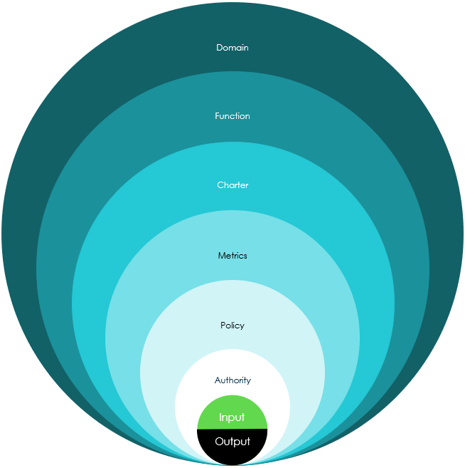
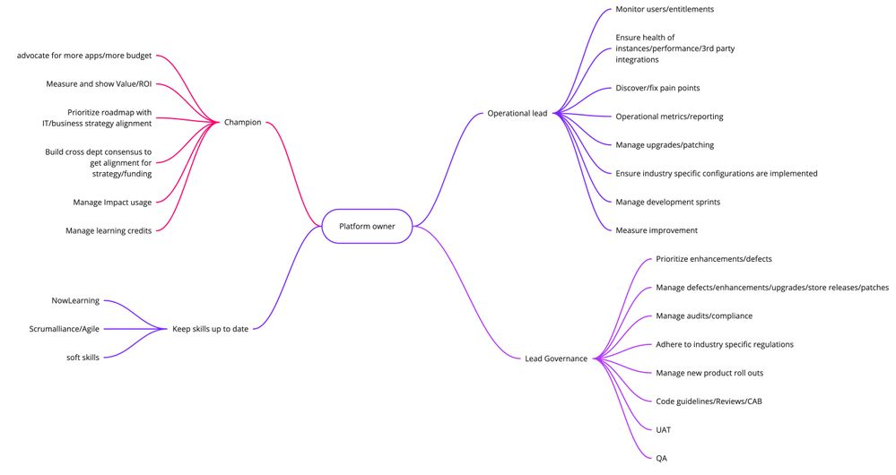
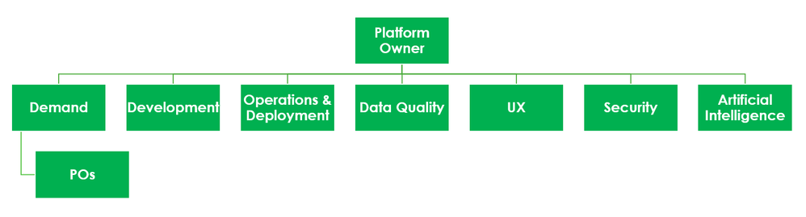
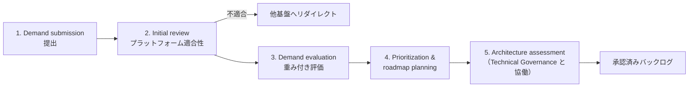
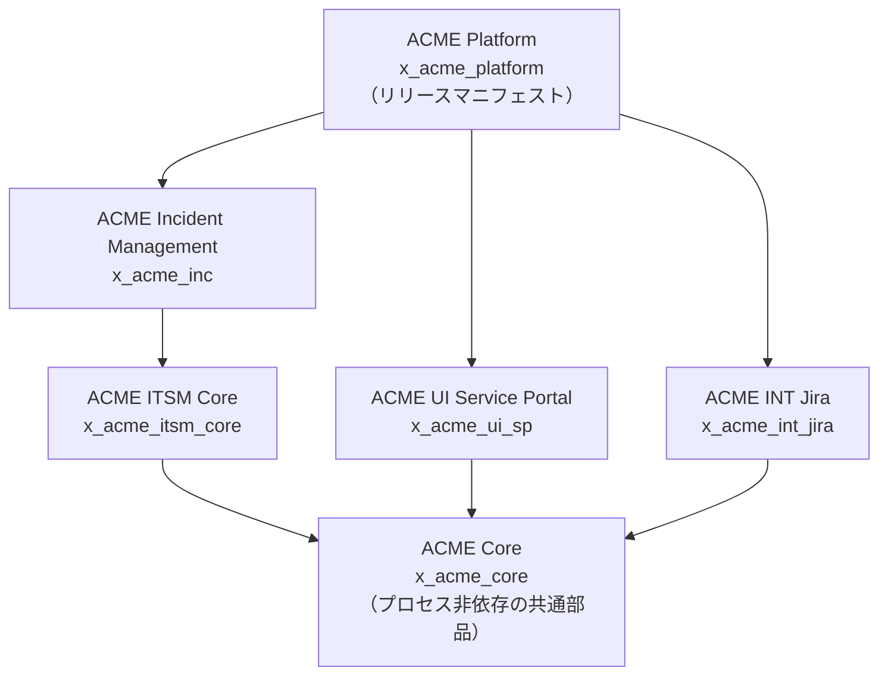
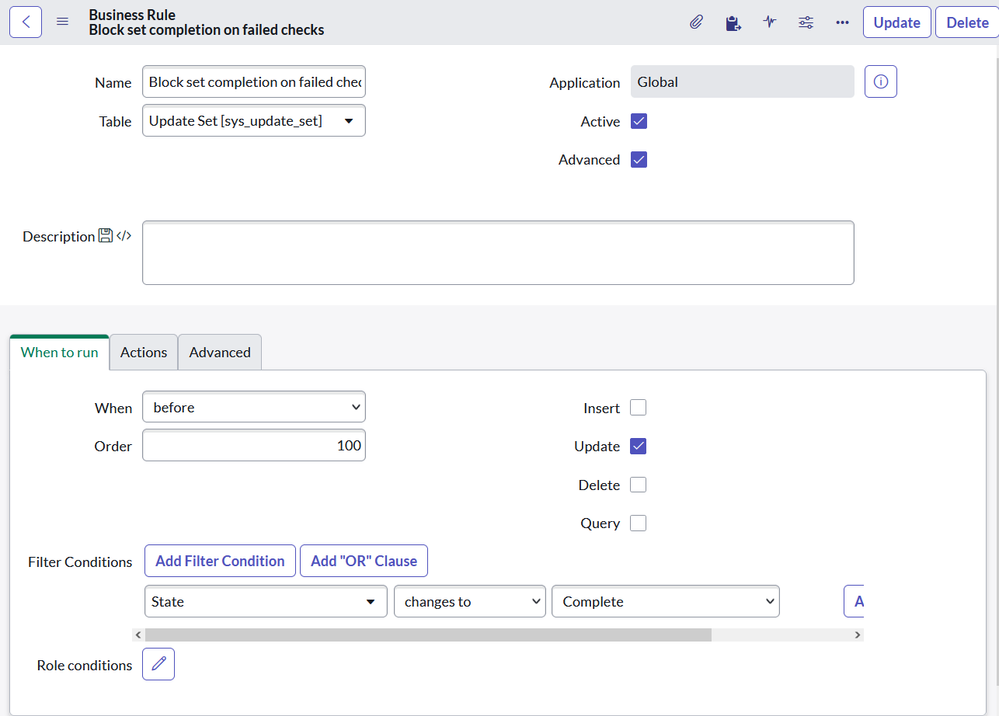

# ガバナンスとCoEの実践（Governance and CoE in Practice）

## 概要

本ファイルは、ServiceNow プラットフォームのガバナンス（Governance、統治）と CoE（Center of Excellence、センター・オブ・エクセレンス）を**実際に回すための知見**をまとめる。扱う範囲は次の 5 つである。

1. Platform Owner（プラットフォームオーナー）の役割・権限・育成
2. デマンド受付（Demand intake）の実践
3. アーキテクチャレビュー委員会（Technical Governance Board / Architecture Review Board、ARB）の運営
4. 標準化（Configure → Integrate → Customize の原則、命名規約、ポリシー体系）
5. 開発ガイドライン（スコープ方針、委任開発、Instance Scan による自動ガードレール、Definition of Ready / Done）

ガバナンス体制の**基本形**（Platform team の構成、3 つのボードの定義、Demand Management アプリの状態遷移、リリース管理、変更凍結、ライセンス運用、運用 KPI）は [運用とガバナンス](../03_導入編/12-operations-governance.md) に記載済みである。本ファイルはその前提の上で、「誰が何を決めるか」「どこで詰まるか」「どう自動化して形骸化を防ぐか」に焦点を当てる。

本ファイルの記述の多くは ServiceNow 公式ドキュメントではなく、ServiceNow 社員・パートナーによる ServiceNow Community の記事に依拠する。ServiceNow 公式はガバナンスの「枠組み（3 ドメイン、3 ボード、必須ロール）」と「ツール（AEMC、Instance Scan、委任開発）」を提供しているが、ボードの運営方法や判断基準の詳細は規定していないためである。公式以外に依拠する記述には `【第三者情報】`、実務上の一般的知見には `【経験則】` を付す。

関連ファイル：

- [運用とガバナンス](../03_導入編/12-operations-governance.md)（ボード・Demand・リリース・KPI の基本）
- [カスタマイズと技術的負債](./02-customization-technical-debt.md)
- [スクリプトのベストプラクティスとアンチパターン](./07-scripting-best-practices.md)
- [アプリケーション開発](../02_リファレンス/platform/app-development.md)
- [アップデートセットとクローン](../02_リファレンス/platform/update-sets-cloning.md)
- [Automated Test Framework (ATF)](../02_リファレンス/platform/automated-test-framework.md)
- [Strategic Portfolio Management（PPM）](../02_リファレンス/spm/strategic-portfolio-management.md)
- [定着化と組織変革](./13-adoption-change-management.md)
- [Now Assist / AI Agents 導入の知見](./10-ai-adoption-lessons.md)

---

## 1. ガバナンスの全体像

### 1.1 公式の 3 ドメイン

ServiceNow 公式ドキュメント「Governing app development」（Brazil 版、2026-09-10 更新）は、アプリ開発のガバナンスを次の 3 種類に分け、組織は 3 つすべてを整備すべきとしている。[出典](https://www.servicenow.com/docs/r/ja-JP/application-development/governing-app-development.html)

| ガバナンス種別 | 内容 | 主なステークホルダー |
|---|---|---|
| Strategic governance（戦略ガバナンス） | アプリ開発をデジタルトランスフォーメーションの目標に整合させる。何を作るか、成功をどう定義・測定するか、予算とリソースに基づき誰が作れるかを決める | Executive sponsor、事業部門（LOB）リーダー、CIO、ESM ディレクター、プログラムマネージャー、ビジネスアナリスト |
| Technical governance（技術ガバナンス） | 開発プラクティス、テストとデプロイの権限、開発者トレーニングなど技術面を管理する | Platform architect、Platform owner、セキュリティ／コンプライアンスリード |
| Portfolio governance（ポートフォリオガバナンス） | アプリの申請・受付（intake）プロセス、サポート・保守・更新の要件、廃止（deprecation）の時期を定める | ポートフォリオ／サービスオーナー、ベンダーマネージャー、QA リード |

同ページは、ステークホルダーがガバナンスモデルに合意した後、**App Engine Management Center（AEMC）**でそのモデルを大規模に実装・強制できるとしている（intake 管理、パイプライン構成、開発者生産性の把握、開発環境横断のインサイト、テストとデプロイ）。[出典](https://www.servicenow.com/docs/r/ja-JP/application-development/governing-app-development.html)

ServiceNow の Customer Success サービス Impact の「ServiceNow Governance」オファリングも同じ 3 ドメイン（strategy / portfolio / technical）に対し、Executive Steering Board・Demand Board・Technical Governance Board の 3 ボードを設計する。[出典](https://www.servicenow.com/docs/r/VD5jAD3VgRc~i0AwgqwfEQ/Nvj8oOhwhdW2rvC43pyEqA)（Yokohama 版 Impact ドキュメント、2025-01-30 更新。Australia 版での変更は公開情報では確認できず）

### 1.2 ドメイン・ボード・ツールの対応

| ドメイン | ボード（決める場） | ServiceNow 上の主なツール | 本ファイルの章 |
|---|---|---|---|
| Strategic | Executive Steering Board | Strategic Portfolio Management（Strategic Planning）、Performance Analytics | 2 章（Platform Owner） |
| Portfolio | Demand Board | Demand Management（`dmn_demand`）、Idea Portal、Service Catalog、AEMC の Intake requests | 3 章 |
| Technical | Technical Governance Board（ARB） | Instance Scan、AEMC（Pipelines、App Readiness report）、ReleaseOps、ATF、委任開発 | 4〜6 章 |

ツール名はそれぞれの公式ページ（本文各節の出典）に基づく。ボードとツールの対応付けは `【経験則】`。

### 1.3 Board と Forum を分ける考え方（Governance Topology）

ServiceNow 社員 Jakob Anker Nielsen の Community 記事「The Governance Topology V.1」（2025-04-26。記事自体は ServiceNow の公式見解ではないと明記）は、ガバナンス機能を次の 2 種類に分けることを提案している。`【第三者情報】` [出典](https://www.servicenow.com/community/in-other-news/the-governance-topology-v-1/ba-p/3245559)

| 種類 | 役割 | 例 |
|---|---|---|
| Board（ボード） | 管理的機能。ポリシーを定め、改善する | Executive Board、Portfolio Board、Technical Governance Board |
| Forum（フォーラム） | 運用的機能。ポリシーを適用して個別の意思決定を行う | Demand Forum、Process Forum、Architectural Authority Forum、Technical Authority Forum、Design Authority Forum、Security Authority Forum |

同記事は、実際にはボードとフォーラムの役割を分離している企業は少ないと述べている。それでも、**「ルールを作る会議」と「ルールを当てはめる会議」を分ける**と、ARB が個別案件の審査で手一杯になり標準の改訂が止まる問題（4.6 節）を避けやすい。`【経験則】`

*図：The Governance Onion*
外側から内側へ「Domain（ドメイン）」「Function（機能：Board / Forum）」「Charter（憲章）」「Metrics（指標）」「Policy（ポリシー）」「Authority（権限）」の同心円が重なり、中心に「Input（入力）」と「Output（出力）」がある。ガバナンス機能を設計するときは、外側（どのドメインのどの機能か）から順に決め、最後に何を受け取り何を出すかを定義する、という構造を表す。出典：https://www.servicenow.com/community/in-other-news/the-governance-topology-v-1/ba-p/3245559 （取得日：2026-11-04）

同記事の構成要素の定義：

| 構成要素 | 意味 |
|---|---|
| Domain | Strategic / Portfolio / Technical |
| Function | Board または Forum |
| Charter | その機能が何で、なぜ存在し、どう・いつ運営されるか |
| Metrics | 有効性の指標（意思決定数、不適合数、要求数など） |
| Policy | その機能が適用しなければならない標準 |
| Authority | 意思決定権限とエスカレーションの閾値 |
| Input / Output | 判断対象（アイデア、デマンド、設計、成果物）と、判断の産物（記録、計画、ポリシー） |

`【第三者情報】` [出典](https://www.servicenow.com/community/in-other-news/the-governance-topology-v-1/ba-p/3245559)

### 1.4 ガバナンスの規模を合わせる（Right-sizing）

ServiceNow Community の Chris Pearson による連載（2025-02）は、ServiceNow の正式なホワイトペーパーが示すボード体系は「大きな組織的フットプリントを必要とする」と述べ、組織規模に合わせてガバナンスを適正化（right-size）すべきとしている。同記事が挙げる、ガバナンスで得たい成果は次の 4 つである。`【第三者情報】` [出典](https://www.servicenow.com/community/developer-blog/right-sizing-servicenow-governance/ba-p/3167126)

1. 業務要求を共通の方法でレビューする
2. 不要なカスタマイズと技術的負債を排除する
3. コーディングと開発のベストプラクティスを徹底する
4. ビジネス成果に整合した複数年ロードマップを持つ

規模別の実装例（`【経験則】`。Pearson 連載の小規模・中規模・大規模向け記事の記述と整合させている）：

| 規模 | Platform Owner | デマンド受付 | 技術レビュー | Executive Steering |
|---|---|---|---|---|
| 小規模（Platform team 1〜3 名） | リード開発者と兼務することがある | カタログアイテム＋RITM、または Idea / Demand | Platform Owner と開発者のペアレビュー、Instance Scan で自動化 | 既存の IT 運営会議の 1 議題として扱う |
| 中規模（4〜15 名） | 専任 | Demand Management または簡易 Demand board（月次） | 定例 ARB（月次）。BA・開発者がカスタマイズ要否を一次判定 | 四半期 |
| 大規模（複数事業部・複数パートナー） | 専任＋製品ごとの Product Owner | Demand board（隔週〜月次）＋製品別フォーラム | ARB＋Design/Security 等のフォーラム、階層型レビュー（4.3 節） | 四半期〜半期 |

---

## 2. Platform Owner の役割

### 2.1 公式の定義

ServiceNow の Impact ドキュメント「ServiceNow Governance」オファリングは、ガバナンス支援を受ける顧客側の**必須ロール**として ServiceNow Executive Sponsor（ServiceNow に対する主たる戦略上の窓口）と Platform Owner の 2 つを定義している。Platform Owner の定義は次のとおり。[出典](https://www.servicenow.com/docs/r/VD5jAD3VgRc~i0AwgqwfEQ/Nvj8oOhwhdW2rvC43pyEqA)

> Platform Owner は、プラットフォーム全体の説明責任（overall accountability）を負い、System Administrator を率いて監督し、チームをビジネス戦略および ServiceNow ロードマップと整合させ、プラットフォームガバナンスに能動的に参加する。（要旨）

Impact の「Technical Governance」アクセラレーター（Advanced / Total パッケージで提供）は、要請する顧客側リソース（Requested customer resources）のうち Platform Owner のみを必須（required）とし、その他の顧客側リソースとして Platform Architect と Executive Sponsor を挙げる。[出典](https://www.servicenow.com/docs/bundle/yokohama-impact/page/product/impact/reference/technical-governance.html)

| ロール | Technical Governance アクセラレーターでの定義（要旨） |
|---|---|
| Platform Owner（必須） | 上記の定義と同じ |
| Platform Architect | プラットフォーム、関連プロセス・システム、ポリシーや組織要件を俯瞰的に把握する |
| Executive Sponsor | ServiceNow に対する主たる戦略上の窓口 |

同アクセラレーターは、顧客に次のインプットを求める：ガバナンス体制文書（憲章、ボード参加者）、前提となる Strategy Governance・Portfolio Governance・Architecture Blueprint の各 Impact アクセラレーターの完了（CoE 憲章作成の前提）、組織図、IT ガバナンス文書、現状のアーキテクチャブループリント、Platform team の役割と責任、技術ポリシー文書（プラットフォーム管理ポリシー、連携概要、クローン手順、SLA）。また **ServiceNow は顧客の技術ガバナンスプロセスやポリシーを開発・運営する責任を負わない**と明記している。[出典](https://www.servicenow.com/docs/bundle/yokohama-impact/page/product/impact/reference/technical-governance.html)

→ 実務上の含意：ガバナンスは ServiceNow 社やパートナーに「外注」できない。Platform Owner を顧客社内に置くことが前提である。`【経験則】`

### 2.2 実務上の責務（Platform Owner の「多くの帽子」）

ServiceNow Community の Platform Owners Blog（ServiceNow 社員 Britta、2024-05-02）は、Platform Owner の責務をマインドマップで示している。`【第三者情報】` [出典](https://www.servicenow.com/community/platform-owners-blog/platform-owners-wear-many-hats/bc-p/3128660)

*図：Platform owners wear many hats（Platform Owner の責務マインドマップ）*
中央の「Platform owner」から 4 つの枝が出る。①「Champion（推進者）」：アプリ・予算拡大の提唱、価値／ROI の測定と提示、IT／事業戦略に整合したロードマップの優先順位付け、戦略・予算に関する部門横断の合意形成、Impact の利用管理、学習クレジットの管理。②「Operational lead（運用リード）」：ユーザーとエンタイトルメントの監視、インスタンス・性能・サードパーティ連携の健全性確保、ペインポイントの発見と解消、運用メトリクス／レポート、アップグレード／パッチ管理、業界固有設定の実装確認、開発スプリントの管理、改善の測定。③「Lead Governance（ガバナンス主導）」：機能拡張・不具合の優先順位付け、不具合・機能拡張・アップグレード・Store リリース・パッチの管理、監査／コンプライアンス対応、業界規制の順守、新製品のロールアウト管理、コードガイドライン・レビュー・CAB、UAT、QA。④「Keep skills up to date（スキル維持）」：Now Learning、Scrum Alliance／Agile、ソフトスキル。出典：https://www.servicenow.com/community/platform-owners-blog/platform-owners-wear-many-hats/bc-p/3128660 （取得日：2026-11-04）

Platform Owners Forum のスレッド「Responsibility of Platform Ownership at Your Company」（2026-03〜06）では、実務者が次のように定義している。`【第三者情報】` [出典](https://www.servicenow.com/community/platform-owners-forum/responsibility-of-platform-ownership-at-your-company/td-p/3508791)

- 質問者は、真のプラットフォームオーナーシップを「アップグレード容易性の保護、データモデル規律の徹底、無秩序なカスタマイズの防止、開発標準の設定、エンタープライズアーキテクチャとの整合」と定義し、「強い Platform Owner は未来を守る」と述べている。
- 回答者の 1 人は「多くのロールがデリバリーを最適化するのに対し、Platform Owner は持続可能性（sustainability）を最適化する」とし、責務として次を挙げる：プラットフォームのビジョンと複数年ロードマップ、事業戦略（IT・HR・Legal 等）のケイパビリティへの翻訳、チーム横断の優先順位、ボトルネックにならないガードレールの設定、ガバナンスと意思決定権（技術チームと協働した build vs configure 判断を含む）、定着推進とビジネス成果による価値測定、アーキテクチャ／デリバリーとの協働（置き換えではない）。
- 別の回答者は、ロードマップとデマンドの形成、Platform team とサービスプロバイダーの戦略・ポリシーへの整合、インスタンスとエスカレーションの所有、プロダクトバックログの管理と優先順位付け、UX の一貫性を保つ設計判断の主導を挙げる。

### 2.3 9 つのステークホルダーロールと Platform Owner の権限

ServiceNow 社員 Sascha Wildgruber の Community 記事「Governance or no Governance. That is the Question.」（2025-01-24）は、プラットフォーム運営を監督するために必要な 9 つのステークホルダーロールを定義している。`【第三者情報】` [出典](https://www.servicenow.com/community/developer-articles/governance-or-no-governance-that-is-the-question/ta-p/3158504)

*図：ガバナンスボディのステークホルダーロール*
最上段に「Platform Owner」があり、その下に横一列で「Demand」「Development」「Operations & Deployment」「Data Quality」「UX」「Security」「Artificial Intelligence」の 7 ロールが並ぶ。「Demand」の下にさらに「POs（Product Owners）」がぶら下がる。Platform Owner がすべてのロールの上位にあり、Product Owner は Demand ロールから日常業務を委任される関係を表す。出典：https://www.servicenow.com/community/developer-articles/governance-or-no-governance-that-is-the-question/ta-p/3158504 （取得日：2026-11-04）

| # | ロール | 責任 |
|---|---|---|
| 1 | Platform Owner | プラットフォームを所有し、最終意思決定権（ultimate decision power）を持つ。あらゆる対立・意思決定の最上位エスカレーション先。各ロールに人が配置されていることに責任を負う |
| 2 | Demand | 要件を特定・優先順位付けし、新規・変更機能を承認・テストする |
| 3 | Product Owners | 特定のプラットフォーム領域または業務／IT プロセス群の要件を特定・文書化・優先順位付けする。通常 Demand から日常業務を委任される |
| 4 | Development | 全開発者の成果物品質に責任を持つ。Coding Guideline と自動テストを所有し、開発着手前の要件記述基準（Definition of Ready）を定める |
| 5 | Operations and Deployment | 全インスタンスの管理者作業と、非開発インスタンスへのアプリ配備に責任を持つ。運用安定性と、リリースが意図どおりに配備されることに注力 |
| 6 | Data Quality | 本番データの正確性・完全性、および不要データのアーカイブ・削除に責任を持つ。各テーブルをいずれかのステークホルダーに対応付ける。共有されることが多い |
| 7 | User Experience | 機能が適切・使いやすく・アクセシブルであることを保証。ユーザーフィードバックと利用分析を監督 |
| 8 | Security | ペルソナごとのアクセス可否の文書化から、自動・手動テスト、本番監視までのセキュリティを監督 |
| 9 | Artificial Intelligence | 開発・本番における AI ベースの活動全般（AI 結果の監督・分析・監視） |

同記事の運営ルール：

- 各ステークホルダーはバックログ項目を追加でき、優先順位付けに対して対等な発言権を持つ。
- 各ステークホルダーは、ゲートキーパー（デプロイ可否と時期を判断する人）が承認前に確認すべき品質ゲート基準を定義できる。
- Data Quality と Security は、本番監視のための Instance Scan チェックの追加・更新を要求できる。

[出典](https://www.servicenow.com/community/developer-articles/governance-or-no-governance-that-is-the-question/ta-p/3158504)

### 2.4 Platform Owner・Architect・Manager・Product Owner の役割分担（RACI 例）

公式の RACI は公開情報では確認できず。以下は 2.1〜2.3 節の情報を基にした `【経験則】` の分担例である（R = 実行責任、A = 説明責任、C = 協議、I = 報告）。

| 意思決定・活動 | Platform Owner | Platform Architect | Platform Manager（運用リード） | Product Owner（製品別） | Executive Sponsor |
|---|---|---|---|---|---|
| ビジョン・複数年ロードマップ | A/R | C | I | C | C（承認） |
| 予算・ライセンス追加 | R | C | C | C | A |
| デマンドの優先順位（プラットフォーム横断） | A | C | I | R | I |
| 製品内のバックログ順位 | C | I | I | A/R | — |
| 技術標準・開発ガイドライン | A | R | C | I | — |
| カスタマイズ可否（ARB 判断） | A（最終エスカレーション） | R（議長） | C | C | — |
| リリース可否・本番配備 | A | C | R | C | — |
| アップグレード計画 | A | R（技術検証） | R（日程・調整） | C（業務検証） | I |
| ユーザー・ロール・ライセンス運用 | A | I | R | I | — |
| パートナー／AMS 管理 | A/R | C | C | C | I |

小規模組織では Platform Owner が Platform Architect と Platform Manager を兼ねることが多い（Pearson の小規模向け記事は「Platform Owner がリード開発者を兼ねることもある」としている。`【第三者情報】` [出典](https://www.servicenow.com/community/developer-blog/demand-governance-for-small-companies/ba-p/3168130)）。兼務時は、**自分で作ったものを自分で承認する**状態になるため、Instance Scan による自動チェック（6.4 節）と、外部（パートナーや ServiceNow Impact）による定期レビューで補う。`【経験則】`

### 2.5 Platform Owner に必要な権限（決裁権の明文化）

Platform Owner が機能しない最大の理由は、「責任はあるが権限がない」ことである。`【経験則】` 次の権限を憲章（charter）に明記しておく。

| 権限 | 内容 | 根拠となる情報 |
|---|---|---|
| 最終意思決定・エスカレーション先 | ボード間・ステークホルダー間の対立を最終判断 | Wildgruber 記事の「ultimate decision power」`【第三者情報】` |
| デマンドの却下・延期 | 戦略外・プラットフォーム不適合の要求を他基盤へ振り向ける | Dames 記事の「他のエンタープライズプラットフォームへのリダイレクト」`【第三者情報】`（3.4 節） |
| 本番配備の停止 | 品質ゲート未達のリリースを止める | `【経験則】` |
| 本番 `admin` の付与承認 | 本番の管理者権限を最小化する | [セキュリティ強化の実践](./12-security-hardening-practice.md) 参照 |
| パートナー成果物の受入可否 | 開発ガイドライン違反（Instance Scan の P1/P2 指摘など）の受入拒否 | `【経験則】` |
| 予算提案 | ライセンス追加・プラットフォーム投資の起案 | マインドマップの「advocate for more apps/more budget」`【第三者情報】` |

### 2.6 Platform Owner の育成と認定

ServiceNow は Platform Owner 向けの学習パスと認定を提供している。

| 項目 | 内容 | 出典 |
|---|---|---|
| Certified Platform Owner Associate（CPOA） | 中級（Intermediate）。ServiceNow または Platform Owner の経験 3〜5 年を想定。ロードマップへの貢献、ユーザーフィードバックの取り込み、チーム横断の協働を行い、「上位者の指導の下で戦術的責務を遂行する準備」を認定する。取得要件：Platform Owner Career Journey の修了または 3〜5 年の経験、監督付き試験の合格、年次の Certification Maintenance Program 費用支払いとデルタ試験 | [Credly](https://www.credly.com/org/servicenow-new/badge/certified-platform-owner-associate-cpoa) `【第三者情報】`（認定発行元は ServiceNow） |
| Credly 上のスキル | Compliance Expertise、Conflict Resolution、Data Analytics、Organizational Change Management、Platform Security、Roadmap Development、ServiceNow Governance、Stakeholder Management、Strategic Planning、Technical Leadership | 同上 |
| Certified Professional Platform Owner（上位） | ServiceNow Community で Beta 試験が告知されている（2026-01-09、ServiceNow 社員の投稿。受験には CPOA が前提）。GA 時期・要件の詳細は公開情報では確認できず | [Community 告知](https://www.servicenow.com/community/training-and-certifications/certified-professional-platform-owner-beta-exam-is-now-available/ta-p/3464550) `【第三者情報】` |
| Platform Owner Career Journey | ServiceNow University の学習パス。2025-05-02 に公開が告知（Platform Owner 向けコース、K25 でのベータ試験を案内）。2026-04 に Expert レベルの公開も告知 | [Community 告知](https://www.servicenow.com/community/platform-owners-forum/platform-owner-career-journey-is-now-live/m-p/3253345)、[Expert レベル告知](https://www.servicenow.com/community/platform-owners-forum/the-expert-platform-owner-career-journey-level-is-live/m-p/3520919) `【第三者情報】` |

認定体系全体は [学習パスと認定資格](../01_入門編/09-learning-path.md) を参照。

### 2.7 Platform Owner のアンチパターン（`【経験則】`）

| アンチパターン | 症状 | 対策 |
|---|---|---|
| 名ばかり Platform Owner | 情報システム部の課長が兼務で任命され、意思決定は各事業部が勝手に行う | 2.5 節の権限を憲章に明記し、Executive Sponsor が任命文書で裏付ける |
| 「最強の管理者」型 | Platform Owner 自身が本番 `admin` で日々設定変更し、ボトルネックかつ単一障害点になる | 実作業は Platform Manager／管理者に委任。Platform Owner は意思決定と優先順位に集中 |
| ベンダー任せ | 導入パートナーや AMS がロードマップと標準を事実上決めている | 2.1 節のとおり公式もガバナンスの外注を想定していない。標準・バックログの所有権を社内に置く |
| デリバリー偏重 | リリース本数・チケット消化数のみで評価され、技術的負債が蓄積 | 持続可能性指標（Instance Scan 指摘数、カスタマイズ件数、アップグレード所要日数）を KPI に入れる（4.7 節） |
| ITSM だけの Owner | HR・CSM 等が別組織で独自にインスタンス／スコープを運営し、データモデルが分裂 | 「1 プラットフォーム 1 Owner」原則。製品ごとに Product Owner を置き、Platform Owner の下に統合 |

---

## 3. デマンド受付（Intake）の実践

Demand Management アプリの状態遷移・ロール（`it_demand_manager`、`it_demand_user`）・変換先エンティティ、およびデマンド管理の 4 ステップは [運用とガバナンス 4 章](../03_導入編/12-operations-governance.md) を参照。本章は受付の**設計と運用**に絞る。

### 3.1 受付時に必須とする情報

ServiceNow Community の Joe Dames の記事「ServiceNow Demand Governance」（2026-03-10）は、デマンドの提出元を「自動化を求める事業部門」「ワークフロー改善を求めるサービスオーナー」「アーキテクチャ改善を提案する Platform team」とし、各提出に次の情報を含めるべきとしている。`【第三者情報】` [出典](https://www.servicenow.com/community/developer-blog/servicenow-demand-governance/ba-p/3505326)

| 必須項目 | 受付フォーム上の実装例（`【経験則】`） |
|---|---|
| Business objective（ビジネス目的） | 複数行テキスト。「何を・なぜ」 |
| Expected outcomes（期待成果） | 測定可能な指標（処理時間、件数、CSAT 等）を選択＋自由記述 |
| Estimated benefits（推定効果） | 年間工数削減時間、コスト削減額の概算 |
| Required integrations（必要な連携） | 連携先システムの参照（CMDB の Business Application を参照させると後工程で便利） |
| Potential users（想定ユーザー） | 部署・人数・ペルソナ（ライセンス影響の判断に必須） |

ライセンス影響の観点から「想定ユーザーが fulfiller（処理者）か requester（依頼者）か」を受付時に聞いておくと、後から追加ライセンスが発覚する事態を防げる。詳細は [ライセンスコスト最適化](./06-license-cost-optimization.md)。`【経験則】`

### 3.2 規模別の受付ツール選択

| 選択肢 | 前提ライセンス | 向くケース | 出典・確度 |
|---|---|---|---|
| Demand Management（SPM）＋ Idea Portal | SPM（Demand Management を含むパッケージ） | 中〜大規模。アセスメントによるスコアリング、Project / Enhancement への変換まで一貫管理 | [公式 Demand workflow](https://www.servicenow.com/docs/r/it-business-management/strategic-planning/demand-process-flow.html) |
| Idea / Demand モジュール（agile ライセンスがある場合） | Agile Development を含むライセンス | 小規模でもアイデア→デマンド変換を使いたい | Pearson 記事 `【第三者情報】` [出典](https://www.servicenow.com/community/developer-blog/demand-governance-for-small-companies/ba-p/3168130) |
| Service Catalog のカタログアイテム（RITM＋タスク） | ITSM 等の標準 | SPM 未購入の小規模。各提出が RITM になり、タスクでレビューを促す | 同上 `【第三者情報】` |
| AEMC の Application Intake | App Engine（App Engine Studio / Creator Studio 利用） | 市民開発者（citizen developer）によるアプリ作成申請の受付 | 3.3 節（公式） |

Pearson 記事の実務ルール：**すべてのデマンドを 1 か所に集めて横並びで比較できるようにする**こと、**口頭や雑談で出たアイデアも正式な受付フォームへ誘導する**こと。`【第三者情報】` [出典](https://www.servicenow.com/community/developer-blog/demand-governance-for-small-companies/ba-p/3168130)

### 3.3 AEMC による市民開発アプリの Intake

App Engine Studio / Creator Studio を使った市民開発では、「誰が開発してよいか」自体がデマンドになる。AEMC（App Engine Management Center）はこれを Intake request として管理する。[出典](https://www.servicenow.com/docs/r/de-DE/application-development/app-engine-management-center/manage-intake-application-requests.html)（Brazil 版、2026-09-10 更新）

| 項目 | 仕様 |
|---|---|
| 必要ロール | `sn_app_eng_notify.app_engine_admin` |
| 前提 | Application Intake アプリケーションが構成済みであること |
| メニュー | All > App Engine > Administration > App Engine Management Center (AEMC) |
| 確認場所 | AEMC ダッシュボードに保留中（Pending）の Intake request 数が表示される。件数または **Requests** ページから一覧へ |
| レビュー項目 | **Details** タブで内容確認。**Development instance**（開発者が希望する開発インスタンス）を確認。そのインスタンスにユーザーが存在しない場合はメッセージが表示され、手動で追加が必要 |
| Permission type（Administration セクション） | **Select group(s)**：App Engine Studio User Limited / App Engine Studio Users / Creator Studio Restricted Users / Creator Studio Users のいずれか（複数可）に追加。選択可能なグループは `sn_app_intake_permission_type` テーブルで管理。**I will manually provision user**：手動でグループ付与。**Do not give requestor permissions**：申請時点では付与しない |
| 状態 | Pending（審査待ち）／ Approved（承認）／ Rejected（却下） |
| 承認時 | ユーザーが App Engine Studio User グループに追加され AES User ロールが付与される。承認インスタンス上で App Engine Studio による開発が可能になり、プロビジョニングされたインスタンスへのリンク付きメールが届く |
| 却下時 | 却下メールが送信される。却下された申請は編集不可だが、新規申請は可能 |
| 補足 | Creator Studio Restricted Users からの App request は **Requests** ページの **App** タブで扱う |

AEMC の Requests ページは、Intake requests・App requests・Collaboration requests・Deployment requests（ReleaseOps）・Deployment requests - Legacy（App Engine）を承認状態別に一覧する。[出典](https://www.servicenow.com/docs/r/application-development/app-engine-management-center/aemc-user-interface.html)

> **Brazil での変更:** 上記の AEMC ページは Brazil 版として公開されている（2026-09-10 更新）。AEMC は ServiceNow Store 配布のアプリでありファミリーリリースとは独立に更新される。Store のリリースノートでは、26.1.0（2024-08）で Creator Studio ユーザーグループへのプロビジョニング、28.2.1（2025-12）で ReleaseOps のリリース・デプロイ要求の管理が追加されている。[出典](https://www.servicenow.com/docs/r/store-release-notes/store-rn-plat-app-engine-mgmt-center.html) Australia と Brazil で Intake の仕様差は公開情報では確認できず。

**実務上の論点**（`【経験則】`）：

- Intake の承認条件（例：基礎トレーニング修了、業務責任者の承認、扱うデータの機密区分）を Platform Owner が事前に定め、AEMC 管理者はそれに従って機械的に判断する。案件ごとに判断が揺れると市民開発者の不満が溜まる。
- 「Select group(s)」で付与するグループを用途別に絞る（Limited / Restricted 系をデフォルトにし、フル権限は実績のある開発者に限定）。
- 市民開発アプリのライセンス消費（カスタムテーブル数など）を Intake 時点で確認する。[ライセンスモデル](../03_導入編/01-licensing-model.md) 参照。

### 3.4 初期スクリーニングと評価基準

Dames 記事は、評価の前に「その要求が ServiceNow プラットフォームに適しているか」を確認し、強みから外れる要求は**他のエンタープライズプラットフォームへ振り向けてよい**としている。ServiceNow の適する用途として、システム横断のワークフロー自動化、サービスリクエスト管理、ケース管理、エンタープライズサービスポータル、運用プロセス自動化を挙げる。`【第三者情報】` [出典](https://www.servicenow.com/community/developer-blog/servicenow-demand-governance/ba-p/3505326)

同記事の評価基準と推奨ウェイト：

| 評価基準 | 推奨ウェイト |
|---|---|
| Strategic alignment（戦略整合） | High |
| Expected business value（期待ビジネス価値） | High |
| Architectural impact（アーキテクチャ影響） | Medium |
| Implementation effort（実装工数） | Medium |
| Platform reuse potential（再利用可能性） | Medium |

優先順位付けで考慮する要素：規制・コンプライアンス要件、戦略的変革イニシアチブ、事業横断の影響、運用上の緊急度、リソースの空き。アウトプットはロードマップ内で順序付けされたプラットフォームバックログである。`【第三者情報】` [出典](https://www.servicenow.com/community/developer-blog/servicenow-demand-governance/ba-p/3505326)

数値化したスコアリング表の例は [運用とガバナンス 4.3 節](../03_導入編/12-operations-governance.md) を参照。

### 3.5 アーキテクチャ評価との接続

Dames 記事は、デマンド評価の最終段で技術ガバナンス側と次の 4 点を確認するとしている。`【第三者情報】` [出典](https://www.servicenow.com/community/developer-blog/servicenow-demand-governance/ba-p/3505326)

1. 既存のプラットフォーム機能を再利用しているか
2. 不要なカスタマイズを追加していないか
3. 連携はエンタープライズアーキテクチャ標準を満たすか
4. 技術的負債を増やさないか

デマンドのワークフロー（同記事）：

実務では「3 → 5」を直列にすると承認までが長くなるため、大きな案件だけ評価段階で ARB の事前相談（Early design review、4.2 節）を並行させる。`【経験則】`

### 3.6 Demand shaping（要求の事前形成）

Dames 記事は、受付の質を上げるために、提出前の業務部門にプラットフォームの機能、最適なユースケース、アーキテクチャ標準、連携ガイドラインを教育する「Demand shaping」を推奨している。また、ガバナンスとアジリティのバランスとして、適切な範囲で現場判断を認め、複雑な判断だけをボードへ上げるべきとしている。`【第三者情報】` [出典](https://www.servicenow.com/community/developer-blog/servicenow-demand-governance/ba-p/3505326)

Demand shaping の具体策（`【経験則】`）：

| 施策 | 内容 |
|---|---|
| 「ServiceNow でできること」カタログ | 既存の OOTB 機能・導入済みアプリ・再利用可能コンポーネント（共通サブフロー、共通 Script Include）の一覧をナレッジ記事で公開 |
| 受付前相談（オフィスアワー） | 週 1 回、BA／アーキテクトが要望者と 30 分相談。フォーム提出前に OOTB 代替を提示 |
| 却下理由の公開 | 却下・延期したデマンドの理由を要望者に返し、類型をナレッジ化 |
| Fit-to-standard ワークショップ | 大型案件は要件定義前に OOTB デモを見せ、ギャップのみを要件化（[要件定義と設計](../03_導入編/06-requirements-design.md)） |

### 3.7 Definition of Ready（着手可能の定義）

承認済みデマンドを開発に渡す前に、記述が十分かを判定する基準が Definition of Ready（DoR）である。Wildgruber の記事「Definition of Ready and Definition of Done」（2025-02-21）は、DoR を「バックログ項目を開発チームが着手できることを確認するチェックリスト」とし、すべての疑問が解消済みであることを意味しないとした上で、次の項目を推奨している。`【第三者情報】` [出典](https://www.servicenow.com/community/developer-articles/definition-of-ready-and-definition-of-done/ta-p/3185162)

| # | DoR 項目 |
|---|---|
| 1 | 望む成果とユースケースの記述 |
| 2 | 影響するアプリケーション |
| 3 | 影響するペルソナと技術ユーザー |
| 4 | 影響するプロセス |
| 5 | 影響するデータエンティティ |
| 6 | 新規・変更フィールド（ラベル含む） |
| 7 | 影響する GUI（Classic、Portal、Mobile） |
| 8 | 対象 GUI 言語 |
| 9 | 影響する通知 |
| 10 | 影響する技術インターフェース |
| 11 | ペルソナごとに必要なアクセス制限 |
| 12 | データ保護・GDPR・コンプライアンス上の影響 |
| 13 | 必要なドキュメント |
| 14 | 想定テストデータ |
| 15 | 想定テストケース |
| 16 | 想定データ品質チェック |

日本企業の実務では、#8（GUI 言語）に「日本語翻訳の要否と翻訳担当」を、#12 に「個人情報保護法上の区分」を加えるとよい。翻訳の扱いは [ローカライゼーション](../02_リファレンス/platform/localization.md) を参照。`【経験則】`

### 3.8 デマンド受付の KPI

Dames 記事が挙げる指標：四半期あたりの評価デマンド数、プラットフォーム戦略に整合したデマンドの割合、平均承認所要時間、優先バックログから提供されたイニシアチブ数。`【第三者情報】` [出典](https://www.servicenow.com/community/developer-blog/servicenow-demand-governance/ba-p/3505326)

追加で計測すると有効な指標（`【経験則】`）：受付から一次回答までの日数（目安：5 営業日以内）、却下・リダイレクト率、承認済みバックログの滞留月数、事業部別のデマンド件数と充足率。

---

## 4. アーキテクチャレビュー委員会（Technical Governance Board / ARB）

### 4.1 憲章（Charter）の標準形

ServiceNow Community の Chris Pearson「Technical Review Boards for Large Enterprises」（2025-02-11）は、技術レビューボードを「技術的意思決定を、会社の戦略ロードマップ、全社アーキテクチャ標準、セキュリティ要件に整合させることでプラットフォームを統治する手段」とし、次の構成を推奨している。`【第三者情報】` [出典](https://www.servicenow.com/community/developer-blog/technical-review-boards-for-large-enterprises/ba-p/3174747)

| 項目 | 推奨内容 |
|---|---|
| 議長 | Platform Architect または Platform Owner |
| メンバー | Platform Architect、Platform Owner、IT ドメインオーナー、プログラムマネージャー、ビジネスアナリスト、QA リード、セキュリティ／コンプライアンスリード、開発リード、UX リード |
| 憲章に書くこと | 技術的意思決定のゲートキーパーとして機能する／デザインパターンとアプローチを定め徹底する／開発標準を徹底する／ベストフィットな利用とデータガバナンスを統治する |
| 責務 | アップグレードの技術面の管理、連携標準とセキュリティ・認証標準の設定、コーディングベストプラクティスの定義、カスタマイズ申請の承認プロセスの所有 |
| 頻度 | 1〜2 か月ごと。未処理の技術レビュー要求が溜まる場合はそれ以上 |
| 意思決定方法 | 多数決、合意、序列など、ボード自身が決める |
| 判断の基本姿勢 | 「Out of the box - first approach」。プラットフォームコードへの変更を最小にし、アップグレードを「月単位」ではなく「日・週単位」に保つ |

Joe Dames「Technical Architecture Governance on the ServiceNow Platform」（2026-03-10）は、メンバーに統合アーキテクト（integration architects）とエンタープライズアーキテクトを加え、「設計提案のレビュー、アーキテクチャ上の質問への回答、プラットフォーム変更の承認」を定例で行うとしている。`【第三者情報】` [出典](https://www.servicenow.com/community/developer-blog/technical-architecture-governance-on-the-servicenow-platform/ba-p/3505328)

### 4.2 何を ARB にかけるか（レビュートリガーとチェックポイント）

Dames 記事は、**すべての変更をレビューすることは目的ではない**とし、ARB にかける設計を次に限定している。`【第三者情報】` [出典](https://www.servicenow.com/community/developer-blog/technical-architecture-governance-on-the-servicenow-platform/ba-p/3505328)

- 大規模なカスタム開発
- 複雑な連携
- 新規プラットフォームアプリケーション
- 複数サービスに影響するアーキテクチャ変更

レビューのチェックポイントは 3 段階：

| チェックポイント | タイミング | 目的 |
|---|---|---|
| Early design review | 本格開発の前 | 方式の妥当性、OOTB 代替の有無 |
| Implementation review | 実装中 | 標準への準拠確認 |
| Release review | 本番配備前 | アーキテクチャ上のリスクの最終確認 |

ARB 付議の具体的なトリガー例（`【経験則】`。上記を ServiceNow の構成要素に落としたもの）：

| 区分 | 付議が必要な例 | 付議不要（標準で可）の例 |
|---|---|---|
| データモデル | 新規テーブル作成（特に Task 拡張）、OOTB テーブルへの列追加で他製品へ影響するもの、CMDB クラスの追加 | 自スコープ内テーブルへの列追加 |
| ベースライン変更 | OOTB の Business Rule・Script Include・UI Action・ウィジェットの変更（Customer Updates `sys_update_xml` に記録されるもの） | フォーム／リストレイアウト、UI Policy、通知文面 |
| スコープ | `global` スコープでの新規開発 | 承認済みスコープアプリ内の機能追加 |
| 連携 | 新規連携先、新規認証方式、MID Server 経由の新規接続 | 承認済み Spoke の利用 |
| 製品・プラグイン | 新規プラグイン有効化、Store アプリ導入、サブスクリプション外機能の利用 | 既存アプリのパッチ適用 |
| セキュリティ | ACL の広範な変更、`admin` 相当ロールの新設、外部公開ポータル | 既存ロールへのユーザー追加（グループ経由） |
| AI | 新規 AI Agent、外部 LLM の接続 | 承認済みスキルの対象拡大（別途 AI ガバナンス、6.8 節） |

### 4.3 階層型レビュー（3 レーン）と権限閾値

ARB を単一のゲートにすると、審査待ちが溜まり、現場がレビューを避けるようになる。ServiceNow Community の App Governance Forum への投稿「Platform Governance at Scale — Why Most Frameworks Fail」（2026-04-09）は、200 人規模の IT 組織で隔週開催の ARB に 3 週間のバックログが生じ、**人々が変更を続けながら誰にも知らせなくなった**事例を挙げ、リスクに応じた 3 レーンを提案している。`【第三者情報】` [出典](https://www.servicenow.com/community/app-governance-forum/platform-governance-at-scale-why-most-frameworks-fail/td-p/3522888)

| レーン | 対象 | 方式 |
|---|---|---|
| Lane 1：自動検証 | 低リスクの構成変更 | Instance Scan 等による自動チェック |
| Lane 2：非同期アーキテクチャレビュー | 中程度の作業 | 書面の意思決定記録（decision record）を残す非同期レビュー |
| Lane 3：同期ボードレビュー | 本当に壊しうる変更 | ARB の会議で審議 |

同投稿は、Instance Scan の結果・Update Set の分析・ATF カバレッジをライブダッシュボードに集め、準拠状況を可視化すれば多くのチームが自己修正すると述べ、ガバナンスは「料金所ではなく高速道路のガードレール」であるべきとしている。`【第三者情報】`

レーン振り分けの閾値には、Governance Topology の「Authority Thresholds」が使える。同記事は各意思決定を次の 5 パラメータで評価し、フォーラムの自律範囲を超えるものを上位へエスカレーションする方式を示している（T シャツサイズによる大まかな判断で、厳密な科学ではないと明記）。`【第三者情報】` [出典](https://www.servicenow.com/community/in-other-news/the-governance-topology-v-1/ba-p/3245559)

| パラメータ | 尺度 |
|---|---|
| 既知のビジネス目的があるか | Y / N |
| 技術的負債の増加 | XS〜L |
| コストの増加 | XS〜L |
| 工数の増加 | XS〜L |
| リスクの増加 | XS〜L |

閾値の設定例（`【経験則】`）：

| 条件 | レーン |
|---|---|
| ビジネス目的が Y、かつ 4 項目すべて XS | Lane 1（自動検証のみ） |
| いずれかが S〜M | Lane 2（アーキテクト 1 名による非同期レビュー、3 営業日以内に回答） |
| いずれかが L、または目的が N | Lane 3（ARB 審議） |

同記事は、過去の意思決定を記録すると先例となり、以後の閾値判断の質が上がるとしている。`【第三者情報】`

### 4.4 カスタマイズ申請テンプレート

Pearson「Technical Review Boards for Mid-size Companies」（2025-02-10）は、ビジネスアナリストと開発者を「最前線の防御」と位置付け、カスタム設計のレビューが必要な要件・ストーリーを彼らが旗揚げし、業務側が理由を説明し、Platform Architect が意見を述べ、**ボードが「その技術的負債がビジネス成果に見合うか」を判断する**流れを示している。公平に判断するため標準のサイズ・リスク属性とテンプレートを使い、処理件数・承認数・却下数や、どの部門がカスタマイズを多く要求しているかを追跡すべきとしている。カスタマイズは「よく設計され、重要なビジネス目的に資し、過度な負担なく社内でサポートできる」なら許容しうる、という判断基準も示されている。`【第三者情報】` [出典](https://www.servicenow.com/community/developer-blog/technical-review-boards-for-mid-size-companies/ba-p/3173617)

テンプレート例（`【経験則】`。上記の考え方を項目化）：

| セクション | 記入項目 |
|---|---|
| 1. 背景 | デマンド番号、ビジネス目的、影響ユーザー数 |
| 2. OOTB 検討結果 | 検討した OOTB 機能・Store アプリ・構成での代替案と、採用しない理由 |
| 3. 方式 | 変更対象（テーブル／スクリプト／UI）、スコープ、Customer Updates への影響の有無 |
| 4. サイズとリスク | 4.3 節の 5 パラメータ |
| 5. 運用 | 保守担当、ATF テストの追加計画、ドキュメント |
| 6. アップグレード影響 | 次回アップグレードで Skipped になる可能性、検証手順 |
| 7. 撤去計画 | OOTB が追いついた場合に戻す条件（reversibility） |
| 8. 判断 | 承認／条件付き承認／却下、条件、有効期限、判断者 |

Pearson は、ガバナンスプロセス自体を ServiceNow 上のカスタムアプリで運用することも選択肢として挙げている。`【第三者情報】` 実務では、カスタマイズ申請をカタログアイテム（またはデマンドの関連レコード）として受け付け、承認フローを Workflow Studio で組むことが多い。`【経験則】`

### 4.5 意思決定記録（Decision record）

ARB の判断は必ず記録し、検索可能にする。Governance Topology 記事の「過去の判断が先例になる」という指摘、および 3 レーン提案の「書面の意思決定記録」と整合する。`【第三者情報】` 記録項目の例（ADR：Architecture Decision Record 形式、`【経験則】`）：

| 項目 | 内容 |
|---|---|
| ID・日付・判断者 | ARB-2026-031、2026-10-15、ARB（議長：Platform Architect） |
| 状況（Context） | 何が問題で、どんな制約があったか |
| 決定（Decision） | 採用した方式 |
| 検討した代替案 | OOTB 案、他方式 |
| 結果（Consequences） | 増える負債、運用負荷、アップグレード時の確認事項 |
| 見直し条件 | 次回レビュー時期、または OOTB 機能リリース時 |

保存先は ServiceNow のナレッジベース（ガバナンス専用 KB）が推奨される。ServiceNow Expert Services の Stephen Farrar は、技術ガバナンスのポリシーを ServiceNow のナレッジベースに保存するよう推奨している。`【第三者情報】` [出典](https://www.servicenow.com/community/in-other-news/kick-starting-your-servicenow-technical-governance-journey-part/ba-p/3235452)

### 4.6 ARB のアンチパターン（`【経験則】`）

| アンチパターン | 症状 | 対策 |
|---|---|---|
| 全件審査 | 通知文面変更まで ARB 付議。バックログ化し、現場が「黙って作る」 | 4.3 節の 3 レーン化。Lane 1 を Instance Scan で自動化 |
| 事後審査 | 開発完了後に ARB にかけ、差し戻すと納期遅延になるため事実上承認 | Early design review を必須化（4.2 節） |
| 標準なき審査 | 判断が委員の好みで変わる | 標準（5 章）とテンプレート（4.4 節）を先に作る |
| 記録なし | 同じ議論を繰り返す。担当交代で経緯不明 | 意思決定記録（4.5 節） |
| パートナー不在 | 外部パートナーの設計が ARB を経ずに本番へ | 契約・SOW に ARB 付議と Instance Scan 準拠を明記 |
| 承認後の追跡なし | 条件付き承認の条件（ATF 追加等）が守られない | Implementation / Release review で条件を確認。技術的負債レジスタに登録 |

### 4.7 ARB とガバナンスの有効性指標

Dames「Technical Architecture Governance」は、技術ガバナンスの有効性を次で測るとしている：アップグレード時のカスタマイズ競合の減少、アプリ間で一貫したアーキテクチャパターン、アーキテクチャ上のエスカレーションの減少、プラットフォーム安定性の向上。また技術的負債レジスタ（technical debt register）を維持し、定期的に技術的負債レビューを行い、古いカスタマイズ・レガシー連携・未使用の構成・冗長なワークフローを監視すべきとしている。`【第三者情報】` [出典](https://www.servicenow.com/community/developer-blog/technical-architecture-governance-on-the-servicenow-platform/ba-p/3505328)

Dames「Measuring ServiceNow Governance Success」（2026-03-10）は、ガバナンス全体の指標を次のように整理している（同記事は「3〜5 個のシンプルな指標を追う」ことも推奨）。`【第三者情報】` [出典](https://www.servicenow.com/community/developer-blog/measuring-servicenow-governance-success/ba-p/3505318)

| 分類 | 指標 | 内容・目安 |
|---|---|---|
| Governance Efficiency | 四半期あたりの意思決定数 | ボードで確定した判断の数 |
| Governance Efficiency | ボード出席率 | ステークホルダーの出席率 |
| Governance Efficiency | 開催頻度 | プラットフォームの活動量と比較。記事中のサンプル：Executive Steering Board は四半期、Demand Board は週次、Technical Governance Board は週 2 回 |
| Governance Efficiency | 平均会議時間 | 予定時間内に収まっているか |
| Policy Effectiveness | ポリシー数 | 有効なポリシー数。10〜25 程度が健全 |
| Policy Effectiveness | エスカレーション件数の減少 | 減少していれば日常判断がポリシーで回っている |
| Policy Effectiveness | ポリシー更新頻度 | 少なくとも 24 か月ごとにレビュー |

技術的な健全性の KPI（Instance Scan の指摘数、Impact の Platform Health）は [運用とガバナンス 8.4 節](../03_導入編/12-operations-governance.md) を参照。

---

## 5. 標準化

### 5.1 Configure → Integrate → Customize と OOTB-first

ServiceNow 公式ドキュメント「Customization vs configuration」（Zurich 版、2025-07-31 更新）は、構成（configuration）・カスタマイズ（customization）・パーソナライズ（personalization）を次のように定義している。[出典](https://www.servicenow.com/docs/r/zS6yb8e~gR8BPjeviYdV9g/HbXqNzgkFujD_JafM1cAng)

| 区分 | 定義（要旨） | 例 |
|---|---|---|
| Configuration（構成） | ServiceNow の組み込みツールでアプリの振る舞いを変える。フローやベースラインコードは変更しない。元に戻すのにベースラインコードの変更は不要 | フィールドとフォームの設定、UI レイアウトとボタン、Service Catalog ポータル、ACL、システムプロパティ値 |
| Customization（カスタマイズ） | ベースラインに含まれるフローやコードを変更する。別途追跡され、アップグレードを複雑にしうる | カスタムスクリプト、カスタムテーブル、外部連携、カスタムウィジェット／ポータル、ワークフローの改変 |
| Personalization（パーソナライズ） | ユーザー自身にのみ適用される見た目の調整。ベースライン・サポート・アップグレードに影響しない。管理者が全体に適用する変更は configuration | ダークモード、表示列の選択 |

同ドキュメントのガイダンス：

- 「アプリケーションをカスタマイズする前に、可能な限り構成で対応する」
- カスタマイズは、その変更がアプリ本来の目的を拡張する場合に限る。そうでなければ Creator Studio や ServiceNow Studio など App Engine のツールで新規アプリを作る
- 追加したコードとそのプラットフォームへの影響は顧客が所有する。ServiceNow サポートはそれをデバッグしない
- 既存フィールドを変更せずにフィールドを追加する、オブジェクトのコピーを避ける、一意な名前を付ける、新規開発はスコープアプリを既定とする
- 変更ごとにビジネス上の正当化を文書化し、ATF テストを書き、HealthScan を定期実行し、アップグレードのたびにカスタマイズを検証する
- カスタマイズは Customer Updates テーブルに `sys_update_xml` レコードを作り、アップグレード時に Skipped となる。各レコードについて保持・復元（revert）・マージを判断する

[出典](https://www.servicenow.com/docs/r/zS6yb8e~gR8BPjeviYdV9g/HbXqNzgkFujD_JafM1cAng)

ServiceNow Community の Dames の記事は、アーキテクチャ上のガードレールとして次の 5 つの「ゴールデンルール」を挙げている。`【第三者情報】` [出典](https://www.servicenow.com/community/developer-blog/servicenow-defining-governance-policies/ba-p/3505314)

| # | ゴールデンルール | 意味 |
|---|---|---|
| 1 | Configure → Integrate → Customize | まず構成、次に連携（既存システム・Spoke の活用）、最後にカスタマイズ |
| 2 | Out-of-the-Box First | OOTB 機能を最優先 |
| 3 | API-First Integration Strategy | 連携は可能な限り標準化された API を使う |
| 4 | Keep Data Clean | データ品質を保つ |
| 5 | Design for Automation | 自動化を前提に設計する |

> 注：Customer Success Center の Community 記事には「'out-of-the-box' という言葉の箱から出よう」（OOB というバズワードへの意見記事）も紹介されている。OOTB-first は「何も変えない」ではなく、「変える場合はコストを理解したうえで意図的に」という意味で運用する。`【第三者情報】` [出典](https://www.servicenow.com/community/in-other-news/your-governance-cheat-sheet/ba-p/2534513)

カスタマイズの判断と技術的負債の管理の詳細は [カスタマイズと技術的負債](./02-customization-technical-debt.md) を参照。

### 5.2 ポリシー体系

Dames「ServiceNow Defining Governance Policies」（2026-03-10）は、最小限のポリシー体系として 5 領域を示している。`【第三者情報】` [出典](https://www.servicenow.com/community/developer-blog/servicenow-defining-governance-policies/ba-p/3505314)

| ポリシー領域 | 扱う内容 |
|---|---|
| Platform management | アクセス、開発標準、連携承認、アーキテクチャレビュー |
| Instance management | 環境数、環境ごとに許される作業、デプロイ権限、クローン頻度、本番データ保護 |
| Upgrade management | 準備、カスタマイズレビュー、回帰テスト、リリース検証、ロールバック |
| Data governance | オーナーシップ、品質、スチュワードシップ、同期、ライフサイクル、CMDB 品質、CSDM 整合、命名規約 |
| Demand management | 受付、価値評価、優先順位付け、リソース配分、ロードマップへの組み込み |

ServiceNow Expert Services の Stephen Farrar による連載「Kick-starting your ServiceNow Technical Governance journey」（2025-04）は、技術ガバナンスを **Environment Management／Platform Management／Data Management／Development Management** の 4 ドメインに分け、Platform Management のポリシーとして次を挙げている。`【第三者情報】` [出典](https://www.servicenow.com/community/in-other-news/kick-starting-your-servicenow-technical-governance-journey-part/ba-p/3235452)

| Platform Management のポリシー | 定める内容 |
|---|---|
| Platform Access | 各インスタンスに誰がどのレベルでアクセスするか、付与と削除、一時アクセス、Now Support のアクセス |
| Upgrades and Patching | 手順、承認、テスト、日程、周知、トレーニング、サポートエスカレーション（Now Create の Upgrade Policy を出発点として推奨） |
| Performance Management | 定常的な管理者作業とその頻度・方法（独自ポリシーの作成を推奨） |
| Platform Security | セキュリティ統制、ユーザー・ロール・グループ管理、監査と監視、管理者アクセス統制 |

同連載は、ポリシーを ServiceNow の Technical Policies Template（Now Create）で文書化し、ナレッジベースに保存することを推奨している。`【第三者情報】`

Governance Topology 記事の技術ドメイン参照フレームワークでは、Development Management は「開発標準、命名、ドキュメント、リリース管理」を扱い、入力は機能・技術設計、出力はリリース計画と技術的負債エントリとされる。`【第三者情報】` [出典](https://www.servicenow.com/community/in-other-news/the-governance-topology-v-1/ba-p/3245559)

**ポリシー数の目安**：4.7 節のとおり 10〜25 程度。それを超える場合は、ポリシー（守るべき原則）とガイドライン（推奨手順）と手順書（作業手順）を分け、ポリシー層を薄く保つ。`【経験則】`

### 5.3 標準ドキュメント体系の例（`【経験則】`）

| 階層 | 文書 | 承認者 | 改訂頻度 |
|---|---|---|---|
| 憲章 | CoE 憲章、各ボード憲章 | Executive Sponsor | 年 1 回 |
| ポリシー | 5.2 節の各ポリシー（10〜25 本） | Platform Owner（Technical 系は ARB 経由） | 24 か月以内に見直し |
| 標準・ガイドライン | 開発ガイドライン（6 章）、命名規約（5.4 節）、連携標準、UI 標準、データ標準 | ARB | リリースごと（年 2 回）に差分確認 |
| 手順書・テンプレート | カスタマイズ申請、DoR/DoD、リリース手順、アップグレード手順 | Platform Manager | 随時 |
| 記録 | 意思決定記録、技術的負債レジスタ | ARB | 随時 |

ServiceNow 社員 Jakob Anker のガバナンス「チートシート」（2023-04-14）は、Customer Success Center のワークシート「Get started with ServiceNow governance」、ガイド「Best practices for customization」、「Technical Governance Assessment」（Now Create）などの公式資料をドメイン別に整理しており、標準文書を作る際の出発点になる。`【第三者情報】` [出典](https://www.servicenow.com/community/in-other-news/your-governance-cheat-sheet/ba-p/2534513)

### 5.4 命名規約

ServiceNow 公式ドキュメント「Plan before you build」（Xanadu 版、2024-08-01 更新。Australia 版での変更は公開情報では確認できず）は、アプリのスコープ名は会社コードとアプリ名から `x_[会社コード]_[アプリ名]` の形で提案され、**18 文字に切り詰められる**こと、スコープはすべてのアプリケーションファイルに継承されアプリ資源を一意に識別するため命名が重要であることを述べている。[出典](https://www.servicenow.com/docs/r/a3E8xg0zsiQLBPKbKO15Mg/7IOu6vhY96xl__WOafBx~w)

ServiceNow 社員 Sascha Wildgruber の Community 記事「Application naming convention」（2026-06-01 更新）は、議論の出発点として次の規約を提案している（規範ではないと明記）。`【第三者情報】` [出典](https://www.servicenow.com/community/developer-articles/application-naming-convention/ta-p/3551785)

| 対象 | パターン | 補足 |
|---|---|---|
| アプリ表示名 | `<Company>[ <Project>][ <Process>][ <Type>][ <Context>][ Global]` | Type は Platform / UI / INT / Core、プロセスアプリは空。Context は UI・INT アプリで対象 IF・連携を示す。Global はグローバルアプリの接尾辞 |
| スコープ名 | `x_<会社略号>[_<プロジェクト略号>][_<プロセス略号>]_<type>[_<コンテキスト略号>]` | 会社略号 2〜4 文字（ServiceNow が定義）、プロジェクト略号 2〜3 文字（任意）、プロセス略号 3〜4 文字（任意）、type は小文字、残りをコンテキストに使う。全体で 18 文字以内 |
| グローバルアプリの技術プレフィックス | アプリ名の短縮形（英数字のみ、英字始まり） | Script Include 等の JavaScript 名の接頭辞として使え、グローバルスコープでの名前衝突を避ける |

同記事の例：

| 表示名 | スコープ名 / プレフィックス | 役割 |
|---|---|---|
| ACME Incident Management | `x_acme_inc` | プロセスアプリ |
| ACME Incident Management Global | プレフィックス `AcmeIncMan` | スコープアプリのグローバル側の相棒 |
| ACME UI Service Portal | `x_acme_ui_sp` | UI アプリ |
| ACME INT Jira | `x_acme_int_jira` | Jira 連携アプリ |
| ACME ITSM Core | `x_acme_itsm_core` | 複数 ITSM プロセス共通のコア |
| ACME Core | `x_acme_core` | プロセス非依存の再利用コード |
| ACME Platform | `x_acme_platform` | 全アプリに依存するリリースマニフェスト用アプリ |

関数名の例として `AcmeIncManIdentifyAssignmentGroup()`、`AcmeITSMCoreGetTasksByConfigItem()` が挙げられている。同記事は、Studio ではアプリ作成時にスコープ名を編集できないため、作成後にスクリプトで変更する必要があると述べている。`【第三者情報】`

命名規約に含めるべき対象（`【経験則】`）：

| 対象 | 規約例 |
|---|---|
| スコープアプリのテーブル | スコープ接頭辞が自動付与（`x_acme_inc_...`）。単数形・英小文字 |
| グローバルのカスタム列・テーブル | `u_` が自動付与。用途が分かる英語名。`u_test` 等の汎用名禁止 |
| Business Rule / Script Include | `<プレフィックス> - <目的>` 形式（Instance Scan で検査可能。6.4 節） |
| ロール | スコープロール `x_acme_inc.manager`、グローバルは機能名＋単数形 |
| グループ | 用途接頭辞（例：`ASG-` 割り当て、`APR-` 承認、`ROL-` ロール付与用） |
| Update Set | `<リリース>_<ストーリー番号>_<要約>` |
| システムプロパティ | `<スコープ>.<機能>.<設定>` |

### 5.5 アプリ分割の標準パターン

Wildgruber の命名例は、そのままアプリ分割の設計パターンにもなっている。`【第三者情報】`（命名記事の例から読み取れる構成。分割の妥当性の判断は `【経験則】`）

この分割の利点（`【経験則】`）：共通部品の重複防止、連携アプリ単位での停止・入替、スコープ単位の委任開発（6.3 節）とソース管理（6.6 節）、リリース単位の明確化。注意点：分割しすぎるとアプリ間依存の管理とデプロイ順序が複雑になる。

---

## 6. 開発ガイドライン

### 6.1 開発ガイドラインの章立て（推奨目次）

公式の「開発ガイドライン雛形」は公開情報では確認できず。以下は 9 ロールモデルで Development ロールが Coding Guideline を所有するという考え方（2.3 節）と、本章の各節を組み合わせた `【経験則】` の目次例である。

| # | 章 | 主な内容 | 参照 |
|---|---|---|---|
| 1 | 適用範囲 | 社内開発者・パートナー・市民開発者への適用区分 | 6.7 節 |
| 2 | 基本原則 | Configure → Integrate → Customize、OOTB-first | 5.1 節 |
| 3 | スコープとアプリ構成 | スコープアプリ既定、`global` の例外条件、アプリ分割 | 6.2 節、5.5 節 |
| 4 | 命名規約 | 5.4 節 | 5.4 節 |
| 5 | サーバーサイドスクリプト | GlideRecord、Business Rule の when 選択、ログ | [スクリプトのベストプラクティス](./07-scripting-best-practices.md) |
| 6 | クライアントサイドスクリプト | GlideAjax、`g_form`、DOM 操作禁止 | 同上 |
| 7 | Flow / Workflow Studio | サブフロー化、エラーハンドリング | [Workflow Studio](../02_リファレンス/platform/flow-designer-workflow-studio.md) |
| 8 | 連携 | API-first、認証情報の保管（スクリプトにパスワードを書かない） | [連携の落とし穴](./08-integration-pitfalls.md) |
| 9 | セキュリティ | ACL、ロール設計、ハードコード `sys_id` 禁止 | [アクセス制御](../02_リファレンス/platform/access-control-acl.md) |
| 10 | テスト | ATF 必須範囲、DoD | 6.5 節 |
| 11 | 移送とリリース | Update Set／アプリ配布／ReleaseOps、ソース管理 | 6.6 節 |
| 12 | 自動検査 | Instance Scan のチェック一覧と重大度 | 6.4 節 |
| 13 | ドキュメント | Description 必須、リリースノート | 6.5 節 |
| 14 | 例外申請 | カスタマイズ申請・ARB | 4.4 節 |

### 6.2 スコープ方針

公式ドキュメント「Plan before you build」（Xanadu 版、2024-08-01 更新。Australia 版での変更は公開情報では確認できず）は、業務アプリは原則スコープアプリで作成し、次のいずれかに該当する場合に限りグローバルスコープを使うとしている：①アプリがグローバルデータを削除する必要がある、②動作のために複数の既定テーブルのアプリケーションアクセス設定を変更する必要がある、③グローバルスコープでのみ利用可能な API を使う必要がある。同ページは、スコープアプリはソース管理連携と委任開発を使えること、グローバルアプリは委任開発を使えないことを述べている（グローバルアプリのソース管理連携については同ページに記述なし。6.6 節のとおり ServiceNow Studio ではグローバルアプリもリンク可能）。また本番用アプリは、個人開発インスタンス（PDI）ではなく組織の開発インスタンスで構築し、組織のテスト・デプロイプロセスに乗せるべきとしている。[出典](https://www.servicenow.com/docs/r/a3E8xg0zsiQLBPKbKO15Mg/7IOu6vhY96xl__WOafBx~w)

| 判断 | スコープアプリ | グローバル |
|---|---|---|
| 既定 | ○ | 例外（ARB 承認） |
| 委任開発（6.3 節） | 可 | 不可（公式） |
| ソース管理連携（6.6 節） | 可（非本番のみ） | 可（ServiceNow Studio、非本番のみ。Zurich 版公式で確認） |
| 他アプリからのアクセス制御 | Application Cross-Scope Access で制御 | 制御が弱い `【経験則】` |
| 典型的な例外 | — | 公式の 3 条件（グローバルデータの削除、複数の既定テーブルのアプリケーションアクセス設定変更、グローバル専用 API の利用）。加えて OOTB グローバル機能の拡張が不可避な場合 `【経験則】` |

`global` での変更が不可避な場合は、Wildgruber 記事のように「スコープアプリ＋グローバル側の相棒アプリ（Global sidekick）」の組み合わせにし、グローバル側を最小化する設計が提案されている。`【第三者情報】` [出典](https://www.servicenow.com/community/developer-articles/application-naming-convention/ta-p/3551785)

### 6.3 委任開発（Delegated development）による権限統制

委任開発（Delegated development and deployment）は、`admin` ロールを与えずに、特定のスコープアプリに対して必要な開発・配備権限だけを付与する仕組みである。開発者権限はスコープアプリでのみ利用でき、グローバルアプリには使えない。[出典](https://www.servicenow.com/docs/r/zUlSbxoxKPAWFDGUdAoSCw/dRJoutYEQeZMRpn60rprlQ)（Australia 版、2026-03-12 更新）

**Developer permissions（開発者権限）**

| 権限 | 内容 |
|---|---|
| Delete Application | スコープアプリの削除 |
| Source Control | ソース管理への完全アクセス |
| All File Types | アプリに構成されたファイル種別すべてへのアクセス（`admin` 類似だが当該アプリ限定） |
| Playbooks | Playbooks の設計環境でのプロセス作成（アクティビティのサブフロー／アクション編集には Flow Designer 権限も必要） |
| Integrations | Web サービス API、REST API、データソース、Integration Hub Import |
| Reporting | レポート、スケジュールレポート |
| Notifications | メール通知 |
| Decision Tables | 複数の if-then ルールによる判定ロジック |
| Mobile Builders | Mobile App Builder 等 |
| UI Builder | Experience のページ作成 |
| Workflow | Workflow Editor、Activity Creator |
| Service Catalog | カタログアイテム、レコードプロデューサー、変数 |
| Service Portal | Service Portal のエディタとツール |
| Workflow Studio | フローとアクションの作成（スクリプトステップには Allow Scripting も必要） |
| Tables & Forms | テーブル列、フォームレイアウト、リストレイアウト |
| Manage ACLs & Roles | ACL とロール |
| Allow Scripting | スクリプトフィールド（Business Rule、Client Script、Workflow Studio のスクリプトステップ）への書込み。SNC スクリプティングロールも付与 |
| Manage Collaborators | ユーザー・グループ・開発者の招待と管理（App Collaboration Component がインストールされている場合に表示） |
| Invite Collaborators | ユーザー・グループ・開発者の招待 |
| Delegated Admin | すべての委任開発権限を一括付与。SNC スクリプティングロールも付与 |

**Deployment permissions（配備権限）**

| 権限 | 内容 |
|---|---|
| Upgrade App | インストール済みアプリのアップグレード |
| Publish To Update Set | アプリを Update Set へ公開（既定で非表示。Manage Update Set と併用不可） |
| Publish To App Store | ServiceNow Store への公開 |
| Manage Update Set | ローカル Update Set の作成・更新・削除、プレビューと競合解決、取得した Update Set のコミット（Publish To Update Set と併用不可） |
| Publish To App Repo | アプリケーションリポジトリへの公開 |
| Submit for Deployment | レビューとデプロイへの提出（Developer Collaborator 機能使用時のみ） |

[出典](https://www.servicenow.com/docs/r/zUlSbxoxKPAWFDGUdAoSCw/dRJoutYEQeZMRpn60rprlQ)

**システム管理ロール**：権限を付与するとシステム管理の委任開発ロールが付く。`delegated_developer`（1 つ以上の開発者権限を持つ）と、`sn_dd_<app_name>_upgrade_app`（会社アプリを `sn_appclient.app_client_company_installer` ロールのユーザーがインストールした後に自動付与され、当該アプリのアップグレードを許可）がある。委任開発ロールのユーザーはシステムの `admin` ロールを追加・削除できない。[出典](https://www.servicenow.com/docs/r/application-development/delegated-development-and-deployment/delegated-dev-deploy-user-roles.html)（Brazil 版）

公式ページ「Delegated development and deployment」（Australia 版、2026-03-12 更新）によると、Application administration が有効なアプリでは、委任開発者に application administrator（アプリケーション管理者）ロールも付与しないと開発者権限を使えない。また、アプリに開発者を委任できるのは対象アプリの application administrator のみであり、アプリ固有の admin ロールを付与された委任開発者はアプリを作成できる。[出典](https://www.servicenow.com/docs/r/zUlSbxoxKPAWFDGUdAoSCw/puoonuu7YQnaAqcFsxmASg)

**ガバナンス上の使い方**（`【経験則】`）：

| 開発者の種類 | 付与する権限の例 | 付与しない権限 |
|---|---|---|
| 社内の熟練開発者 | 担当アプリの Delegated Admin | 本番の `admin` |
| パートナーの開発者 | 担当アプリの All File Types＋Allow Scripting＋Source Control | Delete Application、Manage ACLs & Roles（ARB 承認時のみ） |
| ローコード担当（業務部門） | Service Catalog、Workflow Studio、Reporting、Notifications | Allow Scripting、Integrations、Manage ACLs & Roles |
| リリース担当 | Publish To App Repo、Upgrade App | 開発者権限一式 |

委任開発は「開発インスタンスで `admin` を配らない」ための仕組みであり、本番では原則として開発・配備権限を持つ人を最小化する。アクセス制御の全般は [ユーザー・グループ・ロール](../02_リファレンス/platform/users-groups-roles.md) と [セキュリティ強化の実践](./12-security-hardening-practice.md) を参照。

### 6.4 Instance Scan による自動ガードレール

開発ガイドラインを文書だけで運用すると形骸化する。Instance Scan で機械的に検査し、違反を移送前に止めるのが実務上もっとも効果が高い。`【経験則】`

#### Instance Scan の仕様（Australia）

Instance Scan はインスタンスの健全性を評価するツールで、テーブル・レコード・メタデータに対してチェックを実行し、セキュリティ、アップグレードのベストプラクティス、管理性（manageability）、ユーザーエクスペリエンス、パフォーマンスの問題を検出する。[出典](https://www.servicenow.com/docs/r/UrSRFFKWBbfQBgoRlt~ltw/8S4QcFvEX3qC749Q8ZqTGg)（Australia 版、2026-07-03 更新）

| 項目 | 仕様 |
|---|---|
| チェックのカテゴリ | Security、Upgrade best practices、Manageability、User experience、Performance |
| Full scan | すべての有効なチェックをインスタンス全体に実行 |
| Point scan | 単一レコード、Update Set、またはアプリケーションに対して該当チェックを実行 |
| Test scan | チェックフォームの Test Check で単一チェックを検証 |
| Suite scan | チェックをまとめた Suite を実行。スケジュール実行も可 |
| 構成要素 | Checks（ルール）、Results（スキャンの状態と種別）、Findings（違反レコードへの参照）、Dashboard（Full scan に基づく健全性）、Quota rules（実行時間上限。超過で失敗） |
| ロール | `scan_user`：スキャン実行、チェックの読取と実行、検出結果の参照。`scan_check_writer`：`scan_user` を含み、新規チェックの作成が可能 |
| 制約 | ドメインセパレーションを完全にはサポートしない（Findings はソースレコードのドメインで分離）。`sys_metadata` を拡張したテーブルをスキャン可能 |

> 注：Australia 版の「Instance Scan roles」ページには `scan_user` のみが掲載されている。[出典](https://www.servicenow.com/docs/r/EqTdsLocR0Ylm0TDB1E9xw/2rssDN1WHGWLp1emuAtNcg) `scan_check_writer` は「Exploring Instance Scan」ページ側の記載に基づく。`scan_admin` は、Zurich 版公式ドキュメントの App Engine Studio のペルソナ・ロール表（App Engine Studio Admins グループとプロ開発者の付与ロール）に掲載されている（[アプリ開発 4.4](../02_リファレンス/platform/app-development.md)、[出典](https://www.servicenow.com/docs/r/zurich/application-development/app-engine-studio/aes-personas-roles.html)）。ただし Instance Scan 側のロールページには載っておらず、Australia での権限範囲は公開情報では確認できず。

#### 開発標準のカスタムチェック例

Community 記事「Enforcing best practices and development standards for your instance」（Luke Van Epen、2022-10、2022-11 更新）は、開発標準を Instance Scan のカスタムチェックとして実装する例を示している。チェックの種類は Table、Column type、Script only、Linter の 4 種。`【第三者情報】` [出典](https://www.servicenow.com/community/developer-articles/enforcing-best-practices-and-development-standards-for-your/ta-p/2349946)

| # | チェック内容 | チェック種別 |
|---|---|---|
| 1 | Business Rule の名前が `(ACME) - <名前>` 形式か | Script only（高度なスクリプトチェック） |
| 2 | Business Rule と Script Include の Description が空でないか | Table |
| 3 | 変数名 `gr` を使っていないか | Column type（正規表現） |
| 4 | クライアントサイドで `GlideRecord` や `getReference` を呼んでいないか | クライアントスクリプト対象のチェック |
| 5 | Business Rule にハードコードされた `sys_id` がないか | 正規表現 |

チェックには Upgradability、Performance、Security、Manageability、User Experience 等のカテゴリを設定でき、**Instance Scan > Suites** で Suite に追加する。`【第三者情報】`

#### Update Set 完了時に強制する

同記事は、Update Set（`sys_update_set`）を Complete にしようとしたとき、スキャン未実行または最新スキャンに Priority 1 / 2 の指摘がある場合に完了をブロックする before update の Business Rule を示している（Update Set テーブルの **Scan Update Set** UI Action でスキャンを起動）。`【第三者情報】` [出典](https://www.servicenow.com/community/developer-articles/enforcing-best-practices-and-development-standards-for-your/ta-p/2349946)

*図：Business Rule「Block set completion on failed checks」*
Business Rule フォームの画面。Name は「Block set completion on failed checks」、Table は「Update Set [sys_update_set]」、Application は「Global」、Active と Advanced にチェック。「When to run」タブで When = before、Order = 100、Update にチェック（Insert / Delete / Query は未チェック）、Filter Conditions は「State changes to Complete」。Update Set の状態が Complete に変わる直前に実行され、スキャン結果を確認して完了を止める構成である。出典：https://www.servicenow.com/community/developer-articles/enforcing-best-practices-and-development-standards-for-your/ta-p/2349946 （取得日：2026-11-04）

> 注：この方式は Update Set ベースの移送を前提とした Community の実装例であり、OOTB 機能ではない。ReleaseOps やアプリリポジトリ経由の移送では次項の仕組みを使う。

#### AEMC / Pipelines and Deployments での強制

AEMC のリリースノートによると、次の機能がある。[出典](https://www.servicenow.com/docs/r/store-release-notes/store-rn-plat-app-engine-mgmt-center.html)

| バージョン（時期） | 機能 |
|---|---|
| 24.0.1（2023-08） | デプロイ時に Instance Scan と ATF のスイートを実行するオプション。本番インスタンスの Scan Suites テーブルで構成 |
| 27.1.0（2025-02） | App Readiness report：カスタムアプリが本番昇格可能かを AEMC から評価。OOTB の Instance Scan suite（**11 個のベストプラクティスチェック**）で実行され、親 Suite に子 Suite を追加して拡張可能 |
| 27.2.1（2025-05） | App Readiness and Compliance report に詳細セクションを追加 |
| 28.2.1（2025-12） | ReleaseOps のリリースとデプロイ要求の管理、App Engine パイプラインから ReleaseOps への移行 |

Pipelines and Deployments の公式ドキュメント（Australia 版、2026-05-07 更新）によると、Testing 環境へのデプロイ時に ATF の Application Deployment Test Suite と、Scoped App Definitions の Instance Scan および Scan Suites テーブルに登録された Suite が実行される（Scan Suites テーブルは Controller インスタンス側に登録する）。結果は Deployment Environment Result テーブルに書き込まれ、デプロイ要求の Activity Stream にも表示される。[出典](https://www.servicenow.com/docs/r/zUlSbxoxKPAWFDGUdAoSCw/N7UlF_9mlCgZmtICks6a0Q) パイプラインの詳細は [運用とガバナンス 5.4 節](../03_導入編/12-operations-governance.md) を参照。

**自社開発標準を AEMC に乗せる手順**（`【経験則】`）：

1. 開発ガイドラインの「必須」項目を Instance Scan チェックとして実装（`scan_check_writer`）
2. 自社 Suite を作り、Best Practice suite の子 Suite として追加 → App Readiness report に反映
3. 同じ Suite を Scan Suites テーブルに登録 → デプロイ時に自動実行
4. Priority 1/2 の指摘はデプロイ不可、3 以下は技術的負債レジスタへ登録、というルールを ARB で決める
5. 本番では定期 Full scan を実行し、Data Quality・Security のステークホルダーが要求するチェック（2.3 節）を追加

### 6.5 Definition of Done（完了の定義）

Wildgruber の記事は、Definition of Done（DoD）の「交渉不可」項目として次を挙げている。DoR と DoD は「成熟した開発・デプロイプロセスの 2 つの重要な構成要素」とされる。`【第三者情報】` [出典](https://www.servicenow.com/community/developer-articles/definition-of-ready-and-definition-of-done/ta-p/3185162)

| # | DoD 項目 | ServiceNow での確認手段（`【経験則】`） |
|---|---|---|
| 1 | 記述された機能がすべて実装されている | ストーリーの受入基準 |
| 2 | 実装がピアレビューされている | コードレビュー記録（ソース管理のプルリクエスト等） |
| 3 | 記述・関連テストケースが ATF でカバーされている | ATF テストスイート |
| 4 | 新規・変更 ATF テストがピアレビューされている | 同上 |
| 5 | Coding Guideline に準拠し、Instance Scan の指摘がない | Point scan（Update Set / アプリ単位） |
| 6 | 関連 ATF テストがすべて成功 | ATF 実行結果 |
| 7 | 技術ドキュメントが書かれている | Description フィールド、ナレッジ |
| 8 | すべての変更がリリースノートに記載されている | リリースノート |
| 9 | Product Owner が探索的テストで検証済み | UAT 記録 |
| 10 | アプリ依存関係が確認・更新されている | アプリの Dependencies |

ATF の詳細は [Automated Test Framework (ATF)](../02_リファレンス/platform/automated-test-framework.md)、テスト計画は [テストと本番稼働](../03_導入編/11-testing-golive.md) を参照。

### 6.6 ソース管理と移送の標準

ServiceNow Studio のソース管理連携の公式ドキュメント（Zurich 版、2025-07-31 更新）によると、ソース管理連携は**グローバルアプリとスコープアプリの両方**を対象に、非本番インスタンスから複数バージョンを保存・管理できる。アプリをリポジトリへリンクするには `admin` ロールが必要で、ソース管理連携は**非本番インスタンスでのみ**サポートされる。本番ではアプリケーションリポジトリ、Update Set、ServiceNow Studio でアプリを管理する。各アプリは独自の Git リポジトリを持つ。リポジトリ認証情報はリポジトリごとに 1 組で、そのインスタンスの開発者全員が共有する。ファイアウォール内のリポジトリには MID Server 経由で接続できる。[出典](https://www.servicenow.com/docs/r/zurich/application-development/servicenow-studio-classic/source-control-integration.html)

開発ガイドラインに書く標準（`【経験則】`）：

| 項目 | 標準例 |
|---|---|
| 移送手段 | スコープアプリ：アプリリポジトリ／ReleaseOps。グローバル構成：Update Set（ReleaseOps の update set パイプライン） |
| ブランチ戦略 | アプリごとに 1 リポジトリ。`main` ＋ 機能ブランチ。リリースはタグ |
| 認証トークン | リポジトリ（アプリ）単位で発行し、失効を個別にできるようにする |
| Update Set | 1 ストーリー 1 Update Set を原則、Default Update Set での作業禁止、バッチ（親子）でリリース単位をまとめる |
| 本番直接変更 | 禁止（緊急時は事後に Update Set へ取り込み、ARB に報告） |

Update Set の仕様は [アップデートセットとクローン](../02_リファレンス/platform/update-sets-cloning.md)、ReleaseOps とリリース計画は [運用とガバナンス 5 章](../03_導入編/12-operations-governance.md) を参照。

### 6.7 市民開発（ローコード）のガバナンス

App Engine Studio / Creator Studio による市民開発は、3.3 節の Intake と 6.3 節の委任開発を組み合わせて統制する。公式ドキュメントは、Strategic governance で「予算とリソースに基づき誰がアプリを作れるか」を決め、Portfolio governance で intake・保守・廃止を定め、AEMC でそれを強制する構成を示している。[出典](https://www.servicenow.com/docs/r/ja-JP/application-development/governing-app-development.html)

市民開発の統制ポイント（`【経験則】`）：

| 統制点 | 内容 | 使うもの |
|---|---|---|
| 入口 | 開発者になる申請と承認、基礎トレーニング修了条件 | AEMC Intake（3.3 節） |
| 権限 | Limited / Restricted 系グループを既定に、スクリプト権限なし | Permission type、委任開発（6.3 節） |
| 品質 | App Readiness report、Best Practice suite | AEMC（6.4 節） |
| 配備 | プロ開発者と同じパイプライン、本番配備の承認者は Platform team | Pipelines and Deployments / ReleaseOps |
| 棚卸し | 利用されていないアプリの廃止、所有者不在アプリの引取り | AEMC の Custom apps ページ（アプリ状態、利用状況、デプロイ履歴） |
| ライセンス | App Engine のサブスクリプションとカスタムテーブル数 | [ライセンスモデル](../03_導入編/01-licensing-model.md) |

Creator Studio は App Engine Enterprise ライセンスが必要とされる（Creator Studio リリースノート、Zurich 版、2025-12-08 更新）。[出典](https://www.servicenow.com/docs/r/zurich/release-notes/creator-studio-rn.html)

### 6.8 AI ガバナンスとの接続

Wildgruber の 9 ロールモデルは Artificial Intelligence を独立したステークホルダーにしている（2.3 節）。ServiceNow は AI のガバナンス製品として AI Control Tower を提供しており、公式の「Roles installed with AI Control Tower」（Zurich 版）によると、AI Steward（`sn_ai_governance.ai_steward`）は AI stewards グループ経由で付与され、AI Control Tower の構成、AI ガバナンスの定着推進、AI 資産とそのライフサイクルの管理、サードパーティ LLM やマルチインスタンス管理を含む AI 関連要求の承認を担う。AI Asset Owner（`sn_ai_asset_mgmt.ai_asset_owner`）は AI システム・モデル・データセット・プロンプトなどの AI 資産レコードを受付から廃止まで正確に保つ。[出典](https://www.servicenow.com/docs/r/zurich/intelligent-experiences/ai-control-tower/roles-installed-with-ai-control-tower.html)

実務上は、新規 AI Agent や外部 LLM の接続を ARB の Lane 3 対象にし（4.2 節）、AI 固有のリスク評価は AI Steward 側のプロセスで行う、という役割分担にする。`【経験則】` 詳細は [Now Assist と AI Agents](../02_リファレンス/platform/now-assist-ai-agents.md) と [Now Assist / AI Agents 導入の知見](./10-ai-adoption-lessons.md) を参照。

---

## 7. CoE 立ち上げの 90 日計画（`【経験則】`）

[運用とガバナンス 2.3 節](../03_導入編/12-operations-governance.md) の立ち上げチェックリストを時系列に落とした例。

| 期間 | 目標 | 主な活動 | 成果物 |
|---|---|---|---|
| 0〜30 日 | 体制と権限 | Executive Sponsor による Platform Owner 任命、2.5 節の権限の明文化、9 ロールの担当割当（兼務可）、現状調査（Instance Scan の Full scan、Customer Updates 件数、`admin` 保持者数） | CoE 憲章、RACI、現状ベースライン |
| 31〜60 日 | 受付と審査 | デマンド受付フォーム（3.1 節）、DoR、ARB 憲章とテンプレート（4.4 節）、3 レーン基準（4.3 節）、意思決定記録の KB | 受付フォーム、ARB 憲章、テンプレート |
| 61〜90 日 | 標準と自動化 | 開発ガイドライン v1（6.1 節の目次）、命名規約、Instance Scan カスタムチェック 5〜10 本、移送時の強制（6.4 節）、DoD、ガバナンス KPI 3〜5 個（4.7 節） | 開発ガイドライン、Scan Suite、KPI ダッシュボード |
| 以降 | 定着 | ボード定例化、四半期の技術的負債レビュー、年 2 回のリリースに合わせた標準の改訂 | 改訂履歴 |

外部支援として、Impact の Advanced / Total 契約がある場合は ServiceNow Governance オファリングや Technical Governance アクセラレーターでボード設計のワークショップを受けられる（1.1 節、2.1 節）。[出典](https://www.servicenow.com/docs/bundle/yokohama-impact/page/product/impact/reference/technical-governance.html)

---

## 8. よくある失敗と対策

| # | 失敗パターン | 根本原因 | 対策 | 確度 |
|---|---|---|---|---|
| 1 | ガバナンスが「料金所」化し、現場が回避 | 全件審査、審査待ちの長期化 | 3 レーン化、Lane 1 の自動化、回答期限の SLA 化 | 【第三者情報】（App Governance Forum 投稿）＋【経験則】 |
| 2 | 自己申告のコンプライアンス | 「ガイドラインを守っています」の申告だけ | Instance Scan・ATF カバレッジのダッシュボードで客観化 | 【第三者情報】（同上） |
| 3 | ガバナンスの外注 | パートナー・ServiceNow に任せれば回ると誤解 | 公式も顧客のガバナンス運営責任は負わないと明記。Platform Owner を社内に置く | 公式（Impact） |
| 4 | 大企業向け体系をそのまま導入 | ホワイトペーパーのボード体系を中小規模に適用 | Right-sizing（1.4 節） | 【第三者情報】（Pearson） |
| 5 | 標準文書の肥大化 | 何でもポリシーにする | ポリシー 10〜25 本、24 か月ごとの見直し、ガイドライン・手順書と階層化 | 【第三者情報】（Dames）＋【経験則】 |
| 6 | デマンドが雑談・メールで流入 | 正式窓口がない、または面倒 | 1 か所に集約し、口頭の要望もフォームへ誘導 | 【第三者情報】（Pearson） |
| 7 | ServiceNow で何でも作る | プラットフォーム適合性を判断しない | 初期スクリーニングで他基盤へリダイレクト | 【第三者情報】（Dames） |
| 8 | 市民開発アプリの野放し | Intake なしで `admin` やフル権限を付与 | AEMC Intake＋Limited 系グループ＋App Readiness report | 公式（AEMC）＋【経験則】 |
| 9 | 承認条件が守られない | ARB の条件付き承認を追跡しない | Implementation / Release review、技術的負債レジスタ | 【第三者情報】（Dames）＋【経験則】 |
| 10 | AI が既存ガバナンスの外側で導入 | 部門単位で Now Assist / AI Agent を有効化 | AI を 9 ロールの 1 つとし、AI Control Tower と ARB を接続 | 【第三者情報】＋【経験則】 |

失敗パターン全般は [導入失敗パターンと対策](./01-implementation-failure-patterns.md) も参照。

---

## 9. 公開情報では確認できなかった事項

- ServiceNow 公式の Platform Owner の職務記述書（ジョブディスクリプション）、Platform team の FTE 比率。
- 公式の ARB 憲章テンプレート、カスタマイズ申請の公式スコアリング基準。Customer Success Center の「Best practices for customization」「Get started with ServiceNow governance」の PDF は存在を Community 記事で確認したが、取得時にアクセスが拒否され本文を確認できなかった。
- Impact の ServiceNow Governance オファリング／Technical Governance アクセラレーターの Australia 版での内容変更（確認できたのは Yokohama 版、2025-01-30 更新）。
- Australia 版 Instance Scan での `scan_admin` ロールの権限範囲（`scan_user` と `scan_check_writer` は確認。`scan_admin` は Zurich 版 AES ロール表には掲載）。
- AEMC の OOTB Best Practice suite に含まれる 11 個のチェックの具体的な一覧。
- Australia から Brazil へのガバナンス関連機能（AEMC Intake、委任開発、Instance Scan）の仕様変更。AEMC・委任開発ロールのページは Brazil 版として公開されているが、Australia との差分は明示されていない。
- Certified Professional Platform Owner の正式提供時期と要件。

---

## 参照元

### ServiceNow 公式ドキュメント

- ServiceNow Governance（Impact、Yokohama 版）：https://www.servicenow.com/docs/r/VD5jAD3VgRc~i0AwgqwfEQ/Nvj8oOhwhdW2rvC43pyEqA
- Technical Governance accelerator（Impact、Yokohama 版）：https://www.servicenow.com/docs/bundle/yokohama-impact/page/product/impact/reference/technical-governance.html
- Governing app development（Brazil 版）：https://www.servicenow.com/docs/r/ja-JP/application-development/governing-app-development.html
- Manage intake requests（AEMC、Brazil 版）：https://www.servicenow.com/docs/r/de-DE/application-development/app-engine-management-center/manage-intake-application-requests.html
- App Engine Management Center user interface（Brazil 版）：https://www.servicenow.com/docs/r/application-development/app-engine-management-center/aemc-user-interface.html
- App Engine Management Center release notes（Store）：https://www.servicenow.com/docs/r/store-release-notes/store-rn-plat-app-engine-mgmt-center.html
- Pipelines and Deployments workflow（Australia 版、2026-05-07 更新）：https://www.servicenow.com/docs/r/zUlSbxoxKPAWFDGUdAoSCw/N7UlF_9mlCgZmtICks6a0Q
- Developer and deployment permissions（Australia 版）：https://www.servicenow.com/docs/r/zUlSbxoxKPAWFDGUdAoSCw/dRJoutYEQeZMRpn60rprlQ
- Delegated development and deployment（Australia 版、2026-03-12 更新）：https://www.servicenow.com/docs/r/zUlSbxoxKPAWFDGUdAoSCw/puoonuu7YQnaAqcFsxmASg
- System-managed developer and deployment roles（Brazil 版）：https://www.servicenow.com/docs/r/application-development/delegated-development-and-deployment/delegated-dev-deploy-user-roles.html
- Exploring Instance Scan（Australia 版）：https://www.servicenow.com/docs/r/UrSRFFKWBbfQBgoRlt~ltw/8S4QcFvEX3qC749Q8ZqTGg
- Instance Scan roles（Australia 版）：https://www.servicenow.com/docs/r/EqTdsLocR0Ylm0TDB1E9xw/2rssDN1WHGWLp1emuAtNcg
- Customization vs configuration（Zurich 版）：https://www.servicenow.com/docs/r/zS6yb8e~gR8BPjeviYdV9g/HbXqNzgkFujD_JafM1cAng
- Plan before you build（Xanadu 版、2024-08-01 更新。Australia 版での変更は公開情報では確認できず）：https://www.servicenow.com/docs/r/a3E8xg0zsiQLBPKbKO15Mg/7IOu6vhY96xl__WOafBx~w
- Source control integration in ServiceNow Studio（Zurich 版）：https://www.servicenow.com/docs/r/zurich/application-development/servicenow-studio-classic/source-control-integration.html
- AI Control Tower roles（Zurich 版）：https://www.servicenow.com/docs/r/zurich/intelligent-experiences/ai-control-tower/roles-installed-with-ai-control-tower.html
- Creator Studio release notes（Zurich 版）：https://www.servicenow.com/docs/r/zurich/release-notes/creator-studio-rn.html
- Demand workflow：https://www.servicenow.com/docs/r/it-business-management/strategic-planning/demand-process-flow.html

### ServiceNow Community（ServiceNow 社員・実務者の記事）

- Governance or no Governance. That is the Question.（Sascha Wildgruber、2025-01-24）：https://www.servicenow.com/community/developer-articles/governance-or-no-governance-that-is-the-question/ta-p/3158504
- Definition of Ready and Definition of Done（Sascha Wildgruber、2025-02-21）：https://www.servicenow.com/community/developer-articles/definition-of-ready-and-definition-of-done/ta-p/3185162
- Application naming convention（Sascha Wildgruber、2026-06-01 更新）：https://www.servicenow.com/community/developer-articles/application-naming-convention/ta-p/3551785
- Platform owners wear many hats（Britta、2024-05-02）：https://www.servicenow.com/community/platform-owners-blog/platform-owners-wear-many-hats/bc-p/3128660
- Responsibility of Platform Ownership at Your Company（Platform Owners Forum、2026-03〜06）：https://www.servicenow.com/community/platform-owners-forum/responsibility-of-platform-ownership-at-your-company/td-p/3508791
- Right Sizing ServiceNow Governance（Chris Pearson、2025-02-03）：https://www.servicenow.com/community/developer-blog/right-sizing-servicenow-governance/ba-p/3167126
- Demand Governance for Small Companies（Chris Pearson、2025-02-04）：https://www.servicenow.com/community/developer-blog/demand-governance-for-small-companies/ba-p/3168130
- Technical Review Boards for Mid-size Companies（Chris Pearson、2025-02-10）：https://www.servicenow.com/community/developer-blog/technical-review-boards-for-mid-size-companies/ba-p/3173617
- Technical Review Boards for Large Enterprises（Chris Pearson、2025-02-11）：https://www.servicenow.com/community/developer-blog/technical-review-boards-for-large-enterprises/ba-p/3174747
- ServiceNow Demand Governance（Joe Dames、2026-03-10）：https://www.servicenow.com/community/developer-blog/servicenow-demand-governance/ba-p/3505326
- Technical Architecture Governance on the ServiceNow Platform（Joe Dames、2026-03-10）：https://www.servicenow.com/community/developer-blog/technical-architecture-governance-on-the-servicenow-platform/ba-p/3505328
- ServiceNow Defining Governance Policies（Joe Dames、2026-03-10）：https://www.servicenow.com/community/developer-blog/servicenow-defining-governance-policies/ba-p/3505314
- Measuring ServiceNow Governance Success（Joe Dames、2026-03-10）：https://www.servicenow.com/community/developer-blog/measuring-servicenow-governance-success/ba-p/3505318
- Platform Governance at Scale — Why Most Frameworks Fail（App Governance Forum、2026-04-09）：https://www.servicenow.com/community/app-governance-forum/platform-governance-at-scale-why-most-frameworks-fail/td-p/3522888
- The Governance Topology V.1（Jakob Anker Nielsen、2025-04-26）：https://www.servicenow.com/community/in-other-news/the-governance-topology-v-1/ba-p/3245559
- Your Governance Cheat Sheet（Jakob Anker、2023-04-14）：https://www.servicenow.com/community/in-other-news/your-governance-cheat-sheet/ba-p/2534513
- Kick-starting your ServiceNow Technical Governance journey – Part 2 – Platform Management（Stephen Farrar、2025-04-11）：https://www.servicenow.com/community/in-other-news/kick-starting-your-servicenow-technical-governance-journey-part/ba-p/3235452
- Enforcing best practices and development standards for your instance（Luke Van Epen、2022-10-12）：https://www.servicenow.com/community/developer-articles/enforcing-best-practices-and-development-standards-for-your/ta-p/2349946
- Certified Professional Platform Owner Beta Exam is now available（ServiceNow 社員、2026-01-09）：https://www.servicenow.com/community/training-and-certifications/certified-professional-platform-owner-beta-exam-is-now-available/ta-p/3464550
- Platform Owner Career Journey is now live（2025-05-02）：https://www.servicenow.com/community/platform-owners-forum/platform-owner-career-journey-is-now-live/m-p/3253345
- The Expert Platform Owner Career Journey level is live（2026-04）：https://www.servicenow.com/community/platform-owners-forum/the-expert-platform-owner-career-journey-level-is-live/m-p/3520919

### その他

- ServiceNow Certified Platform Owner Associate（CPOA）バッジ（Credly）：https://www.credly.com/org/servicenow-new/badge/certified-platform-owner-associate-cpoa

### 画像の出典（取得日：2026-11-04）

- `governance-onion.png`：https://www.servicenow.com/community/in-other-news/the-governance-topology-v-1/ba-p/3245559
- `platform-owner-many-hats.jpg`：https://www.servicenow.com/community/platform-owners-blog/platform-owners-wear-many-hats/bc-p/3128660
- `governance-stakeholder-roles.png`：https://www.servicenow.com/community/developer-articles/governance-or-no-governance-that-is-the-question/ta-p/3158504
- `instance-scan-update-set-enforcement.png`：https://www.servicenow.com/community/developer-articles/enforcing-best-practices-and-development-standards-for-your/ta-p/2349946

画像の著作権は ServiceNow, Inc. および各記事の著者に帰属する。社内参照目的に限り利用し、外部へ再配布しない。
