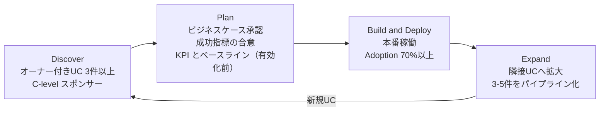
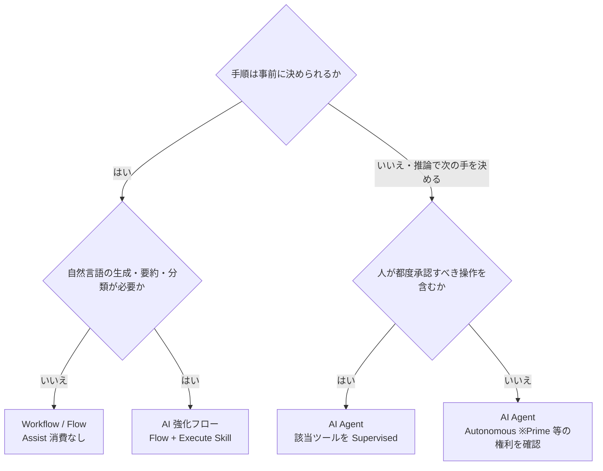
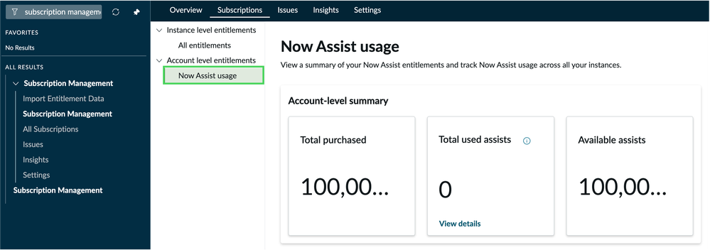
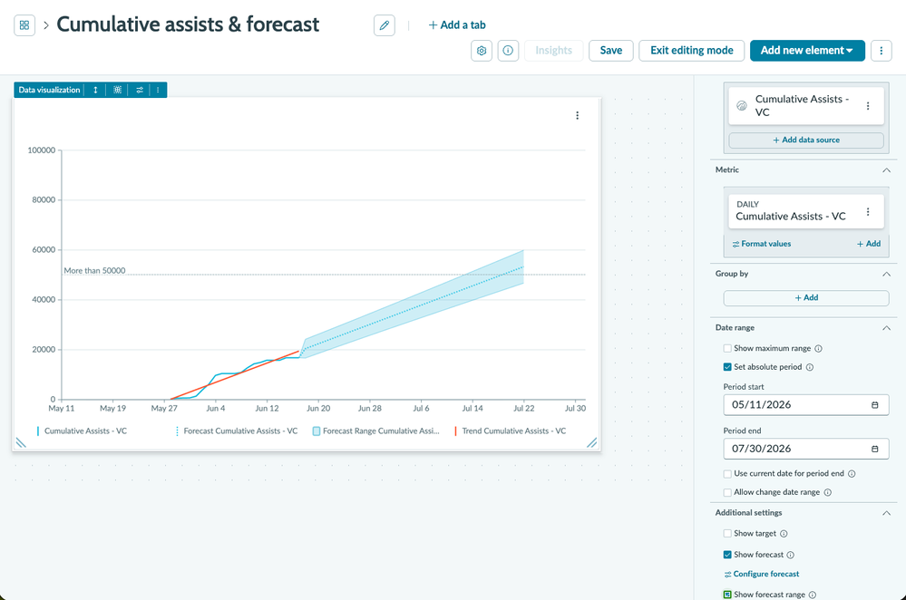
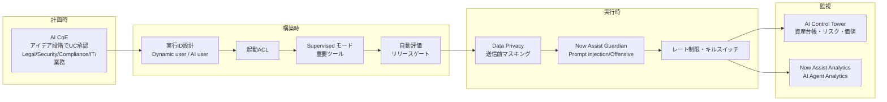
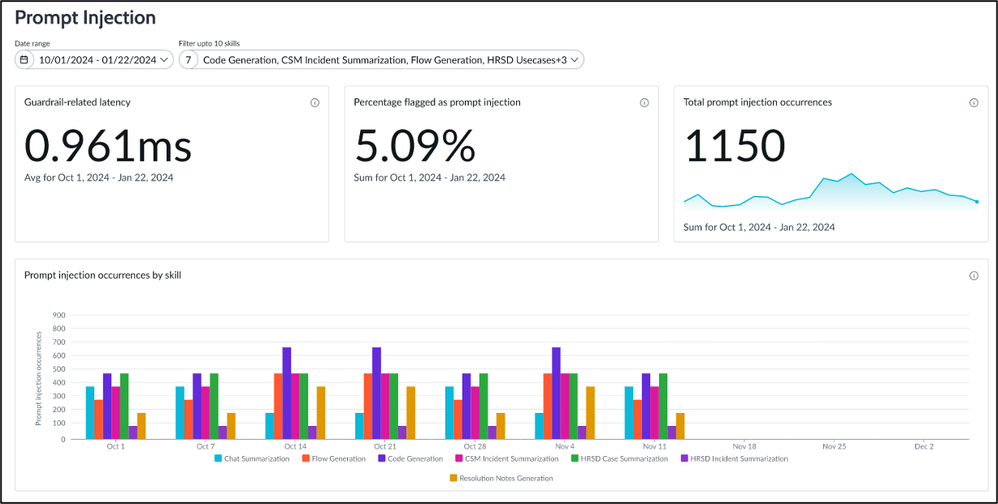
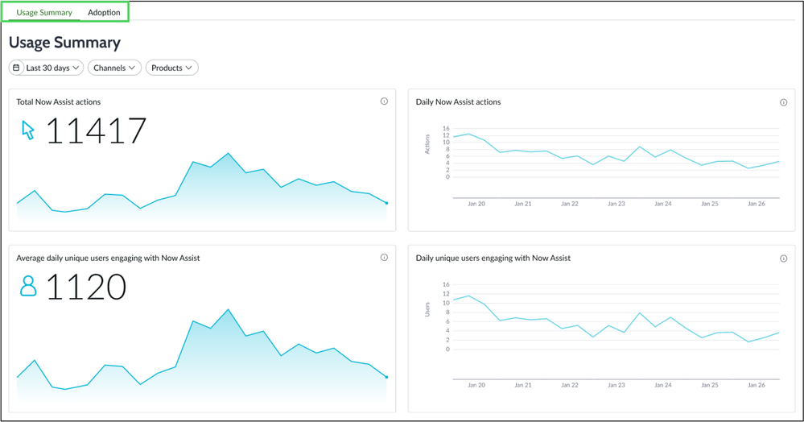

# Now Assist / AI Agents 導入の知見（AI Adoption Lessons）

## 概要

本ファイルは、ServiceNow の生成AI機能 **Now Assist**（スキル単位の生成AI支援）と **AI Agents**（AI エージェント／エージェント型ワークフロー）を、PoC から本番・全社展開へ進めるときの実務知見をまとめた応用編である。製品仕様そのもの（スキル一覧、AI Agent Studio の画面、ライセンス階層）は [Now Assist と AI Agents（リファレンス）](../02_リファレンス/platform/now-assist-ai-agents.md) と [ライセンスコスト最適化](06-license-cost-optimization.md) に譲り、本ファイルは次の問いに答える。

| テーマ | 本ファイルで答える問い |
|---|---|
| ユースケース選定 | 最初に何から始めるか。Workflow / Now Assist スキル / AI エージェントのどれで作るべきか |
| データ品質 | ナレッジ・CMDB の品質が AI の結果と Assist 消費にどう効くか。何を整備するか |
| Assist 消費管理 | Assist はどう数えられ、どう見積り・監視・抑制するか。サブプロ（非本番）が同じ枠を消費する問題 |
| ガバナンス | Guardian、Data Privacy、AI Control Tower、エージェントの実行ID・監督モードをどう設計するか |
| 効果測定 | どの KPI をいつベースライン化し、どのダッシュボードで測るか |
| 導入事例 | 公開されている定量効果はどの程度か。その数値をどう読むか |

本ファイルの知見は、ServiceNow 公式ドキュメント、ServiceNow 社員が執筆した ServiceNow Community 記事（AI CoE・プロダクトマネージャー等）、および第三者情報に基づく。ServiceNow 社員執筆の Community 記事は製品ドキュメントではないため、数値（Assist 単価表など）は執筆時点のものとして扱い、最新値は契約書・Now Assist FAQ・アカウントチームで確認すること。

> **名称の注意（Australia）:** Australia で **Now Assist Admin console は AI Admin Hub** に名称変更された（Australia Patch 5 / Zurich Patch 12 以降、と Community 記事は説明）。また 2026 年には生成AI体験のブランドとして **ServiceNow Otto** の名称も使われている。エンタイトルメント（契約上の権利）は変わらないと公式リリースノートは明記している。古い資料のメニュー名「Now Assist Admin」は新しいインスタンスでは AI Admin Hub と読み替える。[出典](https://www.servicenow.com/docs/r/australia/release-notes/now-assist-rn.html) / [出典](https://www.servicenow.com/community/servicenow-otto-articles/tracking-now-assist-usage-measuring-roi-and-adoption-australia/ta-p/3500172)

---

## 1. 導入フェーズの全体像

### 1.1 4 フェーズと移行条件（Exit criteria）

ServiceNow の AI CoE 系 Community 記事「Agentic AI Adoption Playbook for Now Assist」（Jason Estes, ServiceNow 社員, 2026-03-12 公開 / 2026-09-28 更新）は、Now Assist / エージェント型AI の導入を 4 フェーズで整理し、フェーズ間の **移行条件（Exit criteria）** を定義している。[出典](https://www.servicenow.com/community/ceg-ai-coe-articles/agentic-ai-adoption-playbook-for-now-assist-on-servicenow/ta-p/3507085)

| フェーズ | 目的 | 次フェーズへの移行条件 |
|---|---|---|
| Discover（発見） | 確信を得て、インパクトの大きい機会を特定する | C レベルのスポンサーが関与している／**オーナー付きのユースケースが 3 件以上**確定／7-Pillar Assessment 完了／AI Adoption Plan 着手 |
| Plan（計画） | ロードマップ、ビジネスケース、ガバナンス体制を作る | ビジネスケース承認／ガバナンス確立／実装チームのリソース確保／成功指標の合意 |
| Build and Deploy（構築・展開） | 実装し、本番利用を定着させ、変更管理を行う | 本番稼働／**利用率（Adoption）70% 以上**／測定可能な価値の実現 |
| Expand（拡大） | 成功したユースケースを他部門・隣接領域へ広げる | （継続）3〜5 件のユースケースをパイプラインに保つ |

> KPI を「2〜3 個」に絞る推奨は、同記事の Plan フェーズの移行条件ではなく、別セクション「Just bought Now Assist?」に書かれている（6.1 節）。

同記事の 7 つの準備度（7 Pillars）は、Executive Sponsorship、Governance and Compliance、Data Quality and Architecture、Platform and Technical Readiness、People and Skills、Change Management、Value Measurement and Expansion である。Platform and Technical Readiness の例として「Pro Plus または Enterprise Plus のライセンス、Yokohama Patch 6 以降、エージェントスキル用の Next Experience ワークスペース」が挙げられている（ライセンス名は 2026-04 の Foundation / Advanced / Prime 移行前の表記）。[出典](https://www.servicenow.com/community/ceg-ai-coe-articles/agentic-ai-adoption-playbook-for-now-assist-on-servicenow/ta-p/3507085)

### 1.2 5 本柱（5-Pillar Framework）

ServiceNow のプロダクトマネージャー（Neha Agrawal, AI Platform, 2025-12-03）による「5-Pillar Framework to Scaling Now Assist Adoption」は、Leadership / Awareness / Agility / Integrity / Impact の 5 本柱を示している。実務上の要点は以下である。[出典](https://www.servicenow.com/community/now-assist-articles/5-pillar-framework-to-scaling-now-assist-adoption/ta-p/3442714)

| 柱 | 実務上の要点 |
|---|---|
| Leadership | AI 戦略は C レベルが所有し、AI CoE を統治する。AI を「銀の弾丸」と説明しない。単一 LLM 依存を避ける（Model Provider Flexibility） |
| Awareness | 準備度を Organization Strategy / Technology & Data / Operational & Cultural の 3 領域で評価。Quick win はフルフィラー向けスキル（インシデント要約、Resolution notes 生成）。**導入前のベースライン（解決時間、満足度など）を必ず記録** |
| Agility | North Star を決めて Crawl-Walk-Run-Fly で段階展開。各イテレーションに Exit criteria を設けて **「パイロット止まり（pilot purgatory）」を防ぐ**。OCM（組織変更管理）を全フェーズに入れる |
| Integrity | Responsible AI を初日から。Now Assist Guardian と AI Control Tower で監視。**Legal / Security / Compliance / IT / 業務を集めた AI CoE がアイデア段階でユースケースを承認**する |
| Impact | 効率（時間削減）・品質（精度、CSAT）・収益・リスク低減の多面的な測定。初期シグナル（利用率・満足度）を、持続的な成果（コスト削減）に結び付ける |

### 1.3 PoC が本番化しない理由（業界の警告）

Gartner は 2025-06-25 のプレスリリースで「2027 年末までにエージェント型AIプロジェクトの 40% 超がキャンセルされる」と予測し、要因として **コスト高騰、ビジネス価値の不明確さ、不十分なリスク管理** を挙げた。また、明確な価値・ROI がある領域に限定し、明確なユースケース・現実的な目標・強力なモニタリングを伴う段階的アプローチを推奨している。【第三者情報】[出典](https://www.gartner.com/en/newsroom/press-releases/2025-06-25-gartner-predicts-over-40-percent-of-agentic-ai-projects-will-be-canceled-by-end-of-2027)

ServiceNow 上でこの 3 要因に対応するのが、本ファイルの第 2 章（価値のあるユースケースの選定）、第 4 章（Assist 消費＝コスト管理）、第 5 章（ガバナンス＝リスク管理）である。

---

## 2. ユースケース選定

### 2.1 最初の一手は「フルフィラー向け・低負荷・大量」スキル

複数の ServiceNow 社員執筆記事が、最初のユースケースとして **フルフィラー（担当者）向けの低負荷スキル** を推奨している。

- AI CoE のプレイブックは「大量かつ他システムへの依存が少ないもの」を最良の出発点とし、低負荷のものから有効化するとしている（Build and Deploy の Activity 3「Activate Low-Lift First」）。具体的には、**インシデント要約と AI Search の 2〜4 週間パイロット** の後に、**Resolution notes（解決メモ）生成と Virtual Agent** へ進む流れを示す。ただし AI Search と Virtual Agent の品質はナレッジベースの成熟度に直結するため、ナレッジ品質の課題は Discover 段階で洗い出す（Pillar 3：Data Quality and Architecture）。[出典](https://www.servicenow.com/community/ceg-ai-coe-articles/agentic-ai-adoption-playbook-for-now-assist-on-servicenow/ta-p/3507085)
- 5-Pillar Framework も Quick win としてインシデント要約と Resolution notes 生成を挙げる。[出典](https://www.servicenow.com/community/now-assist-articles/5-pillar-framework-to-scaling-now-assist-adoption/ta-p/3442714)

要約系スキルが最初に向く理由は、(1) 1 回あたりの Assist 消費が小さい（要約は 1 Assist の例。第 4 章）、(2) 人がレビューしてから使う（Human-in-the-loop）ためリスクが低い、(3) 既存の画面（Workspace / Now Assist パネル）に組み込まれ利用者教育が少なくて済む、の 3 点である。【経験則】

### 2.2 価値の事前確認：効率比（Efficiency ratio）

Assist を数える前に「そのユースケースに価値があるか」を確認する方法として、ServiceNow のプロダクトマネージャー記事は **効率比（AI で削減される時間 ÷ 設定・利用・レビューにかかる時間）** を提示している。[出典](https://www.servicenow.com/community/now-assist-articles/a-6-step-framework-for-now-assist-consumption-forecasting/ta-p/3493141)

| 効率比 | 意味 | 推奨 |
|---|---|---|
| 10:1 以上 | 強い ROI | 早期導入の最優先 |
| 5:1〜10:1 | 堅実な ROI | 展開候補 |
| 2:1〜5:1 | 中程度の ROI | 先にプロンプト／品質を最適化する |

同記事の大規模医療機関の Sentiment Analysis（感情分析）事例では、月 25,000 インシデント・担当者 300 名の環境で、Now Assist なしで月 1,025 時間かかる作業が 35 時間となり、**月 990 時間を回収（効率比 29:1）** と試算されている。[出典](https://www.servicenow.com/community/now-assist-articles/a-6-step-framework-for-now-assist-consumption-forecasting/ta-p/3493141)

### 2.3 Workflow / スキル / プロンプトチェーン / AI エージェントの使い分け

**「すべてを AI エージェントで作る」のは典型的なアンチパターンである。** ServiceNow AI CoE の記事「When to use AI Agents」（2025-07-31）は、4 つの実装パターンを次のように比較している。[出典](https://www.servicenow.com/community/ceg-ai-coe-articles/when-to-use-ai-agents-rationalizing-uses-cases-for-workflows/ta-p/3340584)

| パターン | 決定性 | 人の関与 | コスト | 適したデータ |
|---|---|---|---|---|
| Workflow（スクリプト／フロー／アクション） | 完全にルールベースで予測可能 | ロジック自体には不要 | **Assist 消費なし** | 構造化・半構造化 |
| GenAI Skill（Now Assist スキル） | ほぼ予測可能（多少の揺らぎ） | 通常は Human-in-the-loop | スキルごとに固定（例：レコード要約 1 Assist） | レコードデータ＋実行時に取得するナレッジ |
| Prompt Chain（プロンプトチェーン） | スキル・エージェントに構造を足す | レビュー／ブロックの段を入れられる | 連鎖したスキルの合計 | 混在 |
| AI Agent | 最も予測しにくい（動的に計画） | Supervised（監督）または Autonomous（自律） | **実行ツール数による段階制（25 / 50 / 150 Assists）** | 曖昧・非構造で推論が必要 |

同記事の判断基準は次の 3 つである。

1. **規制とリスク許容度**：リスクを最小化すべき領域（規制業界）は Workflow。人のレビューを残すならスキル。エージェントの判断ログは監査人に解釈しにくい場合がある。組み込みフィルタでは足りない独自ガードレールはプロンプトチェーンで実装する。
2. **コストとスケーラビリティ**：確率的なパターンほどコストが上がる。同記事の例では、同じ仕事をエージェントで作ると 26 Assists、スキル＋チェーンで作ると 12 Assists（約 53% 削減）。
3. **ユースケース・データ・依存関係**：構造化データなら Workflow。**スクリプト化できる結果はまず Workflow として作り、それをスキル・チェーン・エージェントから再利用する。**

第三者（RapDev, 2026-07-30）も「手順が分かっているならフローを使え」とし、**AI 強化フロー（AI-enhanced flow）**、すなわちフローがプロセスを制御し、決まった箇所で Execute Skill アクションにより Now Assist スキルを呼ぶ形を、現時点の既定の選択肢として推奨している。【第三者情報】[出典](https://www.rapdev.io/blog/not-every-servicenow-ai-problem-needs-an-ai-agent)

### 2.4 エージェント設計の具体ルール

ServiceNow 社員の Community 記事「Best Practices in managing AI agents, skills, and assists」（hussein_alani, 2026-07-07）は、コストと暴走を抑えるエージェント設計ルールを挙げている。[出典](https://www.servicenow.com/community/servicenow-otto-articles/best-practices-in-managing-ai-agents-skills-and-assists-in/ta-p/3569710)

- **ツール数を減らす**：エージェント型ワークフローは 1 実行あたりのツール実行数で Assist 段階が決まる（第 4 章）。単純な用途は Virtual Agent トピックや会話型カタログアイテムで代替を検討する。
- 1 ユースケースあたりのエージェントは **10 個以下**、ツールリストは最小限に保つ。
- すべてのエージェントに `sn_aia.continuous_tool_execution_limit`（連続ツール実行の上限）を設定する。
- **Record Create と Record Update のトリガーを条件フィルタなしで同じエージェントに組み合わせない**（ループの最も一般的な原因）。エージェントが早い段階で「処理済み」フィールドを立て、後続のトリガー条件で除外する。
- トリガー構成は必ずサブプロダクションで先にテストする。

### 2.5 独自アプリへの AI 組み込みの注意

公式ドキュメント（Build Agent での AI 機能作成）は、**Platform スキルを独自アプリで使うには複製と大幅な再構成が必要**であり、Now Assist の AI エージェントを独自アプリ向けに設定するのは、独自の AI エージェント／エージェント型ワークフローを新規に作るより時間がかかることが多いと注意している。また、エージェントとスキルの作成には Now Assist for App Engine が必要である。[出典](https://www.servicenow.com/docs/r/zurich/application-development/building-applications/vc-build-agents-in-ba.html)

### 2.6 ユースケース評価シート（実務用）

上記の出典を組み合わせ、ユースケース候補を比較するための評価軸を以下にまとめる。【経験則】（各軸の根拠は 2.1〜2.4 の出典）

| 評価軸 | 高評価の条件 | 低評価・要注意の条件 |
|---|---|---|
| 量（Volume） | 月数千件以上のレコード・会話 | 月数十件 |
| 効率比 | 10:1 以上 | 2:1 未満 |
| 依存関係 | 単一テーブル・単一製品内で完結 | 複数外部システムへの書き込みが必要 |
| データ品質 | 対象ナレッジ／レコードのフィールドが埋まっている | 記事の重複・陳腐化、CI 情報が不正確 |
| リスク | 人がレビューしてから確定 | 自動で外部へ送信・不可逆な更新 |
| Assist 単価 | 1〜10 Assists／実行 | 150 Assists／実行の大規模エージェントを高頻度起動 |
| オーナー | 業務オーナーが名指しされ KPI に責任を持つ | IT 部門だけが推進 |

---

## 3. データ品質

### 3.1 ナレッジベースの準備度（公式ガイダンス）

公式ドキュメント「Knowledge Base readiness for Now Assist」（Australia, 2026-09-10 更新）は、Now Assist の回答品質がナレッジの品質と構成に左右されるとして、次の準備事項を挙げている。[出典](https://www.servicenow.com/docs/r/XRgEFx7nPN6ciT_BBIvnbg/Ij4VOnq78uF2Hf1Sc_Jy3A)

| 項目 | 公式ガイダンス |
|---|---|
| 記事構造 | KCS 型、Q&A 型、Issue-Cause-Resolution 型など一貫したテンプレートを使う。独自テンプレートも形式を統一し、主要ステップを明確に定義する |
| プラグイン | Knowledge Management Advanced プラグインが有効であることを確認する |
| メタデータ | **Meta、Meta Description、Category、Author、Validity** を入力する（AI による絞り込み・ターゲティングを精密にするため） |
| 保守 | 1 年以上更新されていない記事、メタデータのない記事、重複、期限切れ間近の記事にフラグを付ける。陳腐化した記事は Retire（廃止）する |
| 重複検出 | 重複の特定・レビューには ServiceNow Otto for Knowledge Management が必要 |
| 検索・Q&A の範囲 | 上位検索クエリをレビューして最適化対象を決める。**Now Assist Q&A の対象を高品質・最適化済みの記事に限定する** |
| ツール | Knowledge Management Overview ダッシュボード（閲覧数、Helpful 評価、フィードバック傾向）、Knowledge Management ダッシュボード（上位検索クエリ） |

> 公式ページは記事の長さ、見出し、画像、添付ファイル、表、User criteria については言及していない（公開情報では確認できず）。ナレッジ管理の仕様は [ナレッジ管理（リファレンス）](../02_リファレンス/platform/knowledge-management.md) を参照。

**実務上の順序：** 「全記事をきれいにしてから始める」と PoC が始まらない。上位検索クエリと閲覧数上位の記事から修正し、**Q&A の対象ナレッジベースを品質を確認した範囲に限定して開始**し、範囲を広げるのが現実的である。【経験則】（公式の「Q&A を高品質記事に限定する」ガイダンスに基づく）

### 3.2 ナレッジ生成は Draft で始める

Now Assist の KB 記事生成をフローで自動化する場合、第三者の実装記事は次を推奨している。【第三者情報】[出典](https://www.rapdev.io/blog/not-every-servicenow-ai-problem-needs-an-ai-agent)

- 生成前に **実現可能性スコア（feasibility）** を判定し、閾値未満ならログを残して終了する（薄く低価値な記事はナレッジベースへの信頼を損なうため）。
- 生成記事は **Draft** で作成し、レビュー後に公開する。自動公開は出力品質への信頼が高まってから。
- Execute Skill の直後に Set Flow Variables で必要なフィールドだけを取り出し、プロンプト出力形式が変わっても後続ロジックが壊れないようにする。
- 判断結果・スコア・スキル出力をカスタムテーブルや `sys_flow_log` に記録して説明可能にする。

### 3.3 データ品質は Assist 消費にも効く

第三者の Community 投稿（2026-06-29）は、**弱い CSDM、陳腐化した CI、薄いナレッジは、再試行・ループ・繰り返しの検索参照を通じて Assist 消費を増やす** と指摘し、エージェント型展開の前に CMDB/CSDM の精度を上げることを契約更新前チェックリストに入れている。【第三者情報】[出典](https://www.servicenow.com/community/upgrades-and-patching-forum/servicenow-ai-native-licensing-in-2026-a-practical-guide-to/m-p/3565858)

AI エージェントが CI・サービス・担当グループを参照して判断するユースケース（インシデントのトリアージ、変更リスク評価など）では、CMDB の正確性がそのまま判断精度になる。CMDB 整備の要点は [CMDB成功の要因](05-cmdb-success-factors.md) を参照。

### 3.4 送信データの最小化（Data Privacy for Now Assist）

LLM に送るデータから個人情報等をマスキングする設定は、データ品質と同時に設計する。公式ドキュメント（Configuring Data Privacy for Now Assist）（Australia 版）の要点は以下である。[出典](https://www.servicenow.com/docs/r/australia/platform-security/data-privacy-classic/configure-now-assist-data-privacy.html)

| 項目 | 内容 |
|---|---|
| 必要ロール | `now_assist_data_privacy_admin`（本ページが明記する唯一のロール）。正規表現の Data Discovery パターンを新規作成・構成する場合は、別ページ「Configure Data Discovery patterns」（Australia）が `data_discovery_admin` を必要ロールとしている [出典](https://www.servicenow.com/docs/r/oL66E_cwDD_tnWQYzYPRdA/hlv0Eq~iNgpBeuOvfRRy6Q) |
| 前提アプリ | Data Privacy (Classic) [`com.glide.data_privacy`]、Data Privacy [`sn_dp_store_app`]、Data Discovery [`sn_data_discovery`]、Data Discovery APIs [`com.glide.data_discovery`]。最新の Generative AI Controller を入れると `sn_dp_store_app` が自動インストールされ、残りも導入される |
| メニュー | All > Data Privacy (Classic) > Privacy Policy Advanced Configuration |
| 手順 | ポリシーを新規作成 → Data Channel に **Now Assist** を選択 → Active = true → Select Data Patterns で正規表現パターン（Data Discovery パターン）を選択 → 保存 |
| 制約 | **1 つの Data Channel で有効にできるポリシーは 1 つだけ**。新ポリシーを有効にするには同チャネルの他ポリシーを Active = false にする |
| 動作 | Now Assist チャネルでは、データが GenAI Controller に送られる前に匿名化される |
| 旧方式 | 以前の Sensitive Data Handler の正規表現は、アップグレード時に移行される（移行したリリースは公開情報では確認できず） |

> 公式ドキュメント（Exploring Data Privacy for ServiceNow Otto, Australia）によれば、マスキングは **双方向マスキング（two-way masking）** である。プロンプトでは機微データがプレースホルダーや匿名化データに置き換えられて LLM に送られ、LLM の応答を受け取った後に元のテキストへ戻される。これにより、エンドユーザーには正確な応答が返り、機微データは LLM に渡らない。[出典](https://www.servicenow.com/docs/r/oL66E_cwDD_tnWQYzYPRdA/MerGjMF3IzmPSHhTwJ1YYA) したがって、マスキングの目的は LLM への送信を防ぐことであり、最終応答でエンドユーザーから隠すことではない。この点を個人情報保護のレビューで誤解されないよう説明する。【経験則】

---

## 4. Assist 消費管理

### 4.1 Assist の数え方（基本モデル）

Now Assist は **トークンではなく Assist（アシスト）単位** で計測される。主要な仕組みは以下である。

| 項目 | 内容 | 出典 |
|---|---|---|
| 計算式 | スキルごとに **Total assists = Number of actions × Assist ratio**（Assist ratio は 1 回あたりの相対コスト） | [公式](https://www.servicenow.com/docs/r/7LhbZn3yz3Q58qhjZoU9iQ/veB~Wy6qL437vAeOgO~r5w) |
| 計測期間 | 契約記念日（contract anniversary）基準の **365 日 burn-down**。2025 年に「直近 365 日のローリング」から変更。**未使用分は繰り越されない** | [Community（ServiceNow 社員）](https://www.servicenow.com/community/now-assist-articles/a-6-step-framework-for-now-assist-consumption-forecasting/ta-p/3493141) |
| プール | アカウント単位のプール。**本番・サブプロダクション・AI Agent Studio でのテストが同じプールから消費** | [Community（ServiceNow 社員）](https://www.servicenow.com/community/servicenow-otto-articles/best-practices-in-managing-ai-agents-skills-and-assists-in/ta-p/3569710) |
| デモ | デモインスタンスでの消費は合計から除外 | [公式](https://www.servicenow.com/docs/r/7LhbZn3yz3Q58qhjZoU9iQ/veB~Wy6qL437vAeOgO~r5w) |
| エージェント | 1 実行あたりのツール実行数で段階が決まる。Orchestrator（オーケストレーター）と communicator のアクションはカウントしない | [Community（ServiceNow 社員）](https://www.servicenow.com/community/servicenow-otto-articles/best-practices-in-managing-ai-agents-skills-and-assists-in/ta-p/3569710) |

### 4.2 Assist 単価の目安

ServiceNow のプロダクトマネージャー記事（2026-02-19）に掲載された Assist 単価表を示す。**最新値は Now Assist FAQ（公開資料）で確認すること**と同記事自身が注記しており、契約により異なる可能性もある。[出典](https://www.servicenow.com/community/now-assist-articles/a-6-step-framework-for-now-assist-consumption-forecasting/ta-p/3493141)

| 区分 | スキル／実行 | Assists |
|---|---|---|
| GenAI スキル | 要約（インシデント、ケース等）／Resolution notes 生成 | 1 |
| GenAI スキル | ナレッジ記事生成 | 10 |
| 会話型AI（NAVA） | Now Assist パネルの会話 | 5 |
| 会話型AI（NAVA） | Virtual Agent トピック | 10 |
| 会話型AI（NAVA） | Voice Agent の会話 | 50 |
| AI エージェント | Small ワークフロー | 25 |
| AI エージェント | Medium ワークフロー（5〜8 アクション） | 50 |
| AI エージェント | Large ワークフロー（9〜20 アクション） | 150 |
| Builder ツール | Experience（UI）生成 | 1,000 |
| Builder ツール | アプリ／プレイブック生成 | 2,500 |

> **段階境界の表記揺れ:** Small の範囲は、上記記事では「4 アクション未満」、別の ServiceNow 社員記事では「0〜4 ツール」と書かれている。[出典](https://www.servicenow.com/community/servicenow-otto-articles/best-practices-in-managing-ai-agents-skills-and-assists-in/ta-p/3569710) 境界ちょうどのツール数のエージェントは、実際の `sn_aia_tool_execution_tier` の記録で確認すること。

**読み方の要点：** 要約（1 Assist）とエージェント（25〜150 Assists）は 1〜2 桁違う。同記事の ITSM 試算（月 5,000 インシデント）では、GenAI スキルの合計が月 5,500 Assists に対し、**インシデントの 20% に Small エージェントを使うだけで月 25,000 Assists となり、全体の 82% をエージェントが占める**。[出典](https://www.servicenow.com/community/now-assist-articles/a-6-step-framework-for-now-assist-consumption-forecasting/ta-p/3493141)

ライセンス階層（2026-04-09 以降の Foundation / Advanced / Prime）と Assist の同梱量は公式には公開されておらず、第三者の推定値しかない。【第三者情報】[出典](https://www.servicenow.com/community/upgrades-and-patching-forum/servicenow-ai-native-licensing-in-2026-a-practical-guide-to/m-p/3565858) 詳細は [ライセンスモデル](../03_導入編/01-licensing-model.md)、[価格情報](../03_導入編/02-pricing.md)、[ライセンスコスト最適化](06-license-cost-optimization.md) を参照。

### 4.3 消費見積り：6 ステップ・フレームワーク

ServiceNow のプロダクトマネージャー記事は、消費見積りを 6 ステップで行うことを推奨している。[出典](https://www.servicenow.com/community/now-assist-articles/a-6-step-framework-for-now-assist-consumption-forecasting/ta-p/3493141)

| ステップ | 内容 |
|---|---|
| 1. VALUE | Assist を数える前に価値を確認する（効率比。2.2 節） |
| 2. BASELINE | 購入 Assist 数、消費済み Assist 数、契約記念日を確認する |
| 3. MAPPING | 稼働中・計画中のスキルとエージェントを棚卸しし、消費区分に割り当てる |
| 4. ESTIMATE | ユースケースごとに **月間消費 = 件数 × 採用率 × 1 アクションあたり Assists** を計算して合算する |
| 5. BUFFER | サブプロダクション分のバッファを積む（同記事の例では 10%） |
| 6. SCALE | 月次成長率のシナリオ（0% / 10% / 20% / 40%）で年間消費をモデル化する |

**記念日基準のチェックポイント**として、消費 50% で採用状況を確認、75% でペースが契約量に合っているか確認、90% で追加購入の協議開始、が示されている。[出典](https://www.servicenow.com/community/now-assist-articles/a-6-step-framework-for-now-assist-consumption-forecasting/ta-p/3493141)

### 4.4 スケジュール実行のスキルは「対象範囲 × 頻度」で消費が決まる

同記事の Sentiment Analysis 事例（年間エンタイトルメント 150 万 Assists）は、スケジュール実行スキルの設定によって消費が大きく変わることを示している。[出典](https://www.servicenow.com/community/now-assist-articles/a-6-step-framework-for-now-assist-consumption-forecasting/ta-p/3493141)

| 構成 | 対象フィルタ | スケジュール | エンタイトルメントに占める割合 |
|---|---|---|---|
| Default（OOTB） | すべてのアクティブなインシデント | 15 分ごと | 記載なし |
| Optimized（推奨） | 直近 24 時間 | 1 日 1 回 | 20% |
| Balanced | 直近 12 時間 | 1 日 2 回 | 40% |

**教訓：** OOTB のまま「全アクティブレコード × 15 分ごと」で動かすと、同じレコードを何度も処理する。スケジュール型スキルは **対象を差分（直近作成・更新分）に絞り、頻度を業務上必要な最小限にする**。

### 4.5 サブプロダクションが本番の枠を食う

サブプロダクション（開発・テスト）インスタンスは本番と同じアカウントプールを消費する。ServiceNow 社員の記事は次の対策を挙げている。[出典](https://www.servicenow.com/community/now-assist-articles/a-6-step-framework-for-now-assist-consumption-forecasting/ta-p/3493141) / [出典](https://www.servicenow.com/community/servicenow-otto-articles/best-practices-in-managing-ai-agents-skills-and-assists-in/ta-p/3569710)

- スキルの **自動有効化（auto-activation）** をレビューし、サブプロで不要なスキルを止める。
- クローンで持ち込まれた本番データを処理しないよう、日付フィルタ（例：Created >= 有効化日）を入れる。
- スケジュールジョブの実行頻度をサブプロでは下げる。
- `sys_gen_ai_usage_log` を日次で監視する。
- **使用ログテーブルをクローン対象から除外**し、本番の分析データが開発インスタンスに持ち込まれて分析を汚さないようにする。
- 消費アラート通知はサブプロでも有効にしておく。
- 自動評価（AI Agent Studio の Automated evaluation）も Assist を消費するため予算に入れる。

クローン運用の詳細は [アップデートセットとクローン](../02_リファレンス/platform/update-sets-cloning.md)、[インスタンス戦略と環境](../03_導入編/07-instance-strategy.md) を参照。

### 4.6 「既定で有効」になるスキルへの備え

公式ドキュメント「Now Assist skills, agents, and agentic workflows on by default」は、一部のスキル・エージェント・エージェント型ワークフローが既定で有効になることを説明している。[出典](https://www.servicenow.com/docs/r/LJrmaT7RuHYvraJ6TwMDCA/3aSpelqKxFQ82Gt~BavCpw)

| 対象 | 動作 |
|---|---|
| 新規顧客 | Now Assist 製品のインストール時に、指定されたスキル等が自動で有効になる |
| 既存顧客（アップグレード、Australia Patch 4 以降） | Now Assist プラグインが導入済みで、その項目が一度も有効化されておらず、管理者がロールを調整していない場合に有効になる |
| 有効にならない条件 | 一度有効化して後で無効化した項目、または管理者がロールを調整した項目 |

Australia のリリースノートは、プラグインのインストール・更新時に自動有効化されるよう構成されたスキルを既定で有効にするかを管理者が制御でき、個々のスキルを有効化・無効化できる、と説明している。[出典](https://www.servicenow.com/docs/r/australia/release-notes/now-assist-rn.html)

**教訓：** パッチ適用・プラグイン更新のたびに、AI Admin Hub のスキル一覧で「意図せず有効になったスキル」がないかを確認する作業を、アップグレード手順に組み込む。一度も有効化していないスキルは、そのままでは自動有効化の対象になる。自動有効化を防ぐには、公式の除外条件（一度有効化してから無効化する、またはロールを調整する）を満たしておくか、Australia（2026-08）で追加された AI Admin Hub の既定有効化の制御を使う。【経験則】（上記公式の条件に基づく） アップグレード手順全般は [アップグレードの教訓](04-upgrade-lessons.md) を参照。

### 4.7 監視ツール

| ツール | メニュー位置 | 用途 | 出典 |
|---|---|---|---|
| Subscription Management の Now Assist usage | Admin > Subscription Management > Subscriptions > Now Assist usage（Account level entitlements） | 契約単位の購入数・消費数・残数、インスタンス別・ドメイン別・スキル別の消費、利用履歴 | [公式](https://www.servicenow.com/docs/r/7LhbZn3yz3Q58qhjZoU9iQ/veB~Wy6qL437vAeOgO~r5w) |
| Now Assist Analytics | All > Now Assist Admin > Performance（Australia Patch 5 / Zurich Patch 12 以降は AI Admin Hub 配下） | 利用・採用、スキル性能、カスタムスキル、Guardian、検索分析 | [Community（ServiceNow 社員）](https://www.servicenow.com/community/servicenow-otto-articles/tracking-now-assist-usage-measuring-roi-and-adoption-australia/ta-p/3500172) |
| AI Agent Analytics | AI Agent Studio 内の Assist Consumption タブ | インスタンス単位のエージェント型ワークフロー消費（ほぼリアルタイム） | [6-Step Framework（ServiceNow 社員）の Baseline 節](https://www.servicenow.com/community/now-assist-articles/a-6-step-framework-for-now-assist-consumption-forecasting/ta-p/3493141) |
| AI Admin Hub の使用量アラート | AI Admin Hub（Australia, 2026-08 追加） | スキル単位で Assist 消費・実行回数の上限ルールを設定し、アラートフィードで管理 | [Australia リリースノート](https://www.servicenow.com/docs/r/australia/release-notes/now-assist-rn.html) |

出典：[Subscription Management（公式）](https://www.servicenow.com/docs/r/7LhbZn3yz3Q58qhjZoU9iQ/veB~Wy6qL437vAeOgO~r5w) / [Tracking Now Assist Usage（ServiceNow 社員）](https://www.servicenow.com/community/servicenow-otto-articles/tracking-now-assist-usage-measuring-roi-and-adoption-australia/ta-p/3500172) / [6-Step Framework（ServiceNow 社員）](https://www.servicenow.com/community/now-assist-articles/a-6-step-framework-for-now-assist-consumption-forecasting/ta-p/3493141) / [Australia リリースノート](https://www.servicenow.com/docs/r/australia/release-notes/now-assist-rn.html)。AI Agent Analytics という名称自体は [Best Practices（ServiceNow 社員）](https://www.servicenow.com/community/servicenow-otto-articles/best-practices-in-managing-ai-agents-skills-and-assists-in/ta-p/3569710) にも登場する。

**Subscription Management の Now Assist usage の仕様（公式）：** [出典](https://www.servicenow.com/docs/r/7LhbZn3yz3Q58qhjZoU9iQ/veB~Wy6qL437vAeOgO~r5w)

- 閲覧・編集に必要なロールは `usage_admin`、`sn_sub_man.admin`、または `admin`。
- Total used assists カードの View details で消費推移を表示し、契約期間内に購入数を超えたかを確認できる。
- Instances リストには **Washington DC Patch 2 以降** のインスタンスのみ表示される。
- インスタンスでデータ共有が制限されていると、そのインスタンスの使用データは表示されない（トラスト構成の更新で解除）。
- Skills 表（Number of actions、Assist ratio、Total assists）は **夜間に更新** される（リアルタイムではない）。
- ドメインセパレーションを使っていて global 以外のドメインがある場合、ドメイン別の消費を表示できる。
- Moveworks のスキルは名前が「MW.」で始まる。

*図1：Subscription Management の Now Assist usage（アカウントレベルの概要）*

画面説明：左のナビゲーターでフィルタ「subscription management」を入力し、Subscription Management 配下（Import Entitlement Data、Subscription Management、All Subscriptions、Issues、Insights、Settings）が表示されている。上部タブは Overview / Subscriptions / Issues / Insights / Settings で、Subscriptions タブが選択されている。左ペインのツリーは「Instance level entitlements > All entitlements」と「Account level entitlements > Now Assist usage」で、Now Assist usage が選択されている。右側に見出し「Now Assist usage」と説明文「View a summary of your Now Assist entitlements and track Now Assist usage across all your instances.」、その下の「Account-level summary」に **Total purchased**（例：100,00…）、**Total used assists**（例：0。下部に View details リンク）、**Available assists**（例：100,00…）の 3 枚のカードが並ぶ。

出典：[Tracking Now Assist Usage: Measuring ROI and Adoption（ServiceNow Community, Dexter Chan, ServiceNow 社員, 2026-03-17 公開 / 2026-09-25 更新）](https://www.servicenow.com/community/servicenow-otto-articles/tracking-now-assist-usage-measuring-roi-and-adoption-australia/ta-p/3500172)（取得日：2026-11-02）

### 4.8 主要テーブル（消費の追跡・監査）

ServiceNow 社員の記事は、消費とエージェント実行を追跡する主要テーブルを次のように挙げている。[出典](https://www.servicenow.com/community/servicenow-otto-articles/best-practices-in-managing-ai-agents-skills-and-assists-in/ta-p/3569710)

| テーブル | 用途 |
|---|---|
| `sys_gen_ai_usage_log` | Gen AI Usage Log。Now Assist 実行ごとの消費 Assist 数（`assists` フィールド） |
| `sys_generative_ai_log` | 生成AIのログ。ケース／タスクなど業務レコードへの参照 |
| `sn_aia_tool_execution_tier` | エージェント実行のツール段階（Small / Medium / Large） |
| `sn_aia_execution_plan` | エージェントの実行計画（推論の連鎖）。エージェント型ワークフロー別の集計に使う |
| `sn_aia_agent` | AI エージェント定義 |
| `sn_aia_usecase` | エージェント型ワークフロー（旧称 use case）定義 |
| `now_assists_skills` / `sn_nowassist_skill_config` | スキル定義・構成 |

**課金を業務レコードまで追跡する方法**：`sys_generative_ai_log`（ケース／タスク参照）と `sys_gen_ai_usage_log`（Assist 数）を結合し、エージェントの段階は `sn_aia_tool_execution_tier`、推論過程は `sn_aia_execution_plan` で確認する。**本番エージェントの実行計画は保存しておく**（非決定的な挙動のデバッグに必要）。[出典](https://www.servicenow.com/community/servicenow-otto-articles/best-practices-in-managing-ai-agents-skills-and-assists-in/ta-p/3569710)

### 4.9 スパイクアラートと予測ダッシュボード

**スパイクアラートのプロパティ**（`sn_aia_property` テーブル、既定値）：[出典](https://www.servicenow.com/community/servicenow-otto-articles/best-practices-in-managing-ai-agents-skills-and-assists-in/ta-p/3569710)

| プロパティ | 既定値 | 意味 |
|---|---|---|
| `alert.assist_spike_hours_to_check` | 3 | 判定対象の時間幅（時間） |
| `alert.assist_spike_usage_percentage_threshold` | 0.5（50%） | 増加率の閾値 |
| `alert.assist_spike_usage_threshold` | 5,000 | 消費量の閾値 |

**予測ダッシュボード**：ServiceNow 社員の記事（Victor Chen, 2026-06-24）は、Platform Analytics で累積 Assist の予測ダッシュボードを作る手順を公開している。要点は以下である。[出典](https://www.servicenow.com/community/now-assist-articles/build-an-assists-forecasting-dashboard/ta-p/3562989)

1. All > Platform Analytics Administration > Data Sources > Indicator Sources で、Facts table = `sys_gen_ai_usage_log`、Valid for frequency = Daily、条件「Created が今日以前 かつ 集計開始日以降」の Indicator Source を作成。**集計開始日は契約記念日ごとに手動で再設定が必要**。
2. Automated Indicator（Aggregate = Sum、Field = Assists、Collect records をオン）を作り、Historic ジョブで過去分を一括収集、Daily ジョブで継続収集。
3. Forecasting タブで Forecast method = Auto（Linear / Exponential Smoothing / Holt-Winters も可）、下限 0。Thresholds で「More than 契約量」を設定し通知先ユーザーを登録（**通知は予測ではなく実績が閾値を超えたときに発火**）。
4. Platform Analytics の Dashboards で Line 型の可視化を作り、Show forecast（点線）、Show forecast range（95% 信頼区間）、Show threshold をオン。
5. エージェント型ワークフロー別には `sn_aia_execution_plan` を元にした Indicator Source とスクリプト型フィールド、ワークフロー別の Breakdown を使う。テストインスタンスの画面例は `trial assists` フィールドだが、本番・サブプロでは `assists` フィールドを使う。

*図2：累積 Assist と予測（Cumulative assists & forecast）ダッシュボードの編集画面*

画面説明：ダッシュボード名「Cumulative assists & forecast」の編集モード。左の折れ線グラフは縦軸が累積 Assist（0〜100,000）、横軸が日付（May 11〜Jul 30）。水色の実線が実績の累積値（Cumulative Assists - VC）、赤線がトレンド、水色の点線が予測（Forecast Cumulative Assists）、その周囲の水色の帯が予測範囲（Forecast Range）で、水平の点線「More than 50000」が閾値を示し、予測線が 7 月中旬に閾値を超える見込みが読み取れる。右の設定パネルには Data source（Cumulative Assists - VC）、Metric（DAILY）、Group by、Date range（Set absolute period オン、Period start 05/11/2026、Period end 07/30/2026）、Additional settings（Show forecast オン、Configure forecast リンク、Show forecast range オン）が表示されている。

出典：[Build an assists and agentic assists forecasting dashboard（ServiceNow Community, Victor Chen, ServiceNow 社員, 2026-06-24 公開 / 2026-07-15 更新）](https://www.servicenow.com/community/now-assist-articles/build-an-assists-forecasting-dashboard/ta-p/3562989)（取得日：2026-11-02）

### 4.10 暴走の抑制：レート制限・キルスイッチ・再帰チェック

エージェントのトリガー設定ミスによる無限ループは、Assist を短時間で大量消費する最大のリスクである。ServiceNow 社員の記事は次の制御を挙げている。[出典](https://www.servicenow.com/community/servicenow-otto-articles/best-practices-in-managing-ai-agents-skills-and-assists-in/ta-p/3569710)

**One Extend のレート制限ルール**（`sys_one_extend_rate_limit_rules`、`admin` ロール、Application = Global）

| 設定 | 推奨 |
|---|---|
| Resource | 特定の LLM プロバイダー、特定の Capability 定義（例：エージェント呼び出しを抑える AIA ReAct Engine）、またはすべての Capability |
| Rule Type | Instance または User |
| Request limit per hour | 観測ピーク＋20〜30% の余裕 |
| 有効化 | サブプロでテストしてから |

**トリガーのスロットリング（キルスイッチ、Australia Patch 3 以降）**

| プロパティ | 既定値／選択肢 |
|---|---|
| `kill_switch.mode` | off / **warn_only（既定）** / enforce。enforce は 1 日目・2 日目に警告し、3 日目にトリガーを無効化 |
| `kill_switch.max_fires_per_window` | 5 |
| `kill_switch.min_distinct_records` | 25 |
| `kill_switch.window_size` | 1,440 分 |
| `kill_switch.consecutive_windows_duration` | 4,320 分 |

まず warn_only で運用し、トリガーが無効化されてもエージェントが止まらないよう冗長性を作ってから enforce にする。

**再帰チェック**

| プロパティ | 既定値 |
|---|---|
| `recursive_check.create_max_executions` / `recursive_check.create_time_window` | 50 回 / 15 分 |
| `recursive_check.update_max_executions` / `recursive_check.update_time_window` | 5 回 / 15 分 |

### 4.11 消費管理の運用サイクル

| 頻度 | 作業 | 主担当 |
|---|---|---|
| 日次 | `sys_gen_ai_usage_log`・AI Agent Analytics でスパイク確認（特に新規エージェント・サブプロ） | プラットフォーム管理者 |
| 週次 | 消費上位のエージェントの実行計画レビュー、スパイクとの相関 | AI アーキテクト |
| 月次 | Subscription Management で契約プール全体の消費ペース確認、ステークホルダーレビュー | AI CoE／ライセンス管理者 |
| 記念日基準 | 50% / 75% / 90% チェックポイント | AI CoE／調達 |
| パッチ・アップグレード時 | 自動有効化スキルの確認、評価の再実行 | プラットフォーム管理者 |

出典：[Best Practices（ServiceNow 社員）](https://www.servicenow.com/community/servicenow-otto-articles/best-practices-in-managing-ai-agents-skills-and-assists-in/ta-p/3569710) / [6-Step Framework（ServiceNow 社員）](https://www.servicenow.com/community/now-assist-articles/a-6-step-framework-for-now-assist-consumption-forecasting/ta-p/3493141)。最初の 30 日でベースラインを確立し、ロール別のダッシュボードビューを用意することも推奨されている。

---

## 5. ガバナンス

### 5.1 ガバナンスの全体像

### 5.2 初期設定で決めるべき事項

Now Assist の初期設定（AI Admin Hub / 旧 Now Assist Admin）で、組織として判断が必要な項目は以下である。Community の実装ガイド（Mukesh Sharma, 2026-03-02）に基づく。【第三者情報】[出典](https://www.servicenow.com/community/now-assist-articles/from-planning-to-go-live-now-assist-implementation/ta-p/3494920)

| 判断事項 | 論点 |
|---|---|
| モデル改善のためのデータ共有 | ServiceNow とデータを共有するか（インスタンスごとにオプトアウトの手続き） |
| データオーバーフロー（バースティング） | ピーク時に ServiceNow データセンターから **Microsoft Azure のデータセンター** へバーストして処理するか（第三者クラウドでの処理となるため、データ所在・委託先審査の論点。5.8 節と下記「Australia の変更」も参照）。オプトアウトすると遅延・容量超過エラーの可能性。無効化できるのは Data Steward ロールのみ |
| モデルプロバイダー | Now LLM Service、またはサードパーティ LLM（Azure OpenAI、Google Gemini、AWS 上の Anthropic Claude 等） |
| データルーティング | 国内／リージョン内処理の要否 |
| フォールバック | 選択したプロバイダーが未対応の AI システムの扱い |
| Now Assist パネルの表示 | `now_assist_panel_user` ロールで表示。**`itil` ロールはパネルアクセスを継承するため既定で itil ユーザー全員に表示される** |
| スキル単位の公開範囲 | 入力フィールド、利用条件、ロール、表示位置（製品 UI／パネル） |

> **Australia の変更:** 2026-07 以降、新規または非アクティブな AI 資産の既定モデルプロバイダーはサードパーティ LLM になった（Now LLM Service も選択可能で、既存構成は変更されない）。データ所在・委託先の審査をやり直す必要があるかを確認する。[出典](https://www.servicenow.com/docs/r/australia/release-notes/now-assist-rn.html)

### 5.3 Now Assist Guardian（AI Guardian）

公式ドキュメントによれば、Now Assist Guardian は次の 3 種のガードレールを提供する。[出典](https://www.servicenow.com/docs/r/intelligent-experiences/now-assist-guardian.html)

| ガードレール | 対象範囲 | 動作 |
|---|---|---|
| Offensiveness detection（攻撃的コンテンツ検出） | 対応する特定の Now Assist スキル・ワークフロー | ログ記録。ブロックは任意設定 |
| Prompt injection detection（プロンプトインジェクション検出） | すべての生成AIアプリケーション・機能 | ログ記録。ブロックは任意設定。確率的なため検出漏れがあり得る |
| Sensitive topic filters（センシティブトピック） | Virtual Agent の会話スキルのみ。HR Service Delivery が必要 | 検出時に Virtual Agent の「Sensitivity Detection: Fallback」トピックへ誘導（ライブエージェント接続や HR ケース作成） |

- ログはメニュー Now Assist Admin > Settings > Now Assist Guardian で参照する。
- ブロックを有効にすると、ユーザーには AI 応答の代わりに標準エラーメッセージが表示される。**公式はブロックを有効にする前にログを確認することを推奨**している。
- Guardian を使うスキルは、LLM に送る前に PII（個人を特定できる情報）を除去する。

> **Australia の変更:** Australia では AI Guardian が既定で有効になり（Patch 3 以降、2026-06）、プロンプトインジェクションと攻撃的コンテンツを手動有効化なしで検出する。プロンプトインジェクション検出はスキル単位で設定でき、Platform スキルとカスタムスキルを除く Now Assist スキルで既定オン。スキル設定とインスタンス設定が両方ある場合は **より保護的な方** が適用される。[出典](https://www.servicenow.com/docs/r/australia/release-notes/now-assist-rn.html)

**教訓：** 「既定で有効」は「既定でブロック」ではない。導入初期は **ログモードで誤検知率を把握** し、業務影響を確認してからブロックに切り替える。カスタムスキルは既定オンの対象外なので、カスタムスキルを作ったら個別にプロンプトインジェクション検出を設定する。【経験則】（上記公式の仕様に基づく）

*図3：Now Assist Analytics の Prompt Injection（Guardian）ダッシュボード*

画面説明：見出し「Prompt Injection」の下に Date range（例：10/01/2024 - 01/22/2024）と「Filter upto 10 skills」（例：Code Generation、CSM Incident Summarization、Flow Generation、HRSD Usecases ほか 7 スキル）のフィルタがある。上段の 3 枚のカードは **Guardrail-related latency**（例：0.961ms、期間平均）、**Percentage flagged as prompt injection**（例：5.09%）、**Total prompt injection occurrences**（例：1150、推移の折れ線付き）。下段は「Prompt injection occurrences by skill」の週別棒グラフで、Chat Summarization、Flow Generation、Code Generation、CSM Incident Summarization、HRSD Case Summarization、HRSD Incident Summarization、Resolution Notes Generation ごとの件数を色分けして示す。数値はデモデータである。

出典：[Tracking Now Assist Usage: Measuring ROI and Adoption（ServiceNow Community, Dexter Chan, ServiceNow 社員）](https://www.servicenow.com/community/servicenow-otto-articles/tracking-now-assist-usage-measuring-roi-and-adoption-australia/ta-p/3500172)（取得日：2026-11-02）

### 5.4 AI エージェントの実行ID・アクセス制御・監督モード

公式ドキュメント「Implement access control in Now Assist AI agents」（Australia）の要点は以下である。[出典](https://www.servicenow.com/docs/r/LJrmaT7RuHYvraJ6TwMDCA/MkFUlXNTbXaXUbLR7_pSiw)

| 要素 | 内容 |
|---|---|
| ACL（AI Agent Studio） | エージェント型ワークフロー・AI エージェント・一部ツールごとに、**誰が起動できるか** を決める。種類は Allow-If と Deny unless、選択肢は Any authenticated user / Users with specified roles（既定）/ Public。**起動後にエージェントが何にアクセスできるかは決めない** |
| User identity（実行ID） | エージェントが動くときのロールとアクセス可能なデータを決める。ACL はまず実際の会話ユーザーで評価され、その後に実行IDが適用される |
| Dynamic user | 既定。起動したログインユーザーの権限で動く |
| AI user | 専用ユーザー（User テーブルで Identity type = AI user）。起動者に関係なく一定のロールで動く。起動者が持たない権限が必要な場合に使う |
| Supervised execution mode | 重要・機微な操作を行うツールに人の承認を必須にする。ツール単位で設定（例：カタログアイテムツール追加時） |
| 実行失敗の条件 | ワークフロー・エージェント・ツール間でセキュリティ要件が矛盾する場合、または起動ユーザーが一部の ACL だけ満たす場合、エージェント型AIは実行されない |

**設計上の教訓：**

- **既定の Dynamic user を基本にする**。AI user を使う場合は「起動者の権限を超えた操作をエージェントが代行する」ことになるため、権限昇格として AI CoE／セキュリティのレビュー対象にする。【経験則】（公式の AI user の説明に基づく）
- 不可逆・外部影響のある操作（レコード削除、外部通知、承認の代行、変更の実施）を行うツールは Supervised モードにする。
- 「動かない」問題の多くは ACL の不整合である。ワークフロー・エージェント・ツールの 3 層の ACL を同じ設計書で管理する。【経験則】

ACL の仕組みは [アクセス制御（ACL）](../02_リファレンス/platform/access-control-acl.md)、セキュリティ強化全般は [セキュリティ強化の実践](12-security-hardening-practice.md) を参照。

### 5.5 評価（Evaluation）をリリースゲートにする

AI エージェントは非決定的なので、従来の ATF だけでは品質保証にならない。ServiceNow 社員の記事は、AI Agent Studio の自動評価を **リリース品質ゲート** にすることを推奨している。[出典](https://www.servicenow.com/community/servicenow-otto-articles/best-practices-in-managing-ai-agents-skills-and-assists-in/ta-p/3569710)

| 項目 | 内容 |
|---|---|
| 場所・ロール | AI Agent Studio > Testing > Start automated evaluation。`sn_aia.admin` ロールが必要 |
| 指標 | Overall task completeness（1 = 不成功、2 = 部分的、3 = 成功）、Tool choice accuracy（Excellent〜Poor）、Tool calling correctness（パラメータの正確性・完全性・形式） |
| データセット | 本番ログ、AI Agent Studio の新規ログ、フィルタしたレコード群でのワークフロー実行。10〜20 件から始め 20〜100 件へ |
| 改善サイクル | 構築 → 手動テスト → 3 指標で自動評価 → 最悪結果の実行トレースを確認 → 修正 → 評価を複製して前後比較。多くのチームで 2〜4 回の反復が必要 |
| 変更管理 | **モデル・プロンプトの変更は同一データセットで並行評価し、前後比較なしにデプロイしない** |
| 再評価 | アップグレード・パッチ・LLM 変更のたびに再実行 |
| コスト | 評価も Assist を消費する |

AI Agent Advisor は効果の高いユースケースを提示し、自動評価用のデータセットを事前選択する機能で、Assist を消費しないと同記事は説明している。テスト全般は [Automated Test Framework (ATF)](../02_リファレンス/platform/automated-test-framework.md)、[テストと本番稼働](../03_導入編/11-testing-golive.md) を参照。

### 5.6 AI Control Tower

公式ドキュメント（Exploring AI Control Tower）によれば、AI Control Tower は企業の AI 利用の可視化と、AI 投資・リスクの管理を目的とし、AI 戦略と価値、AI ガバナンスとコンプライアンス、セキュリティ・アクセス・プライバシー（AI エージェントの ID 管理を含む）、ライフサイクル管理、健全性とパフォーマンス、エンタープライズ AI 連携の 6 領域を扱う。AI 資産データモデルは AI システム、AI モデル、データセット、プロンプトを台帳化し、資産間の関係をマッピングする。Now Assist AI asset discovery がモデル・データセット・プロンプト・スキル・エージェント型AI構成要素を AI Asset Inventory に同期する。[出典](https://www.servicenow.com/docs/r/intelligent-experiences/ai-control-tower/exploring-ai-control-tower.html)

**導入上の要点：**

- AI Control Tower の Value ダッシュボードは、2026-03 リリース以降 **managed（管理対象）の AI 資産** のみを集計する（6.3 節）。[出典](https://www.servicenow.com/docs/r/XRgEFx7nPN6ciT_BBIvnbg/il8XRx8Z7rNr_oZulavtdw) 資産を managed にする手順を運用プロセスに組み込まないと、価値が過小評価される。【経験則】
- 2026-04 以降のパッケージでは AI Control Tower が各ティアに同梱されたと第三者は説明している。Fortune（2026-05-05）も、ServiceNow が AI Control Tower の全機能をアドオン販売ではなく全製品・全パッケージに既定で組み込むと発表した、と報じている。【第三者情報】[出典](https://www.servicenow.com/community/upgrades-and-patching-forum/servicenow-ai-native-licensing-in-2026-a-practical-guide-to/m-p/3565858) / [出典](https://fortune.com/2026/05/05/servicenow-knowledge-2026-autonomous-workforce-microsoft-nvidia-ai-announcements/)
- 第三者報道によれば、Knowledge 2026（2026-05）で AI Control Tower の強化（AI エージェントの継続的な発見、リスクのスコア化、最小権限アクセスの強制）が発表された。【第三者情報】[出典](https://fortune.com/2026/05/05/servicenow-knowledge-2026-autonomous-workforce-microsoft-nvidia-ai-announcements/)

AI CoE と CoE 全般の運営は [ガバナンスとCoEの実践](09-governance-coe-practice.md) を参照。

### 5.7 ドメインセパレーション環境での注意

ServiceNow 社員の Community 記事（JulieSL, 2025-07-08）は、ドメインセパレーション環境（内部 2 ドメイン、顧客向け 5 ドメイン、Xanadu Patch 7）での Now Assist 導入の教訓をまとめている。[出典](https://www.servicenow.com/community/now-assist-articles/now-assist-domain-separation-implementation-lessons-learned/ta-p/3309818)

- Now Assist for Platform のインストールは **global ドメインのユーザーで** 実行する（権限エラー回避）。
- ドメインが 5 未満ならアップデートセットで展開、5 以上なら各ドメインで手動有効化。最上位ドメインから始める。
- 検証は開発インスタンスではなく **直近の本番クローン** で行う。
- カスタマイズされたフォームや UI アクションが新コンポーネントのインストールを妨げることがある。
- 一部 UI アクション（Summarize 等）は既定で非アクティブ。KCS 記事テンプレートが非アクティブだと Create Knowledge が動かない。CSM の Create Knowledge には `sn_customerservice.enable_knowledge_kcs = true` が必要。
- ドメイン固有の UI 要素は global から確実には継承されない。

Subscription Management ではドメイン別の Assist 消費も確認できる（4.7 節）。ドメインセパレーションの仕様は [ドメインセパレーション](../02_リファレンス/platform/domain-separation.md) を参照。

### 5.8 日本における規制・認証の動向

ServiceNow Japan は 2026 年のプレスリリースで、**Now Assist と AI Agents for ServiceNow が ISMAP（政府情報システムのためのセキュリティ評価制度）のクラウドサービスリストに登録された** と発表した。ServiceNow AI Platform 自体は 2022 年に登録済みで、AI 機能の追加登録となる。同リリースは ISO/IEC 42001:2023（AI マネジメントシステム）の認証取得にも言及している。[出典](https://prtimes.jp/main/html/rd/p/000000206.000029239.html)

官公庁・準公共案件では、AI 機能を利用対象に含めるかの判断材料になる。ただし、利用する LLM プロバイダー（Now LLM Service かサードパーティか）やデータルーティング設定によって審査上の扱いが変わり得るため、登録範囲と自社設定の対応を確認する。【経験則】 日本市場全般は [日本市場における導入](../03_導入編/15-japan-market.md) を参照。

---

## 6. 効果測定

### 6.1 原則：KPI は 2〜3 個、ベースラインは有効化前に取る

AI CoE のプレイブックは **2〜3 個の KPI を定義し、有効化前にベースラインを取得する** ことを推奨し、代表的な KPI として MTTR（平均解決時間）、一次解決率、セルフサービスでの回避（Deflection）、利用率（Expand 前の目標 70% 以上）、スキルの受容率を挙げている。[出典](https://www.servicenow.com/community/ceg-ai-coe-articles/agentic-ai-adoption-playbook-for-now-assist-on-servicenow/ta-p/3507085)

**よくある失敗：** 有効化後に「効果を示せ」と言われてから過去データを掘り起こそうとすると、季節変動・人員変動・他施策の影響を分離できない。対象グループと非対象グループ（または有効化前後の同期間）を比較できるよう、パイロット範囲を最初から設計する。【経験則】

### 6.2 Now Assist Analytics

Now Assist Analytics はストアアプリで、Now Assist のサブスクリプション以外の追加ライセンスは不要である。メニューは All > Now Assist Admin > Performance（Australia Patch 5 / Zurich Patch 12 以降は AI Admin Hub 配下）。ストアアプリは最新に保つことが推奨されている。[出典](https://www.servicenow.com/community/servicenow-otto-articles/tracking-now-assist-usage-measuring-roi-and-adoption-australia/ta-p/3500172) / [公式：Usage and adoption](https://www.servicenow.com/docs/r/intelligent-experiences/enable-ai-experiences/usage-and-adoption.html) / [公式：Skills performance](https://www.servicenow.com/docs/r/intelligent-experiences/enable-ai-experiences/skill-usage.html)

| ダッシュボード | 主な内容 |
|---|---|
| Usage and Adoption | 日付・チャネル・製品ファミリーで絞り込み。利用状況、部門別の採用、フィードバック、エラー。Usage summary と Adoption の 2 タブ |
| Skill Performance | スキル利用の推移、アクション数、スキル別の日次アクティブユーザー |
| Skill Details | OOTB スキル別の総アクション・受容アクション・**受容率**・日次アクティブユーザー |
| Custom Skill Details | カスタムスキルの数、プロンプト、消費 Assist、呼び出し回数、成功実行、フィードバック |
| Offensive Content（Guardian） | ガードレール遅延、検出割合、カテゴリ、スキル別件数 |
| Prompt Injection（Guardian） | ガードレール遅延、検出割合、スキル別件数（図3） |
| User Search Analyzer | Genius 結果付きクエリ、エンゲージメント、応答時間、KB・カタログのソース、上位クエリ |
| Context Menu | 利用、受容分布、スキル別利用、フィードバック |
| 廃止 | Self-Service Performance（Assistant Analytics Hub に置換）、Value（Zurich で廃止。出典記事は後継を明記していない。AI 価値の可視化には AI Control Tower の Value タブ［6.3 節］が使える【経験則】）。いずれも Zurich で廃止 |

*図4：Now Assist Analytics の Usage and Adoption ダッシュボード（Usage Summary タブ）*

画面説明：左上に「Usage Summary」「Adoption」の 2 タブがあり、Usage Summary が選択されている。フィルタは「Last 30 days」「Channels」「Products」。4 枚のカードは、**Total Now Assist actions**（例：11417、推移の面グラフ付き）、**Daily Now Assist actions**（日別アクション数の折れ線）、**Average daily unique users engaging with Now Assist**（例：1120、面グラフ付き）、**Daily unique users engaging with Now Assist**（日別ユニークユーザーの折れ線）。数値はデモデータである。Adoption タブでは部門別の利用状況を確認できる。

出典：[Tracking Now Assist Usage: Measuring ROI and Adoption（ServiceNow Community, Dexter Chan, ServiceNow 社員）](https://www.servicenow.com/community/servicenow-otto-articles/tracking-now-assist-usage-measuring-roi-and-adoption-australia/ta-p/3500172)（取得日：2026-11-02）

**カスタマイズの注意：** OOTB ダッシュボードを直接編集するとアップグレード時に問題が起きるため、複製してから編集することが Community で推奨されている。【第三者情報】（Community 投稿に基づく。[Now Assist Analytics のカスタマイズに関する記事](https://www.servicenow.com/community/servicenow-ai-platform-blog/crafting-clarity-customizing-now-assist-analytics/ba-p/3369745)）

### 6.3 AI Control Tower の Value タブ

公式ドキュメントによれば、AI Control Tower の Value ダッシュボードは複数種類の AI の価値を示し、次の指標を持つ。[出典](https://www.servicenow.com/docs/r/intelligent-experiences/ai-control-tower/aict-value-tab.html)

| 指標 | 内容 |
|---|---|
| Top 5 AI systems by value (hrs) | 価値（時間）上位 5 つの AI システム |
| Productivity | 選択期間の推定生産性向上（時間） |
| Average AI users | AI 資産の平均ユニークユーザー |
| Top 5 AI assets by value (hrs) | 価値上位 5 つの AI 資産 |
| Daily AI actions / Daily unique users | AI 資産ごとの日次アクション数・ユニークユーザー |
| System summary | 全 AI システムのユーザー・生産性 |

- 指標は各 AI 資産に紐づく **Value template（価値テンプレート）** に基づいて計算される。
- クリエイタースキルの価値指標は本番と非本番を合算する。
- Australia 版の同ページの注記によれば、2026-03 リリース以降、Value ダッシュボードは選択期間内の **managed（管理対象）AI 資産** についてのみ、インサイトと価値計算を表示する。unmanaged の資産を集計に含めるには managed に再構成する必要がある。一度 managed にしてから unmanaged に戻した資産は、unmanaged に変更した日までの値だけが計算される。[出典](https://www.servicenow.com/docs/r/XRgEFx7nPN6ciT_BBIvnbg/il8XRx8Z7rNr_oZulavtdw)

**教訓：** Value タブの「時間削減」は価値テンプレートの前提（1 アクションあたり削減分数など）に依存する推定値である。経営報告に使う前に、テンプレートの前提を業務部門と合意し、6.1 節の実測 KPI（MTTR 等）と突き合わせる。【経験則】 なお、公式ページは計算式・時給単価などの具体的な前提を記載していない（公開情報では確認できず）。

### 6.4 品質・受容・回避の指標

ServiceNow 社員の記事は、運用で使う指標を次のように定義している。[出典](https://www.servicenow.com/community/servicenow-otto-articles/best-practices-in-managing-ai-agents-skills-and-assists-in/ta-p/3569710)

| 指標 | 定義・目安 |
|---|---|
| 受容率（Acceptance rate） | AI 出力が採用された割合。同記事は一般に 60〜100% の範囲と述べる |
| Deflection rate（回避率） | 回避件数 ÷（回避件数＋作成チケット数）。回避とは、高評価・応答のスクロール／展開・15 秒以上の閲覧のいずれかの後、24 時間以内にチケットを作成しなかったユーザー |
| Agent Productivity Score | AI と人の合計の作業量を理論上限（1 アクション 8.3 分＝約 7.3 アクション／時）と比較 |
| Workflow Automation Score | 1 日あたりの適格な AI アクション（コメント、作業メモ、ケース属性変更）の割合。社内ベンチマークは低複雑度ケース 43%、複雑ケース 37% |
| エージェント別 PA ワークスペース | タスク完了率推移、ツール選択推移、実行あたり Assist（`sn_aia_tool_execution_tier` から）、受容率、AI と人の MTTR 比較、エラー・フォールバック率 |

5-Pillar Framework は Deflection と MTTR だけを見ず、Conversational Insights で満足・混乱のシグナルを拾うことを勧めている。[出典](https://www.servicenow.com/community/now-assist-articles/5-pillar-framework-to-scaling-now-assist-adoption/ta-p/3442714)

### 6.5 測定の頻度と担当

| 頻度 | 内容 | 担当 |
|---|---|---|
| 日次 | AI Agent Analytics レビュー | プラットフォーム管理者 |
| 週次 | 成績の悪いエージェントの実行計画レビュー（消費スパイクと相関） | AI アーキテクト |
| 月次 | エージェントごとに 20〜100 件の正式評価 | AI CoE |
| 四半期 | 自動スコアの人によるレビュー | 業務ステークホルダー |
| アップグレード・パッチごと | 評価の再実行 | プラットフォーム管理者 |

出典：[Best Practices（ServiceNow 社員）](https://www.servicenow.com/community/servicenow-otto-articles/best-practices-in-managing-ai-agents-skills-and-assists-in/ta-p/3569710)

---

## 7. 導入事例

### 7.1 公開されている定量効果

以下は ServiceNow の顧客事例ページ等に掲載された数値である。**いずれもベンダーまたは顧客の自己申告で、第三者監査された数値ではない**。前提条件（対象業務、期間、比較方法）が事例ごとに異なるため、自社のビジネスケースにそのまま転用しない。

| 組織 | 領域 | 公開されている効果 | 出典 |
|---|---|---|---|
| ServiceNow（社内、Now on Now） | ITSM / 社内サービス | Resolution notes 作成時間を約 80% 削減。導入 120 日以内に年換算 1,000 万ドルの有形効果。従業員のセルフサービス回避率 14% 向上 | [事例](https://www.servicenow.com/customers/now-on-now-now-assist.html) |
| Deloitte | ITSM | インシデント解決が 45% 高速化（長いチャット履歴や複数メモを読む必要がなくなった）。事業部門で 20〜60% の生産性向上 | [事例](https://www.servicenow.com/customers/deloitte.html) |
| Kainos | CSM（ケース対応） | 平均解決時間を 71% 削減（平均 7 時間 → 2 時間） | [事例](https://www.servicenow.com/customers/kainos-now-assist.html) |
| ServiceNow（社内、Risk and Security） | セキュリティ | インシデントの文書化と分析が 7 倍高速化 | [事例](https://www.servicenow.com/customers/now-on-now-risk-and-security.html) |
| KPMG UK | Now Assist ITSM、カスタム AI エージェント | 3 か月で 5% の ROI。「完璧を待たずに動いた」ことと、焦点を絞った実行・ガバナンスを教訓に挙げる | [Community（ServiceNow 社員, 2026-01-27）](https://www.servicenow.com/community/ceg-ai-coe-blog/real-results-real-customers-ai-transformation-stories-that/ba-p/3476261) |
| Eaton | AI エージェント | 数値は非公開。ライブプロトタイプと ServiceNow の AI CoE（PACE）の支援が実装を加速 | 同上 |
| 大規模医療機関（匿名） | ITSM（Sentiment Analysis） | 月 990 時間の回収（効率比 29:1）の試算 | [Community（ServiceNow 社員）](https://www.servicenow.com/community/now-assist-articles/a-6-step-framework-for-now-assist-consumption-forecasting/ta-p/3493141) |
| ServiceNow（社内、IT Service Desk の AI Specialist） | 自律型エージェント | 担当 IT ケースの解決が人より 99% 速い（Knowledge 2026 での発表） | 【第三者情報】[報道](https://fortune.com/2026/05/05/servicenow-knowledge-2026-autonomous-workforce-microsoft-nvidia-ai-announcements/) |

> 事例ページの一部（Now on Now、Kainos 等）は本調査時に直接取得できず（HTTP 403）、検索結果に表示された同ページの記述で確認した。数値を顧客提案に引用する場合は、原ページを開いて再確認すること。

### 7.2 事例から読み取れる共通点

1. **最初の成果は「書く・読む」作業の削減**：Resolution notes の作成（ServiceNow 社内）、長いチャット履歴の読解（Deloitte）、ケース解決（Kainos）など、成果の出た事例はいずれも担当者の文書作成・読解時間を削る要約・生成系から始まっている。2.1 節の「フルフィラー向け Quick win」と整合する。
2. **短期間で価値を示している**：ServiceNow 社内は 120 日、KPMG UK は 3 か月で効果を報告している。半年以上パイロットのまま価値を示せない場合は、ユースケース選定か KPI 設計を見直す合図である。【経験則】
3. **CoE・ガバナンスとセット**：KPMG UK と Eaton はいずれもガバナンスや AI CoE の支援を成功要因に挙げている。

### 7.3 日本企業の公開事例

日本企業が Now Assist / AI Agents の効果を定量的に公開した事例は、本調査では確認できなかった（公開情報では確認できず）。日本固有の動向として確認できたのは、ISMAP への AI 機能の登録（5.8 節）と、日本語での利用を前提とした検討事項である。日本語環境での要約品質・ナレッジ検索品質はローカライゼーション設定とナレッジの日本語品質に依存するため、[ローカライゼーション（日本語化）](../02_リファレンス/platform/localization.md) も併せて確認する。

---

## 8. 失敗パターンと対策（まとめ）

| # | 失敗パターン | 起きること | 対策 | 根拠 |
|---|---|---|---|---|
| 1 | 何でも AI エージェントで作る | Assist 消費が 1〜2 桁増え、挙動が予測しにくく監査も難しい | Workflow → AI 強化フロー → エージェントの順で最小の型を選ぶ | 2.3 節 |
| 2 | オーナー不在の PoC | 価値が示せずパイロット止まり | オーナー付き UC 3 件以上、Exit criteria、KPI 2〜3 個 | 1.1 節、6.1 節 |
| 3 | ベースラインなしで有効化 | 効果を説明できない | 有効化前に MTTR 等を記録、比較群を設計 | 6.1 節 |
| 4 | ナレッジ未整備のまま Q&A／AI Search を全展開 | 誤答・古い回答で信頼を失う | Q&A 対象を高品質記事に限定し、上位クエリから改善 | 3.1 節 |
| 5 | スケジュール型スキルを OOTB のまま全件・高頻度実行 | 同じレコードを繰り返し処理しプールを浪費 | 差分対象・低頻度化 | 4.4 節 |
| 6 | サブプロで本番と同じ設定・クローンデータのまま検証 | 本番の枠を開発が消費、分析が汚れる | 日付フィルタ、頻度削減、使用ログのクローン除外、サブプロにもアラート | 4.5 節 |
| 7 | Create と Update のトリガーを条件なしで併用 | エージェントの無限ループ | 処理済みフラグ、`sn_aia.continuous_tool_execution_limit`、キルスイッチ、再帰チェック | 2.4 節、4.10 節 |
| 8 | パッチ後の自動有効化に気付かない | 想定外のスキルが動き消費・リスク増 | パッチ手順にスキル一覧確認を追加、公式の除外条件か AI Admin Hub の既定有効化の制御で自動有効化を防ぐ | 4.6 節 |
| 9 | Guardian を「既定で有効だから安心」と放置 | ログ記録のみでブロックされていない／カスタムスキルが対象外 | ログで誤検知率を把握後にブロック、カスタムスキルを個別設定 | 5.3 節 |
| 10 | AI user を安易に使う | エージェント経由の権限昇格 | 既定は Dynamic user、AI user は CoE レビュー、重要ツールは Supervised | 5.4 節 |
| 11 | モデル・プロンプト変更を評価なしで本番反映 | 精度の劣化に気付かない | 同一データセットで前後比較、評価をリリースゲート化 | 5.5 節 |
| 12 | Value タブの推定時間をそのまま ROI として報告 | 前提が合意されておらず信頼性を問われる | 価値テンプレートの前提合意、実測 KPI との突合、資産を managed に登録 | 6.3 節 |

導入プロジェクトの進め方全般は [コンサルティング・プレイブック](14-consulting-playbook.md)、利用定着の進め方は [定着化と組織変革](13-adoption-change-management.md) を参照。

---

## 9. 最初の 8 週間の実行計画

ServiceNow 社員の記事が示す 8 週間のロードマップを、本ファイルの各章に対応付けて示す。[出典](https://www.servicenow.com/community/servicenow-otto-articles/best-practices-in-managing-ai-agents-skills-and-assists-in/ta-p/3569710)

| 週 | テーマ | 主な作業 |
|---|---|---|
| 1〜2 | 基盤 | エージェント・スキルの棚卸し、プラグイン 6.0 以降・Australia Patch 3 の確認、Now Assist Analytics 導入、スパイクアラート設定、`kill_switch.mode` = warn_only、`sn_aia.continuous_tool_execution_limit` 設定、クローン除外の確認 |
| 3〜4 | 監視 | 消費ベースライン設定、インスタンス横断のプール状況確認、月次レビュー設定、プールが厳しい場合は予測ダッシュボード構築 |
| 5〜6 | 精度 | 上位 3〜5 エージェントの初回評価、ベースライン設定、エージェント別 PA ワークスペース、評価をリリース品質ゲートに |
| 7〜8 | ガバナンス | AI Control Tower 展開、スロットリングデータのレビュー、高頻度 Capability への One Extend ルール作成、ポリシー公開 |
| 以降 | 継続 | 月次評価レビュー、機会の継続発見、予測の精緻化、アップグレード・パッチ・LLM 変更ごとの再評価 |

---

## 10. Brazil での変更

> **Brazil での変更:** Yokohama → Brazil の Now Assist 統合リリースノートでは、Australia・Brazil いずれの列も Now Assist 本体について「No updates for this release」となっており、Brazil 固有の Now Assist 機能変更は同ページでは確認できなかった。[出典](https://www.servicenow.com/docs/r/delta-yokohama-brazil/brazil-yokohama-nowassist-release-notes.html) なお、Now Assist のアプリは Now Assist Suite としてストアで随時更新されるため、機能追加はファミリーリリースではなくストアのリリースノート（例：2026-10-08 版）に現れることが多い。

> **Brazil での変更:** Brazil 版ドキュメントでは「Exploring AI Control Tower」が **「(legacy)」** と表記されており、AI Control Tower に新しい体系（新版）が存在することが示唆される。新版の具体的な差分は本調査では確認できなかった（公開情報では確認できず）。[出典](https://www.servicenow.com/docs/r/intelligent-experiences/ai-control-tower/exploring-ai-control-tower.html)

> **Brazil での変更:** Brazil 版の Now Assist Guardian ページ（2026-09-10 更新）でも、ガードレールの 3 種類（攻撃的コンテンツ、プロンプトインジェクション、センシティブトピック）とログ／ブロックの考え方は Australia と同じ構成で記載されている。[出典](https://www.servicenow.com/docs/r/intelligent-experiences/now-assist-guardian.html)

---

## 11. 確認できなかった事項

- Foundation / Advanced / Prime 各ティアに同梱される Assist 数、追加 Assist の単価、超過時の扱い（公式には非公開。第三者推定のみ）。
- 公式な Assist 単価表（Now Assist FAQ / rate card）の最新版の本文（本ファイルの単価表は ServiceNow 社員の Community 記事 2026-02 時点の値）。
- AI Control Tower Value タブの価値計算式・時給などの前提値。
- 外部（他社）AI エージェントに対する AI Control Tower の統制の深さ（Now Platform ネイティブのエージェントとの差）。
- Brazil における Now Assist / AI Agents の機能差分の網羅的な一覧。
- 日本企業による Now Assist / AI Agents の定量効果の公開事例。
- ナレッジ記事の推奨文字数・見出し構成・画像の扱いなど、Now Assist 向けの記事粒度に関する公式ガイダンス。

---

## 関連ファイル

- [Now Assist と AI Agents（リファレンス）](../02_リファレンス/platform/now-assist-ai-agents.md)
- [Virtual Agent と会話型AI](../02_リファレンス/platform/virtual-agent.md)
- [Predictive Intelligence と AI Search](../02_リファレンス/platform/predictive-intelligence-ai-search.md)
- [ナレッジ管理](../02_リファレンス/platform/knowledge-management.md)
- [ライセンスモデル](../03_導入編/01-licensing-model.md) / [価格情報](../03_導入編/02-pricing.md) / [ライセンスコスト最適化](06-license-cost-optimization.md)
- [ガバナンスとCoEの実践](09-governance-coe-practice.md)
- [セキュリティ強化の実践](12-security-hardening-practice.md)
- [定着化と組織変革](13-adoption-change-management.md)
- [CMDB成功の要因](05-cmdb-success-factors.md)

## 参照元

**ServiceNow 公式ドキュメント**
- Monitoring Now Assist usage in Subscription Management：https://www.servicenow.com/docs/r/7LhbZn3yz3Q58qhjZoU9iQ/veB~Wy6qL437vAeOgO~r5w
- Knowledge Base readiness for Now Assist on the ServiceNow AI Platform（Australia）：https://www.servicenow.com/docs/r/XRgEFx7nPN6ciT_BBIvnbg/Ij4VOnq78uF2Hf1Sc_Jy3A
- Now Assist Guardian（Brazil）：https://www.servicenow.com/docs/r/intelligent-experiences/now-assist-guardian.html
- Configuring Data Privacy for Now Assist（Australia）：https://www.servicenow.com/docs/r/australia/platform-security/data-privacy-classic/configure-now-assist-data-privacy.html
- Configure Data Discovery patterns（Australia、`data_discovery_admin`）：https://www.servicenow.com/docs/r/oL66E_cwDD_tnWQYzYPRdA/hlv0Eq~iNgpBeuOvfRRy6Q
- Implement access control in Now Assist AI agents（Australia）：https://www.servicenow.com/docs/r/LJrmaT7RuHYvraJ6TwMDCA/MkFUlXNTbXaXUbLR7_pSiw
- Now Assist skills, agents, and agentic workflows on by default（Australia）：https://www.servicenow.com/docs/r/LJrmaT7RuHYvraJ6TwMDCA/3aSpelqKxFQ82Gt~BavCpw
- Now Assist release notes（Australia）：https://www.servicenow.com/docs/r/australia/release-notes/now-assist-rn.html
- Combined Now Assist release notes for upgrades from Yokohama to Brazil：https://www.servicenow.com/docs/r/delta-yokohama-brazil/brazil-yokohama-nowassist-release-notes.html
- Value tab in AI Control Tower（Brazil）：https://www.servicenow.com/docs/r/intelligent-experiences/ai-control-tower/aict-value-tab.html
- Value tab in AI Control Tower（Australia、managed 資産の注記あり）：https://www.servicenow.com/docs/r/XRgEFx7nPN6ciT_BBIvnbg/il8XRx8Z7rNr_oZulavtdw
- Exploring Data Privacy for ServiceNow Otto（Australia、双方向マスキング）：https://www.servicenow.com/docs/r/oL66E_cwDD_tnWQYzYPRdA/MerGjMF3IzmPSHhTwJ1YYA
- Exploring AI Control Tower (legacy)（Brazil）：https://www.servicenow.com/docs/r/intelligent-experiences/ai-control-tower/exploring-ai-control-tower.html
- Usage and adoption：https://www.servicenow.com/docs/r/intelligent-experiences/enable-ai-experiences/usage-and-adoption.html
- Skills performance：https://www.servicenow.com/docs/r/intelligent-experiences/enable-ai-experiences/skill-usage.html
- Creating custom agentic workflows, in-app agents, and skills with Build Agent（Zurich）：https://www.servicenow.com/docs/r/zurich/application-development/building-applications/vc-build-agents-in-ba.html

**ServiceNow 公式サイト・顧客事例・プレスリリース**
- AI Control Tower 製品ページ：https://www.servicenow.com/products/ai-control-tower.html
- Now on Now – Now Assist：https://www.servicenow.com/customers/now-on-now-now-assist.html
- Now on Now – Risk and Security：https://www.servicenow.com/customers/now-on-now-risk-and-security.html
- Deloitte：https://www.servicenow.com/customers/deloitte.html
- Kainos：https://www.servicenow.com/customers/kainos-now-assist.html
- ServiceNow Japan「Now AssistをはじめとするAI機能がISMAPのクラウドサービスリストに登録」（PR TIMES）：https://prtimes.jp/main/html/rd/p/000000206.000029239.html

**ServiceNow Community（ServiceNow 社員執筆の記事を含む）**
- Best Practices in managing AI agents, skills, and assists in ServiceNow（hussein_alani, 2026-07-07）：https://www.servicenow.com/community/servicenow-otto-articles/best-practices-in-managing-ai-agents-skills-and-assists-in/ta-p/3569710
- A 6-Step Framework for Now Assist Consumption Forecasting（Neha Agrawal, 2026-02-19）：https://www.servicenow.com/community/now-assist-articles/a-6-step-framework-for-now-assist-consumption-forecasting/ta-p/3493141
- Build an assists and agentic assists forecasting dashboard（Victor Chen, 2026-06-24）：https://www.servicenow.com/community/now-assist-articles/build-an-assists-forecasting-dashboard/ta-p/3562989
- 5-Pillar Framework to Scaling Now Assist Adoption（Neha Agrawal, 2025-12-03）：https://www.servicenow.com/community/now-assist-articles/5-pillar-framework-to-scaling-now-assist-adoption/ta-p/3442714
- Agentic AI Adoption Playbook for Now Assist on ServiceNow（Jason Estes, 2026-03-12）：https://www.servicenow.com/community/ceg-ai-coe-articles/agentic-ai-adoption-playbook-for-now-assist-on-servicenow/ta-p/3507085
- When to use AI Agents: Rationalizing use cases for workflows（AI CoE, 2025-07-31）：https://www.servicenow.com/community/ceg-ai-coe-articles/when-to-use-ai-agents-rationalizing-uses-cases-for-workflows/ta-p/3340584
- Tracking Now Assist Usage: Measuring ROI and Adoption（Dexter Chan, 2026-03-17）：https://www.servicenow.com/community/servicenow-otto-articles/tracking-now-assist-usage-measuring-roi-and-adoption-australia/ta-p/3500172
- Now Assist Domain Separation Implementation - Lessons Learned（JulieSL, 2025-07-08）：https://www.servicenow.com/community/now-assist-articles/now-assist-domain-separation-implementation-lessons-learned/ta-p/3309818
- Real Results, Real Customers: AI Transformation Stories（2026-01-27）：https://www.servicenow.com/community/ceg-ai-coe-blog/real-results-real-customers-ai-transformation-stories-that/ba-p/3476261
- Crafting Clarity: Customizing Now Assist Analytics：https://www.servicenow.com/community/servicenow-ai-platform-blog/crafting-clarity-customizing-now-assist-analytics/ba-p/3369745
- From Planning to Go-Live: Now Assist Implementation（Mukesh Sharma, 2026-03-02）【第三者情報】：https://www.servicenow.com/community/now-assist-articles/from-planning-to-go-live-now-assist-implementation/ta-p/3494920
- ServiceNow AI-Native Licensing in 2026: A Practical Guide（2026-06-29）【第三者情報】：https://www.servicenow.com/community/upgrades-and-patching-forum/servicenow-ai-native-licensing-in-2026-a-practical-guide-to/m-p/3565858

**第三者情報**
- Gartner「Gartner Predicts Over 40% of Agentic AI Projects Will Be Canceled by End of 2027」（2025-06-25）：https://www.gartner.com/en/newsroom/press-releases/2025-06-25-gartner-predicts-over-40-percent-of-agentic-ai-projects-will-be-canceled-by-end-of-2027
- RapDev「Not Every ServiceNow AI Problem Needs an AI Agent」（2026-07-30）：https://www.rapdev.io/blog/not-every-servicenow-ai-problem-needs-an-ai-agent
- Fortune「ServiceNow Knowledge 2026」（2026-05-05）：https://fortune.com/2026/05/05/servicenow-knowledge-2026-autonomous-workforce-microsoft-nvidia-ai-announcements/

（各 URL の取得日：2026-11-02）
