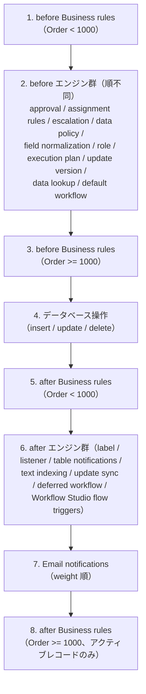
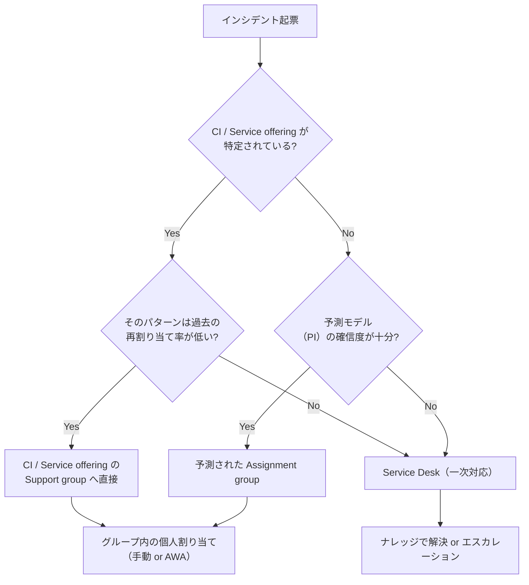
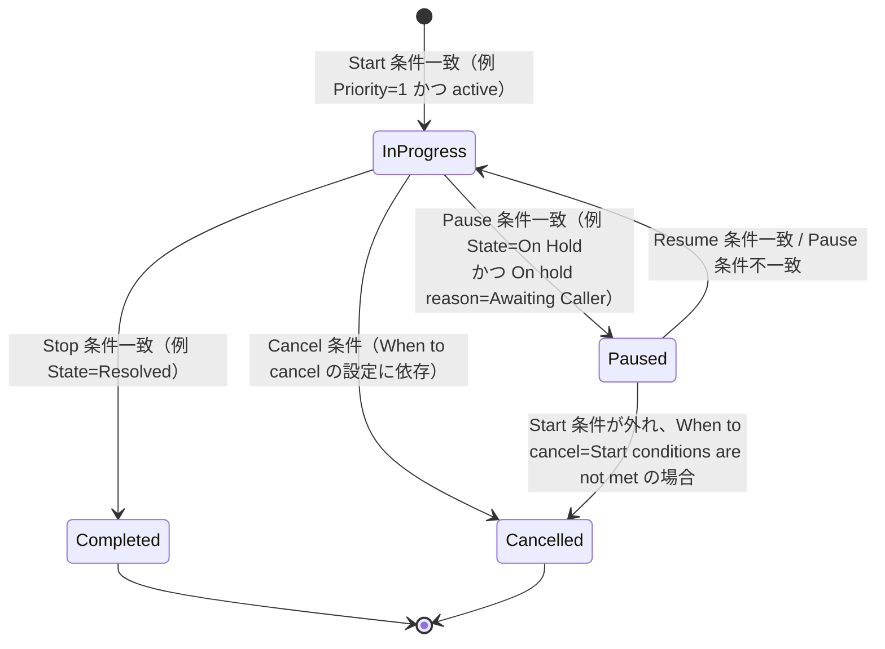
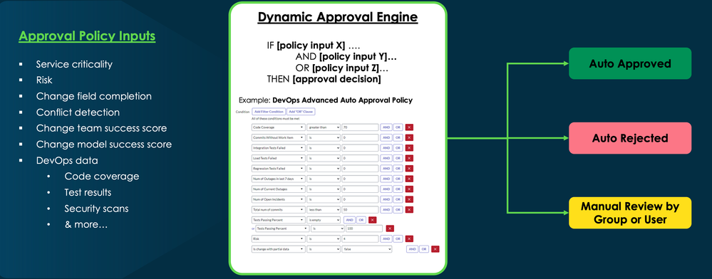
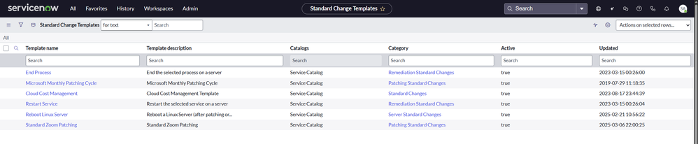
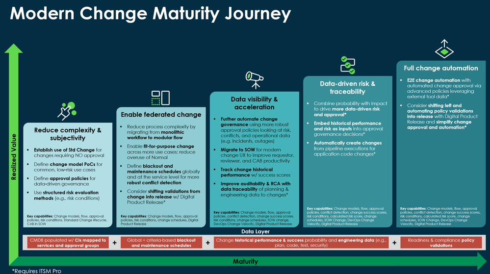
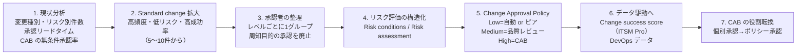

# ITSMプロセス設計の実践知（ITSM Process Design Tips）

## 概要

本ファイルは、ServiceNow ITSM（IT Service Management）を導入・改善するときに、要件定義・設計フェーズで必ず議論になる 6 つのテーマについて、**標準機能の仕様**と**実務上の知見**を出典付きで整理した応用編である。製品仕様の網羅的な説明は各リファレンスに譲り、本ファイルは「どう決めるべきか」「どこで失敗しやすいか」に焦点を当てる。

| テーマ | 本ファイルで答える問い | 仕様の詳細 |
|---|---|---|
| 1. 優先度設計 | Impact × Urgency のマトリクスをどう決めるか。Priority を手入力にしてよいか | [Incident Management](../02_リファレンス/itsm/incident-management.md) |
| 2. 割り当てルール | Assignment rules / Data lookup / Predictive Intelligence / CI の Support group をどう組み合わせるか | [Incident Management](../02_リファレンス/itsm/incident-management.md)、[Predictive Intelligence と AI Search](../02_リファレンス/platform/predictive-intelligence-ai-search.md) |
| 3. SLA設計 | SLA 定義を何本作るか。一時停止条件・スケジュール・Retroactive start をどう使うか | [SLAとスケジュール](../02_リファレンス/platform/sla-schedules.md) |
| 4. カテゴリ設計 | Category / Subcategory を作り込むべきか。Service / CI 中心にすべきか | [CMDB と CSDM](../02_リファレンス/platform/cmdb-csdm.md) |
| 5. Major Incident | 重大インシデントの宣言基準、Trigger rules、コミュニケーション、事後レビュー | [Incident Management](../02_リファレンス/itsm/incident-management.md) |
| 6. 変更承認の簡素化 | Standard change の拡大、Change model、Change Approval Policy、CAB の役割転換 | [Change Management](../02_リファレンス/itsm/change-management.md) |

本ファイルの情報源は、ServiceNow 公式ドキュメント（Australia 版を優先。Australia 版本文が取得できなかった箇所は Zurich / Yokohama / Brazil 版を明記）、ServiceNow 社員が執筆した ServiceNow Community のブログ・記事、および実務者のフォーラム投稿・第三者ブログである。Community 記事は製品ドキュメントではないため、公式ドキュメント以外に依拠する記述には `【第三者情報】`・`【経験則】`・`【推定】` のラベルを付ける。ServiceNow 社員執筆の Community 記事は「公式な製品仕様ではないが ServiceNow 側の推奨」として扱い、本文で執筆者と日付を示す。

ITIL・ITSM の基本概念は [ITILとITSMの基礎](../01_入門編/06-itil-itsm-basics.md)、要件定義の進め方は [要件定義と設計](../03_導入編/06-requirements-design.md)、導入全般の失敗パターンは [導入失敗パターンと対策](01-implementation-failure-patterns.md) を参照する。

### 全テーマに共通する設計原則

6 つのテーマを横断して、出典から繰り返し読み取れる原則は次の 4 点である。

| 原則 | 内容 | 根拠 |
|---|---|---|
| 主観を排し、データで決める | 優先度・割り当て・承認を担当者の判断に委ねると、SLA もエスカレーションも機能しない | 優先度について「主観的な解釈のプロセスになると効率的に処理できない」（ServiceNow 社員ブログ）[出典](https://www.servicenow.com/community/itsm-blog/managing-incident-priority/ba-p/2294101) |
| 少なく、意味のあるものに | SLA 定義・カテゴリ・承認者・重大インシデント宣言は「多いほど良い」ではない | SLA は「少なく意味のあるものを優先」[出典](https://www.servicenow.com/community/community-central-forum/the-complete-practitioner-s-guide-to-servicenow-slas-from/m-p/3453748)、承認者は「レベルごとに説明責任のある 1 グループ／1 人」[出典](https://www.servicenow.com/community/itsm-articles/modern-change-management-maturity-journey-amp-faq/ta-p/3279260) |
| CMDB / CSDM のサービスを共通の軸にする | Incident・Problem・Change が同じ Service / CI を参照することで、割り当て・影響評価・承認・レポートがつながる | CSDM に沿ったカテゴリ設計の記事 [出典](https://www.servicenow.com/community/itsm-articles/aligning-incident-categorization-to-csdm-a-service-centric/ta-p/3394669) |
| 標準（OOTB）の仕組みの上で設定する | 優先度は Data lookup、割り当ては Assignment rules / Data lookup、承認は Change Approval Policy という標準の仕組みがあり、Business rule の独自実装は実行順序の衝突を生みやすい | 実行順序の公式説明 [出典](https://www.servicenow.com/docs/r/7LhbZn3yz3Q58qhjZoU9iQ/BPxjOtOQ2ssDk92rudCDcA)。カスタマイズ全般は [カスタマイズと技術的負債](02-customization-technical-debt.md) |

---

## 1. 優先度設計（Priority）

### 1.1 標準の仕組み：Impact × Urgency → Priority

ServiceNow の Incident Management では、`Priority`（優先度）は `Impact`（影響度）と `Urgency`（緊急度）の組み合わせから **Data lookup（データルックアップ）** によって自動計算される。インシデントフォーム上の `Priority` フィールドは既定で読み取り専用であり、`Impact` と `Urgency` の値に基づいて自動設定される。[出典](https://www.servicenow.com/docs/r/it-service-management/incident-management/def-prio-lookup-rules.html) / [出典](https://www.servicenow.com/community/itsm-blog/managing-incident-priority/ba-p/2294101)

| 項目 | 内容 |
|---|---|
| ルールの場所 | All > System Policy > Rules > **Priority Lookup Rules** |
| 必要ロール | `data_lookup_admin` または `admin` |
| 読み取り専用にしている仕組み | UI policy「**Priority is managed by Data Lookup - set as read-only**」。この UI policy を無効化すると独自の優先度ロジックを作れる |
| 優先度の段階 | ベースシステムは 1 - Critical 〜 5 - Planning の 5 段階 |

[出典](https://www.servicenow.com/docs/r/it-service-management/incident-management/def-prio-lookup-rules.html) / [出典](https://www.servicenow.com/community/itsm-blog/managing-incident-priority/ba-p/2294101)

公式ドキュメントのサンプルルール（Priority Data lookup rules）は次のとおりである。Zurich 版ドキュメントでは Impact 3 - Low × Urgency 3 - Low が **5 - Planning** だが、Brazil 版ドキュメント（2026-09-10 更新）のサンプル表では同じ組み合わせが **4 - Low** と記載されており、リリースによってサンプル表の内容が異なる。Australia 版の該当ページ本文は今回確認できなかったため、実際の値は自インスタンスの Priority Lookup Rules を確認すること。[出典（Zurich）](https://www.servicenow.com/docs/r/zurich/it-service-management/incident-management/def-prio-lookup-rules.html) / [出典（Brazil）](https://www.servicenow.com/docs/r/it-service-management/incident-management/def-prio-lookup-rules.html)

| Impact（影響度）＼ Urgency（緊急度） | 1 - High | 2 - Medium | 3 - Low |
|---|---|---|---|
| **1 - High** | 1 - Critical | 2 - High | 3 - Moderate |
| **2 - Medium** | 2 - High | 3 - Moderate | 4 - Low |
| **3 - Low** | 3 - Moderate | 4 - Low | 5 - Planning（Zurich 版）／ 4 - Low（Brazil 版サンプル） |

### 1.2 Impact と Urgency の「定義」を先に決める

ServiceNow 社員の Community ブログ「Managing incident priority」（Suzanne Smith, 2015-05-21）は、Impact をビジネス上の損失・損害（財務、顧客、規制、セキュリティ、評判への影響）、Urgency を「ビジネスがどれだけ早く解決を必要とするか」と整理し、優先度が「個人の解釈による主観的なプロセス」になるとインシデントを効率的に処理できず、SLA の遵守やエスカレーションの発動も難しくなると述べている。[出典](https://www.servicenow.com/community/itsm-blog/managing-incident-priority/ba-p/2294101)

実務では、マトリクスの値そのものより、**Impact と Urgency の選択肢ごとの判定基準（言葉による定義）**を決めることが設計の本体になる。`【経験則】` 判定基準の例を以下に示す（組織ごとに調整する前提のたたき台）。

| 値 | Impact の判定基準の例 | Urgency の判定基準の例 |
|---|---|---|
| 1 - High | 全社または事業部全体／顧客向けサービス／規制・セキュリティ上の影響あり | 業務が完全に停止し、回避策がない／金銭的損失が時間とともに増える |
| 2 - Medium | 複数部署・複数拠点、または重要な業務担当者 | 業務は遅延しているが回避策で継続できる |
| 3 - Low | 個人・少人数 | 当面業務に支障がない、計画的に対応できる |

### 1.3 優先度設計の実践知

| # | 知見 | ラベル・出典 |
|---|---|---|
| 1 | **Priority を直接編集可能にしない。** 標準では読み取り専用で、変えたいときは Impact / Urgency を変える運用にする。独自ロジックが必要な場合のみ UI policy「Priority is managed by Data Lookup - set as read-only」を無効化し、独自の Business rule / UI policy を作る（公式に示された方法） | 公式 [出典](https://www.servicenow.com/docs/r/it-service-management/incident-management/def-prio-lookup-rules.html) |
| 2 | **マトリクスの値はスクリプトではなく Priority Lookup Rules で変える。** 管理者は Data lookup rules を編集して任意の Impact/Urgency の組み合わせの結果を変更できる | 公式（社員ブログ）[出典](https://www.servicenow.com/community/itsm-blog/managing-incident-priority/ba-p/2294101) |
| 3 | **優先度の段階数を増やさない。** ベースの 5 段階は SLA 定義、レポート、Major Incident の Trigger rules、通知など多くの設定から参照される。段階を増減すると、それらすべての条件を見直す必要がある | `【経験則】` |
| 4 | **Priority は SLA・エスカレーション・Major Incident の入力になる。** 優先度定義を変える場合は SLA 定義の Start 条件（例：Priority = 1）と Major Incident Trigger rules の条件を同時に更新する | `【経験則】`。SLA 条件の仕組みは [出典](https://www.servicenow.com/docs/r/QykF2iRSIs6VXztArCSo3w/WYN6nXXIBmOElVN~7E1oiQ) |
| 5 | **「Priority 1 の乱発」を監視する。** 起票者が Urgency を常に High にすると優先度が意味を失う。Service Desk による初期トリアージで Impact / Urgency を確認する運用、および Priority 別件数のレポートで偏りを定期確認する | `【経験則】` |
| 6 | **Impact はサービスの重要度（CI の Business criticality 等）から導く方法もある。** ただし CMDB の品質に依存するため、CMDB 整備が不十分な段階では手動選択＋判定基準の方が安定する | `【経験則】`。CMDB の成熟度については [CMDB成功の要因](05-cmdb-success-factors.md) |

---

## 2. 割り当てルール（Assignment）

### 2.1 標準の割り当て手段の全体像

ServiceNow でインシデントの `Assignment group`（割り当てグループ）と `Assigned to`（担当者）を自動設定する標準手段は複数あり、併用されることが多い。

| 手段 | 何を決めるか | 主な仕様 | 出典 |
|---|---|---|---|
| Assignment rules（割り当てルール） | `assignment_group`、`assigned_to` | 条件に一致したとき自動設定。「レコードを開いた時点で実行されるよう設計されている」。タスクテーブルに適用 | [出典](https://www.servicenow.com/docs/r/7LhbZn3yz3Q58qhjZoU9iQ/BPxjOtOQ2ssDk92rudCDcA) |
| Assignment Lookup Rules（割り当てデータルックアップ） | `assignment_group`、`assigned_to` | All > System Policy > Rules > Assignment Lookup Rules。Matcher（Category、Subcategory、Configuration item、Location）と Setter（Assignment group、Assigned to）を最低 1 つずつ指定。`Order` が最も小さい一致ルールが実行される。必要ロール `assignment_rule_admin` または `admin`（Australia 版） | [出典](https://www.servicenow.com/docs/r/fBdxWC~8p08POQuUubVDig/RTyTvCtgzgtRvsQglpVyIg) |
| Data lookup rules 全般 | 任意のフィールド | 割り当てに限らず任意のフィールド値を変更する汎用の仕組み | [出典](https://www.servicenow.com/docs/r/7LhbZn3yz3Q58qhjZoU9iQ/BPxjOtOQ2ssDk92rudCDcA) |
| Predictive Intelligence「Incident Assignment」 | `assignment_group` の予測 | Classification 型ソリューション定義。`Short description` から Assignment group を予測。必要プラグイン `com.glide.platform_ml`、`com.snc.incident.ml_solution`（Yokohama 版記載） | [出典](https://www.servicenow.com/docs/r/Mr7qUatbFXax1_h~z60rmA/zy8jQKycmMnI4dM2py_Ucg) |
| CI / Service offering の Support group | `assignment_group` | CI や Service offering に設定されたサポートグループへルーティングする設計パターン（標準の Business rule ではなく、Assignment rules やフローで実装することが多い） | `【第三者情報】` [出典](https://www.servicenow.com/community/developer-forum/how-are-you-assigning-incidents-in-your-itsm-projects/m-p/3383882) |
| Advanced Work Assignment（AWA） | グループ内の担当者（エージェント）へのプッシュ配分 | エージェントの空き状況に応じた配分。グループ決定後の個人割り当てに使う | 仕様は [Workspace と UI Builder](../02_リファレンス/platform/workspaces-ui-builder.md) 等を参照 |

### 2.2 実行順序（Precedence）を理解する

公式ドキュメント「Precedence between data lookup, assignment, and business rules」（Zurich 版、2025-07-31 更新）は、レコードの insert / update 時の処理順序を次のように示している。[出典](https://www.servicenow.com/docs/r/7LhbZn3yz3Q58qhjZoU9iQ/BPxjOtOQ2ssDk92rudCDcA)

この順序から導かれる設計上の要点は次のとおりである。

| # | 要点 | ラベル・出典 |
|---|---|---|
| 1 | Assignment rules エンジンと Data lookup エンジンは**同じ「before エンジン群」に属し、両者の間の順序は規定されていない（順不同）**。同じレコードに両方が割り当てを設定し得る設計にすると、結果が予測しにくくなる。**割り当ての主手段はどちらか一方に寄せる** | 公式の順序 [出典](https://www.servicenow.com/docs/r/7LhbZn3yz3Q58qhjZoU9iQ/BPxjOtOQ2ssDk92rudCDcA)＋`【経験則】` |
| 2 | Order 1000 以上の before Business rule は両エンジンの**後**に動くため、そこで `assignment_group` を設定すると Assignment rules / Data lookup の結果を上書きする。独自の割り当て Business rule は「最後に勝つ」ことを意識する | 公式の順序から導出 [出典](https://www.servicenow.com/docs/r/7LhbZn3yz3Q58qhjZoU9iQ/BPxjOtOQ2ssDk92rudCDcA) |
| 3 | Assignment rules は、`assigned_to` と `assignment_group` がいずれも空の場合にのみ動作し、既存の割り当てを上書きしないと説明されることが多い。一方 Data lookup は既存値を上書きできる、とするパートナー解説がある | `【第三者情報】` [出典](https://www.emergys.com/blog/handling-assignment-rules-in-servicenow) |
| 4 | Assignment rules 同士が競合した場合は、実行順序（Order）が最も小さいルールが優先される | `【第三者情報】` [出典](https://www.emergys.com/blog/handling-assignment-rules-in-servicenow) |
| 5 | Workflow Studio のフロートリガーは「after エンジン群」に属するため、フローで割り当てる場合はレコード保存後に再更新が走る（通知や SLA 付与のタイミングに影響し得る） | 公式の順序から導出 [出典](https://www.servicenow.com/docs/r/7LhbZn3yz3Q58qhjZoU9iQ/BPxjOtOQ2ssDk92rudCDcA)＋`【推定】` |

### 2.3 割り当て戦略：Service Desk 経由か、直接ルーティングか

インシデントを Service Desk（一次対応）に集約するか、CI / Service offering の Support group へ直接 L2/L3 に送るかは、ServiceNow Community でも結論が分かれる論点である。2025-09 のフォーラムスレッドでは、次のハイブリッド案が示されている。`【第三者情報】` [出典](https://www.servicenow.com/community/developer-forum/how-are-you-assigning-incidents-in-your-itsm-projects/m-p/3383882)

- CI / Service、カテゴリが明確で、過去にエスカレーションが少ないパターンに限り、CI / Service offering の Support group への直接ルーティングや ML（予測）による割り当てを適用する。
- それ以外は Service Desk に割り当て、ナレッジ記事で解決できるものは解決し、残りをエスカレーションする。

ServiceNow 社員の Community ブログ「Best practices for implementing the Incident Management application」（Dawn Jurek, 2017-10-25）も、最初のベストプラクティスとして「インシデントをすぐに適切なグループへ割り当てること」を挙げ、組織にとって重要な要素（Contact type、Category、Location、Configuration item 等）を定義してから Assignment rules を設定するよう推奨している。[出典](https://www.servicenow.com/community/itsm-blog/best-practices-for-implementing-the-incident-management/ba-p/2293421)

上図は出典の議論を整理した `【経験則】` の設計たたき台であり、ServiceNow の標準フローではない。

### 2.4 Predictive Intelligence による割り当ての注意点

| # | 知見 | ラベル・出典 |
|---|---|---|
| 1 | 標準のソリューション定義「Incident Assignment」は `Short description` を入力に Assignment group を予測する。同様に「Incident Categorization」（Category）、「Incident Service」（Service）、「Incident Configuration Item」（CI）の Classification 型定義がある | 公式（Yokohama）[出典](https://www.servicenow.com/docs/r/Mr7qUatbFXax1_h~z60rmA/zy8jQKycmMnI4dM2py_Ucg) |
| 2 | ML は常に 100% 正しいわけではない。Performance Analytics の再割り当て（re-assignment）件数を使い、どこで予測が最も効果を出すか（再割り当てが多い領域）を見極めることが推奨されている | 社員記事 [出典](https://www.servicenow.com/community/ai-intelligence-articles/tuning-predictive-intelligence-models-part-1/ta-p/2301076) |
| 3 | **組織変更でグループを廃止すると、モデルが廃止済みグループを予測し続ける。** グループ再編時はモデルの再学習とルーティングロジックの更新を計画に含める | `【第三者情報】` [出典](https://www.servicenow.com/community/common-service-data-model-forum/how-to-update-predictive-intelligence-routing-logic-after/m-p/3403653) |
| 4 | **既存の Assignment rules / Business rule と PI の優先関係、AWA との順序は設計で明示する必要がある。** Community でも「PI を AWA より先に動かすには」という質問が出ており、公開情報では決定的な回答は確認できなかった | `【第三者情報】` [出典](https://www.servicenow.com/community/itsm-forum/how-to-let-predictive-intelligence-to-take-precedence-than/m-p/3269807) |
| 5 | 学習データ（過去のインシデントの Assignment group）が「たらい回し」の結果を含んでいると、誤った割り当てを学習する。学習には最終解決グループを使う、再割り当てが多い期間を除外するなどのデータ整備が必要 | `【経験則】` |

ライセンス上の位置付け（Predictive Intelligence がどのエディションに含まれるか）は [ITSM Pro/Enterprise 固有機能](../02_リファレンス/itsm/itsm-pro-features.md) と [エディション比較](../03_導入編/03-edition-comparison.md) を参照する。

### 2.5 割り当て設計のチェックリスト

`【経験則】` 以下は出典の議論を踏まえた設計レビュー項目である。

- [ ] 割り当ての**主手段**（Assignment rules / Assignment Lookup Rules / フロー / PI）を 1 つに決め、他の手段との優先関係を文書化したか。
- [ ] 割り当てに使う入力（Category、CI、Service offering、Location、Contact type）の**入力品質**を担保する仕組み（必須化、既定値、予測）があるか。
- [ ] どの条件にも一致しない場合の**フォールバック先**（通常は Service Desk）が定義されているか。
- [ ] `Reassignment count`（再割り当て回数）をレポート・PA で監視し、ルール改善のサイクルを回しているか。
- [ ] グループの新設・廃止時に、Assignment rules、Lookup rules、PI モデル、CI の Support group を一括で更新する手順があるか。

---

## 3. SLA設計（Service Level Agreement）

### 3.1 前提となる仕様

SLA の仕様（`contract_sla` テーブルの SLA Definition、計測レコード `task_sla`、Type、Target、Duration type、Schedule source、Timezone source）の詳細は [SLAとスケジュール](../02_リファレンス/platform/sla-schedules.md) にまとめている。設計判断に直結する仕様のみ再掲する。

| 仕様 | 内容 | 出典 |
|---|---|---|
| 条件の種類 | Start、Cancel、Pause、Resume、Stop、Reset の 6 種類。1 つの SLA 定義に最大 6 つ設定できる | 公式（Australia）[出典](https://www.servicenow.com/docs/r/QykF2iRSIs6VXztArCSo3w/WYN6nXXIBmOElVN~7E1oiQ) |
| When to cancel | **Start conditions are not met**（既定。Start 条件が成り立たなくなったらキャンセル）／**Cancel conditions are met**（Start 条件は一度一致すればよく、以後は Cancel 条件でのみキャンセル）／**Never** | 公式（Australia）[出典](https://www.servicenow.com/docs/r/QykF2iRSIs6VXztArCSo3w/WYN6nXXIBmOElVN~7E1oiQ) |
| When to resume | **Pause conditions are not met**（Pause 条件が成り立たなくなったら再開）／**Resume conditions are met**（既定。Resume 条件一致で再開） | 公式（Australia）[出典](https://www.servicenow.com/docs/r/QykF2iRSIs6VXztArCSo3w/WYN6nXXIBmOElVN~7E1oiQ) |
| Retroactive start | チェックすると `Set start to` でタスクの日時フィールドを選択でき、SLA の開始時刻をそのフィールドの値にする（例：Priority 1 SLA で Created を選ぶと、インシデントの作成日時から計測） | 公式（Australia）[出典](https://www.servicenow.com/docs/r/QykF2iRSIs6VXztArCSo3w/WYN6nXXIBmOElVN~7E1oiQ) |
| Type / Target | `Type`（SLA / OLA / Underpinning contract）と `Target`（None / Response / Resolution）は**レポート目的のみ**で、計測ロジックには影響しない | 公式（Yokohama）[出典](https://www.servicenow.com/docs/r/Mr7qUatbFXax1_h~z60rmA/tNst0i0VqJTCN_WBMuSkEA) |
| Duration と Schedule | Duration の日数は 24 時間ブロックに換算される。1 日 8 時間のスケジュールで Duration 1 Day を指定すると、違反は 3 営業日後になる | 公式（Yokohama）[出典](https://www.servicenow.com/docs/r/Mr7qUatbFXax1_h~z60rmA/tNst0i0VqJTCN_WBMuSkEA) |

### 3.2 条件の重なり（Overlap）による典型的な不具合

公式ドキュメントは、条件が重なった場合の次の 3 パターンを明示的に警告している。SLA が「付かない」「すぐ消える」という問い合わせの多くはこれに該当する。[出典](https://www.servicenow.com/docs/r/QykF2iRSIs6VXztArCSo3w/WYN6nXXIBmOElVN~7E1oiQ)

| パターン | 何が起きるか | 対策 |
|---|---|---|
| Start 条件が Stop 条件の部分集合 | Start 条件が一致するときは常に Stop 条件も一致するため、**SLA が付与されない** | Stop 条件を「Start 条件が成り立たない状態」（例：State が Resolved / Closed）で書く |
| Pause 条件が Start 条件の部分集合 | SLA は付与されるが一時停止状態のままになり、Pause 条件が外れると Start 条件も外れて**キャンセル**される | Start 条件を状態に依存しない書き方にする |
| Start 条件と Pause 条件が相互排他 | 例：Start「State is one of New, Active」＋ Pause「State is On Hold」。On Hold に移った時点で Start 条件が外れ、**一時停止する前にキャンセル**される | Start 条件に On Hold も含める、または When to cancel を「Cancel conditions are met」にする |

上図は公式仕様に基づく `【経験則】` の整理図である（条件値は例）。

### 3.3 SLA設計の実践知

実務者による Community 記事「The Complete Practitioner's Guide to ServiceNow SLAs」（Shaah, 2025-12-20, Community Central フォーラム）は、SLA 設計の推奨と典型的な失敗を体系的にまとめている。`【第三者情報】` [出典](https://www.servicenow.com/community/community-central-forum/the-complete-practitioner-s-guide-to-servicenow-slas-from/m-p/3453748)

| # | 知見 | ラベル・出典 |
|---|---|---|
| 1 | **SLA 定義は少なく、意味のあるものに。** 重複する多数の SLA より、少数の意味のある SLA を優先する。1 タスクに Response と Resolution など複数の SLA が付く場合、どれを主たる SLA とするかを文書化する | `【第三者情報】` [出典](https://www.servicenow.com/community/community-central-forum/the-complete-practitioner-s-guide-to-servicenow-slas-from/m-p/3453748) |
| 2 | **パイロットは 1 Response ＋ 1 Resolution から。** 4〜6 週間運用してから拡張する | `【第三者情報】` 同上 |
| 3 | **一時停止は「外部依存で本当に作業が止まっている」場合に限定する。** 例：Awaiting User、Awaiting Vendor。社内の都合での保留を Pause にすると SLA が実態を表さなくなる | `【第三者情報】` [出典](https://www.servicenow.com/community/developer-forum/how-does-pause-condition-work-in-sla-and-why-is-it-important/m-p/3522547) |
| 4 | **Resume ロジックは Pause ロジックの鏡にする。** そうしないと SLA が無期限に一時停止したままになる。Stop 条件と Pause 条件も重ねない | `【第三者情報】` [出典](https://www.servicenow.com/community/community-central-forum/the-complete-practitioner-s-guide-to-servicenow-slas-from/m-p/3453748) |
| 5 | **Business time と Elapsed time を使い分ける。** ユーザー向けサポートは業務時間スケジュール（`cmn_schedule`）、24 時間対応が必要な業務（P1 インシデント、セキュリティ対応）は 24x7 スケジュールまたはスケジュールなしで計測する | `【第三者情報】` 同上 |
| 6 | **スケジュールを事後変更すると残り時間が再計算され、監査が複雑になる。** 祝日の後追い登録は年初にまとめて行う | `【第三者情報】` 同上 |
| 7 | **タイムゾーンを明示する。** スケジュールは組織の主たるタイムゾーンで保持し、レポートにタイムゾーンを明記する。Timezone source（Caller、CI の所在地、タスクの所在地など）の選択は、グローバル展開時に特に重要 | `【第三者情報】` 同上。Timezone source の仕様は [出典](https://www.servicenow.com/docs/r/Mr7qUatbFXax1_h~z60rmA/tNst0i0VqJTCN_WBMuSkEA) |
| 8 | **Retroactive start は慎重に。** 遡及開始はトレンド分析を歪めることがある。典型的な正しい用途は「優先度が後から 1 に引き上げられたとき、作成時刻から P1 SLA を計測する」ケース | `【第三者情報】` [出典](https://www.servicenow.com/community/community-central-forum/the-complete-practitioner-s-guide-to-servicenow-slas-from/m-p/3453748)。仕様は [出典](https://www.servicenow.com/docs/r/QykF2iRSIs6VXztArCSo3w/WYN6nXXIBmOElVN~7E1oiQ) |
| 9 | **エスカレーションは「ノイズ」ではなく「行動」を生むように。** 段階例：50% で Warning、90% で Urgent（担当者とマネージャーへ通知）、違反約 10 分前に Pre-breach（上位者を呼び出し）、Breach で管理職エスカレーションと監査記録。低重要度は定期ダイジェストにまとめる | `【第三者情報】` [出典](https://www.servicenow.com/community/community-central-forum/the-complete-practitioner-s-guide-to-servicenow-slas-from/m-p/3453748) |
| 10 | **OLA / Underpinning contract は SLA と同じ仕組みで計測できる。** OLA は社内チーム間、UC は外部ベンダーとの約束。ベンダー OLA には契約 ID を記録して監査に備える | `【第三者情報】` 同上。`Type` 自体はレポート目的のみ [出典](https://www.servicenow.com/docs/r/Mr7qUatbFXax1_h~z60rmA/tNst0i0VqJTCN_WBMuSkEA) |
| 11 | **SLA にはオーナーを置く。** オーナー不在、目標値変更の履歴がない、レビュー頻度が決まっていない、はガバナンス上の典型的な欠落 | `【第三者情報】` [出典](https://www.servicenow.com/community/community-central-forum/the-complete-practitioner-s-guide-to-servicenow-slas-from/m-p/3453748) |
| 12 | **毎回のタスク更新で動く重いスクリプトを SLA 周りに入れない。** パフォーマンス劣化の典型原因 | `【第三者情報】` 同上。性能全般は [パフォーマンスチューニング](03-performance-tuning.md) |

### 3.4 よくある不具合の切り分け

| 症状 | 主な原因 | 出典 |
|---|---|---|
| SLA が作成されない | 定義の条件が誤っている、Active がオフ、Business rule やスクリプトが作成を阻害している、Start が Stop の部分集合 | `【第三者情報】` [出典](https://www.servicenow.com/community/community-central-forum/the-complete-practitioner-s-guide-to-servicenow-slas-from/m-p/3453748)、公式 [出典](https://www.servicenow.com/docs/r/QykF2iRSIs6VXztArCSo3w/WYN6nXXIBmOElVN~7E1oiQ) |
| 一時停止しない | Pause 条件のフィールドが設定されていない、State を変える Business rule が Pause 条件のフィールドを更新していない、Start と Pause が相互排他でキャンセルされている | 同上 |
| 残り時間がおかしい | スケジュールやタイムゾーンの誤り、計算タイプの誤り、スケジュールの遡及編集 | `【第三者情報】` 同上 |
| 作業は完了したのに違反 | Stop 条件が組織の「解決」の定義と一致していない、Stop 条件の成立が違反時刻より後 | `【第三者情報】` 同上 |

> **Brazil での変更:** Incident Management の Brazil リリースノート（Early Availability、2026-09-10 更新）に、On Hold reason が **Awaiting Caller Information** のインシデントに呼び出し元への通知を繰り返し送り、応答がない場合に解決コード「**Resolved - No response from caller**」で自動解決する機能（試行回数の既定 3 回、0 で無効、試行間隔の既定 1 営業日。zboot（新規構築）インスタンスのみ）が追加された。また、解決済みインシデントの自動クローズ（`glide.ui.autoclose.time`）が**暦日ではなく営業日**で数えるように変わった（0 で無効）。Awaiting Caller を Pause 条件にしている SLA 設計では、自動解決によって Resolution SLA が停止する挙動を前提に、SLA と顧客合意の定義を見直す必要がある（後半は `【推定】`）。[出典](https://www.servicenow.com/docs/r/release-notes/incident-management-rn.html)

---

## 4. カテゴリ設計（Categorization）

### 4.1 なぜカテゴリ設計は失敗しやすいか

インシデントの `Category`（カテゴリ）/ `Subcategory`（サブカテゴリ）は、割り当て、レポート、ナレッジ検索、問題管理の傾向分析など多くの用途に同時に使われるため、要件が衝突しやすい。ServiceNow Community の記事「Aligning Incident Categorization to CSDM: A Service-Centric Approach」（sgrison, 2025-09-30）は、従来の Category / Subcategory モデルは「どの利用者グループにも十分に役立たない」と述べ、**サービスを主たる分類軸にする**ことを推奨している。`【第三者情報】` [出典](https://www.servicenow.com/community/itsm-articles/aligning-incident-categorization-to-csdm-a-service-centric/ta-p/3394669)

同記事は、300 を超えるサブカテゴリを持っていた医療機関の事例で、担当者が「Other（その他）」を既定で選ぶようになったことを挙げ、「階層が多すぎると担当者を混乱させ、入力を遅くする」と警告している。`【第三者情報】` [出典](https://www.servicenow.com/community/itsm-articles/aligning-incident-categorization-to-csdm-a-service-centric/ta-p/3394669)

### 4.2 推奨される分類モデル：Service → CI →（Service offering）

| 層 | フィールド | 誰の役に立つか | 出典 |
|---|---|---|---|
| Service（サービス） | `business_service` 等（CSDM の Business / Technical service） | 経営層・サービスオーナー：サービス単位の影響把握 | `【第三者情報】` [出典](https://www.servicenow.com/community/itsm-articles/aligning-incident-categorization-to-csdm-a-service-centric/ta-p/3394669) |
| Service offering（サービスオファリング） | `service_offering` | サービスをさらに細かい提供単位（特定機能・特定 SLA 区分）に分ける。任意 | 同上 |
| Configuration item（構成アイテム） | `cmdb_ci` | 技術チーム：コンポーネント単位の詳細、割り当て、変更との関連付け | 同上 |
| Category / Subcategory | `category`、`subcategory` | 補助的な分類（症状・問い合わせ種別）。サービスで表現できないものに限定 | `【経験則】` |

CSDM（Common Service Data Model）の構造は [CMDB と CSDM](../02_リファレンス/platform/cmdb-csdm.md) を参照する。

### 4.3 カテゴリ設計の実践知

| # | 知見 | ラベル・出典 |
|---|---|---|
| 1 | **サービスを主たる分類層にする。** Incident・Problem・Change が同じ Service / CI を参照するようにすると、変更起因のインシデント分析やサービス単位のレポートが可能になる | `【第三者情報】` [出典](https://www.servicenow.com/community/itsm-articles/aligning-incident-categorization-to-csdm-a-service-centric/ta-p/3394669) |
| 2 | **サービスの重複を防ぐガバナンスフォーラムを置く。** 「Outlook」「Exchange」「Email」のように似た名前のサービスが別々に登録されると分類が信頼されなくなる | `【第三者情報】` 同上 |
| 3 | **CMDB が古いと分類モデルごと崩れる。** Discovery / Service Mapping と連携して CI データを最新に保つ | `【第三者情報】` 同上。[Discovery](../02_リファレンス/itom/discovery.md)、[Service Mapping](../02_リファレンス/itom/service-mapping.md) |
| 4 | **少数の重要サービスでパイロットしてから拡大する。** 定期的なレコード監査、担当者へのフィードバックと再教育がないと、良いモデルでも「急速に劣化する」 | `【第三者情報】` 同上 |
| 5 | **カテゴリは製品名ではなく機能で切る。** 特定製品名のカテゴリは製品入れ替え時に不要化・改修が必要になる | `【第三者情報】` [出典](https://www.servicenow.com/community/itsm-forum/best-practices-incident-categorization-an-idea-feedback/m-p/918363) |
| 6 | **「報告時カテゴリ」と「解決時カテゴリ」を分ける考え方がある。** 起票者の申告内容と実際の原因を比較でき、誤分類の傾向分析やナレッジ改善に使える | `【第三者情報】` 同上 |
| 7 | **まず「分類値で何を駆動するか」を決める。** ルーティング、ナレッジ検索結果、レポート、問題管理のいずれに使うかで最適な粒度が変わる。Incident・Problem・Change のカテゴリは通常同じにはならない | `【第三者情報】` 同上 |
| 8 | **曖昧な解決コード（Resolution code / `close_code`）は問題管理の入力として不十分。** 「その他」「不明」の解決コードが一定数を超えたら Problem 起票の契機とする運用例がある | `【第三者情報】` 同上 |
| 9 | **「Other / その他」の比率を KPI として監視する。** その他の比率が高いカテゴリ体系は再設計のシグナル | `【経験則】`（事例は [出典](https://www.servicenow.com/community/itsm-articles/aligning-incident-categorization-to-csdm-a-service-centric/ta-p/3394669)） |
| 10 | **分類の入力負荷は予測で下げる。** Predictive Intelligence の「Incident Categorization」「Incident Service」「Incident Configuration Item」ソリューション定義は `Short description` から Category / Service / CI を予測する | 公式（Yokohama）[出典](https://www.servicenow.com/docs/r/Mr7qUatbFXax1_h~z60rmA/zy8jQKycmMnI4dM2py_Ucg) |

`【経験則】` カテゴリの階層は 2 階層（Category / Subcategory）・各階層 10〜15 程度以内に収める、という目安がしばしば語られるが、公式な推奨値は公開情報では確認できず。

---

## 5. Major Incident（重大インシデント）

### 5.1 標準の Major Incident Management（MIM）の仕組み

Major Incident Management は、通常のインシデントでは対応しきれない重大な障害を、専任の Major incident manager の下で調整・コミュニケーション・事後レビューまで管理する仕組みである。公式ドキュメント（Zurich 版、2025-07-31 更新）によれば、重大インシデントの候補は **Trigger rules** によって自動検出されるか、既存のインシデントを候補として**提案（Propose）**することで生まれ、Major incident manager がレビューして対応プロセスを開始する。[出典](https://www.servicenow.com/docs/r/MlbQAgTiiiMOLOw9T36wJg/MS3W5c~PCcn_EGgcM48hsQ)

**Major incident state（重大インシデント状態、`major_incident_state`）**（Australia 版）[出典](https://www.servicenow.com/docs/r/QykF2iRSIs6VXztArCSo3w/OOarIgr5LKo8qkcMu9xxaQ)

| 値 | 意味 |
|---|---|
| Proposed（提案済み） | 重大インシデント候補が作成または提案された初期状態 |
| Accepted（承認済み） | Major incident manager が直接作成した、または候補を昇格（Promote）した状態 |
| Rejected（却下） | 候補が Major incident manager に却下された状態 |
| Canceled（取消） | Major incident manager が重大インシデントを降格（Demote）した状態 |

インシデントフォームの Major Incident タブには `Proposed by`、`Proposed`（日時）、`Promoted by`、`Promoted`（日時）、`Business impact`、`Probable cause` が、Post Incident Report タブには `Overview`、`Findings`、`Timeline` が表示される。[出典](https://www.servicenow.com/docs/r/QykF2iRSIs6VXztArCSo3w/OOarIgr5LKo8qkcMu9xxaQ)

状態遷移図と Major Incident Workbench の画面は [Incident Management（リファレンス）](../02_リファレンス/itsm/incident-management.md) に掲載している。

**Trigger rules（トリガールール）**（Australia 版）[出典](https://www.servicenow.com/docs/r/UMl~97STJe3fa_KTmzD1Gg/p5ldvJGfaA1MpnZYYh4V~w)

| 項目 | 内容 |
|---|---|
| メニュー | All > Major Incidents > Administration > Major Incident Trigger Rules（Admin Center の Major Incident Management 設定ページからも可） |
| 必要ロール | `incident_manager` または `admin`（Australia 版の作成手順ページ）。Zurich 版の設定ページでは `sn_mim_sow_admin` ＋ `major_incident_manager` または `incident_manager`、`admin` と記載 |
| フォーム項目 | Name、Table、Application、Execution order、Action to be taken、Active、Conditions |
| Action | **Propose major incident**（候補として提案し、承認後に有効）／ **Promote to major incident**（直接昇格） |
| 評価 | インシデントの作成・更新時に**非同期**で評価。対象は「Primary incident がない」「まだ提案・承認されていない」「アクティブ」のインシデントのみ。Execution order が小さいルールから評価し、いずれかの条件に一致したら残りのルールは評価しない |
| ベースのルール | ベースシステムの Trigger rules は**既定で非アクティブ** |
| 関連プロパティ | `sn_major_inc_mgmt.com.snc.incident.min.major_incident_creation`（Create major incident from candidate）。値 **Create new** では、承認／昇格時に新しい重大インシデントを作成し、元のインシデントは子（secondary）になる。値 **Promote** では、Promote アクションで既存インシデントをそのまま昇格する |

[出典](https://www.servicenow.com/docs/r/UMl~97STJe3fa_KTmzD1Gg/p5ldvJGfaA1MpnZYYh4V~w) / [出典](https://www.servicenow.com/docs/r/UMl~97STJe3fa_KTmzD1Gg/a_qUQhkDTdZ0e4Has1QO8g)

**ロール:** `major_incident_manager` ロールの保持者は、候補の昇格、候補の作成、重大インシデントのプロセス管理と解決ができる。Service Operations Workspace（SOW）では、Major Incident Management プラグインを有効化した後、Configurations > Major Incident Managers セクションでユーザーにロールを割り当てる（Washington DC 版の記載）。[出典](https://www.servicenow.com/docs/r/BgFKZnPHldZ62gGtzQ71Mw/rbs4nu4jxY91VYMGlUba0A)

**コミュニケーションと解決:** Communication plan（コミュニケーション計画）は、インシデント種別・優先度・対象者ごとに複数定義でき、連絡先、手段、頻度、メッセージを定める（P1 の計画は更新頻度を高くできる）。重大インシデントを解決すると関連する子インシデントがすべて解決され、各呼び出し元に通知される。解決時に Post Incident Report が作成され、レビュー・更新後に関係者へ共有できる。[出典](https://www.servicenow.com/docs/r/MlbQAgTiiiMOLOw9T36wJg/MS3W5c~PCcn_EGgcM48hsQ)

> **Australia での変更:** Incident Management のリリースノートは、インシデント、重大インシデント、タスクアウテージ、関連するコミュニケーション機能の設定を**粒度の細かい管理ロール（granular admin roles）**で行えるようになったとしている。[出典](https://www.servicenow.com/docs/r/delta-zurich-australia/australia-zurich-incidentmanagement-release-notes.html)

> **Brazil での変更:** 新規構築（zboot）インスタンスでは、`major_incident_manager` と `sn_comm_management.comm_plan_mgr` が `itil` を継承しなくなり、ITSM Roles プラグイン（`com.snc.itsm.roles`）の `sn_incident_write`、`sn_problem_write`、`sn_change_write`、`sn_request_write` を継承する（アップグレードしたインスタンスは `itil` を保持）。`incident_manager` ロールも `itil` が除かれ `incident_write` に置き換わる。また、エンタイトルメントがある新規インスタンスでは Major Incident Management 等を自動インストールするスケジュールジョブが追加された。ロール設計（特にカスタム ACL が `itil` を前提にしている場合）に影響する。[出典](https://www.servicenow.com/docs/r/release-notes/incident-management-rn.html)

### 5.2 重大インシデント宣言基準の設計

ServiceNow Community ブログ「Major Incident Management - Common Pitfalls」（sgrison, 2025-09-24）は、MIM の典型的な落とし穴として次の 5 点を挙げている。`【第三者情報】` [出典](https://www.servicenow.com/community/itsm-blog/major-incident-management-common-pitfalls/ba-p/3389617)

| 落とし穴 | 推奨 |
|---|---|
| 宣言の遅れ | エスカレーション基準を早期に認識できるようチームを訓練する |
| Major Incident フラグの乱用 | 影響ユーザー数やサービスの重要度など、**明確な閾値**を設定する。乱用はプロセスを弱め、関係者を疲弊させる |
| 自動化の不足 | 自動通知・タスク作成など定型手順を自動化する |
| コミュニケーション不足 | コミュニケーションテンプレートと通知ルールで構造化した更新を行う |
| 事後レビューの省略 | すべての重大インシデントで Post Incident Review を実施し、教訓と根本原因分析を記録する |

`【経験則】` 宣言基準は「Priority 1 ＝ 重大インシデント」と同一視しないことが多い。P1 はインシデント単体の優先度、重大インシデントは「組織横断の調整とエグゼクティブへのコミュニケーションが必要か」で判断する。宣言基準の例：

| 観点 | 基準の例 |
|---|---|
| サービス | 事前に定義した Tier 1（ミッションクリティカル）サービスの全面停止、または重大な性能劣化 |
| 影響範囲 | 一定数以上のユーザー／拠点／顧客に影響、同一 CI・サービスで短時間に一定件数以上のインシデント |
| 外部影響 | 顧客向けサービス、規制・セキュリティ・個人情報に関わる影響 |
| 時間 | 一定時間内に回復見込みが立たない |

これらの基準を Trigger rules の条件（Priority、Business service、CI、件数等）に落とし込む場合も、自動 **Promote** ではなく **Propose**（候補提案 → Major incident manager の判断）にとどめるのが無難である（`【経験則】`。ベースの Trigger rules が既定で非アクティブであることも、組織ごとの基準定義を前提にしていると読める `【推定】`）。

### 5.3 MIM 運用の実践知

| # | 知見 | ラベル・出典 |
|---|---|---|
| 1 | **「どう作るか」より「なぜ必要か」を先に合意する。** 「ベストプラクティス」と称する MIM ソリューションが go-live 後すぐに使われなくなった例を 10 件以上見てきた、という実務者の指摘がある。理想はイベント管理で影響 CI を特定し、ビジネスサービスへ積み上げ、単一のインシデントと Outage レコードを起こす構成 | `【第三者情報】` [出典](https://www.servicenow.com/community/itsm-forum/servicenow-best-practice-for-major-outages/m-p/755635) |
| 2 | **ビジネスサービス → 技術サービス/CI → 重大インシデントの 3 層で考える。** 対応とコミュニケーションは技術的症状ではなくビジネス影響に紐付ける。推奨フロー：P1 検知 → MI 宣言 → Service Map で影響 Business service を特定 → Outage 作成（Investigating）→ 通知ドラフト → 承認 → 送信 → 状況更新（Identified / Monitoring / Resolved）→ Outage クローズ → Post-Incident Review | ServiceNow 社員 Q&A（anthonycamp, 2026-04-15）[出典](https://www.servicenow.com/community/itsm-blog/implementation-office-hours-q-amp-a-major-incident-management/ba-p/3525865) |
| 3 | **通知の事前承認は標準にない。** OOTB の MIM には通知送信前の承認ゲートがない。必要なら Major Incident レコードにチェックボックス／選択肢とドラフト用フィールド（例 `u_comm_draft`）を追加し、Flow Designer で MIM Manager の承認タスクを作る | 同上 [出典](https://www.servicenow.com/community/itsm-blog/implementation-office-hours-q-amp-a-major-incident-management/ba-p/3525865) |
| 4 | **Communication plan の受信者数上限（99）に注意。** 通知レコードのメール受信者リストの扱い（フィールド長またはクエリの制約）に起因し、ServiceNow は解決策を検討中だがリリースの約束はない（Q&A 時点）。大規模配信は配信リスト（グループアドレス）や Teams 等を使う | 同上 |
| 5 | **修正チームが複数ある場合の制約。** Experts on Call パネルは Assignment group（単一の所有チーム）に紐付く。回避策は修正チームごとに MIM Task を作ること。MIM は 2〜3 チーム程度の修正体制に最も適する | 同上 |
| 6 | **小規模組織は「MIM Lite」で。** SOW の MIM は大規模 NOC・専任 MIM Manager・成熟した CMDB・24x7 体制を想定した設計。小規模組織は同じコアプロセスを簡素な儀式で運用する | 同上 |
| 7 | **CMDB がなくても MIM は始められる。** CMDB は MIM を強化するが MIM を動かしているわけではない。自動化と分析の一部は失われるが、コアプロセスは価値を出せる | 同上 |
| 8 | **SPOC リストよりオンコールシフトで運用する。** 属人的な連絡先リストは退職・不在・陳腐化のリスクがある。On-Call Scheduling は ITSM の SOW に含まれるプラットフォーム機能で、MIM のアドオンとして有効 | 同上 |
| 9 | **MIM Workbench（UI16）のカスタマイズは期待しない。** 開発投資は SOW に集中しており、Workbench の多くの領域は読み取り専用 | 同上。Workspace については [Workspace と UI Builder](../02_リファレンス/platform/workspaces-ui-builder.md) |
| 10 | **Playbook で手順を標準化する。** 重大インシデントに昇格したときにプレイブックを自動起動し、トリアージ・影響評価、関係者通知、War room 設置、回避策、根本原因調査、事後レビューを順に提示する。優先度やカテゴリでプレイブックを切り替え、教訓に基づいて定期的に改訂する | `【第三者情報】` [出典](https://www.servicenow.com/community/itsm-blog/using-playbooks-to-streamline-major-incident-management-in/ba-p/3389644) |
| 11 | **SMS 通知はキャリアの email-to-SMS 廃止に注意。** Twilio 等の SMS プロバイダー連携や MS Teams 通知で代替する | ServiceNow 社員 Q&A [出典](https://www.servicenow.com/community/itsm-blog/implementation-office-hours-q-amp-a-major-incident-management/ba-p/3525865) |
| 12 | **事後レビューは問題管理に接続する。** 根本原因が未特定なら回避策で解決し、恒久対策のために Problem を起票する | `【第三者情報】` [出典](https://www.servicenow.com/community/itsm-blog/major-incident-management-common-pitfalls/ba-p/3389617)。[Problem Management](../02_リファレンス/itsm/problem-management.md) |
| 13 | **類似インシデントの検出に Predictive Intelligence を使える。** 「Major Incident Detection」（類似のアクティブな重大インシデントへのリンク候補、重大インシデントとして提案すべき類似インシデント）、「Similar Incidents (Major Incident Workbench)」のソリューション定義がある | 公式（Yokohama）[出典](https://www.servicenow.com/docs/r/Mr7qUatbFXax1_h~z60rmA/zy8jQKycmMnI4dM2py_Ucg) |

---

## 6. 変更承認の簡素化（Change Approval Simplification）

### 6.1 標準の変更タイプと承認

公式ドキュメント「Change types」（Zurich 版）は 3 つの ITIL 変更タイプを次のように定義している。[出典](https://www.servicenow.com/docs/r/MlbQAgTiiiMOLOw9T36wJg/0mfA2AyAdGPOssbbVgOLLQ)

| タイプ | 承認 | 特徴 |
|---|---|---|
| Standard（標準変更） | 事前承認済み。グループ承認・ピア承認・CAB 承認は不要 | 事前承認済み・低リスク・反復可能な手順の変更。承認済みの標準変更はカタログのテンプレートとして保存 |
| Normal（通常変更） | 評価、ピア／技術承認、CAB 承認の 2 段階 | 規定のプロセスに沿う。通常は変更凍結期間外、またはメンテナンスウィンドウ内で実施 |
| Emergency（緊急変更） | グループ・ピアレビューを省略し、Authorize 状態で CAB 承認へ直行 | 通常変更のライフサイクルを経ない |

Australia 版の Normal change model（Configuration Console で設定）の既定承認者は次のとおりである。状態は New → Assess → Authorize → Scheduled → Implement → Review。必要ロールは `sn_itsm_chg_admin.change_models_config`、`sn_itsm_chg_admin.admin`、または `admin`。[出典](https://www.servicenow.com/docs/r/QykF2iRSIs6VXztArCSo3w/KUkqPh5VH0ZPOZjsznULjA)

| 状態 | Low リスク | Moderate リスク | High リスク |
|---|---|---|---|
| Assess（既定） | Assignment group のメンバー | Assignment group のメンバー | Assignment group のメンバー |
| Authorize（既定） | Assignment group のメンバー | CAB メンバー | CAB メンバー |

選択できる承認者の種類は、Assignment group のメンバー、Assignment group のマネージャー、Change manager、CAB メンバー、その他のグループ（指定）である。[出典](https://www.servicenow.com/docs/r/QykF2iRSIs6VXztArCSo3w/KUkqPh5VH0ZPOZjsznULjA)

### 6.2 Change Approval Policy の仕組み

**Change Approval Policy（変更承認ポリシー）**は、ワークフロー内の個別の承認設定を置き換える、Decision Table ベースの承認エンジンである。ServiceNow 社員の Community ブログ「Using Change Approval Policies」（Jason Occhialin, 2019-01-31）による構成要素は次のとおり。[出典](https://www.servicenow.com/community/in-other-news/using-change-approval-policies/ba-p/2286835)

| 要素 | 内容 |
|---|---|
| Policy Inputs（ポリシー入力） | Normal policy の既定入力は `change_request`（変更要求とその参照先テーブルのフィールド）と `manager_approved`（Boolean） |
| Decisions（判断） | 変更の状態やリスク等の条件。Normal policy には「Assess Technical Approvals」「Low Risk Manager approval」「Requires CAB Approval」の 3 つ |
| Answers（回答 = Change Approval Definition） | 実行するアクション（承認／却下／ユーザー承認／グループ承認）、承認者のソース、必須かどうか。グループ承認では「最初の応答」か「全員の応答」かを指定 |
| ログ | `chg_policy_applied`（Applied Change Policies）に、変更要求・適用ポリシー・一致した Decision・日時を記録。自動承認／自動却下の監査に特に有用 |
| 低リスクのマネージャー承認 | `manager_approved` を使う「Low Risk Manager approval」は、低リスクの Normal change について Assignment group のマネージャーが最終承認でき、以降の承認を不要にする（Kingston で追加） |

ベースシステムには Normal change policy と Emergency change policy が含まれる。Madrid 以降の新規インスタンスでは Normal / Emergency のワークフローにポリシー活動が既定で入っているが、アップグレードしたインスタンスではワークフローに Change Approval Policy 活動を追加しないとポリシーが効かない（2019 年時点の記述）。[出典](https://www.servicenow.com/community/in-other-news/using-change-approval-policies/ba-p/2286835)

- **キャプション:** How approval policies work（Change Approval Policy の動作概念図）
- **図の説明:** 左側に「Approval Policy Inputs（承認ポリシーの入力）」として Service criticality、Risk、Change field completion、Conflict detection、Change team success score、Change model success score、DevOps data（Code coverage、Test results、Security scans など）が列挙されている。中央の「Dynamic Approval Engine」には「IF [policy input X] AND [policy input Y] OR [policy input Z] THEN [approval decision]」という論理と、例として「DevOps Advanced Auto Approval Policy」の条件ビルダー画面（Code Coverage が 70 より大きい、Integration Tests Failed が 0、Num of Outages in last 7 days が 0、Num of Open Incidents が 0、Risk が 4 など）が示されている。右側に 3 つの結果「Auto Approved（自動承認）」「Auto Rejected（自動却下）」「Manual Review by Group or User（グループまたはユーザーによる手動レビュー）」へ矢印が分岐している。
- **出典:** [Modern Change Management Maturity Journey & FAQ（ServiceNow Community, Caelan, ServiceNow 社員）](https://www.servicenow.com/community/itsm-articles/modern-change-management-maturity-journey-amp-faq/ta-p/3279260)（取得日：2026-11-04）

### 6.3 承認を簡素化するための実践知

ServiceNow 社員の Community 記事「Modern Change Management Maturity Journey & FAQ」（Caelan, 2025-06-04 公開 / 2025-07-02 更新）は、承認設計について次の推奨を示している。[出典](https://www.servicenow.com/community/itsm-articles/modern-change-management-maturity-journey-amp-faq/ta-p/3279260)

| # | 推奨 | 出典 |
|---|---|---|
| 1 | **承認者の数を少なく保つ。** レベルごとに説明責任のあるグループまたは個人を 1 つにする | [出典](https://www.servicenow.com/community/itsm-articles/modern-change-management-maturity-journey-amp-faq/ta-p/3279260) |
| 2 | **承認を「変更の周知」の代わりに使わない。** 周知には Change schedule、ダッシュボード、購読（subscription）を使う | 同上 |
| 3 | **タスクの担当者を変更の承認者にしない。** Assignment group はタスク側で受け入れを管理できる | 同上 |
| 4 | **推奨する承認構成:** ピアレビューは全リスクレベル、変更管理による品質レビューは Medium / High、CAB は High のみ、サービスオーナーは計画停止（planned outage）が見込まれる場合のみ、その他は必要な場合のみ | 同上 |
| 5 | **承認ポリシーで自動承認・自動却下・手動レビューを振り分ける。** 入力はリスク、サービス、競合、チームの成功スコアなどのデータ | 同上 |
| 6 | **承認が必要な低リスクのユースケースは、Standard change ではなく「低リスク用 Change model」で扱う** | 同上 |

### 6.4 Standard change の拡大

Standard change は「事前承認済みで、成功実績のある低リスクの変更」であり、標準変更カタログには Change Management アプリケーションで標準変更として承認されたものが含まれる。テンプレートは組織の要件に応じて提案（Propose）・変更・廃止（Retire）でき、テンプレートへのアクセスはロール・場所・部署などでユーザーごとに制御できる。`itil` ロールのユーザーは利用可能な標準変更の一覧を参照して変更要求を起票できる。Standard Change Properties の **Two step** をオンにすると、要求者が Submit を押すまで変更要求レコードが挿入されない。[出典（Zurich）](https://www.servicenow.com/docs/r/MlbQAgTiiiMOLOw9T36wJg/Os7wMltkImYpod2i5v1iPw)

- **キャプション:** Standard Change Templates のリスト画面（Core UI / Next Experience）
- **画面の説明:** 上部ナビゲーションに All / Favorites / History / Workspaces / Admin、中央に「Standard Change Templates」のタイトル。リストの列は Template name、Template description、Catalogs、Category、Active、Updated。行の例として「End Process」（Remediation Standard Changes）、「Microsoft Monthly Patching Cycle」（Patching Standard Changes）、「Cloud Cost Management」（Standard Changes）、「Restart Service」（Remediation Standard Changes）、「Reboot Linux Server」（Server Standard Changes）、「Standard Zoom Patching」（Patching Standard Changes）が並び、Catalogs はすべて Service Catalog、Active は true。テンプレートをカテゴリ（パッチ適用、修復、サーバー等）で整理している例である。
- **出典:** [Modern Change Management Maturity Journey & FAQ（ServiceNow Community）](https://www.servicenow.com/community/itsm-articles/modern-change-management-maturity-journey-amp-faq/ta-p/3279260)（取得日：2026-11-04）

| # | 知見 | ラベル・出典 |
|---|---|---|
| 1 | **頻度が高く低リスクで実績のある作業を Standard change にする。** 提案は変更チームでも要求者でも可。実装計画・切り戻し計画・テスト計画を含む完全な情報を求め、完全性・技術的正確性・コンプライアンスをレビューし、オーナーを割り当てる | ServiceNow 社員記事 [出典](https://www.servicenow.com/community/itsm-articles/modern-change-management-maturity-journey-amp-faq/ta-p/3279260) |
| 2 | **失敗やインシデントを繰り返すテンプレートは無効化し、利用状況を追跡し、古いテンプレートを廃止する** | 同上 |
| 3 | **最初は 5〜10 件の高頻度・低リスク変更から始め、カタログを小さくバージョン管理された状態に保つ。** そうしないとフォームの量産工場になる | `【第三者情報】` [出典](https://us.fitgap.com/stack-guides/handling-recurring-standard-changes-with-pre-approved-patterns-and-automated-sign-off) |
| 4 | **Normal change の実績データから Standard 化の候補を探す。** 同じ Short description・同じ CI クラス・同じグループで、成功率が高く CAB で毎回無条件承認されている Normal change は Standard 化候補 | `【経験則】` |
| 5 | **Standard change でも例外的に承認を差し込める。** Change Approval Policy は事前承認済みの Standard change にも承認を発生させられる（例：1,000 を超える CI に影響する場合）。ただしこの例は Standard change のワークフローには接続されていない説明用のもの | ServiceNow 社員ブログ [出典](https://www.servicenow.com/community/in-other-news/using-change-approval-policies/ba-p/2286835) |

> **Australia での変更:** Change templates を特定の Change model に紐付けて構成し、テンプレートのフィールドポリシーで必須・読み取り専用を制御し、テンプレートのライフサイクル（提案・レビュー・バージョン・廃止）を管理できるようになった。新規作成する Standard change では**改善された Change template データモデル**を任意で使える（既存の標準変更カタログには影響せず、移行は不要）。また、Change Management の設定権限は単一の granular admin ロール **`sn_change_admin`** に集約され、従来の一般的な admin / ITIL ロールによる設定を置き換える（`sn_change_admin` は変更管理の書き込みロール、`change_manager`、`sn_change_cab.cab_manager` 等を含む）。変更要求を競合検出から除外する **Exclude from conflict detection** オプションも追加された。[出典](https://www.servicenow.com/docs/r/8_SIK58xmFJIEc2bL5YTYg/boWeBD1EB9spWQm_TQp4Jw)

### 6.5 データ駆動の承認：Change success score とリスク階層

**Change success score（変更成功スコア）**は、グループの変更履歴を数値化したもので、成功した変更はスコアを上げ、失敗した変更は下げる。Performance Analytics の指標でデータを収集し、Formula indicator で最終スコアを算出する。**ITSM Professional サブスクリプションでのみ利用可能な**「Change Management - Change success score」プラグインで提供される（Australia 版）。[出典](https://www.servicenow.com/docs/r/QykF2iRSIs6VXztArCSo3w/B0mqJSRYCtUEahQQJwwbWA)

ServiceNow 社員の Community 記事（shashanktonpeka, 2020-10-28）は、Change Approval Policy に String 型の Policy Input（例 `u_group_css`）を作り、`metric_instance` テーブルから前日の Assignment group の成功スコアを取得して Decision の閾値と比較する実装例を紹介している。閾値は記事では示されておらず、組織で決める必要がある。[出典](https://www.servicenow.com/community/itsm-articles/using-change-success-score-as-part-of-change-approval-policy/ta-p/2309185)

ServiceNow 社員ブログ「Change Enablement & Federation: Maintaining Change Velocity in Regulated Environments」（ScottG_SN, 2023-01-18）は、規制業界でも CAB に依存せず承認を連邦化（federate）する **3 段階のポリシー**例を示している。[出典](https://www.servicenow.com/community/itsm-blog/change-enablement-amp-federation-maintaining-change-velocity-in/ba-p/2446681)

| ポリシー | 対象 | 承認・統制 |
|---|---|---|
| Policy 1：Accelerated change | 低リスクかつ Change success score が **850 超** | CAB を省略。自動検証、ピアレビュー（公平性のためレビュアーをランダム化）、却下率の監視、変更起票前の研修を必須化 |
| Policy 2：Enhanced review | スコア **500〜850**、またはリスク Medium | Policy 1 の統制＋開発マネージャーとプロダクトマネージャーの承認 |
| Policy 3：Full CAB | 上記以外 | 完全な CAB レビュー |

同ブログは、2022 年の Google State of DevOps レポートを引用し、デプロイ頻度・リードタイムと変更失敗率に相関がない（速度と品質は両立する）と述べ、次の点も推奨している。[出典](https://www.servicenow.com/community/itsm-blog/change-enablement-amp-federation-maintaining-change-velocity-in/ba-p/2446681)

- 大企業では数十〜数百のポリシーが生まれ得るため、**各ポリシーにオーナーを置く**。CAB の役割は個々の変更の承認から**ポリシー変更の承認**へ移行し得る。
- 変更マネージャーの役割を、CAB 運営・個別承認・静的な標準変更リスト管理から、DevOps パイプラインへの変更統合・データ駆動のリスク評価による承認自動化・Change model の構築を担う「**Change enabler**」へ進化させる。
- **監査人と早期に統制方針を合意する**（サーベイランス監査のはるか前に）。

### 6.6 成熟度ジャーニー

- **キャプション:** Modern Change Maturity Journey（モダン変更管理の成熟度ジャーニー、5 段階）
- **図の説明:** 縦軸が Realized Value（実現価値）、横軸が Maturity（成熟度）で、右上がりの階段状に 5 段階が並ぶ。①**Reduce complexity & subjectivity**（複雑性と主観性の削減）：承認不要の変更に Standard change を確立、一般的な低リスクのユースケースで Change model の PoC、データ駆動のガバナンスのための承認ポリシー定義、構造化されたリスク評価（Risk conditions 等）。②**Enable federated change**（変更の連邦化）：モノリシックなワークフローからモジュール化されたフローへ移行、目的に合った変更（fit-for-purpose）で Normal の乱用を削減、グローバル／サービス単位のブラックアウト・メンテナンススケジュールで競合検出を強化、Digital Product Release による検証の前倒しを検討。③**Data visibility & acceleration**（データの可視化と加速）：リスク・競合・運用データ（インシデント、停止）を使ったより強力な承認ポリシー、SOW への移行、Success score による履歴追跡、計画・エンジニアリングデータのトレーサビリティ。④**Data-driven risk & traceability**（データ駆動のリスクとトレーサビリティ）：確率と影響を組み合わせたリスク・承認、過去の実績とリスクを承認ガバナンスの入力に、パイプライン実行から変更を自動作成。⑤**Full change automation**（変更の完全自動化）：外部ツールデータを使った高度なポリシーによる E2E の自動承認、ポリシー検証のシフトレフト。下部の Data Layer には、CI がサービスと承認グループにマッピングされた CMDB、グローバル＋条件ベースのブラックアウト／メンテナンススケジュール、変更の履歴実績と成功確率・エンジニアリングデータ、準備状況とコンプライアンスのポリシー検証、が段階ごとの前提として示されている。図の左下に「*Requires ITSM Pro」（* 印の項目は ITSM Pro が必要）と注記がある。
- **出典:** [Modern Change Management Maturity Journey & FAQ（ServiceNow Community, Caelan, ServiceNow 社員, 2025-06-04 公開）](https://www.servicenow.com/community/itsm-articles/modern-change-management-maturity-journey-amp-faq/ta-p/3279260)（取得日：2026-11-04）

同記事は Stage 1 の具体的ステップとして、①現行プロセスのレビュー、②低リスクのパイロット用ユースケースとチームの特定、③Standard change の拡大、④Risk conditions の有効化、⑤承認ポリシーとフローを備えたパイロット用 Change model の定義、⑥テストとパイロットチームへの展開、を挙げている（Stage 2 以降の詳細は記事執筆時点で「coming soon」）。CAB については、SOW の CAB 機能が従来の CAB Workbench と機能同等でリリースされ、2025-05 の更新で開催中の CAB でアジェンダ項目の一時停止・延期・復元が可能になったこと、事前レビュー（pre-CAB）とコメントの活用、CAB 運営に CAB manager ロールが必要なことが説明されている。[出典](https://www.servicenow.com/community/itsm-articles/modern-change-management-maturity-journey-amp-faq/ta-p/3279260)

### 6.7 変更承認の簡素化：設計手順のまとめ

上図は本節の出典（ServiceNow 社員の Community 記事・ブログ）を統合した `【経験則】` の進め方であり、ServiceNow の公式な導入手順ではない。各ステップの出典は 6.3〜6.6 節を参照。

> **Brazil での変更:** Change Management の Brazil リリースノート（Early Availability、2026-09-10 更新）には、承認とガバナンスに関わる次の機能が含まれる。**Change lockdown**（重大な計画外 IT イベントや決算期などに、変更マネージャーが進行中の変更要求の全部または一部を一時停止できる）と、ロックダウン期間に重なる変更要求を「Inside Change Lockdown」の競合として検出し保留にする **Change lockdown conflict detection**、Change model の状態ごとに変更要求フィールドを必須／読み取り専用にする **State field policies for change models**、影響する CI ごとに子変更を生成・調整する **Scaled change**、Change model への ITIL 変更プロセスの割り当て、リスク・コンプライアンス情報を Dynamic Schema で保持する **Compliance dynamic schema**。また ITSM Enhanced Security Features プラグイン（`com.snc.itsm.enhanced_security`）がアップグレード時にも自動で有効化され、複数の ITSM テーブルに「deny unless authenticated」ACL が追加される。[出典](https://www.servicenow.com/docs/r/release-notes/change-management-rn.html)

---

## 7. テーマ横断：設計判断のクイックリファレンス

| 設計論点 | 推奨の方向 | 主な根拠 |
|---|---|---|
| Priority を手入力にするか | しない。Impact / Urgency の判定基準を定義し、Priority Lookup Rules で算出 | [出典](https://www.servicenow.com/docs/r/it-service-management/incident-management/def-prio-lookup-rules.html) |
| 優先度の段階数を変えるか | 原則としてベースの 5 段階を維持（`【経験則】`） | 本ファイル 1.3 |
| 割り当ての主手段 | Assignment rules か Assignment Lookup Rules のどちらかに寄せ、Business rule での上書きを避ける | [出典](https://www.servicenow.com/docs/r/7LhbZn3yz3Q58qhjZoU9iQ/BPxjOtOQ2ssDk92rudCDcA) |
| Service Desk 経由か直接ルーティングか | CI / サービスが明確で再割り当てが少ないパターンのみ直接、それ以外は Service Desk（`【第三者情報】`） | [出典](https://www.servicenow.com/community/developer-forum/how-are-you-assigning-incidents-in-your-itsm-projects/m-p/3383882) |
| SLA 定義の本数 | 少数（まず Response 1 ＋ Resolution 1）から（`【第三者情報】`） | [出典](https://www.servicenow.com/community/community-central-forum/the-complete-practitioner-s-guide-to-servicenow-slas-from/m-p/3453748) |
| SLA の一時停止 | 外部依存（Awaiting User / Vendor）に限定。Start と Pause を相互排他にしない | [出典](https://www.servicenow.com/docs/r/QykF2iRSIs6VXztArCSo3w/WYN6nXXIBmOElVN~7E1oiQ) |
| カテゴリの主軸 | Service / CI（CSDM）を主、Category / Subcategory は補助（`【第三者情報】`） | [出典](https://www.servicenow.com/community/itsm-articles/aligning-incident-categorization-to-csdm-a-service-centric/ta-p/3394669) |
| Major Incident の宣言 | 明確な閾値を定義。Trigger rules は Propose（候補提案）から始める（後半は `【経験則】`） | [出典](https://www.servicenow.com/community/itsm-blog/major-incident-management-common-pitfalls/ba-p/3389617) |
| MIM の規模 | 小規模組織は MIM Lite。CMDB 整備を待たずに開始可 | [出典](https://www.servicenow.com/community/itsm-blog/implementation-office-hours-q-amp-a-major-incident-management/ba-p/3525865) |
| CAB の対象 | High リスクのみ。承認を周知に使わない | [出典](https://www.servicenow.com/community/itsm-articles/modern-change-management-maturity-journey-amp-faq/ta-p/3279260) |
| 低リスク Normal change | Low Risk Manager approval（`manager_approved`）や承認ポリシーによる自動承認 | [出典](https://www.servicenow.com/community/in-other-news/using-change-approval-policies/ba-p/2286835) |
| データ駆動の承認 | Change success score（ITSM Pro）＋リスクによる階層化ポリシー | [出典](https://www.servicenow.com/community/itsm-blog/change-enablement-amp-federation-maintaining-change-velocity-in/ba-p/2446681) |

### 7.1 プロセス KPI の例

`【経験則】` 設計の効果を確認するために、次の KPI を go-live 前にベースライン化しておくとよい。レポート機能は [レポートとアナリティクス](../02_リファレンス/platform/reporting-analytics.md) を参照。

| テーマ | KPI の例 |
|---|---|
| 優先度 | Priority 別件数の分布、起票後の Priority 変更率 |
| 割り当て | 平均再割り当て回数（Reassignment count）、初回割り当て正解率、Service Desk での一次解決率 |
| SLA | SLA 遵守率（Priority 別）、違反件数、一時停止時間の比率 |
| カテゴリ | 「Other / その他」選択率、解決時のカテゴリ変更率 |
| Major Incident | 宣言までの時間、件数（乱用の監視）、Post Incident Review 完了率 |
| 変更 | Standard change 比率、承認リードタイム、変更成功率（変更起因インシデント率）、CAB にかかる件数 |

（変更関連の KPI のうち変更成功率・承認自動化の考え方は [出典](https://www.servicenow.com/community/itsm-articles/modern-change-management-maturity-journey-amp-faq/ta-p/3279260)、SLA の KPI は [出典](https://www.servicenow.com/community/community-central-forum/the-complete-practitioner-s-guide-to-servicenow-slas-from/m-p/3453748) に例がある。）

---

## 8. 公開情報で確認できなかった事項

- Australia 版「Define priority lookup rules」ページのサンプル表本文（Zurich 版と Brazil 版でサンプル値が異なることのみ確認）。
- Assignment rules が「`assigned_to` と `assignment_group` の両方が空の場合のみ動作し、既存値を上書きしない」ことの Australia 版公式ドキュメント上の記述（第三者情報としてのみ確認）。
- Predictive Intelligence、Assignment rules、Advanced Work Assignment の三者の公式な実行優先順位。
- Australia 版「Create an SLA definition」のフォーム項目一覧の本文（Yokohama 版で確認）。
- インシデントのカテゴリ階層数・選択肢数についての公式な推奨値。
- Change success score の算出式の詳細（乗数の既定値）と、Australia 版での Change Approval Policy への標準的な組み込み手順。
- Brazil での SLA（Service Level Management）固有の変更点。

---

## 参照元

**ServiceNow 公式ドキュメント**

- Define priority lookup rules（Brazil）：https://www.servicenow.com/docs/r/it-service-management/incident-management/def-prio-lookup-rules.html
- Define priority lookup rules（Zurich）：https://www.servicenow.com/docs/r/zurich/it-service-management/incident-management/def-prio-lookup-rules.html
- Precedence between data lookup, assignment, and business rules（Zurich）：https://www.servicenow.com/docs/r/7LhbZn3yz3Q58qhjZoU9iQ/BPxjOtOQ2ssDk92rudCDcA
- Create an assignment data lookup rule（Australia）：https://www.servicenow.com/docs/r/fBdxWC~8p08POQuUubVDig/RTyTvCtgzgtRvsQglpVyIg
- Predictive Intelligence for Incident Management（Yokohama）：https://www.servicenow.com/docs/r/Mr7qUatbFXax1_h~z60rmA/zy8jQKycmMnI4dM2py_Ucg
- SLA conditions（Australia）：https://www.servicenow.com/docs/r/QykF2iRSIs6VXztArCSo3w/WYN6nXXIBmOElVN~7E1oiQ
- Create an SLA definition（Yokohama）：https://www.servicenow.com/docs/r/Mr7qUatbFXax1_h~z60rmA/tNst0i0VqJTCN_WBMuSkEA
- Major Incident Management process（Zurich）：https://www.servicenow.com/docs/r/MlbQAgTiiiMOLOw9T36wJg/MS3W5c~PCcn_EGgcM48hsQ
- View major incident information on the Incident form（Australia）：https://www.servicenow.com/docs/r/QykF2iRSIs6VXztArCSo3w/OOarIgr5LKo8qkcMu9xxaQ
- Create trigger rules for major incidents（Australia）：https://www.servicenow.com/docs/r/UMl~97STJe3fa_KTmzD1Gg/p5ldvJGfaA1MpnZYYh4V~w
- Configure major incident trigger rules（Australia）：https://www.servicenow.com/docs/r/UMl~97STJe3fa_KTmzD1Gg/a_qUQhkDTdZ0e4Has1QO8g
- Assign the Major incident manager role（Washington DC）：https://www.servicenow.com/docs/r/BgFKZnPHldZ62gGtzQ71Mw/rbs4nu4jxY91VYMGlUba0A
- Change types（Zurich）：https://www.servicenow.com/docs/r/MlbQAgTiiiMOLOw9T36wJg/0mfA2AyAdGPOssbbVgOLLQ
- Configure the Normal change model（Australia）：https://www.servicenow.com/docs/r/QykF2iRSIs6VXztArCSo3w/KUkqPh5VH0ZPOZjsznULjA
- Standard change catalog（Zurich）：https://www.servicenow.com/docs/r/MlbQAgTiiiMOLOw9T36wJg/Os7wMltkImYpod2i5v1iPw
- Change success score（Australia）：https://www.servicenow.com/docs/r/QykF2iRSIs6VXztArCSo3w/B0mqJSRYCtUEahQQJwwbWA
- Change Management release notes（Australia）：https://www.servicenow.com/docs/r/8_SIK58xmFJIEc2bL5YTYg/boWeBD1EB9spWQm_TQp4Jw
- Change Management release notes（Brazil）：https://www.servicenow.com/docs/r/release-notes/change-management-rn.html
- Incident Management release notes（Brazil）：https://www.servicenow.com/docs/r/release-notes/incident-management-rn.html
- Combined Incident Management release notes for upgrades from Zurich to Australia：https://www.servicenow.com/docs/r/delta-zurich-australia/australia-zurich-incidentmanagement-release-notes.html

**ServiceNow Community（ServiceNow 社員執筆）**

- Managing incident priority（Suzanne Smith, 2015-05-21）：https://www.servicenow.com/community/itsm-blog/managing-incident-priority/ba-p/2294101
- Best practices for implementing the Incident Management application（Dawn Jurek, 2017-10-25）：https://www.servicenow.com/community/itsm-blog/best-practices-for-implementing-the-incident-management/ba-p/2293421
- Tuning Predictive Intelligence Models Part 1：https://www.servicenow.com/community/ai-intelligence-articles/tuning-predictive-intelligence-models-part-1/ta-p/2301076
- Implementation Office Hours Q&A: Major Incident Management（anthonycamp, 2026-04-15）：https://www.servicenow.com/community/itsm-blog/implementation-office-hours-q-amp-a-major-incident-management/ba-p/3525865
- Using Change Approval Policies（Jason Occhialin, 2019-01-31）：https://www.servicenow.com/community/in-other-news/using-change-approval-policies/ba-p/2286835
- Using Change Success Score as part of Change Approval Policy（shashanktonpeka, 2020-10-28）：https://www.servicenow.com/community/itsm-articles/using-change-success-score-as-part-of-change-approval-policy/ta-p/2309185
- Change Enablement & Federation: Maintaining Change Velocity in Regulated Environments（ScottG_SN, 2023-01-18）：https://www.servicenow.com/community/itsm-blog/change-enablement-amp-federation-maintaining-change-velocity-in/ba-p/2446681
- Modern Change Management Maturity Journey & FAQ（Caelan, 2025-06-04 / 2025-07-02 更新）：https://www.servicenow.com/community/itsm-articles/modern-change-management-maturity-journey-amp-faq/ta-p/3279260

**ServiceNow Community（実務者・フォーラム）**

- Major Incident Management - Common Pitfalls（sgrison, 2025-09-24）：https://www.servicenow.com/community/itsm-blog/major-incident-management-common-pitfalls/ba-p/3389617
- Using Playbooks to Streamline Major Incident Management in ServiceNow（sgrison, 2025-09-24）：https://www.servicenow.com/community/itsm-blog/using-playbooks-to-streamline-major-incident-management-in/ba-p/3389644
- Aligning Incident Categorization to CSDM: A Service-Centric Approach（sgrison, 2025-09-30）：https://www.servicenow.com/community/itsm-articles/aligning-incident-categorization-to-csdm-a-service-centric/ta-p/3394669
- The Complete Practitioner's Guide to ServiceNow SLAs（Shaah, 2025-12-20）：https://www.servicenow.com/community/community-central-forum/the-complete-practitioner-s-guide-to-servicenow-slas-from/m-p/3453748
- How does pause condition work in SLA：https://www.servicenow.com/community/developer-forum/how-does-pause-condition-work-in-sla-and-why-is-it-important/m-p/3522547
- How are you assigning incidents in your ITSM projects?（2025-09-17）：https://www.servicenow.com/community/developer-forum/how-are-you-assigning-incidents-in-your-itsm-projects/m-p/3383882
- How to update Predictive Intelligence routing logic after group changes：https://www.servicenow.com/community/common-service-data-model-forum/how-to-update-predictive-intelligence-routing-logic-after/m-p/3403653
- How to let Predictive Intelligence take precedence over AWA：https://www.servicenow.com/community/itsm-forum/how-to-let-predictive-intelligence-to-take-precedence-than/m-p/3269807
- Best practices - Incident categorization（2016）：https://www.servicenow.com/community/itsm-forum/best-practices-incident-categorization-an-idea-feedback/m-p/918363
- ServiceNow Best Practice for major outages：https://www.servicenow.com/community/itsm-forum/servicenow-best-practice-for-major-outages/m-p/755635

**第三者情報**

- Emergys, Handling Assignment Rules in ServiceNow：https://www.emergys.com/blog/handling-assignment-rules-in-servicenow
- Fitgap, Handling recurring standard changes with pre-approved patterns and automated sign-off：https://us.fitgap.com/stack-guides/handling-recurring-standard-changes-with-pre-approved-patterns-and-automated-sign-off
