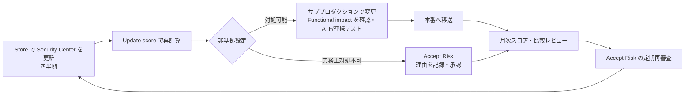
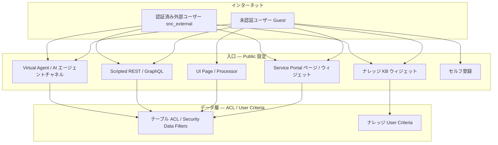
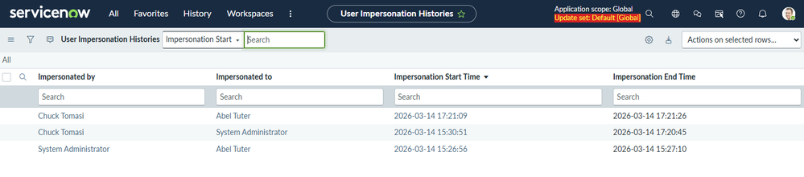
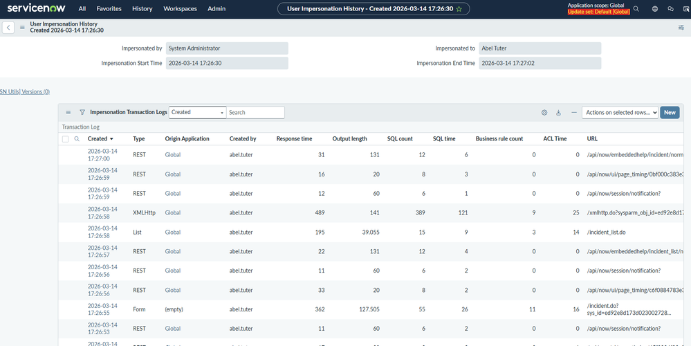
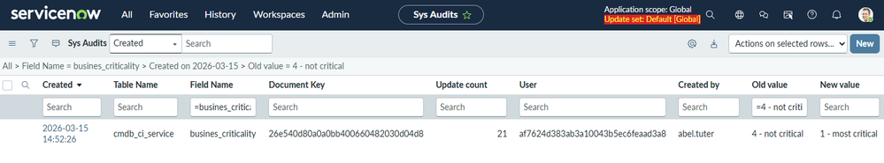
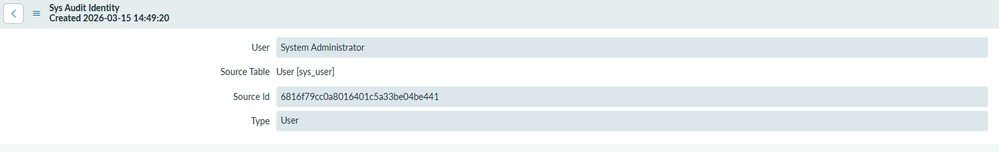

# セキュリティ強化の実践（Security Hardening in Practice）

## 概要

本ファイルは、ServiceNow インスタンスのセキュリティ強化（Security hardening、セキュリティハードニング）を**導入後に継続して回すための実践知**をまとめる。扱う範囲は次の 5 つである。

1. Security Center（旧 Instance Security Center）の活用 — スコア、スキャナー、Access Findings、メトリクスの運用サイクル
2. ACL（Access Control List、アクセス制御リスト）設計の注意 — 過去の事故の原因になった設計パターン
3. 外部公開ポータルのリスク — Public ウィジェット、ナレッジ、Guest ユーザー、AI エージェント経路
4. 権限昇格（Privilege escalation）— `security_admin`、`admin` 付与、なりすまし、システム権限で動く自動化
5. 監査（Audit）— どのログに何が残り、何が残らないか、SIEM への転送

前提となる仕様は以下のファイルに記載済みであり、本ファイルでは重複を避けて「どこで事故が起きるか」「何を定期的に見るか」に焦点を当てる。

| 前提知識 | 参照先 |
|---|---|
| Security Center の画面構成、ハードニングスコアの計算式、Accept Risk、主要ハードニングプロパティ、MFA 強制、IP 制限、Explicit Roles、本番稼働前チェックリスト | [セキュリティとコンプライアンス](../03_導入編/10-security-compliance.md) §7 |
| ACL の評価順序、Deny-Unless、Query ACL、Security Data Filters、High Security Settings | [アクセス制御（ACL）](../02_リファレンス/platform/access-control-acl.md) |
| ユーザー・グループ・ロールの仕様 | [ユーザー・グループ・ロール](../02_リファレンス/platform/users-groups-roles.md) |
| 認証方式（SSO、MFA、Adaptive authentication） | [認証とSSO](../02_リファレンス/platform/authentication-sso.md) |
| 暗号化・Platform security 全般 | [プラットフォームセキュリティと暗号化](../02_リファレンス/platform/platform-security-encryption.md) |
| ポータルの仕様 | [Service Portal と Employee Center](../02_リファレンス/platform/portals-employee-center.md) |

本ファイルの記述は、ServiceNow 公式ドキュメント（Australia / Brazil 版）を一次情報とし、過去の公開事例については SaaS セキュリティベンダー（AppOmni、Varonis 等）の公開調査と報道に依拠する。公式以外に依拠する記述には `【第三者情報】`、実務上の一般的な知見には `【経験則】` を付す。

> **Brazil での変更:** Security Center について、Brazil のリリースノートには新機能・変更・廃止のいずれも記載がない（"No updates"）。Security Center は Store アプリとしてファミリーリリースの間に更新される [出典](https://www.servicenow.com/docs/r/delta-zurich-brazil/brazil-zurich-securitycenter-release-notes.html)。

---

## 1. なぜ「設定の責任」が事故の中心なのか — 公開事例の時系列

ServiceNow の重大なデータ露出事例の多くは、プラットフォームの脆弱性ではなく**顧客側の設定（ACL、User Criteria、Public 設定）**に起因している。責任共有モデルの考え方は [セキュリティとコンプライアンス](../03_導入編/10-security-compliance.md) §5 を参照。以下は公開情報で確認できる主な事例である。

| 時期 | 事例 | 種別 | 原因 | 主な教訓 | 出典 |
|---|---|---|---|---|---|
| 2022-03 | AppOmni による ACL 設定不備の報告 | 設定不備 | ロールなし、または `public` ロールのみで、条件・スクリプトのない ACL と、Guest ユーザーへの過剰権限。検査したインスタンスの約 70% が該当 | 空 ACL・`public` ACL・User Criteria（Guest / Any User）の棚卸し | 【第三者情報】[出典](https://appomni.com/blog/appomni-discovers-security-misconfiguration-impacting-servicenow/) |
| 2023-10 | `KB1553688`「Potential Public List Widget Misconfiguration」 | 設定不備 | 既定で Public な Simple List ウィジェットと、脆弱な ACL の組み合わせで、未認証でテーブルデータを取得可能 | Public ウィジェットの棚卸し、空 ACL の解消、Explicit Roles | 【第三者情報】[出典](https://www.servicenow.com/community/developer-forum/regarding-quot-potential-public-list-widget-misconfiguration/m-p/2718223) |
| 2024-01 | `KB1123580` に基づくナレッジ User Criteria の注意喚起 | 設定不備 | `glide.knowman.block_access_with_no_user_criteria` が未設定または false の場合、User Criteria のないナレッジ記事が未認証ユーザーに見える可能性 | ナレッジベースの User Criteria 設計 | 【第三者情報】[出典](https://www.servicenow.com/community/service-management-forum/potential-misconfiguration-of-knowledge-base-user-criteria/m-p/2806103) |
| 2024-07 | CVE-2024-4879 ほか（UI Macro の Jelly テンプレートインジェクション等） | 製品脆弱性 | 未認証でのリモートコード実行が可能。CISA の KEV（悪用が確認された脆弱性）に登録 | パッチ適用。セルフホスト環境では特に迅速に | 【第三者情報】[出典](https://censys.com/advisory/cve-2024-4879-5178-5217/) |
| 2024-09 | 公開ナレッジベース経由の非公開記事の露出 | 設定不備 | ナレッジベースが Public で記事が Private の場合、ナレッジ系ウィジェット経由で記事本文を取得できた。1,000 超のインスタンス調査で 45% が意図せずデータを露出 | 記事単位ではなくナレッジベース単位の User Criteria 設計、User Criteria Diagnostics で Guest を検証 | 【第三者情報】[出典](https://www.theregister.com/2024/09/19/servicenow_knowledge_base_leaks/) |
| 2025-07 | CVE-2025-3648「Count(er) Strike」 | 製品仕様起因 | データ条件・スクリプト条件だけで守られた ACL では、リストの件数表示から値を 1 文字ずつ推測できた | ロール／Security Attribute 条件を必ず持たせる、Query ACL・Security Data Filters | 【第三者情報】[出典](https://www.varonis.com/blog/counter-strike-servicenow) |
| 2025-11 | Now Assist の Second-order prompt injection | 既定設定起因 | 既定で同一チームに属し、公開時に discoverable な AI エージェント同士の連携を悪用 | AI エージェントの権限・発見範囲・監督実行の設計 | 【第三者情報】[出典](https://thehackernews.com/2025/11/servicenow-ai-agents-can-be-tricked.html) |
| 2026-01 公表 | CVE-2025-12420「BodySnatcher」 | 製品脆弱性 | Virtual Agent API / Now Assist AI Agents のチャネルプロバイダーが共通の静的シークレットを使用し、メールアドレスだけで利用者になりすませた | AI チャネルのアカウントリンク設定、サンプルエージェントの削除、ストアアプリの更新 | 【第三者情報】[出典](https://www.csoonline.com/article/4118264/servicenow-bodysnatcher-flaw-highlights-risks-of-rushed-ai-integrations.html) |

> **用語の注意:** 2022 年の AppOmni 報告が問題にしたのは「ロールなし、または `public` ロールのみで、条件・スクリプトのない ACL」である。Australia 版公式ドキュメントの「空の ACL（Empty ACL）」は「ロール、Security Attribute、データ条件、スクリプトのいずれも持たない ACL」と定義され、既定で拒否される（§3.1）。**`public` ロールだけを持つ ACL はロールを持つため Australia の定義では空 ACL ではないが、未認証ユーザーに対して開いている**。本ファイルで「空 ACL・`public` ACL」と並べて書く場合、この 2 つは別物として扱う。

**事例から導かれる 3 つの原則【経験則】**

1. **「未認証で到達できる入口」を棚卸しする**：Public ページ・ウィジェット・UI Page・Scripted REST・GraphQL・ナレッジ・Virtual Agent / AI チャネル。入口が Public でも、背後のテーブル ACL が正しければ露出しない。逆に、ACL が甘くても入口が閉じていれば露出しない。両方を確認する。
2. **ACL は「ロールまたは Security Attribute」を必ず持たせる**：データ条件・スクリプト条件だけの ACL は、件数推測（§3.3）や空 ACL 扱い（§3.1）の温床になる。
3. **ストアアプリとパッチを最新に保つ**：Security Center 自体、AI エージェント関連アプリ、Virtual Agent API など、セキュリティ修正の多くはストアアプリの更新として提供される。

---

## 2. Security Center（旧 Instance Security Center）の活用

### 2.1 ISC から Security Center への移行状況

Instance Security Center（ISC）は 2024 年 9 月に販売終了となり、サポートされず、新規有効化もできない。後継は ServiceNow Security Center（SSC、アプリケーションスコープ `sn_vsc`）で、Vancouver 以降は既定でインストールされ、ServiceNow Store で四半期ごとに新バージョンが公開される [出典](https://www.servicenow.com/docs/r/platform-security/security-center/sec-center-v2.html)。ISC の廃止手順は `KB0867184`、ISC コンポーネントを無効化（オプトアウト）する手順は `KB1702514` に記載されている [出典](https://www.servicenow.com/docs/r/zurich/platform-security/servicenow-ai-platform-security/instance-security-center-to-security-center-migration.html)。

ISC で行っていた作業を Security Center で行う場所は次のとおり（Zurich 版の移行ガイド）[出典](https://www.servicenow.com/docs/r/zurich/platform-security/servicenow-ai-platform-security/instance-security-center-to-security-center-migration.html)。

| 作業 | Security Center での場所 |
|---|---|
| 最新スコアの確認 | Overview、または Hardening Comparison ページ |
| スコアの手動更新 | Overview から更新 |
| ハードニング設定の変更 | Overview / Hardening > All Settings / Hardening > Comparison の設定名リンク |
| スコアの定期計算 | Scheduled Script Executions（`sysauto_script`）の **SC - Calculate Compliance Monthly**（Run / Day / Time zone / Time を変更可能） |
| メトリクス | 65 以上のメトリクスに目標値（Target）と閾値（Threshold）を設定。Overview > Metrics または All Metrics |
| スキャン | Overview > Scan > Suites で Auditor スイートを実行、Overview > Scan > Results で結果確認。手動・スケジュール実行、カスタムチェック・カスタムスイート、2 回のスキャン結果比較が可能 |
| 通知 | セキュリティイベントのメール通知 |
| セッション | Analytics Hub、Metrics > Sessions |
| 学習 | Overview > Learning |

**実務上の注意【経験則】:** 古いインスタンスでは ISC のメニューや ISC 用の Virtual Agent プラグイン（`com.glide.isc_virtualagent`）が残っていることがある。運用手順書・教育資料が ISC の画面を前提にしていないか確認し、Security Center に一本化する。Security Center の詳細な画面構成は [セキュリティとコンプライアンス](../03_導入編/10-security-compliance.md) §7.1 を参照。

### 2.2 Security Center の構成要素と「誰が見るか」

| 構成要素 | 内容 | 主な利用者【経験則】 |
|---|---|---|
| Security configuration console | ハードニング準拠スコア、推移、優先度の高い非準拠設定、スキャン結果 | プラットフォームオーナー、プラットフォーム管理者 |
| Security monitoring console | セキュリティ通知とメトリクス | 運用担当、SOC |
| Security posture console | 脅威の特定・対応・復旧を手順で支援 | セキュリティ担当 |
| Security Tasks | セキュリティタスクの優先度付け・割り当て・進捗管理（Zurich で導入） | プラットフォームオーナー |
| Identity and Access Management（Access Management Console / Access Findings） | IAM ツールとメトリクス、アクセス設定不備の検出 | アクセス管理担当 |
| Security banner announcements | 緊急・重大なアラートを管理者 UI にバナー表示 | 全管理者 |

出典：[Security Center（Brazil 版）](https://www.servicenow.com/docs/r/platform-security/security-center/sec-center-v2.html)、[Security Center リリースノート](https://www.servicenow.com/docs/r/delta-zurich-brazil/brazil-zurich-securitycenter-release-notes.html)

Zurich 以降、Security Center には**フル `admin` なしで構成作業ができる粒度の細かい管理ロール**が追加された [出典](https://www.servicenow.com/docs/r/delta-zurich-brazil/brazil-zurich-securitycenter-release-notes.html)。Australia 版の「Granular roles for Security Center」によると、このロールは Security Center Admin（`sn_vsc.security_center_admin`）で、Store 版 Security Center 3.2 以降で利用でき、Security Center のコンソールとツールへの管理者レベルのアクセスを提供する [出典](https://www.servicenow.com/docs/r/oL66E_cwDD_tnWQYzYPRdA/vquE8rIq3TcVvQJbtk1wUQ)。セキュリティ部門の担当者に Security Center を見せるために `admin` を付与する必要はない。閲覧のみなら `sn_vsc.security_center_viewer` を使う（ロール名の詳細は [セキュリティとコンプライアンス](../03_導入編/10-security-compliance.md) §7.2）。

### 2.3 運用サイクル — 何をどの頻度で見るか

Security Center の各機能は実行頻度が異なる。Auditor チェックには Daily / Weekly / Monthly / Quarterly のケイデンスが設定されており（§2.5）、Access Findings は 24 時間ごと、ハードニングスコアは毎月 1 日に自動計算される。これに合わせて運用会議を設計すると無駄がない【経験則】。

| 頻度 | 確認対象 | アクション | 根拠 |
|---|---|---|---|
| 日次（自動） | Access Findings、Daily の Auditor チェック、セキュリティイベント通知 | 重大度 High 以上をセキュリティタスク化 | [出典](https://www.servicenow.com/docs/r/oL66E_cwDD_tnWQYzYPRdA/cgdhzrXV3TR4fA0jy0aDSQ) |
| 週次 | Weekly の Auditor チェック（休眠アカウント、内部・外部ロールの混在等）、管理者ログイン数・なりすまし数・セキュリティ昇格数のメトリクス | 異常値の確認、休眠アカウントの無効化 | [出典](https://www.servicenow.com/docs/r/oL66E_cwDD_tnWQYzYPRdA/efyeohDnjYkIo1qBTu_mbA) |
| 月次 | ハードニングスコア（毎月 1 日に自動計算）、スコア比較、Monthly の Auditor チェック、Accept Risk の一覧 | 新規の非準拠設定の対処計画、Accept Risk の再承認 | [出典](https://www.servicenow.com/docs/r/zurich/platform-security/servicenow-ai-platform-security/instance-security-center-to-security-center-migration.html) |
| 四半期 | Security Center の Store 版更新、Quarterly の Auditor チェック（JavaScript ライブラリ、Record producer、未有効化のセキュリティ制御） | アップデート後のスコア再計算と新規設定の評価 | [出典](https://www.servicenow.com/docs/r/platform-security/security-center/sec-center-v2.html) |
| 半期（ファミリーアップグレード時） | Version-based hardening settings（そのファミリーに該当する設定のみ表示）、新ベースライン（Australia はベースライン V7） | アップグレード後に Update score で再計算し、新規項目を評価 | [出典](https://www.servicenow.com/docs/r/delta-zurich-brazil/brazil-zurich-securitycenter-release-notes.html) |

### 2.4 ハードニングスコアの運用 — KPI にするときの注意

ハードニング準拠スコアは、準拠した設定と Accept Risk した設定のスコアを合算して全設定の合計で割った百分率であり、Accept Risk した設定は準拠と同じに扱われる（Australia）[出典](https://www.servicenow.com/community/security-on-now-blog/your-hardening-score-isn-t-just-a-number-here-s-what-it-s/ba-p/3574268)。この性質から、スコアを KPI にする場合は次の点に注意する。

| 論点 | 注意点 | 対策 |
|---|---|---|
| Accept Risk による見かけの改善 | Accept Risk は準拠と同等に計上されるため、理由が形骸化するとスコアだけが上がる。ServiceNow 社員の解説は、Accept Risk は設定をレビューして現在のリスクが受容可能と判断した後にのみ使い、理由を設定上に記録すべきとしている | 「準拠率」と「Accept Risk 件数」を分けて報告する。Accept Risk はセキュリティ責任者の承認を必須にし、年 1 回以上再審査する【経験則】 |
| スコアの母数の変化 | Australia で Version-based hardening settings が追加され、インスタンスのファミリーバージョンに該当する設定のみが表示される。ベースラインの更新（V6 → V7）でも設定数が変わる | Security Center 更新・アップグレードの前後でスコア比較（Hardening score comparison）を取り、「設定変更による改善」と「母数変化による変動」を区別する |
| 優先度の無視 | スコアへの影響（Score Impact）が小さくても Priority 1 - Critical の設定がある | 目標は「スコア○%」ではなく「Priority 1 / 2 の非準拠ゼロ（または承認済み Accept Risk）」で設定する【経験則】 |
| 本番だけを見る | サブプロダクションのスコアが低いと、クローン元・開発環境経由の情報漏えいや設定の逆流が起きる | 全インスタンスで Security Center を同じバージョンに揃え、スコアを並べて管理する【経験則】 |

出典：[Security Center リリースノート](https://www.servicenow.com/docs/r/delta-zurich-brazil/brazil-zurich-securitycenter-release-notes.html)、[Your hardening score isn't just a number](https://www.servicenow.com/community/security-on-now-blog/your-hardening-score-isn-t-just-a-number-here-s-what-it-s/ba-p/3574268)

**変更適用の鉄則【経験則】:** ハードニング設定の多くはシステムプロパティであり、全ユーザー・全連携に即時に効く。各設定の **Functional impact** と **Dependencies and prerequisites** を読み、サブプロダクションで ATF（[Automated Test Framework](../02_リファレンス/platform/automated-test-framework.md)）と連携テストを流してから本番に適用する。特に CSRF、SOAP/WSDL の Basic 認証必須化、添付ファイルの強制ダウンロード、IP 認証の厳格化は既存連携・カスタム UI を壊しやすい（プロパティ一覧は [セキュリティとコンプライアンス](../03_導入編/10-security-compliance.md) §7.5）。

### 2.5 Security Scanner の Auditor チェック — 「設定不備の検出器」として使う

Security Center の Security Scanner には Auditor スイートがあり、Australia 版ドキュメントでは各チェックに実行ケイデンス（Daily / Weekly / Monthly / Quarterly）が割り当てられている。過去の事故パターン（§1）の多くを直接検出できるため、**ACL・ポータル・権限昇格のレビューの起点**として最も実用的である [出典](https://www.servicenow.com/docs/r/oL66E_cwDD_tnWQYzYPRdA/efyeohDnjYkIo1qBTu_mbA)。

| ケイデンス | チェック名（英語原文） | 検出内容 | 関連する本ファイルの節 |
|---|---|---|---|
| Daily | Review public knowledge base articles | 未認証ユーザーが閲覧できるナレッジ記事 | §4.3 |
| Daily | Review public knowledge bases | Public なナレッジベース | §4.3 |
| Daily | Users with Direct Role Assignments (Bypassing Groups) | グループを経由せず直接付与されたロール | §5.5 |
| Daily | Inactive Users with Assigned Roles | ロールを保持したままの非アクティブユーザー | §5.5 |
| Daily | External users with access to classified data | 分類済み（機密）テーブル・フィールドにアクセスできる外部ユーザー | §4.4 |
| Daily | Access controls on Tables | ACL のないテーブル | §3.2 |
| Daily | Access controls on UI pages | ACL で保護されていない UI Page | §3.5 |
| Daily | Access Controls on Client callable Script Includes | ACL で保護されていない Client callable Script Include | §3.5 |
| Weekly | Review client callable script includes with no corresponding ACL | 既定 ACL に依存している Client callable Script Include | §3.5 |
| Weekly | Dormant user account | 最近ログインのないアクティブユーザー | §5.5 |
| Weekly | User Account shouldn't have both internal and external roles | 内部ロールと外部ロールを同時に持つユーザー | §4.4 |
| Monthly | Review custom tables with record producers and no business rule | Record producer はあるがサーバー側検証の Business Rule がないカスタムテーブル | §4.2 |
| Monthly | Review fields with HTML Sanitization inactive | HTML サニタイズが無効な HTML フィールド | — |
| Monthly | Review inactive security feature plugins | 追加のセキュリティ制御を提供する未有効化プラグイン（情報提供） | §2.4 |
| Monthly | Review large allowed IP address ranges | 広すぎる IP 許可範囲 | — |
| Monthly | Review public GraphQL schemas | 認証なしで利用できる GraphQL スキーマ | §4.2 |
| Monthly | Identify out of date store apps | 新バージョンがあるストアアプリ | §1 |
| Monthly | Insecure GlideRecord calls | ユーザーが呼び出せるスクリプトで ACL を尊重しない GlideRecord 呼び出し | §3.5 |
| Monthly | Review public REST API endpoints | 認証なしで利用できる Scripted REST エンドポイント | §4.2 |
| Monthly | Review public Service Portal pages | 未認証ユーザーに公開された Service Portal ページ | §4.2 |
| Monthly | Review public UI Pages | 未認証ユーザーに公開された UI Page | §4.2 |
| Monthly | Review roles that contain the 'admin' role | `admin` ロールを内包するロール | §5.2 |
| Monthly | Review UI Pages without corresponding ACLs | 汎用 UI Page ACL にフォールバックしている UI Page | §3.5 |
| Monthly | Review users with valid local passwords | API アクセスに使われうるローカルパスワードを持つユーザー | §5.6 |
| Monthly | Rotate passwords stored with outdated hashing algorithms | 旧ハッシュアルゴリズムで保存されたパスワード | — |
| Monthly | UI action visibility | テーブルの read 権限がないユーザーでも実行できる UI Action | §3.5 |
| Monthly | Publicly accessible knowledge base and articles | 全ユーザーに見えるナレッジベース・記事 | §4.3 |
| Monthly | Can Contribute / Cannot Contribute user criteria to be defined on each knowledge | 投稿権限の User Criteria が未定義のナレッジベース | §4.3 |
| Monthly | All Processors of type - SCRIPT must be protected with CSRF Token | CSRF 保護のないスクリプト型 Processor | §3.5 |
| Quarterly | Review allowed JavaScript libraries | サードパーティ JavaScript ライブラリの許可・拒否ルール | — |
| Quarterly | Securing record producers | 適切なロールに制限されていない Record producer | §4.2 |
| Quarterly | Deactivated security controls | 新たに導入されたが未有効化のセキュリティ制御 | §2.4 |

注：
- Australia 版ドキュメントの一覧では「Review public REST API endpoints」が重複掲載されている [出典](https://www.servicenow.com/docs/r/oL66E_cwDD_tnWQYzYPRdA/efyeohDnjYkIo1qBTu_mbA)。
- ナレッジ関連の 2 チェック（Review Public Knowledge Bases / Review Public Knowledge Base Articles）は Zurich で追加され、Global スコープで動作する [出典](https://www.servicenow.com/docs/r/delta-zurich-brazil/brazil-zurich-securitycenter-release-notes.html)。
- Yokohama 版ドキュメントでは、Access Controls の Auditor スイートは Security Center > Scanner タブ > Suites > Auditor > Checks タブで 8 件のチェックを確認できると記載されている [出典](https://www.servicenow.com/docs/r/GypxAX2jEErwkCxugICKdg/rUlmIauYX_9qJfjZ9dj41g)。チェック構成は Security Center のバージョンで変わるため、インスタンス上で確認する。

**運用のコツ【経験則】:**
- 初回スキャンは大量の検出が出る。いきなり全件対処せず、「未認証で到達可能（public 系）」→「`admin` 内包ロール・直接ロール付与」→「その他」の順でトリアージする。
- 誤検知・意図的な公開（例：社外向け FAQ ナレッジ）は、理由と承認者を記録して例外台帳で管理する。翌月のスキャンで同じ検出を再審議しないためである。
- 自社標準（例：「カスタムテーブルには必ず `x_` スコープのロールを要求する」）はカスタムチェックとして追加し、同じスイートで回す。カスタムチェックの作り方は [ガバナンスとCoEの実践](09-governance-coe-practice.md) §6.4（Instance Scan）を参照。

### 2.6 Access Findings（Australia）

Access Findings は Access Management Console 内の「事前検出・是正」レイヤーで、**8 種類の標準アクセスチェックを日次で実行**し、重大度で優先度付けした設定不備と是正ワークフローを提供する [出典](https://www.servicenow.com/docs/r/oL66E_cwDD_tnWQYzYPRdA/cgdhzrXV3TR4fA0jy0aDSQ)。ServiceNow 社員の解説では Security Center v3.3 の新機能として紹介され、チェック項目は次のとおりである [出典](https://www.servicenow.com/community/platform-privacy-security-blog/what-s-new-for-security-center-in-australia/ba-p/3575152)。

| # | チェック（英語） | 日本語訳 | 典型的な是正 |
|---|---|---|---|
| 1 | Inactive users with assigned roles | ロールを持つ非アクティブユーザー | ロールの剥奪（ライセンス最適化にも効く。[ライセンスコスト最適化](06-license-cost-optimization.md) 参照） |
| 2 | Dormant user accounts | 休眠ユーザーアカウント | 無効化、またはオーナー確認 |
| 3 | Access controls on UI Pages | UI Page のアクセス制御 | UI Page 個別 ACL の作成 |
| 4 | External users with access to classified data | 分類済みデータにアクセスできる外部ユーザー | ACL / Security Data Filters で外部ユーザーを除外 |
| 5 | Access controls on tables | テーブルのアクセス制御 | テーブル ACL の作成 |
| 6 | Users with direct role assignments (bypassing groups) | グループを介さない直接ロール付与 | グループ経由への付け替え |
| 7 | Access controls on client callable script includes | Client callable Script Include のアクセス制御 | `client_callable_script_include` ACL の作成 |
| 8 | Empty ACLs | 空の ACL | ロールまたは Security Attribute の追加 |

チェック 8 の「Empty ACLs」は、Australia の定義では「ロール、Security Attribute、データ条件、スクリプトのいずれも持たない ACL」を指し、`public` ロールのみの ACL（ロールを持つので空ではないが未認証ユーザーに開いている）とは別物である。`public` ロールのみの ACL は Auditor スイートの public 系チェックや ACL 一覧で別途棚卸しする。空 ACL が既定で拒否されるにもかかわらず検出対象になる理由は §3.1 を参照。

Access Findings の検出項目は Auditor スイートの Daily チェック（§2.5）と重なる。**Access Findings は是正ワークフロー（タスク化）を伴う日常運用、Auditor スイートはスケジュール実行と結果比較による定期監査**、と使い分けるとよい【経験則】。

### 2.7 Security metrics とイベント通知

Security Center のメトリクスは 65 以上あり、目標値と閾値を設定し、閾値超過時にメール通知できる [出典](https://www.servicenow.com/docs/r/zurich/platform-security/servicenow-ai-platform-security/instance-security-center-to-security-center-migration.html)。Australia 版の「Monitor security events」で定義されているイベント系メトリクスは次のとおりである [出典](https://www.servicenow.com/docs/r/aPoGScNNpfmq9WAhaTvMvQ/Lv9V9vKcfJXLjlMPylcPUA)。

| メトリクス | 内容 | 監視の観点【経験則】 |
|---|---|---|
| Admin logins | `admin` ロールを持つユーザーのログイン試行数 | 業務時間外・休日の急増 |
| Admin users added | 1 日に追加された `admin` ロールユーザー数 | 0 以外は全件確認（権限昇格の兆候） |
| External logins | `snc_external` ロールユーザーのログイン数 | 外部ポータルの異常アクセス |
| Failed logins | ログイン失敗数 | パスワードスプレー・総当たり |
| Impersonations | なりすましログイン数 | 本番での常用はガバナンス違反の兆候（§5.3） |
| Quarantined files | ウイルス対策で隔離されたファイル数 | 添付ファイル経由のマルウェア |
| Security elevations | 標準ロールから高権限セキュリティロール（`oauth_admin`、`admin`、`security_admin`、`impersonator`）への変更数 | 変更管理と突合 |
| SNC logins | ServiceNow サポート要員（SNC）のログイン数 | サポートケースとの突合 |
| Inbound email 系（external / spam / trusted / untrusted） | 受信メールの分類別件数 | なりすましメール経由のレコード作成 |
| Virus types | ウイルス対策イベントの種類別件数 | — |

通知は、メール、Now Mobile のプッシュ通知、Microsoft Teams、Slack で受け取れる。推移データは現地時間 02:00 に実行される Performance Analytics ジョブ後に更新されるため、**メトリクスはリアルタイム検知には向かない** [出典](https://www.servicenow.com/docs/r/aPoGScNNpfmq9WAhaTvMvQ/Lv9V9vKcfJXLjlMPylcPUA)。リアルタイム性が必要な検知は、Security event notification のポリシー（コード不要で作成可能）または LES による SIEM 連携（§6.6）で行う。

### 2.8 Security Center 活用のアンチパターン【経験則】

| アンチパターン | 何が起きるか | 対策 |
|---|---|---|
| 本番稼働前に一度だけスコアを見て終わる | 四半期ごとのベースライン更新・新規チェックが放置される | §2.3 の運用サイクルを [運用とガバナンス](../03_導入編/12-operations-governance.md) の定例会議体に組み込む |
| Security Center を更新しない | 新しいチェック（例：Access Findings、Accept Risk）が使えず、Auditor の「Identify out of date store apps」でも検出される | 四半期ごとの Store アプリ更新計画に含める |
| スコア向上を委託先の KPI にする | Accept Risk の乱用、Functional impact を読まない一括変更で連携障害 | KPI は「Priority 1/2 非準拠ゼロ」と「Accept Risk 承認率」に分ける |
| 検出結果をメールで流すだけ | 誰も対処しない | Security Tasks（Zurich〜）で担当・期限を付けて管理 |
| `admin` を持つ人だけが見る | セキュリティ部門が実態を把握できない | `sn_vsc.security_center_viewer` をセキュリティ部門に付与し、月次レポートを共有 |

---

## 3. ACL 設計の注意

ACL の仕様（評価順序、Allow-If / Deny-Unless、Query ACL、Security Data Filters）は [アクセス制御（ACL）](../02_リファレンス/platform/access-control-acl.md) に詳述した。本節では、**事故や監査指摘につながった設計パターン**と、その回避策に絞る。

### 3.1 空 ACL・無効 ACL・`public` ロール

Australia 版の公式ドキュメントでは、ACL エンジンは**空または無効な ACL に対してアクセスを完全に拒否する**（Deny by default）。定義は次のとおり [出典](https://www.servicenow.com/docs/r/australia/platform-security/access-control/exploring-access-control-list.html)。

| 区分 | 定義 |
|---|---|
| 空の ACL（Empty ACL） | ロール、Security Attribute、データ条件、スクリプトのいずれも持たない ACL |
| 無効な ACL（Invalid ACL） | 存在しないロールや Security Attribute を参照する ACL、またはスクリプトが `answer=true` や `true` だけの ACL |

この「既定で拒否」がどのリリースで導入されたか、§1 の事故との因果関係は公開情報では確認できなかった。**古いインスタンスから移行した ACL・古いカスタムアプリの ACL** は、この前提で作られていないことがある【経験則】。アップグレード後に「突然見えなくなった」という問い合わせの原因として、空 ACL の拒否化がよく挙がる。逆に、「見えるようにするために `public` ロールや `answer = true;` を入れる」という場当たり対応は、無効 ACL として拒否されるか、未認証ユーザーへの露出を生む。

**既定で拒否なのに空 ACL を検出対象にする理由【経験則】（公式の説明は公開情報では確認できず）:** Deny by default の下では、空 ACL は主に「データ露出」ではなく「機能が動かない」問題を起こす。それでも Access Findings（§2.6）や公開前チェックリスト（§4.6）で空 ACL を潰すのは、(1) 空 ACL を見つけた担当者や「見えない」という問い合わせを受けた担当者が、`public` ロールの追加や `answer = true;` といった場当たり修正をしがちで、これが露出の入口になること、(2) 「既定で拒否」の導入リリースが公開情報で確認できず、旧挙動を前提に作られた ACL や設計意図が不明な ACL が残っていることによる。なお、`public` ロールのみを持つ ACL は Australia の定義では空 ACL ではないが、露出リスクはこちらの方が直接的である。

| やってはいけないこと | 理由 | 代わりにやること |
|---|---|---|
| `public` ロールをテーブル ACL に付けて「とりあえず全員に見せる」 | `public` は未認証（Guest）ユーザーも満たす | 認証済みユーザー全員に見せたい場合は Security Attribute `UserIsAuthenticated`（Australia 版公式ドキュメントで「認証済みユーザーのみ」の条件例として記載 [出典](https://www.servicenow.com/docs/r/australia/platform-security/access-control/exploring-access-control-list.html)）を使うか、Explicit Roles の `snc_internal` を使う |
| ロール欄を空にしてスクリプトで `gs.isLoggedIn()` を判定する | スクリプト条件のみの ACL は件数推測の対象（§3.3）、かつ評価コストが高い | Security Attribute 条件にする |
| スクリプトで `answer = true;` だけを書く | 無効 ACL として拒否される | 条件を明示する |
| 存在しないロール名を指定（スペルミス、未インストールプラグインのロール） | 無効 ACL として拒否される | ロールは参照フィールドで選ぶ。移送時に依存プラグインを確認 |

Security Attribute は `sys_security_attribute` テーブルに格納され、Vancouver で ACL 条件に「Security Attribute Condition」として追加された。代表的な属性は `Group`、`GroupExplicit`、`HasAdminRole`、`Impersonating`、`InteractiveSession`（対話セッションか連携か）、`LoggedIn`、`NetworkCriteria`（IP 範囲）、`Role`、`RoleExplicit` である【第三者情報】[出典](https://www.servicenow.com/community/now-platform-articles/vancouver-security-attribute-conditions-explained/ta-p/2646179)。Vancouver 時点のこのコミュニティ解説は `LoggedIn` 属性を紹介しているが、Australia 版公式ドキュメントの例は `UserIsAuthenticated` であり、両者が同一属性の改称か別属性かは公開情報では確認できなかった（§9）。インスタンスの `sys_security_attribute` で実在する属性名を確認してから使う。`InteractiveSession` や `NetworkCriteria` を使うと、「連携ユーザーは API からのみ」「社外 IP からは不可」といった条件をスクリプトなしで表現できる。

フォーム上で空・無効 ACL の保存をブロックするプロパティ `glide.security.empty_acl.popup_window.enabled`（High Security プラグイン有効時のみ動作）は [アクセス制御（ACL）](../02_リファレンス/platform/access-control-acl.md) §2.5 を参照。

### 3.2 ワイルドカード ACL と新規テーブル

公式ドキュメントは「テーブルを作成したら、提供されるワイルドカード ACL を使う意図がない限り、そのテーブルの ACL を作成する」としている。ワイルドカードテーブル ACL（`*`）は create / read / write / delete に既定で存在し、ワイルドカードテーブル ACL のみがマッチした場合の挙動は `glide.sm.default_mode` で決まる（Deny access の場合は管理者のみアクセス可）[出典](https://www.servicenow.com/docs/r/australia/platform-security/access-control/exploring-access-control-list.html)、[出典](https://www.servicenow.com/docs/r/hX5GtoLUEU58KgyL7CW5Ag/YaSAeTv6kOt01Eqq7u4HpQ)。

**設計標準の例【経験則】:**
- カスタムテーブル作成時に「Create access controls」を有効にし、スコープ専用ロール（例：`x_acme_app.user`）を要求する ACL を自動生成させる。
- ワイルドカード ACL に依存するテーブルを作らない。Auditor チェック「Access controls on Tables」（§2.5）で検出できる。
- Client callable Script Include や Processor などの種別にワイルドカード ACL を作ると、その種別の全オブジェクトに適用される [出典](https://www.servicenow.com/docs/r/australia/platform-security/access-control/exploring-access-control-list.html)。影響範囲が大きいため、作成は ARB（[ガバナンスとCoEの実践](09-governance-coe-practice.md) §4）の承認事項にする。

### 3.3 データ条件・スクリプト条件だけの ACL は「件数」から漏れる（Count(er) Strike）

Varonis Threat Labs は 2024 年 2 月に ServiceNow へ報告し、2025 年 7 月 8 日に CVE-2025-3648（"Count(er) Strike"）として公表された問題で、次のメカニズムを示した【第三者情報】[出典](https://www.varonis.com/blog/counter-strike-servicenow)。

| ACL 条件の失敗箇所 | 画面の挙動 | 結果 |
|---|---|---|
| ロールまたは Security Attribute 条件で失敗 | 空白ページと「Security constraints prevent access to requested page」 | 件数も漏れない |
| データ条件またはスクリプト条件で失敗 | レコード件数とフィールドが表示され、「Number of rows removed from this list by Security constraints」が出る | `STARTSWITH`・`CONTAINS` 等のクエリを変えながら件数の変化を見ることで、値を 1 文字ずつ推測できる。件数は HTML ソースの `grand_total_rows` にも出るため自動化が容易 |

Varonis は、悪用には特別な構成やプラグインは不要で、テーブルや列の一部にアクセスできるユーザーアカウントがあれば足りるとし、セルフ登録（Self-registration）が有効なインスタンスでは攻撃面が広がると指摘した。パッチ前は全インスタンスの数百テーブルに影響しうるとされたが、悪用の確認はない【第三者情報】[出典](https://thehackernews.com/2025/07/servicenow-flaw-cve-2025-3648-could.html)。

ServiceNow はこの対策として Deny-Unless ACL、Query ACL（`query_range` / `query_match`）、Security Data Filters を提供した【第三者情報】[出典](https://www.varonis.com/blog/counter-strike-servicenow)。Query ACL の仕様と Australia での変更は公式リリースノートにも記載がある（§3.6）[出典](https://www.servicenow.com/docs/r/australia/release-notes/access-management-rn.html)。Varonis が推奨する対応は次のとおり【第三者情報】[出典](https://www.varonis.com/blog/counter-strike-servicenow)。

1. 標準・カスタムテーブルの ACL を見直す。**特にデータ条件・スクリプト条件だけで保護されているもの**。
2. 機密テーブルに Query ACL と Security Data Filters を適用する（Security Data Filters は「rows removed by security constraints」メッセージも抑止する）。
3. `query_range` の Query ACL が既定拒否になる前に、正当な利用者向けの除外を作る（`KB2046494`）。
4. セルフ登録が有効か、有効である必要があるかを確認する。

**設計標準への落とし込み【経験則】:** 「すべての ACL は少なくとも 1 つのロールまたは Security Attribute を持つ。データ条件・スクリプト条件は絞り込みにのみ使う」を ACL の設計規約に明記する。機密テーブル（HR、給与、セキュリティインシデント、顧客個人情報）は、Deny-Unless ACL ＋ Security Data Filters ＋ Query ACL の多層で守る。

### 3.4 集計クエリとレポートは ACL の外側にある

ServiceNow 社員による 2026-01 の解説記事は、ACL と Security Data Filters の限界を次のように整理している【第三者情報】[出典](https://www.servicenow.com/community/tkb/articleprintpage/tkb-id/now-platform-kb/article-id/4956)。

| 仕組み | 限界 |
|---|---|
| ACL（Allow-If / Deny-Unless） | アプリケーション層の制御であり、データベースが計算する**集計クエリ**にはレコード単位の read チェックが効かない。Single-score レポートで、開けないレコードの件数が見える |
| Query ACL（`query_match` / `query_range`） | リストビューでは効くが、Single-score 等の集計レポートには効かない。report_view ACL が必要だが、それでも集計を完全には守れない |
| Security Data Filters | データベース層でクエリに条件を付加するが、**参照経由の間接クエリ**には適用されない（例：Affected CIs（`task_ci`）のレポートで Task のフィールドを dot-walk すると Task レコードが露出しうる）。設計が悪いと対象テーブルの全クエリが遅くなる |

記事の結論は「どちらか単独では厳格な Need-to-know を満たせず、Security Data Filters と Deny-Unless ACL を組み合わせる」である。**レポート・ダッシュボード・Performance Analytics の公開範囲の設計を、ACL 設計とは別のレビュー項目にする**ことが実務上重要である【経験則】。レポートの仕様は [レポートとアナリティクス](../02_リファレンス/platform/reporting-analytics.md) を参照。

### 3.5 スクリプト経由の ACL バイパス

ACL はユーザーの UI 操作・API 操作に対して評価されるが、**サーバーサイドスクリプトの `GlideRecord` はシステムコンテキストで動き、ACL を評価しない**。ユーザーが呼び出せるスクリプトで `GlideRecord` を使うと、ACL を迂回したデータ取得口になる。

| 入口 | リスク | 対策 | 出典 |
|---|---|---|---|
| Client callable Script Include（GlideAjax） | ブラウザから任意の引数で呼び出せる。中で `GlideRecord` を使うと ACL を迂回 | `client_callable_script_include` 型・operation `execute` の ACL でロールを要求。中では `GlideRecordSecure` または `canRead()` 等で明示確認 | [出典](https://www.servicenow.com/community/developer-forum/how-to-implement-an-acl-in-order-to-secure-client-callable/m-p/1942539)、[出典](https://www.servicenow.com/docs/r/1nuU0tTksWZZbL8T4WKSDg/FDmpCLqJOhMWTHvUffHmuw) |
| UI Page | 個別 ACL がないと汎用 UI Page ACL にフォールバック | UI Page ごとの ACL | [出典](https://www.servicenow.com/docs/r/oL66E_cwDD_tnWQYzYPRdA/efyeohDnjYkIo1qBTu_mbA) |
| Service Portal ウィジェットのサーバースクリプト | ウィジェットが Public だと未認証でサーバースクリプトが動く | `GlideRecordSecure` を使い、Public フラグは必要なものだけ | 【第三者情報】[出典](https://www.servicenow.com/community/developer-forum/regarding-quot-potential-public-list-widget-misconfiguration/m-p/2718223) |
| Scripted REST API | 「Requires authentication」「Requires ACL authorization」の組み合わせ次第で無認証・無認可になる | 両方を true にし、`REST_Endpoint` 型の ACL を選択する | [出典](https://www.servicenow.com/docs/r/yokohama/api-reference/rest-api-explorer/c_CustomWebServices.html) |
| Processor（スクリプト型） | CSRF 保護がないと、ログイン中ユーザーに意図しない操作をさせられる | CSRF トークンを要求 | [出典](https://www.servicenow.com/docs/r/oL66E_cwDD_tnWQYzYPRdA/efyeohDnjYkIo1qBTu_mbA) |
| UI Action | テーブルの read 権限がなくても実行できる UI Action がある | Condition・ロールで制限 | [出典](https://www.servicenow.com/docs/r/oL66E_cwDD_tnWQYzYPRdA/efyeohDnjYkIo1qBTu_mbA) |
| Record producer | ロール制限がないと誰でもレコードを作成でき、サーバー側検証がないと任意の値が入る | Record producer のロール制限、カスタムテーブルに検証用 Business Rule | [出典](https://www.servicenow.com/docs/r/oL66E_cwDD_tnWQYzYPRdA/efyeohDnjYkIo1qBTu_mbA) |

Scripted REST API は、既定で `snc_external` ロールのユーザーからの要求を禁止する ACL を持つ。Requires authentication と Requires ACL authorization が両方 true で ACL が選択されていない場合は、リソースで選択された ACL が必要になる。複数の ACL を選択した場合は、すべてを満たす必要はない（いずれかを満たせばよい）[出典](https://www.servicenow.com/docs/r/yokohama/api-reference/rest-api-explorer/c_CustomWebServices.html)。

これらはいずれも Auditor チェック「Insecure GlideRecord calls」「Access Controls on Client callable Script Includes」「Review UI Pages without corresponding ACLs」「Review public REST API endpoints」で検出できる（§2.5）。コードレビューの観点は [スクリプトのベストプラクティスとアンチパターン](07-scripting-best-practices.md) を参照。

### 3.6 アップグレード時の ACL 点検 — Australia の Query ACL 変更

Australia では、ほとんどのプラットフォームプラグインでベースシステムの Query ACL がプラグインインストール時に自動ロードされるようになった（Preconfigured query ACLs）。ストアアプリの Query ACL は含まれず、**既存のカスタム Query ACL は保持されるが inactive としてロードされる**。QueryRangeACLAuditor ツールで行った変更は保持される [出典](https://www.servicenow.com/docs/r/australia/release-notes/access-management-rn.html)。

**Australia アップグレード時の点検手順【経験則】:**
1. アップグレード前に、`sys_security_acl` で Operation が `query_match` / `query_range` の ACL を Active 状態付きでエクスポートしておく。
2. アップグレード後に同じ一覧を取り、inactive に変わったカスタム Query ACL を特定する。
3. プリセット ACL と重複・競合していないかを確認し、必要なものだけ再有効化する。
4. Access Analyzer の Compare user access（§5.5）で、代表的なユーザー同士の可視範囲を比較する。

アップグレード全体の進め方は [アップグレードの教訓](04-upgrade-lessons.md) を参照。

### 3.7 ACL 設計レビューのチェックリスト

| # | チェック項目 | 根拠 |
|---|---|---|
| 1 | すべての ACL にロールまたは Security Attribute がある（空 ACL・`public` のみ ACL がない） | §3.1 |
| 2 | データ条件・スクリプト条件だけで守っている機密テーブルがない | §3.3 |
| 3 | 機密テーブルに Deny-Unless ACL・Security Data Filters・Query ACL を多層適用 | §3.3 |
| 4 | 新規テーブルに専用 ACL があり、ワイルドカード ACL に依存していない | §3.2 |
| 5 | Client callable Script Include・UI Page・Scripted REST・Processor に個別の ACL / 認証設定がある | §3.5 |
| 6 | ユーザーが呼び出せるスクリプトで `GlideRecord` ではなく `GlideRecordSecure` を使う | §3.5 |
| 7 | レポート・ダッシュボードの公開範囲を別途レビューした | §3.4 |
| 8 | Debug Security Rules となりすましでテスト済み（テストは本番以外で） | [アクセス制御（ACL）](../02_リファレンス/platform/access-control-acl.md) §9 |
| 9 | ACL の作成・変更が変更管理と ARB を通っている（`security_admin` 昇格の記録と突合） | §5.1、§6 |

---

## 4. 外部公開ポータルのリスク

### 4.1 外部公開の形態とリスクの所在

外部公開には、(a) 未認証（Guest）ユーザーに公開する部分（FAQ ナレッジ、公開カタログ、問い合わせフォーム）と、(b) 認証済み外部ユーザー（顧客・取引先、[Customer Service Management](../02_リファレンス/customer/customer-service-management.md) のコンシューマー・コンタクト）に公開する部分がある。リスクの所在は次のとおり。

### 4.2 未認証で到達できる入口の棚卸し

| 入口 | 公開の仕組み | 確認方法 | 出典 |
|---|---|---|---|
| Service Portal ページ | ページの Public チェック。ページが Public でも、配置されたウィジェットも Public でないと未認証では表示されない | Auditor「Review public Service Portal pages」 | 【第三者情報】[出典](https://www.servicenow.com/community/developer-forum/regarding-quot-potential-public-list-widget-misconfiguration/m-p/2718223)、[出典](https://www.servicenow.com/docs/r/oL66E_cwDD_tnWQYzYPRdA/efyeohDnjYkIo1qBTu_mbA) |
| Service Portal ウィジェット | ウィジェットの Public フラグ。Simple List ウィジェットは既定で Public だった（`KB1553688`）。複製したウィジェット（`sp_rel_widget_clone_list`）にも同じ修正が必要 | Public = true のウィジェット一覧 | 【第三者情報】[出典](https://www.servicenow.com/community/spain-snug/kb1553688-general-information-potential-public-list-widget/ta-p/2706318) |
| テーブルの公開 | Public Pages（`sys_public`）レコードと、`public` ロールの ACL | `sys_public` の一覧、`public` ロールを含む ACL | [出典](https://www.servicenow.com/docs/r/MVRCUFVyKWd7vUoUukbW6g/42wOqSwQlYpyqqEXuRW85g) |
| UI Page | Public 設定 | Auditor「Review public UI Pages」 | [出典](https://www.servicenow.com/docs/r/oL66E_cwDD_tnWQYzYPRdA/efyeohDnjYkIo1qBTu_mbA) |
| Scripted REST API | Requires authentication = false | Auditor「Review public REST API endpoints」 | 同上 |
| GraphQL | スキーマの認証不要設定 | Auditor「Review public GraphQL schemas」 | 同上 |
| Record producer | ロール制限なし | Auditor「Securing record producers」 | 同上 |
| ナレッジ | ナレッジベース・記事の User Criteria | Auditor のナレッジ系 4 チェック、User Criteria Diagnostics | §4.3 |
| セルフ登録 | 外部ユーザー登録（許可ドメインは `sn_ext_usr_reg.allowed_email_domains`） | 有効化の有無と許可ドメイン | [セキュリティとコンプライアンス](../03_導入編/10-security-compliance.md) §7.5、[出典](https://www.varonis.com/blog/counter-strike-servicenow) |
| Virtual Agent / AI エージェントのチャネル | 外部チャネル連携、アカウントリンク | §4.5 | — |

`KB1553688` についてコミュニティで共有された推奨事項は次のとおりである【第三者情報】[出典](https://www.servicenow.com/community/developer-forum/regarding-quot-potential-public-list-widget-misconfiguration/m-p/2718223)。

- 空の ACL、または `public` ロールを含む ACL を見直す
- Public ウィジェットを見直し、用途に合わないものは Public = false にする
- IP Address Access Control または Adaptive Authentication による接続元制限を検討する
- Explicit Roles プラグインを検討する（ServiceNow は、同プラグインがすべての ACL に少なくとも 1 つのロール要件を宣言させるため、同プラグイン導入済みインスタンスはこの問題の影響を受けないと説明したとされる）

同スレッドでは、`KB1555166` に基づきトランザクションログ（`syslog_transaction`）でリストウィジェットへのアクセスとレコード返却の有無を確認する方法も共有されている（Render Size が 9,600 を超える場合にデータ露出の可能性があるとされる）【第三者情報】[出典](https://www.servicenow.com/community/developer-forum/regarding-quot-potential-public-list-widget-misconfiguration/m-p/2718223)。**露出が疑われた場合の初動調査には、トランザクションログの保持期間内であることが前提になる**（§6.5）。

### 4.3 ナレッジベースの公開設計

ナレッジは ACL ではなく主に **User Criteria**（Can Read / Cannot Read / Can Contribute / Cannot Contribute）で保護されるため、2023 年のウィジェット・ACL 強化の対象外となり、2024 年に別途問題化した【第三者情報】[出典](https://www.theregister.com/2024/09/19/servicenow_knowledge_base_leaks/)。

| 構成 | 結果（2024 年の報告時点） |
|---|---|
| ナレッジベース Private ＋ 記事 Private | 安全 |
| ナレッジベース Private ＋ 記事 Public | 安全 |
| ナレッジベース **Public** ＋ 記事 **Private** | **ナレッジ系ウィジェット経由で記事本文を取得できた**（記事番号 `KB` ＋ 7 桁を順に試行可能） |

報道によれば、露出した記事には新入社員向け VPN の初期パスワードのような情報も含まれていた。ServiceNow は 2024-09-04 から顧客のナレッジ構成に対する予防的な対処を始め、また 2022 年に導入された「既定で Guest ユーザーのナレッジ閲覧をブロックする Business Rule」が有効であることを確認するよう案内されている【第三者情報】[出典](https://www.theregister.com/2024/09/19/servicenow_knowledge_base_leaks/)。

2024-01 の注意喚起（`KB1123580`）では、プロパティ `glide.knowman.block_access_with_no_user_criteria` が未設定または false のインスタンスで、User Criteria のない記事が未認証ユーザーに見える可能性があるとされた。コミュニティで共有された検証では、このプロパティを true にすると Can Read が空の記事は未認証で見えなくなり、Guest や Public を Can Read に追加しても見えなかった。ServiceNow サポートと調整した解決策は、(1) `public` ロールを条件とする User Criteria を作り、(2) 公開が必要なナレッジベースの Can Read に設定し、(3) 認証が必要な記事には個別に User Criteria を設定する、というものだった【第三者情報】[出典](https://www.servicenow.com/community/service-management-forum/potential-misconfiguration-of-knowledge-base-user-criteria/m-p/2806103)。

**実務の指針【経験則】:**
- **社外公開用ナレッジベースを社内用と物理的に分ける。** 1 つのナレッジベース内で記事単位に公開・非公開を切り替える運用はやめる。
- プロパティ変更の前に、既存ユーザーが記事にアクセスできることをサブプロダクションで確認する（コミュニティでも推奨）。
- User Criteria Diagnostics で Guest ユーザーを選んで、各ナレッジベースの可視範囲を確認する。
- Auditor のナレッジ系チェック（Review public knowledge bases / articles、Publicly accessible knowledge base and articles、Can Contribute / Cannot Contribute）を Daily / Monthly で回す（§2.5）。

ナレッジ管理の仕様は [ナレッジ管理](../02_リファレンス/platform/knowledge-management.md) を参照。

### 4.4 認証済み外部ユーザーの分離 — Explicit Roles

顧客・取引先がログインするポータルでは、Explicit Roles プラグイン（`com.glide.explicit_roles`）で内部ユーザー（`snc_internal`）と外部ユーザー（`snc_external`）を分離する。`snc_external` を持つユーザーは、ACL で明示的に許可されない限りリソースにアクセスできない [出典](https://www.servicenow.com/docs/r/washingtondc/platform-security/explicit-role-plugin.html?contentId=Kz6Y3SzGSHaxI6jT5cO5rA)。仕様と導入タイミングは [セキュリティとコンプライアンス](../03_導入編/10-security-compliance.md) §7.8 を参照。

AppOmni は 2022 年の報告で、Explicit Roles は Customer Service（`com.sn_customerservice`）や Human Resources Management（`com.snc.hr_management`）のインストールで間接的に有効化される場合があること、**一度有効化すると削除できない**こと、可能な限り `public` ロールを `snc_internal` / `snc_external` に置き換えることを推奨している【第三者情報】[出典](https://appomni.com/blog/appomni-discovers-security-misconfiguration-impacting-servicenow/)。

**外部ユーザー運用の注意点【経験則】:**
- 1 ユーザーに内部ロールと外部ロールを同時に付けない（Auditor「User Account shouldn't have both internal and external roles」）。退職者が取引先担当として再登録されるケースなどで起きやすい。
- 外部ユーザーが分類済みデータに到達していないかを Access Findings「External users with access to classified data」で日次確認する。データ分類は Data Discovery / Data Classification と連動させる（[プラットフォームセキュリティと暗号化](../02_リファレンス/platform/platform-security-encryption.md) 参照）。
- 外部ユーザーのログイン数は Security metrics「External logins」で監視する（§2.7）。
- MFA 強制の既定ポリシーでは `snc_external` は除外されるため、外部ポータルの MFA は別途設計する（[セキュリティとコンプライアンス](../03_導入編/10-security-compliance.md) §7.6）。

### 4.5 AI エージェント・Virtual Agent という新しい入口

Now Assist / AI Agents の導入で、「会話チャネル」が外部からの新しい入口になった。公開されている 2 件の事例は次のとおり。

**BodySnatcher（CVE-2025-12420）【第三者情報】**
- AppOmni が 2025-10 に報告し、2026-01 に公表した。CVSS 9.3 と報じられている。
- Now Assist AI Agents（`sn_aia`）と Virtual Agent API（`sn_va_as_service`）が対象。AI エージェントのチャネルプロバイダーが、全インスタンス共通の静的シークレットによるメッセージ認証を使っており、アカウントリンクのロジックがメールアドレスだけで外部の依頼者を ServiceNow アカウントに紐付けていた。このため、未認証の攻撃者が従業員のメールアドレスだけでそのユーザーになりすまし、MFA と SSO を迂回して、AI エージェントを動かす内部ワークフローを実行できた。
- ServiceNow は 2025-10-30 までにプロバイダー資格情報のローテーションと、PoC に使われたサンプル AI エージェントの削除で対処したと報じられている。修正版は Virtual Agent API 3.15.2 / 4.0.4 等。ServiceNow ホスト環境の顧客は対応不要、セルフホスト環境はアップグレードが必要とされる。
- AppOmni は、これらは時点修正であり、プロバイダー設定とアカウントリンクの厳格化（アカウントリンクに MFA を要求する等）、エージェントの正式な承認プロセスとライフサイクル管理が必要だとしている。
- 出典：[CSO Online](https://www.csoonline.com/article/4118264/servicenow-bodysnatcher-flaw-highlights-risks-of-rushed-ai-integrations.html)、[Security Boulevard](https://securityboulevard.com/2026/01/appomni-surfaces-bodysnatcher-ai-agent-security-flaw-affecting-servicenow-apps/)

**Second-order prompt injection（2025-11）【第三者情報】**
- AppOmni は、低権限のエージェントが読み込むデータに埋め込まれた指示によって、より高権限のエージェントを「勧誘」させ、データの持ち出し・レコード改ざん・権限昇格を行わせる手法を示した。
- 前提となったのは既定設定である：Now Assist のエージェントが既定で同じチームにまとめられること、公開時に既定で discoverable（他エージェントから発見可能）になること、エージェントが（別途設定しない限り）**対話を開始したユーザーの権限**で動くこと。プロンプトインジェクション保護機能が有効でも攻撃は成功した。
- ServiceNow は「設計どおりの動作」としつつ、構成に伴うリスクをドキュメントでより明確にした。
- 推奨される緩和策：特権的なエージェントの監督付き実行（supervised execution）、autonomous override プロパティの無効化、チームによるエージェントの職務分離、エージェントの挙動監視。
- 出典：[AppOmni](https://appomni.com/ao-labs/ai-agent-to-agent-discovery-prompt-injection/)、[The Hacker News](https://thehackernews.com/2025/11/servicenow-ai-agents-can-be-tricked.html)

**実務の指針【経験則】:** AI エージェントは「対話者の権限で動く強力な自動化」として扱い、§5 の権限昇格レビューの対象に含める。外部チャネル（Teams、Slack、Web 埋め込み）と連携する場合は、アカウントリンクの方式と MFA 要件を設計書に明記する。サンプル・デモ用エージェントは本番で無効化する。AI ガバナンスの全体像は [Now Assist / AI Agents 導入の知見](10-ai-adoption-lessons.md) と [Now Assist と AI Agents](../02_リファレンス/platform/now-assist-ai-agents.md) を参照。

### 4.6 外部公開前チェックリスト

| # | 項目 | 確認方法 |
|---|---|---|
| 1 | 公開ページ・ウィジェット・UI Page・REST・GraphQL の一覧を作り、各々に「公開理由・オーナー」がある | Auditor の public 系チェック（§2.5） |
| 2 | Public ウィジェット（クローン含む）のサーバースクリプトが `GlideRecordSecure` を使う | コードレビュー |
| 3 | `public` ロールを含む ACL・空 ACL がない | Access Findings「Empty ACLs」、ACL 一覧 |
| 4 | 社外公開ナレッジベースが社内用と分離され、Guest で User Criteria Diagnostics を確認済み | §4.3 |
| 5 | `glide.knowman.block_access_with_no_user_criteria` の値と影響を確認済み | `sys_properties` |
| 6 | Explicit Roles が有効で、内部・外部ロールの混在ユーザーがいない | §4.4 |
| 7 | セルフ登録の要否と許可ドメインが決まっている | §4.2 |
| 8 | 外部チャネルの Virtual Agent / AI エージェントのアカウントリンク方式と権限が設計されている | §4.5 |
| 9 | 未認証ユーザーとしての侵入テスト（サブプロダクション）を実施済み | [セキュリティとコンプライアンス](../03_導入編/10-security-compliance.md) §8 |
| 10 | トランザクションログの保持・SIEM 転送が有効で、事後調査が可能 | §6 |

---

## 5. 権限昇格（Privilege escalation）

本節の「権限昇格」は、(a) 正規の昇格機能（Elevated privilege roles）の統制と、(b) 設計上の抜け道による意図しない昇格の両方を扱う。

### 5.1 Elevated privilege roles と `security_admin`

公式ドキュメントの仕様は次のとおり [出典](https://www.servicenow.com/docs/r/platform-security/c_ElevatedPrivilege.html)、[出典](https://www.servicenow.com/docs/r/platform-security/security-admin-role.html)。

| 項目 | 仕様 |
|---|---|
| 定義 | ユーザーが手動で昇格（Elevate）しないと権限を使えないロール。ログイン時には付与されていない |
| ベースシステム | `security_admin` が唯一の Elevated privilege role。既定の System Administrator（`admin`）ユーザーに付与されている |
| `security_admin` の権限 | ACL と High Security Settings へのアクセス。ACL の作成・変更、High Security Settings の変更 |
| 有効期間 | 現在のユーザーセッションの間のみ。セッションタイムアウトまたはログアウトで失われる |
| 包含関係 | 昇格ロール A が昇格ロール B を含む場合でも、B には個別に昇格が必要 |
| カスタム化 | 任意のロールを Role フォームで Elevated privilege に指定できる |
| `security_admin` の付与 | 付与する側が `admin` を持ち、かつ `security_admin` に昇格している必要がある（`admin` だけでは付与不可）。`security_admin` を持たないユーザーは、`security_admin` を含むグループにユーザーを追加できない |
| 推奨 | `security_admin` を付与するユーザー・グループを限定する |

**`glide.security.strict_elevate_privilege`** は、特権ロールに指定されたロールを新しいセッションごとに手動で昇格させるかを制御する。推奨値 `true`、既定値なし（フォールバック値 `true`）。false の場合、`admin` ユーザーには `security_admin` を除く特権ロールが自動で昇格される。Security Center のハードニング設定（カテゴリー Access control、CVSS 6.7 Medium）である [出典](https://www.servicenow.com/docs/r/oL66E_cwDD_tnWQYzYPRdA/u6b73M_Z_R~wpRWCKJmtlQ)、[出典](https://www.servicenow.com/docs/r/platform-security/t_ForceAdmManElev.html)。

**実務の指針【経験則】:**
- 昇格操作を「変更作業の開始宣言」として扱う。`security_admin` への昇格は、承認済み変更（[Change Management](../02_リファレンス/itsm/change-management.md)）の作業時間帯にのみ行うルールにし、§6.3 のイベントと突合する。
- 業務アプリ側の強力なロール（例：HR の管理ロール、セキュリティインシデントの管理ロール）を Elevated privilege に指定し、日常は昇格なしで作業させる。
- 公式ドキュメントでは `admin` ロール自体の Elevated privilege 化はサポートされず、代わりに管理者に手動昇格を強制することが推奨されている [出典](https://www.servicenow.com/docs/r/platform-security/c_ElevatedPrivilege.html)。

### 5.2 `admin` ロールの付与経路を閉じる

| 経路 | 仕様・リスク | 対策 | 出典 |
|---|---|---|---|
| `user_admin` による `admin` 付与 | `admin` の付与には付与者も `admin` を持つ必要があり、`user_admin` だけでは付与できない。非 `admin` ユーザーは `admin` を含むグループにユーザーを追加できない | 仕様として守られている。カスタムロールで回避されていないか確認 | [出典](https://www.servicenow.com/docs/r/platform-security/c_ElevatedPrivilege.html) |
| `admin` を内包するカスタムロール | ロールの包含（Contains roles）で `admin` を含めると、そのロールの付与権限者が実質 `admin` を配れる | Auditor「Review roles that contain the 'admin' role」で月次確認 | [出典](https://www.servicenow.com/docs/r/oL66E_cwDD_tnWQYzYPRdA/efyeohDnjYkIo1qBTu_mbA) |
| グループ経由の付与 | `admin` を持つグループのメンバー管理者（Group manager）やグループ同期（LDAP / SCIM）でメンバーが増える | `admin` を持つグループは IdP 同期の対象外にする、またはメンバー変更を監視（§6.2）【経験則】 | — |
| 直接付与 | グループを経由しないロール付与は棚卸しから漏れやすい | Auditor「Users with Direct Role Assignments」、Access Findings で日次確認 | [出典](https://www.servicenow.com/docs/r/oL66E_cwDD_tnWQYzYPRdA/efyeohDnjYkIo1qBTu_mbA) |
| 非アクティブ・休眠アカウント | ロールを持ったまま残ると、パスワード再設定やローカルログインで再利用される | Access Findings の該当チェック | 同上 |

### 5.3 なりすまし（Impersonation）

なりすましは ACL テスト・問い合わせ調査に不可欠な機能だが、**なりすまし中の操作はなりすまされたユーザーの操作として記録される**ため、監査上の盲点になる [出典](https://www.servicenow.com/docs/r/platform-administration/user-administration/c_ImpersonateAUser.html)。

| 仕様 | 内容 |
|---|---|
| ログ | なりすまし開始時に「Impersonate Begin」、終了時に「Impersonate End」がシステムログに記録される |
| 操作の帰属 | なりすまし中のすべての操作は、なりすまされたユーザーに帰属する |
| 管理者ロールを持つユーザーへのなりすまし | 一部の機能・モジュールへのアクセスが制限される（なりすます側が同じロールを持つ場合を除く）。HR やセキュリティインシデントのアプリ管理ロールも同様 |
| スコープ保護・暗号化モジュールのロール | モジュールアクセスポリシーで「Impersonation」オプションが構成されている場合のみサポート |
| 終了 | 別ユーザーへのなりすまし、またはセッション終了で終わる |

なりすまし権限は `impersonator` ロールで付与され、その付与は Security metrics の「Security elevations」の対象である（§2.7）。

**実務の指針【経験則】:**
- 本番での `impersonator` 保有者を最小化する。開発・テストインスタンスでは広く許可し、本番は運用担当の限られたメンバーに限定する。
- なりすましは問い合わせ番号とひも付けて記録し、なりすまし監査（§6.4）と突合する。
- Security metrics「Impersonations」の推移を監視し、常用されていないかを確認する。

### 5.4 システム権限で動く自動化 — 「実行者」を誰にするか

ユーザーが直接持たない権限で処理を実行させる仕組みは、設計を誤ると権限昇格の抜け道になる。

| 仕組み | 権限の扱い | リスク | 対策 | 出典 |
|---|---|---|---|---|
| Flow（Workflow Studio / Flow Designer）の Run As = System User | ユーザーのロール・ACL を評価せずに実行。Run with roles は使えない | 低権限ユーザーがトリガーできるフローで、システム権限の更新が走る。レコードの作成者・更新者が `system` になり監査で追えない | Run As = User who initiates session ＋ Run with roles（実行中のみ指定ロールに置き換え）を優先。System User を使う場合はトリガー条件を厳しくし、誰が起動したかを別フィールドに記録 | [出典](https://www.servicenow.com/docs/r/lrkTElBCU7vjDopuMF1Pjg/f9mPvawhyrWlL5EllYCofA)、【第三者情報】[出典](https://www.servicenow.com/community/developer-blog/correctly-utilizing-service-accounts-in-flow-designer/ba-p/3458651) |
| Run with roles | 指定したロールが、フロー実行中にユーザーの通常のロールを**置き換える**。未指定ならユーザーの通常のロールで実行 | 過大なロールを指定すると、フロー経由の昇格になる | 必要最小限のロールのみ指定。公式ドキュメント「Flow roles」（Brazil 版）では、`admin`、`security_admin`、アプリ固有の管理ロール（例：HR のアプリ管理ロール）はフローに割り当てられない。ロールは開始ユーザーとして実行するフローにのみ割り当てられ、System User として実行するフローには割り当てられない | [出典](https://www.servicenow.com/docs/r/lrkTElBCU7vjDopuMF1Pjg/f9mPvawhyrWlL5EllYCofA)、[出典](https://www.servicenow.com/docs/r/build-workflows/workflow-studio/flow-roles.html) |
| Scheduled Job の Run as | 指定ユーザーの権限で実行 | 個人の `admin` アカウントを指定すると、退職・無効化で停止、または過大権限で動き続ける | 専用のサービスアカウント（Web service access only、Internal Integration User）を使う【経験則】 | — |
| Background scripts（Scripts - Background） | 任意のサーバースクリプトを実行 | ACL・ビジネスルールを迂回した一括更新・データ抽出 | 実行には昇格（`security_admin`）を要求する構成とし、実行履歴（`sys_script_execution_history`）を確認（§6.5） | 【第三者情報】[出典](https://www.servicenow.com/community/developer-articles/discovering-a-previously-executed-background-scripts/ta-p/2604217) |
| AI エージェント | 既定では対話を開始したユーザーの権限で実行 | エージェント間連携で高権限エージェントを呼ばれる（§4.5） | 監督付き実行、エージェントのチーム分割 | 【第三者情報】[出典](https://thehackernews.com/2025/11/servicenow-ai-agents-can-be-tricked.html) |
| スクリプト内の `GlideRecord` | システムコンテキストで ACL を評価しない | ユーザーが呼べるスクリプト経由のデータアクセス | §3.5 | — |

### 5.5 ロール付与の棚卸しと Access Analyzer

Access Analyzer（ServiceNow Store 製品）の **Compare user access** は、2 段階の比較を提供する。Level 1 はユーザーレコード（属性、ロール、グループ、Australia ではエージェント型ワークフローと AI エージェントを含む）の比較、Level 2 は ACL レベルのアクセス比較（Roles、Security Attribute、Condition、Script の評価状態）による原因分析である。メニューは All > Access Analyzer > Analyze Permissions の Compare user access タブで、Australia 版の必要ロールは `access_analyzer_admin`。ACL レベルで比較できるのはテーブルのアクセス権限のみ [出典](https://www.servicenow.com/docs/r/oL66E_cwDD_tnWQYzYPRdA/uTWjZcDMwO7ZuBEu3BxzkQ)。

**棚卸しでの使い方【経験則】:**
- 「同じ職務のはずの 2 人」を比較し、片方だけが持つロール（直接付与、過去の異動の残り）を検出する。
- 異動・退職時の権限剥奪漏れの確認に使う。
- 監査対応では、「このユーザーはなぜこのテーブルを見られるのか」の説明資料として ACL レベルの評価結果を使う。

ロール棚卸しの周期は、四半期（`admin`・`security_admin`・`impersonator`・アプリ管理ロール）と年次（全ロール）を分けると負荷が現実的になる【経験則】。

### 5.6 管理者アカウントの運用

| 項目 | 推奨【経験則】 |
|---|---|
| `admin` 保有者数 | 本番は最小限（例：プラットフォームチームの数名）。開発者には本番の `admin` を付与せず、移送はアップデートセット / パイプラインで行う（[アップデートセットとクローン](../02_リファレンス/platform/update-sets-cloning.md)） |
| 個人アカウントと管理アカウントの分離 | 日常業務アカウントと管理作業アカウントを分ける。管理アカウントは SSO ＋ MFA を必須にする |
| 既定の `admin` ユーザー | Break-glass（緊急用）として、ローカルパスワード＋ MFA、資格情報を金庫管理、使用時は事後報告 |
| ローカルパスワード | SSO 運用下でローカルパスワードを持つユーザーは API アクセスに悪用されうる。Auditor「Review users with valid local passwords」で月次確認 [出典](https://www.servicenow.com/docs/r/oL66E_cwDD_tnWQYzYPRdA/efyeohDnjYkIo1qBTu_mbA) |
| 連携ユーザー | Web service access only、最小ロール、OAuth 化（[連携の落とし穴](08-integration-pitfalls.md)） |
| Delegated development | 開発者に `admin` を与えず、スコープ単位の委任開発ロールで権限を絞る（[ガバナンスとCoEの実践](09-governance-coe-practice.md) §6.3） |
| PAM 連携 | 特権アクセス管理（PAM）製品で `admin` を時間限定で払い出す方式は、コミュニティでも議論されているが、公式の標準手順は確認できなかった |

---

## 6. 監査

### 6.1 監査ログの全体像 — 何がどこに残るか

| 目的 | ログ / テーブル | 記録内容 | 保持・注意 | 出典 |
|---|---|---|---|---|
| レコード変更の履歴 | `sys_audit`、`sys_audit_relation`（History Set は表示時に生成） | 監査対象テーブルの挿入・更新。incident・change・problem 等は既定で監査対象 | 監査対象はテーブル・フィールド単位で設定 | [出典](https://www.servicenow.com/docs/r/platform-security/c_AuditedTables.html) |
| ロール付与・剥奪 | `sys_audit_role`（Audit Roles） | Changed by、Count after change、Granted by group、Operation（Added / Removed）、Role、User | Contextual Security: Role Management V2 がある場合はロール監査の有効化が別途必要 | [出典](https://www.servicenow.com/docs/bundle/zurich-platform-administration/page/administer/roles/task/audit-user-roles.html) |
| ID・アクセス設定の変更 | Identity and Access Audit（`com.glide.security.audit`） | ユーザー、グループ、ロール、ACL、メンバーシップの変更（§6.2） | **最大 30 日** | [出典](https://www.servicenow.com/docs/r/platform-security/identity/explore-identity-audit.html) |
| `security_admin` への昇格 | `sysevent`（イベント名 `security.elevated_role.enabled`、解除は `security.elevated_role.disabled`） | parm1 に昇格したユーザー、parm2 に `security_admin` | 公式ドキュメントにイベント仕様の記載は見当たらない（コミュニティ情報）。`sysevent` は短期保持 | 【第三者情報】[出典](https://www.servicenow.com/community/developer-forum/notification-on-security-admin-role-elevation/m-p/3105009) |
| なりすまし | システムログの Impersonate Begin / End、User Impersonation 監査（§6.4） | 誰が誰になりすましたか、開始・終了、その間のトランザクション | トランザクションログと同じ保持ポリシー（既定 7 日） | [出典](https://www.servicenow.com/docs/r/platform-administration/user-administration/impersonation-audits.html) |
| ブラウザ・API の全操作 | `syslog_transaction`（All > System Logs > Transactions） | URL、Response time（応答時間）、SQL count（SQL 件数）、Business rule count / time、Output length など。ACL Time 列はなりすまし監査のトランザクションログ一覧（図 2）で確認できる | 短期保持。バックグラウンド・スケジューラーのトランザクションは実行時間が 1,000 ms を超えた場合のみ記録。露出調査の唯一の手がかりになることが多い | [出典](https://www.servicenow.com/docs/r/platform-security/r_TransactionLogs.html)、図 2（§6.4） |
| スクリプト実行 | `sys_script_execution_history` | Background script の開始・終了時刻、ノード、スクリプト、出力 | 「Record for rollback?」付きの実行で記録。Auto flush で 7 日後に削除（`sys_auto_flush` で変更可能） | 【第三者情報】[出典](https://www.servicenow.com/community/developer-articles/discovering-a-previously-executed-background-scripts/ta-p/2604217) |
| 外部への通信 | `sys_outbound_http_log` | アウトバウンド HTTP | LES のログソース | [出典](https://www.servicenow.com/docs/r/platform-security/les-log-sources-export.html) |
| セキュリティ指標 | Security Center の Security metrics | §2.7 | PA ジョブで日次更新 | [出典](https://www.servicenow.com/docs/r/aPoGScNNpfmq9WAhaTvMvQ/Lv9V9vKcfJXLjlMPylcPUA) |

**盲点【経験則】:** インスタンス内のログの多くは保持期間が短い（7〜30 日）。事故が発覚するのは数週間〜数か月後であることが多いため、**SIEM への転送（§6.6）なしでは事後調査がほぼできない**。

### 6.2 Identity and Access Audit

Identity and Access Audit（Identity Security Audit とも呼ばれる、プラグイン `com.glide.security.audit`）は自動インストールされ、システムプロパティ `glide.identity.security.audit.enabled`（既定 `true`）で有効・無効を切り替える。ユーザーアカウント・グループ・ロールについて「誰が、何を、どこで、いつ変更したか」を示す（Brazil 版ドキュメント）[出典](https://www.servicenow.com/docs/r/platform-security/identity/explore-identity-audit.html)。

| 項目 | 内容 |
|---|---|
| 監査対象テーブル | `sys_user_group`、`sys_user_role`、`sys_security_acl`、`sys_user`、`sys_group_has_role`、`sys_user_has_role`、`sys_security_acl_role`、`sys_user_role_contains`、`sys_user_grmember` |
| モジュール | Audit Results、Configure Table & Fields、Configure Retention Period、User Trails、Group Trails、Role Trails、ACL Trails |
| 保持 | 直近 30 日分を閲覧可能。保持期間の上限は 30 日 |
| ペルソナ・ロール | 公式ドキュメントは「2 つのユーザーペルソナ（`identity_access_audit_viewer`）」と記載し、`role_viewer`・`group_viewer` は監査記録と構成の閲覧、Security Admin は監査証跡の閲覧と、テーブル・フィールド単位の監査の有効・無効化とする（Australia / Brazil 版で同じ記載）[出典](https://www.servicenow.com/docs/r/oL66E_cwDD_tnWQYzYPRdA/WZ18gzENNYfIy0Yz7LnnEg)。`identity_access_audit_viewer` が単独のロールとして何を付与するかは同ページに詳細がない |

このテーブル群は、まさに §5 の権限昇格の経路（ロール包含、グループメンバー、ACL のロール）に対応している。**`sys_user_role_contains`（ロール包含）と `sys_security_acl_role`（ACL に付くロール）の変更は通常業務ではほぼ発生しない**ため、変更があれば全件レビューする対象にする【経験則】。30 日を超える保持が必要な場合は LES で外部に転送する。

### 6.3 `security_admin` 昇格の監視

公式ドキュメントでは昇格イベントの仕様は確認できなかったが、コミュニティでは `security_admin` への昇格時に `sysevent` に `security.elevated_role.enabled` イベントが作成され、parm1 にユーザー、parm2 に `security_admin` が入ると報告されている。同名のイベントを登録すれば Script Action や通知で拾えるとされるが、`sysevent` への Business Rule は遅延を生むため推奨されない、という指摘もある【第三者情報】[出典](https://www.servicenow.com/community/developer-forum/notification-on-security-admin-role-elevation/m-p/3105009)。

**監視設計の例【経験則】:**
1. `security.elevated_role.enabled` を Script Action で受け、専用の監査テーブルまたは通知に記録する（`sysevent` は短期保持のため）。
2. 昇格の時刻を変更管理の作業時間帯と突合し、時間外の昇格をアラートにする。
3. 同じセッションで発生した ACL 変更（Identity and Access Audit の ACL Trails）とひも付けて、昇格ごとの作業内容を説明できるようにする。
4. Security metrics「Security elevations」「Admin users added」の閾値通知を併用する（§2.7）。

### 6.4 なりすまし監査（Australia）

Australia で、なりすましの透明性を高める 2 つの機能が追加された。ServiceNow Community の解説（Australia EA 時点、2026-03）による仕様は次のとおり【第三者情報】[出典](https://www.servicenow.com/community/servicenow-ai-platform-blog/australia-release-brings-better-transparency-for-user/ba-p/3508237)。

| 機能 | 仕様 |
|---|---|
| Impersonation History Logging | 新テーブル User Impersonation History（`sys_user_impersonation_history`）。メニューは All > System Logs > User Impersonation。プロパティ `identity.impersonation.history.enabled`（既定で有効）。誰が誰に、開始・終了時刻、セッション ID を記録し、各レコードからそのセッションのトランザクションログにドリルダウンできる |
| Impersonation Tracking in Audit Logs | プロパティ `glide.audit.track_impersonation`（既定で無効。作成して `true` にする）。有効化すると、`sys_audit` の Created by にはなりすまされたユーザーが残るが、User フィールドには Sys Audit Identity（`sys_audit_identity`）レコードの sys_id が入り、実際の操作者を特定できる |

Brazil 版の公式ドキュメント（User impersonation auditing）では、この機能はプラグイン `com.glide.security.audit` が必要で、プロパティ `glide.audit.user.impersonation.enabled` で制御され、Security administrator が System Logs > User Impersonation で記録を閲覧すると記載されている。各セッションは開始エントリ・時系列の操作・終了エントリからなる監査セットとして保存され、**保持期間はトランザクションログと同じ（既定 7 日）**で、システム管理者が変更すると両方に適用される [出典](https://www.servicenow.com/docs/r/platform-administration/user-administration/impersonation-audits.html)。

> **Brazil での変更:** 公式ドキュメント上のプロパティ名（`glide.audit.user.impersonation.enabled`）は、Australia EA 時点のコミュニティ解説（`identity.impersonation.history.enabled`）と異なる。インスタンスの `sys_properties` で実際の名称と値を確認すること。

*図 1: User Impersonation Histories（`sys_user_impersonation_history`）の一覧*

画面の説明：Next Experience（Core UI のリスト）で、タイトルは「User Impersonation Histories」。列は Impersonated by（なりすました側）、Impersonated to（なりすまされた側）、Impersonation Start Time、Impersonation End Time。例として「Chuck Tomasi → Abel Tuter」「Chuck Tomasi → System Administrator」「System Administrator → Abel Tuter」の 3 件が、2026-03-14 の開始・終了時刻とともに並ぶ。一般ユーザーが System Administrator になりすました記録も同じ一覧に出るため、レビュー対象を絞りやすい。
出典：ServiceNow Community「Australia Release brings better Transparency for User Impersonations」https://www.servicenow.com/community/servicenow-ai-platform-blog/australia-release-brings-better-transparency-for-user/ba-p/3508237 （取得日：2026-11-04）

*図 2: User Impersonation History の詳細とトランザクションログ*

画面の説明：フォーム上部に Impersonated by（System Administrator）、Impersonated to（Abel Tuter）、Impersonation Start Time（2026-03-14 17:26:30）、Impersonation End Time（2026-03-14 17:27:02）。下部の関連リスト「Impersonation Transaction Logs」に、そのセッション中のトランザクションが並ぶ。列は Created、Type（REST / XMLHttp / List / Form）、Origin Application、Created by（なりすまされた `abel.tuter`）、Response time、Output length、SQL count、SQL time、Business rule count、ACL Time、URL（例：`/incident_list.do`、`/incident.do?sys_id=...`、`/api/now/...`）。なりすまし中に何を開いたかを URL 単位で追える。
出典：同上（取得日：2026-11-04）

*図 3: `glide.audit.track_impersonation` 有効時の Sys Audits 一覧*

画面の説明：Sys Audits（`sys_audit`）の一覧で、Field Name = `busines_criticality`、Old value = 4 - not critical でフィルター。1 行目は Table Name `cmdb_ci_service`、New value「1 - most critical」。Created by は `abel.tuter`（なりすまされたユーザー）だが、User 列には通常のユーザー名ではなく sys_id（Sys Audit Identity への参照）が入っている。
出典：同上（取得日：2026-11-04）

*図 4: Sys Audit Identity（`sys_audit_identity`）レコード*

画面の説明：図 3 の User 列の sys_id を開いた Sys Audit Identity フォーム。User = System Administrator、Source Table = User [sys_user]、Source Id（sys_id）、Type = User。`sys_audit` の Created by（abel.tuter）とは別に、実際の操作者が System Administrator であったことが分かる。
出典：同上（取得日：2026-11-04）

**実務の指針【経験則】:** `glide.audit.track_impersonation` は既定で無効なので、本番では有効化を検討する（有効化前に、`sys_audit` の User フィールドを参照している既存レポート・連携への影響を確認する）。なりすまし監査の保持は 7 日と短いため、LES で SIEM に転送するか、保持期間を延ばす。

### 6.5 保持期間とインシデント調査

| ログ | 既定の保持（公開情報で確認できた範囲） | 調査で困ること |
|---|---|---|
| トランザクションログ / なりすまし監査 | 既定 7 日（管理者が変更可能） | 露出が数週間後に発覚すると、誰がどのウィジェット・API にアクセスしたか追えない |
| `sys_script_execution_history` | Auto flush で 7 日【第三者情報】 | 誰が Background script で何をしたか追えない |
| Identity and Access Audit | 最大 30 日 | 四半期のアクセスレビュー時点で変更経緯が消えている |
| `sys_audit` | テーブル・設定に依存 | 監査対象外のテーブル・フィールドは記録されない |

`KB1553688` の事例では、トランザクションログでリストウィジェットへのアクセスとレコード返却の有無を確認する調査方法が共有された（§4.2）。**同様の注意喚起が出たときに「自社は影響を受けたか」を答えられるかどうかは、ログをどれだけ遡れるかで決まる**【経験則】。

### 6.6 Log Export Service（LES）による SIEM 連携

Log Export Service（LES）は、インスタンスのシステムログ・アプリケーションログを、セキュリティ脅威検出のための分析ツールにほぼリアルタイムでエクスポートする [出典](https://www.servicenow.com/docs/r/platform-security/les-intro.html)。

| 項目 | 内容 |
|---|---|
| ログソース（参照可能なテーブル） | `syslog`、`syslog_transaction`、`sys_outbound_http_log`、`sys_audit`、アプリケーションノードのログファイル（Australia 版ドキュメント記載分）。加えて、新しい LES Store アプリでは `sys_audit_delete`・`sys_audit_relation`（削除・リレーションの監査、v3.5.0〜3.6.0 で追加）、`sys_flow_log`（フロー実行の詳細・状態）、`sys_user_login_history`（ログイン試行・認証イベント）（いずれも v3.6.0、2026-09 で追加）をサポート。**利用可能なソースは LES アプリのバージョンに依存するため、インスタンス上で確認する** |
| 既定のログソース | LES プラグイン有効化時に `syslog` と `sys_audit` が自動構成される |
| 配布形態 | ServiceNow Store アプリとして配布され、ファミリーリリースとは別にバージョンアップされる（v1.0.1 2022-11 〜 v3.6.0 2026-09）。Store リスティングではオンプレミス（セルフホスト）インスタンスは非対応とされる |
| 接続方式 | Kafka コンシューマー（Splunk Connect for Kafka 等の Kafka コネクタ）、MID Server コンシューマー |
| 構成 | ソースごとに複数トピックを管理可能 |
| クローン時の注意 | LES 構成をクローンで保持するためのテーブルについて KB が案内されている |

出典：[LES（Brazil 版）](https://www.servicenow.com/docs/r/platform-security/les-intro.html)、[Log sources（Australia 版）](https://www.servicenow.com/docs/r/hX5GtoLUEU58KgyL7CW5Ag/z7MrFbpOTUt823oaurJ7Sw)、[Log sources（Brazil 版）](https://www.servicenow.com/docs/r/platform-security/les-log-sources-export.html)、[Log Export Service release notes](https://www.servicenow.com/docs/r/C17ZqvSaMwUVpMBg8Nc5sg/FaDTkkY0ZVq4KLOCk9Eq1A)、[ServiceNow Store: Log Export Service](https://store.servicenow.com/store/app/9d3bab2a1b246a50a85b16db234bcbf1)（オンプレミス非対応の記載。Store ページは動的描画のため本文を直接取得できず、検索結果の抜粋で確認）

> **Brazil での変更:** Brazil 版の Log sources ページには、`sys_audit_delete`、`sys_audit_relation`、`sys_flow_log`、`sys_user_login_history` が追記されている（Store アプリ側の追加をドキュメントに反映したもの）[出典](https://www.servicenow.com/docs/r/platform-security/les-log-sources-export.html)。

**SIEM で作るべき検知ルールの例【経験則】:**

| 検知 | 元データ |
|---|---|
| `security_admin` 昇格（時間外・変更なし） | `sysevent` を受けた監査テーブル、または `syslog` |
| `admin` / `security_admin` / `impersonator` のロール付与 | `sys_audit`（`sys_user_has_role`、`sys_user_grmember` を監査対象にした場合）、`sys_audit_role` |
| ACL・ロール包含の変更 | `sys_audit`（`sys_security_acl`、`sys_user_role_contains`） |
| 未認証セッションからの大量のウィジェット / REST 呼び出し | `syslog_transaction`（URL、Output length） |
| 外部ユーザーの異常な大量取得 | `syslog_transaction` |
| 想定外の外部宛て通信 | `sys_outbound_http_log` |
| ログイン失敗の急増 | `sys_user_login_history`（LES v3.6.0 以降）、`syslog`、Security metrics |
| System User として実行されたフローの想定外の実行（§5.4） | `sys_flow_log`（LES v3.6.0 以降） |
| レコード・リレーションの大量削除 | `sys_audit_delete`、`sys_audit_relation`（LES v3.5.0〜3.6.0 以降） |

LES のライセンス条件は公式ページでは確認できなかった（§9）。SIEM 連携の設計全般は [連携設計](../03_導入編/09-integration-design.md) と [サポートと監視](../03_導入編/14-support-monitoring.md) を参照。

### 6.7 定期アクセスレビューの型

| 周期 | 対象 | 使う機能 |
|---|---|---|
| 日次 | Access Findings、Security metrics の閾値通知 | §2.6、§2.7 |
| 週次 | 休眠アカウント、内部・外部ロールの混在、なりすまし履歴 | Auditor Weekly、§6.4 |
| 月次 | `security_admin` 昇格と変更管理の突合、ACL・ロール包含の変更、Accept Risk | §6.3、§6.2、§2.4 |
| 四半期 | `admin`・`security_admin`・`impersonator`・アプリ管理ロール保有者の再承認 | `sys_user_has_role`、Access Analyzer |
| 年次 | 全ロール棚卸し、外部公開範囲の再承認、侵入テスト | §4.6、[セキュリティとコンプライアンス](../03_導入編/10-security-compliance.md) §8 |

---

## 7. 実践ロードマップ（既存インスタンスを強化する 90 日計画）【経験則】

| 期間 | 実施事項 | 成果物 |
|---|---|---|
| 0〜30 日 | Security Center を全インスタンスで最新版に更新し Update score。Auditor スイートを初回実行し、public 系・`admin` 内包ロール・空 ACL をトリアージ。Access Findings の確認。LES または保持期間延長でログを確保 | 現状スコア、検出一覧（優先度付き）、緊急対処リスト |
| 31〜60 日 | Public ウィジェット・ページ・ナレッジの是正。ACL の空・`public`・データ条件のみを是正。`glide.security.strict_elevate_privilege` = true。`admin` / `security_admin` / `impersonator` 保有者の削減。なりすまし監査の有効化 | 公開入口の台帳、ACL 設計規約、特権ロール台帳 |
| 61〜90 日 | 機密テーブルへの Deny-Unless / Security Data Filters / Query ACL 適用。SIEM の検知ルール整備。§2.3 の運用サイクルと §6.7 のレビューを定例化。Accept Risk の承認フロー確立 | 運用手順書、定例レポート、Accept Risk 台帳 |

---

## 8. よくある失敗と対策【経験則】

| 失敗 | 何が起きるか | 対策 |
|---|---|---|
| 「ACL が見えないので `public` を付けた」 | 未認証ユーザーへの露出 | `UserIsAuthenticated` 属性または `snc_internal` を使う（§3.1） |
| データ条件だけの ACL で「自分のレコードだけ見える」を実装 | 件数推測による情報漏えい（Count(er) Strike） | ロール／Security Attribute ＋ Security Data Filters（§3.3） |
| 公開ナレッジベースの中に社内向け記事を Private で置く | ウィジェット経由で記事本文が露出 | 社外用ナレッジベースを分離（§4.3） |
| Client callable Script Include で `GlideRecord` を使う | ブラウザから任意データ取得 | ACL ＋ `GlideRecordSecure`（§3.5） |
| フローを全部 Run As System User で作る | 権限昇格と監査不能 | Run with roles を優先（§5.4） |
| 本番で `impersonator` を開発者全員に付与 | 操作がなりすまされたユーザーに帰属し、責任追跡ができない | 本番の `impersonator` 最小化、なりすまし監査（§5.3、§6.4） |
| ハードニングスコアだけを KPI にする | Accept Risk の乱用 | Priority 1/2 の非準拠ゼロと Accept Risk 承認を別指標に（§2.4） |
| ログをインスタンス内だけに置く | 事故発覚時には消えている | LES で SIEM に転送（§6.6） |
| AI エージェントをデモ設定のまま本番公開 | エージェント間連携やチャネル経由の権限濫用 | 監督付き実行、チーム分割、アカウントリンクの MFA（§4.5） |
| ストアアプリの更新を後回しにする | Security Center の新チェックや AI 関連の修正が入らない | 四半期の更新計画、Auditor「Identify out of date store apps」 |

---

## 9. 公開情報では確認できなかった事項

- `KB1553688`、`KB1555166`、`KB1123580`、`KB2046494`、`KB0867184`、`KB1702514` 等の Now Support KB 本文（ログインが必要なため、コミュニティ・第三者の引用で記述した）。
- `security.elevated_role.enabled` / `security.elevated_role.disabled` イベントの公式仕様（コミュニティ情報のみ）。
- なりすまし履歴のプロパティ名の確定（Australia EA 時点のコミュニティ解説 `identity.impersonation.history.enabled` と、Brazil 公式ドキュメント `glide.audit.user.impersonation.enabled` が異なる）。
- Background script の実行に `security_admin` 昇格を要求するプロパティの正式名称と既定値。
- Log Export Service（LES）のライセンス条件（Platform に含まれるか、別ライセンスか）。
- Security Attribute `UserIsAuthenticated`（Australia 公式ドキュメントの例）と `LoggedIn`（Vancouver 時点のコミュニティ解説）の関係（同一属性の改称か別属性か）。
- 空 ACL が「既定で拒否」であるにもかかわらず Access Findings で検出対象とされる公式の理由（§3.1 の説明は経験則）。
- Security Center の Auditor スイートの全チェック数（Access Controls スイートは Yokohama で 8 件、Australia 版ドキュメントの一覧は 33 行で、うち 1 行は重複）とバージョンごとの差分。
- Security Center の各バージョン番号（v3.2 / v3.3 等）とファミリーリリースの正確な対応（リリースノートにアプリのバージョン番号の記載がない）。
- BodySnatcher（CVE-2025-12420）の ServiceNow 公式アドバイザリ本文（`KB2587329` と報じられているが未確認）。
- CVE-2024-4879 ほか 2024 年 7 月の脆弱性の正確な KB 番号と修正ビルドの対応（第三者情報間で不一致）。

---

## 参照元

### ServiceNow 公式ドキュメント

- Security Center（Brazil 版）: https://www.servicenow.com/docs/r/platform-security/security-center/sec-center-v2.html
- Security Center リリースノート（Zurich〜Brazil）: https://www.servicenow.com/docs/r/delta-zurich-brazil/brazil-zurich-securitycenter-release-notes.html
- Instance Security Center to ServiceNow Security Center migration（Zurich）: https://www.servicenow.com/docs/r/zurich/platform-security/servicenow-ai-platform-security/instance-security-center-to-security-center-migration.html
- Auditor checks（Australia）: https://www.servicenow.com/docs/r/oL66E_cwDD_tnWQYzYPRdA/efyeohDnjYkIo1qBTu_mbA
- View the Access Controls Auditor Suite（Yokohama）: https://www.servicenow.com/docs/r/GypxAX2jEErwkCxugICKdg/rUlmIauYX_9qJfjZ9dj41g
- Access findings（Australia）: https://www.servicenow.com/docs/r/oL66E_cwDD_tnWQYzYPRdA/cgdhzrXV3TR4fA0jy0aDSQ
- Monitor security events（Australia）: https://www.servicenow.com/docs/r/aPoGScNNpfmq9WAhaTvMvQ/Lv9V9vKcfJXLjlMPylcPUA
- Explore Access Control Lists（Australia）: https://www.servicenow.com/docs/r/australia/platform-security/access-control/exploring-access-control-list.html
- Access management release notes（Australia）: https://www.servicenow.com/docs/r/australia/release-notes/access-management-rn.html
- Exploring High Security Settings（Australia）: https://www.servicenow.com/docs/r/hX5GtoLUEU58KgyL7CW5Ag/j2ACdTRLByyyHwKuAw7J2Q
- Default deny（`glide.sm.default_mode`）: https://www.servicenow.com/docs/r/hX5GtoLUEU58KgyL7CW5Ag/YaSAeTv6kOt01Eqq7u4HpQ
- GlideRecordSecure: https://www.servicenow.com/docs/r/1nuU0tTksWZZbL8T4WKSDg/FDmpCLqJOhMWTHvUffHmuw
- Scripted REST APIs（Yokohama）: https://www.servicenow.com/docs/r/yokohama/api-reference/rest-api-explorer/c_CustomWebServices.html
- Configure tables to work with guests: https://www.servicenow.com/docs/r/MVRCUFVyKWd7vUoUukbW6g/42wOqSwQlYpyqqEXuRW85g
- Explicit Roles plugin: https://www.servicenow.com/docs/r/washingtondc/platform-security/explicit-role-plugin.html?contentId=Kz6Y3SzGSHaxI6jT5cO5rA
- Elevated privilege roles: https://www.servicenow.com/docs/r/platform-security/c_ElevatedPrivilege.html
- Security_admin role: https://www.servicenow.com/docs/r/platform-security/security-admin-role.html
- Force administrators to manually elevate: https://www.servicenow.com/docs/r/platform-security/t_ForceAdmManElev.html
- Enforce strict elevate privilege（Australia）: https://www.servicenow.com/docs/r/oL66E_cwDD_tnWQYzYPRdA/u6b73M_Z_R~wpRWCKJmtlQ
- Impersonating users: https://www.servicenow.com/docs/r/platform-administration/user-administration/c_ImpersonateAUser.html
- User impersonation auditing（Brazil）: https://www.servicenow.com/docs/r/platform-administration/user-administration/impersonation-audits.html
- Audit user roles（Zurich）: https://www.servicenow.com/docs/bundle/zurich-platform-administration/page/administer/roles/task/audit-user-roles.html
- Exploring Identity and Access Audit（Brazil）: https://www.servicenow.com/docs/r/platform-security/identity/explore-identity-audit.html
- Auditing（Brazil）: https://www.servicenow.com/docs/r/platform-security/c_AuditedTables.html
- Exploring Identity and Access Audit（Australia）: https://www.servicenow.com/docs/r/oL66E_cwDD_tnWQYzYPRdA/WZ18gzENNYfIy0Yz7LnnEg
- Transaction logs（Brazil）: https://www.servicenow.com/docs/r/platform-security/r_TransactionLogs.html
- Granular roles for Security Center（Australia）: https://www.servicenow.com/docs/r/oL66E_cwDD_tnWQYzYPRdA/vquE8rIq3TcVvQJbtk1wUQ
- Flow roles（Brazil）: https://www.servicenow.com/docs/r/build-workflows/workflow-studio/flow-roles.html
- Comparing user access（Australia）: https://www.servicenow.com/docs/r/oL66E_cwDD_tnWQYzYPRdA/uTWjZcDMwO7ZuBEu3BxzkQ
- Create a flow with roles: https://www.servicenow.com/docs/r/lrkTElBCU7vjDopuMF1Pjg/f9mPvawhyrWlL5EllYCofA
- Log Export Service（Brazil）: https://www.servicenow.com/docs/r/platform-security/les-intro.html
- LES Log sources（Brazil）: https://www.servicenow.com/docs/r/platform-security/les-log-sources-export.html
- LES Log sources（Australia）: https://www.servicenow.com/docs/r/hX5GtoLUEU58KgyL7CW5Ag/z7MrFbpOTUt823oaurJ7Sw
- Log Export Service release notes: https://www.servicenow.com/docs/r/C17ZqvSaMwUVpMBg8Nc5sg/FaDTkkY0ZVq4KLOCk9Eq1A
- ServiceNow Store: Log Export Service: https://store.servicenow.com/store/app/9d3bab2a1b246a50a85b16db234bcbf1

### ServiceNow Community

- What's new for Security Center in Australia（ServiceNow 社員、2026-07）: https://www.servicenow.com/community/platform-privacy-security-blog/what-s-new-for-security-center-in-australia/ba-p/3575152
- Your hardening score isn't just a number（ServiceNow 社員、2026-07-15）: https://www.servicenow.com/community/security-on-now-blog/your-hardening-score-isn-t-just-a-number-here-s-what-it-s/ba-p/3574268
- Vancouver Security Attribute conditions explained（2023-08-17）: https://www.servicenow.com/community/now-platform-articles/vancouver-security-attribute-conditions-explained/ta-p/2646179
- Need-to-know Principle Implementation, part 4: Limitations of Security Data Filters and ACLs（ServiceNow 社員、2026-01）: https://www.servicenow.com/community/tkb/articleprintpage/tkb-id/now-platform-kb/article-id/4956
- Regarding "Potential Public List Widget Misconfiguration" [KB1553688]: https://www.servicenow.com/community/developer-forum/regarding-quot-potential-public-list-widget-misconfiguration/m-p/2718223
- KB1553688 General Information（SNUG Spain）: https://www.servicenow.com/community/spain-snug/kb1553688-general-information-potential-public-list-widget/ta-p/2706318
- Potential misconfiguration of Knowledge Base user criteria（KB1123580）: https://www.servicenow.com/community/service-management-forum/potential-misconfiguration-of-knowledge-base-user-criteria/m-p/2806103
- Australia Release brings better Transparency for User Impersonations（2026-03-15）: https://www.servicenow.com/community/servicenow-ai-platform-blog/australia-release-brings-better-transparency-for-user/ba-p/3508237
- Notification on security_admin role elevation: https://www.servicenow.com/community/developer-forum/notification-on-security-admin-role-elevation/m-p/3105009
- Discovering previously executed background scripts: https://www.servicenow.com/community/developer-articles/discovering-a-previously-executed-background-scripts/ta-p/2604217
- Correctly utilizing service accounts in Flow Designer: https://www.servicenow.com/community/developer-blog/correctly-utilizing-service-accounts-in-flow-designer/ba-p/3458651
- How to implement an ACL to secure client callable script includes: https://www.servicenow.com/community/developer-forum/how-to-implement-an-acl-in-order-to-secure-client-callable/m-p/1942539

### 第三者情報（セキュリティベンダー・報道）

- AppOmni: AppOmni discovers security misconfiguration impacting ServiceNow（2022-03-09）: https://appomni.com/blog/appomni-discovers-security-misconfiguration-impacting-servicenow/
- The Register: ServiceNow knowledge base leaks（2024-09-19）: https://www.theregister.com/2024/09/19/servicenow_knowledge_base_leaks/
- Varonis: Count(er) Strike（CVE-2025-3648）: https://www.varonis.com/blog/counter-strike-servicenow
- The Hacker News: ServiceNow flaw CVE-2025-3648（2025-07）: https://thehackernews.com/2025/07/servicenow-flaw-cve-2025-3648-could.html
- Censys: CVE-2024-4879 / 5178 / 5217 advisory: https://censys.com/advisory/cve-2024-4879-5178-5217/
- AppOmni: AI agent-to-agent discovery prompt injection: https://appomni.com/ao-labs/ai-agent-to-agent-discovery-prompt-injection/
- The Hacker News: ServiceNow AI agents can be tricked（2025-11）: https://thehackernews.com/2025/11/servicenow-ai-agents-can-be-tricked.html
- CSO Online: ServiceNow BodySnatcher flaw（2026-01）: https://www.csoonline.com/article/4118264/servicenow-bodysnatcher-flaw-highlights-risks-of-rushed-ai-integrations.html
- Security Boulevard: AppOmni surfaces BodySnatcher（2026-01）: https://securityboulevard.com/2026/01/appomni-surfaces-bodysnatcher-ai-agent-security-flaw-affecting-servicenow-apps/

### 画像の出典（取得日：2026-11-04）

- 図 1〜4：ServiceNow Community「Australia Release brings better Transparency for User Impersonations」https://www.servicenow.com/community/servicenow-ai-platform-blog/australia-release-brings-better-transparency-for-user/ba-p/3508237 （画像の著作権は投稿者および ServiceNow, Inc. 等の権利者に帰属。社内参照目的に限り利用）
