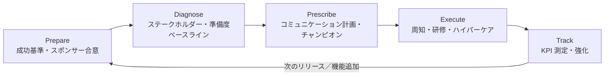
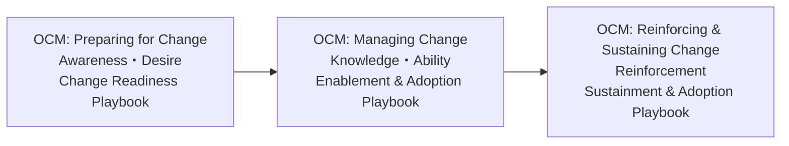
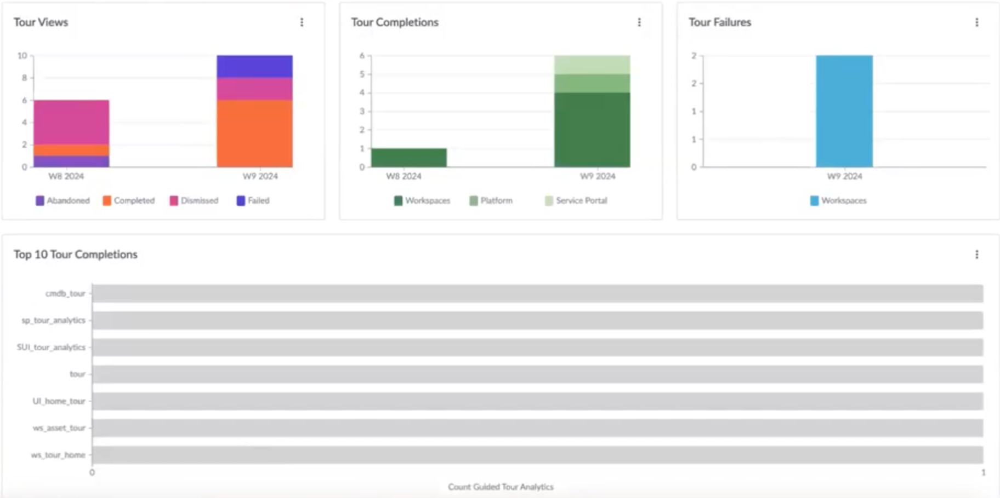
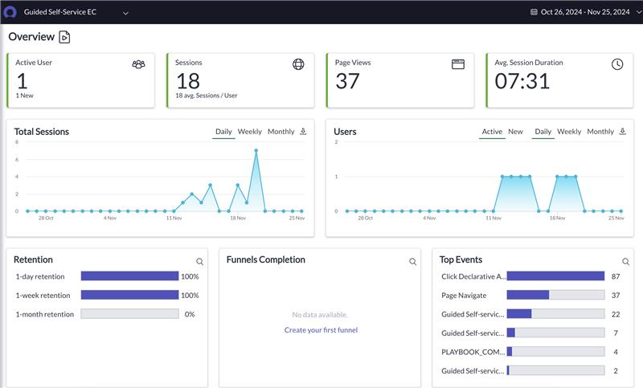
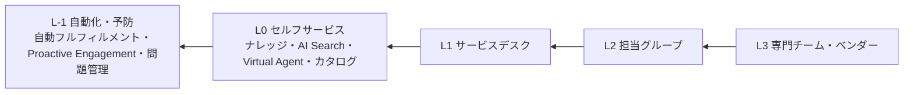

# 定着化と組織変革（Adoption and Organizational Change Management）

## 概要

本ファイルは、ServiceNow を「稼働させた」状態から「業務で使われ、効果が数字で示せる」状態へ移すための実務知見をまとめた応用編である。ServiceNow の導入失敗は技術よりも「人とプロセス」で起きることが多く、OCM（Organizational Change Management／組織変革管理）、トレーニング、ポータル利用促進、シフトレフト、KPI による効果測定を一体として設計する必要がある。

| テーマ | 本ファイルで答える問い |
|---|---|
| OCM の体制と計画 | 誰が何を担うか。スポンサー・チャンピオン・コミュニケーションをどう設計するか。ServiceNow 自身はどんな OCM 支援を提供しているか |
| トレーニング | 役割別・タスク型の研修をどう作るか。製品内の学習支援（Adoption Services：Guided Tours、Embedded Help、Help Center、Dynamic Guidance）は何ができ、何ができないか |
| ポータル利用促進 | Employee Center をどう立ち上げ、どう周知し、利用状況をどう計測するか（Campaign、Content Analytics、Usage Insights） |
| シフトレフト | 電話・メールからセルフサービスへ、L2 から L1/L0 へ、どう移行させるか。デフレクション（Deflection／問い合わせ回避）をどう定義・計測するか |
| KPI による効果測定 | 公式ダッシュボード（ITSM Success Dashboard、Assistant analytics）の KPI と計算式は何か。ベースラインをどう取り、誰がいつ見るか |

製品仕様の詳細は次のファイルに譲る：ポータルは [Service Portal と Employee Center](../02_リファレンス/platform/portals-employee-center.md)、ナレッジは [ナレッジ管理](../02_リファレンス/platform/knowledge-management.md)、Virtual Agent は [Virtual Agent と会話型AI](../02_リファレンス/platform/virtual-agent.md)、レポートは [レポートとアナリティクス](../02_リファレンス/platform/reporting-analytics.md)、AI 機能の定着は [Now Assist / AI Agents 導入の知見](10-ai-adoption-lessons.md)、プラットフォーム運営体制は [ガバナンスとCoEの実践](09-governance-coe-practice.md)。

本ファイルの記述は、ServiceNow 公式ドキュメント（Australia 版を優先）、ServiceNow 社員が執筆した ServiceNow Community 記事、および第三者情報に基づく。公式以外の情報には規約どおり `【第三者情報】`・`【経験則】`・`【推定】` を付ける。

---

## 1. 定着化の全体像

### 1.1 なぜ OCM が独立した論点になるのか

ServiceNow 導入における OCM は、しばしば「本番直前のトレーニング」に矮小化される。ServiceNow Community の記事は、技術チームが OCM を単なるトレーニングとして扱うために、人の側面がデプロイ直前まで放置されがちであると指摘し、OCM を早期に始めることを推奨している【第三者情報】（[出典](https://www.servicenow.com/community/in-other-news/5-organizational-change-management-tips-for-successful/ba-p/3207468)）。

Prosci の ServiceNow 向けガイドは、ベンチマーク調査で「プロジェクト管理と変革管理を統合した参加者の 47% がプロジェクト目標を達成または上回った」こと、ピープルマネージャー（現場の上長）の関与が 2011 年以降一貫して変革成功の上位要因であることを挙げている【第三者情報】（[出典](https://www.prosci.com/blog/a-guide-to-servicenow-organizational-change-management-ocm)）。

実務上の含意は次のとおりである【経験則】。

- OCM はプロジェクト計画の「ワークストリーム」として要件定義段階から予算・要員を確保する。トレーニングは OCM の一部にすぎない。
- 定着化の成否は本番稼働日ではなく、稼働後 3〜6 か月の KPI（自己解決率、チャネル比率、ポータル利用者数）で判定する。そのためのベースラインは稼働前に取る（[6.6](#66-ベースライン取得と測定サイクル) 参照）。
- 「機能は作ったが使われない」状態はライセンスの未活用でもある。ServiceNow Risk の導入事例では、未活用ライセンス価値をロールアウトの動機付けに使った例が報告されている（[出典](https://www.servicenow.com/community/grc-blog/organizational-change-management-lessons-from-the-field-real/ba-p/3396453)）。ライセンス観点は [ライセンスコスト最適化](06-license-cost-optimization.md) を参照。

### 1.2 定着化のライフサイクル（ServiceNow Impact の 5 フェーズ）

ServiceNow のカスタマーサクセス製品 ServiceNow Impact の Accelerator「OCM: Preparing for Change」は、変革準備を次の 5 フェーズで進める。フェーズ名の英語原文は Prepare / Diagnose / Prescribe / Execute / Track で、日本語版ドキュメントでは「準備／診断／処方／実行／追跡」と訳されている（[出典（日本語版）](https://www.servicenow.com/docs/r/GhZz9BVbXzoY5nvjZCe6Ww/~JqRArQL9CIkcIWV9SBLwQ)、[出典（ポルトガル語版：Preparar／Diagnosticar／PRESCRIBE／Executar／Rastrear）](https://www.servicenow.com/docs/r/NYweeRocREicYwhLVBs7lg/k2NWYNkgT40Ljxmm4TAkNw)、[出典（ドイツ語版）](https://www.servicenow.com/docs/r/tJa9Em2DAbijpCjxYUU3Pw/t74Rj80jzDULmyZDVTrnZA)）。なお、2026-11 時点で取得した英語版ページは 5 フェーズの見出しではなく、Kickoff Session から Accelerator Close & Handoff までのセッション単位（Organizational Readiness Assessment & Success Criteria、Stakeholder Mapping & Analysis、Communication & Engagement Planning、Champion Network Design & Launch Readiness 等）で構成されており、版・言語によって記載形式が異なる（[出典（英語版）](https://www.servicenow.com/docs/r/OLEAh14mAEPe8fUlW2F9wQ/laq40ut6M73wEY9po7aXkA)）。本ファイルはこの 5 フェーズを定着化の骨格として用いる。

| フェーズ | 公式の目的（要約） | 主な成果物（本ファイルでの整理） |
|---|---|---|
| Prepare（準備） | リーダーシップの合意、準備度、測定可能な成功基準を定める | 成功基準、スポンサー合意 |
| Diagnose（診断） | 主要ステークホルダーを特定し、従業員の準備度のベースラインを取る | ステークホルダーマップ、準備度評価 |
| Prescribe（処方） | 的を絞ったコミュニケーションとチャンピオンネットワークを設計する | コミュニケーション計画、チャンピオン網 |
| Execute（実行） | コミュニケーションを開始し、チャンピオンを稼働させる | 周知・トレーニング実施 |
| Track（追跡） | 定着の進捗を測定し、教訓を記録し、継続的な強化へ移行する | KPI レポート、教訓、強化計画 |

英語版ページによれば、Preparing for Change の主な成果物は **Change Readiness Playbook**（変革準備プレイブック）である。準備度評価の結果、成功基準付きの変革ビジョン、ステークホルダーマップ、スポンサー活性化計画、8 週間のコミュニケーション計画、チャンピオンネットワーク設計、キックオフイベント計画、エンゲージメント追跡結果、準備度ベースラインを含む（[出典](https://www.servicenow.com/docs/r/OLEAh14mAEPe8fUlW2F9wQ/laq40ut6M73wEY9po7aXkA)）。Preparing for Change は 3 本構成の OCM Accelerator シリーズの 1 本目で、後続に OCM: Managing Change と OCM: Reinforcing & Sustaining Change がある（[2.5](#25-servicenow-が提供する-ocm-支援メニュー) 参照）。



### 1.3 変革フレームワークと ServiceNow 機能の対応

ServiceNow 社員による Community 記事（Agentic AI の OCM）は、Prosci ADKAR、Kotter の変革原則、Daryl Conner の変革飽和（Change saturation）の考え方を組み合わせることを推奨している（[出典](https://www.servicenow.com/community/now-assist-blog/strategic-adoption-amp-organizational-change-management-for/ba-p/3356821)）。ADKAR（Awareness／認知、Desire／意欲、Knowledge／知識、Ability／能力、Reinforcement／定着）の各段階に、ServiceNow で使える手段を対応させると次のようになる【経験則】（機能仕様は各節の公式出典を参照）。

| ADKAR 段階 | 目的 | ServiceNow 上の手段 | 本ファイルの節 |
|---|---|---|---|
| Awareness | 変更の理由と影響を知る | Employee Center Pro の Campaign／News、Microsoft Teams への配信、ポータルのバナー | [4.4](#44-campaign-と-employee-communications-employee-center-pro) |
| Desire | 使いたいと思う | 上長からのメッセージ、早期アクセス（Early access）、成功事例の共有 | [2.3](#23-チャンピオンネットワークとピープルマネージャー)・[4.2](#42-employee-center-立ち上げの実践知) |
| Knowledge | 使い方を知る | 役割別研修、Guided Tours、Embedded Help、Help Center | [3](#3-トレーニング) |
| Ability | 実務でできる | QA 環境でのタスク型演習、ハイパーケア、Dynamic Guidance | [2.6](#26-ハイパーケアは行動の強化として設計する)・[3.7](#37-dynamic-guidance) |
| Reinforcement | 元に戻らない | チャネル閉鎖、KPI の定例レビュー、Guided Tours dashboard／Content Analytics による継続改善 | [5](#5-シフトレフト)・[6](#6-kpi-による効果測定) |

---

## 2. OCM の体制と計画

### 2.1 顧客側に必要な役割

ServiceNow Impact の「OCM: Preparing for Change」Accelerator は、顧客側に次の役割を必須として求めている（[出典](https://www.servicenow.com/docs/r/tJa9Em2DAbijpCjxYUU3Pw/t74Rj80jzDULmyZDVTrnZA)）。

| 役割 | 公式の位置付け | 必須／推奨 |
|---|---|---|
| Platform owner（プラットフォームオーナー） | ServiceNow プラットフォームとビジネス戦略・ロードマップの整合に責任を持つ | 必須 |
| System administrators（システム管理者） | プラットフォームの安定性・使い勝手を維持し、設定を担う | 必須 |
| Executive sponsor（エグゼクティブスポンサー） | ServiceNow に関する主たる戦略窓口 | 必須 |
| Communications lead（コミュニケーションリード） | 社内コミュニケーションを設計・発信する | 必須 |
| Change lead（チェンジリード） | 顧客の変革推進プログラムを管理する | 必須 |
| Trusted service partners（パートナー） | コーチングに同席し、以後の支援に備える | 推奨 |

同 Accelerator は、準備資料として「影響部門の組織図」「暫定ステークホルダー一覧（影響力のある人、チャンピオン候補、既知の抵抗）」「直近の変革施策の履歴」「既存の社内コミュニケーション手段とガイドライン」「既存展開を拡張する場合は現在の利用指標・ライセンス使用データ」「ビジネスケース」を挙げている（[出典](https://www.servicenow.com/docs/r/tJa9Em2DAbijpCjxYUU3Pw/t74Rj80jzDULmyZDVTrnZA)）。これらはそのまま OCM 計画の入力チェックリストとして使える。

AI 機能（Now Assist／AI Agents）の展開では、上記に加えて Product Owner（AI）、Process Owners、OCM Lead、Security and Risk、Platform Team、Champion Network を置く構成が ServiceNow 社員の記事で示されている（[出典](https://www.servicenow.com/community/now-assist-blog/strategic-adoption-amp-organizational-change-management-for/ba-p/3356821)）。プロジェクト全体の体制は [プロジェクト体制とパートナー](../03_導入編/05-project-organization.md) を参照。

### 2.2 ステークホルダー分析は「役職」ではなく「行動」で切る

ServiceNow Risk（IRM）導入の現場知見をまとめた ServiceNow 社員の記事は、次の教訓を示している（[出典](https://www.servicenow.com/community/grc-blog/organizational-change-management-lessons-from-the-field-real/ba-p/3396453)）。

- **行動でセグメントする**：組織図上は「非重要」とされた利用者が実際には毎週リスク例外を承認していたことがジョブシャドーイングで判明し、優先トレーニング対象に移した。
- **3 区分で接触頻度を決める**：ステークホルダーを「意思決定者（decision-makers）」「実行者（executors）」「影響者（influencers）」に分け、コミュニケーションの頻度とアクセス権を変えた。

ITSM での応用例【経験則】：

| セグメント | 典型的な対象 | 主な関心 | 接触方法 |
|---|---|---|---|
| 意思決定者 | CIO、部門長、サービスオーナー | 投資対効果、リスク、KPI | 月次ステアリング、ダッシュボード共有 |
| 実行者（フルフィラー） | サービスデスク、L2/L3 担当、承認者 | 作業手順の変化、負荷 | 役割別研修、手順書、ハイパーケア |
| 実行者（依頼者） | 全従業員 | どこで頼めばよいか、早く解決するか | ポータル周知、Campaign、上長経由の案内 |
| 影響者 | 現場のキーパーソン、古参の担当者、労組・部門 IT 担当 | 既存のやり方・裁量の変化 | 早期巻き込み、チャンピオン化 |

### 2.3 チャンピオンネットワークとピープルマネージャー

- Community の OCM Tips 記事は、パワーユーザーを「Champion」に指名して稼働後の一次サポート役とし、稼働後 1 週間はドロップイン型のオフィスアワーを設けることを推奨している【第三者情報】（[出典](https://www.servicenow.com/community/in-other-news/5-organizational-change-management-tips-for-successful/ba-p/3207468)）。
- 同記事は、リーダーに「プロジェクトの価値」に関するトーキングポイントを渡し、スケジュール競合を避けるよう調整することを勧めている（同上）。
- Agentic AI の OCM 記事は、新規ユーザーをチャンピオンとペアにし、エスカレーションやロールバックのクイックリファレンスを提供すること、さらに「マネージャーがエージェントの KPI について尋ねない」ことを新しい行動が定着しない典型的な失敗として挙げている（[出典](https://www.servicenow.com/community/now-assist-blog/strategic-adoption-amp-organizational-change-management-for/ba-p/3356821)）。
- Prosci は、ピープルマネージャーの関与を変革成功の上位要因としている【第三者情報】（[出典](https://www.prosci.com/blog/a-guide-to-servicenow-organizational-change-management-ocm)）。

実務上の設計指針【経験則】：

| 項目 | 推奨 |
|---|---|
| チャンピオンの人数 | 部門・拠点ごとに最低 1 名。全社展開では利用者 50〜100 名に 1 名程度を目安にし、拠点・シフト勤務を考慮する |
| 選定基準 | 職位ではなく「同僚から質問される人」。ステークホルダー分析の影響者から選ぶ |
| 役割 | 早期アクセスでの試用とフィードバック、部門向け説明、稼働後の一次相談、回避策（ワークアラウンド）の早期発見 |
| 支援 | 専用チャネル（Teams 等）、先行研修、FAQ、プロジェクトチームとの定例 |
| 評価 | 上長の評価項目に組み込む、表彰する。無償の善意に依存しない |

### 2.4 コミュニケーション計画は「信頼」を設計する

ServiceNow Risk 導入の教訓は、コミュニケーションの信頼性を最優先にしている（[出典](https://www.servicenow.com/community/grc-blog/organizational-change-management-lessons-from-the-field-real/ba-p/3396453)）。

- UAT が遅延したら、予定していた告知を止める（守られない日付を告知しない）。
- 告知は「既知のリーダー」から、FAQ とビジュアルを添えて出す。
- CISO・役員・部長・マネージャーと階層ごとにメッセージを変え、通知疲れを減らす。

AI 展開の OCM 記事は、1 ページのナラティブ、デモ、5〜7 分の役割別マイクロラーニング、オフィスアワー、展開ウェーブ前の準備度サーベイを組み合わせることを推奨している（[出典](https://www.servicenow.com/community/now-assist-blog/strategic-adoption-amp-organizational-change-management-for/ba-p/3356821)）。

コミュニケーション計画の雛形【経験則】：

| 時期 | 対象 | メッセージ | 媒体 | 発信者 |
|---|---|---|---|---|
| 稼働 12 週前 | 全社 | なぜ変えるのか（課題と目指す姿） | 社内報、全社メール | エグゼクティブスポンサー |
| 8 週前 | 部門長・マネージャー | 部門への影響、マネージャーへの依頼事項 | 説明会、トーキングポイント | プロジェクトオーナー |
| 6 週前 | チャンピオン | 早期アクセス開始、役割 | キックオフ、専用チャネル | チェンジリード |
| 4〜2 週前 | フルフィラー | 研修日程、新しい作業手順 | 研修招集、手順書 | プロセスオーナー |
| 2 週前〜稼働 | 全従業員 | いつから・どこで・何が変わるか | ポータルバナー、Campaign、Teams | コミュニケーションリード |
| 稼働後 1〜4 週 | 全員 | 早期の成果、よくある質問、旧チャネル停止日 | ポータル News、メール | スポンサー／チェンジリード |
| 稼働後 3 か月 | 意思決定者 | KPI の結果、次の改善 | ステアリング報告 | プラットフォームオーナー |

### 2.5 ServiceNow が提供する OCM 支援メニュー

ServiceNow Impact の OCM Accelerator は、OCM: Preparing for Change → OCM: Managing Change → OCM: Reinforcing & Sustaining Change の 3 本構成のシリーズとして公式ドキュメントに掲載されている。3 本とも顧客側の必須役割は Platform Owner、System administrator(s)、Executive Sponsor、Communication Lead(s)、Change Lead(s)（Trusted Service Partners は推奨）で共通である（[出典](https://www.servicenow.com/docs/r/OLEAh14mAEPe8fUlW2F9wQ/Dp0RIDVDPReMJDsnxZ4JoA)、[出典](https://www.servicenow.com/docs/r/OLEAh14mAEPe8fUlW2F9wQ/F8iNlER03DL7R6zqaH_JPg)）。定着化（Reinforcement）の段階で ServiceNow の支援を受けたい場合は、3 本目の Reinforcing & Sustaining Change が該当する。



| メニュー | 内容 | 前提・注意 | 出典 |
|---|---|---|---|
| OCM: Preparing for Change（Impact Accelerator） | 5 フェーズのコーチングセッション。任意フォローでは抵抗管理、CSE 主導ワークショップ（ビジョン整合、準備度評価、ステークホルダーマッピング、コミュニケーション計画）等 | Impact Guided+（strategic value add-on）、Advanced、Total パッケージで利用可。作業の主体は顧客で、CSE（Customer Success Executive）はフレームワークとファシリテーションを提供。主な成果物は Change Readiness Playbook。OCM Accelerator シリーズの 1 本目（OCM Readiness フレームワークの Awareness／Desire に対応） | [出典](https://www.servicenow.com/docs/r/tJa9Em2DAbijpCjxYUU3Pw/t74Rj80jzDULmyZDVTrnZA)、[出典（英語版）](https://www.servicenow.com/docs/r/OLEAh14mAEPe8fUlW2F9wQ/laq40ut6M73wEY9po7aXkA) |
| OCM: Managing Change（Impact Accelerator） | ユーザーイネーブルメントのコーチング（各最大 1.5 時間）。Kickoff Session、Training Needs Analysis、Enablement Plan、Skill Gap & Barrier Assessment、Enablement Session Design、Champion Network & Peer Support Activation、Process Integration Checklist、Training Completion & Proficiency Dashboard、Accelerator Close & Hand-off。成果物は Enablement & Adoption Playbook（研修ニーズ分析、オンボーディングジャーニーマップ付きの研修計画、チャンピオンネットワーク活性化ガイド、研修習熟度ダッシュボード等） | Impact Guided+（strategic value add-on）、Advanced、Total。シリーズの 2 本目で OCM Readiness フレームワークの Knowledge／Ability に対応。Preparing for Change の事前完了を強く推奨（必須ではなく、スポンサー・ステークホルダーマップ・チャンピオン網が既にあれば省略可）。結果は Reinforcing & Sustaining Change に引き継ぐ | [出典](https://www.servicenow.com/docs/r/OLEAh14mAEPe8fUlW2F9wQ/Dp0RIDVDPReMJDsnxZ4JoA) |
| OCM: Reinforcing & Sustaining Change（Impact Accelerator） | 稼働後の定着維持のコーチング。Executive Sponsor Re-Engagement Session、Success Metrics & KPI Framework、End-User Feedback & Gap Analysis、Corrective Action Plan、Recognition & Sustainment Plan、Business Review Session、Adoption Sustainability Scorecard & Accelerator Close。成果物は Sustainment & Adoption Playbook（KPI フレームワーク、定着ダッシュボード設定ガイド、利用者サーベイ結果、是正計画、表彰計画、チャンピオン役割の進化を含む維持計画、継続的改善フレームワーク等） | Impact Guided+（strategic value add-on）、Advanced、Total。シリーズの 3 本目で OCM Readiness フレームワークの Reinforcement に対応。前提は初回稼働の完了と Platform Owner または OCM Lead の任命。Managing Change または同等の基盤（イネーブルメント戦略、稼働中のチャンピオン網、定着のベースラインデータ）を推奨。推奨設定のインスタンスへの実装は含まない | [出典](https://www.servicenow.com/docs/r/OLEAh14mAEPe8fUlW2F9wQ/F8iNlER03DL7R6zqaH_JPg) |
| TuneUp Your Employee Center（Impact Accelerator） | 一時インスタンスで HealthScan を実行し、最大 90 分のコーチング（+任意 60 分 Q&A）。未活用機能の特定と利用促進の推奨 | Impact Advanced／Total のみ。推奨事項の実装は顧客責任。一時インスタンスへのアクセスは 30 日間 | [出典](https://www.servicenow.com/docs/r/xanadu/impact/accelerator-and-initiative-list/tuneup-employee-center.html)（Xanadu 版） |
| User Adoption Packages | 導入モジュール別の既製の定着化パック、カスタマイズ版の講師主導デモ研修・録画デモ動画、ジョブエイド／クイックリファレンス、定着化コーチング、コミュニケーション計画、統合変革計画 | 価格・詳細は Now Support の KB0012660 またはアカウントチームに確認（記事執筆者も価格は不明としている） | [出典](https://www.servicenow.com/community/now-platform-blog/organizational-change-management-yes-but-how/ba-p/3079107)【第三者情報】 |
| NowCreate の OCM アセット | 製品非依存の OCM 資料（テンプレート等） | 顧客・パートナー向けポータル。アクセス権が必要 | [出典](https://www.servicenow.com/community/in-other-news/5-organizational-change-management-tips-for-successful/ba-p/3207468)【第三者情報】 |
| Change Adoption Specialist Career Journey | ServiceNow の学習プラットフォーム上の OCM スキル学習パス | 名称・構成は改訂される可能性あり | [出典](https://www.servicenow.com/community/now-platform-blog/organizational-change-management-yes-but-how/ba-p/3079107)【第三者情報】 |

ServiceNow Impact の Customer Success Executive は、ガバナンスと運用モデルの構築、利用者の定着推進を担う役割として公式に記載されている（[出典](https://www.servicenow.com/docs/r/impact/impact-squad.html)）。Impact のパッケージ構成は [サポートと監視](../03_導入編/14-support-monitoring.md) も参照。

### 2.6 ハイパーケアは「行動の強化」として設計する

ServiceNow Risk 導入の教訓は、サポートを「行動の強化（behavior reinforcement）」と位置付けている（[出典](https://www.servicenow.com/community/grc-blog/organizational-change-management-lessons-from-the-field-real/ba-p/3396453)）。

- ライブのサポートチャネル、エスカレーションマトリクス、「Week One Welcome Kit」を備えた、目に見える構造化されたハイパーケアを実施する。
- 「24 時間以内のチケット解決」などの早期の成果をステアリング会議で共有する。
- UAT 段階から能力移転を始め、社内要員がトリアージを共同リードし、リバースデモ（顧客側が説明する）を行い、プラットフォームの決定事項を文書化する。
- ハイパーケア期間中にスチュワード（現場推進役）ネットワークを稼働させ、定着状況の追跡、阻害要因の報告、繰り返し現れる回避策の早期発見を行う。

ハイパーケアの期間・体制・終了基準は [テストと本番稼働](../03_導入編/11-testing-golive.md) を参照。

---

## 3. トレーニング

### 3.1 役割別・タスク型で作る

| 原則 | 内容 | 出典 |
|---|---|---|
| スライドではなくシミュレーション | QA 環境で実タスク（承認ルーティング、例外エスカレーション等）を完了させる演習に置き換える。モジュール化された役割別・シナリオ型のジョブエイドを用意する | [出典](https://www.servicenow.com/community/grc-blog/organizational-change-management-lessons-from-the-field-real/ba-p/3396453) |
| 出席率ではなく習熟で測る | 研修出席数の代わりに「利用者の自信」と「機能的な正確さ」を指標にする | 同上 |
| 現行との差分で教える | 役割ごとに将来の状態を現行プロセスと比較して示し、動画・対話型セッション・ハンズオンを組み合わせる | [出典](https://www.servicenow.com/community/in-other-news/5-organizational-change-management-tips-for-successful/ba-p/3207468)【第三者情報】 |
| 役割別に分ける（AI の例） | プロセスオーナー（エージェント化できる手順と判断ポリシーの定義）、フルフィラー（監督とフィードバック）、ビルダー（プロンプト・ポリシー・下位環境テスト） | [出典](https://www.servicenow.com/community/now-assist-blog/strategic-adoption-amp-organizational-change-management-for/ba-p/3356821) |

ITSM での対象別カリキュラム例【経験則】：

| 対象 | ロール例 | 研修形式 | 内容 | 時間目安 |
|---|---|---|---|---|
| 一般従業員（依頼者） | ロールなし（ESS） | 1〜3 分の動画、Guided Tour、ポータル上の FAQ | ポータルでの検索・申請・状況確認、Virtual Agent の使い方 | 合計 10 分以内 |
| 承認者 | `approver_user` 等 | 動画＋ジョブエイド | 承認（メール／モバイル／ポータル）、委任設定 | 15〜30 分 |
| サービスデスク（L1） | `itil` | 講師主導ハンズオン（QA 環境） | Service Operations Workspace、インシデント登録・分類・エスカレーション、ナレッジ活用・作成 | 0.5〜1 日 |
| L2/L3 担当 | `itil` | 講師主導＋ジョブエイド | 割り当て・解決・問題/変更連携 | 半日 |
| マネージャー | `itil`、レポート閲覧 | 説明会＋ダッシュボードツアー | KPI の見方、チームへの期待行動 | 1〜2 時間 |
| プロセスオーナー・管理者 | `admin` 系 | ServiceNow University の公式コース＋社内手順 | 設定変更の手順、ガバナンス | 数日 |

### 3.2 管理者・開発者向け：ServiceNow University

- ServiceNow は Knowledge 2025（2025 年 5 月）で学習体験 **ServiceNow University** を発表し、従業員・顧客・パートナー・個人に一般提供している（[出典](https://www.businesswire.com/news/home/20250506888980/en/ServiceNow-Introduces-ServiceNow-University-an-Innovative-Learner-Experience-to-Empower-Individuals-to-Grow-Develop-and-Build-Skills-for-an-AI-driven-World)）。
- 2025 年 3 月 4 日付の ServiceNow 社員による Community 投稿によれば、Now Learning（当時）のオンデマンド研修はすべて無償化された。講師主導研修と認定試験は引き続き有償である（[出典](https://www.servicenow.com/community/now-learning-community-events/servicenow-now-learning-ondemand-training-is-free/ta-p/3195871)）。
- 有償研修の購入通貨は Learning Credits（LC）で、公式ページでは 1 LC = 1 USD とされている（[出典](https://www.servicenow.com/services/training-and-certification/learning-credits.html)）。

学習パスと認定資格の全体像は [学習パスと認定資格](../01_入門編/09-learning-path.md) を参照。注意点として、ServiceNow University の標準コースは製品のベースシステムを前提としており、自社のプロセス・カスタマイズ・用語は教えない。エンドユーザー向け教材は自社で作る必要がある【経験則】。

### 3.3 製品内学習支援：Adoption Services の全体像

ServiceNow は製品内ガイダンス機能群を **Adoption Services** として提供している。Zurich ではプラグインとともに既定で有効（明示的なアクティベートは不要）とされ、Australia では ServiceNow AI Platform の機能として既定で有効と記載されている（[出典](https://www.servicenow.com/docs/r/delta-zurich-brazil/brazil-zurich-adoptionservices-release-notes.html)）。

| 機能 | 何をするか | 主な対象 UI | 定着化での用途 | 詳細 |
|---|---|---|---|---|
| Guided Tours | 画面上の吹き出し（コールアウト）で手順を順番に案内する対話型ウォークスルー | Standard UI（Core UI）、Workspace、Service Portal、Custom UI | 稼働直後のオンボーディング、新機能の紹介 | [3.4](#34-guided-tours) |
| Embedded Help | UI ページごと・ロールごとのヘルプ記事をサイドパネルに表示 | Core UI | 自社手順・自社用語の補足 | [3.5](#35-embedded-help) |
| Help Center | Configurable Workspace の右サイドバーにヘルプトピックを表示。Guided Tours や Dynamic Guidance の起動口 | Configurable Workspace | フルフィラー向けの画面内 FAQ | [3.6](#36-help-center) |
| Dynamic Guidance | 画面共有と音声で、その場の画面に即した回答を返す AI アシスタント（リリースノート上は Australia の新機能。Zurich Patch 8 以降でも提供） | Core UI、Configurable Workspace | 管理者・パワーユーザーの自習支援 | [3.7](#37-dynamic-guidance) |
| Guided Setup | 製品の初期設定を案内する管理者向け機能 | Core UI | （管理者向け） | Australia で将来の廃止準備に入った（[3.8](#38-guided-setup-の扱い)） |

> **Brazil での変更:** Zurich→Brazil の比較リリースノートでは、Adoption Services の Brazil 欄の新機能・変更・廃止はいずれも「No updates for this release」とされている。ただし同ページの要約部分は AI 生成で正確性を保証しないと注記されているため、正式なリリース表で確認すること（[出典](https://www.servicenow.com/docs/r/delta-zurich-brazil/brazil-zurich-adoptionservices-release-notes.html)）。

ServiceNow 社員の Community 記事は、Guided Tours と Dynamic Guidance の関係を「Guided Tours は学ばせる（learn）、Dynamic Guidance は日々の成功を助ける（succeed）」と整理し、新規ユーザー・直線的な手順・稼働直後や大きな変更後のオンボーディングには Guided Tours、ベストプラクティスの定着・ミスや手戻りの削減・日常業務の支援には Dynamic Guidance を使うとしている（[出典](https://www.servicenow.com/community/servicenow-ai-platform-blog/guided-tours-and-dynamic-guidance/ba-p/3527057)、2026-04-16 投稿）。

### 3.4 Guided Tours

**プラグインとプロパティ**

Guided Tours は Guided Tour（`com.glide.guided_tours`）と Guided Tour Designer（`com.glide.sn_tourbuilder`）の 2 プラグインで構成される（[出典](https://www.servicenow.com/docs/r/xanadu/platform-user-interface/adoption-services/exploring-guided-tours.html)）。Australia 版ドキュメントでは、`admin` ロールで次のシステムプロパティを `true` にすることで UI ごとに有効化する（[出典](https://www.servicenow.com/docs/r/australia/platform-user-interface/adoption-services/activate-guidedtours-service-portal.html)）。

| プロパティ | 効果 |
|---|---|
| `com.snc.guided_tours.standard_ui.enable` | Standard platform UI と Workspace でガイドツアーを実行可能にする。Next Experience 上での Guided Tours もこのプロパティで有効化する |
| `com.snc.guided_tours.sp.enable` | Service Portal ページで実行可能にする |
| `com.snc.guided_tours.custom_ui.enable` | Custom UI ページで実行可能にする |

**設計・運用上の仕様**

- 登場人物は Administrator（designer／作成者）と User（player／利用者）。ツアーは Standard UI、Workspace、Service Portal、Custom UI で動作する（[出典](https://www.servicenow.com/docs/r/australia/platform-user-interface/adoption-services/exploring-guided-tours.html)）。
- Guided Tour Designer は Core UI でのみ利用でき、UI15 とは互換性がない（[出典](https://www.servicenow.com/docs/r/australia/platform-user-interface/adoption-services/activate-guidedtours-service-portal.html)）。
- ツアーには 1 つ以上のロールを割り当てられ、対象ロールを持つ利用者だけがツアーを見られる。ページ到達時の自動起動（auto-launch）を設定できる。ヘッダーメニューのない Service Portal ページでは、自動起動が利用者がツアーにアクセスする唯一の方法になる（[出典](https://www.servicenow.com/docs/r/xanadu/platform-user-interface/adoption-services/exploring-guided-tours.html)）。
- Zurich で、Guided Tours が Help Center に目立つ形で表示されるようになり、ロールに応じて利用できるツアーが変わるようになった（[出典](https://www.servicenow.com/docs/r/delta-zurich-brazil/brazil-zurich-adoptionservices-release-notes.html)）。

**制約（Xanadu 版ドキュメントの記載。導入前に対象画面で必ず検証する）**（[出典](https://www.servicenow.com/docs/r/xanadu/platform-user-interface/adoption-services/exploring-guided-tours.html)）

| 対象 | 主な非対応 |
|---|---|
| Standard UI | Flow Designer、Agent Workspace、ポップアップウィンドウ、Select2 要素、SVG 要素、カスタムタグ、独自 UI 要素を持つページ（Contextual search など） |
| Service Portal | IFRAME を含むページ、Branding Editor、Shadow DOM のコンポーネント（`sn-search-combobox`、`sn-search-results-container` など） |
| Workspace | 対応する App Shell は Breadcrumb、ACE Unified Nav、Workspace、Custom のみ。iframe 内のコールアウト不可。Standard UI／Workspace から Service Portal へまたがるツアー不可。1 ページ内に限定（新しいタブが開くとツアー終了）。モバイル表示非対応。可視化コンポーネント内要素へのコールアウト不可 |
| 共通 | スクロールで読み込まれる要素はツアーに影響する（利用者にスクロールを促す必要がある） |

**定着化での使い方【経験則】**

- 稼働直後の「最初の 1 回」に限定して自動起動し、2 回目以降は Help Center から任意で再生させる。自動起動を乱発すると、利用者が自動起動を無効化する（後述の Disengaged Users として計測される）。
- ツアーは 5〜7 ステップ以内に抑え、1 ツアー 1 タスク（例：「PC 故障を報告する」「申請の状況を確認する」）にする。
- 画面変更（アップグレード、UI Builder の変更）でツアーが壊れるため、ツアーを ATF（Automated Test Framework）とは別にアップグレード後の確認項目に入れる。アップグレード時の確認体制は [アップグレードの教訓](04-upgrade-lessons.md) を参照。

**Guided Tours dashboard**

Guided Tours の利用状況は **Guided Tour Designer > Guided Tours Overview** のダッシュボードで確認できる。ダッシュボードは User Engagement と Tour Statistics の 2 タブで構成される（[出典](https://www.servicenow.com/docs/r/australia/platform-user-interface/adoption-services/guided-tour-overview.html)）。

| タブ | ウィジェット | 意味 |
|---|---|---|
| User Engagement | Tour Views | 1 日あたりのツアー閲覧数 |
| | Tours Completed | 1 日あたりの完了数 |
| | Unique Users Views／Unique User Completion | 1 日あたりのユニーク閲覧者数・完了者数 |
| | Weekly Engagement | 期間の利用傾向（PNG/JPEG で保存可） |
| | Disengaged Users | 自動起動を無効にした利用者数 |
| Tour Statistics | Tour Views | 放棄（abandoned）・完了・却下（dismissed）・失敗（failed）の件数 |
| | Tour Completions／Tour Failures | 種類別の完了数・失敗数 |
| | Top 10 Tour Completions／Failures／Dismissals | 完了・失敗・却下の多いツアー上位 10 件 |



- **キャプション：** Guided Tours Overview ダッシュボード（Tour Statistics タブ）
- **画面の説明：** Guided Tour Designer > Guided Tours Overview で開くダッシュボードの Tour Statistics タブ。上段左の Tour Views は週（例：W8 2024、W9 2024）ごとにツアーの閲覧結果を Abandoned（放棄）、Completed（完了）、Dismissed（却下）、Failed（失敗）で色分けした積み上げ棒グラフ。上段中央の Tour Completions は完了数をツアー種別（Workspaces、Platform、Service Portal）で積み上げ、上段右の Tour Failures は失敗数を種別で表示する。下段の Top 10 Tour Completions は完了数の多いツアー名（`cmdb_tour`、`sp_tour_analytics` など）を横棒で並べる。Dismissed と Failed が多いツアーは、内容の見直しまたは画面変更による破損を疑う。
- **出典：** https://www.servicenow.com/docs/r/australia/platform-user-interface/adoption-services/guided-tour-overview.html （取得日：2026-11-04）

### 3.5 Embedded Help

Embedded Help は、UI ページごとにロールに応じたヘルプコンテンツを表示する機能である（[出典](https://www.servicenow.com/docs/r/australia/platform-user-interface/adoption-services/exploring-embedded-help.html)）。

- ベースシステムのヘルプ記事は ServiceNow のデータセンター内の CDN に格納され、インスタンスの Embedded Help Content（`sys_embedded_help_content`）テーブルに取り込まれる。CDN のコンテンツは 30 日ごとに更新される。
- ベースシステムの記事（読み取り専用の ServiceNow Help チェックボックスがオン）は編集できない。内容を変えるには記事をコピーして修正する。カスタム記事は ServiceNow のヘルプより優先して表示される。
- ヘルプは UI ページ名（例：`asmt_metric_type_list`、フォームは `asmt_metric_type`）で識別される。
- 追加・置換の用途として、カスタムアプリのヘルプ、自社業務プロセスの具体的手順や動画、英語以外の言語のヘルプ、ロールごとに異なる内容が挙げられている。Australia では、既存の言語コンテンツを上書きせずに英語以外のコンテンツをインポートできるようになった。

**ロール優先順位**：Embedded Help Role Priority（`sys_embedded_help_role`）テーブルで、ロールごとの優先順（小さいほど優先）が管理される（[出典](https://www.servicenow.com/docs/r/australia/platform-user-interface/adoption-services/embedded-help-roles.html)）。

| 順序番号 | ロール |
|---|---|
| 10 | admin 系（`admin`、`chat_admin`、`pa_admin`、`survey_admin` 等。`itil_admin` は除く） |
| 100 | manager 系または `itil_admin`（`catalog_manager`、`content_manager`、`sla_manager` 等） |
| 300 | `itil` のみ |
| 1000 | その他のロールまたはロールなし（ESS ユーザー） |

定着化での使い方【経験則】：インシデントフォーム（`incident`）に `itil` 向けの自社手順（分類ルール、エスカレーション基準）を Embedded Help として置くと、研修資料を探しに行かずに済む。手順書の正本を Embedded Help に一本化し、Word／PDF の手順書を増やさないことが重要である。

### 3.6 Help Center

Help Center は、Configurable Workspace 利用中に必要な情報を右サイドバーに表示する機能で、ヘルプアイコンを選ぶと表示される。現在の UI ページにコンテンツがあるとアイコンにインジケーターが付き、同じページに複数トピックを置ける。Australia では、パネルのヘッダーへの着脱、切り離し時のドラッグ・リサイズ、キーボードによる操作（アクセシビリティ）が追加された。コンテンツがない場合は、その旨と製品ドキュメントへのリンクが表示され、add new content リンクから管理者がコンテンツを追加できる（[出典](https://www.servicenow.com/docs/r/australia/platform-user-interface/adoption-services/exploring-help-center.html)）。Help Center の各記事には「役に立った／役に立たなかった」の評価（thumbs up/down）フィードバック機能があり、利用者は記事を選ぶと評価できる。結果は User Experience Analytics（Usage Insights）のダッシュボードで確認する。**All > User Experience Analytics > Dashboard** を開き、左ナビゲーションの **Analytics > Events** で Thumbs up 等のイベントを選ぶと、発生件数、ページ名、パス名、バージョンなどの詳細が表示される（[出典](https://www.servicenow.com/docs/r/australia/platform-user-interface/adoption-services/help-center-content-feedback.html)）。


- **キャプション：** Configurable Workspace（Service Operations Workspace）の Help Center パネル
- **画面の説明：** 画面上部のヘッダーに「Service Operations Workspace」、右上に検索・言語・ヘルプ（?）・通知アイコンが並ぶ。左はリストのナビゲーション（Interactions、Requests、Catalog Tasks、Incidents の各リスト）、中央にインシデント一覧（Number、Short description、Caller、Priority）。ヘルプアイコンを選ぶと右側に「Help」パネルが開き、このページで使えるヘルプトピック（リストからレコードを作成、フィルタ付きリストの作成、リストからの一括編集、リストのエクスポートなど）が説明文付きで縦に並ぶ。自社のトピックを追加すれば、フルフィラーは画面を離れずに手順を確認できる。
- **出典：** https://www.servicenow.com/docs/r/australia/platform-user-interface/adoption-services/exploring-help-center.html （取得日：2026-11-04）

### 3.7 Dynamic Guidance

Dynamic Guidance は、Help Center と ServiceNow Otto パネル（Australia 版ドキュメントの表記）から呼び出す、音声およびテキストでリアルタイムの手順ガイダンスを生成する AI アシスタントである。リアルタイムの画面共有に Google のサービスを使う（[出典](https://www.servicenow.com/docs/r/australia/platform-user-interface/adoption-services/dynamic-guidance.html)）。Dynamic Guidance は、ファミリーリリースのリリースノート上は Australia の新機能として記載されている（[出典](https://www.servicenow.com/docs/r/delta-zurich-brazil/brazil-zurich-adoptionservices-release-notes.html)）一方、最小バージョンは Zurich Patch 8 および Australia Patch 1 とされ（[出典](https://www.servicenow.com/docs/r/australia/platform-user-interface/adoption-services/dynamic-guidance.html)）、Zurich 版ドキュメントにも利用手順とロール（`sn_dyn_guidance_user`）が掲載されている（[出典](https://www.servicenow.com/docs/r/zurich/platform-user-interface/adoption-services/using-dynamic-guidance.html)）。つまり「ファミリーとしては Australia で新機能扱いだが、Zurich にもパッチで提供されている」と理解するのが正確である。Zurich 環境で利用する場合は Patch 8 以上であることを確認する。

> **Brazil での変更:** Brazil 版ドキュメントで、Dynamic Guidance の英語のみ・米国／欧州リージョンのみという制約が解除されたことは公開情報では確認できず。Zurich→Brazil の比較リリースノートの Brazil 欄は「No updates for this release」である（[出典](https://www.servicenow.com/docs/r/delta-zurich-brazil/brazil-zurich-adoptionservices-release-notes.html)）。

| 項目 | 内容 | 出典 |
|---|---|---|
| 最小バージョン | Zurich Patch 8 および Australia Patch 1 | [出典](https://www.servicenow.com/docs/r/australia/platform-user-interface/adoption-services/dynamic-guidance.html) |
| 必要ロール | `sn_dyn_guidance_user`。v28.4.3 以降、このロールに `genai_admin` が自動的に含まれる（ドキュメントは `genai_admin` が管理者権限を付与しないと明記） | [出典](https://www.servicenow.com/docs/r/zurich/platform-user-interface/adoption-services/using-dynamic-guidance.html) |
| 前提 | AI Control Tower で Google を有効化する | 同上 |
| 起動方法 | Help Center で Dynamic Guidance を選び Start。または Now Assist パネルでスキル「Ask Dynamic Guidance for help」を呼び出し、Open Dynamic Guidance を選ぶ。初回は画面共有とマイクの同意が必要 | 同上 |
| 回答の根拠 | 既定では ServiceNow 製品ドキュメント。管理者は External Content Connectors（XCC）でカスタムナレッジベースや社内ランブックを追加できる。XCC は AI Search を使い、Gemini が RAG API ハンドラー経由で検索結果を受け取って回答を生成する | [出典](https://www.servicenow.com/docs/r/australia/platform-user-interface/adoption-services/external-content-connector-in-dynamic-guidance.html) |

**制約（Australia 版ドキュメント）**（[出典](https://www.servicenow.com/docs/r/australia/platform-user-interface/adoption-services/dynamic-guidance.html)）

- 英語のみ対応。
- 米国および欧州リージョンでのみ提供。
- ガイダンス対象のハイライト表示機能はない。
- 利用者の代わりに操作は実行しない。
- Core UI と Configurable Workspace ページのみ対応。Service Portal ページからは起動できない。

**日本での評価【推定】**：上記の言語・リージョン制約のため、2026-11 時点で日本語話者のエンドユーザー定着施策として Dynamic Guidance を前提にすることはできない。日本のデータセンターを使うインスタンスでの提供可否は公開情報では確認できず。日本では Guided Tours・Embedded Help・Help Center と日本語のナレッジ記事・動画を主軸にし、Dynamic Guidance は英語を使う管理者・開発者の自習支援として位置付けるのが現実的である。

### 3.8 Guided Setup の扱い

Australia で、Guided Setup は将来の廃止に向けた準備段階（being prepared for future deprecation）に入った。新規インスタンスでは非表示・非アクティブになるが、ServiceNow は引き続きサポートする。詳細は Now Support の KB0867184（Deprecation Process）を参照するよう案内されている（[出典](https://www.servicenow.com/docs/r/delta-zurich-brazil/brazil-zurich-adoptionservices-release-notes.html)）。Guided Setup を前提とした管理者向けの手順書は作らない方がよい【経験則】。

### 3.9 トレーニング効果の測り方

| 指標 | 取得方法 | 備考 |
|---|---|---|
| 研修完了率 | 研修管理（LMS）や出席簿 | 入口指標にすぎない。これだけで判定しない |
| 習熟度（正確さ） | 研修後の演習結果、稼働後の差し戻し率・再分類率 | Risk 導入の教訓は「出席ではなく自信と正確さ」を推奨（[出典](https://www.servicenow.com/community/grc-blog/organizational-change-management-lessons-from-the-field-real/ba-p/3396453)） |
| Time-to-proficiency（習熟までの期間） | 新任者が独力で処理できるまでの日数 | AI 展開の OCM 記事が定着指標として挙げる（[出典](https://www.servicenow.com/community/now-assist-blog/strategic-adoption-amp-organizational-change-management-for/ba-p/3356821)） |
| ツアーの完了・離脱 | Guided Tours Overview の Tour Completions／Dismissals／Disengaged Users | [3.4](#34-guided-tours) |
| ヘルプの有用性 | Help Center の thumbs up/down（User Experience Analytics の Analytics > Events で集計）、ナレッジのフィードバック | [出典](https://www.servicenow.com/docs/r/australia/platform-user-interface/adoption-services/help-center-content-feedback.html) |
| 回避策の発生 | ハイパーケアでのスチュワード報告、メール・電話での依頼の残存 | 回避策の再発は定着失敗の先行指標 |

---

## 4. ポータル利用促進

### 4.1 前提：どのポータルに寄せるか

ServiceNow の従業員向けポータルは、現在 **Employee Center**（および上位の Employee Center Pro）が標準である。Service Portal との違い、移行、構成要素（Taxonomy、Topic page、Microsite 等）は [Service Portal と Employee Center](../02_リファレンス/platform/portals-employee-center.md) を参照。定着化の観点では、「部門ごとにポータルが乱立し、従業員がどこへ行けばよいか分からない」状態を解消し、単一の入口（One-stop shop）に寄せることが利用促進の前提になる【経験則】。

### 4.2 Employee Center 立ち上げの実践知

グローバル製薬企業の事例を ServiceNow 社員がまとめた Community 記事（2024-03-15 公開）は、次の 4 点を挙げている（[出典](https://www.servicenow.com/community/employee-center-articles/4-key-employee-center-deployment-tips-by-a-global/ta-p/2863910)）。

| 施策 | 内容 | 効果・示唆 |
|---|---|---|
| Taxonomy 設計プロセス | 既存ナレッジベースのカテゴリを出発点に、コンテンツオーナーとブレインストーミングし、パワーユーザーとカードソート、ユーザビリティテスト、モバイルエスノグラフィーを実施 | 以前からポータルにあったが見つからなかった資料に、新しい Taxonomy で初めてフィードバックが付くようになった |
| ベータではなく「Early access」 | 約 2,000 名のパワーユーザーを選び、本番環境・実データ・実コンテンツで Employee Center Pro を先行公開。同時にカスタマイズを標準機能に置き換え | 完成度の高い実物で、利用者がタスクを完了できるかを検証できた |
| Dynamic Topic Microsites をローコード環境として訴求 | 管理されない SharePoint サイトを持っていたコンテンツオーナーに、サブトピック・外部リンク・ナレッジ・カタログを 1 か所にまとめられる Microsite を提供 | コンテンツオーナーが Employee Center に移行した |
| 3 層のポータルガバナンス | Tier 1 ポータル協力者（コンテンツ管理者・Taxonomy オーナー、隔週）、Tier 2 ポータルガバナンス（IT・HR・財務などの運用リード、隔週）、Tier 3 ステアリングコミッティ（エグゼクティブスポンサー、四半期）。ポータルオーナーが 3 層すべてを推進 | 利用者調査・分析結果・機能判断を定例で回す体制 |

Employee Center の成功を測るビジネス成果と KPI の対応は [6.5](#65-employee-center-のビジネス成果と-kpi) を参照。

### 4.3 チャネルシフト：旧チャネルを閉じる計画を最初に作る

ポータルを開設しても、電話・メール・個人チャットの窓口が残る限り、利用者の多くは慣れた手段を使い続ける【経験則】。日本の公開事例でも、定着は「意識を変える取り組みの継続」として語られている。

| 事例 | 公開されている内容 | 出典 |
|---|---|---|
| 大林組（日立ソリューションズ掲載） | 導入前は月平均約 6,000 件の問い合わせの約 7 割が電話。受付をポータルに切り替え、既存 FAQ をナレッジとして登録しあいまい検索を可能にした結果、ナレッジ検索での自己解決が増え、電話問い合わせが月平均約 2,000 件減少（見出しでは約 30% 削減）。利用者が電話を好む傾向があるため、意識を変える取り組みを今後も続けるとしている | 【第三者情報】[出典](https://www.hitachi-solutions.co.jp/servicenow/case04/) |
| パソナグループ（ServiceNow Japan 提供コンテンツ、2022-01-12 掲載） | グループ従業員約 7,000 名に対し IT 窓口のオペレーターは 7 名。窓口は電話とメールで 8 割以上が電話だった。新システム導入後、電話での問い合わせ比率が 85% から 25% に低下 | 【第三者情報】[出典](https://www.sbbit.jp/document/sp/18392) |

チャネルシフトの段階的な進め方【経験則】：

| 段階 | 施策 | 注意点 |
|---|---|---|
| 1. 並行期（稼働〜1 か月） | 電話・メールも受けるが、受付担当がポータルの使い方を案内し、代理登録時にポータル URL を返信する | 代理登録の `contact_type` を正しく記録し、チャネル比率を測れるようにする |
| 2. 誘導期（1〜3 か月） | メールの自動返信でポータルへ誘導、電話の IVR（自動音声）でポータルを案内、電話受付時間の短縮 | 障害時・PC が使えない時の電話窓口は必ず残す |
| 3. 閉鎖期（3 か月〜） | 特定の依頼種別（アカウント、ソフトウェア申請等）をポータル専用にする。共有メールアドレスを廃止または受付専用に | 閉鎖日を事前に繰り返し告知する。役員・VIP の例外運用を決めておく |
| 4. 定着期 | チャネル比率を月次でレビュー。メールで来た依頼のトップ 10 をカタログ化・ナレッジ化 | 「ポータルで頼みにくい」依頼が残る原因（カタログ不足、項目過多）を潰す |

インバウンドメールからのレコード作成など通知・メール側の仕様は [通知とメール](../02_リファレンス/platform/notifications-email.md)、カタログ設計は [サービスカタログ](../02_リファレンス/platform/service-catalog.md) を参照。

### 4.4 Campaign と Employee Communications（Employee Center Pro）

Employee Center Pro は、従業員向けコミュニケーションを多様なコンテンツ種別と配信チャネルで作成・公開・管理する機能群を提供する。設定項目として、Content Ownership（誰がどこに公開でき誰が見られるか）、Content templates（ニュース記事の大量作成）、Content engagement（ニュース記事へのコメント・リアクションと効果測定）、Video hosting integrations framework、再利用コンポーネント（Audiences による対象者絞り込み、Content destinations、Content categories）がある（[出典](https://www.servicenow.com/docs/r/australia/employee-service-management/employee-experience-foundation/setup-employee-comms.html)）。Australia のドキュメント群には、Campaign Builder Experience で Microsoft Teams の Campaign ステージを作成するトピックも含まれている。

ポータル定着化での Campaign の使い方【経験則】：

- 稼働告知を単発のメールで終わらせず、「告知 → ポータル初回訪問 → 最初の申請 → 満足度回答」までを Campaign として設計し、To-do やバナーで段階的に誘導する。
- Audiences で部門・拠点・入社時期を絞り、新入社員向けのオンボーディング Campaign を常設する。
- Campaign の効果は次節の Content Analytics で、インプレッションからクリックスルー・To-do 完了までを計測する。

Content Experiences（Campaign 等の配信ウィジェット）は Employee Center Pro でのみ利用可能とされ、HRSD Pro／Enterprise ライセンスに含まれるか、Employee Center Pro を別途ライセンスする必要がある（ServiceNow 社員による Community 記事、[出典](https://www.servicenow.com/community/employee-center-articles/content-experiences-and-publishing/ta-p/2638647)）。エディション差は [エディション比較](../03_導入編/03-edition-comparison.md) を参照。

### 4.5 Content Analytics でポータルと Campaign を計測する

Content Analytics は、Web ポータルのトラフィック分析と Content Experiences（Campaign）のエンゲージメント統計を提供する既定の分析ソリューションである（[出典](https://www.servicenow.com/docs/r/australia/employee-service-management/employee-experience-foundation/activate-content-analytics-plugin.html)）。

**必要なプラグイン**（同上）

| プラグイン | 役割 |
|---|---|
| Content Analytics（`sn_cda`） | データ収集、ページビュー・セッションの基本指標 |
| Content Publishing（`sn_cd`） | Content Publishing で公開したコンテンツのデータ |
| Content Experiences（`sn_ca`） | Content Experiences で公開したコンテンツのデータ |
| Performance Analytics - Portal Analytics（`sn_cdap`） | コンテンツプロファイル・期間フィルタでダッシュボードを拡張 |
| Performance Analytics - Content engagement Analytics（`sn_ca_pa`） | Campaign フィルタ、To-do のエンゲージメント推移 |

アクティベートは **All > System Applications > All Available Applications > All** から行い、`admin` ロールが必要である（同上）。

**ロール・テーブル**（[出典](https://www.servicenow.com/docs/r/australia/employee-service-management/employee-experience-foundation/ecpro-installed-content-analytics.html)）

- `sn_cda.analytics_admin`：トラッキングプロファイルの作成、`sn_cda.analytics_admin` と `sn_cda.analytics_reader` の付与、ダッシュボード閲覧。
- `sn_cda.analytics_reader`：トラッキングプロファイルとダッシュボードの閲覧。
- システムプロパティ `sn_cda.min_admin_count`（既定 2）により、Content Analytics 管理者が最低人数を下回る削除が防止される。
- 主なテーブル：Analytics Visit Statistic（`sn_cda_analytics_visit_stat`）、Page Statistic（`sn_cda_page_stat`）、Event Statistic（`sn_cda_event_stat`）、Browser Statistic（`sn_cda_browser_stat`）、Device Statistic（`sn_cda_device_stat`）、Tracked Event（`sn_cda_tracked_evt_agg`）。
- スケジュールジョブ：「Content Experiences: Calculate Campaign Engagements」（トラッキングが有効な公開 Campaign のエンゲージメントスコアを既定 5 分ごとに計算）、「Content Experiences: Process SNC analytics」（Tracked Event から Analytics Statistic（`sn_ca_analytics_stat`）へ日次変換）。

**ダッシュボード**（[出典](https://www.servicenow.com/docs/r/australia/employee-service-management/employee-experience-foundation/content-analytics-dashboards.html)、[出典](https://www.servicenow.com/docs/r/australia/employee-service-management/employee-experience-foundation/ecpro-content-automation-content-pack.html)）

| ダッシュボード | 主なウィジェット | 定着化での読み方 |
|---|---|---|
| Content Analytics | Adoption（日次の新規・リピートのユニークユーザー）、Average Session Duration、Average Time per Page、Engagement Metrics、Visits by Browser／Device、Unique Users | 新規ユーザーの伸びが止まったら周知の届いていない層がある。リピート率は「頼れる場所」になったかの指標 |
| Content Analytics - Basics | All Visits in Last 365 Days、Average Page Views Per Session、This Week's／Yesterday's Top Pages、Page Views Per Day、Visits Per Day | 上位ページから「探されているもの」を把握し、Taxonomy やクイックリンクを調整する |
| Campaign overview | Open Campaign Tasks、Campaign Task Closures This Week、Event Activity Over Time、Events Over Time by Content、Events Over Time by Action、Action Activity、Top Content、Top Notifications | Campaign の To-do 完了状況の追跡 |
| Campaign analytics | 3 タブ構成：Campaign Engagement（Campaign info、Days running、Total engagement、Event activity over time、Events over time by content／action、Action activity、Top content、Top notifications）／To-dos（All campaign to-dos）／Campaign impact | 公開後 24 時間以上待ってからデータを見ることが推奨されている |

Content Analytics は Campaign で、バナー・カレンダー・イベント・画像リンク・リンク・リッチコンテンツ・To-do・動画などのインプレッションとクリックスルー（または完了・再生）を追跡する。セッションは「ページを開いてから 30 分」または「タブを閉じるまで」として扱われる（同上）。Xanadu 版ドキュメントには、Content Analytics は Platform Analytics／Performance Analytics を利用し、Google Analytics はサポートされなくなったこと、カスタムページ・ウィジェットはテーマヘッダーへのトラッキングプロファイル追加とウィジェットへの `cdaAnalytics` サービス追加が必要なことが記載されている（[出典](https://www.servicenow.com/docs/r/xGHm5nN1KlkEq58WJHJoPw/18sK5E8sjIM4olQCBoeItQ)）。

### 4.6 Usage Insights（ポータル・UI の利用分析）

Usage Insights は、ポータルやアプリケーションの利用状況を分析する機能である（ドキュメントの URL パスや一部の画面・メニュー名には旧名 User Experience Analytics が残っている）（[出典](https://www.servicenow.com/docs/r/platform-user-interface/service-portal/sp-analytics.html)）。

- `portal_analytics_admin` と `portal_analytics_viewer` ロールは Service Portal Analytics プラグイン（`com.glide.service-portal.analytics`）とともにインストールされる（[出典](https://www.servicenow.com/docs/r/platform-user-interface/service-portal/sp-analytics.html)、Usage Insights for Service Portal）。
- ポータルの既定のトラッキング状態は、版・言語によってドキュメントの記載が食い違っている。Usage Insights for Service Portal（Brazil 版英語ページ、2026-09-10 更新）は「すべてのポータルで既定で有効。以前の版で一部のポータルだけ有効化していた場合にのみ個別の有効化が必要」と記載する（[出典](https://www.servicenow.com/docs/r/platform-user-interface/service-portal/sp-analytics.html)）一方、Track Usage Insights in Service Portal（Australia 版）は「既定ではポータルのトラッキングは有効でない」と記載する（[出典](https://www.servicenow.com/docs/r/australia/platform-user-interface/service-portal/create-sp-analytics-settings.html)）。**自社インスタンスで各ポータルの Analytics Settings を確認すること。**
- ポータルごとの設定は `portal_analytics_admin` ロールで **Service Portal > Portals** からポータルを開き **Create Analytics Settings**（設定済みなら View Analytics Settings）から行う。Enable Unauthenticated User Tracking チェックボックスで、認証済みユーザーのみを追跡するか、未認証ユーザーも追跡するかを選ぶ。未認証ユーザーを追跡する場合は分析されていることを通知する法的義務が生じ得るため、既定で非アクティブの Privacy Notice アナウンスを有効化して通知する（[出典](https://www.servicenow.com/docs/r/australia/platform-user-interface/service-portal/create-sp-analytics-settings.html)）。
- Core UI・Next Experience・モバイルアプリは **All > Platform Analytics Administration > UX Analytics Settings > Settings** でアプリケーション単位に有効・無効を設定する（ポータルはこの手順の対象外）。全アプリケーション一括の有効・無効は UX Analytics Settings > Properties の Usage Insights チェックボックスで行い、既定は有効（[出典](https://www.servicenow.com/docs/r/zurich/now-intelligence/usage-insights/enable-user-experience-analytics.html)、Zurich 版）。
- 利用者は Service Portal のユーザーメニュー > Profile > User Preferences > Enable Analytics で、Usage Insights の詳細トラッキングへの同意を切り替えられる（[出典](https://www.servicenow.com/docs/r/australia/now-intelligence/usage-insights/user-exp-analytics-user-set.html)、How users consent to tracking in Usage Insights、Australia 版）。

> **Brazil での変更:** Brazil 版の Usage Insights for Service Portal（2026-09-10 更新）は「すべてのポータルで既定で有効」と記載している。Australia 版の Track Usage Insights in Service Portal の「既定で無効」との差が仕様変更か記載の揺れかは公開情報では確認できず（[出典](https://www.servicenow.com/docs/r/platform-user-interface/service-portal/sp-analytics.html)）。

日本企業での注意【経験則】：従業員の操作ログ取得は就業規則・個人情報保護方針・労使協議の対象になり得る。Usage Insights の有効化範囲（認証済みのみ／匿名化の扱い）は情報セキュリティ部門・人事と事前に合意しておく。セキュリティ・コンプライアンスの全体は [セキュリティとコンプライアンス](../03_導入編/10-security-compliance.md) を参照。

### 4.7 Guided Self-Service の利用分析

Employee Center の Guided Self-Service（ガイド付きセルフサービス）の利用・行動・定着は、**Usage Insights > Dashboard > Guided Self-Service** で分析できる。管理には `portal_analytics_admin`、閲覧には `analytics_viewer`、`mobile_analytics_viewer`、`web_analytics_viewer`、`portal_analytics_viewer` のいずれかが必要である（[出典](https://www.servicenow.com/docs/r/australia/employee-service-management/employee-experience-foundation/user-analytics-guided-help-gss.html)）。

- 追跡イベント：Click Declarative Action（restart、continue、complete 等）、Page Navigate、Catalog item shown、Knowledge article shown、`PLAYBOOK_COMPLETED`、Action clicked。
- 利用行動：よく起動される Guided Self-Service、日次・月次の利用、入口（ホーム、トピックページ、クイックリンク）別のクリック。
- ファネル分析：重要経路で目的の操作を完了した利用者の割合（離脱箇所の特定）。
- リテンション：新規とリピート、セッション頻度、セッション間隔。日・週・月単位のコホート分析が可能。



- **キャプション：** Usage Insights の Guided Self-Service ダッシュボード
- **画面の説明：** 左上のアプリ選択で「Guided Self-Service EC」を選び、右上で期間（例：Oct 26, 2024 - Nov 25, 2024）を指定する。上段のカードは Active User（アクティブユーザー数と新規数）、Sessions（セッション数とユーザーあたり平均）、Page Views、Avg. Session Duration（平均セッション時間）。中段は Total Sessions と Users（Active／New 切替）の推移で、Daily／Weekly／Monthly を切り替えられる。下段左の Retention は 1 日・1 週間・1 か月のリテンション率、中央の Funnels Completion はファネル未作成時に「Create your first funnel」を表示、右の Top Events は Click Declarative Action、Page Navigate、PLAYBOOK_COMPLETED などのイベント件数の上位を横棒で示す。
- **出典：** https://www.servicenow.com/docs/r/australia/employee-service-management/employee-experience-foundation/user-analytics-guided-help-gss.html （取得日：2026-11-04）

---

## 5. シフトレフト

### 5.1 シフトレフトの定義と段階

シフトレフト（Shift left）は、問い合わせの解決をより左（より早い段階・より低コストの層）へ移すことを指す。一般的な層は次のとおりである【経験則】。



| 移行 | 主な施策 | ServiceNow の機能 |
|---|---|---|
| L1 → L0 | よくある質問のナレッジ化、ポータル検索、チャットでの自己解決、パスワードリセット | Knowledge Management、AI Search、Virtual Agent（Now Assist in Virtual Agent）、Password Reset |
| L1 → 自動化 | 定型申請の自動処理、受付時の自動解決 | カタログの完全自動フルフィルメント（Flow）、Issue Auto Resolution |
| L2 → L1 | L2 の解決手順をナレッジ化し L1 で解決（KCS） | ナレッジ作成（インシデントから記事化）、Now Assist による記事生成 |
| 発生そのものを減らす | 再発防止、デバイス問題の予防検知 | Problem Management、DEX（Digital End-user Experience）と Proactive Engagement |

### 5.2 Now on Now：ServiceNow 社内 IT の実績

ServiceNow 社内 IT は、シフトレフト戦略により従業員の問題の約 50% をセルフサービスで解決していると公表している（2020 年 6 月の Community 投稿。Knowledge 2020 のセッション BRE1059「L1 サポート案件の 50% をセルフサービス自動化で解決」に関連）（[出典](https://www.servicenow.com/community/itsm-blog/now-on-now-how-servicenow-it-uses-a-shift-left-strategy-to/ba-p/2293307)）。生成 AI 導入後については、GenAI によるスマート検索の提案で従業員のデフレクション率が 14% 向上したと公表されている（[出典](https://www.servicenow.com/customers/now-on-now-now-assist.html)）。いずれもベンダー自身の事例であり、前提（ナレッジの量・質、利用者の IT リテラシー）が自社と異なる点に注意する【経験則】。

### 5.3 デフレクションの定義を最初に決める

「デフレクション（Deflection）」は製品・ダッシュボードごとに定義が異なる。KPI として報告する前に、どの定義を使うかを関係者で合意する。

| 定義の出所 | デフレクションの判定 | 出典 |
|---|---|---|
| ITSM Success Dashboard の Self-solved 系 KPI | ナレッジ記事を読んだ／Virtual Agent の会話を完了した／AI Search の要約回答を見た後、**24 時間以内**にチケット作成も有人エージェントへの接触もない | [出典](https://www.servicenow.com/docs/r/australia/it-service-management/itsm-success-dashboard-indicators/performance-overview-ref.html) |
| Virtual Agent の Deflection pattern | 会話トピック内のデフレクション・トピックブロックで結果（Outcome）を記録。Primary Activity Table（例：`task`）で業務領域別の率を算出 | [出典](https://www.servicenow.com/docs/r/australia/conversational-interfaces/virtual-agent/set-up-deflection-settings-va.html) |
| Assistant analytics（Self-Solve Performance） | 解決（Resolved）＝AI エージェント・スキル・トピックの実行、または肯定的フィードバック。否定的フィードバックや有人エージェント移管は Not Resolved | [出典](https://www.servicenow.com/docs/r/australia/conversational-interfaces/now-assist-in-virtual-agent/self-solve-performance-page-in-assistant-analytics.html) |
| Self-Service Analytics（主に CSM） | 設定した時間窓内にケースが作成されなければ、最後の行動が肯定的フィードバックなら Confirmed deflection、それ以外は Potential deflection。窓内にケースが作成されれば No deflection | [出典](https://www.servicenow.com/docs/r/servicenow-platform/knowledge-management/ssa-concepts.html) |

### 5.4 Virtual Agent のデフレクション計測設定

Virtual Agent では、セルフサービスによる問い合わせ回避を追跡するために、デフレクション設定（Deflection configuration）とデフレクションパターン（Deflection pattern）を作成し、会話トピックのデフレクション・トピックブロックにマッピングする（[出典](https://www.servicenow.com/docs/r/australia/conversational-interfaces/virtual-agent/set-up-deflection-settings-va.html)）。

- 必要ロール：`virtual_agent_admin` または `admin`。
- 手順：**All > Conversational Interfaces > Settings** を開き、**Virtual Agent > Deflection metrics > View all** で Activate トグルをオンにし、Deflection Configuration（Name、Description）を作成、その中に Deflection Pattern（Name、Outcome、Primary Activity Table）を作成する。
- 公式の計算例：Virtual Agent が VPN の問題を 42 件解決し、VPN インシデントが 100 件作成された場合、VPN のデフレクション率は 42/142 ≒ 30%。

ITSM Success Dashboard の VA ticket submissions は、ベースシステムでは「ITSM - Triage & Created」デフレクションパターンで判定される。ITSM VA Conversations 同梱のトピックは計測ノードが組み込み済みだが、**インシデントを作成するその他すべてのトピックにも組み込む必要がある**（[出典](https://www.servicenow.com/docs/r/australia/it-service-management/itsm-success-dashboard-indicators/performance-overview-ref.html)）。独自トピックを作ったのに計測ノードを入れ忘れると、デフレクションが過小評価される【経験則】。

Virtual Agent が提供するセルフサービス手段として、Australia 版ドキュメントは ServiceNow Otto for Virtual Agent による強化チャット（AI Search と生成 AI チャットスキル）、Issue Auto Resolution（ML と NLU で緊急度と意図を判定し、適切なトピック、なければ AI Search でナレッジ・FAQ・カタログを、メール・SMS・チャットで返す）、Conversational Catalog Request、エージェント型会話、Microsoft Teams 連携を挙げている（[出典](https://www.servicenow.com/docs/r/australia/conversational-interfaces/virtual-agent/case-incident-deflection-virtual-agent.html)）。各機能の仕様は [Virtual Agent と会話型AI](../02_リファレンス/platform/virtual-agent.md) を参照。

### 5.5 シフトレフト施策の優先順位付け

| 優先 | 施策 | 根拠・効く条件 |
|---|---|---|
| 1 | 依頼トップ 20 のカタログ化と自動フルフィルメント | 構造化チケット（Structured tickets）と自動解決（Request Fulfilled Automatically）は Success Dashboard で直接計測される。カタログアイテムの Fulfillment automation level を Fully-automated にしたものだけが自動解決に計上される（[出典](https://www.servicenow.com/docs/r/australia/it-service-management/itsm-success-dashboard-indicators/performance-overview-ref.html)） |
| 2 | パスワードリセット・アカウントロック解除のセルフサービス | Success Dashboard の Self-solved % の分母・分子に Password Reset アプリの実績が含まれる（同上） |
| 3 | インシデント上位カテゴリのナレッジ整備 | ナレッジ閲覧後 24 時間チケットなしで Self-solved using Knowledge に計上（同上）。ナレッジの品質・運用は [ナレッジ管理](../02_リファレンス/platform/knowledge-management.md) |
| 4 | Virtual Agent／AI Search の導入 | ナレッジが整っていないと効果が出ない。Assist 消費とコストは [Now Assist / AI Agents 導入の知見](10-ai-adoption-lessons.md) |
| 5 | L2 手順の L1 移管（KCS） | L2 の解決記録からナレッジを作る運用が回って初めて持続する【経験則】 |
| 6 | 問題管理・予防（DEX、Proactive Engagement） | 件数そのものを減らす。ITSM Pro 以上の機能を含む（[ITSM Pro/Enterprise 固有機能](../02_リファレンス/itsm/itsm-pro-features.md)） |

### 5.6 シフトレフトの落とし穴

| 落とし穴 | 内容 | 対策 |
|---|---|---|
| 強制デフレクション | 有人窓口に到達しにくくして見かけの自己解決率を上げる。コンタクトセンター業界では、有人エージェントへの到達を困難にして達成した高い封じ込め率は forced deflection であり、満足度と併せて読むべきとされる | 自己解決率と同時に CSAT・Effort Score・再問い合わせ率を必ず見る【第三者情報】（[出典](https://www.nice.com/glossary/containment-rate)） |
| 件数は減ったがコストは減らない | L1 の件数減に応じて体制を見直さないと、コスト効果は出ない | 削減時間を要員計画・L2 移管・改善活動に再配分する計画を先に作る【経験則】 |
| ナレッジの陳腐化 | 古いナレッジで自己解決に失敗し、利用者がポータルを信用しなくなる | 記事のレビュー期限、フィードバック対応 SLA を設ける【経験則】 |
| 計測ノード漏れ | 独自 VA トピックにデフレクション計測を入れていない | [5.4](#54-virtual-agent-のデフレクション計測設定) 参照 |
| 24 時間ルールの誤解 | 「24 時間以内にチケットなし」は解決の証明ではない（別チャネルで相談した可能性） | Potential と Confirmed を分けて報告する（[5.3](#53-デフレクションの定義を最初に決める)） |

---

## 6. KPI による効果測定

### 6.1 KPI 体系

ServiceNow 社員の AI OCM 記事は、測定可能な成果を 3〜5 個に絞り（例：トリアージ 30% 高速化、セルフサービスデフレクション 25%、CSAT +10）、指標を次の 5 区分で持つことを推奨している（[出典](https://www.servicenow.com/community/now-assist-blog/strategic-adoption-amp-organizational-change-management-for/ba-p/3356821)）。この区分を ITSM／ポータルの定着化に当てはめると次のようになる（指標例は本ファイルの各節の公式出典に対応）。

| 区分 | 公式記事の例 | ITSM・ポータル定着化での指標例 | 取得元 |
|---|---|---|---|
| Adoption（定着） | アクティブユーザー、反復利用、習熟期間 | ポータルのユニークユーザー・リピート率、チャネル比率（ポータル／VA 経由の割合）、ツアー完了率 | Content Analytics、Usage Insights、`contact_type` のレポート、Guided Tours dashboard |
| Impact（効果） | サイクルタイム、デフレクション、バックログ消化、ケースあたりコスト | Self-solved %、Call deflection、構造化チケット数、MTTR、推定コスト削減 | ITSM Success Dashboard |
| Quality（品質） | 正確さ、手戻り、エスカレーション・オーバーライド率 | 再オープン率、再割り当て回数、誤分類率、Not Resolved 率 | 標準レポート、Assistant analytics |
| Risk（リスク） | ポリシー違反、PII 漏えい試行のブロック、監査指摘 | 承認バイパス、ポータル外での依頼残存 | 監査レポート |
| Experience（体験） | CSAT／NPS、コメントの感情 | 依頼者アンケート、Effort Score、ヘルプの thumbs up/down | Survey、Assistant analytics |

### 6.2 ITSM Success Dashboard

ITSM Success Dashboard は、リーダーとプロセスオーナーが ITSM 導入の成果を KPI で評価するためのダッシュボードである。Performance overview、Service Quality、Operational Success の 3 カテゴリで KPI を提供する（[出典](https://www.servicenow.com/docs/r/QykF2iRSIs6VXztArCSo3w/_RtDJAxOPgzf_S6HFeyLWA)）。ITSM Success Dashboard indicators は ServiceNow Store アプリとして頻繁に更新されており、9.1.5（2026 年 9 月）までのリリースノートが公開されている（[出典](https://www.servicenow.com/docs/r/C17ZqvSaMwUVpMBg8Nc5sg/a8SixPp~rWbPVNBbiK_lWA)）。

> **Brazil での変更:** ITSM Success Dashboard indicators は Store アプリとしてファミリーリリース（Brazil）とは別に更新される（9.1.5 が 2026 年 9 月）。Brazil 固有の KPI 変更は公開情報では確認できず（[出典](https://www.servicenow.com/docs/r/C17ZqvSaMwUVpMBg8Nc5sg/a8SixPp~rWbPVNBbiK_lWA)）。

**ロール**（ITSM と HR で共通）（[出典](https://www.servicenow.com/docs/r/australia/it-service-management/itsm-success-dashboard-indicators/success-roles.html)）

| ロール | できること |
|---|---|
| `sn_sd.success_dashboard_admin` | ダッシュボード設定、Contributing indicator の追加・削除による KPI 管理、共有 |
| `sn_sd.success_dashboard_read` | ダッシュボードと KPI の閲覧、上位レベルのブレークダウン閲覧、共有（IT リーダー・プロセスオーナー向け） |
| `sn_sd.success_dashboard_details_read` | ダッシュボードと KPI の閲覧、レコードレベルのブレークダウン閲覧、共有（プロセスオーナー向け） |

ダッシュボードは **All > Success Dashboard > Success Dashboard** で開く（[出典](https://www.servicenow.com/docs/bundle/zurich-it-service-management/page/product/itsm-success-dashboard/concept/estimated-cost-savings-sd.html)）。

**公式の KPI 計算式（Performance overview、Australia 版）**（[出典](https://www.servicenow.com/docs/r/australia/it-service-management/itsm-success-dashboard-indicators/performance-overview-ref.html)）

```text
Self-solved percentage =
  [Self-solved (VA, KB, QnA, Proactive Engagement) + Automated resolutions]
  / [Total Tickets Resolution + Self-solved (VA, KB, QnA, Proactive Engagement)
     + Self service using Password Reset apps] × 100

Call deflection =
  [Catalog ticket submissions + VA ticket submissions + Self-solved (VA) + Self-solved (KB)]
  / [Total tickets submitted + Self-solved (VA) + Self-solved (KB)] × 100
```

| 構成要素 | 公式の定義（要約） |
|---|---|
| Self-solved using Virtual Agent | VA の会話を完了し、24 時間以内に有人エージェントと接触しなかった自動会話の数。NLU と LLM（Now Assist VA）の両方を含む |
| Self-solved using Knowledge | ナレッジ記事を読み、24 時間以内にチケット作成も有人接触もなかった回数 |
| Self-solved using QnA | VA またはポータルで AI Search の要約回答を見て、24 時間以内にチケット作成も有人接触もなかった回数 |
| Self-solved using Proactive Engagement for DEX | DEX が検知し Proactive Engagement が自己解決を支援したデジタル体験の問題数 |
| Automated Resolutions | ベースシステムでは Incident Auto Resolution（Issue Auto Resolution トピックのデフレクションノードで判定）と Request Fulfilled Automatically（Fulfillment automation level が Fully-automated のカタログ）。Password Reset アプリによるアカウントロック解除・パスワード更新も含む |
| Total ticket resolutions | 解決済みインシデント数 + クローズした RITM 数 + チケットにならずクローズした Agent interaction 数 |
| Catalog ticket submissions | Service Portal または Now Mobile アプリの Service Catalog から登録されたインシデントと RITM |
| VA ticket submissions | VA 経由で登録されたチケット（ITSM - Triage & Created パターンで判定） |
| Total tickets submitted | 作成されたインシデント数 + 作成された RITM 数 |
| Structured tickets | 期間内に正常完了した RITM の数 |
| Productivity moments per user | NLU の意図理解（search）、Predictive Intelligence の予測一致（routing）、解決時間短縮（fulfilment）、Now Assist による要約・解決メモ生成・変更リスク説明・ナレッジ記事作成など |

**計算式の読み方【経験則】**：

- Call deflection は「Tier 1 エージェントを経由しなかった依頼の割合」であり、カタログ・VA から**チケットを登録した**場合もデフレクションに数える。つまり「ポータル経由の起票」も成果に含まれる。チャネルシフトの成果は Call deflection、真の自己解決は Self-solved % で見る。
- Self-solved % は Automated resolutions を分子に含むため、自動フルフィルメントのカタログを増やすと上がる。セルフサービス（ナレッジ・VA）の効果だけを見たい場合は、構成要素の内訳を見る。
- 構成要素の判定方法は「Configure Success Dashboard indicators KPIs」で変更できる（同上）。Primary indicator は ServiceNow が規定したもので、変更するとスコアが変わるため変更しないよう注意喚起されている（[出典](https://www.servicenow.com/docs/r/Recj91eIo1YnsOabQjgskg/cttp1UZfUZsD9VXxOBwO7Q)）。社内報告用に定義を変える場合は、変更内容を記録し、ベンチマーク比較に使わない。

**管理コンソールで行う前提設定**（[出典](https://www.servicenow.com/docs/r/australia/it-service-management/itsm-success-dashboard-indicators/admin-console-sd.html)）

- ロールの付与。
- セルフサービス KPI（Knowledge deflection、Virtual Agent deflection、Catalog Item fulfillment level）の確認・設定。
- 日次・履歴データを収集する Performance Analytics ジョブのアクティベート。
- Process Mining の KPI の確認・設定。
- VA が推奨したナレッジ記事を読んだ場合のデフレクションを数える時間範囲（refresh interval）の設定。
- ベースシステム以外の VA トピックの設定、Live agent の script include の更新。

**推定コスト削減**：コスト削減は Self-solved、Call deflection、Structured tickets completed、Successful predictions から算出され、ペルソナグループ、ペルソナグループごとの時給、指標ごとの削減時間を設定できる（[出典](https://www.servicenow.com/docs/bundle/zurich-it-service-management/page/product/itsm-success-dashboard/concept/estimated-cost-savings-sd.html)）。Australia では **All > Success Dashboard > Getting Started** の Customize Cost Savings カードで For ITSM を選び、Contributing indicator ごとにペルソナグループと削減時間を設定する（`sn_sd.success_dashboard_admin` が必要）（[出典](https://www.servicenow.com/docs/r/australia/it-service-management/itsm-success-dashboard-indicators/customize-cost-savings.html)）。単価と削減時間は自社の実測値（タイムスタディ）で設定し、ServiceNow の既定値や他社事例の値をそのまま経営報告に使わない【経験則】。

HR 側にも同様の HR Success Dashboard があり、ロールと作業は ITSM と共通である（[出典](https://www.servicenow.com/docs/r/australia/it-service-management/itsm-success-dashboard-indicators/success-roles.html)）。KPI の定義は HR 用ドキュメントを参照（[HR Service Delivery](../02_リファレンス/employee/hr-service-delivery.md)）。

### 6.3 Assistant analytics の Self-Solve Performance

Virtual Agent／Now Assist in Virtual Agent のアシスタントによる自己解決は、Assistant Designer の Analytics にある Self-Solve Performance ページで分析する（[出典](https://www.servicenow.com/docs/r/australia/conversational-interfaces/now-assist-in-virtual-agent/self-solve-performance-page-in-assistant-analytics.html)）。

| 指標 | 定義 |
|---|---|
| Total Deflection Events | 期間内でデフレクションが試みられた（その可能性があった）利用者の問い合わせ総数 |
| Total Deflections | デフレクション結果が Resolved だった件数（AI エージェント・スキル・トピックの実行、または肯定的フィードバック） |
| Total Live Agent Transfers | 有人エージェントに移管された会話数と前期比 |
| Deflection Rate | （自己解決イベント数 / 全イベント数）× 100 |
| Deflection Rate Over Time | 期間中の Deflection Rate の推移 |
| Deflection Outcome Distribution | Resolved／Response Provided（雑談や生成回答のみで以後の行動なし）／No Response Provided／Not Resolved（否定的フィードバックまたは有人移管）の構成比 |
| Deflection Types Offered | 提示された AI 資産（カタログ、生成回答、ナレッジ記事など）の構成比 |
| Effort Score | 会話ごとの利用者の労力（High／Medium／Low）。推定された Effort CSAT 要因に基づく |


- **キャプション：** Assistant analytics の Self-Solve Performance ページ
- **画面の説明：** 画面上部は「Assistant Designer」で、Assistants／Asset library／Analytics のタブのうち Analytics を選んでいる。左メニューに Overview、Usage、Adoption & Engagement、Sentiment、Self Solved Performance、Assists、Related Dashboards、Documentation が並ぶ。上部フィルタで Date（期間）、Assistants、Channels を選べる。サンプルでは Total Deflection Events 140、Total Deflections 64、Total Live Agent Transfers 0、Deflection Rate 47%。Deflection Outcome Distribution の円グラフは Resolved 49%、No Response Provided 26%、Response Provided 24%、Not Resolved 2%。Deflection Types Offered は Others、Agentic、Synthesized、Catalog、Topic、KB、Doc QnA、Web Search の構成比。最下段の Effort Score は High／Medium／Low 別の会話数推移。No Response Provided の比率が高い場合は、ナレッジやトピックの不足を疑う。
- **出典：** https://www.servicenow.com/docs/r/australia/conversational-interfaces/now-assist-in-virtual-agent/self-solve-performance-page-in-assistant-analytics.html （取得日：2026-11-04）

Now Assist の利用・定着ダッシュボード（Now Assist Analytics、AI Control Tower の Value タブ）は [Now Assist / AI Agents 導入の知見](10-ai-adoption-lessons.md) の「効果測定」を参照。

### 6.4 チャネル比率の測り方

チャネルシフトの定着度は、インシデント・リクエスト等の Contact type（`contact_type`、ラベルは環境により Channel）フィールドの比率で測るのが一般的である【経験則】。ただし次の点に注意する。

- ベースシステムの選択肢や既定値は環境・テーブルで異なり、Community では PDI の `incident` で alert／email／phone／self-service／walk-in が表示された報告、`virtual_agent` の選択肢が `incident` では非アクティブだった報告がある【第三者情報】（[出典](https://www.servicenow.com/community/developer-forum/contact-type-on-incident-and-requests-not-showing-all-values/m-p/1650110)）。自社インスタンスの選択肢リストを必ず確認する（Contact type の仕様は [Incident Management](../02_リファレンス/itsm/incident-management.md)）。
- レコードプロデューサー・VA トピック・インバウンドメールアクション・代理登録のそれぞれで `contact_type` が正しく設定されることを稼働前にテストする。設定漏れがあると、ポータル経由の依頼が「phone」として集計され、チャネルシフトの成果が見えなくなる【経験則】。
- 「サービスデスクがポータルで代理登録した」ケースを self-service と区別できるよう、代理登録用の値を設けるか、Opened by と Caller の差で判定する【経験則】。

### 6.5 Employee Center のビジネス成果と KPI

ServiceNow 社員の Community 記事（2024-03-22）は、Employee Center の成功を測るため、ビジネス成果に優先順位を付けてステークホルダーと合意し、初期リリースで扱う成果と後続フェーズに回す成果を分けることを推奨し、次の KPI 対応表を示している（[出典](https://www.servicenow.com/community/employee-slate-and-employee/employee-center-define-and-measure-success-by-identifying-clear/ta-p/2874957)）。

| 区分 | 成果 | KPI |
|---|---|---|
| コスト | チケット削減（フルフィラー） | チケット件数 |
| コスト | 解決工数の削減（フルフィラー） | チケット解決時間（時間） |
| コスト | ポータル管理者の効率化 | ポータル管理者の FTE 効率 |
| コスト | コミュニケーション作成者の効率化 | コンテンツ作成・公開の平均累積工数（時間） |
| コスト | 既存企業ポータル費用の廃止 | 企業ポータルの年間運用費 |
| リスク | 不十分・見逃されたコミュニケーションによる混乱の削減 | それによる従業員生産性の損失（%） |
| 収益 | チケット削減（従業員側） | チケット件数 |
| 収益 | 従業員の検索時間の削減 | 検索に費やす時間（%） |
| 非金銭 | 従業員満足度の向上 | NPS または CES |

「既存イントラ・部門ポータルの廃止」は、ポータル統合の効果を金額で示しやすく、かつ旧チャネル閉鎖（[4.3](#43-チャネルシフト旧チャネルを閉じる計画を最初に作る)）の強制力にもなる【経験則】。

### 6.6 ベースライン取得と測定サイクル

| 項目 | 推奨【経験則】 |
|---|---|
| ベースライン | 稼働 3 か月前から、チャネル別件数、L1 解決率、MTTR、依頼者満足度、電話応答率を旧システム・電話システムから取得しておく。稼働後に旧データを再集計するのは困難 |
| 比較期間 | 季節変動（期初・期末、人事異動期、年末年始）を避けて前年同月と比較する |
| 判定時期 | 稼働後 1 か月（初期定着：ユーザー数・チャネル比率）、3 か月（行動定着：自己解決率・再オープン率）、6〜12 か月（効果：コスト・満足度） |
| レビュー体制 | 週次（ハイパーケア中：問い合わせ傾向・回避策）、月次（プロセスオーナー：KPI と改善バックログ）、四半期（ステアリング：投資対効果と次の施策） |
| 表示先 | 経営層は ITSM Success Dashboard の Performance overview、プロセスオーナーは詳細ブレークダウン、ポータル運営は Content Analytics／Usage Insights |
| 公開 | 定着状況を利用者にも公開し（例：「今月はポータル経由が 70% になりました」）、行動の強化に使う |

KPI の運用を CoE がどう担うかは [ガバナンスとCoEの実践](09-governance-coe-practice.md)、レポート作成の仕様は [レポートとアナリティクス](../02_リファレンス/platform/reporting-analytics.md) を参照。

---

## 7. 失敗パターンと対策

| 失敗パターン | 典型的な症状 | 対策 | 出典 |
|---|---|---|---|
| OCM＝研修と捉える | 本番 2 週間前に研修だけ実施。稼働後も電話・メールが減らない | 要件定義段階から OCM ワークストリームを置き、ステークホルダー分析・コミュニケーション計画・チャンピオンを用意する | [出典](https://www.servicenow.com/community/in-other-news/5-organizational-change-management-tips-for-successful/ba-p/3207468)【第三者情報】 |
| 技術先行 | 「機能を入れれば使われる」前提で、プロセス変更とリスク統制を後回し | プロセス変更と人の役割変更を先に定義する | [出典](https://www.servicenow.com/community/now-assist-blog/strategic-adoption-amp-organizational-change-management-for/ba-p/3356821) |
| 変革の過負荷 | 他の全社施策と同時期に稼働し、現場が対応できない | 変革飽和（Change saturation）を確認し、ウェーブ展開にする | 同上 |
| 信頼を失う告知 | 告知した稼働日が延期になり、以後の告知が無視される | UAT 遅延時は告知を止める。既知のリーダーから発信 | [出典](https://www.servicenow.com/community/grc-blog/organizational-change-management-lessons-from-the-field-real/ba-p/3396453) |
| 役職でのセグメント | 実際に業務を回している人が研修対象から漏れる | ジョブシャドーイングで行動ベースにセグメントする | 同上 |
| マネージャーが無関心 | 上長が旧チャネルで依頼を受け続け、部下もそれに倣う | マネージャーにトーキングポイントと KPI を渡し、レビューで尋ねてもらう | [出典](https://www.servicenow.com/community/now-assist-blog/strategic-adoption-amp-organizational-change-management-for/ba-p/3356821) |
| 旧チャネルを閉じない | ポータルと電話・メールが並存し続ける | チャネル閉鎖計画と日付を稼働前に決める | 【経験則】／[出典](https://www.hitachi-solutions.co.jp/servicenow/case04/) |
| ポータルで見つからない | 上位ページ・検索結果ゼロ件が多い、Topic が部門組織図どおり | 利用者参加の Taxonomy 設計（カードソート、ユーザビリティテスト）、検索ログの定期レビュー | [出典](https://www.servicenow.com/community/employee-center-articles/4-key-employee-center-deployment-tips-by-a-global/ta-p/2863910) |
| KPI 定義の不一致 | 部門ごとに「自己解決率」の数字が違い、経営報告が信用されない | 公式 KPI 定義（[6.2](#62-itsm-success-dashboard)）を基準に、定義変更は記録する | [出典](https://www.servicenow.com/docs/r/australia/it-service-management/itsm-success-dashboard-indicators/performance-overview-ref.html) |
| ベースラインがない | 稼働後に効果を問われても比較できない | 稼働前に旧データを取得 | 【経験則】 |
| 計測の仕込み漏れ | 独自 VA トピックのデフレクション、`contact_type`、Content Analytics の独自ウィジェット計測が漏れる | 計測要件を設計書・テスト項目に入れる | [出典](https://www.servicenow.com/docs/r/australia/it-service-management/itsm-success-dashboard-indicators/performance-overview-ref.html) |
| 日本語非対応機能を前提にする | 英語のみの Dynamic Guidance をエンドユーザー定着策に組み込む | 言語・リージョン制約を確認し、Guided Tours・Embedded Help・日本語ナレッジを主軸にする | [出典](https://www.servicenow.com/docs/r/australia/platform-user-interface/adoption-services/dynamic-guidance.html) |
| ハイパーケア後に放置 | 稼働 3 か月でプロジェクトが解散し、ナレッジ・カタログが陳腐化 | ポータルガバナンス（3 層）と月次 KPI レビューを運用に移管する | [出典](https://www.servicenow.com/community/employee-center-articles/4-key-employee-center-deployment-tips-by-a-global/ta-p/2863910) |

導入プロジェクト全体の失敗パターンは [導入失敗パターンと対策](01-implementation-failure-patterns.md) を参照。

---

## 8. 定着化の実行計画テンプレート

以下は ITSM ＋ Employee Center の全社展開を想定した実行計画の雛形である【経験則】。各施策の根拠は上記各節の出典を参照。

| 時期 | OCM・コミュニケーション | トレーニング | ポータル・シフトレフト | 計測 |
|---|---|---|---|---|
| T-16〜12 週 | スポンサー合意、成功基準（KPI 3〜5 個）決定、ステークホルダー分析 | 対象別カリキュラム設計 | 依頼トップ 20・問い合わせトップ 20 の分析、Taxonomy 設計開始 | ベースライン取得開始（チャネル別件数、MTTR、満足度） |
| T-12〜8 週 | コミュニケーション計画、チャンピオン選定、マネージャー向けトーキングポイント | ジョブエイド・動画作成、Embedded Help 文案 | カタログ・ナレッジ整備、利用者参加のカードソート・ユーザビリティテスト | `contact_type`、VA デフレクション計測、Content Analytics の計測要件を設計に反映 |
| T-8〜4 週 | 「なぜ変えるか」の全社発信 | チャンピオン先行研修 | Early access（本番環境・実データ）開始、フィードバック反映 | ITSM Success Dashboard の前提設定（PA ジョブ、ロール、VA トピック） |
| T-4〜0 週 | 稼働日・旧チャネル停止日の告知、FAQ 公開 | フルフィラー向けハンズオン（QA 環境）、Guided Tours 公開 | 稼働告知 Campaign、ポータルバナー | 計測のテスト（ポータル起票が self-service として計上されるか） |
| 稼働〜4 週 | 早期成果の共有、ハイパーケア（Welcome Kit、オフィスアワー） | 追加研修、FAQ 更新 | 並行期：代理登録時にポータル誘導 | 週次：問い合わせ傾向、回避策、ツアー離脱 |
| 1〜3 か月 | 旧チャネル停止の再告知 | 習熟度確認、新任者向け常設教材 | 誘導期→閉鎖期、メール依頼トップ 10 のカタログ化 | 月次：Self-solved %、Call deflection、ポータル利用者、チャネル比率 |
| 3〜12 か月 | 定着状況の公開、表彰 | 新機能・アップグレード時の差分研修 | KCS による L2→L1 移管、AI Search／VA 拡張 | 四半期：コスト削減、満足度、次の投資判断 |

---

## 9. Brazil での変更

本章は、本文中の「> **Brazil での変更:**」（[3.3](#33-製品内学習支援adoption-services-の全体像)、[3.7](#37-dynamic-guidance)、[4.6](#46-usage-insightsポータルui-の利用分析)、[6.2](#62-itsm-success-dashboard)）の要約である。

- **Adoption Services：** Zurich→Brazil の比較リリースノートでは、Brazil 欄の新機能・変更・廃止はいずれも「No updates for this release」とされている（Australia 以前の変更として Guided Tours の Help Center 表示、Dynamic Guidance、Coral テーマ、Guided Setup の廃止準備が記載）。ただし同ページの要約部分は AI 生成で正確性を保証しないと注記されているため、正式なリリース表で確認すること（[出典](https://www.servicenow.com/docs/r/delta-zurich-brazil/brazil-zurich-adoptionservices-release-notes.html)）。
- **Dynamic Guidance：** Brazil 版ドキュメント（Brazil の Guided Tours 概要ページを含む）で、英語のみ・米国／欧州リージョンのみという制約が解除されたことは公開情報では確認できず。
- **ITSM Success Dashboard：** Store アプリとしてファミリーリリースとは別に更新される（9.1.5 が 2026 年 9 月）。Brazil 固有の KPI 変更は公開情報では確認できず（[出典](https://www.servicenow.com/docs/r/C17ZqvSaMwUVpMBg8Nc5sg/a8SixPp~rWbPVNBbiK_lWA)）。

---

## 10. 確認できなかった事項

- ServiceNow User Adoption Packages の価格、提供範囲、日本語対応（KB0012660 は Now Support 認証が必要で未確認）。
- Impact Accelerator「Adoption Accelerator」（チャンピオンネットワーク構築、コミュニケーション計画開始等のコーチング）の Australia 版詳細（検索結果では存在を確認したが、ページ本文は取得できず）。
- OCM Accelerator シリーズ（Preparing for Change／Managing Change／Reinforcing & Sustaining Change）の日本語での提供可否、および英語版 Preparing for Change が 5 フェーズ表記からセッション単位の表記に変わった時期（言語版により記載形式が異なる）。
- Service Portal の Usage Insights トラッキングの既定値（Australia 版の Track Usage Insights in Service Portal は既定無効、Brazil 版の Usage Insights for Service Portal は既定有効と記載）がどちらの仕様に統一されるか。
- Dynamic Guidance の日本リージョン・日本語対応予定、および Now Assist ライセンス要否の公式記載。
- Employee Center 専用の「定着化ダッシュボード」の有無（Content Analytics と Usage Insights 以外の専用ダッシュボードは確認できず）。
- `incident.contact_type` のベースシステムの選択肢一覧と既定値の公式ドキュメント上の記載。
- ServiceNow University の顧客向けサブスクリプション（定額）プランの有無。
- 日本企業の公開事例における「自己解決率」の定量値（電話比率・電話件数の削減値は確認できたが、Self-solved % 相当の値は確認できず）。

---

## 関連ファイル

- [導入失敗パターンと対策](01-implementation-failure-patterns.md)
- [ガバナンスとCoEの実践](09-governance-coe-practice.md)
- [Now Assist / AI Agents 導入の知見](10-ai-adoption-lessons.md)
- [ITSMプロセス設計の実践知](11-itsm-process-design-tips.md)
- [コンサルティング実践プレイブック](14-consulting-playbook.md)
- [プロジェクト体制とパートナー](../03_導入編/05-project-organization.md)
- [テストと本番稼働](../03_導入編/11-testing-golive.md)
- [運用とガバナンス](../03_導入編/12-operations-governance.md)
- [日本市場における導入](../03_導入編/15-japan-market.md)
- [Service Portal と Employee Center](../02_リファレンス/platform/portals-employee-center.md)
- [ナレッジ管理](../02_リファレンス/platform/knowledge-management.md)
- [Virtual Agent と会話型AI](../02_リファレンス/platform/virtual-agent.md)
- [レポートとアナリティクス](../02_リファレンス/platform/reporting-analytics.md)
- [学習パスと認定資格](../01_入門編/09-learning-path.md)

## 参照元

**ServiceNow 公式ドキュメント**

- OCM: Preparing for Change（Impact Accelerator、ドイツ語版）: https://www.servicenow.com/docs/r/tJa9Em2DAbijpCjxYUU3Pw/t74Rj80jzDULmyZDVTrnZA
- OCM: Preparing for Change（日本語版、5 フェーズ名）: https://www.servicenow.com/docs/r/GhZz9BVbXzoY5nvjZCe6Ww/~JqRArQL9CIkcIWV9SBLwQ
- OCM: Preparing for Change（ポルトガル語版、5 フェーズ名）: https://www.servicenow.com/docs/r/NYweeRocREicYwhLVBs7lg/k2NWYNkgT40Ljxmm4TAkNw
- OCM: Preparing for Change（英語版、Change Readiness Playbook）: https://www.servicenow.com/docs/r/OLEAh14mAEPe8fUlW2F9wQ/laq40ut6M73wEY9po7aXkA
- OCM: Managing Change（Impact Accelerator）: https://www.servicenow.com/docs/r/OLEAh14mAEPe8fUlW2F9wQ/Dp0RIDVDPReMJDsnxZ4JoA
- OCM: Reinforcing & Sustaining Change（Impact Accelerator）: https://www.servicenow.com/docs/r/OLEAh14mAEPe8fUlW2F9wQ/F8iNlER03DL7R6zqaH_JPg
- TuneUp Your Employee Center（Impact Accelerator、Xanadu）: https://www.servicenow.com/docs/r/xanadu/impact/accelerator-and-initiative-list/tuneup-employee-center.html
- Impact Squad: https://www.servicenow.com/docs/r/impact/impact-squad.html
- Exploring Guided Tours（Australia）: https://www.servicenow.com/docs/r/australia/platform-user-interface/adoption-services/exploring-guided-tours.html
- Enable Guided Tours（Australia）: https://www.servicenow.com/docs/r/australia/platform-user-interface/adoption-services/activate-guidedtours-service-portal.html
- Guided Tours dashboard（Australia）: https://www.servicenow.com/docs/r/australia/platform-user-interface/adoption-services/guided-tour-overview.html
- Exploring Guided Tours（Xanadu、プラグイン・制約）: https://www.servicenow.com/docs/r/xanadu/platform-user-interface/adoption-services/exploring-guided-tours.html
- Exploring Embedded Help（Australia）: https://www.servicenow.com/docs/r/australia/platform-user-interface/adoption-services/exploring-embedded-help.html
- Embedded Help roles（Australia）: https://www.servicenow.com/docs/r/australia/platform-user-interface/adoption-services/embedded-help-roles.html
- Exploring Help Center（Australia）: https://www.servicenow.com/docs/r/australia/platform-user-interface/adoption-services/exploring-help-center.html
- Help Center content thumbs up and down feedback（Australia）: https://www.servicenow.com/docs/r/australia/platform-user-interface/adoption-services/help-center-content-feedback.html
- Dynamic Guidance（Australia）: https://www.servicenow.com/docs/r/australia/platform-user-interface/adoption-services/dynamic-guidance.html
- External content connector in Dynamic Guidance（Australia）: https://www.servicenow.com/docs/r/australia/platform-user-interface/adoption-services/external-content-connector-in-dynamic-guidance.html
- Using Dynamic Guidance（Zurich）: https://www.servicenow.com/docs/r/zurich/platform-user-interface/adoption-services/using-dynamic-guidance.html
- Combined Adoption Services release notes（Zurich→Brazil）: https://www.servicenow.com/docs/r/delta-zurich-brazil/brazil-zurich-adoptionservices-release-notes.html
- Setup employee communications（Australia）: https://www.servicenow.com/docs/r/australia/employee-service-management/employee-experience-foundation/setup-employee-comms.html
- Activate Content Analytics（Australia）: https://www.servicenow.com/docs/r/australia/employee-service-management/employee-experience-foundation/activate-content-analytics-plugin.html
- Components installed with Content Analytics（Australia）: https://www.servicenow.com/docs/r/australia/employee-service-management/employee-experience-foundation/ecpro-installed-content-analytics.html
- Content Analytics dashboards（Australia）: https://www.servicenow.com/docs/r/australia/employee-service-management/employee-experience-foundation/content-analytics-dashboards.html
- Campaign overview and Campaign analytics dashboards（Australia）: https://www.servicenow.com/docs/r/australia/employee-service-management/employee-experience-foundation/ecpro-content-automation-content-pack.html
- Content Analytics（Xanadu）: https://www.servicenow.com/docs/r/xGHm5nN1KlkEq58WJHJoPw/18sK5E8sjIM4olQCBoeItQ
- Guided Self-Service Usage Insights（Australia）: https://www.servicenow.com/docs/r/australia/employee-service-management/employee-experience-foundation/user-analytics-guided-help-gss.html
- Enable Usage Insights（Zurich）: https://www.servicenow.com/docs/r/zurich/now-intelligence/usage-insights/enable-user-experience-analytics.html
- Track Usage Insights in Service Portal（Australia）: https://www.servicenow.com/docs/r/australia/platform-user-interface/service-portal/create-sp-analytics-settings.html
- Usage Insights for Service Portal（Brazil、2026-09-10 更新）: https://www.servicenow.com/docs/r/platform-user-interface/service-portal/sp-analytics.html
- How users consent to tracking in Usage Insights（Australia）: https://www.servicenow.com/docs/r/australia/now-intelligence/usage-insights/user-exp-analytics-user-set.html
- ITSM Success Dashboard indicators KPI definitions and formulas（Australia）: https://www.servicenow.com/docs/r/QykF2iRSIs6VXztArCSo3w/_RtDJAxOPgzf_S6HFeyLWA
- Performance overview（Australia）: https://www.servicenow.com/docs/r/australia/it-service-management/itsm-success-dashboard-indicators/performance-overview-ref.html
- Success Dashboard indicators user roles and responsibilities（Australia）: https://www.servicenow.com/docs/r/australia/it-service-management/itsm-success-dashboard-indicators/success-roles.html
- Create a cost savings indicator for ITSM Success Dashboard（Australia）: https://www.servicenow.com/docs/r/australia/it-service-management/itsm-success-dashboard-indicators/customize-cost-savings.html
- ITSM Success Dashboard Admin console（Australia）: https://www.servicenow.com/docs/r/australia/it-service-management/itsm-success-dashboard-indicators/admin-console-sd.html
- Configure Success Dashboard indicators KPIs: https://www.servicenow.com/docs/r/Recj91eIo1YnsOabQjgskg/cttp1UZfUZsD9VXxOBwO7Q
- ITSM Success Dashboard indicators release notes: https://www.servicenow.com/docs/r/C17ZqvSaMwUVpMBg8Nc5sg/a8SixPp~rWbPVNBbiK_lWA
- Estimated Cost Savings for Success Dashboard indicators（Zurich）: https://www.servicenow.com/docs/bundle/zurich-it-service-management/page/product/itsm-success-dashboard/concept/estimated-cost-savings-sd.html
- Self-Solve Performance page in Assistant analytics（Australia）: https://www.servicenow.com/docs/r/australia/conversational-interfaces/now-assist-in-virtual-agent/self-solve-performance-page-in-assistant-analytics.html
- Case and incident deflection in Virtual Agent（Australia）: https://www.servicenow.com/docs/r/australia/conversational-interfaces/virtual-agent/case-incident-deflection-virtual-agent.html
- Create deflection configurations and patterns（Australia）: https://www.servicenow.com/docs/r/australia/conversational-interfaces/virtual-agent/set-up-deflection-settings-va.html
- Self-Service Analytics concepts: https://www.servicenow.com/docs/r/servicenow-platform/knowledge-management/ssa-concepts.html
- Self-Service Analytics dashboard for Customer Service Management: https://www.servicenow.com/docs/r/5M2H7PAkXUuakbtz~5Kfeg/1DwxiaDvQm_m19ewWJcecQ
- Self-Service performance（Now Assist、Xanadu）: https://www.servicenow.com/docs/r/x7YYxCVARboMBfN2zKAZsA/ysVIa1MXS~~2b2VKVOZk1A

**ServiceNow 公式サイト・Community（ServiceNow 社員執筆を含む）**

- Now on Now: shift left strategy（2020）: https://www.servicenow.com/community/itsm-blog/now-on-now-how-servicenow-it-uses-a-shift-left-strategy-to/ba-p/2293307
- Now on Now: Now Assist: https://www.servicenow.com/customers/now-on-now-now-assist.html
- OCM Lessons from the Field: ServiceNow Risk Implementations（2025-10-02）: https://www.servicenow.com/community/grc-blog/organizational-change-management-lessons-from-the-field-real/ba-p/3396453
- Strategic Adoption & OCM for ServiceNow Agentic AI（2025-08-20）: https://www.servicenow.com/community/now-assist-blog/strategic-adoption-amp-organizational-change-management-for/ba-p/3356821
- Organizational Change Management – Yes, but … How?（2024-10-21）: https://www.servicenow.com/community/now-platform-blog/organizational-change-management-yes-but-how/ba-p/3079107
- 5 OCM Tips for Successful ServiceNow Implementations（2025-03-15）: https://www.servicenow.com/community/in-other-news/5-organizational-change-management-tips-for-successful/ba-p/3207468
- 4 Key Employee Center Deployment Tips（2024-03-15）: https://www.servicenow.com/community/employee-center-articles/4-key-employee-center-deployment-tips-by-a-global/ta-p/2863910
- Employee Center: Define and Measure Success（2024-03-22）: https://www.servicenow.com/community/employee-slate-and-employee/employee-center-define-and-measure-success-by-identifying-clear/ta-p/2874957
- Content Experiences and Publishing: https://www.servicenow.com/community/employee-center-articles/content-experiences-and-publishing/ta-p/2638647
- Guided Tours + Dynamic Guidance（2026-04-16）: https://www.servicenow.com/community/servicenow-ai-platform-blog/guided-tours-and-dynamic-guidance/ba-p/3527057
- Now Learning OnDemand training is free（2025-03-04）: https://www.servicenow.com/community/now-learning-community-events/servicenow-now-learning-ondemand-training-is-free/ta-p/3195871
- Learning credits: https://www.servicenow.com/services/training-and-certification/learning-credits.html
- ServiceNow University 発表（Business Wire、2025-05-06）: https://www.businesswire.com/news/home/20250506888980/en/ServiceNow-Introduces-ServiceNow-University-an-Innovative-Learner-Experience-to-Empower-Individuals-to-Grow-Develop-and-Build-Skills-for-an-AI-driven-World

**第三者情報**

- Prosci: A Guide to ServiceNow Organizational Change Management (OCM): https://www.prosci.com/blog/a-guide-to-servicenow-organizational-change-management-ocm
- 日立ソリューションズ：大林組様 ServiceNow 導入事例: https://www.hitachi-solutions.co.jp/servicenow/case04/
- ビジネス+IT（ServiceNow Japan 提供コンテンツ）：パソナグループ事例: https://www.sbbit.jp/document/sp/18392
- ServiceNow Community フォーラム：Contact type on incident and requests: https://www.servicenow.com/community/developer-forum/contact-type-on-incident-and-requests-not-showing-all-values/m-p/1650110
- NICE: Containment rate: https://www.nice.com/glossary/containment-rate
