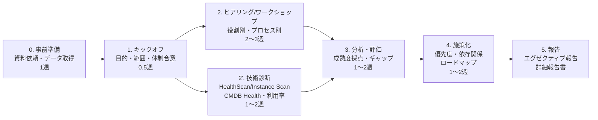
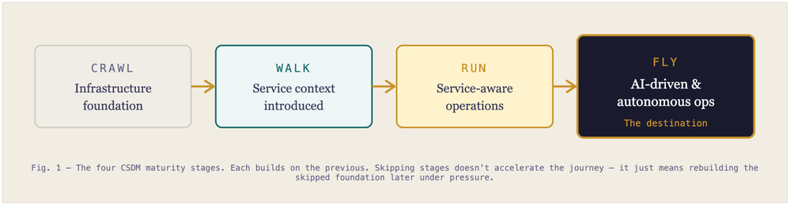
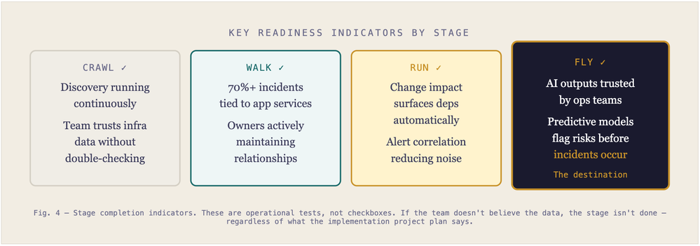
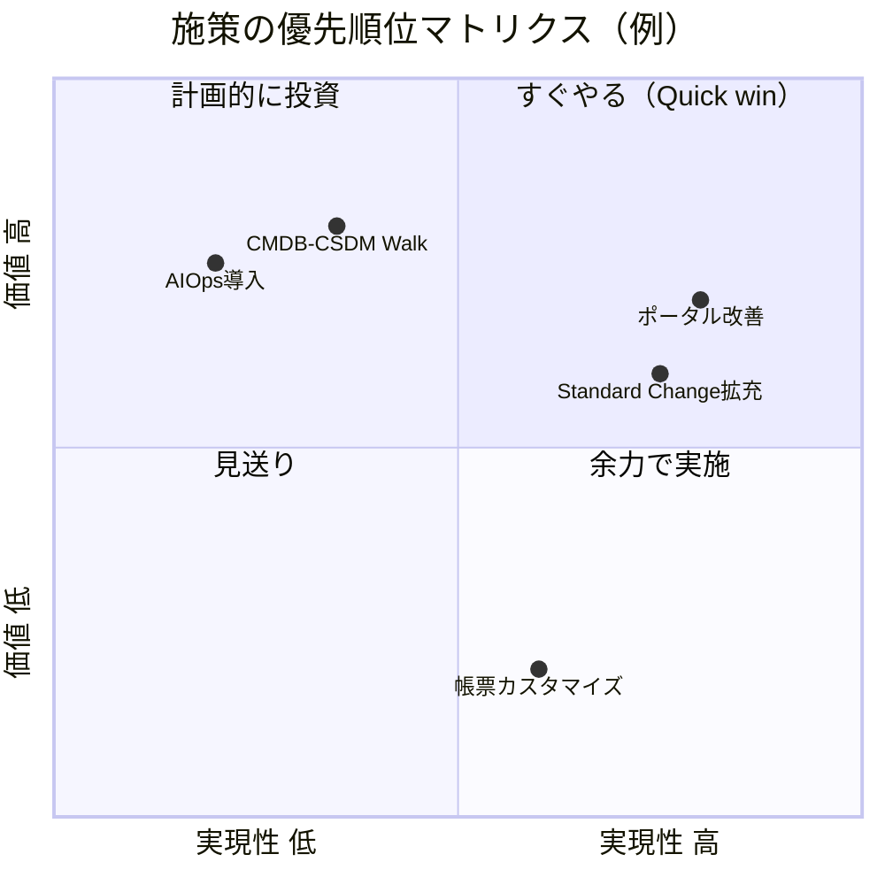
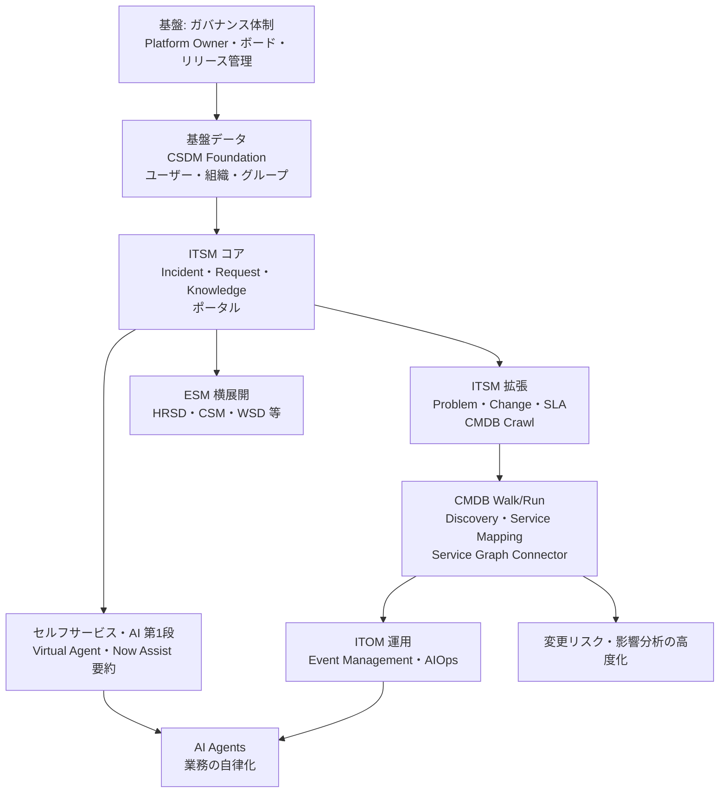

# コンサルティング実践プレイブック（Consulting Playbook）

## 概要

本ファイルは、ServiceNow 案件でコンサルタントが行う次の 3 種類の仕事を、実務でそのまま使える形にまとめる。

1. **現状診断（Assessment、アセスメント）**: 既存インスタンスまたは導入前の業務・IT 運用を診断し、課題と改善機会を特定する。
2. **提案（Proposal）**: 新規導入、追加製品導入、再構築（リインプリメンテーション）、運用改善の提案を作る。
3. **ロードマップ策定（Roadmap planning）**: 成熟度の現在地から目標までを、段階と順序と投資判断に落とす。

本ファイルの章構成は次のとおりである。

| 章 | 内容 | 主な用途 |
|---|---|---|
| 1 | コンサルティングの全体像とエンゲージメントの型 | 案件開始時の進め方決定 |
| 2 | アセスメント観点（6 領域） | 診断の観点表、報告書の目次 |
| 3 | ヒアリング質問集（役割別・領域別） | ワークショップ・インタビュー準備 |
| 4 | 成熟度評価（公式アセスメント、スコア、段階モデル） | 現在地の定量化・定性化 |
| 5 | ロードマップ策定 | 段階計画・優先順位付け |
| 6 | 提案時の論点 | 提案書・RFP 回答のチェックリスト |
| 7 | よくある顧客質問と回答 | 商談・ステアリングコミッティでの Q&A |
| 8 | 成果物テンプレート | 報告書・提案書の骨子 |

**情報の性質について:** ServiceNow 公式は、成熟度評価やロードマップ策定を **ServiceNow Impact（インパクト、ServiceNow の有償カスタマーサクセスサービス）の Accelerator（アクセラレーター）** として提供しており、その「範囲・活動・成果物・必要ロール」は公式ドキュメントで公開されている。しかし、成熟度の採点基準（質問票の中身、スコアの段階定義）は公開されていない。本ファイルでは、公式に公開されている枠組みを骨格とし、質問集や判断基準は ServiceNow Community の記事と実務上の一般的知見で補う。公式以外に依拠する記述には `【第三者情報】`、実務上の一般的知見には `【経験則】` を付す。

関連ファイル:

- [導入方法論](../03_導入編/04-implementation-methodology.md)（Now Create / Best Practices、Fit to Standard、期間目安）
- [要件定義と設計](../03_導入編/06-requirements-design.md)
- [プロジェクト体制とパートナー](../03_導入編/05-project-organization.md)
- [ライセンスモデル](../03_導入編/01-licensing-model.md)、[価格情報](../03_導入編/02-pricing.md)、[エディション比較](../03_導入編/03-edition-comparison.md)
- [競合比較](../03_導入編/16-competitor-comparison.md)、[日本市場における導入](../03_導入編/15-japan-market.md)
- [導入失敗パターンと対策](./01-implementation-failure-patterns.md)、[カスタマイズと技術的負債](./02-customization-technical-debt.md)
- [CMDB成功の要因](./05-cmdb-success-factors.md)、[ライセンスコスト最適化](./06-license-cost-optimization.md)
- [ガバナンスとCoEの実践](./09-governance-coe-practice.md)、[Now Assist / AI Agents 導入の知見](./10-ai-adoption-lessons.md)
- [ITSMプロセス設計の実践知](./11-itsm-process-design-tips.md)、[定着化と組織変革](./13-adoption-change-management.md)

---

## 1. コンサルティングの全体像

### 1.1 エンゲージメントの型

ServiceNow のコンサルティング案件は、顧客の状況によって次の 4 つの型に分けられる。型によって、アセスメントの重心と成果物が変わる。【経験則】

| 型 | 顧客の状況 | アセスメントの重心 | 主な成果物 |
|---|---|---|---|
| A. 新規導入（Greenfield） | ServiceNow 未導入。既存ツール（Excel、他社 ITSM、内製）で運用 | 業務プロセス成熟度、データ（ユーザー・組織・CI）の所在、組織体制 | 現状分析書、To-Be 概要、スコープ・フェーズ案、概算・体制案 |
| B. 追加導入（Expansion） | ServiceNow ITSM 稼働済み。ITOM / HRSD / CSM / SPM 等を追加したい | 既存インスタンスの健全性、CSDM / CMDB の到達段階、ライセンス状況 | 追加製品の価値仮説、前提条件（CMDB 等）の充足度、段階計画 |
| C. 再構築（Re-implementation / Brownfield） | 稼働済みだがカスタマイズ過多・アップグレード困難・定着不足 | Instance Health（HealthScan 結果）、技術的負債、OOTB 回帰可能性 | 健全性診断書、OOTB 回帰方針、再構築 vs 段階改善の比較 |
| D. 運用改善・価値最大化（Optimization） | 稼働済みで大きな問題はないが投資対効果が見えない | KPI・ベンチマーク、利用率、未使用ライセンス、AI 活用余地 | 改善施策バックログ、KPI ダッシュボード案、ロードマップ |

> 型 C と D の境界は、HealthScan のスコアと「アップグレードのたびにどれだけ工数がかかっているか」で判断することが多い。アップグレードのたびに大量の Skipped records（スキップされたレコード）が出る、ATF が無く回帰テストが手作業、といった状況は型 C の兆候である。詳細は [カスタマイズと技術的負債](./02-customization-technical-debt.md)、[アップグレードの教訓](./04-upgrade-lessons.md) を参照。【経験則】

### 1.2 標準的な進め方（6〜10 週のアセスメント）

ServiceNow の公式 Accelerator は、キックオフ → 質問票 → 分析 → 報告（Readout）→ フォローアップ、という流れで構成されている（4 章参照）。[出典](https://www.servicenow.com/docs/r/OLEAh14mAEPe8fUlW2F9wQ/8fO6gIiOYt9oofvSN3tu0A) パートナー・コンサルティング会社のアセスメントも、これを拡張した次の流れで進めるのが一般的である。【経験則】



| ステップ | 主な作業 | 注意点 |
|---|---|---|
| 0. 事前準備 | 依頼資料リスト送付（組織図、プロセス文書、KPI、契約・ライセンス、インスタンス一覧、連携一覧）、データ抽出依頼 | 依頼から受領まで 1〜2 週かかる前提で日程を組む【経験則】 |
| 1. キックオフ | 目的・評価範囲・成果物・参加者・日程の合意。スポンサーから参加者への協力依頼 | 公式の Strategy Governance Accelerator も Executive Sponsor と Platform Owner を必須ロールとしている。[出典](https://www.servicenow.com/docs/r/OLEAh14mAEPe8fUlW2F9wQ/XIskqsHxMVp2Ge5eKDngSA) |
| 2. ヒアリング | 役割別インタビュー、プロセス別ワークショップ、現場観察 | 「解決策の議論」をしない。現状把握に徹する（3 章） |
| 2'. 技術診断 | HealthScan / Instance Scan、CMDB Health、利用状況、ライセンス利用率 | 本番クローンまたは本番に近い非本番で実施（4.3 節） |
| 3. 分析・評価 | 成熟度採点、ギャップ、根本原因の整理 | 「事実（データ）」と「意見（ヒアリング）」を区別して記載 |
| 4. 施策化 | 施策の洗い出し、効果・難易度・依存関係による優先順位付け | 5 章のロードマップ手法を使う |
| 5. 報告 | エグゼクティブ向け（10 枚程度）と実務者向け詳細報告 | 公式 Accelerator の報告も「スコア＋上位 5 推奨＋全推奨一覧」構成。[出典](https://www.servicenow.com/docs/r/OLEAh14mAEPe8fUlW2F9wQ/8fO6gIiOYt9oofvSN3tu0A) |

### 1.3 ServiceNow Impact との役割分担

ServiceNow Impact を契約している顧客は、ServiceNow 社から一部のアセスメントを Accelerator として受けられる。コンサルタントは、顧客が既に受けた（または受けられる）Accelerator の結果を**入力として活用**し、重複を避けるのが効率的である。【経験則】

Impact のパッケージ（Australia 版ドキュメント、2026-07-07 更新）は次のとおりである。Brazil 版（2026-09-10 更新）も同じ内容である。[出典](https://www.servicenow.com/docs/r/australia/impact/impact-packages1.html)、[出典（Brazil）](https://www.servicenow.com/docs/r/impact/impact-packages1.html)

| パッケージ | 主な内容 | Accelerator の利用枠 |
|---|---|---|
| Guided | Impact App、24/7 サポート、限定的な Accelerator カタログ、Customer Success Manager | Technical、Strategy（一部）、Architecture（一部）の各サブカタログで同時 1 件 |
| Total | Guided の全内容 ＋ P1/P2 の応答時間短縮、Developer Support（10 席）、Accelerator 拡大、専任 Impact Squad | Technical・Strategy・Architecture は各同時 2 件、Optimization は同時 1 件 |
| （Managed Support add-on） | Guided / Total に追加でき、Developer Support を 5 席追加 | ― |
| Integrated Success | Total の全内容 ＋ Impact の Free Form initiative で開始する導入サービス | Total と同じ（個別の上限記載なし） |
| Strategic Value add-on | Guided: Strategy サブカタログ拡大＋Strategy の同時実行枠 +2。Total: Strategy の同時実行枠 +2 | ― |
| Platform Governance add-on | Guided: Architecture サブカタログ拡大＋Architecture の同時実行枠 +2。Total: Architecture の同時実行枠 +2 | ― |
| Platform Optimization add-on | Guided: Optimization サブカタログの利用権＋Optimization の同時実行枠 +1。Total: Optimization の同時実行枠 +1 | ― |

このほかのアドオンとして、Preventive Care（Account Escalation Engineer による年 2 回のパフォーマンス評価。Guided 向けは改善の実装まで含み、Total 向けは推奨まで）、Platform Health（Guided 向け。Scan Engine のカスタム定義の無制限化と Proposed Fix）、Instance Observer（Features と Seats +10）がある。[出典](https://www.servicenow.com/docs/r/australia/impact/impact-packages1.html)

> **注意:** Impact のパッケージ名はリリースごとに変わっている。Yokohama 以前のドキュメントには Guided / Advanced / Total の 3 段階が記載されている。Australia 版のパッケージ一覧（2026-07-07 更新）には Advanced というパッケージの説明が無い。ただし同じページの Developer Support の注記には「Developer Support is an offering to Advanced and Total Impact packages」と、Advanced の表記が 1 か所だけ残っている。また、同じ Australia 版の各 Accelerator ページ（2026-03-12 更新）には「Impact Guided+ (Strategic Value add-on), Advanced and Total」という対象表記や Health Assessment（Advanced）が残っている。Brazil 版のパッケージ一覧も Australia 版と同じく Advanced を記載していない。顧客の契約書に記載されたパッケージ名で利用可否を確認すること。[出典](https://www.servicenow.com/docs/r/australia/impact/impact-packages1.html)、[出典](https://www.servicenow.com/docs/r/OLEAh14mAEPe8fUlW2F9wQ/8fO6gIiOYt9oofvSN3tu0A)

コンサルティングで活用しやすい Impact Accelerator は次のとおりである（詳細は 4 章・5 章）。

| Accelerator | 用途 | 対象パッケージ（ページ記載） | 出典 |
|---|---|---|---|
| ITSM Maturity Assessment | ITSM プロセスの成熟度スコアと上位 5 推奨 | Guided+（Strategic Value add-on）、Advanced、Total（Australia） | [出典](https://www.servicenow.com/docs/r/OLEAh14mAEPe8fUlW2F9wQ/8fO6gIiOYt9oofvSN3tu0A) |
| ITOM Maturity Assessment | ITOM の成熟度スコアと上位 5 推奨 | Guided+（Strategic Value add-on）、Advanced、Total（Australia） | [出典](https://www.servicenow.com/docs/r/tJa9Em2DAbijpCjxYUU3Pw/owLPvyPC5crPYR6oOrc8Cw) |
| Health Assessment（Advanced / Total） | HealthScan によるインスタンス健全性診断 | Advanced、Total（Australia。Brazil も同じ） | [出典](https://www.servicenow.com/docs/r/australia/impact/accelerator-and-initiative-list/health-assessment.html) |
| Strategy Governance | 戦略ロードマップと事業成果の整合を取るガバナンス | Guided+（Strategic Value add-on）、Advanced、Total（Australia） | [出典](https://www.servicenow.com/docs/r/OLEAh14mAEPe8fUlW2F9wQ/XIskqsHxMVp2Ge5eKDngSA) |
| Stakeholder Path to Value | ステークホルダーインタビューと戦略／製品導入ロードマップ | Guided+（Strategic Value add-on）、Advanced、Total（Zurich） | [出典](https://www.servicenow.com/docs/r/zurich/impact/accelerator-and-initiative-list/stakeholder-path-to-value.html) |
| Value Potential | 未導入製品の価値試算（ビジネスケース） | Advanced、Total、Strategic Value Add-on（Australia） | [出典](https://www.servicenow.com/docs/r/NYweeRocREicYwhLVBs7lg/6fBo2_9udUgJb3sxveFVPg) |
| Jumpstart Your ServiceNow AI Journey | AI 導入ロードマップと AI Adoption Scan | Guided、Guided+（Strategic Value または Platform Governance add-on）、Advanced、Total（Brazil） | [出典](https://www.servicenow.com/docs/r/impact/accelerator-and-initiative-list/jumpstart-snow-ai-journey.html) |

いずれの Accelerator も「推奨事項の実装は ServiceNow の責任範囲外（顧客の責任）」と明記されている。推奨を実行計画に落とし、実装を支援する部分がパートナー・コンサルタントの役割になる。[出典](https://www.servicenow.com/docs/r/OLEAh14mAEPe8fUlW2F9wQ/8fO6gIiOYt9oofvSN3tu0A)、[出典](https://www.servicenow.com/docs/r/OLEAh14mAEPe8fUlW2F9wQ/XIskqsHxMVp2Ge5eKDngSA)

---

## 2. アセスメント観点

### 2.1 6 つの評価領域

ServiceNow のアセスメントは、次の 6 領域で観点を整理すると漏れが少ない。領域 1〜5 は ServiceNow Community の「Evaluating the Maturity State of Your ITSM Application in ServiceNow」（2024-11-08）が挙げる 6 観点（Process Maturity、Data Quality and Management、Integration、Automation and Self-Service、User Experience and Satisfaction、Measurement and Continuous Improvement）を再構成したもので、領域 3 の「プラットフォーム健全性」は公式 HealthScan の 5 カテゴリ、領域 6 の AI は公式 AI Accelerator の入力項目に基づいて追加した。[出典](https://www.servicenow.com/community/itsm-forum/evaluating-the-maturity-state-of-your-itsm-application-in/m-p/3100255) `【第三者情報】`

| # | 領域 | 何を見るか | 主なエビデンス |
|---|---|---|---|
| 1 | プロセス（Process） | ITIL との整合、標準化、承認・エスカレーション、プロセスオーナーの存在、継続的改善 | プロセス文書、ワークショップ、レコードの状態遷移データ |
| 2 | データ（Data） | CMDB / CSDM の到達段階、基盤データ（ユーザー・組織・拠点・グループ）の正確性、レコードの入力品質 | CMDB Health、CSDM Data Foundations ダッシュボード、データ抽出 |
| 3 | プラットフォーム健全性（Platform health） | カスタマイズ量、セキュリティ設定、パフォーマンス、アップグレード容易性、UX | HealthScan / Instance Scan、Upgrade 履歴、Skipped records |
| 4 | 連携・自動化（Integration & Automation） | 連携の数と方式、手作業の受け渡し、Flow / IntegrationHub の活用、セルフサービス比率 | 連携一覧、Flow 一覧、ポータル・Virtual Agent の利用率 |
| 5 | 組織・ガバナンス・定着（People, Governance & Adoption） | Platform Owner、CoE、デマンド受付、リリース管理、利用率、満足度、教育 | 体制図、ボード議事録、利用ログ、CSAT |
| 6 | AI・価値（AI & Value） | KPI と事業成果のつながり、ベンチマーク比較、AI のユースケースと前提条件 | PA ダッシュボード、Benchmarks、AI Adoption Scan |

### 2.2 領域 1: プロセスの評価観点

公式の ITSM Maturity Assessment（Australia 版）が対象とするのは、Incident、Problem、Request、Change、Knowledge、Continual Improvement Management、Service Desk、CSDM Foundations の 8 領域である。[出典](https://www.servicenow.com/docs/r/OLEAh14mAEPe8fUlW2F9wQ/8fO6gIiOYt9oofvSN3tu0A) ITSM のアセスメントではこの 8 領域を最低限の評価単位とすると、公式の推奨と比較しやすい。

> **リリース間の差異:** Yokohama 版（2025-01-30 更新）の ITSM Maturity Assessment ページでは、対象範囲に Knowledge Management が含まれていなかった。Australia 版（2026-03-12 更新）で Knowledge Management が追加されている。[出典](https://www.servicenow.com/docs/r/VD5jAD3VgRc~i0AwgqwfEQ/OtrXK8Fl8tRfUetfDjwkEg)、[出典](https://www.servicenow.com/docs/r/OLEAh14mAEPe8fUlW2F9wQ/8fO6gIiOYt9oofvSN3tu0A)

プロセス別の観点は次のとおりである（判定基準は【経験則】。各プロセスの仕様は 02_リファレンス/itsm 配下を参照）。

| プロセス | 確認する観点 | 成熟度が低い兆候 |
|---|---|---|
| Incident Management | 起票チャネル（ポータル・メール・電話・チャット）の比率、カテゴリ体系、優先度マトリクス（Impact × Urgency）、割り当てルール、Major Incident の手順、SLA | カテゴリ「その他」が多い、優先度が手入力で一律、再割り当て回数が多い |
| Problem Management | Problem 起票基準、根本原因分析（RCA）、Known Error と Knowledge の連携 | Problem レコードがほぼ無い、Incident をクローズするだけで再発防止が無い |
| Change Management | Change モデル（Standard / Normal / Emergency）、CAB の運営、リスク評価、Change と CI の紐づけ、変更成功率 | Normal Change が大半、Standard Change カタログが無い、CI 未入力 |
| Request Management | Service Catalog の構成、カタログ項目の数と利用状況、承認・フルフィルメントの自動化 | 汎用「その他依頼」フォームの利用が多い、承認がメール外部で行われる |
| Knowledge Management | 記事のライフサイクル、レビュー期限、記事の利用率と有用性評価、Incident からの記事作成 | 記事が古い、検索されても解決につながらない |
| Continual Improvement Management | 改善施策の登録・承認・追跡の仕組み | 改善が会議資料だけで管理され、効果測定が無い |
| Service Desk | 一次解決率、チャネル別の対応工数、エージェントの UI（Service Operations Workspace 等） | 一次解決率が測られていない、エージェントが旧 UI で作業 |
| CSDM Foundations | 基盤データ（会社、拠点、部署、グループ、ユーザー）の正確性と鮮度 | ユーザー・組織データが手動メンテナンス、退職者が残る |

Continual Improvement Management（継続的改善管理）は、ServiceNow では `sn_cim.improvement_requester`（改善の起票）、`sn_cim.improvement_coordinator`（担当改善の推進）、`sn_cim.improvement_manager`（全改善の管理・承認・割り当て）の 3 ロールで運用する。改善施策を ServiceNow 上で管理している顧客は、アセスメントで改善の流量（起票数・完了数・効果）を定量的に見ることができる。[出典](https://www.servicenow.com/docs/r/QykF2iRSIs6VXztArCSo3w/VSrZSYTVhywmKSfJzHJlKA)

ITSM プロセス設計の詳しい判断基準は [ITSMプロセス設計の実践知](./11-itsm-process-design-tips.md) を参照。

### 2.3 領域 2: データの評価観点

データ領域は「CSDM のどの段階まで到達しているか」と「CMDB Health の 3 指標」の 2 軸で評価する。

**CSDM の段階（公式）:** ServiceNow 公式ドキュメント「Implementing the CSDM framework in stages」は、CSDM の実装を Foundation → Crawl → Walk → Run → Fly の 5 段階で進めるとしている（4.4 節で詳述）。[出典](https://www.servicenow.com/docs/r/zS6yb8e~gR8BPjeviYdV9g/uvfOC73Q0jOZzQLwDDJIrg)

**CMDB Health の 3 指標（公式）:** CMDB Health ダッシュボードは、次の 3 つの KPI を合成して総合スコアを出す。以下は公式ページ「CMDB Health KPIs and metrics」（Xanadu 版、2024-08-01 更新）に基づく。[出典](https://www.servicenow.com/docs/r/GCPjp~ldPTNRN99oH1DYFg/LJdK4ZKD0ozmnz0eLhmUog)

| KPI | 意味 | アセスメントでの使い方 |
|---|---|---|
| Completeness（完全性） | CI の必須・推奨フィールドが埋まっているか | 推奨フィールドが定義されていない場合、スコアが高く出ても意味が無い点に注意【経験則】 |
| Compliance（準拠性） | 指標は Audit（監査）の 1 つだけで、CMDB 監査の直近の実行結果に基づく。対象 CI は、適用されるすべての監査に合格する必要がある | Audit を有効化しないと結果が出ない。監査定義が無ければ測定されていない |
| Correctness（正確性） | 重複（Duplicate）CI、孤立（Orphan）CI、陳腐化（Staleness）CI | Discovery / Service Graph Connector 導入状況と合わせて評価 |

3 つの KPI とは別に、**Relationships（リレーション）** の指標として、重複リレーション（Duplicate relationships）、孤立リレーション（Orphan relationships）、陳腐化リレーション（Stale relationships）がある（設定変更不可）。リレーションの健全性は CMDB Health ダッシュボードではなく、別の **Relationship Health ダッシュボード**に表示される。推奨リレーション・包含ルール・ホスティングルールに準拠しないリレーションの集計も Relationship Health ダッシュボード側で確認する。リレーションの品質は Compliance ではなく、この Relationships 指標で確認する。[出典](https://www.servicenow.com/docs/r/GCPjp~ldPTNRN99oH1DYFg/LJdK4ZKD0ozmnz0eLhmUog)

> CMDB Health ダッシュボードのスコアは、各 KPI のスコア計算ジョブ（Completeness / Compliance / Correctness Score Calculation）が動いていることが前提である。アセスメントでは最初に「ジョブが有効か」「ルール（推奨フィールド、監査）が定義されているか」を確認し、未定義ならスコアそのものを根拠にしない。【経験則】

CMDB の評価と改善の詳細は [CMDB成功の要因](./05-cmdb-success-factors.md)、仕様は [CMDB と CSDM](../02_リファレンス/platform/cmdb-csdm.md) を参照。

基盤データについては、ServiceNow Community の新規顧客オンボーディングブログ（ServiceNow 社員、2024-08-07）が「ユーザー・部署・拠点データのゴールデンソース（正本）を特定し、どう連携し最新に保つかを決める」「多くの組織はプラットフォーム設定の前にデータクレンジングが必要で、ここが遅れるとスケジュール全体に影響する」と指摘している。[出典](https://www.servicenow.com/community/new-customer-onboarding-blog/tell-me-a-story-requirements-gathering-part-2/ba-p/3012494) `【第三者情報】`

### 2.4 領域 3: プラットフォーム健全性の評価観点

プラットフォーム健全性は、ServiceNow の Scan Engine / HealthScan が使う**5 カテゴリ**で評価するのが標準である。[出典](https://www.servicenow.com/docs/r/impact/scan-engine-overview.html)、[出典](https://www.servicenow.com/docs/r/australia/impact/accelerator-and-initiative-list/health-assessment.html)

| カテゴリ | 意味 |
|---|---|
| Security（セキュリティ） | 侵害・コンプライアンス・アクセス制御に関わる設定 |
| Performance（パフォーマンス） | 全ユーザーに影響し、放置すると悪化する問題 |
| Manageability（管理容易性） | 保守性。指摘件数が最も多いカテゴリ |
| Upgradeability（アップグレード容易性） | リリースアップグレードを阻害・遅延させる構成 |
| User Experience（ユーザー体験） | 定着に影響するが緊急度は最も低い |

> **Brazil での変更:** Brazil 版ドキュメントに「Instance health score calculation」ページ（2026-10-07 更新）があり、Instance Health スコアにおけるカテゴリの重みが Security 約 40%、Performance 約 22%、Manageability 約 19%、Upgradeability 約 9%、User Experience 約 9% と記載されている（合計 99% は丸めによる）。Australia 版に同じページがあるかは公開情報では確認できなかった（Australia 版の URL は 404）。そのため、Brazil で新設または改訂された内容である可能性がある。[出典](https://www.servicenow.com/docs/r/impact/instance-health-score-calculation.html) スコアの計算方法は 4.3 節を参照。

健全性診断では、スキャン結果に加えて次の項目を確認する。【経験則】

| 観点 | 確認方法 | 判断の目安 |
|---|---|---|
| カスタマイズ量 | `sys_update_xml` の件数、カスタムテーブル数、OOTB スクリプトの改変数 | 改変された OOTB レコードが多いほど Skipped records が増える |
| アップグレード実績 | 直近 2 回のアップグレードの期間、Skipped records 数、障害 | 毎回数か月かかる、N-1 から外れかけている |
| テスト自動化 | ATF のテスト数とカバー範囲 | 主要プロセスに ATF が無い |
| 旧 UI・旧機能 | UI16 依存、旧 Workflow（Legacy Workflow）、旧 Service Portal | Next Experience / Workspace / Flow Designer への移行が未着手 |
| セキュリティ | ACL、High Security 設定、MFA、SSO | 詳細は [セキュリティ強化の実践](./12-security-hardening-practice.md) |
| パフォーマンス | 遅いトランザクション、大きなテーブル、スケジュールジョブ | 詳細は [パフォーマンスチューニング](./03-performance-tuning.md) |

### 2.5 領域 4: 連携・自動化の評価観点

| 観点 | 確認する内容 | 出典・参照 |
|---|---|---|
| 連携一覧 | 連携先、方向、方式（REST / SOAP / IntegrationHub Spoke / MID Server / ファイル）、頻度、エラー監視の有無 | [連携設計](../03_導入編/09-integration-design.md) |
| 手作業の受け渡し | 他システムへの転記、メールでの依頼転送、Excel での集計 | Community の観点「manual handoffs を減らせているか」[出典](https://www.servicenow.com/community/itsm-forum/evaluating-the-maturity-state-of-your-itsm-application-in/m-p/3100255) `【第三者情報】` |
| セルフサービス | ポータル起票比率、Knowledge の自己解決、Virtual Agent の完結率 | 同上 |
| ワークフロー自動化 | Flow Designer の利用、旧 Workflow の残存、承認の自動化 | [Workflow Studio / Flow Designer](../02_リファレンス/platform/flow-designer-workflow-studio.md) |
| 消費型課金の把握 | IntegrationHub トランザクションの消費状況 | [ライセンスモデル](../03_導入編/01-licensing-model.md) |

連携の典型的な問題は [連携の落とし穴](./08-integration-pitfalls.md) を参照。

### 2.6 領域 5: 組織・ガバナンス・定着の評価観点

| 観点 | 確認する内容 | 成熟度が低い兆候【経験則】 |
|---|---|---|
| Platform Owner | 専任か兼任か、権限（優先順位を決められるか） | Platform Owner が不在、または IT 運用担当者の兼務で決定権が無い |
| CoE / ボード | Executive steering board、Demand board、Technical governance board の有無と開催実績 | 要望が直接開発者に届き、優先順位付けが無い |
| デマンド受付 | 要望の起票経路、評価基準、バックログ | バックログが Excel、またはそもそも存在しない |
| リリース管理 | リリース頻度、Update Set の運用、変更凍結 | 本番への直接変更がある |
| 利用・定着 | ライセンス対比のアクティブユーザー、ポータル利用率、CSAT | 利用者がメール・電話に戻っている |
| 教育 | 管理者・開発者の認定資格、エンドユーザー教育 | 管理者が 1 人だけで属人化 |

公式の Strategy Governance Accelerator は、顧客に事前提出を求める資料として「ガバナンス体制文書（憲章、ボード参加者一覧）、CoE 憲章、組織図、IT ガバナンス文書、現在の戦略ロードマップとミッション／ビジョン、文書化された OKR・テーマ・エピック、ビジネス KPI、ビジネスケース（またはそのテンプレート）」を挙げている。この一覧は、そのままガバナンス領域の依頼資料リストとして使える。[出典](https://www.servicenow.com/docs/r/OLEAh14mAEPe8fUlW2F9wQ/XIskqsHxMVp2Ge5eKDngSA)

ガバナンスの詳細は [ガバナンスとCoEの実践](./09-governance-coe-practice.md)、定着化は [定着化と組織変革](./13-adoption-change-management.md) を参照。

### 2.7 領域 6: AI・価値の評価観点

**KPI とベンチマーク:** ServiceNow Benchmarks アプリケーションを使うと、ITSM（ほか ITOM、Security Operations）の KPI を業界平均・トップパフォーマー・同規模同業と比較できる（4.5 節）。[出典](https://www.servicenow.com/docs/r/it-service-management/benchmarks/exploring-benchmarks.html) ベンチマークで弱い KPI を特定し、Process Mining で原因を分析し、Continual Improvement Management に改善施策として登録する、という流れが公式ドキュメントで例示されている。[出典](https://www.servicenow.com/docs/r/now-intelligence/process-mining/integration-itsm.html)

**AI の前提条件:** 公式の Jumpstart Your ServiceNow AI Journey Accelerator は、顧客に次の情報を事前に求める。これは AI 活用のアセスメント観点として使える。[出典](https://www.servicenow.com/docs/r/impact/accelerator-and-initiative-list/jumpstart-snow-ai-journey.html)

| 項目 | 内容 |
|---|---|
| 目的と期間 | 3・6・12 か月のいずれかの期間での 3 つの成果 |
| スコープ境界 | 対象・対象外の事業部、製品、地域 |
| ユースケース | 上位 3〜5 件。名前、段階（アイデア / パイロット / 本番）、オーナー |
| 制約 | 予算、時間、人員、ツールの制約 |
| 成功指標 | 例: MTTR |

AI 導入の詳細な知見は [Now Assist / AI Agents 導入の知見](./10-ai-adoption-lessons.md) を参照。

---

## 3. ヒアリング質問集

### 3.1 ヒアリングの原則

ServiceNow Community の新規顧客オンボーディングブログ（ServiceNow 社員、2024-08-07）と、ServiceNow MVP による記事（NowBen、2026-06-26）は、要件収集について次の原則を挙げている。`【第三者情報】`

| 原則 | 内容 | 出典 |
|---|---|---|
| 現状把握中に解決策を議論しない | 現状レビュー中にソリューションの議論を始めるとワークショップが脱線する。実現可能性や実装順序は後で開発者と検討する | [出典](https://www.servicenow.com/community/new-customer-onboarding-blog/tell-me-a-story-requirements-gathering-part-2/ba-p/3012494) |
| 現状レビューの前に製品デモを見せる | 参加者が視覚的な前提を持てる。ただしデモ後も解決策の議論はしない | 同上 |
| 決定権者を明確にする | 各プロセス領域のオーナー（決定権を持つ人）を確定させる | 同上 |
| ストーリー形式で書く | 「（ペルソナ）として、（成果・便益）を得るために、（行動）をする必要がある」。便益が書けないストーリーは価値が無い可能性がある | 同上 |
| 受け入れ基準を同時に書く | テスター向けの受け入れ基準をストーリーと同じ丁寧さで書く。後回しにすると UAT で漏れ、本番障害につながる | 同上、[出典](https://nowben.com/how-scope-creep-is-destroying-your-servicenow-implementation/) |
| 「何を」より先に「なぜ」を聞く | 利害関係者は問題ではなく解決策（「フォームが欲しい」）を語る。その裏にある必要性を掘り下げる | [出典](https://nowben.com/how-scope-creep-is-destroying-your-servicenow-implementation/) |
| 幅広い層から聞く | 経営スポンサー、プロセスオーナー、エンドユーザーはそれぞれ異なる視点を持つ。多くの案件は経営層からしか聞いていない | 同上 |
| 前提は明示的なリスクとして記録 | 合意前に、前提事項をリスクとして記録し追跡する | 同上 |

NowBen の記事は、要件ごとに次の 4 つの問いで挑戦することを推奨している。[出典](https://nowben.com/how-scope-creep-is-destroying-your-servicenow-implementation/) `【第三者情報】`

1. なぜそれが必要か（Why is this needed?）
2. 作らなかったら何が起きるか（What happens if it is not built?）
3. このプロセスで他に誰が影響を受けるか（Who else is affected by this process?）
4. 今はどうやっていて、なぜそれでは不十分なのか（What is done today, and why is that not good enough?）

> **公式ワークショップ資料:** ServiceNow は Now Create の Success Pack として、ITSM 等のプロセスワークショップ資料（Process Workshop Presentation）、スコーピングガイド、スターターストーリー等を提供している。Now Create のポータルは 2025-12 に My Now の **Best Practices** サイト（`https://mynow.servicenow.com/now/best-practices/home`）に置き換えられたが、Now Create のコンテンツと方法論は残っており、直近 2 ファミリーリリース分のコンテンツが Best Practices で参照できる。[出典](https://www.servicenow.com/community/grc-blog/what-is-best-practices-does-it-replace-now-create/ba-p/3224712) Incident のディスカバリーワークショップの進め方を問うコミュニティ質問でも、Success Pack の利用が回答として挙げられている。[出典](https://www.servicenow.com/community/product-launch-forum/request-for-best-practices-discovery-workshops-for-incident/m-p/3326001) `【第三者情報】` 本章の質問集は、これらの公式資料を補完するものとして使う。

### 3.2 役割別インタビューの組み立て

| 対象 | 時間目安 | 目的 | 主な質問領域 |
|---|---|---|---|
| Executive Sponsor（CIO、事業部長） | 45〜60 分 | 事業目標、投資判断基準、成功の定義 | 3.3 |
| Platform Owner / IT 企画 | 60〜90 分 | プラットフォーム戦略、体制、課題 | 3.4、3.9 |
| Process Owner（プロセスオーナー） | プロセスごとに 90〜120 分 | プロセスの現状と課題 | 3.5 |
| Service Desk Manager / エージェント | 60 分＋現場観察 | 日々の作業、手作業、UI の不満 | 3.5、3.7 |
| エンドユーザー（依頼者） | 30 分 × 数名、またはアンケート | 依頼のしやすさ、満足度 | 3.7 |
| システム管理者・開発者 | 90 分 | インスタンス構成、カスタマイズ、リリース、テスト | 3.8 |
| インフラ・運用チーム | 60〜90 分 | CMDB、監視、Discovery | 3.6 |
| セキュリティ・監査 | 60 分 | 要件、監査指摘 | 3.8 |
| ESM・SecOps・IRM の業務オーナー（人事、カスタマーサービス、PMO、セキュリティ運用、リスク管理） | 60〜90 分 | 追加導入（型 B）の対象業務の現状 | 3.10 |

時間目安は【経験則】。公式の Stakeholder Path to Value Accelerator は、事業部・部門ごとに約 60 分のステークホルダーインタビュー（Stakeholder Discovery Think Tank）を行い、目標と成功指標、課題、改善機会、事業価値ドライバー、要望を聞くとしている。[出典](https://www.servicenow.com/docs/r/zurich/impact/accelerator-and-initiative-list/stakeholder-path-to-value.html)

### 3.3 経営層・スポンサー向け質問

| # | 質問 | 狙い |
|---|---|---|
| E1 | ServiceNow（または IT サービス管理の改善）で、1〜3 年後に何が達成されていれば成功と言えますか | 成功の定義。KPI に落とす起点 |
| E2 | その成果は、どの経営指標（コスト、売上、従業員体験、顧客満足、リスク）に結び付きますか | ビジネスケースの価値ドライバー |
| E3 | 現在の最大の痛み（ペイン）は何ですか。それは誰の、どの業務で起きていますか | 優先領域の特定 |
| E4 | 今回の取り組みで「やらないこと」は何ですか | スコープ境界 |
| E5 | 投資判断はどの会議体で、どの基準（回収期間、ROI、戦略整合）で行いますか | 提案書の構成と承認プロセス |
| E6 | 予算の時間軸（単年度・中期計画）と、ライセンス更新時期はいつですか | ロードマップの区切り、商談タイミング |
| E7 | 他に並行して進んでいる全社施策（ERP 刷新、クラウド移行、組織再編、AI 戦略）はありますか | 依存関係・リソース競合 |
| E8 | 業務プロセスを標準（ServiceNow のベストプラクティス）に合わせることに、どこまで経営として関与できますか | Fit to Standard の実現可能性 |
| E9 | AI（生成 AI、AI エージェント）の活用について、全社方針やガードレールはありますか | AI 提案の前提 |
| E10 | プロジェクトに専任で出せる社内人材は誰ですか | 体制リスク |

### 3.4 Platform Owner・IT 企画向け質問

| # | 質問 | 狙い |
|---|---|---|
| P1 | 現在利用中の ServiceNow 製品・エディション・ライセンス数と、契約期間・更新日を教えてください | ライセンス状況。[ライセンスモデル](../03_導入編/01-licensing-model.md) |
| P2 | インスタンスは何個ありますか（本番・非本番、用途）。クローンの頻度は | インスタンス戦略。[インスタンス戦略と環境](../03_導入編/07-instance-strategy.md) |
| P3 | 現在のファミリーリリースと、直近 2 回のアップグレードにかかった期間・工数・問題点は | 技術的負債の兆候 |
| P4 | 要望はどこから、どう受け付け、誰が優先順位を決めていますか | デマンド管理 |
| P5 | 社内の ServiceNow チームの構成（管理者、開発者、BA、アーキテクト）と、パートナーへの依存度は | 体制・属人化 |
| P6 | リリース頻度と、本番反映までの承認・テストの流れは | リリース管理・ATF |
| P7 | ServiceNow Impact の契約有無とパッケージ、過去に受けた Accelerator と結果は | 既存アセスメント結果の再利用 |
| P8 | HealthScan / Instance Scan を実施していますか。直近のスコアは | 健全性の定量情報 |
| P9 | 未使用、または使い切れていない製品・機能（購入済みだが未導入）はありますか | 価値最大化・Value Potential の候補 |
| P10 | ServiceNow 以外に、同じ目的で使われているツール（他社 ITSM、Jira、Excel、内製）はありますか | 統合・置き換え候補 |

### 3.5 プロセスオーナー・現場向け質問（ITSM）

**共通質問（全プロセス）:**

| # | 質問 |
|---|---|
| C1 | このプロセスの目的と、プロセスオーナー（決定権者）は誰ですか |
| C2 | プロセス文書（フロー図、手順書、RACI）はありますか。最終更新はいつですか |
| C3 | 月間の件数、ピーク時期、関与するグループ数は |
| C4 | 測定している KPI と目標値、実績は。誰がどの会議で見ていますか |
| C5 | 最も時間がかかる・手戻りが多いステップはどこですか |
| C6 | システム外（メール、電話、Excel、チャット）で行っている作業は何ですか |
| C7 | 監査・コンプライアンス上の要件（証跡、承認、職務分掌）はありますか |
| C8 | 理想の姿を 1 つだけ実現できるとしたら何ですか |

**プロセス別の追加質問:**

| プロセス | 質問 |
|---|---|
| Incident | 優先度はどう決めていますか（Impact × Urgency のマトリクスか、手入力か）／ 割り当てグループの決定方法は ／ 再割り当て（たらい回し）はどの程度ありますか ／ Major Incident の判断基準と連絡手順は ／ SLA は誰との合意で、違反時に何が起きますか ／ 夜間・休日の対応体制（On-Call）は |
| Problem | Problem はどんな基準で起票しますか ／ 根本原因分析の手法（5 Whys 等）と、結果の共有先は ／ Known Error はどこに記録されていますか |
| Change | Change の種類と承認経路は ／ CAB の開催頻度、参加者、1 回あたりの審議件数は ／ 事前承認済み（Standard）の変更はありますか ／ 変更による障害の割合は ／ 変更対象の CI は特定できていますか |
| Request | 依頼の種類はいくつありますか。上位 20 種類で全体の何割ですか ／ 承認は何段階ですか。代理承認は ／ 依頼の後工程（アカウント作成、PC 手配等）は自動化されていますか ／ 依頼者は進捗を自分で確認できますか |
| Knowledge | 記事は誰が書き、誰がレビューしますか ／ 記事の有効期限と棚卸しの仕組みは ／ 利用者は記事で自己解決できていますか |
| Service Desk | 受付チャネルの比率（電話・メール・ポータル・チャット）は ／ 一次解決率は ／ エージェント 1 人あたりの処理件数とアフターコール作業は ／ エージェントが最も不満に感じている画面・操作は |

**日本企業でよく出る論点:** 稟議・多段承認、帳票（PDF）出力、Excel での集計文化、和暦・祝日カレンダー、日本語の検索精度は、ヒアリングで必ず確認する。詳細は [日本市場における導入](../03_導入編/15-japan-market.md) を参照。【経験則】

### 3.6 CMDB・ITOM 向け質問

| # | 質問 | 狙い |
|---|---|---|
| D1 | CMDB を「何のために」使いたいですか（影響分析、変更リスク、資産管理、監視連携、コスト） | CMDB の目的。目的が無い CMDB は失敗する（[CMDB成功の要因](./05-cmdb-success-factors.md)） |
| D2 | CI の正本（Discovery、クラウド API、構成管理ツール、資産台帳、Excel）はどこですか | データソース・Service Graph Connector の候補 |
| D3 | 対象範囲（本番 / 非本番、オンプレ / クラウド、ネットワーク、アプリケーション）は | スコープ。Community の回答でも、環境（本番 / 非本番）・クラウド・インフラ・アプリ単位で範囲を決め、まずサーバーと重要アプリから始めることが推奨されている。[出典](https://www.servicenow.com/community/cmdb-forum/need-to-build-a-cmdb-for-my-project/m-p/3371026) `【第三者情報】` |
| D4 | アプリケーション（ビジネスアプリケーション）とサービスの一覧と、その所有者はいますか | CSDM の Walk / Run 段階に進めるか |
| D5 | Discovery の資格情報、ファイアウォール、MID Server の設置について、セキュリティ部門の合意は取れますか | 技術的阻害要因 |
| D6 | 監視ツール（Datadog、Zabbix 等）からのアラートは今どこに集まり、誰が見ていますか | Event Management / AIOps の前提 |
| D7 | CI の鮮度・正確性の責任者は誰ですか | データガバナンス |

### 3.7 エンドユーザー・エージェント向け質問

| # | 質問 |
|---|---|
| U1 | IT（または総務・人事）に何かを依頼するとき、最初にどうしますか（ポータル、メール、電話、知人に直接） |
| U2 | 依頼してから完了するまでで、困ったことは何ですか |
| U3 | ポータルで目的の依頼項目や記事を見つけられますか |
| U4 | 依頼の進捗が分からず問い合わせたことはありますか |
| U5 | （エージェント）1 件処理するのに、いくつの画面・システムを行き来しますか |
| U6 | （エージェント）毎日繰り返している転記・コピー＆ペーストは何ですか |
| U7 | （エージェント）AI（要約、回答案作成）があれば使いたい作業は何ですか |

### 3.8 システム管理者・開発者・セキュリティ向け質問

| # | 質問 | 参照 |
|---|---|---|
| T1 | カスタムテーブル、カスタムアプリ（スコープ）の数と用途は | [アプリケーション開発](../02_リファレンス/platform/app-development.md) |
| T2 | OOTB のスクリプト・UI・ACL を直接変更していますか | [カスタマイズと技術的負債](./02-customization-technical-debt.md) |
| T3 | 開発標準・命名規約・コードレビューはありますか | [スクリプトのベストプラクティスとアンチパターン](./07-scripting-best-practices.md) |
| T4 | ATF のテストはいくつあり、アップグレード時に使っていますか | [Automated Test Framework (ATF)](../02_リファレンス/platform/automated-test-framework.md) |
| T5 | Update Set の運用ルール、またはソース管理（Git 連携）は | [アップデートセットとクローン](../02_リファレンス/platform/update-sets-cloning.md) |
| T6 | パフォーマンス上の苦情（遅い画面、遅いリスト）はありますか | [パフォーマンスチューニング](./03-performance-tuning.md) |
| T7 | 認証方式（SSO、MFA）、特権アカウントの管理、監査ログの扱いは | [セキュリティ強化の実践](./12-security-hardening-practice.md) |
| T8 | 外部監査・内部監査での ServiceNow に関する指摘事項は | [セキュリティとコンプライアンス](../03_導入編/10-security-compliance.md) |

### 3.9 依頼資料リスト（事前送付用）

| 区分 | 資料 | 出典・根拠 |
|---|---|---|
| 戦略・ガバナンス | 組織図、IT 戦略・中期計画、ガバナンス体制文書（憲章、ボード参加者）、CoE 憲章、OKR、ビジネス KPI、ビジネスケース | 公式 Strategy Governance Accelerator の要求資料。[出典](https://www.servicenow.com/docs/r/OLEAh14mAEPe8fUlW2F9wQ/XIskqsHxMVp2Ge5eKDngSA) |
| プロセス | プロセス文書、RACI、SLA・OLA、CAB 議事録、KPI レポート | 【経験則】 |
| 割り当て・組織 | 割り当てルール、ロール、グループ一覧 | 公式オンボーディングブログ。[出典](https://www.servicenow.com/community/new-customer-onboarding-blog/tell-me-a-story-requirements-gathering-part-2/ba-p/3012494) `【第三者情報】` |
| 技術 | インスタンス一覧、連携一覧、カスタムアプリ一覧、直近の HealthScan / Instance Scan 結果、アップグレード履歴 | 【経験則】 |
| 契約 | ライセンス契約（製品・数量・期間）、Impact 契約、パートナー契約 | 【経験則】 |
| データ（抽出） | 直近 6〜12 か月の Incident / Request / Change / Problem の件数・状態・処理時間、ユーザー数とロール別数 | 【経験則】 |

### 3.10 ESM・SecOps・IRM の追加導入向け質問

1.1 の型 B（追加導入）で ITSM 以外の製品を検討する場合は、3.3〜3.9 の共通質問に加えて、次の製品別の質問を使う。質問はいずれも【経験則】である。製品仕様は各リファレンスを参照。

| 製品 | # | 質問 | 狙い・参照 |
|---|---|---|---|
| HR Service Delivery（HRSD） | H1 | 人事への問い合わせ・手続きの種類と件数は。上位 20 種類で全体の何割ですか | HR サービス・ケースの設計範囲 |
| | H2 | 機密性の高いケース（ハラスメント、懲戒、健康情報等）をどう扱い、誰が閲覧できますか | 機密区分とアクセス制御の要件 |
| | H3 | 従業員データの正本（HCM: Workday、SAP SuccessFactors、自社システム等）はどこで、どの頻度で連携しますか | 連携方式・データ鮮度 |
| | H4 | 入社・異動・退職のライフサイクルイベントで、人事以外（IT、総務、施設）の作業はどう連携していますか | Lifecycle Events の範囲。[HR Service Delivery](../02_リファレンス/employee/hr-service-delivery.md) |
| | H5 | ライセンス課金の対象になる従業員数（全従業員か、一部か）は | 課金区分の確認。7.2 Q4 |
| Customer Service Management（CSM） | S1 | 顧客の問い合わせチャネル（電話、メール、Web、チャット、SNS）の比率と件数は | チャネル設計 |
| | S2 | 顧客・契約・製品の正本となる CRM（Salesforce、Dynamics 等）は何で、ServiceNow とどう役割分担しますか | CRM 連携・重複排除 |
| | S3 | 顧客は B2B（法人・取引先）ですか、B2C（個人）ですか。顧客ポータルの利用者数は | データモデルと外部ユーザー数 |
| | S4 | 顧客の問題の根本原因が IT・製造・現場作業にある場合、社内のどの部門へどう引き継いでいますか | ITSM・FSM との連携。[Customer Service Management](../02_リファレンス/customer/customer-service-management.md) |
| Strategic Portfolio Management（SPM） | M1 | 投資案件・デマンドはどこで受け付け、どの会議体で承認していますか | Demand Management の範囲 |
| | M2 | ポートフォリオ・プロジェクト・アジャイルの管理ツール（Excel、MS Project、Jira 等）は何ですか。どれを置き換えますか | 置き換え・連携の範囲 |
| | M3 | 予算・工数（タイムシート）・リソースの計画と実績を、どの粒度で管理していますか | Resource / Financial Management の要否。[Strategic Portfolio Management](../02_リファレンス/spm/strategic-portfolio-management.md) |
| Security Operations（SecOps） | X1 | セキュリティインシデントと脆弱性は、どのツール（SIEM、脆弱性スキャナー、EDR）から検知し、誰が対応していますか | 連携元と運用体制 |
| | X2 | 脆弱性の修正対象 CI（サーバー、アプリ）とその所有者を、CMDB で特定できますか | CMDB の到達段階が前提。[Security Operations](../02_リファレンス/secops/security-operations.md) |
| Integrated Risk Management（IRM） | R1 | 対象とする規制・フレームワーク（J-SOX、ISO 27001、NIST 等）と、統制・リスクの台帳はどこにありますか | コンテンツの範囲 |
| | R2 | 統制テスト・証跡収集は手作業ですか。自動化したい統制はどれですか | 継続的モニタリングの範囲。[Integrated Risk Management](../02_リファレンス/irm/integrated-risk-management.md) |

> ESM 製品も、ITSM と同じく基盤データ（ユーザー・組織・拠点）とプラットフォームのガバナンスを共有する。追加導入の前に、2.3 節の基盤データと 2.6 節のガバナンスの状態を確認しておくと、追加製品だけの問題として扱わずに済む。【経験則】

---

## 4. 成熟度評価

### 4.1 成熟度評価の全体設計

成熟度評価は、**公式の枠組み（ServiceNow Impact の Maturity Assessment・Health Assessment、CSDM の段階、Benchmarks）で定量・半定量の基準点**を取り、**自社（コンサル側）の成熟度モデルで定性評価**を補う構成が実務的である。【経験則】

| 評価対象 | 公式の枠組み | 出力 | 本ファイルの節 |
|---|---|---|---|
| ITSM プロセス | ITSM Maturity Assessment（Impact Accelerator） | 成熟度スコア、上位 5 推奨、全推奨一覧 | 4.2 |
| ITOM プロセス | ITOM Maturity Assessment（Impact Accelerator） | 成熟度スコア、上位 5 推奨、全推奨一覧 | 4.2 |
| インスタンス | Health Assessment / HealthScan、Instance Health スコア | 0〜100 のスコア、カテゴリ別指摘 | 4.3 |
| CMDB / CSDM | CSDM の Foundation〜Fly、CMDB Health | 段階、3 KPI のスコア | 4.4 |
| KPI | Benchmarks | 業界平均・上位との比較 | 4.5 |
| AI | Enterprise AI Maturity Index（調査）、AI Adoption Scan | 調査上の平均スコア、スキャン結果 | 4.6 |
| 全体（定性） | 5 段階成熟度モデル（コンサル側で定義） | 領域別のレベル | 4.7 |

### 4.2 ITSM / ITOM Maturity Assessment（公式 Accelerator）

ServiceNow Impact の **ITSM Maturity Assessment** は、顧客の現在のプロセス成熟度のスナップショットを提供し、プラットフォームの価値をさらに引き出すための次のステップを推奨する Accelerator である。Australia 版（2026-03-12 更新）の内容は次のとおりである。[出典](https://www.servicenow.com/docs/r/OLEAh14mAEPe8fUlW2F9wQ/8fO6gIiOYt9oofvSN3tu0A)

| 項目 | 内容 |
|---|---|
| 対象パッケージ | Impact Guided+（Strategic Value add-on）、Advanced、Total |
| 活動 | キックオフ（最大 1.5 時間）→ 参加者が個別に質問票に回答 → 結果分析（期間は Impact Squad が決定）→ 顧客報告（最大 1.5 時間）→ 任意のフォローアップ（最大 1 時間、顧客要望時） |
| 成果物 | ITSM Maturity Assessment レポート（成熟度スコア、ServiceNow のリーディングプラクティスに基づく優先度付き上位 5 推奨、追加の Initiative / Accelerator の提案、観察された全推奨の一覧）、Impact Squad による ITSM 投資の最大化ガイダンス |
| 必須ロール | Platform Owner、Process Owner、IT Service Desk Manager（質問票に回答） |
| 推奨ロール | Subject Matter Experts（質問票に回答） |
| 前提 | 報告の少なくとも 2 週間前までに質問票へオンラインで回答。要求データ・入力の提供 |
| 対象範囲 | Incident、Problem、Request、Change、Knowledge、Continual Improvement Management、Service Desk、CSDM Foundations |
| 対象外 | ITSM 構成の技術レビュー。推奨の実装は ServiceNow の責任外 |

> **Yokohama 版との違い:** Yokohama 版（2025-01-30 更新）では、活動が「Learning Overview（最大 60 分、質問票の紹介を含む）→ Customer Read-out（最大 90 分）→ 任意のフォローアップ（最大 60 分）」で、成果物に「全推奨一覧の Excel 版」が含まれていた。[出典](https://www.servicenow.com/docs/r/VD5jAD3VgRc~i0AwgqwfEQ/OtrXK8Fl8tRfUetfDjwkEg)

**ITOM Maturity Assessment** も同じ構造である（Australia 版、2026-03-12 更新）。[出典](https://www.servicenow.com/docs/r/tJa9Em2DAbijpCjxYUU3Pw/owLPvyPC5crPYR6oOrc8Cw)

| 項目 | 内容 |
|---|---|
| 対象パッケージ | Impact Guided+（Strategic Value add-on）、Advanced、Total |
| 活動 | キックオフ（最大 1.5 時間）→ 事前構築された ITOM 質問票に参加者が個別に回答（記述を評価してギャップと機会を特定）→ 分析 → 報告（最大 1.5 時間、提案計画とリソースを提示）→ 任意フォローアップ（最大 1 時間） |
| 成果物 | 成熟度スコア、上位 5 推奨、コンテンツ・Accelerator・次のステップ、全推奨一覧 |
| 必須の顧客リソース | 主担当（PMO。参加者リストの取りまとめ、完了の担保、推奨に基づく支出のスポンサー）、評価参加者、プロセスオーナー |
| 前提 | 報告の少なくとも 2 週間前までにオンライン質問票に回答 |
| 対象外 | ITOM の技術レビュー、ITOM 以外の Enterprise Workflow 機能の評価、推奨の実装 |

**公開されていない情報:** 質問票の設問内容、成熟度スコアの尺度（例: 何段階か、何点満点か）、スコアの段階名称は、公式ドキュメントでは公開されていない（公開情報では確認できず）。コンサルティングで比較可能性を持たせたい場合は、顧客が Impact で受けたレポートのスコアをそのまま「基準点」として引用し、独自の 5 段階モデル（4.7 節）と並べて示すのが現実的である。【経験則】

### 4.3 Health Assessment と Instance Health スコア

**Health Assessment Accelerator:** HealthScan のスキャンで、インスタンスがリーディングプラクティスにどの程度沿っているかを示す Accelerator である。Australia 版（2026-03-12 更新）では Advanced（Impact Advanced 向け）と Total（Impact Total 向け）の 2 種類があり、Brazil 版（2026-09-10 更新）も同じ構成である。下表の詳細（ロール・活動・成果物）は Brazil 版に基づき、2 種類の構成と対象外条件は Australia 版でも同じであることを確認した。[出典](https://www.servicenow.com/docs/r/australia/impact/accelerator-and-initiative-list/health-assessment.html)、[出典（Brazil）](https://www.servicenow.com/docs/r/impact/accelerator-and-initiative-list/health-assessment.html)

| 項目 | Advanced | Total |
|---|---|---|
| 対象パッケージ | Impact Advanced のみ | Impact Total のみ |
| 必要な顧客ロール | Platform Owner、Platform Administrator、Platform Architect（必須）。Enterprise Architect、Lead Developer、Application Owner（該当時） | Platform Owner、System Administrators（必須）。Enterprise Architect、Developer（推奨） |
| 活動 | 導入セッション（最大 60 分）→ 任意の例外協議（最大 30 分）→ HealthScan 評価 → 報告（最大 90 分）→ 任意コーチング（最大 60 分） | 導入セッション（最大 60 分）→ HealthScan 評価 → ワーキングセッション #1（最大 120 分）→ #2（最大 120 分） |
| 成果物 | Health Assessment Scorecard、詳細スキャン結果、解釈ガイダンス、優先順位付けの考え方、任意のリーディングプラクティス、次回スキャンの例外レビュー | 詳細スキャン結果、解釈ガイダンス、Platform Architect の推奨、リーディングプラクティスと例外管理 |

両方に共通する条件と対象外は次のとおりである。[出典](https://www.servicenow.com/docs/r/impact/accelerator-and-initiative-list/health-assessment.html)

- スキャンへの同意が必要。スキャン対象として**非本番インスタンス**を提供する（本番に近いもの、または最近の本番クローンを推奨）。
- 事前に情報質問票（非本番インスタンス、予定アップグレード、クローン予定、コードリリース予定）を提出する。
- MSP（社内利用を除く）、セキュリティクリアランスが必要な顧客、ドメインセパレーション環境は対象外。
- 設計・プロセス・戦略・ガバナンスのレビュー、推奨の実装、構成変更、**アプリケーション固有のレビュー**は対象外（「Health Assessment is a platform-wide review and excludes application specific reviews.」）。

> コンサルティングでの使い方: Health Assessment は「プラットフォーム全体の技術的健全性」に限定され、プロセスやガバナンスは見ない。したがって、コンサルタントは HealthScan の結果を技術診断の入力として使い、プロセス・ガバナンス・定着の診断（2 章の領域 1・5・6）を補完する形で役割を分けるのがよい。【経験則】

**Instance Health スコアの計算方法:** Australia 版ドキュメントでは、Instance Health スコアの算出式を説明するページは公開情報では確認できなかった。算出式は Brazil 版で次のとおり公開されている。

> **Brazil での変更:** Brazil 版の「Instance health score calculation」ページ（2026-10-07 更新）で、スコア（0〜100）の算出式が公開された。Brazil で新設または改訂された内容である可能性がある。[出典](https://www.servicenow.com/docs/r/impact/instance-health-score-calculation.html)
>
> | 手順 | 計算式 | 説明 |
> |---|---|---|
> | 1. Magnitude（規模係数） | `min(2, 1 + ln(1+F) ÷ ln(1+R))`（F=0 なら 0） | F はチェックの指摘件数、R は固定の基準値（テーブル単位のチェックは 10、それ以外は 20,000） |
> | 2. Penalty（減点） | チェックの重み W × Magnitude | 指摘件数が増えても減点は最大 2W で頭打ち |
> | 3. カテゴリの健全性 | `100 × (1 − ΣPenalty ÷ ΣCeiling)`（0〜100 に丸め） | 各有効チェックの上限（Ceiling）は 2W |
> | 4. 総合スコア | Σ（カテゴリの重み × カテゴリの健全性） | カテゴリの重みは 2.4 節の Brazil 注記（Security 約 40% 等） |
>
> 同ページには「新しい定義（チェック）を公開しても、それだけではスコアは変わらない」と記載されている。スコア解釈の閾値（何点以上が良好か）は公開されていない（公開情報では確認できず）。

> **解釈上の注意（Brazil の算出式に基づく）:** 指摘件数は対数で効くため、「指摘を半分にしてもスコアはあまり上がらない」一方で、「重みの大きい Security カテゴリの特定チェックをゼロにする」とスコアが大きく動く。改善施策の優先順位を「スコアを上げるため」だけで決めると、実際の業務リスクとずれることがある。スコアは傾向把握に使い、施策の優先順位は業務影響で決める。【推定】（計算式からの推定）

**Instance Scan（顧客が自分で実行するスキャン）:** Impact を契約していない顧客でも、プラットフォーム標準の Instance Scan で同じ 5 カテゴリのチェックを実行できる。アセスメントでは、顧客の非本番インスタンスで Full scan を実行してもらい、結果を入力とする。公式ページ「Exploring Instance Scan」（Zurich 版・Yokohama 版、いずれも 2026-07-03 更新）は「Instance Scan doesn't fully support domain separation.」と記載しており、指摘（Finding）はソースレコードのドメインに基づいて分離表示されるとしている。ドメインセパレーション環境では結果の見え方に注意する（Australia 版の同ページは公開情報では確認できず）。[出典](https://www.servicenow.com/docs/r/7LhbZn3yz3Q58qhjZoU9iQ/UYKQ5DxOadDGtt~FveHndA)、[出典](https://www.servicenow.com/docs/r/VbEA8DxUy61CFZ25mbYrcQ/ziDko6iXFc8zzvGEVXg2UA) 仕様は [システム管理](../02_リファレンス/platform/system-administration.md)、運用は [ガバナンスとCoEの実践](./09-governance-coe-practice.md) を参照。

### 4.4 CSDM の段階（Foundation / Crawl / Walk / Run / Fly）

ServiceNow 公式ドキュメント（Zurich 版、2025-07-31 更新）は、CSDM の実装段階を次のように定義している。[出典](https://www.servicenow.com/docs/r/zS6yb8e~gR8BPjeviYdV9g/uvfOC73Q0jOZzQLwDDJIrg)

| 段階 | 内容（公式） |
|---|---|
| Foundation | ベースシステムのテーブルで参照データ（基盤データ）を整備し、レポートが事業判断を支えられるようにする。以降の全段階の土台 |
| Crawl | ITSM に関連するベースシステムの CMDB テーブルに取り組み、CMDB を中核の ITSM プロセスと整合させる |
| Walk | ネットワークインフラの CI と、技術チームが支えるアプリケーションを特定・登録する |
| Run | 技術コンポーネントを、それを販売・消費する事業と結び付け、ビジネス文脈を加える |
| Fly | CSDM の実装がすべて、またはほぼ完了し、成熟した包括的データモデルに到達する |

同ページは、ビジネスアプリケーションが情報オブジェクトを参照するため、Information Object テーブル（`cmdb_ci_information_object`）は業務要件に応じて Fly より前に実装してよいとしている。[出典](https://www.servicenow.com/docs/r/zS6yb8e~gR8BPjeviYdV9g/uvfOC73Q0jOZzQLwDDJIrg)

**段階を判定する実務的な基準:** ServiceNow Community の開発者ブログ（2026-03-12）は、各段階を「運用上のテスト」で判定することを提唱している。[出典](https://www.servicenow.com/community/developer-blog/achieving-csdm-maturity-moving-from-crawl-to-fly/ba-p/3506920) `【第三者情報】`



*図 1: CSDM の 4 つの成熟段階*

- **画面の説明:** 左から右へ 4 つの箱が矢印でつながる図。CRAWL「Infrastructure foundation（インフラ基盤）」→ WALK「Service context introduced（サービス文脈の導入）」→ RUN「Service-aware operations（サービスを意識した運用）」→ FLY「AI-driven & autonomous ops（AI 駆動・自律運用）、The destination（目的地）」。下部に「各段階は前の段階の上に成り立つ。段階を飛ばしても速くはならず、飛ばした土台を後で圧力の中で作り直すことになる」という注記がある。公式の Foundation 段階はこの図には含まれていない。
- **出典:** [ServiceNow Community: CSDM Is Not a Project You Finish. It's a Direction You Commit To.](https://www.servicenow.com/community/developer-blog/achieving-csdm-maturity-moving-from-crawl-to-fly/ba-p/3506920)（取得日: 2026-11-04）



*図 2: 段階ごとの主要な準備完了指標（Key readiness indicators by stage）*

- **画面の説明:** 4 列の図。CRAWL「Discovery が継続的に稼働」「チームがインフラデータを二重確認なしで信頼している」。WALK「インシデントの 70% 以上がアプリケーションサービスに紐づく」「オーナーがリレーションを能動的に維持している」。RUN「変更影響で依存関係が自動的に表示される」「アラート相関がノイズを減らしている」。FLY「運用チームが AI の出力を信頼」「予測モデルがインシデント発生前にリスクを検知」。下部に「これはチェックボックスではなく運用上のテストである。チームがデータを信じていなければ、プロジェクト計画上どうであれ、その段階は完了していない」という注記がある。
- **出典:** [ServiceNow Community: CSDM Is Not a Project You Finish. It's a Direction You Commit To.](https://www.servicenow.com/community/developer-blog/achieving-csdm-maturity-moving-from-crawl-to-fly/ba-p/3506920)（取得日: 2026-11-04）

同記事に基づく、アセスメントで使える判定質問は次のとおりである（質問化は本ファイルによる）。`【第三者情報】`

| 段階を出る条件 | 判定質問 |
|---|---|
| Crawl を出る | Discovery は継続的に動いていますか。インシデント対応で、別の台帳を確認せずに CMDB のデータを使っていますか |
| Walk を出る | インシデントのうち、インフラ CI ではなくアプリケーションサービスに紐づいている割合は何％ですか（目安 70% 超）。サービスオーナーはリレーションを能動的に維持していますか |
| Run を出る | 変更の影響評価で、手作業で調べなくても下流の依存関係が表示されますか。アラート相関はアラート数を減らしていますか |
| Fly に到達 | 運用チームは AI の推奨を信頼していますか。経営層は特別なレポート作成なしに、ビジネスケイパビリティの単位でサービスの健全性を見られますか |

同記事は、段階を飛ばさないこと、各段階のオーナー（Crawl は Discovery 管理者、Walk はアプリケーションサービスオーナー、Run は部門横断のガバナンス）を明確にすること、保守を早期に自動化すること（Service Graph Connector、監視連携）を推奨している。[出典](https://www.servicenow.com/community/developer-blog/achieving-csdm-maturity-moving-from-crawl-to-fly/ba-p/3506920) `【第三者情報】`

> **提案上の意味:** 「AIOps を入れたい」「Now Assist で影響分析をしたい」という顧客要望は、CSDM の Run〜Fly 段階を前提とすることが多い。現在地が Crawl 以前であれば、ロードマップ上は CMDB・CSDM の整備を先行させる必要がある。これを提案時に明示しないと、AI・AIOps の期待値が満たされない。【経験則】

### 4.5 Benchmarks による KPI 比較

ServiceNow **Benchmarks** アプリケーションは、ITSM の KPI を業界平均、トップパフォーマー、同業同規模と比較する。仕様は次のとおりである。表は Brazil 版（2026-09-10 更新）に基づき、主要項目（対象 KPI、参加条件と対象外、2,850 社以上、20 社未満は Other）は Australia 版（2026-03-12 更新）でも同じであることを確認した。[出典](https://www.servicenow.com/docs/r/australia/it-service-management/benchmarks/exploring-benchmarks.html)、[出典（Brazil）](https://www.servicenow.com/docs/r/it-service-management/benchmarks/exploring-benchmarks.html)

| 項目 | 内容 |
|---|---|
| 対象 KPI | ITSM、ITOM、Security Operations の KPI（KPI 定義は顧客のカスタマイズに合わせて変更可能） |
| データ収集 | Performance Analytics が顧客インスタンスのデータを日次で収集。前月分を翌月初にスケジュールジョブでアップロードし、その月内に集約、月半ばに自社結果・グローバル結果・順位がインスタンスにダウンロードされる。グローバルデータが利用可能になるとメール通知 |
| 参加条件 | 本番インスタンスからオプトイン。Express、Federal、オンプレミスの顧客は対象外。2,850 社以上が参加 |
| 比較軸 | グローバル、業種（会社のアカウントレコードの標準業種コード）、ユーザー規模（アクティブユーザー数）、地域（会社テーブルの Region）、同業同規模。参加者 20 社未満のカテゴリは「Other」にまとめられる |
| 必要ユーザー | Benchmark Scheduler（`bm.scheduler`）ユーザーが自動追加され、データ収集に必要 |
| UI | Benchmarks ダッシュボードは Service Portal 上にあり、モバイル対応 |

Benchmarks で弱い KPI（例: 高優先度インシデントの MTTR）を見つけたら、KPI から **Go to Process Mining** アイコンで Process Mining の Analyst workbench を開き、原因を分析して Continual Improvement Management の改善施策を起票する、という流れが公式に例示されている。[出典](https://www.servicenow.com/docs/r/now-intelligence/process-mining/integration-itsm.html)

> **アセスメントでの使い方:** Benchmarks は「客観的な外部比較」をステアリングコミッティに示せる数少ない手段である。顧客がオプトインしていない場合は、アセスメント開始時にオプトインを依頼すると、最初の比較結果が出るまで 1〜2 か月かかる点に注意する（前月データを翌月に集約し月半ばに配信する仕組みのため）。【推定】（仕様からの推定）

ServiceNow Community の記事は、ITSM 成熟度の測定に使う代表的な指標として、SLA 遵守率、MTTR（平均解決時間）、CSAT、一次解決率（First Call Resolution）、インシデント再オープン率、変更成功率を挙げている。[出典](https://www.servicenow.com/community/itsm-forum/evaluating-the-maturity-state-of-your-itsm-application-in/m-p/3100255) `【第三者情報】`

### 4.6 AI 成熟度

**Enterprise AI Maturity Index 2025（ServiceNow と Oxford Economics の調査）:** ServiceNow は、企業の AI 成熟度を測る調査レポートを公開している。2025 年版（2025-05 公開。Oxford Economics のリソースページは 2025-05-02 付。ServiceNow のランディングページと地域別の発表は 2025-07。約 4,500 人のリーダーを対象、5 つの柱で評価）の主な数値は次のとおりである。[出典](https://www.servicenow.com/uk/workflow/ai/enterprise-ai-maturity-index-2025.html)、[出典](https://www.oxfordeconomics.com/resource/impact-ai-series/) `【第三者情報】`（ServiceNow 委託の調査のため。本文はアクセス制限で直接確認できず、検索結果の要約に基づく）

| 指標 | 値 |
|---|---|
| 全体平均スコア | 35（前年の 44 から 9 ポイント低下） |
| Pacesetters（先行企業）の平均 | 44（全体平均より 9 ポイント高い） |
| Pacesetters の割合 | 回答者の 18.2% |
| 最高スコア | 57.9 |

> 提案の場で「御社の AI 成熟度は業界の中でどの位置か」を語る材料として使えるが、これは**調査上のスコア**であり、顧客インスタンスの状態を測るものではない。顧客固有の AI 準備状況は、次の AI Adoption Scan やユースケース棚卸しで評価する。【経験則】

**AI Adoption Scan（Impact）:** Jumpstart Your ServiceNow AI Journey Accelerator では、Technical Accelerator Consultant がインスタンスのコピーに対して **AI Adoption Scan** を実行し、AI を活用したデータ探索を行う。成果物は、AI Adoption Scan の結果、AI を活用したデータ探索の結果、ロードマップ付きの報告資料、一時インスタンスへの 30 日間アクセス（該当時）である。活動はコーチングセッション 1（ディスカバリー、最大 1.5 時間）とセッション 2（AI Adoption Brief と Impact AI Accelerators ロードマップの報告、最大 1 時間）で構成される。必須ロールは Top Management、Platform Owner、Subject Matter Experts である。[出典](https://www.servicenow.com/docs/r/impact/accelerator-and-initiative-list/jumpstart-snow-ai-journey.html)

AI Adoption Scan のチェック項目の詳細は公開されていない（公開情報では確認できず）。

### 4.7 5 段階成熟度モデル（コンサルティング用）

公式の Maturity Assessment はスコアの段階定義を公開していないため、報告書では CMMI 型の 5 段階（Initial / Repeatable / Defined / Managed / Optimizing）を ServiceNow に合わせて定義したモデルを使うと説明しやすい。以下は本ファイルが提示するモデルであり、各領域の記述は 2 章の観点と 4.2〜4.6 節の公式枠組みを対応付けたものである。【経験則】

| レベル | 名称 | プロセス | データ（CSDM 対応） | プラットフォーム健全性 | ガバナンス・定着 | AI・価値 |
|---|---|---|---|---|---|---|
| 1 | Initial（場当たり） | 文書化されていない。担当者ごとに対応が異なる | 基盤データが手動・不正確（Foundation 未達） | スキャン未実施。直接本番変更 | Platform Owner 不在 | KPI 未定義 |
| 2 | Repeatable（反復可能） | 主要プロセスは ServiceNow 上で回るが、手作業・例外が多い | Foundation 達成、CMDB は一部 | スキャン実施、Security 指摘が残る | 要望受付はあるが優先順位付けが属人的 | 件数ベースのレポートのみ |
| 3 | Defined（定義済み） | プロセスオーナー・RACI・KPI が定義され、OOTB に近い形で標準化 | Crawl 完了、ITSM と CMDB が連動 | 主要指摘に対処、ATF が主要プロセスをカバー | ボードが機能、リリース管理あり | KPI と目標値があり定期的にレビュー |
| 4 | Managed（定量管理） | KPI で管理され、自動化・セルフサービスが進む | Walk〜Run。サービス単位でインシデント・変更を管理 | アップグレードが計画どおり年 1〜2 回 | 利用率・満足度を測定し改善 | Benchmarks・Process Mining で原因分析、改善を CIM で追跡 |
| 5 | Optimizing（最適化） | 継続的改善が組織に定着し、AI が日常業務に組み込まれる | Fly。CMDB が信頼され AIOps が機能 | 健全性スコアを継続監視 | 価値（Value Report 等）で投資判断 | AI エージェントが業務の一部を自律実行、AI ガバナンスあり |

**採点のしかた:** 各領域を 1〜5 で採点し、根拠（データ、ヒアリング、スキャン結果）を必ず併記する。「平均値」は意味が薄いため、レーダーチャートで領域間の凸凹を示し、「どの領域が他の領域の足を引っ張っているか」（例: データがレベル 2 のままでは AI をレベル 4 にできない）を論点にする。【経験則】

---

## 5. ロードマップ策定

### 5.1 ロードマップの構成要素

公式の Stakeholder Path to Value Accelerator は、成果物として「事業テーマと優先順位への要約」「戦略に沿ったパートナーシップビジョン」「マイルストーン付きの戦略ロードマップ」「製品導入ロードマップ（product adoption roadmap）」「次のステップとオーナーを含む戦術アクションプラン」を挙げている。[出典](https://www.servicenow.com/docs/r/zurich/impact/accelerator-and-initiative-list/stakeholder-path-to-value.html) コンサルティングのロードマップも、次の 3 層で作ると公式の考え方と整合する。

| 層 | 内容 | 時間軸 | 主な読み手 |
|---|---|---|---|
| 戦略ロードマップ | 事業目標 → 価値テーマ → マイルストーン | 2〜3 年 | 経営層 |
| 製品導入ロードマップ | どの製品・機能をどの順で導入・拡大するか。ライセンス・リリースとの整合 | 1〜3 年（半期単位） | Platform Owner、IT 企画 |
| 戦術アクションプラン | 直近 3〜6 か月の施策、オーナー、期限、依存関係 | 3〜6 か月 | プロジェクトチーム |

### 5.2 施策の優先順位付け

施策は「価値（Value）」と「実現性（Feasibility）」の 2 軸と、依存関係で並べる。【経験則】

| 評価軸 | 評価項目 | 採点例（1〜5） |
|---|---|---|
| 価値 | 事業 KPI への影響、対象ユーザー数、リスク低減、規制対応 | 5 = 経営 KPI に直結、1 = 局所的な改善 |
| 実現性 | 必要工数、OOTB で実現できるか、データ・前提条件の充足、組織の準備度 | 5 = OOTB 設定のみ、1 = 大規模カスタマイズ＋データ整備 |
| 前提条件 | CSDM 段階、ライセンス、リリース、他施策の完了 | 前提が満たされない施策は後ろに置く |



### 5.3 典型的な段階の並べ方

ServiceNow のロードマップは、次の依存関係を守って並べると破綻しにくい。【経験則】



| 原則 | 説明 |
|---|---|
| ガバナンスを最初に | 体制が無いまま製品を増やすと、要望が無秩序に実装され技術的負債が増える。[ガバナンスとCoEの実践](./09-governance-coe-practice.md) |
| データ（CSDM）は AI・ITOM の前提 | 4.4 節のとおり、AIOps や影響分析は CSDM の Run 以降が前提 |
| Quick win を早期に | 最初の 3〜6 か月で目に見える成果（ポータル改善、承認自動化等）を出し、スポンサーの支持を維持する |
| リリースサイクルと合わせる | 年 2 回のファミリーリリースとアップグレード時期を避けて大規模リリースを計画する。[アップグレード管理](../03_導入編/13-upgrade-management.md) |
| ライセンス更新と合わせる | 製品追加・エディション変更は更新時期に合わせて交渉する。[ライセンスコスト最適化](./06-license-cost-optimization.md) |

### 5.4 価値の測定と Value Report

ロードマップには、各段階の「価値をどう測るか」を書く。ServiceNow Impact の **Value report（価値レポート）** は、Impact チームが顧客と協力して、ServiceNow で得た運用上または金額換算の価値を算出するものである。Australia 版（2026-03-12 更新）の内容は次のとおりである。[出典](https://www.servicenow.com/docs/r/NYweeRocREicYwhLVBs7lg/WCbdZRD_kNeip3~S0vw_uQ)

- 導入前後の比較を行うため、成功指標のベースラインデータが必要である。
- 歴史的ベースライン（Historical baseline）: 通常、少なくとも 1 年前に終わった 12 か月間。導入前後を全体で比較する場合は、旧システムを廃止する前に 12 か月分のデータを集めておく。
- 現在の実績（Current actual results）: 通常、直近 12 か月の実績をベースラインと比較する。
- 価値の報告: 主要な前提を検証し、改善を金額換算する。Value Realization Assessment（価値実現の評価）の結果として Value report が提供される。
- 作成・管理は Impact 専用インスタンス（Impact > Value Management > Value reports）で行う。Impact ストアアプリでは公開済みレポートの閲覧のみできる。

> **名称の変遷:** Yokohama の Impact リリースノート（2025-03-24 更新）の「Value Management name changes」で、Business Value Report は Value Report に、Impact Value Journey は Impact Value に改名された。古いドキュメントや契約書には旧名称が残っている場合がある。Brazil の Impact リリースノートには Value 関連の変更は記載されていない（Brazil 行は「No updates for this release」）。[出典](https://www.servicenow.com/docs/r/yokohama/release-notes/impact-rn.html)、[出典](https://www.servicenow.com/docs/r/delta-yokohama-brazil/brazil-yokohama-impact-release-notes.html)

未導入製品の価値を試算する **Value Potential Accelerator**（Australia 版、2026-03-12 更新）は、ビジネスケース作成に直接使える。[出典](https://www.servicenow.com/docs/r/NYweeRocREicYwhLVBs7lg/6fBo2_9udUgJb3sxveFVPg)

| 項目 | 内容 |
|---|---|
| 目的 | Customer Success Executive（CSE）と Value Strategist とともに、未導入製品の潜在価値を見積もり、将来の導入のビジネスケースを作る |
| 対象 | Impact Advanced、Total、Strategic Value Add-on SKU。製品は**既にライセンス済み**であることが条件 |
| 活動 | 導入セッション（最大 60 分）→ ディスカバリーワークショップ（最大 4 時間。事業課題、目標成果、期待される標準成果、展開予定範囲とデータ、ギャップと前提）→ レビューセッション（最大 60 分、価値モデル案の検証）→ 任意フォローアップ（最大 60 分） |
| 成果物 | 価値モデル案と資料、最終の価値ポテンシャルレポートと資料、主要成功指標、任意の導入ロードマップ入力 |
| 必須の顧客リソース | Application sponsor（アプリケーションスポンサー。組織全体でアプリケーションを推進するエグゼクティブアドボケート）、Platform Owner（プラットフォームオーナー）、Process Leads（プロセスリード。該当プロセスを管理する SME）。Reporting Leads は任意。顧客はデータ提供、前提の検証、コスト情報の提供、最終レポートの承認を行う |
| 制約 | 1 回あたり 3 製品まで（例外は CSE と Value Strategist に相談できる） |
| 対象外 | 対象アプリケーションの実装・管理、未ライセンスの製品。ServiceNow の製品進化のペースにより、まだ対象にならない製品もあるため、CSE に適格性を確認する |

> 「購入済みだが未導入」の製品がある顧客には、Value Potential を Impact で実施してもらい、その価値モデルをロードマップの投資根拠に使うと、コンサル側の試算と ServiceNow 側の試算が整合し、社内承認が通りやすい。未ライセンスの製品は対象外なので、新規購入の検討にはコンサル側でビジネスケースを作る必要がある。【経験則】

### 5.5 ロードマップのガバナンス

ロードマップは作って終わりではなく、四半期ごとに見直す。公式の Strategy Governance Accelerator は、「ロードマップ上の意思決定の現状レビュー → リーディングプラクティス → 顧客が実行するアクション項目の提案」を最大 4 時間のワークショップで行い、成果物としてワークショップ資料、アクションプランのメモとテンプレートを提供する。ServiceNow は戦略ガバナンスのプロセス実行には責任を持たない。[出典](https://www.servicenow.com/docs/r/OLEAh14mAEPe8fUlW2F9wQ/XIskqsHxMVp2Ge5eKDngSA)

| 会議体 | 頻度 | ロードマップに関する役割【経験則】 |
|---|---|---|
| Executive steering board | 四半期 | 戦略ロードマップの承認、投資判断、優先順位の最終決定 |
| Demand board | 月次〜隔週 | 新規要望をロードマップに組み込むか判断 |
| Technical governance board | 月次 | 技術的な前提（アーキテクチャ、アップグレード、技術的負債）の確認 |

ボードの運営方法は [ガバナンスとCoEの実践](./09-governance-coe-practice.md)、[運用とガバナンス](../03_導入編/12-operations-governance.md) を参照。

---

## 6. 提案時の論点

### 6.1 提案書チェックリスト

提案書・RFP 回答で、顧客の意思決定者が必ず確認する論点を一覧にする。各論点の詳細は右列のファイルを参照。【経験則】

| # | 論点 | 提案書で示すべきこと | 詳細 |
|---|---|---|---|
| 1 | 目的と成功の定義 | E1・E2 の回答に基づく KPI と目標値。ベースラインの測り方 | 3.3、4.5 |
| 2 | スコープとフェーズ | 何を、どの順で、何をやらないか。MVP の定義 | 5 章、[要件定義と設計](../03_導入編/06-requirements-design.md) |
| 3 | 標準適合（Fit to Standard）方針 | OOTB を原則とし、カスタマイズの判断基準と承認プロセスを示す | 6.2、[導入方法論](../03_導入編/04-implementation-methodology.md) |
| 4 | ライセンスとエディション | 必要な製品・エディション・数量、ユーザー区分（Fulfiller / Requester 等）の根拠 | 6.3、[ライセンスモデル](../03_導入編/01-licensing-model.md)、[エディション比較](../03_導入編/03-edition-comparison.md) |
| 5 | 費用 | 初期（導入サービス）と継続（サブスクリプション、運用、アップグレード） | [価格情報](../03_導入編/02-pricing.md) |
| 6 | 期間と体制 | フェーズ別期間、顧客側の必要人員（Platform Owner、プロセスオーナー、SME） | [プロジェクト体制とパートナー](../03_導入編/05-project-organization.md) |
| 7 | データ移行 | 移行対象・移行しないもの・データクレンジングの責任 | [データ移行](../03_導入編/08-data-migration.md) |
| 8 | 連携 | 連携一覧、方式、IntegrationHub の消費量見込み | [連携設計](../03_導入編/09-integration-design.md) |
| 9 | セキュリティ・コンプライアンス | データ所在地、認証、監査対応 | [セキュリティとコンプライアンス](../03_導入編/10-security-compliance.md) |
| 10 | テストと本番稼働 | ATF の範囲、UAT、カットオーバー | [テストと本番稼働](../03_導入編/11-testing-golive.md) |
| 11 | 運用とアップグレード | 稼働後の体制、年 2 回のリリースへの追随方針 | [運用とガバナンス](../03_導入編/12-operations-governance.md)、[アップグレード管理](../03_導入編/13-upgrade-management.md) |
| 12 | 定着化 | 教育、コミュニケーション、利用率の目標 | [定着化と組織変革](./13-adoption-change-management.md) |
| 13 | AI | 何を AI に任せ、どう測り、どう統制するか。消費型課金の見込み | [Now Assist / AI Agents 導入の知見](./10-ai-adoption-lessons.md) |
| 14 | リスクと前提 | 前提事項の一覧（リスクとして管理）、主要リスクと対策 | 6.5 |

### 6.2 Fit to Standard とカスタマイズ方針

ServiceNow は設定（Configuration）優先のプラットフォームであり、言われたとおりのものを作れてしまうため、初期の判断ミスがその後のすべてのスプリントと連携に引き継がれる、と ServiceNow MVP の記事は指摘している。[出典](https://nowben.com/how-scope-creep-is-destroying-your-servicenow-implementation/) `【第三者情報】`

提案書では、次の方針を明記する。【経験則】

| 項目 | 推奨する記述 |
|---|---|
| 原則 | 「Configure → Integrate → Customize」の順で検討し、OOTB で実現できない要件のみカスタマイズを検討する |
| 判断基準 | カスタマイズは、①法令・監査要件、②競争優位に直結する業務、③OOTB 代替が無く業務影響が大きい、のいずれかに該当する場合のみ |
| 承認 | カスタマイズは Technical governance board（またはプロジェクトの設計審査）で承認し、技術的負債として記録する |
| 見える化 | カスタマイズ件数を KPI として追跡する |

背景と詳細は [カスタマイズと技術的負債](./02-customization-technical-debt.md)、[導入失敗パターンと対策](./01-implementation-failure-patterns.md) を参照。

### 6.3 ライセンス・エディションの論点

2026 年 4 月に ServiceNow はパッケージ体系を刷新し、ITSM は **Foundation / Advanced / Prime** の 3 段階になったとされる（従来は Standard / Pro / Enterprise）。第三者の解説によれば、Foundation に Incident（基本）・Request・Asset・Cost・Virtual Agent・Predictive Intelligence・Now Assist for ITSM（OOTB 構成レベル）、Advanced に Problem・Change・Major Incident・On-Call・Walk-up・Platform Analytics Advanced・Process Mining for Platform を追加、Prime に DevOps Change Velocity を追加し、カスタム AI スキルや AI エージェントの新規構築ができる唯一のティアとされる。[出典](https://www.servicenow.com/community/itsm-articles/itsm-licensing-in-april-2026-foundation-advanced-and-prime-in/ta-p/3544380) `【第三者情報】` 日本でも 2026 年事業戦略として 3 ティアへの刷新と、定額サブスクリプションに従量課金を組み合わせる方針が報じられている。[出典](https://cloud.watch.impress.co.jp/docs/news/2104011.html) `【第三者情報】`

提案時の論点は次のとおりである。【経験則】

| 論点 | 確認すること |
|---|---|
| 必要なティア | 要件（Problem・Change が必要か、AI エージェントを自作するか）からティアを逆算する。Foundation に Change が含まれないとされる点は特に注意 |
| ユーザー区分 | Fulfiller（処理担当者）、Business Stakeholder（承認・閲覧）、Requester（依頼者）の人数見積もりと根拠 |
| 消費型課金 | Now Assist の Assist、IntegrationHub トランザクション、Workflow Data Fabric の見込み消費量 |
| 既存契約との関係 | 旧エディション契約の更新時の移行条件 |

ティア別機能・価格の詳細は [ライセンスモデル](../03_導入編/01-licensing-model.md)、[価格情報](../03_導入編/02-pricing.md)、[エディション比較](../03_導入編/03-edition-comparison.md)、コスト最適化は [ライセンスコスト最適化](./06-license-cost-optimization.md) を参照。

### 6.4 ビジネスケース（ROI）の作り方

ServiceNow ITSM の公開 ROI 調査としては、Forrester の Total Economic Impact（TEI）調査（2017 年、ServiceNow 委託、ITSM・ITOM・Performance Analytics 対象）が知られ、ROI 195%、便益の現在価値 1,730 万ドル、NPV 1,140 万ドル、回収期間 9 か月という数値が示されている。[出典](https://servicenow.com/lpwbr/total-economic-impact-itsm-forrester.html)（ServiceNow のランディングページ。機械取得では HTTP 403 になることがあり、数値は 2026-11-02 時点の検索結果の要約で確認） `【第三者情報】`

その後、2019 年 6 月公開とされる Forrester TEI「The Total Economic Impact of ServiceNow IT Applications」（ServiceNow 委託、ITSM・ITOM・ITAM・ITBM を含む IT アプリケーション群が対象）では、ROI 229%、回収期間 7 か月、3 年間で旧ソリューションのコスト 420 万ドルを回避、という数値が紹介されている。[出典](https://www.brighttalk.com/webcast/13097/383931) `【第三者情報】`（Forrester による Web セミナーの紹介文に基づく。レポート本文の要約表は確認できず）

> 2017 年版（ITSM・ITOM・Performance Analytics、ROI 195%）と 2019 年版（IT アプリケーション群、ROI 229%）は対象範囲も合成モデル企業も異なる別の調査である。数値を混ぜて引用しない。いずれもベンダー委託の調査で、合成モデル企業に基づく。2024〜2025 年に ITSM を対象とした更新版が出ているかは公開情報では確認できず。

> 古いベンダー委託調査の ROI をそのまま顧客のビジネスケースに使うのは避ける。顧客自身のベースライン（件数、処理時間、人件費単価）から試算し、外部調査は「参考値」として脚注に置く。【経験則】

ビジネスケースの価値ドライバーは次のように分類して試算する。【経験則】

| 価値ドライバー | 試算の式（例） | 必要なベースライン |
|---|---|---|
| 工数削減（エージェント） | 件数 × 1 件あたり削減時間 × 人件費単価 | 月間件数、平均処理時間 |
| 自己解決（ディフレクション） | ポータル・Virtual Agent で解決した件数 × 1 件あたりの対応コスト | 現在のチャネル別件数 |
| 障害影響の低減 | 重大障害件数 × 平均影響時間の短縮 × 時間あたり損失 | 重大障害の記録 |
| 変更失敗の低減 | 変更件数 × 失敗率の低減 × 1 件あたりの復旧コスト | 変更成功率 |
| ツール統合 | 廃止する既存ツールのライセンス・保守費 | 既存ツールの契約 |
| 従業員体験 | 依頼待ち時間の短縮 × 依頼者数 × 時間単価（参考値扱い） | 依頼のリードタイム |

### 6.5 提案時に明示すべき前提とリスク

NowBen の記事は、前提事項を合意前に明示的なリスクとして記録し追跡すること、ディスカバリーの時間を守ることを推奨している。[出典](https://nowben.com/how-scope-creep-is-destroying-your-servicenow-implementation/) `【第三者情報】` 提案書の前提・リスクとして、次を明示する。【経験則】

| 区分 | 前提・リスク | 対策の書き方 |
|---|---|---|
| 体制 | 顧客側のプロセスオーナーと SME が所定の工数で参加できること | 参加できない場合の影響（期間延長）を明記 |
| 意思決定 | 要件の決定権者が明確で、決定が期限内に行われること | 決定期限と、期限超過時のエスカレーション経路 |
| データ | 基盤データの正本が特定され、クレンジングは顧客責任で行うこと | クレンジング期間をスケジュールに含める |
| 標準適合 | 業務を OOTB に合わせる方針を経営が支持すること | カスタマイズ承認プロセスを提案に含める |
| 連携 | 連携先システムの担当者・仕様・テスト環境が提供されること | 連携先ごとの前提一覧 |
| AI | AI の成果は学習データ・ナレッジの品質に依存すること | パイロットで効果を測ってから拡大 |
| リリース | プロジェクト期間中にファミリーリリース・パッチが発生すること | アップグレード時期を計画に組み込む |

---

## 7. よくある顧客質問と回答

本章の回答は、商談やステアリングコミッティでコンサルタントが答える際の「要点」と「根拠の所在」をまとめたものである。契約条件に関わる内容は、必ず顧客の契約書と ServiceNow 営業の正式回答で確認する。

### 7.1 導入・期間に関する質問

**Q1. 導入にどれくらいの期間がかかりますか。**

- ServiceNow は導入期間の公式な標準値を公開していない（公開情報では確認できず）。
- 第三者の公開値（Aegis Softtech、2026-10-23）では、OOTB 中心の Basic ITSM で 6〜8 週、承認・SLA・基本 CMDB・標準連携を含む中規模 ITSM で 10〜14 週、ITSM＋CMDB で 12〜16 週という目安がある。[出典](https://www.aegissofttech.com/insights/servicenow-implementation-timeline/) `【第三者情報】`
- 期間はスコープ、連携数、CMDB の準備状況、プロセス成熟度、意思決定の速さで大きく変わる。
- 詳細と出典: [導入方法論](../03_導入編/04-implementation-methodology.md) の「期間・工数の目安」

**Q2. 他社の ITSM ツール（または Excel）から移行するとき、過去データは全部移すべきですか。**

- 一般には、未完了のレコードと、参照頻度の高いマスタ（ユーザー、グループ、CI、ナレッジ）を移行し、完了済みの履歴は旧システムのアーカイブ参照で済ませる判断が多い。【経験則】
- 移行対象を絞るほど期間とリスクが下がる。データクレンジングは設定作業の前に必要で、遅れるとスケジュール全体に影響する。[出典](https://www.servicenow.com/community/new-customer-onboarding-blog/tell-me-a-story-requirements-gathering-part-2/ba-p/3012494) `【第三者情報】`
- 詳細: [データ移行](../03_導入編/08-data-migration.md)

**Q3. 今の業務プロセスをそのままシステム化できますか。**

- 技術的にはほぼ何でも作れるが、カスタマイズはアップグレードのたびにコスト（Skipped records の確認、回帰テスト）を生む。
- 推奨は、ServiceNow の標準プロセス（OOTB）をデモで見せ、業務側を標準に合わせる「Fit to Standard」である。【経験則】
- 詳細: [カスタマイズと技術的負債](./02-customization-technical-debt.md)、[導入方法論](../03_導入編/04-implementation-methodology.md)

### 7.2 ライセンス・費用に関する質問

**Q4. 全社員分のライセンスが必要ですか。**

- ITSM では、チケットを処理する **Fulfiller（処理担当者）** が主な課金対象であり、ポータルで依頼を起票し自分の依頼を確認するだけの **Requester（依頼者）** は通常追加課金されないとされる。`【第三者情報】` [出典](https://www.servicenow.com/community/servicenow-ai-platform-forum/are-requestor-not-charged-by-servicenow/m-p/2487515)
- ただし製品によって異なり、HRSD は全従業員課金（Unrestricted User）、SPM / APM や Legal Service Delivery では Fulfiller に加えて Requester も課金対象とする解説がある。[出典](https://www.servicenow.com/community/servicenow-ai-platform-articles/about-servicenow-licensing-guide/ta-p/3512215) `【第三者情報】`（Community 記事による。公式ドキュメントでは製品ごとの課金区分は公開されておらず、必ず製品ごとに契約書で確認する）
- 承認だけを行うユーザーは Business Stakeholder の区分になり得る。現行の公式メーターに Approver という名称は無く、Business Stakeholder User メーターに統合されているとされる。[出典](https://redresscompliance.com/servicenow-license-types-2026)、[出典](https://www.cloudnuro.ai/blog/understanding-servicenow-licensing-a-comprehensive-guide) `【第三者情報】` なお、Fulfiller より権限の少ないユーザーを Business Stakeholder User メーターで追跡すること自体は公式ドキュメントに記載がある。[出典](https://www.servicenow.com/docs/r/australia/platform-administration/subscription-details-v2.html)
- 詳細: [ライセンスモデル](../03_導入編/01-licensing-model.md)

**Q5. 価格はいくらですか。**

- ServiceNow は定価を公開していない。価格は製品、ティア、数量、契約期間、交渉で決まる。
- 推定値を示す場合は、必ず推定値・出典・取得日をセットにする。
- 詳細: [価格情報](../03_導入編/02-pricing.md)

**Q6. AI（Now Assist）を使うと追加費用がかかりますか。**

- 2026 年のパッケージ刷新では、最下位ティアでも AI を利用可能にし、定額サブスクリプションに従量課金を組み合わせる方針と報じられている。[出典](https://cloud.watch.impress.co.jp/docs/news/2104011.html) `【第三者情報】`
- Now Assist の利用は Assist（アシスト）単位で計測される。Assist の購入数・使用数・残量は Subscription Management の Now Assist usage 画面で確認できる（公式）。[出典](https://www.servicenow.com/docs/r/australia/platform-administration/monitoring-now-assist-usage.html)
- 2026 年 4 月のパッケージでは、ITSM の各ティアに Now Assist が同梱され、ティアごとに Assist の割当量が異なるとされる。[出典](https://www.servicenow.com/community/itsm-articles/itsm-licensing-in-april-2026-foundation-advanced-and-prime-in/ta-p/3544380) `【第三者情報】`（Community 記事。著者は Bill Martin、Community ランクは Tera Sage（MVP）、2026-05-28 公開。具体的な割当量は記載なし）割当量を超える利用の扱いは契約で確認する。
- 詳細: [ライセンスモデル](../03_導入編/01-licensing-model.md)、[Now Assist と AI Agents](../02_リファレンス/platform/now-assist-ai-agents.md)、[Now Assist / AI Agents 導入の知見](./10-ai-adoption-lessons.md)

### 7.3 アップグレード・運用に関する質問

**Q7. バージョンアップは必須ですか。どのくらいの頻度ですか。**

- ServiceNow のファミリーリリースは年 2 回（2026 年は Australia と Brazil）。
- 一般に「N（最新）と N-1（1 つ前）」がサポート対象と説明され、契約により N-2 まで保持できる場合がある。サポート対象外（EOL）になったファミリーには Patch / Hotfix が提供されず、ServiceNow 側でサポート対象へのアップグレードがスケジュールされる。[出典](https://www.servicenow.com/community/product-launch-forum/i-am-on-washington-dc-why-am-i-getting-status-of-quot-nearing/m-p/3112765) `【第三者情報】`
- 実務では、年 2 回すべて追随するか、年 1 回（1 ファミリーおき）にするかを選ぶ。
- 詳細: [リリースサイクルとバージョン](../01_入門編/07-release-cycle.md)、[アップグレード管理](../03_導入編/13-upgrade-management.md)、[アップグレードの教訓](./04-upgrade-lessons.md)

**Q8. 稼働後、社内に何人の体制が必要ですか。**

- 最低限、Platform Owner（意思決定者）、システム管理者、プロセスオーナーが必要である。公式の Impact Accelerator でも Platform Owner は多くのアセスメントで必須ロールとされている。[出典](https://www.servicenow.com/docs/r/OLEAh14mAEPe8fUlW2F9wQ/8fO6gIiOYt9oofvSN3tu0A)
- 人数は製品数、要望量、内製比率で変わる。公式の標準人数は公開情報では確認できず。
- 詳細: [運用とガバナンス](../03_導入編/12-operations-governance.md)、[ガバナンスとCoEの実践](./09-governance-coe-practice.md)

**Q9. ServiceNow 社はどこまで支援してくれますか。**

- 標準のサポートに加え、有償の ServiceNow Impact では Customer Success Manager、Accelerator（成熟度評価、健全性評価、価値試算、AI ロードマップ等）が提供される。パッケージにより範囲が異なる（1.3 節）。[出典](https://www.servicenow.com/docs/r/impact/impact-packages1.html)
- Accelerator は助言とガイダンスであり、推奨事項の実装は顧客（またはパートナー）の責任である。[出典](https://www.servicenow.com/docs/r/OLEAh14mAEPe8fUlW2F9wQ/8fO6gIiOYt9oofvSN3tu0A)
- 詳細: [サポートと監視](../03_導入編/14-support-monitoring.md)

### 7.4 セキュリティ・データに関する質問

**Q10. データは日本国内に置けますか。**

- ServiceNow は東京・大阪のデータセンターペアで日本の顧客にサービスを提供している（2018 年に NTT コミュニケーションズの Nexcenter 上での開設を発表）。[出典](https://atmarkit.itmedia.co.jp/ait/articles/1810/19/news068.html) `【第三者情報】`
- 契約上のデータ所在地、バックアップ、サブプロセッサーは契約書・サービスガイドで確認する。
- 詳細: [日本市場における導入](../03_導入編/15-japan-market.md)、[セキュリティとコンプライアンス](../03_導入編/10-security-compliance.md)

**Q11. 可用性や障害時の復旧（RTO/RPO）はどうなっていますか。**

- ServiceNow 社員のコミュニティブログは、データセンターペア間で transfer（計画的切替）または failover（障害時切替）を行う Advanced High Availability（AHA）の仕組みを説明している。[出典](https://www.servicenow.com/community/platform-privacy-security-blog/data-backup-for-my-servicenow-instances/ba-p/2772922) `【第三者情報】`
- ブログ上の目標値は契約上の SLA ではない。契約上の可用性 SLA・RTO/RPO は契約書で確認する。
- 詳細: [セキュリティとコンプライアンス](../03_導入編/10-security-compliance.md)、[インスタンスアーキテクチャ](../02_リファレンス/platform/instance-architecture.md)

### 7.5 CMDB・AI に関する質問

**Q12. CMDB は最初から作るべきですか。**

- CMDB は目的（影響分析、変更リスク、資産管理）を決めてから、その目的に必要な範囲だけ段階的に作る。CSDM の公式の段階（Foundation → Crawl → Walk → Run → Fly）に沿って進める。[出典](https://www.servicenow.com/docs/r/zS6yb8e~gR8BPjeviYdV9g/uvfOC73Q0jOZzQLwDDJIrg)
- ITSM 導入時は Foundation（基盤データ）と Crawl（ITSM 関連の CMDB テーブル）までを最初のスコープにするのが一般的である。【経験則】
- 詳細: [CMDB成功の要因](./05-cmdb-success-factors.md)、[CMDB と CSDM](../02_リファレンス/platform/cmdb-csdm.md)

**Q13. AI を入れればすぐに効果が出ますか。**

- AI の効果は、データ（チケットの記述品質、ナレッジ、CMDB）とプロセスの標準化に依存する。4.4 節のとおり、影響分析や AIOps は CSDM の Run 以降が前提になることが多い。【経験則】
- ServiceNow と Oxford Economics の調査では、2025 年の AI 成熟度の全体平均スコアは前年の 44 から 35 に低下しており、多くの企業が AI の定着に苦戦していることが示されている。[出典](https://www.servicenow.com/uk/workflow/ai/enterprise-ai-maturity-index-2025.html) `【第三者情報】`
- 推奨は、3〜5 件のユースケースに絞り、成功指標（例: MTTR）を決めてパイロットで効果を測ることである。これは公式の AI Accelerator が顧客に求める入力（3 つの成果、上位 3〜5 ユースケース、成功指標）とも一致する。[出典](https://www.servicenow.com/docs/r/impact/accelerator-and-initiative-list/jumpstart-snow-ai-journey.html)
- 詳細: [Now Assist / AI Agents 導入の知見](./10-ai-adoption-lessons.md)

### 7.6 比較・選定に関する質問

**Q14. 他社製品（Jira Service Management、BMC Helix、Salesforce 等）と比べてどうですか。**

- 比較は「単一プラットフォームでの ITSM・ITOM・ESM の統合度」「CMDB と ITOM の深さ」「総保有コスト」「導入・運用人材の確保しやすさ」の観点で整理する。【経験則】
- 詳細と出典: [競合比較](../03_導入編/16-competitor-comparison.md)

**Q15. 自社の ServiceNow の使い方は他社と比べて進んでいますか。**

- 客観的な比較には Benchmarks を使う。本番インスタンスからオプトインすると、業種・規模・地域で絞った同業比較ができる（Express、Federal、オンプレミス顧客は対象外）。[出典](https://www.servicenow.com/docs/r/it-service-management/benchmarks/exploring-benchmarks.html)
- プロセス成熟度は ITSM Maturity Assessment、技術的健全性は Health Assessment / Instance Scan で評価する（4 章）。

**Q16. 今のインスタンスは作り直したほうがよいですか（再構築か段階改善か）。**

- 判断材料は、Instance Health スコアとカテゴリ別の指摘、アップグレード工数の推移、OOTB に戻せる範囲、業務の変化の大きさである。【経験則】
- 一般に、OOTB の中核テーブル・スクリプトへの直接改変が多く、アップグレードのたびに大量のスキップが発生し、かつ業務プロセス自体も見直す予定がある場合は、再構築（新インスタンスへの再実装を含む）を比較検討する価値がある。それ以外は段階的な OOTB 回帰が現実的である。【経験則】
- 詳細: [カスタマイズと技術的負債](./02-customization-technical-debt.md)、[アップグレードの教訓](./04-upgrade-lessons.md)

---

## 8. 成果物テンプレート

### 8.1 アセスメント報告書の目次（例）

公式 Accelerator の報告構成（成熟度スコア、上位 5 推奨、推奨される Initiative / Accelerator、全推奨一覧）を踏まえた、コンサルティング報告書の目次例である。[出典](https://www.servicenow.com/docs/r/OLEAh14mAEPe8fUlW2F9wQ/8fO6gIiOYt9oofvSN3tu0A)（目次自体は【経験則】）

| 章 | 内容 |
|---|---|
| 1. エグゼクティブサマリー | 結論、成熟度の全体像（レーダーチャート）、上位 5 推奨、投資規模と期待効果 |
| 2. 評価の目的・範囲・方法 | 対象プロセス・製品、インタビュー対象、使用データ、使用ツール（HealthScan、CMDB Health、Benchmarks） |
| 3. 現状評価（領域別） | 2 章の 6 領域ごとに、事実・評価・レベル・根拠 |
| 4. 主要課題と根本原因 | 課題間の因果関係（例: データ品質 → AI 効果不足） |
| 5. 推奨施策 | 全施策一覧（価値・実現性・依存関係・概算工数） |
| 6. ロードマップ | 戦略 / 製品導入 / 戦術の 3 層 |
| 7. 推進体制とガバナンス | ボード、Platform Owner、KPI のレビュー方法 |
| 付録 | インタビュー記録、データ分析、スキャン結果の詳細 |

### 8.2 ユーザーストーリーのテンプレート

ServiceNow Community のオンボーディングブログが推奨する形式に、受け入れ基準を加えたテンプレートである。[出典](https://www.servicenow.com/community/new-customer-onboarding-blog/tell-me-a-story-requirements-gathering-part-2/ba-p/3012494) `【第三者情報】`

```text
タイトル: <短い名前>
ストーリー: <ペルソナ> として、<成果・便益> を得るために、<行動> をする必要がある。
  （英語形式: As <persona>, I need to <action> so that <outcome/benefit>.）
背景・現状: <今どうやっているか、なぜ不十分か>
受け入れ基準:
  1. <前提条件> のとき、<操作> をすると、<期待結果> になる。
  2. ...
OOTB との関係: OOTB で実現 / 設定で実現 / カスタマイズ（理由: ）
優先度: Must / Should / Could
決定権者: <プロセスオーナー名>
```

ストーリーには技術的な実装詳細を書かない（要件は変わるため、技術詳細は開発者が後で記録する）。[出典](https://www.servicenow.com/community/new-customer-onboarding-blog/tell-me-a-story-requirements-gathering-part-2/ba-p/3012494) `【第三者情報】`

### 8.3 アセスメント採点シート（例）

| 領域 | 観点 | レベル（1〜5） | 根拠（データ / ヒアリング / スキャン） | 主要課題 | 推奨施策 |
|---|---|---|---|---|---|
| プロセス | Incident の優先度設定 | 2 | 優先度の 85% が「3 - Moderate」（データ） | 優先度が判断に使われていない | Impact × Urgency マトリクスの再設計 |
| データ | CSDM 段階 | 2 | Foundation 完了、Crawl 未着手（CMDB Health 未設定） | CI と Incident が紐づかない | Crawl の実施、推奨フィールド定義 |
| 健全性 | Security | 3 | HealthScan の Security カテゴリ指摘 n 件 | ― | 指摘の優先対処 |
| … | … | … | … | … | … |

（数値は記入例であり、実データではない）

---

## 参照元

### ServiceNow 公式ドキュメント

- ITSM Maturity Assessment（Australia）: https://www.servicenow.com/docs/r/OLEAh14mAEPe8fUlW2F9wQ/8fO6gIiOYt9oofvSN3tu0A
- ITSM Maturity Assessment（Yokohama）: https://www.servicenow.com/docs/r/VD5jAD3VgRc~i0AwgqwfEQ/OtrXK8Fl8tRfUetfDjwkEg
- ITOM Maturity Assessment（Australia）: https://www.servicenow.com/docs/r/tJa9Em2DAbijpCjxYUU3Pw/owLPvyPC5crPYR6oOrc8Cw
- Health Assessment（Australia）: https://www.servicenow.com/docs/r/australia/impact/accelerator-and-initiative-list/health-assessment.html
- Health Assessment（Brazil）: https://www.servicenow.com/docs/r/impact/accelerator-and-initiative-list/health-assessment.html
- Instance health score calculation（Brazil。Australia 版は確認できず）: https://www.servicenow.com/docs/r/impact/instance-health-score-calculation.html
- Scan Engine overview: https://www.servicenow.com/docs/r/impact/scan-engine-overview.html
- Exploring Instance Scan（Zurich、2026-07-03 更新）: https://www.servicenow.com/docs/r/7LhbZn3yz3Q58qhjZoU9iQ/UYKQ5DxOadDGtt~FveHndA
- Exploring Instance Scan（Yokohama、2026-07-03 更新）: https://www.servicenow.com/docs/r/VbEA8DxUy61CFZ25mbYrcQ/ziDko6iXFc8zzvGEVXg2UA
- Impact Packages（Australia、2026-07-07 更新）: https://www.servicenow.com/docs/r/australia/impact/impact-packages1.html
- Impact Packages（Brazil）: https://www.servicenow.com/docs/r/impact/impact-packages1.html
- Strategy Governance（Australia）: https://www.servicenow.com/docs/r/OLEAh14mAEPe8fUlW2F9wQ/XIskqsHxMVp2Ge5eKDngSA
- Stakeholder Path to Value（Zurich）: https://www.servicenow.com/docs/r/zurich/impact/accelerator-and-initiative-list/stakeholder-path-to-value.html
- Value Potential（Australia）: https://www.servicenow.com/docs/r/NYweeRocREicYwhLVBs7lg/6fBo2_9udUgJb3sxveFVPg
- Value reports（Australia、2026-03-12 更新）: https://www.servicenow.com/docs/r/NYweeRocREicYwhLVBs7lg/WCbdZRD_kNeip3~S0vw_uQ
- Impact release notes（Yokohama、Value Management name changes、2025-03-24 更新）: https://www.servicenow.com/docs/r/yokohama/release-notes/impact-rn.html
- Combined Impact release notes（Yokohama → Brazil）: https://www.servicenow.com/docs/r/delta-yokohama-brazil/brazil-yokohama-impact-release-notes.html
- Jumpstart Your ServiceNow AI Journey（Brazil）: https://www.servicenow.com/docs/r/impact/accelerator-and-initiative-list/jumpstart-snow-ai-journey.html
- Exploring Benchmarks（Australia）: https://www.servicenow.com/docs/r/australia/it-service-management/benchmarks/exploring-benchmarks.html
- Exploring Benchmarks（Brazil）: https://www.servicenow.com/docs/r/it-service-management/benchmarks/exploring-benchmarks.html
- Process Mining – Integration with Benchmarks: https://www.servicenow.com/docs/r/now-intelligence/process-mining/integration-itsm.html
- Implementing the CSDM framework in stages（Zurich）: https://www.servicenow.com/docs/r/zS6yb8e~gR8BPjeviYdV9g/uvfOC73Q0jOZzQLwDDJIrg
- CMDB Health KPIs and metrics（Xanadu、2024-08-01 更新）: https://www.servicenow.com/docs/r/GCPjp~ldPTNRN99oH1DYFg/LJdK4ZKD0ozmnz0eLhmUog
- Continual Improvement Management roles: https://www.servicenow.com/docs/r/QykF2iRSIs6VXztArCSo3w/VSrZSYTVhywmKSfJzHJlKA
- Subscription details（Australia、ユーザー区分とメーター）: https://www.servicenow.com/docs/r/australia/platform-administration/subscription-details-v2.html
- Monitoring Now Assist usage（Australia）: https://www.servicenow.com/docs/r/australia/platform-administration/monitoring-now-assist-usage.html

### ServiceNow 公式サイト（調査・マーケティング資料）

- Enterprise AI Maturity Index 2025: https://www.servicenow.com/uk/workflow/ai/enterprise-ai-maturity-index-2025.html
- Forrester Total Economic Impact of ServiceNow ITSM（2017 年版。機械取得では 403 の場合あり）: https://servicenow.com/lpwbr/total-economic-impact-itsm-forrester.html

### ServiceNow Community

- Evaluating the Maturity State of Your ITSM Application in ServiceNow（2024-11-08）: https://www.servicenow.com/community/itsm-forum/evaluating-the-maturity-state-of-your-itsm-application-in/m-p/3100255
- Tell me a story, Requirements gathering Part 2（2024-08-07）: https://www.servicenow.com/community/new-customer-onboarding-blog/tell-me-a-story-requirements-gathering-part-2/ba-p/3012494
- CSDM Is Not a Project You Finish. It's a Direction You Commit To.（2026-03-12）: https://www.servicenow.com/community/developer-blog/achieving-csdm-maturity-moving-from-crawl-to-fly/ba-p/3506920
- What is Best Practices? Does it replace Now Create?（2025-04-01、2026-01 更新）: https://www.servicenow.com/community/grc-blog/what-is-best-practices-does-it-replace-now-create/ba-p/3224712
- Request for best practices: discovery workshops for Incident（2025-07-18）: https://www.servicenow.com/community/product-launch-forum/request-for-best-practices-discovery-workshops-for-incident/m-p/3326001
- ITSM licensing in April 2026: Foundation, Advanced and Prime（2026-05-28）: https://www.servicenow.com/community/itsm-articles/itsm-licensing-in-april-2026-foundation-advanced-and-prime-in/ta-p/3544380
- Are requestor not charged by ServiceNow: https://www.servicenow.com/community/servicenow-ai-platform-forum/are-requestor-not-charged-by-servicenow/m-p/2487515
- About ServiceNow licensing guide: https://www.servicenow.com/community/servicenow-ai-platform-articles/about-servicenow-licensing-guide/ta-p/3512215
- Need to Build a CMDB for my project: https://www.servicenow.com/community/cmdb-forum/need-to-build-a-cmdb-for-my-project/m-p/3371026
- N-1 / N-2 サポート（Washington DC "nearing" status）: https://www.servicenow.com/community/product-launch-forum/i-am-on-washington-dc-why-am-i-getting-status-of-quot-nearing/m-p/3112765
- Data backup for my ServiceNow instances（2023-12-26）: https://www.servicenow.com/community/platform-privacy-security-blog/data-backup-for-my-servicenow-instances/ba-p/2772922

### 第三者

- NowBen: How Scope Creep Is Destroying Your ServiceNow Implementation（2026-06-26）: https://nowben.com/how-scope-creep-is-destroying-your-servicenow-implementation/
- ITmedia @IT（2018-10、日本データセンター）: https://atmarkit.itmedia.co.jp/ait/articles/1810/19/news068.html
- クラウド Watch（2026-04、ServiceNow Japan 事業戦略）: https://cloud.watch.impress.co.jp/docs/news/2104011.html
- Oxford Economics: Impact AI series（Enterprise AI Maturity Index 2025、2025-05-02）: https://www.oxfordeconomics.com/resource/impact-ai-series/
- BrightTALK: The Total Economic Impact of ServiceNow IT Applications with Forrester: https://www.brighttalk.com/webcast/13097/383931
- Aegis Softtech: ServiceNow implementation timeline（2026-10-23）: https://www.aegissofttech.com/insights/servicenow-implementation-timeline/
- Redress Compliance: ServiceNow license types 2026: https://redresscompliance.com/servicenow-license-types-2026
- CloudNuro: Understanding ServiceNow licensing: https://www.cloudnuro.ai/blog/understanding-servicenow-licensing-a-comprehensive-guide

### 画像

- `assets/images/14-consulting-playbook/csdm-maturity-stages.png`、`csdm-maturity-readiness.png`: ServiceNow Community「CSDM Is Not a Project You Finish. It's a Direction You Commit To.」より取得（取得日: 2026-11-04）。著作権は権利者に帰属し、社内参照目的に限る。
