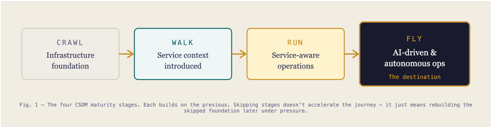
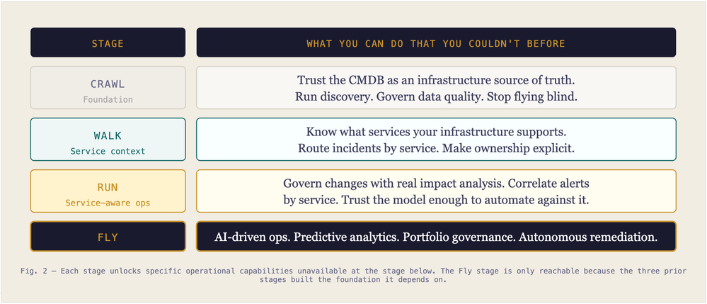
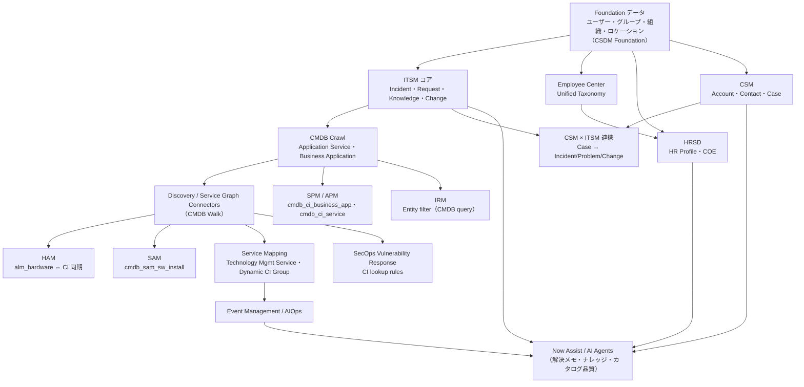
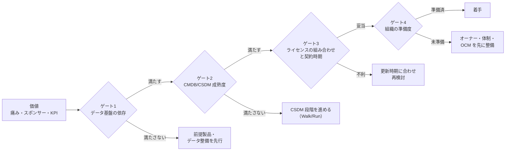
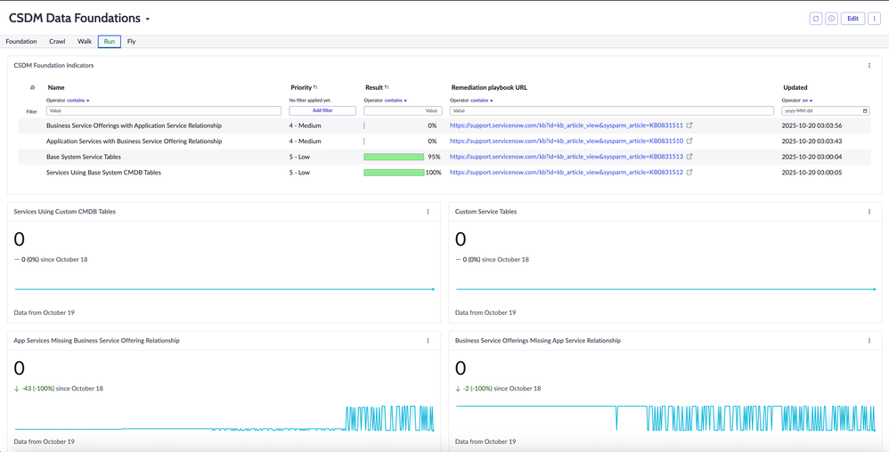
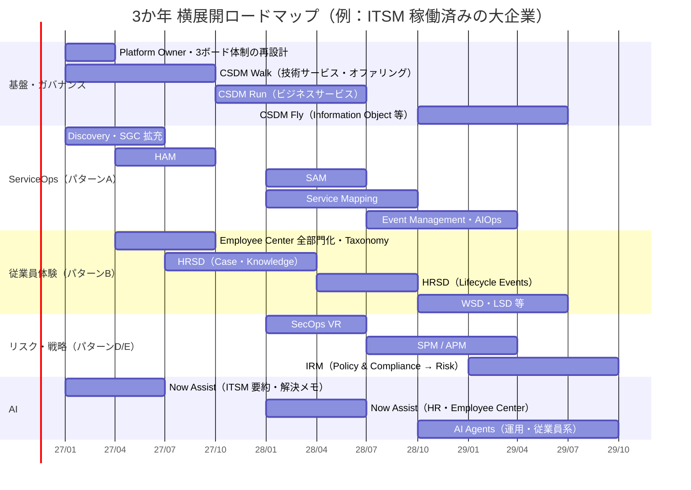

# ITSM から ESM・全社プラットフォームへの展開ロードマップ（Platform Expansion Roadmap）

## 概要

本ファイルは、ServiceNow の **初期導入（多くの場合 ITSM：IT Service Management）が稼働した後** に、ITOM（IT Operations Management）、ITAM（IT Asset Management）、HRSD（HR Service Delivery）、CSM（Customer Service Management）、SPM（Strategic Portfolio Management）、IRM（Integrated Risk Management）、SecOps（Security Operations）、AI（Now Assist / ServiceNow Otto・AI Agents）へと **横展開（Platform expansion）** していくための順序と判断基準を、応用編として整理したものである。

本ファイルが答える問いは次のとおりである。

| # | 問い | 主な節 |
|---|---|---|
| 1 | ServiceNow 自身は展開の順序をどう示しているか | 2 章 |
| 2 | 各製品は、どのデータ基盤（CMDB・CSDM・ユーザー/組織マスタ等）に依存しているか | 3 章 |
| 3 | 次に何を入れるかを、何を基準に決めるか（データ・CSDM 成熟度・ライセンス・組織） | 4 章 |
| 4 | 典型的な展開パターンと 3 か年ロードマップの例 | 5 章・6 章 |
| 5 | 横展開で繰り返される失敗（アンチパターン） | 7 章 |
| 6 | プラットフォームオーナーが製品追加の前に確認すべきこと | 8 章 |

前提知識と関連ファイル：

- 製品の全体像は [製品ポートフォリオ一覧](../01_入門編/03-product-portfolio.md)、パッケージ・ティアは [エディション比較](../03_導入編/03-edition-comparison.md) と [プラットフォームのパッケージ構成](../02_リファレンス/platform/platform-licensing-packaging.md) を参照する。
- CMDB / CSDM の仕様は [CMDB と CSDM](../02_リファレンス/platform/cmdb-csdm.md)、成功要因は [CMDB成功の要因](./05-cmdb-success-factors.md) を参照する。
- 初期導入プロジェクトのロードマップ作法（優先順位マトリクス、Quick win、Value report）は [コンサルティング実践プレイブック](./14-consulting-playbook.md) の 5 章に、ガバナンス体制は [ガバナンスとCoEの実践](./09-governance-coe-practice.md) にある。本ファイルは「初期導入後の **製品追加の順序と判断**」に絞る。

> **確度の扱い:** ServiceNow は「全製品の公式な展開順序」を 1 枚の公開文書としては示していない（2026-11 時点で公開情報では確認できず）。本ファイルは、①公式ドキュメントの CSDM 段階モデル、②ServiceNow 社員がコミュニティで公開した **Recommended Implementation Sequence**（ITSM+ITOM 版）、③製品ドキュメントに書かれたデータ依存関係、を一次根拠とし、それ以外の順序づけには `【経験則】`・`【第三者情報】` を付ける。

---

## 1. 横展開の順序が問題になる理由

### 1.1 ServiceNow の製品は「同じデータ」を共有する

ServiceNow の製品群は単一プラットフォーム上で、ユーザー（`sys_user`）・グループ・組織・ロケーションといった基盤データと、CMDB（Configuration Management Database）を共有する。CSDM（Common Service Data Model）の公式ドキュメントは、Foundation ドメインの基盤データは **ServiceNow の製品を使う前に** 整備しておく必要があると位置づけている。[出典](https://www.servicenow.com/docs/r/zS6yb8e~gR8BPjeviYdV9g/YO9~nS73A2CUXGgC7Mjz6g)

このため、後から入れる製品ほど「先に入れた製品が作ったデータ」の品質に左右される。たとえば次の依存がある（詳細は 3 章）。

| 後から入れる製品 | 先に必要なデータ | 品質が悪いと起きること |
|---|---|---|
| ITOM Event Management / AIOps | Discovery・Service Graph Connectors で投入された CI と、サービス（Application Service 等）への関係 | アラートがサービスに紐づかず、影響範囲が出ない |
| SAM（Software Asset Management） | `cmdb_sam_sw_install`（Software Installations）に入るインストール情報 | ライセンスのコンプライアンス計算が不正確になる |
| SecOps Vulnerability Response | 脆弱性スキャナの資産と CMDB CI の突合 | 突合できない資産が「Unmatched CI」として溜まる |
| IRM（GRC） | CMDB から作る Entity（エンティティ） | リスク・統制の対象範囲が実態とずれる |
| Now Assist / AI Agents | 解決メモ・ナレッジ・カタログの品質 | 要約・回答の品質が出ず、利用が定着しない |

### 1.2 横展開の事例・知見は少なく、個別最適になりやすい

ServiceNow 社員による Community 記事（2018）は、ITSM から ESM（Enterprise Service Management）へ広げる手順として「業務部門への啓発とユースケース発掘 → 2〜3 件のパイロット → 社内への成功の発信 → ビジネス成果を明記したロードマップ」の 4 段階を挙げ、拡大が進んだ成熟組織には ESM CoE（Center of Excellence）を置くことを勧めている。[出典](https://www.servicenow.com/community/in-other-news/extending-enterprise-service-management/ba-p/2272554)

一方、2025〜2026 年の Community では「10 年使った ITSM に 85,000 ユーザー規模の HRSD を追加するが、ITSM と HRSD のサポート・ガバナンスをどう組むべきか」という質問に回答がつかない状態が見られ [出典](https://www.servicenow.com/community/london-snug/what-is-your-support-governance-model-for-itsm-and-hrsd/m-p/3476688)、HRSD 稼働後に「HR ケースに ITSM 側チームを巻き込む運用で困っている」という報告もある [出典](https://www.servicenow.com/community/community-central-forum/working-with-non-hrsd-groups-on-a-case/td-p/3071945)。横展開は **製品機能より、データとガバナンスの接続** でつまずきやすい。`【経験則】`

---

## 2. 公式・準公式の段階モデル

### 2.1 CSDM implementation stages（公式）

CSDM の公式ドキュメント「Implementing the CSDM framework in stages」（Australia 版）は、CSDM を **Foundation → Crawl → Walk → Run → Fly** の 5 段階で段階的に実装するよう示している。各段階は前段の上に積み上げる。[出典](https://www.servicenow.com/docs/r/australia/servicenow-platform/common-service-data-model-csdm/csdm-implementation-stages.html)

| 段階 | 公式の説明（要旨） | 横展開との関係（本ファイルの整理） |
|---|---|---|
| **Foundation** | ベースシステムのテーブルで基盤の参照データ（組織、ロケーション、グループ、ユーザー等）を整える | **全製品の前提**。HRSD・CSM でも同じユーザー/組織マスタを使う |
| **Crawl** | ITSM プロセスに関係するベースシステムの CMDB テーブルを投入する | ITSM（Incident / Problem / Change）が Application Service を参照できる状態 |
| **Walk** | 技術チームが支える **ネットワーク・インフラの CI とアプリケーション** を特定・投入する | **ITOM・ITAM の前提**。サポートグループ等のメタデータ管理 |
| **Run** | 技術と、それを **販売・消費する事業** との関係を設定する | Business Service の整備。CSM・SPM・影響分析の高度化 |
| **Fly** | Information Object（`cmdb_ci_information_object`）などの高度なテーブルを含めて実装を完了する | IRM・データプライバシー・ポートフォリオ統治 |

公式ドキュメントは、Information Object テーブルのように **ビジネス要件次第で前倒し実装してよいテーブル** もあるとしている。[出典](https://www.servicenow.com/docs/r/australia/servicenow-platform/common-service-data-model-csdm/csdm-implementation-stages.html)

#### Walk 段階で整備するもの（公式）

Walk 段階の公式ページは、次のテーブルと活動を挙げ、関連製品として Service Portfolio Management、Service Mapping、Discovery、Event Management、Service Catalog、Incident / Change Management を明記している。[出典](https://www.servicenow.com/docs/r/australia/servicenow-platform/common-service-data-model-csdm/csdm-implement-walk-stage.html)

| テーブル | 名称 | 役割 |
|---|---|---|
| `cmdb_ci_service_technical` | Technology Management Service（技術管理サービス） | 事業が消費する技術の提供者を表す。サービス分類は Technical Service |
| `service_offering` | Technology Management Offering | 場所・環境・価格・可用性・サポートグループ・技術承認グループ等で区分したオファリング。稼働中の技術管理サービスには最低 1 つ必要 |
| `cmdb_ci_query_based_service` | Dynamic CI Group | Query Builder の保存クエリ等で CI をまとめるグループ |

同ページが挙げる活動には「検出済みインフラ CI のメタデータ（サポートグループ、技術承認グループ）を管理し、管理するオファリングに CI を紐づけて子に同期する」「Service Portfolio Management を早く採用できるようサービスデータを整理する」「**ITOM 製品のための CI データ基盤を作る**」が含まれる。[出典](https://www.servicenow.com/docs/r/australia/servicenow-platform/common-service-data-model-csdm/csdm-implement-walk-stage.html)

### 2.2 Service Operations（ITSM + ITOM）Recommended Implementation Sequence（準公式）

ServiceNow 社員が Community に公開した「Service Operations on a page: How to sequence your ITOM and ITSM Transformation」（2022-05 投稿、2023-03 更新）は、ServiceNow の Technology Workflows Leading Practices チームがまとめた **Recommended Implementation Sequence**（PowerPoint）を添付し、ITSM と ITOM の製品を **Foundation → Crawl → Walk → Run → Fly** の 5 段階に配置している。記事は「this is our recommended starting point」とし、固定の順序ではなく出発点だと述べている。[出典](https://www.servicenow.com/community/itom-articles/service-operations-on-a-page-how-to-sequence-your-itom-and-itsm/ta-p/2320846)

添付スライド（「Products are placed based on when implementation may start」＝製品は実装を開始してよい時期に配置）から読み取れる配置は次のとおりである（製品名はスライド作成時点のもの）。[出典](https://www.servicenow.com/community/itom-articles/service-operations-on-a-page-how-to-sequence-your-itom-and-itsm/ta-p/2320846)

| 段階 | 配置されている製品・機能 | 次の段階へ進む条件（スライドの記述の要旨） |
|---|---|---|
| **Foundation** | Incident Management、Major Incident Management、Knowledge Management、Change Management、Service Catalog / Request Management、Service Operations Workspace、Employee Center、CSDM、CMDB、Discovery、ACC for Visibility（Agent Client Collector）、Service Graph Connectors、Reporting | ITSM プロセスが ITOM の支援のもと、OOTB の簡素なプロセスで実装されている |
| **Crawl** | Problem Management、Walk Up Experience、Surveys and Assessments、Mobile Agent / Now Mobile、**Asset - Hardware（HAM）**、**Asset - Software（SAM）**、Tag Governance、**Service Mapping**、Cloud Discovery、Data Certification | セルフサービスと自動化で従業員体験が向上し、統合されたツールが運用を支えている |
| **Walk** | Virtual Agent、Predictive Intelligence for Incident、Multimodal Change、**Service Portfolio Management**、Digital Portfolio Management、Service Builder、Service Level Management、Firewall Audit & Reporting、Certificate Inventory & Management、ACC for Monitoring、**Event Management**、Performance Analytics | サービス管理がコア以外の IT 重要プロセスへ広がり、Service Portfolio Management がサービスの全体像を提供している |
| **Run** | Continuous Improvement Management、Site Reliability Operations、Coaching、Cloud Provisioning & Governance、Cloud Migration Assessment、Cloud Action Library、Health Log Analytics、Event Management Mobile Experience、Success Dashboards | 高度化した運用データが AI 運用（AIOps）に使える |
| **Fly** | Workforce Optimization for ITSM、Process Optimization（Process Mining）、Benchmarks | ワークフローが IT の計画・運用・提供を自動化し、AI が IT の従業員体験の大半を担う |

スライドには「Before you start」の条件として **Executive sponsorship（経営スポンサー）が確立していること** と、ITSM をリセットしてモダンでリーンなやり方を採ることが挙げられている。成功指標（Success Measures）も段階ごとに置かれ、Foundation では「インシデント平均解決時間」「一次割当での解決率」、Walk では「変更のクローズまでの平均時間」「失敗した変更の割合」、Run では「障害で影響を受けたビジネスサービスの割合」「SLO 達成率」などが例示されている。[出典](https://www.servicenow.com/community/itom-articles/service-operations-on-a-page-how-to-sequence-your-itom-and-itsm/ta-p/2320846)

この配置から読み取れる要点：

- **Discovery・Service Graph Connectors・CSDM は Foundation**（ITSM と同時期）に置かれ、Service Mapping は Crawl、**Event Management は Walk** と、データ基盤 → サービスマップ → イベント相関の順になっている。
- **HAM / SAM は Crawl** に置かれ、CMDB が投入されてから資産管理を始める順になっている。
- **AI（Virtual Agent、Predictive Intelligence）は Walk 以降**。運用データが蓄積してから機械学習を使う並びである。

> **注意:** このシーケンスは 2022〜2023 年作成で、製品名（Service Builder、Digital Portfolio Management 等）や生成 AI（Now Assist、AI Agents）の扱いは現行と異なる。順序の考え方の根拠として使い、製品名はリリースごとに読み替える。Now Create 上には CSM、Automation Engine、業界別などの製品別 Recommended Implementation Sequence もあるとされるが、ログインが必要で本文は確認できていない。

### 2.3 CSDM 成熟度の段階と「できること」

ServiceNow Community の Developer Blog 記事（2026-03、Community 会員による投稿）は、CSDM 成熟度を Crawl → Walk → Run → Fly の 4 段階で説明し、「段階を飛ばしても旅は速くならない。飛ばした基盤を後で圧力の下で作り直すことになるだけだ」と図示している。`【第三者情報】` [出典](https://www.servicenow.com/community/developer-blog/achieving-csdm-maturity-moving-from-crawl-to-fly/ba-p/3506920)

- **キャプション:** CSDM の 4 つの成熟度段階を左から右へ矢印でつないだ図（Fig. 1）。
- **図の説明:** 左から「CRAWL：Infrastructure foundation（インフラ基盤）」「WALK：Service context introduced（サービス文脈の導入）」「RUN：Service-aware operations（サービスを意識した運用）」「FLY：AI-driven & autonomous ops（AI 駆動・自律運用）— The destination」の 4 つの箱が並ぶ。下部の注記は「各段階は前段の上に築かれる。段階を飛ばしても旅は速くならず、飛ばした基盤を後で作り直すことになる」という趣旨。
- **出典:** https://www.servicenow.com/community/developer-blog/achieving-csdm-maturity-moving-from-crawl-to-fly/ba-p/3506920 （取得日：2026-11-08）

- **キャプション:** 段階ごとに「前の段階ではできなかったこと」を並べた表形式の図（Fig. 2）。
- **図の説明:** CRAWL（Foundation）＝CMDB をインフラの信頼できる情報源にする・Discovery を回す・データ品質を統治する。WALK（Service context）＝インフラが支えるサービスを把握する・サービス単位でインシデントをルーティングする・所有者を明確にする。RUN（Service-aware ops）＝実際の影響分析で変更を統治する・サービス単位でアラートを相関する・モデルを信頼して自動化する。FLY＝AI 駆動の運用、予測分析、ポートフォリオ統治、自律的な修復。注記は「Fly は前の 3 段階が基盤を作ったから到達できる」という趣旨。
- **出典:** https://www.servicenow.com/community/developer-blog/achieving-csdm-maturity-moving-from-crawl-to-fly/ba-p/3506920 （取得日：2026-11-08）

同記事は、次の段階へ進む目安として「Crawl を出る：Discovery が継続的に回り、インシデント時に CMDB のインフラ情報が信頼されている」「Walk を出る：**インシデントの 70% 超が Application Service に紐づき**、所有者が関係を保守している」「Run を出る：変更評価で下流の依存が自動で示され、アラート相関でノイズが減っている」を挙げている。`【第三者情報】` [出典](https://www.servicenow.com/community/developer-blog/achieving-csdm-maturity-moving-from-crawl-to-fly/ba-p/3506920)

---

## 3. 製品別のデータ依存関係

### 3.1 依存関係の全体図

次の図は、2 章の段階モデルと 3.2 節の製品ドキュメントに基づき、**どの製品がどのデータ基盤を前提にするか** を本ファイルが整理したものである（矢印は「前提として必要」を表す）。`【経験則】`（個々の依存の根拠は 3.2 節の表に出典付きで示す）

### 3.2 製品別の前提データと根拠

次の表の「本格利用時の CSDM 段階の目安」列は、その製品を本格的に使うときに整っているべき段階を示す。4.2 節の表は、着手に「最低限必要な段階」と「価値が出始める段階」に分けて示しており、本表の目安はおおむねその間（多くは「価値が出始める段階」寄り）にあたる。`【経験則】`

| 製品 | 前提となるデータ・機能 | 本格利用時の CSDM 段階の目安 | 根拠（公式） |
|---|---|---|---|
| **ITOM Discovery / Service Graph Connectors** | CMDB クラスモデルと IRE（Identification and Reconciliation Engine）。Walk 段階で「ITOM 製品のための CI データ基盤を作る」 | Foundation〜Walk（着手は Foundation から可。Recommended Implementation Sequence でも Foundation に配置） | [Walk stage](https://www.servicenow.com/docs/r/australia/servicenow-platform/common-service-data-model-csdm/csdm-implement-walk-stage.html) |
| **Service Mapping / Event Management** | Technology Management Service（`cmdb_ci_service_technical`）、Offering（`service_offering`）、Dynamic CI Group（`cmdb_ci_query_based_service`）。Event Management でも Dynamic CI Group を使える（公式ページには `cmdb_query_based_services` と表記されているが、同ページで定義している Dynamic CI Group テーブル `cmdb_ci_query_based_service` の誤記とみられる。`cmdb_query_based_services` というテーブルは存在しない） | Walk〜Run | [Walk stage](https://www.servicenow.com/docs/r/australia/servicenow-platform/common-service-data-model-csdm/csdm-implement-walk-stage.html) |
| **HAM** | Asset（`alm_hardware` 等）と CI が **互いに参照し合っている場合のみ** 状態（Asset の State と CI の Status / Install Status / Hardware Status）が双方向同期される。Model category が Asset・CI・Install Base Item を関連づける | Walk | [Managing assets](https://www.servicenow.com/docs/r/it-asset-management/asset-management/c_ManagingAssets.html) |
| **SAM** | 検出したソフトウェアは Software Installations（`cmdb_sam_sw_install`）に格納される。データ源は ServiceNow Discovery（データセンター向け）、Microsoft SCCM（デスクトップ向け。新規は Service Graph connector for Microsoft SCCM を推奨）、その他サードパーティ | Walk | [Software discovery](https://www.servicenow.com/docs/r/it-asset-management/software-asset-management/sam-software-discovery.html) |
| **SecOps Vulnerability Response** | 取り込んだ資産を Discovered Items のベンダー ID で照合し、なければ CI lookup rules（FQDN、NetBIOS、DNS、IP、MAC 等を Order 順に評価）で CMDB CI を探す。見つからなければプレースホルダの **Unmatched CI** を作る。メニュー：Security Operations > CMDB > Lookup Rules | Walk | [CI lookup rules](https://www.servicenow.com/docs/r/aWI6yzr0o7OSh9MJT0Yyxw/Zzy8ZTPpXc8hXTUGlyt7Jw) |
| **SPM（Service Portfolio）/ APM** | CSDM activation plugin（`com.snc.cmdb.csdm.activation`）でライフサイクル項目が SPM に出る。`cmdb_ci_service` の SPM フェーズが CSDM のライフサイクルに対応する | Walk〜Run | [Applying CSDM to SPM](https://www.servicenow.com/docs/r/Mr7qUatbFXax1_h~z60rmA/mWLqUrx_9AGdQXuA49QDuQ) |
| **IRM（GRC）** | Entity type の Entity filter を「独自条件（テーブル選択）」または「定義済み CMDB クエリ」で作る。CMDB クエリを使うには `sn_grc.admin` が GRC Properties の「Enable entity scoping for CMDB query」を有効にし、クエリに GRC Scoping タグを付ける。定義済みクエリ例に「Business Apps using Information Object」 | Run〜Fly | [Create an entity filter](https://www.servicenow.com/docs/r/UUPLjuAXTo4SlQO8Ml6ZjQ/ZVR9tkZrIQm~Ym8TJjzdBA) |
| **HRSD** | HR Profile と組織・部署・ロケーション・職位（Guided Setup の HR Company カテゴリ）。Guided Setup は All > HR Administration > Guided Setup、必要ロール `sn_hr_core.admin` 等 | Foundation | [Guided setup for HRSD](https://www.servicenow.com/docs/r/XbpkTdWa3HBo31srdD0Rdg/mZn__WgJhhIinp~OZcC9mQ) |
| **CSM** | 顧客アカウント・連絡先・（必要なら）Install Base。ITSM 連携は Customer Service with Service Management（`com.sn_cs_sm`）と Customer Service with Request Management（`com.sn_cs_sm_request`）プラグイン | Foundation（連携は ITSM 稼働後） | [CSM integration with ITSM](https://www.servicenow.com/docs/r/customer-service-management/csm-integration-service-management.html) |
| **Employee Center（全部門ポータル）** | Unified Taxonomy（Content Taxonomy アプリ＋Employee Experience Taxonomy プラグイン）。既定のタクソノミーはライセンス製品（IT、HR、Legal 等）向けにストアから入手 | Foundation | [Unified Taxonomy](https://www.servicenow.com/docs/r/zurich/employee-service-management/employee-experience-foundation/config-taxonomy.html) |
| **Now Assist / AI Agents** | タスクレコードの完全性・解決サマリーの一貫性、ナレッジの構造化と解決済みケースへのリンク、カタログアイテムの構造。AI Readiness Evaluation アプリで評価できる | ITSM 稼働後（運用データ蓄積後） | [Data readiness](https://www.servicenow.com/docs/r/intelligent-experiences/sn-ai-impl-data-readiness.html) |
| **Predictive Intelligence** | 分類ソリューションの学習レコード数の最小値は `glide.platform_ml.api.csv_min_line`（既定 10,000）、最大値は `glide.platform_ml.api.csv_max_line`（既定 300,000） | ITSM 稼働後（データ蓄積後） | [PI properties](https://www.servicenow.com/docs/r/intelligent-experiences/predictive-intelligence/predictive-intelligence-properties.html) |

補足：

- Community の CSDM Crawl 解説（2025-10）は、Application Service（`cmdb_ci_service_auto`）を「インシデントの申告者がアプリの不具合を報告するときに選ぶ対象」とし、Business Application（`cmdb_ci_business_app`）は **Incident / Problem / Change から直接参照すべきでない** と述べている。また Application（`cmdb_ci_appl`）は Discovery が自動作成・維持する技術 CI であり、手作業での投入は推奨しないとしている。`【第三者情報】` [出典](https://www.servicenow.com/community/common-service-data-model-blog/csdm-crawl/ba-p/3408764)
- CSM ×ITSM 連携では、1 件のケースから作成・関連付けできる Incident / Problem / Change は各 1 件、Request は複数件である。連携プラグインはカスタマーサービスエージェント（`sn_customerservice_agent`）ロールにロールを追加しないため、エージェントには Incident Management 側の CSM/ITSM 連携ロールが必要になる。[出典](https://www.servicenow.com/docs/r/customer-service-management/csm-integration-service-management.html)
- 詳細仕様は各リファレンス（[Discovery](../02_リファレンス/itom/discovery.md)、[Service Mapping](../02_リファレンス/itom/service-mapping.md)、[Event Management と AIOps](../02_リファレンス/itom/event-management-aiops.md)、[HAM](../02_リファレンス/itam/hardware-asset-management.md)、[SAM](../02_リファレンス/itam/software-asset-management.md)、[SecOps](../02_リファレンス/secops/security-operations.md)、[IRM](../02_リファレンス/irm/integrated-risk-management.md)、[SPM](../02_リファレンス/spm/strategic-portfolio-management.md)、[APM・EAM](../02_リファレンス/spm/agile-apm-eam.md)、[HRSD](../02_リファレンス/employee/hr-service-delivery.md)、[CSM](../02_リファレンス/customer/customer-service-management.md)）を参照する。

---

## 4. 次の製品を決める判断基準

次の製品を決めるときは、**価値（ビジネス上の痛み・スポンサーの有無）** だけでなく、次の 4 つのゲートを順に確認する。`【経験則】`（各観点の根拠は節ごとに示す）

### 4.1 ゲート 1：データ基盤の依存関係

3 章の表に照らし、**その製品が読むデータを、どの製品・どの連携が書いているか** を確認する。

| 確認項目 | 判断の目安 |
|---|---|
| ユーザー・組織・ロケーションのマスタは単一の権威あるソース（AD/Entra ID、HCM 等）から連携されているか | HRSD・CSM・Employee Center を入れる前の必須条件。HRSD は HR Profile と組織データを使う [出典](https://www.servicenow.com/docs/r/XbpkTdWa3HBo31srdD0Rdg/mZn__WgJhhIinp~OZcC9mQ) |
| CI を自動投入する手段（Discovery、Service Graph Connectors、Agent Client Collector）が稼働しているか | HAM・SAM・VR・Event Management の前提。Recommended Implementation Sequence でも Discovery / SGC は Foundation に置かれる [出典](https://www.servicenow.com/community/itom-articles/service-operations-on-a-page-how-to-sequence-your-itom-and-itsm/ta-p/2320846) |
| ソフトウェアのインストール情報源が 1 つに定まっているか | 公式ドキュメント「Discovery and SCCM together」（Zurich）は、SCCM 連携より先に Discovery を有効化するとソフトウェアのインストール情報が混在しうるとし、プロパティ `glide.discovery.software_sccm_managed` を Yes にすると SCCM 管理下の Windows コンピューターのソフトウェアを Discovery が取り込まないと説明している。混在した場合は Software Installation テーブルのクリアが必要になる [出典](https://www.servicenow.com/docs/r/guxhDnVk8OUAJKLm7WZsYA/TRcQclWzJrNY9hNOQg6fbA) |
| 解決メモ・ナレッジ・カタログの品質が AI に耐えるか | AI の前提。公式は「Now Assist requires high-quality data」とし、AI Readiness Evaluation による評価を勧める [出典](https://www.servicenow.com/docs/r/intelligent-experiences/sn-ai-impl-data-readiness.html) |
| 機械学習に必要な件数があるか | Predictive Intelligence の分類は既定で最低 10,000 件 [出典](https://www.servicenow.com/docs/r/intelligent-experiences/predictive-intelligence/predictive-intelligence-properties.html) |

### 4.2 ゲート 2：CMDB / CSDM の成熟度

製品ごとに必要な CSDM 段階の目安は次のとおりである（3.2 節と 2 章の段階モデルから本ファイルが整理）。3.2 節の「本格利用時の CSDM 段階の目安」は、本表の「最低限必要な段階」から「価値が出始める段階」までの範囲の中で、本格利用に必要な水準を示したものである。`【経験則】`

| 製品 | 最低限必要な CSDM 段階 | 価値が出始める段階 |
|---|---|---|
| ITSM（Incident / Request） | Foundation | Crawl（Application Service でルーティング） |
| ITSM（Change のリスク・影響分析） | Crawl | Run |
| HAM / SAM | Walk（Discovery 稼働） | Walk |
| ITOM Event Management / AIOps | Walk | Run（サービス単位の相関） |
| SecOps VR | Walk | Run（ビジネス影響での優先度付け） |
| SPM / APM | Crawl（Business Application） | Run |
| IRM | Crawl（Entity の元データ） | Fly（Information Object・データ分類） |
| HRSD / CSM / Employee Center | Foundation | Foundation（CMDB への依存は小さい） |
| AI Agents（IT 運用系） | Run | Fly |

CSDM の進捗は **CSDM Data Foundations dashboard** で段階（Foundation / Crawl / Walk / Run / Fly）ごとに確認できる。

- **キャプション:** CSDM Data Foundations ダッシュボードの Run タブ。
- **画面の説明:** 画面上部にタブ「Foundation / Crawl / Walk / Run / Fly」があり、Run が選択されている。上段の「CSDM Foundation Indicators」リストは Name（指標名）、Priority、Result（達成率のバー）、Remediation playbook URL（Now Support の KB 記事へのリンク）、Updated の列を持ち、例として「Business Service Offerings with Application Service Relationship（4 - Medium、0%）」「Application Services with Business Service Offering Relationship（4 - Medium、0%）」「Base System Service Tables（5 - Low、95%）」「Services Using Base System CMDB Tables（5 - Low、100%）」が並ぶ。下段には「Services Using Custom CMDB Tables」「Custom Service Tables」「App Services Missing Business Service Offering Relationship」「Business Service Offerings Missing App Service Relationship」の件数と推移グラフのウィジェットがある。
- **出典:** ServiceNow Community「CSDM Run」（2025-10-20 投稿）https://www.servicenow.com/community/common-service-data-model-blog/csdm-run/ba-p/3408768 （取得日：2026-11-08）

ダッシュボードの導入方法・指標の詳細は [CMDB と CSDM](../02_リファレンス/platform/cmdb-csdm.md) と [CMDB成功の要因](./05-cmdb-success-factors.md) を参照する。ITOM 導入を判断する際は、Community の ITOM 価値最大化フレームワーク（2025-11）が「技術的な展開の前に Discovery・CMDB・Service Mapping・Event Management のオーナーを決める」「CSDM を早く実装すると手戻りが減る」と述べている点も考慮する。`【第三者情報】` [出典](https://www.servicenow.com/community/itom-articles/maximize-itom-value-framework/ta-p/3432956)

### 4.3 ゲート 3：ライセンスの組み合わせと契約時期

製品ごとに課金の単位が違うため、**同じ「横展開」でもコスト構造が大きく変わる**。詳細は [ライセンスモデル](../03_導入編/01-licensing-model.md)・[エディション比較](../03_導入編/03-edition-comparison.md)・[ライセンスコスト最適化](./06-license-cost-optimization.md) にあり、ここでは展開順序の判断に効く点だけを示す。

| 観点 | 内容 | 展開判断への影響 |
|---|---|---|
| 課金単位の違い | ITSM・CSM・SPM 等はユーザー（Fulfiller 等）課金で、Subscription Management 上の Type は Per-User / Unrestricted User となる [出典](https://www.servicenow.com/docs/r/australia/platform-administration/subscription-details-v2.html)。ITOM は管理対象 CI を契約上の比率で Subscription Unit（SU）に換算して計測する [出典](https://www.servicenow.com/docs/r/australia/it-operations-management/itom-license-module.html)。ITAM（HAM / SAM）も Type = Capacity の容量課金として表示される（例：`Hardware Asset Management Professional`）[出典](https://www.servicenow.com/docs/r/australia/platform-administration/subscriptions-overview-v2.html)。HRSD は全従業員（Unrestricted User）型とされる `【第三者情報】` [出典](https://www.servicenow.com/community/servicenow-ai-platform-articles/about-servicenow-licensing-guide/ta-p/3512215) | ITOM の費用は **CMDB に入る CI 数** で増える。Discovery 範囲を広げる前に、SU 消費の見込みを出す |
| 2026-04 の新ティア | Foundation / Advanced / Prime の 3 ティア。公式ドキュメントはティアの定義と AI 要素の提供範囲を示し、詳細な権利はアカウントチームに確認するよう記載 [出典](https://www.servicenow.com/docs/r/intelligent-experiences/enable-ai-experiences/ai-native-sku-overview.html) | AI 機能はティアに同梱されるため、「AI だけ後から買う」より、**次の製品をどのティアで買うか** が AI ロードマップを左右する |
| 複合 SKU | **ESM Foundation**（IT・HR・法務・財務・調達・ワークプレイスの基本サービスを中堅企業向けにまとめたもの。公式プレスリリースは「can be live in weeks」と記載）[出典](https://newsroom.servicenow.com/press-releases/details/2026/ServiceNow-moves-beyond-the-sidecar-AI-era-giving-customers-a-complete-AI-native-experience-across-all-products-and-packages/default.aspx)。ITSM と ITOM を共通クレジットで買う **ServiceOps Advanced / Prime** `【第三者情報】` [出典](https://www.servicenow.com/community/architect-articles/navigating-the-april-2026-servicenow-itom-licensing-model/ta-p/3555121) | 中堅企業は ESM Foundation で「部門横断の基本サービス」を先に広げ、深い製品（HRSD Advanced 等）は後から、という順序が取りうる |
| ティアの製品差 | ITOM は Advanced / Prime のみ（Foundation なし）とされる（[エディション比較](../03_導入編/03-edition-comparison.md) の 3.4 節） | ITOM 追加は最初から Advanced 以上の予算が要る |
| 契約時期 | 既存契約は契約期間中は旧 SKU のまま、更新・追加購入時に新ティアへ移るとされる `【第三者情報】` [出典](https://www.servicenow.com/community/itsm-articles/itsm-licensing-in-april-2026-foundation-advanced-and-prime-in/ta-p/3544380) | 製品追加は **更新時期と合わせて交渉** する（[コンサルティング実践プレイブック](./14-consulting-playbook.md) 5.3 節の原則と同じ） |
| 「ライセンスを買わずに作る」誘惑 | ITSM の Service Catalog で人事・総務の申請を作る方法は、ITSM ライセンスだけで早く始められる一方、人事・総務に特有のプライバシー・SLA・承認要件を満たしにくく、技術的負債を生むと Community で指摘されている `【第三者情報】` [出典](https://www.servicenow.com/community/service-management-blog/service-request-for-the-enterprise-part-1/bc-p/3344031) | 暫定策として使う場合は、負債を記録し、ドメイン製品（HRSD 等）への移行をロードマップに載せる |

> **注意:** カスタムテーブルや App Engine で業務部門アプリを作る場合も、別途ライセンス（App Engine、Custom Table Guide の扱い）が関わる。判断前に [アプリケーション開発](../02_リファレンス/platform/app-development.md) と [ライセンスモデル](../03_導入編/01-licensing-model.md) を確認する。

### 4.4 ゲート 4：組織の準備度

公式の ServiceNow Governance（Impact）ドキュメント（Yokohama 版）は、顧客側の必須ロールとして **ServiceNow Executive Sponsor**（ServiceNow に関する主要な戦略的窓口）と **Platform Owner**（プラットフォーム全体に説明責任を持ち、システム管理者を率い、ビジネス戦略と ServiceNow のロードマップにチームを合わせ、プラットフォームガバナンスに参加する）を挙げ、戦略・ポートフォリオ・技術の 3 つのガバナンスとして **Executive Steering Board / Demand Board / Technical Governance Board** を設置するとしている。顧客は ServiceNow 向けの戦略ロードマップ・技術ロードマップと、関連する OKR・テーマ・エピックを用意することが求められる。[出典](https://www.servicenow.com/docs/r/VD5jAD3VgRc~i0AwgqwfEQ/Nvj8oOhwhdW2rvC43pyEqA)

横展開の着手前に確認する組織面の項目：

| 観点 | 確認内容 | 根拠 |
|---|---|---|
| 業務部門のオーナー | 追加する製品のプロセスオーナー（人事なら HR 側、顧客サービスなら CS 側）が任命され、要件の決定権を持つか | ESM 拡大の 4 ステップは業務部門との協働とパイロットから始まる [出典](https://www.servicenow.com/community/in-other-news/extending-enterprise-service-management/ba-p/2272554) |
| プラットフォームチームの容量 | 稼働中製品の運用と新製品の構築を同じ要員で回せるか。ストリーム数は PM・開発者・プロセス SME・テスターの容量で制約される | ServiceNow 社員による計画ガイド [出典](https://www.servicenow.com/community/in-other-news/how-to-think-about-planning-your-servicenow-digital/ba-p/3059144) |
| チーム構成モデル | 集中型・分散型・ハイブリッドのどれで新部門を支えるか。Community では「ServiceNow の推奨はハイブリッド型に移っている」との問題提起がある | `【第三者情報】` [出典](https://www.servicenow.com/community/platform-owners-forum/how-are-you-structuring-your-servicenow-teams-insights-wanted/m-p/3278878) |
| 機微データの扱い | HRSD では System Administrator は HR Profile の機微項目や HR ケースのコメント・作業メモを閲覧できず、HR ロール（`sn_hr_core.case_reader`、`sn_hr_core.profile_reader` 等）を持つ人だけがアクセスする。なりすまし（impersonation）時の ACL チェックを有効にするプロパティもある | [出典](https://www.servicenow.com/docs/r/SogDT~k7ktsbe1ZYegnaLg/du9UjN5uHbc4kr37eVMtEA) |
| 部門間の引き継ぎ設計 | HR ケースから IT 作業を依頼する、顧客ケースからインシデントを起こす等、部門間のハンドオフを設計したか | CSM × ITSM 連携 [出典](https://www.servicenow.com/docs/r/customer-service-management/csm-integration-service-management.html)、HRSD 稼働後の困りごと報告 [出典](https://www.servicenow.com/community/community-central-forum/working-with-non-hrsd-groups-on-a-case/td-p/3071945) |
| 定着化（OCM） | 新しい利用者層（全従業員、外部顧客）への教育・広報・サポート窓口の準備 | [定着化と組織変革](./13-adoption-change-management.md) |

### 4.5 判断用スコアカード（例）

候補製品を横並びで比較するためのスコアカードの例を示す。重みは組織で調整する。`【経験則】`

| 評価軸 | 重み | 1 点 | 3 点 | 5 点 |
|---|---|---|---|---|
| ビジネス価値（痛みの大きさ・KPI の明確さ） | 30% | 定性的な期待のみ | KPI はあるがベースライン未取得 | KPI とベースライン（12 か月）あり |
| スポンサーと業務オーナー | 20% | 不在 | スポンサーのみ | スポンサーと権限ある業務オーナーが両方いる |
| データ依存の充足（ゲート 1） | 15% | 前提データが無い | 一部手作業で補える | 自動連携で揃っている |
| CSDM 成熟度（ゲート 2） | 15% | 必要段階に 2 段以上不足 | 1 段不足 | 必要段階に到達 |
| ライセンス・契約（ゲート 3） | 10% | 契約途中で追加費用が大きい | 更新まで 1 年以上 | 更新交渉のタイミング |
| チーム容量・OCM（ゲート 4） | 10% | 運用で手一杯 | 外部パートナーで補える | 専任チームを確保 |

ベースラインの取り方（導入前 12 か月）や Value report の作り方は [コンサルティング実践プレイブック](./14-consulting-playbook.md) 5.4 節と [ビジネスケース・ROI・価値実現](../03_導入編/17-business-case-roi-value-realization.md) を参照する。

---

## 5. 典型的な展開パターン

ITSM 稼働後の横展開は、概ね次の 5 つのパターン（ワークフロー領域）の組み合わせになる。各パターンの「起点」と「前提」を押さえると、順序の衝突を避けやすい。`【経験則】`（各パターン内の順序は 2 章・3 章の出典に基づく）

| パターン | 典型的な順序 | 起点となる痛み | 主な前提 |
|---|---|---|---|
| **A. ServiceOps 深化（IT 内の縦展開）** | ITSM → Discovery / SGC → HAM・SAM → Service Mapping → Event Management / AIOps → Process Mining・Workforce Optimization | 障害影響が分からない、資産・ライセンスが把握できない | CSDM Walk、SU 予算 |
| **B. 従業員体験（ESM）** | ITSM + Employee Center → HRSD（Case / Knowledge → Lifecycle Events）→ Workplace Service Delivery・Legal Service Delivery 等 | 社内問い合わせ窓口が部門ごとに分散 | HR データ連携、Unified Taxonomy、HR 機微データの権限設計 |
| **C. 顧客サービス** | CSM（Case）→ CSM × ITSM 連携 → Field Service Management → Sales and Order Management | 顧客問い合わせと社内 IT 対応の分断 | 顧客アカウント・製品・Install Base データ、外部ユーザー認証 |
| **D. リスク・セキュリティ** | SecOps（Security Incident / Vulnerability Response）→ IRM（Policy & Compliance → Risk）→ TPRM・BCM 等 | 監査対応・脆弱性対応の手作業 | CMDB Walk（CI 突合）、CSDM Run〜Fly（Entity・Information Object） |
| **E. 戦略・ポートフォリオ** | SPM（Demand → Project / Portfolio）→ APM / EAM → Agile | 投資判断とIT 運用データの分断 | Business Application（`cmdb_ci_business_app`）の整備 |

補足：

- パターン A は 2.2 節の Recommended Implementation Sequence にほぼ対応する。[出典](https://www.servicenow.com/community/itom-articles/service-operations-on-a-page-how-to-sequence-your-itom-and-itsm/ta-p/2320846)
- パターン B では、Employee Center を「IT 専用ポータル」ではなく全部門ポータルとして設計しておくことが後の展開を楽にする。公式ドキュメントは Unified Taxonomy を「複数部門・複数コンテンツタイプにまたがる一体的な従業員ポータル体験」のための仕組みとしている。[出典](https://www.servicenow.com/docs/r/zurich/employee-service-management/employee-experience-foundation/config-taxonomy.html) ServiceNow 社員の App Development Blog（2025-03）も、部門向けソリューションへの拡張では Employee Center Pro のタクソノミーでサービスを業務機能別に整理し、部門ごとのワークスペースを用意することを勧めている。[出典](https://www.servicenow.com/community/app-development-blog/expand-to-a-departmental-solution/ba-p/3189880)
- パターン C は「誰が依頼者か（外部顧客か社内か）」で ITSM と CSM を使い分け、顧客の問題が社内 IT 作業を要する場合に連携させる、という整理が ServiceNow 社員の Community 記事で示されている。`【第三者情報】` [出典](https://www.servicenow.com/community/csm-articles/csm-itsm-or-both-what-s-your-recipe-for-success/ta-p/3101936)
- AI（Now Assist / ServiceNow Otto・AI Agents）は独立したパターンではなく、**各パターンのデータが揃った領域から順に重ねる** のが原則である（[Now Assist / AI Agents 導入の知見](./10-ai-adoption-lessons.md)）。2026-04 以降の新ティアでは AI が各製品に同梱されるため、「AI 専用フェーズ」を別に設けるより、各フェーズの完了条件に AI 活用を含める設計が取りやすい。[出典](https://newsroom.servicenow.com/press-releases/details/2026/ServiceNow-moves-beyond-the-sidecar-AI-era-giving-customers-a-complete-AI-native-experience-across-all-products-and-packages/default.aspx)

---

## 6. 典型的な 3 か年ロードマップ例

### 6.1 前提

以下は **大企業（従業員数千〜数万人、単一本番インスタンス、ITSM が稼働済み）** を想定した例である。実際の順序は 4 章のゲートと 5 章のパターン選択で決まり、この例をそのまま当てはめるものではない。`【経験則】`

例の作成にあたり参照した段階づけ：

- ServiceNow 社員の計画ガイドは、ロードマップは **少なくとも今後 12 か月** をカバーし、製品・チーム・スコープ・順序を定め、ストリームはワークフロー別（テクノロジー・従業員・顧客）、製品別、または成果別（ポータル、Employee Center 等の横断成果）で組むとしている。また **Now Create の Recommended Implementation Sequence** に従い、ServiceNow のアップグレードも計画に入れるよう述べている。[出典](https://www.servicenow.com/community/in-other-news/how-to-think-about-planning-your-servicenow-digital/ba-p/3059144)
- 公共部門向けの Community 記事（2026-04）は、Phase 1（1〜3 か月）基盤（インスタンス、SSO、CMDB 投入、セキュリティ強化）→ Phase 2（3〜9 か月）ITSM または CSM → Phase 3（9〜18 か月）AI・HRSD・IRM という段階を示し、「クリーンな CMDB なしには AI と自動化は失敗する」と述べている。`【第三者情報】` [出典](https://www.servicenow.com/community/architect-blog/the-art-of-the-timeline-balancing-velocity-and-governance/ba-p/3535436)

### 6.2 ガントチャート（例）

### 6.3 年次の内容と完了条件（例）

| 期間 | 主な取り組み | 完了条件（次へ進む条件）の例 | 根拠・関連 |
|---|---|---|---|
| **Year 1 前半** | ガバナンス再設計（Executive Steering / Demand / Technical Governance Board）、CSDM Walk 着手、Discovery・Service Graph Connectors の範囲拡大、ITSM への Now Assist（要約・解決メモ）適用 | Discovery が継続的に回り、インシデント対応で CMDB のインフラ情報が使われている。解決メモ等のデータ品質を AI Readiness Evaluation で評価済み | [Governance](https://www.servicenow.com/docs/r/VD5jAD3VgRc~i0AwgqwfEQ/Nvj8oOhwhdW2rvC43pyEqA)、[CSDM 成熟度](https://www.servicenow.com/community/developer-blog/achieving-csdm-maturity-moving-from-crawl-to-fly/ba-p/3506920)、[Data readiness](https://www.servicenow.com/docs/r/intelligent-experiences/sn-ai-impl-data-readiness.html) |
| **Year 1 後半** | HAM、Employee Center の全部門化（Unified Taxonomy）、HRSD のパイロット（Case・Knowledge、1〜2 か国または 1 事業部） | Asset と CI の相互参照が整い状態同期が機能している。HR ロールと COE セキュリティポリシーが設計・テスト済み | [Managing assets](https://www.servicenow.com/docs/r/it-asset-management/asset-management/c_ManagingAssets.html)、[HR security](https://www.servicenow.com/docs/r/SogDT~k7ktsbe1ZYegnaLg/du9UjN5uHbc4kr37eVMtEA) |
| **Year 2 前半** | SAM、Service Mapping、HRSD の全社展開、SecOps VR、HR 領域への Now Assist | インシデントの大半が Application Service に紐づく（Community 記事の目安は 70% 超）。VR の Unmatched CI が許容範囲に収まる | [CSDM 成熟度](https://www.servicenow.com/community/developer-blog/achieving-csdm-maturity-moving-from-crawl-to-fly/ba-p/3506920)、[CI lookup rules](https://www.servicenow.com/docs/r/aWI6yzr0o7OSh9MJT0Yyxw/Zzy8ZTPpXc8hXTUGlyt7Jw) |
| **Year 2 後半** | CSDM Run（ビジネスサービス）、HRSD Lifecycle Events（入社・異動・退職）、SPM / APM、Event Management 着手 | ビジネスサービスとオファリングの関係が CSDM Data Foundations dashboard の Run 指標で一定水準に達する | [CSDM Run](https://www.servicenow.com/community/common-service-data-model-blog/csdm-run/ba-p/3408768) |
| **Year 3** | Event Management / AIOps の本格化、IRM（Entity を CMDB クエリから生成）、WSD・LSD 等の ESM 拡張、AI Agents の業務適用、CSDM Fly | 変更評価で下流依存が自動表示される。アラート相関でノイズが減る。AI 推奨が運用で信頼されている | [Create an entity filter](https://www.servicenow.com/docs/r/UUPLjuAXTo4SlQO8Ml6ZjQ/ZVR9tkZrIQm~Ym8TJjzdBA)、[CSDM 成熟度](https://www.servicenow.com/community/developer-blog/achieving-csdm-maturity-moving-from-crawl-to-fly/ba-p/3506920) |

各年で共通に入れるもの：

- **年 2 回のファミリーリリースへのアップグレード**（Australia → Brazil → 次期）。大規模な製品追加の本番リリースは、アップグレード期間と重ねない。[アップグレード管理](../03_導入編/13-upgrade-management.md)
- **ライセンス更新の交渉窓**。製品追加の契約は更新時期に寄せる。[ライセンスコスト最適化](./06-license-cost-optimization.md)
- **価値の測定**（ベースライン → 実績比較）。[コンサルティング実践プレイブック](./14-consulting-playbook.md) 5.4 節

### 6.4 中堅企業向けの変形例

従業員数百〜数千人で専任のプラットフォームチームが小さい場合は、次の変形が考えられる。`【経験則】`

| 期間 | 取り組み | 理由 |
|---|---|---|
| Year 1 | ESM Foundation で IT 以外（HR・総務・法務等）の基本サービスを Employee Center に集約。CSDM は Foundation〜Crawl に絞る | ESM Foundation は中堅企業向けで「数週間で稼働」を謳う複合オファリングである [出典](https://newsroom.servicenow.com/press-releases/details/2026/ServiceNow-moves-beyond-the-sidecar-AI-era-giving-customers-a-complete-AI-native-experience-across-all-products-and-packages/default.aspx) |
| Year 2 | HAM / SAM（資産管理が監査要件になる場合）、またはHRSD の上位ティア（ライフサイクルイベントが必要な場合） | 深い機能が必要な領域だけ専用製品に上げる |
| Year 3 | Discovery・Event Management は SU 費用対効果を見て判断。AI Agents は同梱ティアの範囲から始める | ITOM は Foundation ティアがなく、初期費用が大きい（[エディション比較](../03_導入編/03-edition-comparison.md)） |

---

## 7. 展開時のアンチパターン

| # | アンチパターン | 症状 | なぜ起きるか | 対策 | 根拠 |
|---|---|---|---|---|---|
| 1 | **Big Bang 展開** | 複数製品を同時に本番化し、セキュリティゲートや利用者の抵抗で止まる | 経営層の短納期要求、契約一括購入の消化圧力 | 段階リリース。ゲートレビュー・UAT・認定で「管理されたペース」を示す | `【第三者情報】` [出典](https://www.servicenow.com/community/architect-blog/the-art-of-the-timeline-balancing-velocity-and-governance/ba-p/3535436)、[出典](https://www.servicenow.com/community/in-other-news/how-to-think-about-planning-your-servicenow-digital/ba-p/3059144) |
| 2 | **CSDM を飛ばして ITOM / AI を入れる** | Event Management のアラートがサービスに紐づかない。AIOps・AI の結果が信頼されない | 製品を買えば価値が出るという期待。CSDM を「技術プロジェクト」と誤認 | 4.2 節の段階表で必要段階を確認し、未達なら CSDM 整備を先行 | `【第三者情報】` [出典](https://www.servicenow.com/community/developer-blog/achieving-csdm-maturity-moving-from-crawl-to-fly/ba-p/3506920)、[Walk stage](https://www.servicenow.com/docs/r/australia/servicenow-platform/common-service-data-model-csdm/csdm-implement-walk-stage.html) |
| 3 | **Crawl で停滞** | Discovery は回っているが、サービスとの関係が作られず CMDB が使われない | Walk 以降は組織的な所有者の任命が必要で、技術チームだけでは進まない | CI・サービスの所有者（Managed by group 等）を任命し、Data Certification で保守 | `【第三者情報】` [出典](https://www.servicenow.com/community/developer-blog/achieving-csdm-maturity-moving-from-crawl-to-fly/ba-p/3506920)、[CMDB成功の要因](./05-cmdb-success-factors.md) |
| 4 | **ITSM のカタログで全部門を賄い続ける** | 人事・総務申請が `sc_req_item` に混在し、プライバシー・SLA・承認要件を満たせない | 追加ライセンスを避けたい | 暫定策と割り切り、負債を記録して HRSD 等への移行をロードマップに載せる | `【第三者情報】` [出典](https://www.servicenow.com/community/service-management-blog/service-request-for-the-enterprise-part-1/bc-p/3344031) |
| 5 | **App Engine で HRSD 相当を自作** | 機微データの権限設計・ライフサイクルイベントを独自実装し、保守負債になる | 製品価格への抵抗 | ドメイン製品があるならそれを使い、App Engine は製品が無い領域に限る | 同記事の著者コメント `【第三者情報】` [出典](https://www.servicenow.com/community/service-management-blog/service-request-for-the-enterprise-part-1/bc-p/3344031) |
| 6 | **部門ごとのポータル乱立** | IT・HR・総務で別ポータルができ、従業員がどこに聞けばよいか分からない | 部門ごとに導入プロジェクトが立つ | Employee Center と Unified Taxonomy で単一入口を設計してから部門を追加 | [Unified Taxonomy](https://www.servicenow.com/docs/r/zurich/employee-service-management/employee-experience-foundation/config-taxonomy.html) |
| 7 | **部門ごとに本番インスタンスを分ける** | ユーザー・CMDB・連携が重複し、部門間連携に eBonding が必要になる。Fulfiller のライセンスが重複する | 社内政治、データ分離への過剰な懸念 | 原則は単一本番。分離が必要なのは規制・データ主権等の正当な理由がある場合に限る。HR 機微データはロールと COE セキュリティポリシーで分離 | `【第三者情報】`（ServiceNow 社員の Community 記事）[出典](https://www.servicenow.com/community/architect-articles/multi-instance-architecture-yes-no-when/ta-p/2330584)、[インスタンス戦略と環境](../03_導入編/07-instance-strategy.md) |
| 8 | **HR ロールを System Administrator に付けたまま** | IT 管理者が HR ケースや HR Profile の機微情報を閲覧できてしまう | 構築時の便宜で付けたロールを外し忘れる | HR ロールは必要な人にだけ付与。なりすまし時の ACL チェックのプロパティを本番で有効化 | [HR security](https://www.servicenow.com/docs/r/SogDT~k7ktsbe1ZYegnaLg/du9UjN5uHbc4kr37eVMtEA) |
| 9 | **部門間ハンドオフの未設計** | HR ケースに IT の作業が必要になったとき、メールや別チケットでやり取りされる | 製品ごとにプロジェクトが閉じている | ケース → タスク／インシデントの連携（CSM × ITSM 連携プラグイン等）を設計し、責任分界を RACI で定義 | [CSM integration with ITSM](https://www.servicenow.com/docs/r/customer-service-management/csm-integration-service-management.html)、[出典](https://www.servicenow.com/community/community-central-forum/working-with-non-hrsd-groups-on-a-case/td-p/3071945) |
| 10 | **SU を見ずに Discovery 範囲を拡大** | 想定外の ITOM SU 消費で True-up が発生 | CI 数と SU の関係を確認していない | Discovery 範囲の拡大前に All > ITOM License > ITOM Licensing Dashboard（`sn_itom_license.reader` ロールが必要）で、90 日平均の SU 消費とライセンスカテゴリ別の SU 数を確認する | [ITOM licensing dashboard](https://www.servicenow.com/docs/r/australia/it-operations-management/itom-licensing-dashboard.html)、[ITOM license](https://www.servicenow.com/docs/r/australia/it-operations-management/itom-license-module.html)、[ライセンスモデル](../03_導入編/01-licensing-model.md) |
| 11 | **ソフトウェア情報源の混在** | SAM のインストール情報が重複・不整合になる | Discovery と SCCM／他ツールを無計画に併用 | 環境ごとに主たるデータ源を決め、`glide.discovery.software_sccm_managed` を設計する。SCCM は Service Graph Connector に移行 | [Software discovery](https://www.servicenow.com/docs/r/it-asset-management/software-asset-management/sam-software-discovery.html)、[Discovery and SCCM together](https://www.servicenow.com/docs/r/guxhDnVk8OUAJKLm7WZsYA/TRcQclWzJrNY9hNOQg6fbA) |
| 12 | **AI を最後にまとめて入れる／データ整備なしで入れる** | AI の要約・回答の品質が低く、利用が定着しない | AI を独立プロジェクトとして扱う | 各フェーズの完了条件にデータ品質（解決メモ、ナレッジ、カタログ）を含める | [Data readiness](https://www.servicenow.com/docs/r/intelligent-experiences/sn-ai-impl-data-readiness.html)、[Now Assist / AI Agents 導入の知見](./10-ai-adoption-lessons.md) |
| 13 | **製品追加のたびにガバナンスを作り直さない** | 新部門の要望が Demand Board を通らずに実装され、技術的負債が増える | 初期導入時の体制が IT 部門内で閉じている | 新部門の代表を Demand Board に入れ、Technical Governance Board で設計標準を共有 | [Governance](https://www.servicenow.com/docs/r/VD5jAD3VgRc~i0AwgqwfEQ/Nvj8oOhwhdW2rvC43pyEqA)、[ガバナンスとCoEの実践](./09-governance-coe-practice.md) |

---

## 8. プラットフォームオーナー向け意思決定チェックリスト

製品追加（横展開）を承認する前に、Platform Owner が Executive Steering Board / Demand Board に提示する項目のチェックリストである。`【経験則】`（各項目の根拠は 4 章・7 章の出典を参照）

### 8.1 価値とスポンサー

- [ ] 追加製品で解決する業務上の痛みと KPI が定義されている
- [ ] KPI のベースライン（目安として導入前 12 か月）が取得済み、または取得計画がある
- [ ] 業務部門側のスポンサーと、要件の決定権を持つプロセスオーナーが任命されている
- [ ] パイロット（範囲を限定した先行導入）の対象と成功基準が決まっている

### 8.2 データ基盤（ゲート 1）

- [ ] 追加製品が読むデータ（ユーザー・組織、CI、資産、ナレッジ等）の権威あるソースと連携方式が決まっている
- [ ] Discovery / Service Graph Connectors / HCM 連携など、データを自動投入する手段がある（手作業投入に依存しない）
- [ ] データの所有者（Data owner / Data steward）が任命されている
- [ ] AI を使う場合、AI Readiness Evaluation 等でデータ品質を評価した

### 8.3 CMDB / CSDM（ゲート 2）

- [ ] 4.2 節の表で、追加製品に必要な CSDM 段階を確認した
- [ ] CSDM Data Foundations dashboard の該当段階の指標を確認した
- [ ] 必要段階に未達の場合、CSDM 整備を先行または並行させる計画がある
- [ ] カスタムのサービス用テーブルや Business Application の不正な参照（Incident から直接参照など）が無いことを確認した

### 8.4 ライセンス・契約（ゲート 3）

- [ ] 課金単位（ユーザー、Unrestricted、SU、assist 等）と、3 年間の数量見込みを出した
- [ ] ティア（Foundation / Advanced / Prime）ごとの機能差と、必要なティアを確認した
- [ ] ESM Foundation・ServiceOps 等の複合 SKU を比較した
- [ ] 契約更新のタイミングと交渉計画が決まっている
- [ ] App Engine・カスタムテーブルで代替する場合のライセンス影響を確認した

### 8.5 アーキテクチャ

- [ ] 単一本番インスタンスで実装する（分離する場合は規制・データ主権等の理由が文書化されている）
- [ ] Employee Center / ポータル・Unified Taxonomy の設計に新部門を組み込んだ
- [ ] 部門間のハンドオフ（ケース → インシデント／タスク等）と責任分界を設計した
- [ ] 機微データ（HR、法務、顧客個人情報）のロール・ACL・COE セキュリティポリシーを設計した
- [ ] OOTB 優先・カスタマイズ最小の方針をスコープに反映した（[カスタマイズと技術的負債](./02-customization-technical-debt.md)）

### 8.6 組織・運用

- [ ] プラットフォームチームの容量（開発・テスト・運用）を確認し、不足分の調達手段がある
- [ ] 新部門の代表が Demand Board に参加する
- [ ] 稼働後のサポート体制（一次窓口、プラットフォームチーム、パートナー／AMS）が決まっている（[マネージドサービスと AMS](../03_導入編/18-managed-services-ams.md)）
- [ ] 定着化（教育・広報・利用状況の測定）の計画がある
- [ ] 本番リリースが年 2 回のアップグレード期間と重ならない
- [ ] Automated Test Framework（ATF）のテストを製品追加と同時に作る計画がある（[ATF](../02_リファレンス/platform/automated-test-framework.md)）

---

## 9. Brazil での変更

横展開の判断に影響する、Brazil（次期ファミリー）で判明している変更を挙げる。

> **Brazil での変更:** Now Assist・Moveworks の AI 体験は **ServiceNow Otto** に名称統一される。CMDB 関連では、Service Graph Workspace が非推奨（deprecated）となり CMDB Workspace に統合される。zBoot した（初期化した）インスタンスでは Dynamic IRE が既定で有効になる（アップグレードしたインスタンスは Static IRE のままで、切り替えは可能）。CMDB app roles（`com.snc.cmdb.app.roles`）で、`itil` を付けずに Service Instance レコードを作成・更新・削除できる `app_service_owner` ロール（`app_service_user` を含む）が追加された。[出典](https://www.servicenow.com/docs/r/release-notes/cmdb-rn.html)

> **Brazil での変更:** Process Mining for ITSM が Brazil リリースでは既定で利用可能とされている（Recommended Implementation Sequence で Fly に置かれていた Process Optimization を、より早い段階で試しやすくなる）。[出典](https://www.servicenow.com/docs/r/delta-zurich-brazil/brazil-zurich-processminingforitsm-release-notes.html)

> **Brazil での変更:** 製品ドキュメント「ServiceNow product tiers」（Brazil 版）に Foundation / Advanced / Prime の定義が掲載され、ティアの展開はインスタンスのアップグレードサイクルとは独立していると記載されている。[出典](https://www.servicenow.com/docs/r/intelligent-experiences/enable-ai-experiences/ai-native-sku-overview.html)

---

## 10. 公開情報では確認できなかった事項

- ServiceNow が **全製品（ITSM・ITOM・ITAM・HRSD・CSM・SPM・IRM・SecOps・AI）を通した公式の展開順序** を公開しているか。製品別の Recommended Implementation Sequence は Now Create 上にあるとされるが、ログインが必要で、ITSM + ITOM 版以外の内容は確認できなかった。
- Recommended Implementation Sequence（Service Operations）の **Australia / Brazil 時点の改訂版** の有無。確認できたのは 2022〜2023 年版である。
- 新ティア（Foundation / Advanced / Prime）における IRM・SPM の機能範囲と、ESM Foundation に含まれる具体的な機能・上限。
- 横展開の成功率・平均期間に関する ServiceNow 公式の統計。
- Impact の「Artificial Intelligence Readiness Assessment」アクセラレーターの Australia 版ページ（取得時に 404）。

---

## 参照元

**ServiceNow 公式ドキュメント**

- Implementing the CSDM framework in stages（Australia）: https://www.servicenow.com/docs/r/australia/servicenow-platform/common-service-data-model-csdm/csdm-implementation-stages.html
- CSDM Walk stage（Australia）: https://www.servicenow.com/docs/r/australia/servicenow-platform/common-service-data-model-csdm/csdm-implement-walk-stage.html
- CSDM data domains（Zurich）: https://www.servicenow.com/docs/r/zS6yb8e~gR8BPjeviYdV9g/YO9~nS73A2CUXGgC7Mjz6g
- Applying the CSDM guidelines to Service Portfolio Management（Yokohama）: https://www.servicenow.com/docs/r/Mr7qUatbFXax1_h~z60rmA/mWLqUrx_9AGdQXuA49QDuQ
- Software discovery（SAM）: https://www.servicenow.com/docs/r/it-asset-management/software-asset-management/sam-software-discovery.html
- Discovery and SCCM together（Zurich）: https://www.servicenow.com/docs/r/guxhDnVk8OUAJKLm7WZsYA/TRcQclWzJrNY9hNOQg6fbA
- Managing assets（Asset Management）: https://www.servicenow.com/docs/r/it-asset-management/asset-management/c_ManagingAssets.html
- CSM integration with IT Service Management overview: https://www.servicenow.com/docs/r/customer-service-management/csm-integration-service-management.html
- HR profile and HR case security: https://www.servicenow.com/docs/r/SogDT~k7ktsbe1ZYegnaLg/du9UjN5uHbc4kr37eVMtEA
- Guided setup for HR Service Delivery: https://www.servicenow.com/docs/r/XbpkTdWa3HBo31srdD0Rdg/mZn__WgJhhIinp~OZcC9mQ
- Unified Taxonomy for Employee Center（Zurich）: https://www.servicenow.com/docs/r/zurich/employee-service-management/employee-experience-foundation/config-taxonomy.html
- Create an entity filter（IRM）: https://www.servicenow.com/docs/r/UUPLjuAXTo4SlQO8Ml6ZjQ/ZVR9tkZrIQm~Ym8TJjzdBA
- CI lookup rules for Vulnerability Response: https://www.servicenow.com/docs/r/aWI6yzr0o7OSh9MJT0Yyxw/Zzy8ZTPpXc8hXTUGlyt7Jw
- Data readiness for implementing Now Assist: https://www.servicenow.com/docs/r/intelligent-experiences/sn-ai-impl-data-readiness.html
- Predictive Intelligence properties: https://www.servicenow.com/docs/r/intelligent-experiences/predictive-intelligence/predictive-intelligence-properties.html
- ServiceNow product tiers: https://www.servicenow.com/docs/r/intelligent-experiences/enable-ai-experiences/ai-native-sku-overview.html
- ServiceNow Governance（Impact、Yokohama）: https://www.servicenow.com/docs/r/VD5jAD3VgRc~i0AwgqwfEQ/Nvj8oOhwhdW2rvC43pyEqA
- ITOM license module（Australia）: https://www.servicenow.com/docs/r/australia/it-operations-management/itom-license-module.html
- ITOM Licensing dashboard（Australia）: https://www.servicenow.com/docs/r/australia/it-operations-management/itom-licensing-dashboard.html
- Subscription details（Australia）: https://www.servicenow.com/docs/r/australia/platform-administration/subscription-details-v2.html
- Subscriptions overview（Australia）: https://www.servicenow.com/docs/r/australia/platform-administration/subscriptions-overview-v2.html
- CMDB release notes: https://www.servicenow.com/docs/r/release-notes/cmdb-rn.html
- Process Mining for ITSM release notes（Zurich → Brazil）: https://www.servicenow.com/docs/r/delta-zurich-brazil/brazil-zurich-processminingforitsm-release-notes.html

**ServiceNow 公式サイト・プレスリリース**

- ServiceNow moves beyond the sidecar AI era...（2026-04-09）: https://newsroom.servicenow.com/press-releases/details/2026/ServiceNow-moves-beyond-the-sidecar-AI-era-giving-customers-a-complete-AI-native-experience-across-all-products-and-packages/default.aspx

**ServiceNow Community（ServiceNow 社員による記事）**

- Service Operations on a page: How to sequence your ITOM and ITSM Transformation（添付 Recommended Implementation Sequence を含む）: https://www.servicenow.com/community/itom-articles/service-operations-on-a-page-how-to-sequence-your-itom-and-itsm/ta-p/2320846
- How to think about planning your ServiceNow digital transformation program: https://www.servicenow.com/community/in-other-news/how-to-think-about-planning-your-servicenow-digital/ba-p/3059144
- Extending Enterprise Service Management: https://www.servicenow.com/community/in-other-news/extending-enterprise-service-management/ba-p/2272554
- Expand to a departmental solution: https://www.servicenow.com/community/app-development-blog/expand-to-a-departmental-solution/ba-p/3189880
- CSM, ITSM or both? What's your recipe for success: https://www.servicenow.com/community/csm-articles/csm-itsm-or-both-what-s-your-recipe-for-success/ta-p/3101936
- Multi-instance architecture: yes, no, when: https://www.servicenow.com/community/architect-articles/multi-instance-architecture-yes-no-when/ta-p/2330584

**ServiceNow Community（会員による記事・フォーラム）`【第三者情報】`**

- CSDM Crawl: https://www.servicenow.com/community/common-service-data-model-blog/csdm-crawl/ba-p/3408764
- CSDM Run: https://www.servicenow.com/community/common-service-data-model-blog/csdm-run/ba-p/3408768
- Achieving CSDM maturity: moving from Crawl to Fly: https://www.servicenow.com/community/developer-blog/achieving-csdm-maturity-moving-from-crawl-to-fly/ba-p/3506920
- Maximize ITOM value framework: https://www.servicenow.com/community/itom-articles/maximize-itom-value-framework/ta-p/3432956
- The Art of the Timeline: Balancing Velocity and Governance: https://www.servicenow.com/community/architect-blog/the-art-of-the-timeline-balancing-velocity-and-governance/ba-p/3535436
- Service Request for the enterprise - Part 1: https://www.servicenow.com/community/service-management-blog/service-request-for-the-enterprise-part-1/bc-p/3344031
- How are you structuring your ServiceNow teams?: https://www.servicenow.com/community/platform-owners-forum/how-are-you-structuring-your-servicenow-teams-insights-wanted/m-p/3278878
- What is your support / governance model for ITSM and HRSD?: https://www.servicenow.com/community/london-snug/what-is-your-support-governance-model-for-itsm-and-hrsd/m-p/3476688
- Working with non-HRSD groups on a case: https://www.servicenow.com/community/community-central-forum/working-with-non-hrsd-groups-on-a-case/td-p/3071945
- ITSM licensing in April 2026: Foundation, Advanced and Prime: https://www.servicenow.com/community/itsm-articles/itsm-licensing-in-april-2026-foundation-advanced-and-prime-in/ta-p/3544380
- Navigating the April 2026 ServiceNow ITOM licensing model: https://www.servicenow.com/community/architect-articles/navigating-the-april-2026-servicenow-itom-licensing-model/ta-p/3555121
- About ServiceNow licensing guide: https://www.servicenow.com/community/servicenow-ai-platform-articles/about-servicenow-licensing-guide/ta-p/3512215
